# ME 415 Data Book

Refrigeration and air-conditioning data, reorganised and retypeset, with the tables attached to the term-final papers. Values exactly as printed; cells marked in the `flag` column are doubtful or misprinted (see Known misprints).

# How to use this data book

This is a clean copy of the *Refrigeration & Air Conditioning Data Book* used in ME 415, plus the lift and fire tables that are attached to the term-final papers. Every value is **as printed** in the original; nothing has been "corrected" in the tables. Known misprints and doubtful cells are listed below and marked with a dagger ($^\dagger$) in the tables, with the reason printed under the table.

The original book numbers its tables inconsistently (two different tables are both "Table 1", the superheated tables have no number, charts and tables share one sequence). This copy groups everything by topic into sections D1–D20. **Every item keeps its original caption** ("Data Book Table 15", "Chart 6"), so the numbers used in the exam papers, the slides and the study guide still find the right table.

**Units.** $T$ in °C, $p$ in MPa (R134a) or bar (water, ammonia), $v$ in m³/kg, $h$ and $u$ in kJ/kg, $s$ in kJ/(kg·K). 1 bar = 100 kPa; 1 MPa = 1000 kPa.

**Interpolation.** Interpolate linearly in the property tables. In the superheated blocks, first interpolate within each pressure block at the required $s$ or $T$, then between the two blocks in pressure.

## Concordance with the original data book

| Section | Contents | Original |
|---|---|---|
| D1 | Water (R718), saturated liquid and vapour | Table 1, p.2 (ASHRAE) |
| D2 | Superheated water vapour, 24 pressure blocks | pp.3–6, unnumbered (Moran & Shapiro A-4) |
| D3 | R134a saturated | "Table 1", p.8 (ASHRAE) |
| D4 | R134a superheated, 18 pressure blocks | pp.9–10, unnumbered (ASHRAE) |
| D5 | R134a p-h chart (scan, plus a clean print of the same ASHRAE chart) | Chart 2, p.7 |
| D6 | Ammonia saturated, temperature table | Table 3, p.12 (Moran & Shapiro A-13) |
| D7 | Ammonia superheated, 21 pressure blocks | pp.13–16, unnumbered (Moran & Shapiro A-15) |
| D8 | Ammonia p-h chart | Chart 3, p.11 |
| D9 | LiBr–water: temperature–pressure–concentration and enthalpy–concentration | Charts 4 and 5, p.17 |
| D10 | Psychrometric chart, sea level (scan, plus a clean print) | Chart 8, p.22 |
| D11 | Friction chart, round ducts | Chart 6, p.18 |
| D12 | Fitting loss coefficients (ED1-3, CD3-10, SD5-10, ED5-3) | Table 7, pp.19–21 |
| D13 | Climate, surface conductance, indoor design | Tables 9, 10, 11, pp.23–25 |
| D14 | Roof codes, CLTD roofs, latitude–month correction, wall groups, CLTD walls | Tables 12(a), 12(b), 13, 14, 15, pp.25–29 |
| D15 | Layer codes; thermal properties of materials | Tables 16, 17, pp.30–39 |
| D16 | SHGF (sunlit and shaded), CLF glass, CLTD glass, shading coefficients | Tables 18(a), 18(b), 19, 20, 21, pp.40–43 |
| D17 | Lights $a$, $b$ and CLF; appliance and people CLF; occupant heat gain | Tables 22–28, pp.43–49 |
| D18 | Lift tables T1–T6 | attached to the papers, 2012-13 to 2022-23 (from Grondzik) |
| D19 | Lift charts C1 (average trip time) and C2 (round-trip time) | attached to the papers |
| D20 | BNBC Table 4.4.1, 2006 and 2020 editions | attached to the 2015-16, 2016-17 and 2022-23 papers |

## Known misprints and warnings

| Where | What | Use |
|---|---|---|
| Table 16, code B7 (25 mm wood) | $R$ printed 1.760 m²·°C/W; $L/k=0.025/0.121=0.207$ | 0.207. With 1.760 a built-up roof $U$ comes out about 2.4 times too low; or take $U$ straight from Table 12(b) |
| Table 7, SD5-10 and ED5-3 tees | the columns are headed $\dot V_b/\dot V_c$ (flow-rate ratio, as in ASHRAE); the course (Ameen Table 15.5, slides, Kanak vai's note) reads them as the velocity ratio $V_b/V_c$ | state which you use; the course reading is the velocity ratio |
| Table 7, ED5-3 (p.21) | about 8 digits are broken in the scan | the doubtful cells carry a dagger |
| Chart 8 (psychrometric) | drawn for 101.325 kPa | at any other pressure use the equations $\omega=0.622P_v/(P-P_v)$, $v=0.287T/(P-P_v)$, not the chart |
| Chart 3 (ammonia p-h) | its reference state differs from the ammonia tables (D6, D7) | use only differences from the chart; never mix chart and table enthalpies |
| R134a tables vs Çengel | the data book uses the IIR datum ($h=200$ kJ/kg, $s=1.00$ kJ/kgK, saturated liquid at 0 °C); Çengel's tables use $h=s=0$ at −40 °C | the clean chart in D5 is the ASHRAE (IIR) chart and matches the data-book tables |
| Ammonia superheated, 3.0 bar block (p.14) | the page edge cut the last digit of 12 entropy values | taken from Moran & Shapiro, flagged |
| BNBC 2020 Table 4.4.1 | the footnote says durations above 51 m are 1.25 times, which gives 93.75 min, but the table prints 95 min | the table value |
| BNBC Table 4.4.6 (referred to in the fire notes) | the 63 mm pipe is labelled "(1½)" | it is 2½ in |
| Lift table T6 | differs from Grondzik's Table 31.9 in 4 values | the attached table (printed here) |

# Part I. Properties of refrigerants and water

## D1. Water (R718): saturated

**Data Book Table 1 (p.2). Refrigerant 718 (water/steam): saturated liquid and saturated vapour**

Datum: $u=s=0$ for saturated liquid at the triple point. $v_f = 1/\rho_f$. For moist air $P_g = p_{sat}(T)$. Flags: a = triple point, b = normal boiling point, c = critical point.

| $T$ °C | $p$ MPa | $\rho_f$ kg/m$^3$ | $v_g$ m$^3$/kg | $h_f$ kJ/kg | $h_g$ kJ/kg | $s_f$ kJ/kgK | $s_g$ kJ/kgK | $c_{p,f}$ | $c_{p,g}$ | $c_p/c_v$ vap | Sound liq m/s | Sound vap m/s | $\mu_f$ $\mu$Pa s | $\mu_g$ | $k_f$ mW/mK | $k_g$ | $\sigma$ mN/m | flag |
|---|---|---|---|---|---|---|---|---|---|---|---|---|---|---|---|---|---|---|
| 0.01 | 0.00061 | 999.8 | 205.99 | 0.00 | 2500.92 | 0.0000 | 9.1555 | 4.220 | 1.884 | 1.329 | 1402. | 409.0 | 1791.2 | 9.22 | 561.0 | 17.07 | 75.65 | a |
| 5.00 | 0.00087 | 999.9 | 147.01 | 21.02 | 2510.06 | 0.0763 | 9.0248 | 4.205 | 1.889 | 1.328 | 1426. | 412.6 | 1518.3 | 9.34 | 570.5 | 17.34 | 74.94 |  |
| 10.00 | 0.00123 | 999.7 | 106.30 | 42.02 | 2519.21 | 0.1511 | 8.8998 | 4.196 | 1.895 | 1.328 | 1447. | 416.2 | 1306.0 | 9.46 | 580.0 | 17.62 | 74.22 |  |
| 15.00 | 0.00171 | 999.1 | 77.875 | 62.98 | 2528.33 | 0.2245 | 8.7803 | 4.189 | 1.900 | 1.328 | 1466. | 419.7 | 1137.6 | 9.59 | 589.3 | 17.92 | 73.49 |  |
| 20.00 | 0.00234 | 998.2 | 57.757 | 83.91 | 2537.43 | 0.2965 | 8.6660 | 4.184 | 1.906 | 1.327 | 1482. | 423.2 | 1001.6 | 9.73 | 598.4 | 18.23 | 72.74 |  |
| 25.00 | 0.00317 | 997.0 | 43.337 | 104.83 | 2546.51 | 0.3672 | 8.5566 | 4.182 | 1.912 | 1.327 | 1497. | 426.6 | 890.1 | 9.87 | 607.2 | 18.55 | 71.97 |  |
| 30.00 | 0.00425 | 995.6 | 32.878 | 125.73 | 2555.55 | 0.4368 | 8.4520 | 4.180 | 1.918 | 1.327 | 1509. | 430.0 | 797.4 | 10.01 | 615.5 | 18.89 | 71.19 |  |
| 35.00 | 0.00563 | 994.0 | 25.205 | 146.63 | 2564.55 | 0.5051 | 8.3517 | 4.180 | 1.925 | 1.327 | 1520. | 433.4 | 719.3 | 10.16 | 623.3 | 19.24 | 70.40 |  |
| 40.00 | 0.00738 | 992.2 | 19.515 | 167.53 | 2573.51 | 0.5724 | 8.2555 | 4.180 | 1.931 | 1.327 | 1529. | 436.7 | 653.0 | 10.31 | 630.6 | 19.60 | 69.60 |  |
| 45.00 | 0.00959 | 990.2 | 15.252 | 188.43 | 2582.43 | 0.6386 | 8.1633 | 4.180 | 1.939 | 1.327 | 1536. | 440.0 | 596.1 | 10.46 | 637.3 | 19.97 | 68.78 |  |
| 50.00 | 0.01235 | 988.0 | 12.027 | 209.34 | 2591.29 | 0.7038 | 8.0748 | 4.182 | 1.947 | 1.328 | 1542. | 443.2 | 546.8 | 10.62 | 643.6 | 20.36 | 67.94 |  |
| 55.00 | 0.01576 | 985.7 | 9.5643 | 230.26 | 2600.09 | 0.7680 | 7.9898 | 4.183 | 1.955 | 1.328 | 1547. | 446.4 | 504.0 | 10.77 | 649.2 | 20.77 | 67.10 |  |
| 60.00 | 0.01995 | 983.2 | 7.6672 | 251.18 | 2608.83 | 0.8313 | 7.9081 | 4.185 | 1.965 | 1.328 | 1551. | 449.5 | 466.4 | 10.93 | 654.3 | 21.19 | 66.24 |  |
| 65.00 | 0.02504 | 980.5 | 6.1935 | 272.12 | 2617.50 | 0.8937 | 7.8296 | 4.187 | 1.975 | 1.329 | 1553. | 452.6 | 433.2 | 11.10 | 659.0 | 21.62 | 65.37 |  |
| 70.00 | 0.03120 | 977.7 | 5.0395 | 293.07 | 2626.10 | 0.9551 | 7.7540 | 4.190 | 1.986 | 1.330 | 1555. | 455.6 | 403.9 | 11.26 | 663.1 | 22.07 | 64.48 |  |
| 75.00 | 0.03860 | 974.8 | 4.1289 | 314.03 | 2634.60 | 1.0158 | 7.6812 | 4.193 | 1.999 | 1.331 | 1555. | 458.5 | 377.7 | 11.43 | 666.8 | 22.53 | 63.58 |  |
| 80.00 | 0.04741 | 971.8 | 3.4052 | 335.01 | 2643.02 | 1.0756 | 7.6111 | 4.197 | 2.012 | 1.332 | 1554. | 461.4 | 354.3 | 11.59 | 670.0 | 23.01 | 62.67 |  |
| 85.00 | 0.05787 | 968.6 | 2.8258 | 356.01 | 2651.33 | 1.1346 | 7.5434 | 4.201 | 2.027 | 1.333 | 1553. | 464.2 | 333.3 | 11.76 | 672.8 | 23.51 | 61.75 |  |
| 90.00 | 0.07018 | 965.3 | 2.3591 | 377.04 | 2659.53 | 1.1929 | 7.4781 | 4.205 | 2.043 | 1.334 | 1550. | 466.9 | 314.4 | 11.93 | 675.3 | 24.02 | 60.82 |  |
| 95.00 | 0.08461 | 961.9 | 1.9806 | 398.09 | 2667.61 | 1.2504 | 7.4151 | 4.210 | 2.061 | 1.335 | 1547. | 469.6 | 297.3 | 12.10 | 677.3 | 24.55 | 59.87 |  |
| 99.97 | 0.10133 | 958.4 | 1.6732 | 419.06 | 2675.53 | 1.3069 | 7.3544 | 4.216 | 2.080 | 1.337 | 1543. | 472.2 | 281.8 | 12.27 | 679.1 | 25.09 | 58.92 | b |
| 100.00 | 0.10142 | 958.3 | 1.6718 | 419.17 | 2675.57 | 1.3072 | 7.3541 | 4.216 | 2.080 | 1.337 | 1543. | 472.2 | 281.7 | 12.27 | 679.1 | 25.10 | 58.91 |  |
| 105.00 | 0.12090 | 954.7 | 1.4184 | 440.27 | 2683.39 | 1.3633 | 7.2952 | 4.222 | 2.101 | 1.339 | 1538. | 474.7 | 267.6 | 12.44 | 680.5 | 25.66 | 57.94 |  |
| 110.00 | 0.14338 | 950.9 | 1.2093 | 461.42 | 2691.06 | 1.4188 | 7.2381 | 4.228 | 2.124 | 1.341 | 1533. | 477.1 | 254.7 | 12.61 | 681.7 | 26.24 | 56.96 |  |
| 115.00 | 0.16918 | 947.1 | 1.0358 | 482.59 | 2698.58 | 1.4737 | 7.1828 | 4.236 | 2.150 | 1.343 | 1527. | 479.5 | 242.9 | 12.78 | 682.6 | 26.85 | 55.97 |  |
| 120.00 | 0.19867 | 943.1 | 0.89121 | 503.81 | 2705.93 | 1.5279 | 7.1291 | 4.244 | 2.177 | 1.346 | 1520. | 481.7 | 232.1 | 12.96 | 683.2 | 27.47 | 54.97 |  |
| 125.00 | 0.23224 | 939.0 | 0.77003 | 525.07 | 2713.10 | 1.5816 | 7.0770 | 4.252 | 2.207 | 1.349 | 1512. | 483.9 | 222.1 | 13.13 | 683.6 | 28.11 | 53.96 |  |
| 130.00 | 0.27028 | 934.8 | 0.66800 | 546.38 | 2720.08 | 1.6346 | 7.0264 | 4.261 | 2.239 | 1.352 | 1504. | 486.0 | 212.9 | 13.30 | 683.7 | 28.76 | 52.93 |  |
| 135.00 | 0.31323 | 930.5 | 0.58173 | 567.74 | 2726.87 | 1.6872 | 6.9772 | 4.272 | 2.274 | 1.355 | 1496. | 487.9 | 204.4 | 13.47 | 683.6 | 29.44 | 51.90 |  |
| 140.00 | 0.36154 | 926.1 | 0.50845 | 589.16 | 2733.44 | 1.7392 | 6.9293 | 4.283 | 2.311 | 1.359 | 1486. | 489.8 | 196.5 | 13.65 | 683.3 | 30.14 | 50.86 |  |
| 145.00 | 0.41568 | 921.6 | 0.44596 | 610.64 | 2739.80 | 1.7907 | 6.8826 | 4.294 | 2.351 | 1.363 | 1476. | 491.6 | 189.2 | 13.82 | 682.8 | 30.86 | 49.80 |  |
| 150.00 | 0.47616 | 917.0 | 0.39245 | 632.18 | 2745.93 | 1.8418 | 6.8371 | 4.307 | 2.394 | 1.368 | 1466. | 493.3 | 182.5 | 13.99 | 682.0 | 31.60 | 48.74 |  |
| 155.00 | 0.54350 | 912.3 | 0.34646 | 653.79 | 2751.81 | 1.8924 | 6.7926 | 4.321 | 2.440 | 1.373 | 1455. | 494.8 | 176.1 | 14.16 | 681.1 | 32.35 | 47.67 |  |
| 160.00 | 0.61823 | 907.4 | 0.30678 | 675.47 | 2757.44 | 1.9426 | 6.7491 | 4.335 | 2.488 | 1.379 | 1443. | 496.3 | 170.2 | 14.34 | 680.0 | 33.13 | 46.59 |  |
| 165.00 | 0.70093 | 902.5 | 0.27243 | 697.24 | 2762.81 | 1.9923 | 6.7066 | 4.351 | 2.540 | 1.385 | 1431. | 497.6 | 164.7 | 14.51 | 678.6 | 33.93 | 45.50 |  |
| 170.00 | 0.79219 | 897.5 | 0.24259 | 719.08 | 2767.90 | 2.0417 | 6.6650 | 4.368 | 2.594 | 1.392 | 1419. | 498.9 | 159.6 | 14.68 | 677.0 | 34.75 | 44.41 |  |
| 175.00 | 0.89260 | 892.3 | 0.21658 | 741.02 | 2772.71 | 2.0906 | 6.6241 | 4.386 | 2.652 | 1.399 | 1405. | 500.0 | 154.7 | 14.85 | 675.3 | 35.59 | 43.30 |  |
| 180.00 | 1.0028 | 887.0 | 0.19384 | 763.05 | 2777.21 | 2.1392 | 6.5840 | 4.405 | 2.713 | 1.407 | 1392. | 501.0 | 150.1 | 15.03 | 673.3 | 36.45 | 42.19 |  |
| 185.00 | 1.1235 | 881.6 | 0.17390 | 785.19 | 2781.41 | 2.1875 | 6.5447 | 4.425 | 2.777 | 1.416 | 1378. | 501.9 | 145.8 | 15.20 | 671.1 | 37.33 | 41.07 |  |
| 190.00 | 1.2552 | 876.1 | 0.15636 | 807.43 | 2785.28 | 2.2355 | 6.5059 | 4.447 | 2.844 | 1.425 | 1363. | 502.7 | 141.8 | 15.37 | 668.8 | 38.24 | 39.95 |  |
| 195.00 | 1.3988 | 870.4 | 0.14089 | 829.79 | 2788.82 | 2.2832 | 6.4678 | 4.471 | 2.915 | 1.436 | 1348. | 503.4 | 137.9 | 15.54 | 666.1 | 39.16 | 38.81 |  |
| 200.00 | 1.5549 | 864.7 | 0.12721 | 852.27 | 2792.01 | 2.3305 | 6.4302 | 4.496 | 2.990 | 1.447 | 1332. | 503.9 | 134.3 | 15.71 | 663.3 | 40.11 | 37.67 |  |
| 205.00 | 1.7243 | 858.8 | 0.11508 | 874.88 | 2794.83 | 2.3777 | 6.3930 | 4.523 | 3.068 | 1.459 | 1316. | 504.3 | 130.9 | 15.89 | 660.3 | 41.09 | 36.53 |  |
| 210.00 | 1.9077 | 852.7 | 0.10429 | 897.63 | 2797.27 | 2.4245 | 6.3563 | 4.551 | 3.150 | 1.472 | 1299. | 504.6 | 127.6 | 16.06 | 657.0 | 42.09 | 35.38 |  |
| 215.00 | 2.1058 | 846.5 | 0.09468 | 920.53 | 2799.32 | 2.4712 | 6.3200 | 4.582 | 3.237 | 1.486 | 1282. | 504.8 | 124.5 | 16.24 | 653.4 | 43.11 | 34.23 |  |
| 220.00 | 2.3196 | 840.2 | 0.08609 | 943.58 | 2800.95 | 2.5177 | 6.2840 | 4.615 | 3.329 | 1.501 | 1264. | 504.8 | 121.5 | 16.41 | 649.7 | 44.17 | 33.07 |  |
| 225.00 | 2.5497 | 833.7 | 0.07840 | 966.80 | 2802.15 | 2.5640 | 6.2483 | 4.650 | 3.426 | 1.518 | 1246. | 504.6 | 118.7 | 16.59 | 645.6 | 45.26 | 31.90 |  |
| 230.00 | 2.7971 | 827.1 | 0.07150 | 990.19 | 2802.90 | 2.6101 | 6.2128 | 4.688 | 3.528 | 1.536 | 1228. | 504.4 | 116.0 | 16.76 | 641.3 | 46.38 | 30.74 |  |
| 235.00 | 3.0625 | 820.3 | 0.06530 | 1013.77 | 2803.17 | 2.6561 | 6.1775 | 4.728 | 3.638 | 1.556 | 1209. | 503.9 | 113.4 | 16.94 | 636.7 | 47.53 | 29.57 |  |
| 240.00 | 3.3469 | 813.4 | 0.05970 | 1037.55 | 2802.96 | 2.7020 | 6.1423 | 4.772 | 3.754 | 1.578 | 1189. | 503.3 | 110.9 | 17.12 | 631.8 | 48.73 | 28.39 |  |
| 245.00 | 3.6512 | 806.2 | 0.05465 | 1061.55 | 2802.22 | 2.7478 | 6.1072 | 4.819 | 3.878 | 1.601 | 1169. | 502.6 | 108.4 | 17.31 | 626.7 | 49.97 | 27.22 |  |
| 250.00 | 3.9762 | 798.9 | 0.05008 | 1085.77 | 2800.93 | 2.7935 | 6.0721 | 4.870 | 4.011 | 1.627 | 1148. | 501.6 | 106.1 | 17.49 | 621.2 | 51.26 | 26.04 |  |
| 255.00 | 4.3229 | 791.4 | 0.04594 | 1110.23 | 2799.07 | 2.8392 | 6.0369 | 4.925 | 4.153 | 1.655 | 1127. | 500.5 | 103.9 | 17.68 | 615.4 | 52.61 | 24.87 |  |
| 260.00 | 4.6923 | 783.6 | 0.04217 | 1134.96 | 2796.60 | 2.8849 | 6.0016 | 4.986 | 4.308 | 1.686 | 1105. | 499.2 | 101.7 | 17.88 | 609.2 | 54.03 | 23.69 |  |
| 265.00 | 5.0853 | 775.7 | 0.03875 | 1159.96 | 2793.49 | 2.9307 | 5.9661 | 5.051 | 4.475 | 1.720 | 1083. | 497.7 | 99.6 | 18.07 | 602.8 | 55.53 | 22.51 |  |
| 270.00 | 5.5030 | 767.5 | 0.03562 | 1185.27 | 2789.69 | 2.9765 | 5.9304 | 5.123 | 4.656 | 1.757 | 1060. | 496.0 | 97.5 | 18.28 | 595.9 | 57.11 | 21.34 |  |
| 275.00 | 5.9464 | 759.0 | 0.03277 | 1210.90 | 2785.17 | 3.0224 | 5.8944 | 5.202 | 4.855 | 1.798 | 1037. | 494.1 | 95.5 | 18.48 | 588.7 | 58.80 | 20.16 |  |
| 280.00 | 6.4166 | 750.3 | 0.03015 | 1236.88 | 2779.87 | 3.0685 | 5.8579 | 5.289 | 5.073 | 1.845 | 1013. | 491.9 | 93.5 | 18.70 | 581.1 | 60.61 | 18.99 |  |
| 285.00 | 6.9147 | 741.3 | 0.02776 | 1263.25 | 2773.73 | 3.1147 | 5.8209 | 5.385 | 5.314 | 1.896 | 988. | 489.5 | 91.6 | 18.92 | 573.2 | 62.57 | 17.83 |  |
| 290.00 | 7.4418 | 731.9 | 0.02555 | 1290.03 | 2766.70 | 3.1612 | 5.7834 | 5.493 | 5.582 | 1.954 | 962. | 486.9 | 89.7 | 19.15 | 565.0 | 64.71 | 16.66 |  |
| 295.00 | 7.9991 | 722.2 | 0.02353 | 1317.27 | 2758.70 | 3.2080 | 5.7451 | 5.614 | 5.882 | 2.019 | 936. | 483.9 | 87.8 | 19.40 | 556.3 | 67.05 | 15.51 |  |
| 300.00 | 8.5879 | 712.1 | 0.02166 | 1345.01 | 2749.64 | 3.2552 | 5.7059 | 5.750 | 6.220 | 2.094 | 909. | 480.7 | 85.9 | 19.65 | 547.4 | 69.65 | 14.36 |  |
| 310.00 | 9.8651 | 690.7 | 0.01833 | 1402.22 | 2727.95 | 3.3510 | 5.6244 | 6.085 | 7.045 | 2.277 | 853. | 473.3 | 82.2 | 20.21 | 528.7 | 75.84 | 12.09 |  |
| 320.00 | 11.2843 | 667.1 | 0.01547 | 1462.22 | 2700.59 | 3.4494 | 5.5372 | 6.537 | 8.159 | 2.528 | 793. | 464.4 | 78.4 | 20.85 | 509.2 | 83.91 | 9.86 |  |
| 330.00 | 12.8581 | 640.8 | 0.01298 | 1525.87 | 2666.03 | 3.5518 | 5.4422 | 7.186 | 9.753 | 2.889 | 729. | 453.7 | 74.5 | 21.61 | 489.1 | 94.94 | 7.70 |  |
| 340.00 | 14.6007 | 610.7 | 0.01078 | 1594.53 | 2621.85 | 3.6601 | 5.3356 | 8.21 | 12.24 | 3.45 | 658. | 440.7 | 70.4 | 22.55 | 468.5 | 110.91 | 5.63 |  |
| 350.00 | 16.5294 | 574.7 | 0.00880 | 1670.89 | 2563.64 | 3.7784 | 5.2110 | 10.12 | 16.69 | 4.46 | 578. | 424.4 | 65.9 | 23.82 | 447.4 | 135.95 | 3.67 |  |
| 360.00 | 18.6660 | 527.6 | 0.00695 | 1761.66 | 2481.49 | 3.9167 | 5.0536 | 15.00 | 27.36 | 6.83 | 480. | 402.4 | 60.3 | 25.72 | 425.7 | 181.51 | 1.88 |  |
| 370.00 | 21.0436 | 451.4 | 0.00495 | 1890.69 | 2334.52 | 4.1112 | 4.8012 | 45.16 | 96.60 | 21.15 | 360. | 362.8 | 52.1 | 29.68 | 425.0 | 323.84 | 0.39 |  |
| 373.95 | 22.0640 | 322.0 | 0.00311 | 2084.26 | 2084.26 | 4.4070 | 4.4070 | ∞ | ∞ | ∞ | 0. | 0.0 | — | — | ∞ | ∞ | 0.00 | c |

## D2. Water: superheated vapour

**Data Book (pp.3–6). Superheated water vapour**

Moran & Shapiro Table A-4.

**0.06 bar, Tsat 36.16 °C**

| $T$ °C | $v$ m$^3$/kg | $u$ kJ/kg | $h$ kJ/kg | $s$ kJ/kgK |
|---|---|---|---|---|
| Sat | 23.739 | 2425.0 | 2567.4 | 8.3304 |
| 80 | 27.132 | 2487.3 | 2650.1 | 8.5804 |
| 120 | 30.219 | 2544.7 | 2726.0 | 8.7840 |
| 160 | 33.302 | 2602.7 | 2802.5 | 8.9693 |
| 200 | 36.383 | 2661.4 | 2879.7 | 9.1398 |
| 240 | 39.462 | 2721.0 | 2957.8 | 9.2982 |
| 280 | 42.540 | 2781.5 | 3036.8 | 9.4464 |
| 320 | 45.618 | 2843.0 | 3116.7 | 9.5859 |
| 360 | 48.696 | 2905.5 | 3197.7 | 9.7180 |
| 400 | 51.774 | 2969.0 | 3279.6 | 9.8435 |
| 440 | 54.851 | 3033.5 | 3362.6 | 9.9633 |
| 500 | 59.467 | 3132.3 | 3489.1 | 10.1336 |

**0.35 bar, Tsat 72.69 °C**

| $T$ °C | $v$ m$^3$/kg | $u$ kJ/kg | $h$ kJ/kg | $s$ kJ/kgK |
|---|---|---|---|---|
| Sat | 4.526 | 2473.0 | 2631.4 | 7.7158 |
| 80 | 4.625 | 2483.7 | 2645.6 | 7.7564 |
| 120 | 5.163 | 2542.4 | 2723.1 | 7.9644 |
| 160 | 5.696 | 2601.2 | 2800.6 | 8.1519 |
| 200 | 6.228 | 2660.4 | 2878.4 | 8.3237 |
| 240 | 6.758 | 2720.3 | 2956.8 | 8.4828 |
| 280 | 7.287 | 2780.9 | 3036.0 | 8.6314 |
| 320 | 7.815 | 2842.5 | 3116.1 | 8.7712 |
| 360 | 8.344 | 2905.1 | 3197.1 | 8.9034 |
| 400 | 8.872 | 2968.6 | 3279.2 | 9.0291 |
| 440 | 9.400 | 3033.2 | 3362.2 | 9.1490 |
| 500 | 10.192 | 3132.1 | 3488.8 | 9.3194 |

**0.70 bar, Tsat 89.95 °C**

| $T$ °C | $v$ m$^3$/kg | $u$ kJ/kg | $h$ kJ/kg | $s$ kJ/kgK |
|---|---|---|---|---|
| Sat | 2.365 | 2494.5 | 2660.0 | 7.4797 |
| 100 | 2.434 | 2509.7 | 2680.0 | 7.5341 |
| 120 | 2.571 | 2539.7 | 2719.6 | 7.6375 |
| 160 | 2.841 | 2599.4 | 2798.2 | 7.8279 |
| 200 | 3.108 | 2659.1 | 2876.7 | 8.0012 |
| 240 | 3.374 | 2719.3 | 2955.5 | 8.1611 |
| 280 | 3.640 | 2780.2 | 3035.0 | 8.3162 |
| 320 | 3.905 | 2842.0 | 3115.3 | 8.4504 |
| 360 | 4.170 | 2904.6 | 3196.5 | 8.5828 |
| 400 | 4.434 | 2968.2 | 3278.6 | 8.7086 |
| 440 | 4.698 | 3032.9 | 3361.8 | 8.8286 |
| 500 | 5.095 | 3131.8 | 3488.5 | 8.9991 |

**1.0 bar, Tsat 99.63 °C**

| $T$ °C | $v$ m$^3$/kg | $u$ kJ/kg | $h$ kJ/kg | $s$ kJ/kgK |
|---|---|---|---|---|
| Sat | 1.694 | 2506.1 | 2675.5 | 7.3594 |
| 100 | 1.696 | 2506.7 | 2676.2 | 7.3614 |
| 120 | 1.793 | 2537.3 | 2716.6 | 7.4668 |
| 160 | 1.984 | 2597.8 | 2796.2 | 7.6597 |
| 200 | 2.172 | 2658.1 | 2875.3 | 7.8343 |
| 240 | 2.359 | 2718.5 | 2954.5 | 7.9949 |
| 280 | 2.546 | 2779.6 | 3034.2 | 8.1445 |
| 320 | 2.732 | 2841.5 | 3114.6 | 8.2849 |
| 360 | 2.917 | 2904.2 | 3195.9 | 8.4175 |
| 400 | 3.103 | 2967.9 | 3278.2 | 8.5435 |
| 440 | 3.288 | 3032.6 | 3361.4 | 8.6636 |
| 500 | 3.565 | 3131.6 | 3488.1 | 8.8342 |

**1.5 bar, Tsat 111.37 °C**

| $T$ °C | $v$ m$^3$/kg | $u$ kJ/kg | $h$ kJ/kg | $s$ kJ/kgK |
|---|---|---|---|---|
| Sat | 1.159 | 2519.7 | 2693.6 | 7.2233 |
| 120 | 1.188 | 2533.3 | 2711.4 | 7.2693 |
| 160 | 1.317 | 2595.2 | 2792.8 | 7.4665 |
| 200 | 1.444 | 2656.2 | 2872.9 | 7.6433 |
| 240 | 1.570 | 2717.2 | 2952.7 | 7.8052 |
| 280 | 1.695 | 2778.6 | 3032.8 | 7.9555 |
| 320 | 1.819 | 2840.6 | 3113.5 | 8.0964 |
| 360 | 1.943 | 2903.5 | 3195.0 | 8.2293 |
| 400 | 2.067 | 2967.3 | 3277.4 | 8.3555 |
| 440 | 2.191 | 3032.1 | 3360.7 | 8.4757 |
| 500 | 2.376 | 3131.2 | 3487.6 | 8.6466 |
| 600 | 2.685 | 3301.7 | 3704.3 | 8.9101 |

**3.0 bar, Tsat 133.55 °C**

| $T$ °C | $v$ m$^3$/kg | $u$ kJ/kg | $h$ kJ/kg | $s$ kJ/kgK |
|---|---|---|---|---|
| Sat | 0.606 | 2543.6 | 2725.3 | 6.9919 |
| 160 | 0.651 | 2587.1 | 2782.3 | 7.1276 |
| 200 | 0.716 | 2650.7 | 2865.5 | 7.3115 |
| 240 | 0.781 | 2713.1 | 2947.3 | 7.4774 |
| 280 | 0.844 | 2775.4 | 3028.6 | 7.6299 |
| 320 | 0.907 | 2838.1 | 3110.1 | 7.7722 |
| 360 | 0.969 | 2901.4 | 3192.2 | 7.9061 |
| 400 | 1.032 | 2965.6 | 3275.0 | 8.0330 |
| 440 | 1.094 | 3030.6 | 3358.7 | 8.1538 |
| 500 | 1.187 | 3130.0 | 3486.0 | 8.3251 |
| 600 | 1.341 | 3300.8 | 3703.2 | 8.5892 |

**5.0 bar, Tsat 151.86 °C**

| $T$ °C | $v$ m$^3$/kg | $u$ kJ/kg | $h$ kJ/kg | $s$ kJ/kgK |
|---|---|---|---|---|
| Sat | 0.3749 | 2561.2 | 2748.7 | 6.8213 |
| 180 | 0.4045 | 2609.7 | 2812.0 | 6.9656 |
| 200 | 0.4249 | 2642.9 | 2855.4 | 7.0592 |
| 240 | 0.4646 | 2707.6 | 2939.9 | 7.2307 |
| 280 | 0.5034 | 2771.2 | 3022.9 | 7.3865 |
| 320 | 0.5416 | 2834.7 | 3105.6 | 7.5308 |
| 360 | 0.5796 | 2898.7 | 3188.4 | 7.6660 |
| 400 | 0.6173 | 2963.2 | 3271.9 | 7.7938 |
| 440 | 0.6548 | 3028.6 | 3356.0 | 7.9152 |
| 500 | 0.7109 | 3128.4 | 3483.9 | 8.0873 |
| 600 | 0.8041 | 3299.6 | 3701.7 | 8.3522 |
| 700 | 0.8969 | 3477.5 | 3925.9 | 8.5952 |

**7.0 bar, Tsat 164.97 °C**

| $T$ °C | $v$ m$^3$/kg | $u$ kJ/kg | $h$ kJ/kg | $s$ kJ/kgK |
|---|---|---|---|---|
| Sat | 0.2729 | 2572.5 | 2763.5 | 6.7080 |
| 180 | 0.2847 | 2599.8 | 2799.1 | 6.7880 |
| 200 | 0.2999 | 2634.8 | 2844.8 | 6.8865 |
| 240 | 0.3292 | 2701.8 | 2932.2 | 7.0641 |
| 280 | 0.3574 | 2766.9 | 3017.1 | 7.2233 |
| 320 | 0.3852 | 2831.3 | 3100.9 | 7.3697 |
| 360 | 0.4126 | 2895.8 | 3184.7 | 7.5063 |
| 400 | 0.4397 | 2960.9 | 3268.7 | 7.6350 |
| 440 | 0.4667 | 3026.6 | 3353.3 | 7.7571 |
| 500 | 0.5070 | 3126.8 | 3481.7 | 7.9299 |
| 600 | 0.5738 | 3298.5 | 3700.2 | 8.1956 |
| 700 | 0.6403 | 3476.6 | 3924.8 | 8.4391 |

**10.0 bar, Tsat 179.91 °C**

| $T$ °C | $v$ m$^3$/kg | $u$ kJ/kg | $h$ kJ/kg | $s$ kJ/kgK |
|---|---|---|---|---|
| Sat | 0.1944 | 2583.6 | 2778.1 | 6.5865 |
| 200 | 0.2060 | 2621.9 | 2827.9 | 6.6940 |
| 240 | 0.2275 | 2692.9 | 2920.4 | 6.8817 |
| 280 | 0.2480 | 2760.2 | 3008.2 | 7.0465 |
| 320 | 0.2678 | 2826.1 | 3093.9 | 7.1962 |
| 360 | 0.2873 | 2891.6 | 3178.9 | 7.3349 |
| 400 | 0.3066 | 2957.3 | 3263.9 | 7.4651 |
| 440 | 0.3257 | 3023.6 | 3349.3 | 7.5883 |
| 500 | 0.3541 | 3124.4 | 3478.5 | 7.7622 |
| 540 | 0.3729 | 3192.6 | 3565.6 | 7.8720 |
| 600 | 0.4011 | 3296.8 | 3697.9 | 8.0290 |
| 640 | 0.4198 | 3367.4 | 3787.2 | 8.1290 |

**15.0 bar, Tsat 198.32 °C**

| $T$ °C | $v$ m$^3$/kg | $u$ kJ/kg | $h$ kJ/kg | $s$ kJ/kgK |
|---|---|---|---|---|
| Sat | 0.1318 | 2594.5 | 2792.2 | 6.4448 |
| 200 | 0.1325 | 2598.1 | 2796.8 | 6.4546 |
| 240 | 0.1483 | 2676.9 | 2899.3 | 6.6628 |
| 280 | 0.1627 | 2748.6 | 2992.7 | 6.8381 |
| 320 | 0.1765 | 2817.1 | 3081.9 | 6.9938 |
| 360 | 0.1899 | 2884.4 | 3169.2 | 7.1363 |
| 400 | 0.2030 | 2951.3 | 3255.8 | 7.2690 |
| 440 | 0.2160 | 3018.5 | 3342.5 | 7.3940 |
| 500 | 0.2352 | 3120.3 | 3473.1 | 7.5698 |
| 540 | 0.2478 | 3189.1 | 3560.9 | 7.6805 |
| 600 | 0.2668 | 3293.9 | 3694.0 | 7.8385 |
| 640 | 0.2793 | 3364.8 | 3783.8 | 7.9391 |

**20.0 bar, Tsat 212.42 °C**

| $T$ °C | $v$ m$^3$/kg | $u$ kJ/kg | $h$ kJ/kg | $s$ kJ/kgK |
|---|---|---|---|---|
| Sat | 0.0996 | 2600.3 | 2799.5 | 6.3409 |
| 240 | 0.1085 | 2659.6 | 2876.5 | 6.4952 |
| 280 | 0.1200 | 2736.4 | 2976.4 | 6.6828 |
| 320 | 0.1308 | 2807.9 | 3069.5 | 6.8452 |
| 360 | 0.1411 | 2877.0 | 3159.3 | 6.9917 |
| 400 | 0.1512 | 2945.2 | 3247.6 | 7.1271 |
| 440 | 0.1611 | 3013.4 | 3335.5 | 7.2540 |
| 500 | 0.1757 | 3116.2 | 3467.6 | 7.4317 |
| 540 | 0.1853 | 3185.6 | 3556.1 | 7.5434 |
| 600 | 0.1996 | 3290.9 | 3690.1 | 7.7024 |
| 640 | 0.2091 | 3362.2 | 3780.4 | 7.8035 |
| 700 | 0.2232 | 3470.9 | 3917.4 | 7.9487 |

**30.0 bar, Tsat 233.90 °C**

| $T$ °C | $v$ m$^3$/kg | $u$ kJ/kg | $h$ kJ/kg | $s$ kJ/kgK |
|---|---|---|---|---|
| Sat | 0.0667 | 2604.1 | 2804.2 | 6.1869 |
| 240 | 0.0682 | 2619.7 | 2824.3 | 6.2265 |
| 280 | 0.0771 | 2709.9 | 2941.3 | 6.4462 |
| 320 | 0.0850 | 2788.4 | 3043.4 | 6.6245 |
| 360 | 0.0923 | 2861.7 | 3138.7 | 6.7801 |
| 400 | 0.0994 | 2932.8 | 3230.9 | 6.9212 |
| 440 | 0.1062 | 3002.9 | 3321.5 | 7.0520 |
| 500 | 0.1162 | 3108.0 | 3456.5 | 7.2338 |
| 540 | 0.1227 | 3178.4 | 3546.6 | 7.3474 |
| 600 | 0.1324 | 3285.0 | 3682.3 | 7.5085 |
| 640 | 0.1388 | 3357.0 | 3773.5 | 7.6106 |
| 700 | 0.1484 | 3466.5 | 3911.7 | 7.7571 |

**40 bar, Tsat 250.4 °C**

| $T$ °C | $v$ m$^3$/kg | $u$ kJ/kg | $h$ kJ/kg | $s$ kJ/kgK |
|---|---|---|---|---|
| Sat | 0.04978 | 2602.3 | 2801.4 | 6.0701 |
| 280 | 0.05546 | 2680.0 | 2901.8 | 6.2568 |
| 320 | 0.06199 | 2767.4 | 3015.4 | 6.4553 |
| 360 | 0.06788 | 2845.7 | 3117.2 | 6.6215 |
| 400 | 0.07341 | 2919.9 | 3213.6 | 6.7690 |
| 440 | 0.07872 | 2992.2 | 3307.1 | 6.9041 |
| 500 | 0.08643 | 3099.5 | 3445.3 | 7.0901 |
| 540 | 0.09145 | 3171.1 | 3536.9 | 7.2056 |
| 600 | 0.09885 | 3279.1 | 3674.4 | 7.3688 |
| 640 | 0.1037 | 3351.8 | 3766.6 | 7.4720 |
| 700 | 0.1110 | 3462.1 | 3905.9 | 7.6198 |
| 740 | 0.1157 | 3536.6 | 3999.6 | 7.7141 |

**60 bar, Tsat 275.64 °C**

| $T$ °C | $v$ m$^3$/kg | $u$ kJ/kg | $h$ kJ/kg | $s$ kJ/kgK |
|---|---|---|---|---|
| Sat | 0.03244 | 2589.7 | 2784.3 | 5.8892 |
| 280 | 0.03317 | 2605.2 | 2804.2 | 5.9252 |
| 320 | 0.03876 | 2720.0 | 2952.6 | 6.1846 |
| 360 | 0.04331 | 2811.2 | 3071.1 | 6.3782 |
| 400 | 0.04739 | 2892.9 | 3177.2 | 6.5408 |
| 440 | 0.05122 | 2970.0 | 3277.3 | 6.6853 |
| 500 | 0.05665 | 3082.2 | 3422.2 | 6.8803 |
| 540 | 0.06015 | 3156.1 | 3517.0 | 6.9999 |
| 600 | 0.06525 | 3266.9 | 3658.4 | 7.1677 |
| 640 | 0.06859 | 3341.0 | 3752.6 | 7.2731 |
| 700 | 0.07352 | 3453.1 | 3894.1 | 7.4234 |
| 740 | 0.07677 | 3528.3 | 3989.2 | 7.5190 |

**80 bar, Tsat 295.06 °C**

| $T$ °C | $v$ m$^3$/kg | $u$ kJ/kg | $h$ kJ/kg | $s$ kJ/kgK |
|---|---|---|---|---|
| Sat | 0.02352 | 2569.8 | 2758.0 | 5.7432 |
| 320 | 0.02682 | 2662.7 | 2877.2 | 5.9489 |
| 360 | 0.03089 | 2772.7 | 3019.8 | 6.1819 |
| 400 | 0.03432 | 2863.8 | 3138.3 | 6.3634 |
| 440 | 0.03742 | 2946.7 | 3246.1 | 6.5190 |
| 480 | 0.04034 | 3025.7 | 3348.4 | 6.6586 |
| 520 | 0.04313 | 3102.7 | 3447.7 | 6.7871 |
| 560 | 0.04582 | 3178.7 | 3545.3 | 6.9072 |
| 600 | 0.04845 | 3254.4 | 3642.0 | 7.0206 |
| 640 | 0.05102 | 3330.1 | 3738.3 | 7.1283 |
| 700 | 0.05481 | 3443.9 | 3882.4 | 7.2812 |
| 740 | 0.05729 | 3520.4 | 3978.7 | 7.3782 |

**100 bar, Tsat 311.06 °C**

| $T$ °C | $v$ m$^3$/kg | $u$ kJ/kg | $h$ kJ/kg | $s$ kJ/kgK |
|---|---|---|---|---|
| Sat | 0.01803 | 2544.4 | 2724.7 | 5.6141 |
| 320 | 0.01925 | 2588.8 | 2781.3 | 5.7103 |
| 360 | 0.02331 | 2729.1 | 2962.1 | 6.0060 |
| 400 | 0.02641 | 2832.4 | 3096.5 | 6.2120 |
| 440 | 0.02911 | 2922.1 | 3213.2 | 6.3805 |
| 480 | 0.03160 | 3005.4 | 3321.4 | 6.5282 |
| 520 | 0.03394 | 3085.6 | 3425.1 | 6.6622 |
| 560 | 0.03619 | 3164.1 | 3526.0 | 6.7864 |
| 600 | 0.03837 | 3241.7 | 3625.3 | 6.9029 |
| 640 | 0.04048 | 3318.9 | 3723.7 | 7.0131 |
| 700 | 0.04358 | 3434.7 | 3870.5 | 7.1687 |
| 740 | 0.04560 | 3512.1 | 3968.1 | 7.2670 |

**120 bar, Tsat 324.75 °C**

| $T$ °C | $v$ m$^3$/kg | $u$ kJ/kg | $h$ kJ/kg | $s$ kJ/kgK |
|---|---|---|---|---|
| Sat | 0.01426 | 2513.7 | 2684.9 | 5.4924 |
| 360 | 0.01811 | 2678.4 | 2895.7 | 5.8361 |
| 400 | 0.02108 | 2798.3 | 3051.3 | 6.0747 |
| 440 | 0.02355 | 2896.1 | 3178.7 | 6.2586 |
| 480 | 0.02576 | 2984.4 | 3293.5 | 6.4154 |
| 520 | 0.02781 | 3068.0 | 3401.8 | 6.5555 |
| 560 | 0.02977 | 3149.0 | 3506.2 | 6.6840 |
| 600 | 0.03164 | 3228.7 | 3608.3 | 6.8037 |
| 640 | 0.03345 | 3307.5 | 3709.0 | 6.9164 |
| 700 | 0.03610 | 3425.2 | 3858.4 | 7.0749 |
| 740 | 0.03781 | 3503.7 | 3957.4 | 7.1746 |

**140 bar, Tsat 336.75 °C**

| $T$ °C | $v$ m$^3$/kg | $u$ kJ/kg | $h$ kJ/kg | $s$ kJ/kgK |
|---|---|---|---|---|
| Sat | 0.01149 | 2476.8 | 2637.6 | 5.3717 |
| 360 | 0.01422 | 2617.4 | 2816.5 | 5.6602 |
| 400 | 0.01722 | 2760.9 | 3001.9 | 5.9448 |
| 440 | 0.01954 | 2868.6 | 3142.2 | 6.1474 |
| 480 | 0.02157 | 2962.5 | 3264.5 | 6.3143 |
| 520 | 0.02343 | 3049.8 | 3377.8 | 6.4610 |
| 560 | 0.02517 | 3133.6 | 3486.0 | 6.5941 |
| 600 | 0.02683 | 3215.4 | 3591.1 | 6.7172 |
| 640 | 0.02843 | 3296.0 | 3694.1 | 6.8326 |
| 700 | 0.03075 | 3415.7 | 3846.2 | 6.9939 |
| 740 | 0.03225 | 3495.2 | 3946.7 | 7.0952 |

**160 bar, Tsat 347.44 °C**

| $T$ °C | $v$ m$^3$/kg | $u$ kJ/kg | $h$ kJ/kg | $s$ kJ/kgK |
|---|---|---|---|---|
| Sat | 0.00931 | 2431.7 | 2580.6 | 5.2455 |
| 360 | 0.01105 | 2539.0 | 2715.8 | 5.4614 |
| 400 | 0.01426 | 2719.4 | 2947.6 | 5.8175 |
| 440 | 0.01652 | 2839.4 | 3103.7 | 6.0429 |
| 480 | 0.01842 | 2939.7 | 3234.4 | 6.2215 |
| 520 | 0.02013 | 3031.1 | 3353.3 | 6.3752 |
| 560 | 0.02172 | 3117.8 | 3465.4 | 6.5132 |
| 600 | 0.02323 | 3201.8 | 3573.5 | 6.6399 |
| 640 | 0.02467 | 3284.2 | 3678.9 | 6.7580 |
| 700 | 0.02674 | 3406.0 | 3833.9 | 6.9224 |
| 740 | 0.02808 | 3486.7 | 3935.9 | 7.0251 |

**180 bar, Tsat 357.06 °C**

| $T$ °C | $v$ m$^3$/kg | $u$ kJ/kg | $h$ kJ/kg | $s$ kJ/kgK |
|---|---|---|---|---|
| Sat | 0.00749 | 2374.3 | 2509.1 | 5.1044 |
| 360 | 0.00809 | 2418.9 | 2564.5 | 5.1922 |
| 400 | 0.01190 | 2672.8 | 2887.0 | 5.6887 |
| 440 | 0.01414 | 2808.2 | 3062.8 | 5.9428 |
| 480 | 0.01596 | 2915.9 | 3203.2 | 6.1345 |
| 520 | 0.01757 | 3011.8 | 3378.0 | 6.2960 |
| 560 | 0.01904 | 3101.7 | 3444.4 | 6.4392 |
| 600 | 0.02042 | 3188.0 | 3555.6 | 6.5696 |
| 640 | 0.02174 | 3272.3 | 3663.6 | 6.6905 |
| 700 | 0.02362 | 3396.3 | 3821.5 | 6.8580 |
| 740 | 0.02483 | 3478.0 | 3925.0 | 6.9623 |

**200 bar, Tsat 365.81 °C**

| $T$ °C | $v$ m$^3$/kg | $u$ kJ/kg | $h$ kJ/kg | $s$ kJ/kgK |
|---|---|---|---|---|
| Sat | 0.00583 | 2293.0 | 2409.7 | 4.9269 |
| 400 | 0.00994 | 2619.3 | 2818.1 | 5.5540 |
| 440 | 0.01222 | 2774.9 | 3019.4 | 5.8450 |
| 480 | 0.01399 | 2891.2 | 3170.8 | 6.0518 |
| 520 | 0.01551 | 2992.0 | 3302.2 | 6.2218 |
| 560 | 0.01689 | 3085.2 | 3423.0 | 6.3705 |
| 600 | 0.01818 | 3174.0 | 3537.6 | 6.5048 |
| 640 | 0.01940 | 3260.2 | 3648.1 | 6.6286 |
| 700 | 0.02113 | 3386.4 | 3809.0 | 6.7993 |
| 740 | 0.02224 | 3469.3 | 3914.1 | 6.9052 |
| 800 | 0.02385 | 3592.7 | 4069.7 | 7.0544 |

**240 bar, Tsat  °C**

| $T$ °C | $v$ m$^3$/kg | $u$ kJ/kg | $h$ kJ/kg | $s$ kJ/kgK |
|---|---|---|---|---|
| 400 | 0.00673 | 2477.8 | 2639.4 | 5.2393 |
| 440 | 0.00929 | 2700.6 | 2923.4 | 5.6506 |
| 480 | 0.01100 | 2838.3 | 3102.3 | 5.8950 |
| 520 | 0.01241 | 2950.5 | 3248.5 | 6.0842 |
| 560 | 0.01366 | 3051.1 | 3379.0 | 6.2448 |
| 600 | 0.01481 | 3145.2 | 3500.7 | 6.3875 |
| 640 | 0.01588 | 3235.5 | 3616.7 | 6.5174 |
| 700 | 0.01739 | 3366.4 | 3783.8 | 6.6947 |
| 740 | 0.01835 | 3451.7 | 3892.1 | 6.8038 |
| 800 | 0.01974 | 3578.0 | 4051.6 | 6.9567 |

**280 bar, Tsat  °C**

| $T$ °C | $v$ m$^3$/kg | $u$ kJ/kg | $h$ kJ/kg | $s$ kJ/kgK |
|---|---|---|---|---|
| 400 | 0.00383 | 2223.5 | 2330.7 | 4.7494 |
| 440 | 0.00712 | 2613.2 | 2812.6 | 5.4494 |
| 480 | 0.00885 | 2780.8 | 3028.5 | 5.7446 |
| 520 | 0.01020 | 2906.8 | 3192.3 | 5.9566 |
| 560 | 0.01136 | 3015.7 | 3333.7 | 6.1307 |
| 600 | 0.01241 | 3115.6 | 3463.0 | 6.2823 |
| 640 | 0.01338 | 3210.3 | 3584.8 | 6.4187 |
| 700 | 0.01473 | 3346.1 | 3758.4 | 6.6029 |
| 740 | 0.01558 | 3433.9 | 3870.0 | 6.7153 |
| 800 | 0.01680 | 3563.1 | 4033.4 | 6.8720 |
| 900 | 0.01873 | 3774.3 | 4298.8 | 7.1084 |

**320 bar, Tsat  °C**

| $T$ °C | $v$ m$^3$/kg | $u$ kJ/kg | $h$ kJ/kg | $s$ kJ/kgK |
|---|---|---|---|---|
| 400 | 0.00236 | 1980.4 | 2055.9 | 4.3239 |
| 440 | 0.00544 | 2509.0 | 2683.0 | 5.2327 |
| 480 | 0.00722 | 2718.1 | 2949.2 | 5.5968 |
| 520 | 0.00853 | 2860.7 | 3133.7 | 5.8357 |
| 560 | 0.00963 | 2979.0 | 3287.2 | 6.0246 |
| 600 | 0.01061 | 3085.3 | 3424.6 | 6.1858 |
| 640 | 0.01150 | 3184.5 | 3552.5 | 6.3290 |
| 700 | 0.01273 | 3325.4 | 3732.8 | 6.5203 |
| 740 | 0.01350 | 3415.9 | 3847.8 | 6.6361 |
| 800 | 0.01460 | 3548.0 | 4015.1 | 6.7966 |
| 900 | 0.01633 | 3762.7 | 4285.1 | 7.0372 |

## D3. R134a: saturated

**Data Book Table 1 (p.8). Refrigerant 134a: properties of saturated liquid and saturated vapour**

Datum (IIR): $h=200$ kJ/kg, $s=1.00$ kJ/kgK for saturated liquid at 0 °C. $v_f = 1/\rho_f$. Flags: a = triple point, b = normal boiling point, c = critical point.

| $T$ °C | $p$ MPa | $\rho_f$ kg/m$^3$ | $v_g$ m$^3$/kg | $h_f$ kJ/kg | $h_g$ kJ/kg | $s_f$ kJ/kgK | $s_g$ kJ/kgK | $c_{p,f}$ | $c_{p,g}$ | $c_p/c_v$ vap | Sound liq m/s | Sound vap m/s | $\mu_f$ $\mu$Pa s | $\mu_g$ | $k_f$ mW/mK | $k_g$ | $\sigma$ mN/m | flag |
|---|---|---|---|---|---|---|---|---|---|---|---|---|---|---|---|---|---|---|
| -103.30 | 0.00039 | 1591.1 | 35.496 | 71.46 | 334.94 | 0.4126 | 1.9639 | 1.184 | 0.585 | 1.164 | 1120. | 126.8 | 2175. | 6.46 | 145.2 | 3.08 | 28.07 | a |
| -100.00 | 0.00056 | 1582.4 | 25.193 | 75.36 | 336.85 | 0.4354 | 1.9456 | 1.184 | 0.593 | 1.162 | 1103. | 127.9 | 1893. | 6.60 | 143.2 | 3.34 | 27.50 |  |
| -90.00 | 0.00152 | 1555.8 | 9.7698 | 87.23 | 342.76 | 0.5020 | 1.8972 | 1.189 | 0.617 | 1.156 | 1052. | 131.0 | 1339. | 7.03 | 137.3 | 4.15 | 25.79 |  |
| -80.00 | 0.00367 | 1529.0 | 4.2682 | 99.16 | 348.83 | 0.5654 | 1.8580 | 1.198 | 0.642 | 1.151 | 1002. | 134.0 | 1018. | 7.46 | 131.5 | 4.95 | 24.10 |  |
| -70.00 | 0.00798 | 1501.9 | 2.0590 | 111.20 | 355.02 | 0.6262 | 1.8264 | 1.210 | 0.667 | 1.148 | 952. | 136.8 | 809.2 | 7.89 | 126.0 | 5.75 | 22.44 |  |
| -60.00 | 0.01591 | 1474.3 | 1.0790 | 123.36 | 361.31 | 0.6846 | 1.8010 | 1.223 | 0.692 | 1.146 | 903. | 139.4 | 663.1 | 8.30 | 120.7 | 6.56 | 20.80 |  |
| -50.00 | 0.02945 | 1446.3 | 0.60620 | 135.67 | 367.65 | 0.7410 | 1.7806 | 1.238 | 0.720 | 1.146 | 855. | 141.7 | 555.1 | 8.72 | 115.6 | 7.36 | 19.18 |  |
| -40.00 | 0.05121 | 1417.7 | 0.36108 | 148.14 | 374.00 | 0.7956 | 1.7643 | 1.255 | 0.749 | 1.148 | 807. | 143.6 | 472.2 | 9.12 | 110.6 | 8.17 | 17.60 |  |
| -30.00 | 0.08438 | 1388.4 | 0.22594 | 160.79 | 380.32 | 0.8486 | 1.7515 | 1.273 | 0.781 | 1.152 | 760. | 145.2 | 406.4 | 9.52 | 105.8 | 8.99 | 16.04 |  |
| -28.00 | 0.09270 | 1382.4 | 0.20680 | 163.34 | 381.57 | 0.8591 | 1.7492 | 1.277 | 0.788 | 1.153 | 751. | 145.4 | 394.9 | 9.60 | 104.8 | 9.15 | 15.73 |  |
| -26.07 | 0.10133 | 1376.7 | 0.19018 | 165.81 | 382.78 | 0.8690 | 1.7472 | 1.281 | 0.794 | 1.154 | 742. | 145.7 | 384.2 | 9.68 | 103.9 | 9.31 | 15.44 | b |
| -26.00 | 0.10167 | 1376.5 | 0.18958 | 165.90 | 382.82 | 0.8694 | 1.7471 | 1.281 | 0.794 | 1.154 | 742. | 145.7 | 383.8 | 9.68 | 103.9 | 9.32 | 15.43 |  |
| -24.00 | 0.11130 | 1370.4 | 0.17407 | 168.47 | 384.07 | 0.8798 | 1.7451 | 1.285 | 0.801 | 1.155 | 732. | 145.9 | 373.1 | 9.77 | 102.9 | 9.48 | 15.12 |  |
| -22.00 | 0.12165 | 1364.4 | 0.16006 | 171.05 | 385.32 | 0.8900 | 1.7432 | 1.289 | 0.809 | 1.156 | 723. | 146.1 | 362.9 | 9.85 | 102.0 | 9.65 | 14.82 |  |
| -20.00 | 0.13273 | 1358.3 | 0.14739 | 173.64 | 386.55 | 0.9002 | 1.7413 | 1.293 | 0.816 | 1.158 | 714. | 146.3 | 353.0 | 9.92 | 101.1 | 9.82 | 14.51 |  |
| -18.00 | 0.14460 | 1352.1 | 0.13592 | 176.23 | 387.79 | 0.9104 | 1.7396 | 1.297 | 0.823 | 1.159 | 705. | 146.4 | 343.5 | 10.01 | 100.1 | 9.98 | 14.21 |  |
| -16.00 | 0.15728 | 1345.9 | 0.12551 | 178.83 | 389.02 | 0.9205 | 1.7379 | 1.302 | 0.831 | 1.161 | 695. | 146.6 | 334.3 | 10.09 | 99.2 | 10.15 | 13.91 |  |
| -14.00 | 0.17082 | 1339.7 | 0.11605 | 181.44 | 390.24 | 0.9306 | 1.7363 | 1.306 | 0.838 | 1.163 | 686. | 146.7 | 325.4 | 10.17 | 98.3 | 10.32 | 13.61 |  |
| -12.00 | 0.18524 | 1333.4 | 0.10744 | 184.07 | 391.46 | 0.9407 | 1.7348 | 1.311 | 0.846 | 1.165 | 677. | 146.8 | 316.9 | 10.25 | 97.4 | 10.49 | 13.32 |  |
| -10.00 | 0.20060 | 1327.1 | 0.09959 | 186.70 | 392.66 | 0.9506 | 1.7334 | 1.316 | 0.854 | 1.167 | 668. | 146.9 | 308.6 | 10.33 | 96.5 | 10.66 | 13.02 |  |
| -8.00 | 0.21693 | 1320.8 | 0.09242 | 189.34 | 393.87 | 0.9606 | 1.7320 | 1.320 | 0.863 | 1.169 | 658. | 146.9 | 300.6 | 10.41 | 95.6 | 10.83 | 12.72 |  |
| -6.00 | 0.23428 | 1314.3 | 0.08587 | 191.99 | 395.06 | 0.9705 | 1.7307 | 1.325 | 0.871 | 1.171 | 649. | 147.0 | 292.9 | 10.49 | 94.7 | 11.00 | 12.43 |  |
| -4.00 | 0.25268 | 1307.9 | 0.07987 | 194.65 | 396.25 | 0.9804 | 1.7294 | 1.330 | 0.880 | 1.174 | 640. | 147.0 | 285.4 | 10.57 | 93.8 | 11.17 | 12.14 |  |
| -2.00 | 0.27217 | 1301.4 | 0.07436 | 197.32 | 397.43 | 0.9902 | 1.7282 | 1.336 | 0.888 | 1.176 | 631. | 147.0 | 278.1 | 10.65 | 92.9 | 11.34 | 11.85 |  |
| 0.00 | 0.29280 | 1294.8 | 0.06931 | 200.00 | 398.60 | 1.0000 | 1.7271 | 1.341 | 0.897 | 1.179 | 622. | 146.9 | 271.1 | 10.73 | 92.0 | 11.51 | 11.56 |  |
| 2.00 | 0.31462 | 1288.1 | 0.06466 | 202.69 | 399.77 | 1.0098 | 1.7260 | 1.347 | 0.906 | 1.182 | 612. | 146.9 | 264.3 | 10.81 | 91.1 | 11.69 | 11.27 |  |
| 4.00 | 0.33766 | 1281.4 | 0.06039 | 205.40 | 400.92 | 1.0195 | 1.7250 | 1.352 | 0.916 | 1.185 | 603. | 146.8 | 257.6 | 10.90 | 90.2 | 11.86 | 10.99 |  |
| 6.00 | 0.36198 | 1274.7 | 0.05644 | 208.11 | 402.06 | 1.0292 | 1.7240 | 1.358 | 0.925 | 1.189 | 594. | 146.7 | 251.2 | 10.98 | 89.4 | 12.04 | 10.70 |  |
| 8.00 | 0.38761 | 1267.9 | 0.05280 | 210.84 | 403.20 | 1.0388 | 1.7230 | 1.364 | 0.935 | 1.192 | 585. | 146.5 | 244.9 | 11.06 | 88.5 | 12.22 | 10.42 |  |
| 10.00 | 0.41461 | 1261.0 | 0.04944 | 213.58 | 404.32 | 1.0485 | 1.7221 | 1.370 | 0.945 | 1.196 | 576. | 146.4 | 238.8 | 11.15 | 87.6 | 12.40 | 10.14 |  |
| 12.00 | 0.44301 | 1254.0 | 0.04633 | 216.33 | 405.43 | 1.0581 | 1.7212 | 1.377 | 0.956 | 1.200 | 566. | 146.2 | 232.9 | 11.23 | 86.7 | 12.58 | 9.86 |  |
| 14.00 | 0.47288 | 1246.9 | 0.04345 | 219.09 | 406.53 | 1.0677 | 1.7204 | 1.383 | 0.967 | 1.204 | 557. | 146.0 | 227.1 | 11.32 | 85.9 | 12.77 | 9.58 |  |
| 16.00 | 0.50425 | 1239.8 | 0.04078 | 221.87 | 407.61 | 1.0772 | 1.7196 | 1.390 | 0.978 | 1.209 | 548. | 145.7 | 221.5 | 11.40 | 85.0 | 12.95 | 9.30 |  |
| 18.00 | 0.53718 | 1232.6 | 0.03830 | 224.66 | 408.69 | 1.0867 | 1.7188 | 1.397 | 0.989 | 1.214 | 539. | 145.5 | 216.0 | 11.49 | 84.1 | 13.14 | 9.03 |  |
| 20.00 | 0.57171 | 1225.3 | 0.03600 | 227.47 | 409.75 | 1.0962 | 1.7180 | 1.405 | 1.001 | 1.219 | 530. | 145.1 | 210.7 | 11.58 | 83.3 | 13.33 | 8.76 |  |
| 22.00 | 0.60789 | 1218.0 | 0.03385 | 230.29 | 410.79 | 1.1057 | 1.7173 | 1.413 | 1.013 | 1.224 | 520. | 144.8 | 205.5 | 11.67 | 82.4 | 13.53 | 8.48 |  |
| 24.00 | 0.64578 | 1210.5 | 0.03186 | 233.12 | 411.82 | 1.1152 | 1.7166 | 1.421 | 1.025 | 1.230 | 511. | 144.5 | 200.4 | 11.76 | 81.6 | 13.72 | 8.21 |  |
| 26.00 | 0.68543 | 1202.9 | 0.03000 | 235.97 | 412.84 | 1.1246 | 1.7159 | 1.429 | 1.038 | 1.236 | 502. | 144.1 | 195.4 | 11.85 | 80.7 | 13.92 | 7.95 |  |
| 28.00 | 0.72688 | 1195.2 | 0.02826 | 238.84 | 413.84 | 1.1341 | 1.7152 | 1.437 | 1.052 | 1.243 | 493. | 143.6 | 190.5 | 11.95 | 79.8 | 14.13 | 7.68 |  |
| 30.00 | 0.77020 | 1187.5 | 0.02664 | 241.72 | 414.82 | 1.1435 | 1.7145 | 1.446 | 1.065 | 1.249 | 483. | 143.2 | 185.8 | 12.04 | 79.0 | 14.33 | 7.42 |  |
| 32.00 | 0.81543 | 1179.6 | 0.02513 | 244.62 | 415.78 | 1.1529 | 1.7138 | 1.456 | 1.080 | 1.257 | 474. | 142.7 | 181.1 | 12.14 | 78.1 | 14.54 | 7.15 |  |
| 34.00 | 0.86263 | 1171.6 | 0.02371 | 247.54 | 416.72 | 1.1623 | 1.7131 | 1.466 | 1.095 | 1.265 | 465. | 142.1 | 176.6 | 12.24 | 77.3 | 14.76 | 6.89 |  |
| 36.00 | 0.91185 | 1163.4 | 0.02238 | 250.48 | 417.65 | 1.1717 | 1.7124 | 1.476 | 1.111 | 1.273 | 455. | 141.6 | 172.1 | 12.34 | 76.4 | 14.98 | 6.64 |  |
| 38.00 | 0.96315 | 1155.1 | 0.02113 | 253.43 | 418.55 | 1.1811 | 1.7118 | 1.487 | 1.127 | 1.282 | 446. | 141.0 | 167.7 | 12.44 | 75.6 | 15.21 | 6.38 |  |
| 40.00 | 1.0166 | 1146.7 | 0.01997 | 256.41 | 419.43 | 1.1905 | 1.7111 | 1.498 | 1.145 | 1.292 | 436. | 140.3 | 163.4 | 12.55 | 74.7 | 15.44 | 6.13 |  |
| 42.00 | 1.0722 | 1138.2 | 0.01887 | 259.41 | 420.28 | 1.1999 | 1.7103 | 1.510 | 1.163 | 1.303 | 427. | 139.7 | 159.2 | 12.65 | 73.9 | 15.68 | 5.88 |  |
| 44.00 | 1.1301 | 1129.5 | 0.01784 | 262.43 | 421.11 | 1.2092 | 1.7096 | 1.523 | 1.182 | 1.314 | 418. | 138.9 | 155.1 | 12.76 | 73.0 | 15.93 | 5.63 |  |
| 46.00 | 1.1903 | 1120.6 | 0.01687 | 265.47 | 421.92 | 1.2186 | 1.7089 | 1.537 | 1.202 | 1.326 | 408. | 138.2 | 151.0 | 12.88 | 72.1 | 16.18 | 5.38 |  |
| 48.00 | 1.2529 | 1111.5 | 0.01595 | 268.53 | 422.69 | 1.2280 | 1.7081 | 1.551 | 1.223 | 1.339 | 399. | 137.4 | 147.0 | 13.00 | 71.3 | 16.45 | 5.13 |  |
| 50.00 | 1.3179 | 1102.3 | 0.01509 | 271.62 | 423.44 | 1.2375 | 1.7072 | 1.566 | 1.246 | 1.354 | 389. | 136.6 | 143.1 | 13.12 | 70.4 | 16.72 | 4.89 |  |
| 52.00 | 1.3854 | 1092.9 | 0.01428 | 274.74 | 424.15 | 1.2469 | 1.7064 | 1.582 | 1.270 | 1.369 | 379. | 135.7 | 139.2 | 13.24 | 69.6 | 17.01 | 4.65 |  |
| 54.00 | 1.4555 | 1083.2 | 0.01351 | 277.89 | 424.83 | 1.2563 | 1.7055 | 1.600 | 1.296 | 1.386 | 370. | 134.7 | 135.4 | 13.37 | 68.7 | 17.31 | 4.41 |  |
| 56.00 | 1.5282 | 1073.4 | 0.01278 | 281.06 | 425.47 | 1.2658 | 1.7045 | 1.618 | 1.324 | 1.405 | 360. | 133.8 | 131.6 | 13.51 | 67.8 | 17.63 | 4.18 |  |
| 58.00 | 1.6036 | 1063.2 | 0.01209 | 284.27 | 426.07 | 1.2753 | 1.7035 | 1.638 | 1.354 | 1.425 | 350. | 132.7 | 127.9 | 13.65 | 67.0 | 17.96 | 3.95 |  |
| 60.00 | 1.6818 | 1052.9 | 0.01144 | 287.50 | 426.63 | 1.2848 | 1.7024 | 1.660 | 1.387 | 1.448 | 340. | 131.7 | 124.2 | 13.79 | 66.1 | 18.31 | 3.72 |  |
| 62.00 | 1.7628 | 1042.2 | 0.01083 | 290.78 | 427.14 | 1.2944 | 1.7013 | 1.684 | 1.422 | 1.473 | 331. | 130.5 | 120.6 | 13.95 | 65.2 | 18.68 | 3.49 |  |
| 64.00 | 1.8467 | 1031.2 | 0.01024 | 294.09 | 427.61 | 1.3040 | 1.7000 | 1.710 | 1.461 | 1.501 | 321. | 129.4 | 117.0 | 14.11 | 64.3 | 19.07 | 3.27 |  |
| 66.00 | 1.9337 | 1020.0 | 0.00969 | 297.44 | 428.02 | 1.3137 | 1.6987 | 1.738 | 1.504 | 1.532 | 311. | 128.1 | 113.5 | 14.28 | 63.4 | 19.50 | 3.05 |  |
| 68.00 | 2.0237 | 1008.3 | 0.00916 | 300.84 | 428.36 | 1.3234 | 1.6972 | 1.769 | 1.552 | 1.567 | 301. | 126.8 | 109.9 | 14.46 | 62.6 | 19.95 | 2.83 |  |
| 70.00 | 2.1168 | 996.2 | 0.00865 | 304.28 | 428.65 | 1.3332 | 1.6956 | 1.804 | 1.605 | 1.607 | 290. | 125.5 | 106.4 | 14.65 | 61.7 | 20.45 | 2.61 |  |
| 72.00 | 2.2132 | 983.8 | 0.00817 | 307.78 | 428.86 | 1.3430 | 1.6939 | 1.843 | 1.665 | 1.653 | 280. | 124.0 | 102.9 | 14.85 | 60.8 | 20.98 | 2.40 |  |
| 74.00 | 2.3130 | 970.8 | 0.00771 | 311.33 | 429.00 | 1.3530 | 1.6920 | 1.887 | 1.734 | 1.705 | 269. | 122.6 | 99.5 | 15.07 | 59.9 | 21.56 | 2.20 |  |
| 76.00 | 2.4161 | 957.3 | 0.00727 | 314.94 | 429.04 | 1.3631 | 1.6899 | 1.938 | 1.812 | 1.766 | 259. | 121.0 | 96.0 | 15.30 | 59.0 | 22.21 | 1.99 |  |
| 78.00 | 2.5228 | 943.1 | 0.00685 | 318.63 | 428.98 | 1.3733 | 1.6876 | 1.996 | 1.904 | 1.838 | 248. | 119.4 | 92.5 | 15.56 | 58.1 | 22.92 | 1.80 |  |
| 80.00 | 2.6332 | 928.2 | 0.00645 | 322.39 | 428.81 | 1.3836 | 1.6850 | 2.065 | 2.012 | 1.924 | 237. | 117.7 | 89.0 | 15.84 | 57.2 | 23.72 | 1.60 |  |
| 85.00 | 2.9258 | 887.2 | 0.00550 | 332.22 | 427.76 | 1.4104 | 1.6771 | 2.306 | 2.397 | 2.232 | 207. | 113.1 | 80.2 | 16.67 | 54.9 | 26.22 | 1.14 |  |
| 90.00 | 3.2442 | 837.8 | 0.00461 | 342.93 | 425.42 | 1.4390 | 1.6662 | 2.756 | 3.121 | 2.820 | 176. | 107.9 | 70.9 | 17.81 | 52.8 | 29.91 | 0.71 |  |
| 95.00 | 3.5912 | 772.7 | 0.00374 | 355.25 | 420.67 | 1.4715 | 1.6492 | 3.938 | 5.020 | 4.369 | 141. | 101.9 | 60.4 | 19.61 | 51.7 | 36.40 | 0.33 |  |
| 100.00 | 3.9724 | 651.2 | 0.00268 | 373.30 | 407.68 | 1.5188 | 1.6109 | 17.59 | 25.35 | 20.81 | 101. | 94.0 | 45.1 | 24.21 | 59.9 | 60.58 | 0.04 |  |
| 101.06 | 4.0593 | 511.9 | 0.00195 | 389.64 | 389.64 | 1.5621 | 1.5621 | inf | inf | inf | 0. | 0.0 |  |  | inf | inf | 0.00 | c |

## D4. R134a: superheated vapour

**Data Book (pp.9–10). Refrigerant 134a: properties of superheated vapour**

Same datum as the saturated table. $v = 1/\rho$. To find $u$ use $u = h - pv$.

**0.101325 MPa, Tsat -26.07 °C**

| $T$ °C | $\rho$ kg/m$^3$ | $h$ kJ/kg | $s$ kJ/kgK | $c$ m/s |
|---|---|---|---|---|
| Sat. liquid | 1374.34 | 166.07 | 0.8701 | 747.1 |
| Sat. vapor | 5.26 | 382.90 | 1.7476 | 145.7 |
| -20.00 | 5.11 | 387.68 | 1.7667 | 147.8 |
| -10.00 | 4.89 | 395.65 | 1.7976 | 151.0 |
| 0.00 | 4.69 | 403.74 | 1.8278 | 154.2 |
| 10.00 | 4.50 | 411.97 | 1.8574 | 157.2 |
| 20.00 | 4.34 | 420.34 | 1.8864 | 160.1 |
| 30.00 | 4.18 | 428.85 | 1.9150 | 162.9 |
| 40.00 | 4.04 | 437.52 | 1.9431 | 165.7 |
| 50.00 | 3.91 | 446.33 | 1.9708 | 168.4 |
| 60.00 | 3.78 | 455.30 | 1.9981 | 171.0 |
| 70.00 | 3.67 | 464.43 | 2.0251 | 173.6 |
| 80.00 | 3.56 | 473.70 | 2.0518 | 176.1 |
| 90.00 | 3.46 | 483.13 | 2.0781 | 178.6 |
| 100.00 | 3.36 | 492.71 | 2.1041 | 181.0 |
| 110.00 | 3.27 | 502.44 | 2.1298 | 183.4 |
| 120.00 | 3.19 | 512.32 | 2.1553 | 185.7 |
| 130.00 | 3.11 | 522.35 | 2.1805 | 188.1 |
| 140.00 | 3.03 | 532.52 | 2.2054 | 190.3 |
| 150.00 | 2.96 | 542.83 | 2.2301 | 192.6 |

**0.200 MPa, Tsat -10.07 °C**

| $T$ °C | $\rho$ kg/m$^3$ | $h$ kJ/kg | $s$ kJ/kgK | $c$ m/s |
|---|---|---|---|---|
| Sat. liquid | 1325.78 | 186.69 | 0.9506 | 672.8 |
| Sat. vapor | 10.01 | 392.71 | 1.7337 | 146.9 |
| -10.00 | 10.01 | 392.77 | 1.7339 | 147.0 |
| 0.00 | 9.54 | 401.21 | 1.7654 | 150.6 |
| 10.00 | 9.13 | 409.73 | 1.7961 | 154.0 |
| 20.00 | 8.76 | 418.35 | 1.8260 | 157.3 |
| 30.00 | 8.42 | 427.07 | 1.8552 | 160.4 |
| 40.00 | 8.12 | 435.90 | 1.8839 | 163.4 |
| 50.00 | 7.83 | 444.87 | 1.9121 | 166.3 |
| 60.00 | 7.57 | 453.97 | 1.9398 | 169.2 |
| 70.00 | 7.33 | 463.20 | 1.9671 | 171.9 |
| 80.00 | 7.11 | 472.57 | 1.9940 | 174.6 |
| 90.00 | 6.89 | 482.08 | 2.0206 | 177.2 |
| 100.00 | 6.70 | 491.74 | 2.0468 | 179.7 |
| 110.00 | 6.51 | 501.53 | 2.0727 | 182.2 |
| 120.00 | 6.34 | 511.47 | 2.0983 | 184.7 |
| 130.00 | 6.17 | 521.55 | 2.1236 | 187.1 |
| 140.00 | 6.01 | 531.76 | 2.1486 | 189.4 |
| 150.00 | 5.87 | 542.12 | 2.1734 | 191.7 |

**0.400 MPa, Tsat 8.94 °C**

| $T$ °C | $\rho$ kg/m$^3$ | $h$ kJ/kg | $s$ kJ/kgK | $c$ m/s |
|---|---|---|---|---|
| Sat. liquid | 1263.84 | 212.08 | 1.0432 | 583.8 |
| Sat. vapor | 19.52 | 403.80 | 1.7229 | 146.6 |
| 10.00 | 19.41 | 404.78 | 1.7263 | 147.0 |
| 20.00 | 18.45 | 414.00 | 1.7583 | 151.2 |
| 30.00 | 17.61 | 423.21 | 1.7892 | 155.0 |
| 40.00 | 16.87 | 432.46 | 1.8192 | 158.6 |
| 50.00 | 16.20 | 441.76 | 1.8485 | 162.0 |
| 60.00 | 15.60 | 451.15 | 1.8771 | 165.3 |
| 70.00 | 15.05 | 460.63 | 1.9051 | 168.4 |
| 80.00 | 14.54 | 470.21 | 1.9326 | 171.4 |
| 90.00 | 14.08 | 479.91 | 1.9597 | 174.3 |
| 100.00 | 13.65 | 489.72 | 1.9864 | 177.1 |
| 110.00 | 13.24 | 499.65 | 2.0126 | 179.8 |
| 120.00 | 12.87 | 509.71 | 2.0386 | 182.4 |
| 130.00 | 12.51 | 519.90 | 2.0641 | 185.0 |
| 140.00 | 12.18 | 530.21 | 2.0894 | 187.5 |
| 150.00 | 11.87 | 540.66 | 2.1144 | 190.0 |

**0.600 MPa, Tsat 21.58 °C**

| $T$ °C | $\rho$ kg/m$^3$ | $h$ kJ/kg | $s$ kJ/kgK | $c$ m/s |
|---|---|---|---|---|
| Sat. liquid | 1219.08 | 229.62 | 1.1035 | 524.0 |
| Sat. vapor | 29.13 | 410.67 | 1.7178 | 145.0 |
| 30.00 | 27.79 | 418.97 | 1.7455 | 149.0 |
| 40.00 | 26.41 | 428.72 | 1.7772 | 153.4 |
| 50.00 | 25.21 | 438.44 | 1.8077 | 157.4 |
| 60.00 | 24.16 | 448.16 | 1.8374 | 161.2 |
| 70.00 | 23.22 | 457.93 | 1.8662 | 164.7 |
| 80.00 | 22.37 | 467.75 | 1.8944 | 168.0 |
| 90.00 | 21.59 | 477.65 | 1.9221 | 171.2 |
| 100.00 | 20.88 | 487.64 | 1.9492 | 174.3 |
| 110.00 | 20.22 | 497.72 | 1.9759 | 177.3 |
| 120.00 | 19.61 | 507.92 | 2.0022 | 180.1 |
| 130.00 | 19.04 | 518.22 | 2.0280 | 182.9 |
| 140.00 | 18.51 | 528.63 | 2.0536 | 185.6 |
| 150.00 | 18.01 | 539.17 | 2.0787 | 188.2 |
| 160.00 | 17.54 | 549.82 | 2.1036 | 190.8 |
| 170.00 | 17.10 | 560.59 | 2.1282 | 193.3 |
| 180.00 | 16.68 | 571.48 | 2.1525 | 195.8 |
| 190.00 | 16.29 | 582.50 | 2.1766 | 198.2 |
| 200.00 | 15.91 | 593.63 | 2.2003 | 200.6 |

**0.800 MPa, Tsat 31.33 °C**

| $T$ °C | $\rho$ kg/m$^3$ | $h$ kJ/kg | $s$ kJ/kgK | $c$ m/s |
|---|---|---|---|---|
| Sat. liquid | 1181.92 | 243.58 | 1.1495 | 477.4 |
| Sat. vapor | 38.99 | 415.58 | 1.7144 | 142.9 |
| 40.00 | 36.98 | 424.61 | 1.7437 | 147.6 |
| 50.00 | 35.03 | 434.85 | 1.7758 | 152.4 |
| 60.00 | 33.36 | 444.98 | 1.8067 | 156.8 |
| 70.00 | 31.90 | 455.08 | 1.8366 | 160.8 |
| 80.00 | 30.62 | 465.17 | 1.8656 | 164.6 |
| 90.00 | 29.46 | 475.30 | 1.8939 | 168.1 |
| 100.00 | 28.41 | 485.49 | 1.9215 | 171.5 |
| 110.00 | 27.46 | 495.74 | 1.9486 | 174.7 |
| 120.00 | 26.58 | 506.07 | 1.9753 | 177.8 |
| 130.00 | 25.77 | 516.50 | 2.0015 | 180.8 |
| 140.00 | 25.01 | 527.03 | 2.0272 | 183.7 |
| 150.00 | 24.31 | 537.66 | 2.0527 | 186.4 |
| 160.00 | 23.65 | 548.40 | 2.0777 | 189.2 |
| 170.00 | 23.03 | 559.24 | 2.1025 | 191.8 |
| 180.00 | 22.45 | 570.20 | 2.1270 | 194.4 |
| 190.00 | 21.89 | 581.28 | 2.1511 | 196.9 |
| 200.00 | 21.37 | 592.46 | 2.1750 | 199.4 |

**1.000 MPa, Tsat 39.39 °C**

| $T$ °C | $\rho$ kg/m$^3$ | $h$ kJ/kg | $s$ kJ/kgK | $c$ m/s |
|---|---|---|---|---|
| Sat. liquid | 1149.06 | 255.44 | 1.1874 | 438.6 |
| Sat. vapor | 49.16 | 419.31 | 1.7117 | 140.6 |
| 40.00 | 48.95 | 419.99 | 1.7139 | 141.0 |
| 50.00 | 45.86 | 430.91 | 1.7482 | 146.9 |
| 60.00 | 43.34 | 441.56 | 1.7807 | 152.0 |
| 70.00 | 41.21 | 452.05 | 1.8117 | 156.7 |
| 80.00 | 39.36 | 462.47 | 1.8416 | 160.9 |
| 90.00 | 37.74 | 472.86 | 1.8706 | 164.9 |
| 100.00 | 36.29 | 483.26 | 1.8989 | 168.6 |
| 110.00 | 34.99 | 493.69 | 1.9265 | 172.1 |
| 120.00 | 33.80 | 504.19 | 1.9535 | 175.4 |
| 130.00 | 32.71 | 514.75 | 1.9800 | 178.6 |
| 140.00 | 31.70 | 525.39 | 2.0061 | 181.7 |
| 150.00 | 30.76 | 536.12 | 2.0318 | 184.6 |
| 160.00 | 29.90 | 546.95 | 2.0571 | 187.5 |
| 170.00 | 29.08 | 557.88 | 2.0820 | 190.3 |
| 180.00 | 28.32 | 568.91 | 2.1066 | 193.0 |
| 190.00 | 27.60 | 580.05 | 2.1309 | 195.6 |
| 200.00 | 26.92 | 591.29 | 2.1550 | 198.2 |

**1.200 MPa, Tsat 46.32 °C**

| $T$ °C | $\rho$ kg/m$^3$ | $h$ kJ/kg | $s$ kJ/kgK | $c$ m/s |
|---|---|---|---|---|
| Sat. liquid | 1118.89 | 265.91 | 1.2200 | 405.0 |
| Sat. vapor | 59.73 | 422.22 | 1.7092 | 138.2 |
| 50.00 | 58.09 | 426.51 | 1.7226 | 140.7 |
| 60.00 | 54.32 | 437.83 | 1.7571 | 146.9 |
| 70.00 | 51.26 | 448.81 | 1.7896 | 152.3 |
| 80.00 | 48.69 | 459.61 | 1.8206 | 157.1 |
| 90.00 | 46.49 | 470.30 | 1.8504 | 161.5 |
| 100.00 | 44.55 | 480.94 | 1.8794 | 165.6 |
| 110.00 | 42.83 | 491.58 | 1.9075 | 169.4 |
| 120.00 | 41.28 | 502.25 | 1.9350 | 173.0 |
| 130.00 | 39.87 | 512.95 | 1.9619 | 176.4 |
| 140.00 | 38.58 | 523.72 | 1.9882 | 179.7 |
| 150.00 | 37.39 | 534.56 | 2.0142 | 182.8 |
| 160.00 | 36.29 | 545.48 | 2.0397 | 185.8 |
| 170.00 | 35.26 | 556.50 | 2.0648 | 188.8 |
| 180.00 | 34.31 | 567.60 | 2.0896 | 191.6 |
| 190.00 | 33.40 | 578.80 | 2.1141 | 194.4 |
| 200.00 | 32.56 | 590.11 | 2.1382 | 197.1 |
| 210.00 | 31.76 | 601.51 | 2.1621 | 199.7 |
| 220.00 | 31.01 | 613.02 | 2.1856 | 202.3 |
| 230.00 | 30.29 | 624.64 | 2.2090 | 204.8 |
| 240.00 | 29.61 | 636.36 | 2.2320 | 207.2 |
| 250.00 | 28.96 | 648.18 | 2.2548 | 209.7 |

**1.400 MPa, Tsat 52.43 °C**

| $T$ °C | $\rho$ kg/m$^3$ | $h$ kJ/kg | $s$ kJ/kgK | $c$ m/s |
|---|---|---|---|---|
| Sat. liquid | 1090.50 | 275.38 | 1.2488 | 375.1 |
| Sat. vapor | 70.76 | 424.50 | 1.7068 | 135.6 |
| 60.00 | 66.61 | 433.69 | 1.7347 | 141.2 |
| 70.00 | 62.25 | 445.31 | 1.7691 | 147.5 |
| 80.00 | 58.74 | 456.56 | 1.8014 | 153.0 |
| 90.00 | 55.79 | 467.60 | 1.8322 | 158.0 |
| 100.00 | 53.24 | 478.53 | 1.8619 | 162.5 |
| 110.00 | 51.03 | 489.39 | 1.8906 | 166.6 |
| 120.00 | 49.05 | 500.25 | 1.9186 | 170.5 |
| 130.00 | 47.28 | 511.11 | 1.9459 | 174.2 |
| 140.00 | 45.67 | 522.02 | 1.9726 | 177.7 |
| 150.00 | 44.19 | 532.97 | 1.9988 | 181.0 |
| 160.00 | 42.83 | 544.00 | 2.0246 | 184.2 |
| 170.00 | 41.57 | 555.10 | 2.0499 | 187.2 |
| 180.00 | 40.41 | 566.28 | 2.0748 | 190.2 |
| 190.00 | 39.31 | 577.55 | 2.0994 | 193.1 |
| 200.00 | 38.28 | 588.92 | 2.1237 | 195.9 |
| 210.00 | 37.32 | 600.38 | 2.1477 | 198.6 |
| 220.00 | 36.41 | 611.94 | 2.1714 | 201.3 |
| 230.00 | 35.55 | 623.60 | 2.1948 | 203.9 |
| 240.00 | 34.73 | 635.35 | 2.2179 | 206.4 |
| 250.00 | 33.96 | 647.22 | 2.2408 | 208.9 |

**1.600 MPa, Tsat 57.91 °C**

| $T$ °C | $\rho$ kg/m$^3$ | $h$ kJ/kg | $s$ kJ/kgK | $c$ m/s |
|---|---|---|---|---|
| Sat. liquid | 1063.28 | 284.11 | 1.2748 | 348.1 |
| Sat. vapor | 82.34 | 426.27 | 1.7042 | 132.9 |
| 60.00 | 80.74 | 428.99 | 1.7124 | 134.7 |
| 70.00 | 74.43 | 441.47 | 1.7493 | 142.3 |
| 80.00 | 69.61 | 453.30 | 1.7833 | 148.7 |
| 90.00 | 65.71 | 464.76 | 1.8153 | 154.2 |
| 100.00 | 62.43 | 476.01 | 1.8458 | 159.2 |
| 110.00 | 59.62 | 487.13 | 1.8753 | 163.8 |
| 120.00 | 57.14 | 498.19 | 1.9038 | 168.0 |
| 130.00 | 54.95 | 509.23 | 1.9315 | 171.9 |
| 140.00 | 52.98 | 520.28 | 1.9586 | 175.6 |
| 150.00 | 51.18 | 531.36 | 1.9851 | 179.1 |
| 160.00 | 49.54 | 542.49 | 2.0111 | 182.5 |
| 170.00 | 48.03 | 553.68 | 2.0366 | 185.7 |
| 180.00 | 46.63 | 564.94 | 2.0617 | 188.8 |
| 190.00 | 45.32 | 576.29 | 2.0865 | 191.8 |
| 200.00 | 44.10 | 587.71 | 2.1109 | 194.7 |
| 210.00 | 42.96 | 599.23 | 2.1350 | 197.6 |
| 220.00 | 41.88 | 610.84 | 2.1588 | 200.3 |
| 230.00 | 40.87 | 622.55 | 2.1823 | 203.0 |
| 240.00 | 39.91 | 634.35 | 2.2055 | 205.6 |
| 250.00 | 39.00 | 646.25 | 2.2285 | 208.2 |

**1.800 MPa, Tsat 62.90 °C**

| $T$ °C | $\rho$ kg/m$^3$ | $h$ kJ/kg | $s$ kJ/kgK | $c$ m/s |
|---|---|---|---|---|
| Sat. liquid | 1036.81 | 292.26 | 1.2987 | 323.2 |
| Sat. vapor | 94.53 | 427.59 | 1.7014 | 130.1 |
| 70.00 | 88.23 | 437.17 | 1.7296 | 136.5 |
| 80.00 | 81.54 | 449.76 | 1.7657 | 144.0 |
| 90.00 | 76.38 | 461.74 | 1.7992 | 150.3 |
| 100.00 | 72.17 | 473.36 | 1.8308 | 155.9 |
| 110.00 | 68.64 | 484.78 | 1.8610 | 160.8 |
| 120.00 | 65.60 | 496.06 | 1.8900 | 165.4 |
| 130.00 | 62.91 | 507.29 | 1.9183 | 169.6 |
| 140.00 | 60.53 | 518.50 | 1.9457 | 173.5 |
| 150.00 | 58.37 | 529.71 | 1.9725 | 177.3 |
| 160.00 | 56.42 | 540.95 | 1.9988 | 180.8 |
| 170.00 | 54.62 | 552.24 | 2.0246 | 184.2 |
| 180.00 | 52.97 | 563.59 | 2.0499 | 187.4 |
| 190.00 | 51.44 | 575.01 | 2.0748 | 190.6 |
| 200.00 | 50.01 | 586.50 | 2.0993 | 193.6 |
| 210.00 | 48.68 | 598.08 | 2.1236 | 196.5 |
| 220.00 | 47.43 | 609.74 | 2.1475 | 199.4 |
| 230.00 | 46.25 | 621.50 | 2.1710 | 202.1 |
| 240.00 | 45.14 | 633.34 | 2.1944 | 204.9 |
| 250.00 | 44.09 | 645.28 | 2.2174 | 207.5 |

**2.000 MPa, Tsat 67.49 °C**

| $T$ °C | $\rho$ kg/m$^3$ | $h$ kJ/kg | $s$ kJ/kgK | $c$ m/s |
|---|---|---|---|---|
| Sat. liquid | 1010.74 | 299.96 | 1.3209 | 300.1 |
| Sat. vapor | 107.46 | 428.52 | 1.6983 | 127.2 |
| 70.00 | 104.37 | 432.22 | 1.7091 | 129.9 |
| 80.00 | 94.85 | 445.86 | 1.7483 | 138.9 |
| 90.00 | 87.97 | 458.49 | 1.7835 | 146.2 |
| 100.00 | 82.58 | 470.57 | 1.8164 | 152.4 |
| 110.00 | 78.17 | 482.32 | 1.8474 | 157.8 |
| 120.00 | 74.44 | 493.86 | 1.8772 | 162.7 |
| 130.00 | 71.18 | 505.30 | 1.9059 | 167.2 |
| 140.00 | 68.33 | 516.68 | 1.9338 | 171.4 |
| 150.00 | 65.78 | 528.03 | 1.9609 | 175.4 |
| 160.00 | 63.47 | 539.39 | 1.9875 | 179.1 |
| 170.00 | 61.37 | 550.79 | 2.0135 | 182.6 |
| 180.00 | 59.45 | 562.23 | 2.0390 | 186.0 |
| 190.00 | 57.67 | 573.72 | 2.0641 | 189.3 |
| 200.00 | 56.02 | 585.28 | 2.0888 | 192.4 |
| 210.00 | 54.49 | 596.92 | 2.1131 | 195.5 |
| 220.00 | 53.05 | 608.64 | 2.1371 | 198.4 |
| 230.00 | 51.70 | 620.44 | 2.1608 | 201.3 |
| 240.00 | 50.43 | 632.33 | 2.1842 | 204.1 |
| 250.00 | 49.23 | 644.30 | 2.2073 | 206.8 |

**2.200 MPa, Tsat 71.74 °C**

| $T$ °C | $\rho$ kg/m$^3$ | $h$ kJ/kg | $s$ kJ/kgK | $c$ m/s |
|---|---|---|---|---|
| Sat. liquid | 984.76 | 307.32 | 1.3417 | 278.4 |
| Sat. vapor | 121.25 | 429.08 | 1.6948 | 124.3 |
| 80.00 | 110.03 | 441.49 | 1.7303 | 133.3 |
| 90.00 | 100.70 | 454.98 | 1.7680 | 141.8 |
| 100.00 | 93.78 | 467.61 | 1.8023 | 148.7 |
| 110.00 | 88.25 | 479.75 | 1.8344 | 154.7 |
| 120.00 | 83.70 | 491.59 | 1.8649 | 160.0 |
| 130.00 | 79.79 | 503.25 | 1.8942 | 164.9 |
| 140.00 | 76.41 | 514.81 | 1.9226 | 169.3 |
| 150.00 | 73.40 | 526.32 | 1.9501 | 173.5 |
| 160.00 | 70.71 | 537.81 | 1.9769 | 177.4 |
| 170.00 | 68.28 | 549.31 | 2.0032 | 181.1 |
| 180.00 | 66.06 | 560.84 | 2.0289 | 184.6 |
| 190.00 | 64.02 | 572.42 | 2.0542 | 188.0 |
| 200.00 | 62.13 | 584.06 | 2.0790 | 191.3 |
| 210.00 | 60.38 | 595.76 | 2.1035 | 194.4 |
| 220.00 | 58.74 | 607.53 | 2.1276 | 197.5 |
| 230.00 | 57.21 | 619.38 | 2.1514 | 200.4 |
| 240.00 | 55.77 | 631.31 | 2.1749 | 203.3 |
| 250.00 | 54.42 | 643.33 | 2.1981 | 206.1 |

**2.400 MPa, Tsat 75.70 °C**

| $T$ °C | $\rho$ kg/m$^3$ | $h$ kJ/kg | $s$ kJ/kgK | $c$ m/s |
|---|---|---|---|---|
| Sat. liquid | 958.58 | 314.40 | 1.3616 | 257.9 |
| Sat. vapor | 136.07 | 429.27 | 1.6908 | 121.4 |
| 80.00 | 127.96 | 436.42 | 1.7112 | 126.9 |
| 90.00 | 114.90 | 451.12 | 1.7523 | 137.0 |
| 100.00 | 105.89 | 464.44 | 1.7885 | 144.8 |
| 110.00 | 99.00 | 477.04 | 1.8218 | 151.5 |
| 120.00 | 93.44 | 489.22 | 1.8532 | 157.2 |
| 130.00 | 88.79 | 501.14 | 1.8831 | 162.4 |
| 140.00 | 84.77 | 512.90 | 1.9119 | 167.2 |
| 150.00 | 81.27 | 524.57 | 1.9398 | 171.6 |
| 160.00 | 78.15 | 536.20 | 1.9670 | 175.7 |
| 170.00 | 75.35 | 547.82 | 1.9935 | 179.6 |
| 180.00 | 72.81 | 559.45 | 2.0195 | 183.3 |
| 190.00 | 70.48 | 571.11 | 2.0449 | 186.8 |
| 200.00 | 68.34 | 582.82 | 2.0699 | 190.2 |
| 210.00 | 66.36 | 594.58 | 2.0945 | 193.4 |
| 220.00 | 64.51 | 606.41 | 2.1188 | 196.6 |
| 230.00 | 62.79 | 618.31 | 2.1427 | 199.6 |
| 240.00 | 61.18 | 630.29 | 2.1662 | 202.5 |
| 250.00 | 59.66 | 642.35 | 2.1895 | 205.4 |

**2.600 MPa, Tsat 79.41 °C**

| $T$ °C | $\rho$ kg/m$^3$ | $h$ kJ/kg | $s$ kJ/kgK | $c$ m/s |
|---|---|---|---|---|
| Sat. liquid | 931.88 | 321.29 | 1.3806 | 238.2 |
| Sat. vapor | 152.12 | 429.08 | 1.6863 | 118.3 |
| 80.00 | 150.48 | 430.22 | 1.6895 | 119.3 |
| 90.00 | 131.08 | 446.81 | 1.7359 | 131.7 |
| 100.00 | 119.15 | 461.03 | 1.7745 | 140.8 |
| 110.00 | 110.50 | 474.19 | 1.8093 | 148.1 |
| 120.00 | 103.72 | 486.75 | 1.8417 | 154.4 |
| 130.00 | 98.17 | 498.96 | 1.8724 | 160.0 |
| 140.00 | 93.46 | 510.94 | 1.9017 | 165.0 |
| 150.00 | 89.39 | 522.79 | 1.9301 | 169.7 |
| 160.00 | 85.80 | 534.57 | 1.9576 | 174.0 |
| 170.00 | 82.59 | 546.30 | 1.9844 | 178.1 |
| 180.00 | 79.70 | 558.04 | 2.0106 | 181.9 |
| 190.00 | 77.07 | 569.79 | 2.0362 | 185.5 |
| 200.00 | 74.65 | 581.57 | 2.0614 | 189.0 |
| 210.00 | 72.43 | 593.40 | 2.0861 | 192.4 |
| 220.00 | 70.36 | 605.29 | 2.1105 | 195.6 |
| 230.00 | 68.44 | 617.24 | 2.1345 | 198.8 |
| 240.00 | 66.64 | 629.27 | 2.1581 | 201.8 |
| 250.00 | 64.95 | 641.37 | 2.1815 | 204.8 |

**2.800 MPa, Tsat 82.90 °C**

| $T$ °C | $\rho$ kg/m$^3$ | $h$ kJ/kg | $s$ kJ/kgK | $c$ m/s |
|---|---|---|---|---|
| Sat. liquid | 904.29 | 328.05 | 1.3990 | 219.1 |
| Sat. vapor | 169.71 | 428.50 | 1.6812 | 115.3 |
| 90.00 | 150.13 | 441.84 | 1.7183 | 125.9 |
| 100.00 | 133.85 | 457.32 | 1.7603 | 136.4 |
| 110.00 | 122.89 | 471.16 | 1.7970 | 144.6 |
| 120.00 | 114.63 | 484.17 | 1.8305 | 151.5 |
| 130.00 | 108.00 | 496.70 | 1.8620 | 157.5 |
| 140.00 | 102.49 | 508.93 | 1.8919 | 162.9 |
| 150.00 | 97.78 | 520.97 | 1.9207 | 167.8 |
| 160.00 | 93.66 | 532.90 | 1.9486 | 172.3 |
| 170.00 | 90.01 | 544.77 | 1.9757 | 176.5 |
| 180.00 | 86.74 | 556.61 | 2.0021 | 180.5 |
| 190.00 | 83.78 | 568.45 | 2.0279 | 184.3 |
| 200.00 | 81.08 | 580.31 | 2.0533 | 187.9 |
| 210.00 | 78.59 | 592.21 | 2.0782 | 191.4 |
| 220.00 | 76.29 | 604.16 | 2.1027 | 194.7 |
| 230.00 | 74.15 | 616.17 | 2.1268 | 198.0 |
| 240.00 | 72.16 | 628.25 | 2.1505 | 201.1 |
| 250.00 | 70.30 | 640.39 | 2.1740 | 204.1 |

**3.000 MPa, Tsat 86.20 °C**

| $T$ °C | $\rho$ kg/m$^3$ | $h$ kJ/kg | $s$ kJ/kgK | $c$ m/s |
|---|---|---|---|---|
| Sat. liquid | 875.30 | 334.75 | 1.4171 | 200.4 |
| Sat. vapor | 189.25 | 427.47 | 1.6752 | 112.2 |
| 90.00 | 173.82 | 435.84 | 1.6983 | 119.1 |
| 100.00 | 150.47 | 453.20 | 1.7455 | 131.8 |
| 110.00 | 136.36 | 467.93 | 1.7845 | 141.0 |
| 120.00 | 126.23 | 481.47 | 1.8194 | 148.5 |
| 130.00 | 118.34 | 494.36 | 1.8518 | 155.0 |
| 140.00 | 111.89 | 506.86 | 1.8824 | 160.7 |
| 150.00 | 106.45 | 519.11 | 1.9117 | 165.9 |
| 160.00 | 101.75 | 531.21 | 1.9399 | 170.6 |
| 170.00 | 97.62 | 543.21 | 1.9673 | 175.0 |
| 180.00 | 93.94 | 555.16 | 1.9940 | 179.2 |
| 190.00 | 90.62 | 567.10 | 2.0201 | 183.1 |
| 200.00 | 87.61 | 579.05 | 2.0456 | 186.8 |
| 210.00 | 84.84 | 591.02 | 2.0706 | 190.4 |
| 220.00 | 82.30 | 603.03 | 2.0952 | 193.8 |
| 230.00 | 79.94 | 615.10 | 2.1195 | 197.2 |
| 240.00 | 77.74 | 627.22 | 2.1433 | 200.4 |
| 250.00 | 75.69 | 639.41 | 2.1668 | 203.4 |
| 260.00 | 73.77 | 651.66 | 2.1900 | 206.5 |
| 270.00 | 71.96 | 664.00 | 2.2130 | 209.4 |
| 280.00 | 70.25 | 676.41 | 2.2356 | 212.2 |
| 290.00 | 68.63 | 688.89 | 2.2580 | 215.0 |
| 300.00 | 67.10 | 701.46 | 2.2801 | 217.8 |

**4.000 MPa, Tsat 100.35 °C**

| $T$ °C | $\rho$ kg/m$^3$ | $h$ kJ/kg | $s$ kJ/kgK | $c$ m/s |
|---|---|---|---|---|
| Sat. liquid | 626.95 | 376.48 | 1.5272 | 101.3 |
| Sat. vapor | 396.29 | 404.57 | 1.6024 | 93.4 |
| 110.00 | 233.68 | 446.28 | 1.7131 | 119.8 |
| 120.00 | 199.79 | 465.29 | 1.7621 | 132.5 |
| 130.00 | 179.83 | 481.11 | 1.8018 | 142.0 |
| 140.00 | 165.73 | 495.51 | 1.8371 | 149.7 |
| 150.00 | 154.89 | 509.13 | 1.8697 | 156.4 |
| 160.00 | 146.10 | 522.25 | 1.9004 | 162.4 |
| 170.00 | 138.74 | 535.07 | 1.9296 | 167.8 |
| 180.00 | 132.41 | 547.69 | 1.9578 | 172.7 |
| 190.00 | 126.88 | 560.17 | 1.9850 | 177.4 |
| 200.00 | 121.97 | 572.58 | 2.0115 | 181.7 |
| 210.00 | 117.55 | 584.95 | 2.0374 | 185.8 |
| 220.00 | 113.56 | 597.30 | 2.0627 | 189.7 |
| 230.00 | 109.90 | 609.66 | 2.0875 | 193.4 |
| 240.00 | 106.55 | 622.05 | 2.1119 | 197.0 |
| 250.00 | 103.44 | 634.47 | 2.1359 | 200.5 |
| 260.00 | 100.56 | 646.93 | 2.1595 | 203.8 |
| 270.00 | 97.87 | 659.45 | 2.1827 | 207.1 |
| 280.00 | 95.35 | 672.03 | 2.2057 | 210.2 |
| 290.00 | 92.98 | 684.67 | 2.2283 | 213.3 |
| 300.00 | 90.75 | 697.38 | 2.2507 | 216.2 |

**6.00 MPa, Tsat  °C**

| $T$ °C | $\rho$ kg/m$^3$ | $h$ kJ/kg | $s$ kJ/kgK | $c$ m/s | flag |
|---|---|---|---|---|---|
| Sat. liquid |  |  |  |  | supercritical |
| Sat. vapor |  |  |  |  | supercritical |
| 110.00 | 762.66 | 375.61 | 1.5174 | 173.6 | supercritical |
| 120.00 | 591.77 | 405.75 | 1.5950 | 127.4 | supercritical |
| 130.00 | 418.90 | 439.87 | 1.6807 | 120.4 | supercritical |
| 140.00 | 333.91 | 465.19 | 1.7428 | 130.1 | supercritical |
| 150.00 | 289.37 | 484.69 | 1.7894 | 139.9 | supercritical |
| 160.00 | 260.70 | 501.52 | 1.8288 | 148.3 | supercritical |
| 170.00 | 239.96 | 516.92 | 1.8639 | 155.7 | supercritical |
| 180.00 | 223.87 | 531.45 | 1.8963 | 162.2 | supercritical |
| 190.00 | 210.82 | 545.43 | 1.9269 | 168.1 | supercritical |
| 200.00 | 199.88 | 559.04 | 1.9559 | 173.6 | supercritical |
| 210.00 | 190.50 | 572.39 | 1.9839 | 178.6 | supercritical |
| 220.00 | 182.31 | 585.57 | 2.0109 | 183.4 | supercritical |
| 230.00 | 175.06 | 598.64 | 2.0371 | 187.8 | supercritical |
| 240.00 | 168.56 | 611.63 | 2.0626 | 192.1 | supercritical |
| 250.00 | 162.68 | 624.57 | 2.0876 | 196.2 | supercritical |
| 260.00 | 157.33 | 637.50 | 2.1121 | 200.0 | supercritical |
| 270.00 | 152.41 | 650.43 | 2.1361 | 203.8 | supercritical |
| 280.00 | 147.88 | 663.38 | 2.1598 | 207.4 | supercritical |
| 290.00 | 143.67 | 676.35 | 2.1830 | 210.9 | supercritical |
| 300.00 | 139.75 | 689.36 | 2.2059 | 214.3 | supercritical |

## D5. R134a: pressure-enthalpy charts

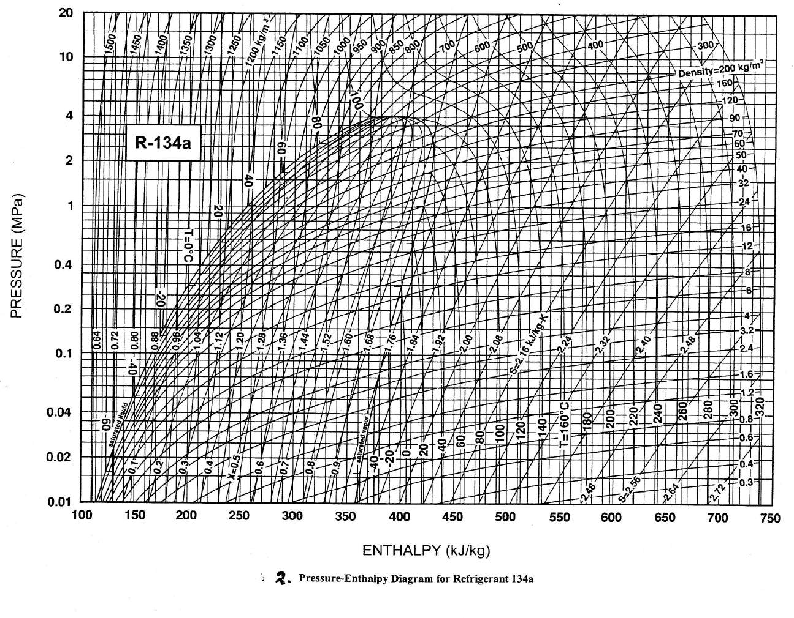

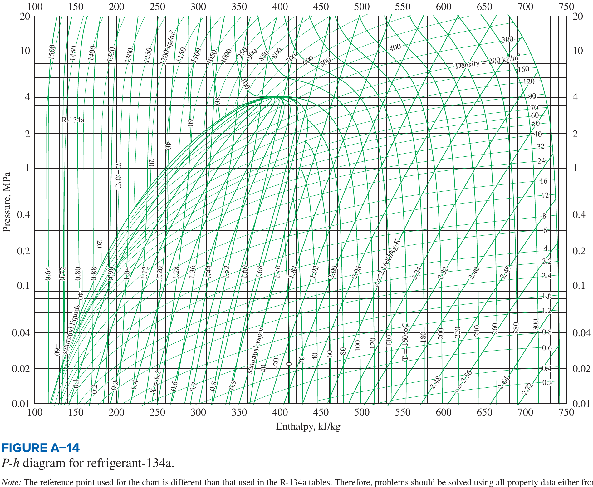

## D6. Ammonia (R717): saturated

**Data Book Table 3 (p.12). Saturated ammonia (liquid–vapour): temperature table**

Moran & Shapiro Table A-13. Datum: $h=s=0$ for saturated liquid at $-40$ °C. Do not mix with the NH$_3$ p-h chart (different datum).

| $T$ °C | $p$ bar | $v_f\times10^3$ m$^3$/kg | $v_g$ m$^3$/kg | $u_f$ kJ/kg | $u_g$ kJ/kg | $h_f$ kJ/kg | $h_{fg}$ kJ/kg | $h_g$ kJ/kg | $s_f$ kJ/kgK | $s_g$ kJ/kgK |
|---|---|---|---|---|---|---|---|---|---|---|
| -50 | 0.4086 | 1.4245 | 2.6265 | -43.94 | 1264.99 | -43.88 | 1416.20 | 1372.32 | -0.1922 | 6.1543 |
| -45 | 0.5453 | 1.4367 | 2.0060 | -22.03 | 1271.19 | -21.95 | 1402.52 | 1380.57 | -0.0951 | 6.0523 |
| -40 | 0.7174 | 1.4493 | 1.5524 | -0.10 | 1277.20 | 0.00 | 1388.56 | 1388.56 | 0.0000 | 5.9557 |
| -36 | 0.8850 | 1.4597 | 1.2757 | 17.47 | 1281.87 | 17.60 | 1377.17 | 1394.77 | 0.0747 | 5.8819 |
| -32 | 1.0832 | 1.4703 | 1.0561 | 35.09 | 1286.41 | 35.25 | 1365.55 | 1400.81 | 0.1484 | 5.8111 |
| -30 | 1.1950 | 1.4757 | 0.9634 | 43.93 | 1288.63 | 44.10 | 1359.65 | 1403.75 | 0.1849 | 5.7767 |
| -28 | 1.3159 | 1.4812 | 0.8803 | 52.78 | 1290.82 | 52.97 | 1353.68 | 1406.66 | 0.2212 | 5.7430 |
| -26 | 1.4465 | 1.4867 | 0.8056 | 61.65 | 1292.97 | 61.86 | 1347.65 | 1409.51 | 0.2572 | 5.7100 |
| -22 | 1.7390 | 1.4980 | 0.6780 | 79.46 | 1297.18 | 79.72 | 1335.36 | 1415.08 | 0.3287 | 5.6457 |
| -20 | 1.9019 | 1.5038 | 0.6233 | 88.40 | 1299.23 | 88.68 | 1329.10 | 1417.79 | 0.3642 | 5.6144 |
| -18 | 2.0769 | 1.5096 | 0.5739 | 97.36 | 1301.25 | 97.68 | 1322.77 | 1420.45 | 0.3994 | 5.5837 |
| -16 | 2.2644 | 1.5155 | 0.5291 | 106.36 | 1303.23 | 106.70 | 1316.35 | 1423.05 | 0.4346 | 5.5536 |
| -14 | 2.4652 | 1.5215 | 0.4885 | 115.37 | 1305.17 | 115.75 | 1309.86 | 1425.61 | 0.4695 | 5.5239 |
| -12 | 2.6798 | 1.5276 | 0.4516 | 124.42 | 1307.08 | 124.83 | 1303.28 | 1428.11 | 0.5043 | 5.4948 |
| -10 | 2.9089 | 1.5338 | 0.4180 | 133.50 | 1308.95 | 133.94 | 1296.61 | 1430.55 | 0.5389 | 5.4662 |
| -8 | 3.1532 | 1.5400 | 0.3874 | 142.60 | 1310.78 | 143.09 | 1289.86 | 1432.95 | 0.5734 | 5.4380 |
| -6 | 3.4134 | 1.5464 | 0.3595 | 151.74 | 1312.57 | 152.26 | 1283.02 | 1435.28 | 0.6077 | 5.4103 |
| -4 | 3.6901 | 1.5528 | 0.3340 | 160.88 | 1314.32 | 161.46 | 1276.10 | 1437.56 | 0.6418 | 5.3831 |
| -2 | 3.9842 | 1.5594 | 0.3106 | 170.07 | 1316.04 | 170.69 | 1269.08 | 1439.78 | 0.6759 | 5.3562 |
| 0 | 4.2962 | 1.5660 | 0.2892 | 179.29 | 1317.71 | 179.96 | 1261.97 | 1441.94 | 0.7097 | 5.3298 |
| 2 | 4.6270 | 1.5727 | 0.2695 | 188.53 | 1319.34 | 189.26 | 1254.77 | 1444.03 | 0.7435 | 5.3038 |
| 4 | 4.9773 | 1.5796 | 0.2514 | 197.80 | 1320.92 | 198.59 | 1247.48 | 1446.07 | 0.7770 | 5.2781 |
| 6 | 5.3479 | 1.5866 | 0.2348 | 207.10 | 1322.47 | 207.95 | 1240.09 | 1448.04 | 0.8105 | 5.2529 |
| 8 | 5.7395 | 1.5936 | 0.2195 | 216.42 | 1323.96 | 217.34 | 1232.61 | 1449.94 | 0.8438 | 5.2279 |
| 10 | 6.1529 | 1.6008 | 0.2054 | 225.77 | 1325.42 | 226.75 | 1225.03 | 1451.78 | 0.8769 | 5.2033 |
| 12 | 6.5890 | 1.6081 | 0.1923 | 235.14 | 1326.82 | 236.20 | 1217.35 | 1453.55 | 0.9099 | 5.1791 |
| 16 | 7.5324 | 1.6231 | 0.1691 | 253.95 | 1329.48 | 255.18 | 1201.70 | 1456.87 | 0.9755 | 5.1314 |
| 20 | 8.5762 | 1.6386 | 0.1492 | 272.86 | 1331.94 | 274.26 | 1185.64 | 1459.90 | 1.0404 | 5.0849 |
| 24 | 9.7274 | 1.6547 | 0.1320 | 291.84 | 1334.19 | 293.45 | 1169.16 | 1462.61 | 1.1048 | 5.0394 |
| 28 | 10.993 | 1.6714 | 0.1172 | 310.92 | 1336.20 | 312.75 | 1152.24 | 1465.00 | 1.1686 | 4.9948 |
| 32 | 12.380 | 1.6887 | 0.1043 | 330.07 | 1337.97 | 332.17 | 1134.87 | 1467.03 | 1.2319 | 4.9509 |
| 36 | 13.896 | 1.7068 | 0.0930 | 349.32 | 1339.47 | 351.69 | 1117.00 | 1468.70 | 1.2946 | 4.9078 |
| 40 | 15.549 | 1.7256 | 0.0831 | 368.67 | 1340.70 | 371.35 | 1098.62 | 1469.97 | 1.3569 | 4.8652 |
| 45 | 17.819 | 1.7503 | 0.0725 | 393.01 | 1341.81 | 396.13 | 1074.84 | 1470.96 | 1.4341 | 4.8125 |
| 50 | 20.331 | 1.7765 | 0.0634 | 417.56 | 1342.42 | 421.17 | 1050.09 | 1471.26 | 1.5109 | 4.7604 |

## D7. Ammonia: superheated vapour

**Data Book (pp.13–16). Superheated ammonia vapour**

Moran & Shapiro Table A-15, same datum as Table 3.

**0.4 bar, Tsat -50.36 °C**

| $T$ °C | $v$ m$^3$/kg | $u$ kJ/kg | $h$ kJ/kg | $s$ kJ/kgK |
|---|---|---|---|---|
| Sat | 2.6795 | 1264.54 | 1371.72 | 6.1618 |
| -50 | 2.6841 | 1265.11 | 1372.48 | 6.1652 |
| -45 | 2.7481 | 1273.05 | 1382.98 | 6.2118 |
| -40 | 2.8118 | 1281.01 | 1393.48 | 6.2573 |
| -35 | 2.8753 | 1288.96 | 1403.98 | 6.3018 |
| -30 | 2.9385 | 1296.93 | 1414.47 | 6.3455 |
| -25 | 3.0015 | 1304.90 | 1424.96 | 6.3882 |
| -20 | 3.0644 | 1312.88 | 1435.46 | 6.4300 |
| -15 | 3.1271 | 1320.87 | 1445.95 | 6.4711 |
| -10 | 3.1896 | 1328.87 | 1456.45 | 6.5114 |
| -5 | 3.2520 | 1336.88 | 1466.95 | 6.5509 |
| 0 | 3.3142 | 1344.90 | 1477.47 | 6.5898 |
| 5 | 3.3764 | 1352.95 | 1488.00 | 6.6280 |

**0.6 bar, Tsat -43.28 °C**

| $T$ °C | $v$ m$^3$/kg | $u$ kJ/kg | $h$ kJ/kg | $s$ kJ/kgK |
|---|---|---|---|---|
| Sat | 1.8345 | 1273.27 | 1383.34 | 6.0186 |
| -40 | 1.8630 | 1278.62 | 1390.40 | 6.0490 |
| -35 | 1.9061 | 1286.75 | 1401.12 | 6.0946 |
| -30 | 1.9491 | 1294.88 | 1411.83 | 6.1390 |
| -25 | 1.9918 | 1303.01 | 1422.52 | 6.1826 |
| -20 | 2.0343 | 1311.13 | 1433.19 | 6.2251 |
| -15 | 2.0766 | 1319.25 | 1443.85 | 6.2668 |
| -10 | 2.1188 | 1327.37 | 1454.50 | 6.3077 |
| -5 | 2.1609 | 1335.49 | 1465.14 | 6.3478 |
| 0 | 2.2028 | 1343.61 | 1475.78 | 6.3871 |
| 5 | 2.2446 | 1351.75 | 1486.43 | 6.4257 |

**0.8 bar, Tsat -37.94 °C**

| $T$ °C | $v$ m$^3$/kg | $u$ kJ/kg | $h$ kJ/kg | $s$ kJ/kgK |
|---|---|---|---|---|
| Sat | 1.4021 | 1279.61 | 1391.78 | 5.9174 |
| -35 | 1.4215 | 1284.51 | 1398.23 | 5.9446 |
| -30 | 1.4543 | 1292.81 | 1409.15 | 5.9900 |
| -25 | 1.4868 | 1301.09 | 1420.04 | 6.0343 |
| -20 | 1.5192 | 1309.36 | 1430.90 | 6.0777 |
| -15 | 1.5514 | 1317.61 | 1441.72 | 6.1200 |
| -10 | 1.5834 | 1325.85 | 1452.53 | 6.1615 |
| -5 | 1.6153 | 1334.09 | 1463.31 | 6.2021 |
| 0 | 1.6471 | 1342.31 | 1474.08 | 6.2419 |
| 5 | 1.6788 | 1350.54 | 1484.84 | 6.2809 |
| 10 | 1.7103 | 1358.77 | 1495.60 | 6.3192 |
| 15 | 1.7418 | 1367.01 | 1506.35 | 6.3568 |
| 20 | 1.7732 | 1375.25 | 1517.10 | 6.3939 |

**1.0 bar, Tsat -33.60 °C**

| $T$ °C | $v$ m$^3$/kg | $u$ kJ/kg | $h$ kJ/kg | $s$ kJ/kgK |
|---|---|---|---|---|
| Sat | 1.1381 | 1284.61 | 1398.41 | 5.8391 |
| -30 | 1.1573 | 1290.71 | 1406.44 | 5.8723 |
| -25 | 1.1838 | 1299.15 | 1417.53 | 5.9175 |
| -20 | 1.2101 | 1307.57 | 1428.58 | 5.9616 |
| -15 | 1.2362 | 1315.96 | 1439.58 | 6.0046 |
| -10 | 1.2621 | 1324.33 | 1450.54 | 6.0467 |
| -5 | 1.2880 | 1332.67 | 1461.47 | 6.0878 |
| 0 | 1.3136 | 1341.00 | 1472.37 | 6.1281 |
| 5 | 1.3392 | 1349.33 | 1483.25 | 6.1676 |
| 10 | 1.3647 | 1357.64 | 1494.11 | 6.2063 |
| 15 | 1.3900 | 1365.95 | 1504.96 | 6.2442 |
| 20 | 1.4153 | 1374.27 | 1515.80 | 6.2816 |

**1.5 bar, Tsat -25.22 °C**

| $T$ °C | $v$ m$^3$/kg | $u$ kJ/kg | $h$ kJ/kg | $s$ kJ/kgK |
|---|---|---|---|---|
| Sat | 0.7787 | 1293.80 | 1410.61 | 5.6973 |
| -25 | 0.7795 | 1294.20 | 1411.13 | 5.6994 |
| -20 | 0.7978 | 1303.00 | 1422.67 | 5.7454 |
| -15 | 0.8158 | 1311.75 | 1434.12 | 5.7902 |
| -10 | 0.8336 | 1320.44 | 1445.49 | 5.8338 |
| -5 | 0.8514 | 1329.08 | 1456.79 | 5.8764 |
| 0 | 0.8689 | 1337.68 | 1468.02 | 5.9179 |
| 5 | 0.8864 | 1346.25 | 1479.20 | 5.9585 |
| 10 | 0.9037 | 1354.78 | 1490.34 | 5.9981 |
| 15 | 0.9210 | 1363.29 | 1501.44 | 6.0370 |
| 20 | 0.9382 | 1371.79 | 1512.51 | 6.0751 |
| 25 | 0.9553 | 1380.28 | 1523.56 | 6.1125 |
| 30 | 0.9723 | 1388.76 | 1534.60 | 6.1492 |

**2.0 bar, Tsat -18.86 °C**

| $T$ °C | $v$ m$^3$/kg | $u$ kJ/kg | $h$ kJ/kg | $s$ kJ/kgK |
|---|---|---|---|---|
| Sat | 0.59460 | 1300.39 | 1419.31 | 5.5969 |
| -15 | 0.60542 | 1307.43 | 1428.51 | 5.6328 |
| -10 | 0.61926 | 1316.46 | 1440.31 | 5.6781 |
| -5 | 0.63294 | 1325.41 | 1452.00 | 5.7221 |
| 0 | 0.64648 | 1334.29 | 1463.59 | 5.7649 |
| 5 | 0.65989 | 1343.11 | 1475.09 | 5.8066 |
| 10 | 0.67320 | 1351.87 | 1486.51 | 5.8473 |
| 15 | 0.68640 | 1360.59 | 1497.87 | 5.8871 |
| 20 | 0.69952 | 1369.28 | 1509.18 | 5.9260 |
| 25 | 0.71256 | 1377.93 | 1520.44 | 5.9641 |
| 30 | 0.72553 | 1386.56 | 1531.67 | 6.0014 |

**2.5 bar, Tsat -13.67 °C**

| $T$ °C | $v$ m$^3$/kg | $u$ kJ/kg | $h$ kJ/kg | $s$ kJ/kgK |
|---|---|---|---|---|
| Sat | 0.48213 | 1305.49 | 1426.03 | 5.5190 |
| -10 | 0.49051 | 1312.37 | 1435.00 | 5.5534 |
| -5 | 0.50180 | 1321.65 | 1447.10 | 5.5989 |
| 0 | 0.51293 | 1330.83 | 1459.06 | 5.6431 |
| 5 | 0.52393 | 1339.91 | 1470.89 | 5.6860 |
| 10 | 0.53482 | 1348.91 | 1482.61 | 5.7278 |
| 15 | 0.54560 | 1357.84 | 1494.25 | 5.7685 |
| 20 | 0.55630 | 1366.72 | 1505.80 | 5.8083 |
| 25 | 0.56691 | 1375.55 | 1517.28 | 5.8471 |
| 30 | 0.57745 | 1384.34 | 1528.70 | 5.8851 |
| 35 | 0.58793 | 1393.10 | 1540.08 | 5.9223 |
| 40 | 0.59835 | 1401.84 | 1551.42 | 5.9589 |
| 45 | 0.60872 | 1410.56 | 1562.74 | 5.9947 |

**3.0 bar, Tsat -9.24 °C**

| $T$ °C | $v$ m$^3$/kg | $u$ kJ/kg | $h$ kJ/kg | $s$ kJ/kgK | flag |
|---|---|---|---|---|---|
| Sat | 0.40607 | 1309.65 | 1431.47 | 5.4554 | s_last_digit_cut_off_in_scan;value_from_Moran_A-15 |
| -5 | 0.41428 | 1317.80 | 1442.08 | 5.4953 | s_last_digit_cut_off_in_scan;value_from_Moran_A-15 |
| 0 | 0.42382 | 1327.28 | 1454.43 | 5.5409 | s_last_digit_cut_off_in_scan;value_from_Moran_A-15 |
| 5 | 0.43323 | 1336.64 | 1466.61 | 5.5851 | s_last_digit_cut_off_in_scan;value_from_Moran_A-15 |
| 10 | 0.44251 | 1345.89 | 1478.65 | 5.6280 | s_last_digit_cut_off_in_scan;value_from_Moran_A-15 |
| 15 | 0.45169 | 1355.05 | 1490.56 | 5.6697 | s_last_digit_cut_off_in_scan;value_from_Moran_A-15 |
| 20 | 0.46078 | 1364.13 | 1502.36 | 5.7103 | s_last_digit_cut_off_in_scan;value_from_Moran_A-15 |
| 25 | 0.46978 | 1373.14 | 1514.07 | 5.7499 | s_last_digit_cut_off_in_scan;value_from_Moran_A-15 |
| 30 | 0.47870 | 1382.09 | 1525.70 | 5.7886 | s_last_digit_cut_off_in_scan;value_from_Moran_A-15 |
| 35 | 0.48756 | 1391.00 | 1537.26 | 5.8264 | s_last_digit_cut_off_in_scan;value_from_Moran_A-15 |
| 40 | 0.49637 | 1399.86 | 1548.77 | 5.8635 | s_last_digit_cut_off_in_scan;value_from_Moran_A-15 |
| 45 | 0.50512 | 1408.70 | 1560.24 | 5.8998 | s_last_digit_cut_off_in_scan;value_from_Moran_A-15 |

**3.5 bar, Tsat -5.36 °C**

| $T$ °C | $v$ m$^3$/kg | $u$ kJ/kg | $h$ kJ/kg | $s$ kJ/kgK |
|---|---|---|---|---|
| Sat | 0.35108 | 1313.14 | 1436.01 | 5.4016 |
| 0 | 0.36011 | 1323.66 | 1449.70 | 5.4522 |
| 10 | 0.37654 | 1342.82 | 1474.61 | 5.5417 |
| 20 | 0.39251 | 1361.49 | 1498.87 | 5.6259 |
| 30 | 0.40814 | 1379.81 | 1522.66 | 5.7057 |
| 40 | 0.42350 | 1397.87 | 1546.09 | 5.7818 |
| 60 | 0.45363 | 1433.55 | 1592.32 | 5.9249 |
| 80 | 0.48320 | 1469.06 | 1638.18 | 6.0586 |
| 100 | 0.51240 | 1504.73 | 1684.07 | 6.1850 |
| 120 | 0.54136 | 1540.79 | 1730.26 | 6.3056 |
| 140 | 0.57013 | 1577.38 | 1776.92 | 6.4213 |
| 160 | 0.59876 | 1614.60 | 1824.16 | 6.5330 |
| 180 | 0.62728 | 1652.51 | 1872.06 | 6.6411 |
| 200 | 0.65572 | 1691.15 | 1920.65 | 6.7460 |

**4.0 bar, Tsat -1.90 °C**

| $T$ °C | $v$ m$^3$/kg | $u$ kJ/kg | $h$ kJ/kg | $s$ kJ/kgK |
|---|---|---|---|---|
| Sat | 0.30942 | 1316.12 | 1439.89 | 5.3548 |
| 0 | 0.31227 | 1319.95 | 1444.86 | 5.3731 |
| 10 | 0.32701 | 1339.68 | 1470.49 | 5.4652 |
| 20 | 0.34129 | 1358.81 | 1495.33 | 5.5515 |
| 30 | 0.35520 | 1377.49 | 1519.57 | 5.6328 |
| 40 | 0.36884 | 1395.85 | 1543.38 | 5.7101 |
| 60 | 0.39550 | 1431.97 | 1590.17 | 5.8549 |
| 80 | 0.42160 | 1467.77 | 1636.41 | 5.9897 |
| 100 | 0.44733 | 1503.64 | 1682.58 | 6.1169 |
| 120 | 0.47280 | 1539.85 | 1728.97 | 6.2380 |
| 140 | 0.49808 | 1576.55 | 1775.79 | 6.3541 |
| 160 | 0.52323 | 1613.86 | 1823.16 | 6.4661 |
| 180 | 0.54827 | 1651.85 | 1871.16 | 6.5744 |
| 200 | 0.57322 | 1690.56 | 1919.85 | 6.6796 |

**4.5 bar, Tsat 1.25 °C**

| $T$ °C | $v$ m$^3$/kg | $u$ kJ/kg | $h$ kJ/kg | $s$ kJ/kgK |
|---|---|---|---|---|
| Sat | 0.27671 | 1318.73 | 1443.25 | 5.3135 |
| 10 | 0.28846 | 1336.48 | 1466.29 | 5.3962 |
| 20 | 0.30142 | 1356.09 | 1491.72 | 5.4845 |
| 30 | 0.31401 | 1375.15 | 1516.45 | 5.5674 |
| 40 | 0.32631 | 1393.80 | 1540.64 | 5.6460 |
| 60 | 0.35029 | 1430.37 | 1588.00 | 5.7926 |
| 80 | 0.37369 | 1466.47 | 1634.63 | 5.9285 |
| 100 | 0.39671 | 1502.55 | 1681.07 | 6.0564 |
| 120 | 0.41947 | 1538.91 | 1727.67 | 6.1781 |
| 140 | 0.44205 | 1575.73 | 1774.65 | 6.2946 |
| 160 | 0.46448 | 1613.13 | 1822.15 | 6.4069 |
| 180 | 0.48681 | 1651.20 | 1870.26 | 6.5155 |
| 200 | 0.50905 | 1689.97 | 1919.04 | 6.6208 |

**5.0 bar, Tsat 4.13 °C**

| $T$ °C | $v$ m$^3$/kg | $u$ kJ/kg | $h$ kJ/kg | $s$ kJ/kgK |
|---|---|---|---|---|
| Sat | 0.25034 | 1321.02 | 1446.19 | 5.2765 |
| 10 | 0.25757 | 1333.22 | 1462.00 | 5.3330 |
| 20 | 0.26949 | 1353.32 | 1488.06 | 5.4234 |
| 30 | 0.28103 | 1372.76 | 1513.28 | 5.5080 |
| 40 | 0.29227 | 1391.74 | 1537.87 | 5.5878 |
| 60 | 0.31410 | 1428.76 | 1585.81 | 5.7362 |
| 80 | 0.33535 | 1465.16 | 1632.84 | 5.8733 |
| 100 | 0.35621 | 1501.46 | 1679.56 | 6.0020 |
| 120 | 0.37681 | 1537.97 | 1726.37 | 6.1242 |
| 140 | 0.39722 | 1574.90 | 1773.51 | 6.2412 |
| 160 | 0.41749 | 1612.40 | 1821.14 | 6.3537 |
| 180 | 0.43765 | 1650.54 | 1869.36 | 6.4626 |
| 200 | 0.45771 | 1689.38 | 1918.24 | 6.5681 |

**5.5 bar, Tsat 6.79 °C**

| $T$ °C | $v$ m$^3$/kg | $u$ kJ/kg | $h$ kJ/kg | $s$ kJ/kgK |
|---|---|---|---|---|
| Sat | 0.22861 | 1323.06 | 1448.80 | 5.2430 |
| 10 | 0.23227 | 1329.88 | 1457.63 | 5.2743 |
| 20 | 0.24335 | 1350.50 | 1484.34 | 5.3671 |
| 30 | 0.25403 | 1370.35 | 1510.07 | 5.4534 |
| 40 | 0.26441 | 1389.64 | 1535.07 | 5.5345 |
| 50 | 0.27454 | 1408.53 | 1559.53 | 5.6114 |
| 60 | 0.28449 | 1427.13 | 1583.60 | 5.6848 |
| 80 | 0.30398 | 1463.85 | 1631.04 | 5.8230 |
| 100 | 0.32307 | 1500.36 | 1678.05 | 5.9525 |
| 120 | 0.34190 | 1537.02 | 1725.07 | 6.0753 |
| 140 | 0.36054 | 1574.07 | 1772.37 | 6.1926 |
| 160 | 0.37903 | 1611.66 | 1820.13 | 6.3055 |
| 180 | 0.39742 | 1649.88 | 1868.46 | 6.4146 |
| 200 | 0.41571 | 1688.79 | 1917.43 | 6.5203 |

**6.0 bar, Tsat 9.27 °C**

| $T$ °C | $v$ m$^3$/kg | $u$ kJ/kg | $h$ kJ/kg | $s$ kJ/kgK |
|---|---|---|---|---|
| Sat | 0.21038 | 1324.89 | 1451.12 | 5.2122 |
| 10 | 0.21115 | 1326.47 | 1453.16 | 5.2195 |
| 20 | 0.22155 | 1347.62 | 1480.55 | 5.3145 |
| 30 | 0.23152 | 1367.90 | 1506.81 | 5.4026 |
| 40 | 0.24118 | 1387.52 | 1532.23 | 5.4851 |
| 50 | 0.25059 | 1406.67 | 1557.03 | 5.5631 |
| 60 | 0.25981 | 1425.49 | 1581.38 | 5.6373 |
| 80 | 0.27783 | 1462.52 | 1629.22 | 5.7768 |
| 100 | 0.29546 | 1499.25 | 1676.52 | 5.9071 |
| 120 | 0.31281 | 1536.07 | 1723.76 | 6.0304 |
| 140 | 0.32997 | 1573.24 | 1771.22 | 6.1481 |
| 160 | 0.34699 | 1610.92 | 1819.12 | 6.2613 |
| 180 | 0.36390 | 1649.22 | 1867.56 | 6.3707 |
| 200 | 0.38071 | 1688.20 | 1916.63 | 6.4766 |

**7.0 bar, Tsat 13.79 °C**

| $T$ °C | $v$ m$^3$/kg | $u$ kJ/kg | $h$ kJ/kg | $s$ kJ/kgK |
|---|---|---|---|---|
| Sat | 0.18148 | 1328.04 | 1455.07 | 5.1576 |
| 20 | 0.18721 | 1341.72 | 1472.77 | 5.2186 |
| 30 | 0.19610 | 1362.88 | 1500.15 | 5.3104 |
| 40 | 0.20464 | 1383.20 | 1526.45 | 5.3958 |
| 50 | 0.21293 | 1402.90 | 1551.95 | 5.4760 |
| 60 | 0.22101 | 1422.16 | 1576.87 | 5.5519 |
| 80 | 0.23674 | 1459.85 | 1625.56 | 5.6939 |
| 100 | 0.25205 | 1497.02 | 1673.46 | 5.8258 |
| 120 | 0.26709 | 1534.16 | 1721.12 | 5.9502 |
| 140 | 0.28193 | 1571.57 | 1768.92 | 6.0688 |
| 160 | 0.29663 | 1609.44 | 1817.08 | 6.1826 |
| 180 | 0.31121 | 1647.90 | 1865.75 | 6.2925 |
| 200 | 0.32571 | 1687.02 | 1915.01 | 6.3988 |

**8.0 bar, Tsat 17.84 °C**

| $T$ °C | $v$ m$^3$/kg | $u$ kJ/kg | $h$ kJ/kg | $s$ kJ/kgK |
|---|---|---|---|---|
| Sat | 0.15958 | 1330.64 | 1458.30 | 5.1099 |
| 20 | 0.16138 | 1335.59 | 1464.70 | 5.1318 |
| 30 | 0.16948 | 1357.71 | 1493.29 | 5.2277 |
| 40 | 0.17720 | 1378.77 | 1520.53 | 5.3161 |
| 50 | 0.18465 | 1399.05 | 1546.77 | 5.3986 |
| 60 | 0.19189 | 1418.77 | 1572.28 | 5.4763 |
| 80 | 0.20590 | 1457.14 | 1621.86 | 5.6209 |
| 100 | 0.21949 | 1494.77 | 1670.37 | 5.7545 |
| 120 | 0.23280 | 1532.24 | 1718.48 | 5.8801 |
| 140 | 0.24590 | 1569.89 | 1766.61 | 5.9995 |
| 160 | 0.25886 | 1607.96 | 1815.04 | 6.1140 |
| 180 | 0.27170 | 1646.57 | 1863.94 | 6.2243 |
| 200 | 0.28445 | 1685.83 | 1913.39 | 6.3311 |

**9.0 bar, Tsat 21.52 °C**

| $T$ °C | $v$ m$^3$/kg | $u$ kJ/kg | $h$ kJ/kg | $s$ kJ/kgK |
|---|---|---|---|---|
| Sat | 0.14239 | 1332.82 | 1460.97 | 5.0675 |
| 30 | 0.14872 | 1352.36 | 1486.20 | 5.1520 |
| 40 | 0.15582 | 1374.21 | 1514.45 | 5.2436 |
| 50 | 0.16263 | 1395.11 | 1541.47 | 5.3286 |
| 60 | 0.16922 | 1415.32 | 1567.61 | 5.4083 |
| 80 | 0.18191 | 1454.39 | 1618.11 | 5.5555 |
| 100 | 0.19416 | 1492.50 | 1667.24 | 5.6908 |
| 120 | 0.20612 | 1530.30 | 1715.81 | 5.8176 |
| 140 | 0.21788 | 1568.20 | 1764.29 | 5.9379 |
| 160 | 0.22948 | 1606.46 | 1813.00 | 6.0530 |
| 180 | 0.24097 | 1645.24 | 1862.12 | 6.1639 |
| 200 | 0.25237 | 1684.64 | 1911.77 | 6.2711 |

**10.0 bar, Tsat 24.89 °C**

| $T$ °C | $v$ m$^3$/kg | $u$ kJ/kg | $h$ kJ/kg | $s$ kJ/kgK |
|---|---|---|---|---|
| Sat | 0.12852 | 1334.66 | 1463.18 | 5.0294 |
| 30 | 0.13206 | 1346.82 | 1478.88 | 5.0816 |
| 40 | 0.13868 | 1369.52 | 1508.20 | 5.1768 |
| 50 | 0.14499 | 1391.07 | 1536.06 | 5.2644 |
| 60 | 0.15106 | 1411.79 | 1562.86 | 5.3460 |
| 80 | 0.16270 | 1451.60 | 1614.31 | 5.4960 |
| 100 | 0.17389 | 1490.20 | 1664.10 | 5.6332 |
| 120 | 0.18478 | 1528.35 | 1713.13 | 5.7612 |
| 140 | 0.19545 | 1566.51 | 1761.96 | 5.8823 |
| 160 | 0.20598 | 1604.97 | 1810.94 | 5.9981 |
| 180 | 0.21638 | 1643.91 | 1860.29 | 6.1095 |
| 200 | 0.22670 | 1683.44 | 1910.14 | 6.2171 |

**12.0 bar, Tsat 30.94 °C**

| $T$ °C | $v$ m$^3$/kg | $u$ kJ/kg | $h$ kJ/kg | $s$ kJ/kgK |
|---|---|---|---|---|
| Sat | 0.10751 | 1337.52 | 1466.53 | 4.9625 |
| 40 | 0.11287 | 1359.73 | 1495.18 | 5.0553 |
| 60 | 0.12378 | 1404.54 | 1553.07 | 5.2347 |
| 80 | 0.13387 | 1445.91 | 1606.56 | 5.3906 |
| 100 | 0.14347 | 1485.55 | 1657.71 | 5.5315 |
| 120 | 0.15275 | 1524.41 | 1707.71 | 5.6620 |
| 140 | 0.16181 | 1563.09 | 1757.26 | 5.7850 |
| 160 | 0.17072 | 1601.95 | 1806.81 | 5.9021 |
| 180 | 0.17950 | 1641.23 | 1856.63 | 6.0145 |
| 200 | 0.18819 | 1681.05 | 1906.87 | 6.1230 |
| 220 | 0.19680 | 1721.50 | 1957.66 | 6.2282 |
| 240 | 0.20534 | 1762.63 | 2009.04 | 6.3303 |
| 260 | 0.21382 | 1804.48 | 2061.06 | 6.4297 |
| 280 | 0.22225 | 1847.04 | 2113.74 | 6.5267 |

**14.0 bar, Tsat 36.26 °C**

| $T$ °C | $v$ m$^3$/kg | $u$ kJ/kg | $h$ kJ/kg | $s$ kJ/kgK |
|---|---|---|---|---|
| Sat | 0.09231 | 1339.56 | 1468.79 | 4.9050 |
| 40 | 0.09432 | 1349.29 | 1481.33 | 4.9453 |
| 60 | 0.10423 | 1396.97 | 1542.89 | 5.1360 |
| 80 | 0.11324 | 1440.06 | 1598.59 | 5.2984 |
| 100 | 0.12172 | 1480.79 | 1651.20 | 5.4433 |
| 120 | 0.12986 | 1520.41 | 1702.21 | 5.5765 |
| 140 | 0.13777 | 1559.63 | 1752.52 | 5.7013 |
| 160 | 0.14552 | 1598.92 | 1802.65 | 5.8198 |
| 180 | 0.15315 | 1638.53 | 1852.94 | 5.9333 |
| 200 | 0.16068 | 1678.64 | 1903.59 | 6.0427 |
| 220 | 0.16813 | 1719.35 | 1954.73 | 6.1485 |
| 240 | 0.17551 | 1760.72 | 2006.43 | 6.2513 |
| 260 | 0.18283 | 1802.78 | 2058.75 | 6.3513 |
| 280 | 0.19010 | 1845.55 | 2111.69 | 6.4488 |

**16.0 bar, Tsat 41.03 °C**

| $T$ °C | $v$ m$^3$/kg | $u$ kJ/kg | $h$ kJ/kg | $s$ kJ/kgK |
|---|---|---|---|---|
| Sat | 0.08079 | 1340.97 | 1470.23 | 4.8542 |
| 60 | 0.08951 | 1389.06 | 1532.28 | 5.0461 |
| 80 | 0.09774 | 1434.02 | 1590.40 | 5.2156 |
| 100 | 0.10539 | 1475.93 | 1644.56 | 5.3648 |
| 120 | 0.11268 | 1516.34 | 1696.64 | 5.5008 |
| 140 | 0.11974 | 1556.14 | 1747.72 | 5.6276 |
| 160 | 0.12663 | 1595.85 | 1798.45 | 5.7475 |
| 180 | 0.13339 | 1635.81 | 1849.23 | 5.8621 |
| 200 | 0.14005 | 1676.21 | 1900.29 | 5.9723 |
| 220 | 0.14663 | 1717.18 | 1951.79 | 6.0789 |
| 240 | 0.15314 | 1758.79 | 2003.81 | 6.1823 |
| 260 | 0.15959 | 1801.07 | 2056.42 | 6.2829 |
| 280 | 0.16599 | 1844.05 | 2109.64 | 6.3809 |

**18.0 bar, Tsat 45.38 °C**

| $T$ °C | $v$ m$^3$/kg | $u$ kJ/kg | $h$ kJ/kg | $s$ kJ/kgK |
|---|---|---|---|---|
| Sat | 0.07174 | 1341.88 | 1471.01 | 4.8086 |
| 60 | 0.07801 | 1380.77 | 1521.19 | 4.9627 |
| 80 | 0.08565 | 1427.79 | 1581.97 | 5.1399 |
| 100 | 0.09267 | 1470.97 | 1637.78 | 5.2937 |
| 120 | 0.09931 | 1512.22 | 1690.98 | 5.4326 |
| 140 | 0.10570 | 1552.61 | 1742.88 | 5.5614 |
| 160 | 0.11192 | 1592.76 | 1794.23 | 5.6828 |
| 180 | 0.11801 | 1633.08 | 1845.50 | 5.7985 |
| 200 | 0.12400 | 1673.78 | 1896.98 | 5.9096 |
| 220 | 0.12991 | 1715.00 | 1948.83 | 6.0170 |
| 240 | 0.13574 | 1756.85 | 2001.18 | 6.1210 |
| 260 | 0.14152 | 1799.35 | 2054.08 | 6.2222 |
| 280 | 0.14724 | 1842.55 | 2107.58 | 6.3207 |

**20.0 bar, Tsat 49.37 °C**

| $T$ °C | $v$ m$^3$/kg | $u$ kJ/kg | $h$ kJ/kg | $s$ kJ/kgK |
|---|---|---|---|---|
| Sat | 0.06445 | 1342.37 | 1471.26 | 4.7670 |
| 60 | 0.06875 | 1372.05 | 1509.54 | 4.8838 |
| 80 | 0.07596 | 1421.36 | 1573.27 | 5.0696 |
| 100 | 0.08248 | 1465.89 | 1630.86 | 5.2283 |
| 120 | 0.08861 | 1508.03 | 1685.24 | 5.3703 |
| 140 | 0.09447 | 1549.03 | 1737.98 | 5.5012 |
| 160 | 0.10016 | 1589.65 | 1789.97 | 5.6241 |
| 180 | 0.10571 | 1630.32 | 1841.74 | 5.7409 |
| 200 | 0.11116 | 1671.33 | 1893.64 | 5.8530 |
| 220 | 0.11652 | 1712.82 | 1945.87 | 5.9611 |
| 240 | 0.12182 | 1754.90 | 1998.54 | 6.0658 |
| 260 | 0.12706 | 1797.63 | 2051.74 | 6.1675 |
| 280 | 0.13224 | 1841.03 | 2105.50 | 6.2665 |

## D8. Ammonia: pressure-enthalpy chart

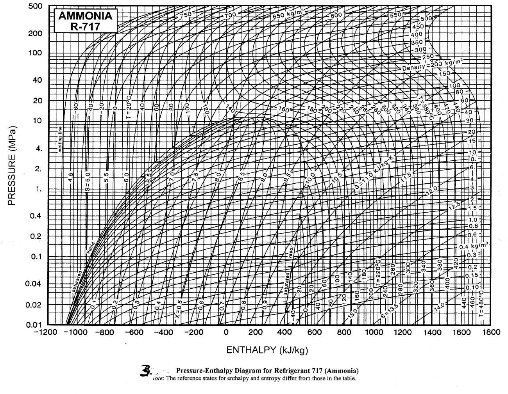

## D9. Lithium bromide-water solutions

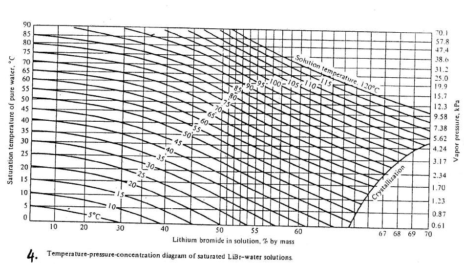

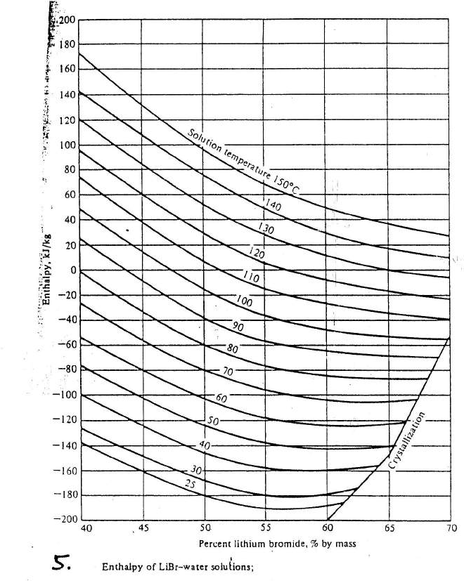

# Part II. Psychrometry

## D10. Psychrometric charts

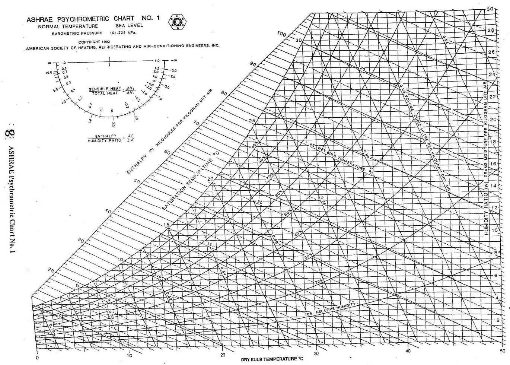

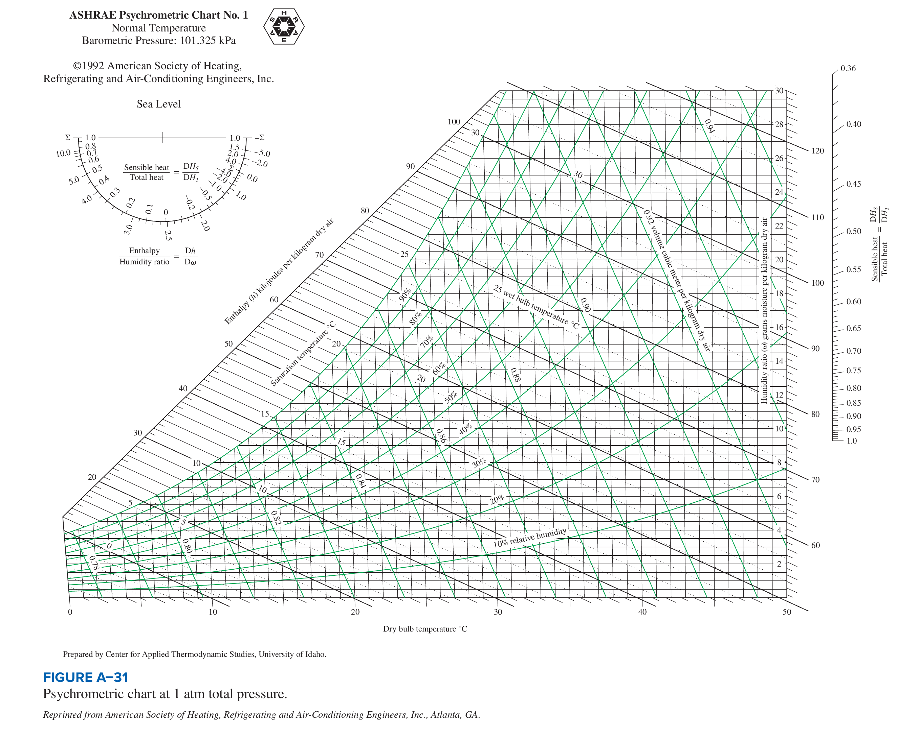

# Part III. Air distribution (ducts)

## D11. Friction chart for round ducts

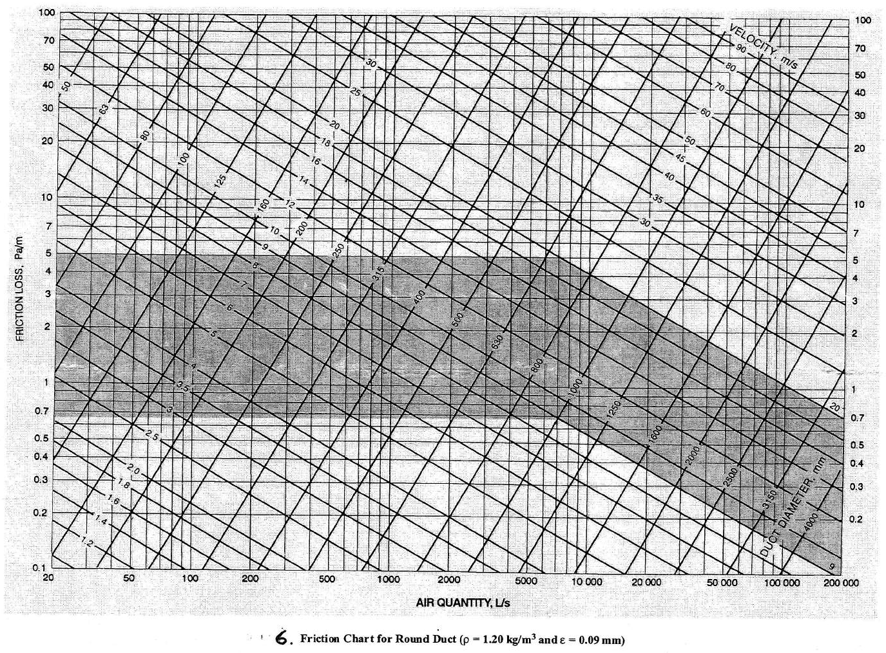

## D12. Fitting loss coefficients

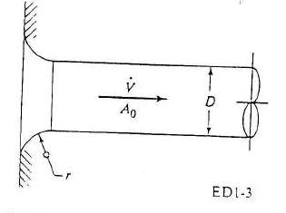

**Data Book Table 7. Bell-mouth inlet to a round duct (ED1-3): $C_o$**

| $r/D$ | $C_o$ |
|---|---|
| 0.00 | 0.50 |
| 0.01 | 0.44 |
| 0.02 | 0.37 |
| 0.03 | 0.31 |
| 0.04 | 0.26 |
| 0.05 | 0.22 |
| 0.06 | 0.20 |
| 0.08 | 0.15 |
| 0.10 | 0.12 |
| 0.12 | 0.09 |
| 0.16 | 0.06 |
| 0.20 | 0.03 |
| 10.00 | 0.03 |

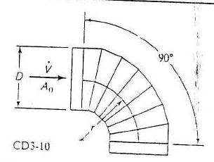

**Data Book Table 7. 90° pleated elbow, round, 7 sections, $r/D$ = 2.5 (CD3-10)**

| $D$ (in) | $D$ (mm) | $C_o$ |
|---|---|---|
| 3 | 75 | 0.16 |
| 6 | 150 | 0.12 |
| 9 | 230 | 0.10 |
| 12 | 300 | 0.08 |
| 15 | 380 | 0.07 |
| 18 | 450 | 0.06 |
| 27 | 690 | 0.05 |
| 60 | 1500 | 0.03 |

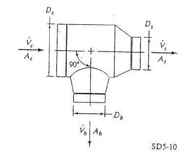

**Data Book Table 7. Diverging tee, round, conical branch (SD5-10): branch $C_b$**

| $A_b/A_c$ | $\dot V_b/\dot V_c$ = 0.1 | $\dot V_b/\dot V_c$ = 0.2 | $\dot V_b/\dot V_c$ = 0.3 | $\dot V_b/\dot V_c$ = 0.4 | $\dot V_b/\dot V_c$ = 0.5 | $\dot V_b/\dot V_c$ = 0.6 | $\dot V_b/\dot V_c$ = 0.7 | $\dot V_b/\dot V_c$ = 0.8 | $\dot V_b/\dot V_c$ = 0.9 |
|---|---|---|---|---|---|---|---|---|---|
| 0.1 | 0.65 | 0.24 |  |  |  |  |  |  |  |
| 0.2 | 2.98 | 0.65 | 0.33 | 0.24 | 0.18 |  |  |  |  |
| 0.3 | 7.36 | 1.56 | 0.65 | 0.39 | 0.29 | 0.24 | 0.20 |  |  |
| 0.4 | 13.78 | 2.98 | 1.20 | 0.65 | 0.43 | 0.33 | 0.27 | 0.24 | 0.21 |
| 0.5 | 22.24 | 4.92 | 1.98 | 1.04 | 0.65 | 0.47 | 0.36 | 0.30 | 0.26 |
| 0.6 | 32.73 | 7.36 | 2.98 | 1.56 | 0.96 | 0.65 | 0.49 | 0.39 | 0.33 |
| 0.7 | 45.26 | 10.32 | 4.21 | 2.21 | 1.34 | 0.90 | 0.65 | 0.51 | 0.42 |
| 0.8 | 59.82 | 13.78 | 5.67 | 2.98 | 1.80 | 1.20 | 0.86 | 0.65 | 0.52 |
| 0.9 | 76.41 | 17.75 | 7.36 | 3.88 | 2.35 | 1.56 | 1.11 | 0.83 | 0.65 |

**Data Book Table 7. Diverging tee (SD5-10): main (straight) $C_s$**

| $A_s/A_c$ | $\dot V_s/\dot V_c$ = 0.1 | $\dot V_s/\dot V_c$ = 0.2 | $\dot V_s/\dot V_c$ = 0.3 | $\dot V_s/\dot V_c$ = 0.4 | $\dot V_s/\dot V_c$ = 0.5 | $\dot V_s/\dot V_c$ = 0.6 | $\dot V_s/\dot V_c$ = 0.7 | $\dot V_s/\dot V_c$ = 0.8 | $\dot V_s/\dot V_c$ = 0.9 |
|---|---|---|---|---|---|---|---|---|---|
| 0.1 | 0.13 | 0.16 |  |  |  |  |  |  |  |
| 0.2 | 0.20 | 0.13 | 0.15 | 0.16 | 0.28 |  |  |  |  |
| 0.3 | 0.90 | 0.13 | 0.13 | 0.14 | 0.15 | 0.16 | 0.20 |  |  |
| 0.4 | 2.88 | 0.20 | 0.14 | 0.13 | 0.14 | 0.15 | 0.15 | 0.16 | 0.34 |
| 0.5 | 6.25 | 0.37 | 0.17 | 0.14 | 0.13 | 0.14 | 0.14 | 0.15 | 0.15 |
| 0.6 | 11.88 | 0.90 | 0.20 | 0.13 | 0.14 | 0.13 | 0.14 | 0.14 | 0.15 |
| 0.7 | 18.62 | 1.71 | 0.33 | 0.18 | 0.16 | 0.14 | 0.13 | 0.15 | 0.14 |
| 0.8 | 26.88 | 2.88 | 0.50 | 0.20 | 0.15 | 0.14 | 0.13 | 0.13 | 0.14 |
| 0.9 | 36.45 | 4.46 | 0.90 | 0.30 | 0.19 | 0.16 | 0.15 | 0.14 | 0.13 |

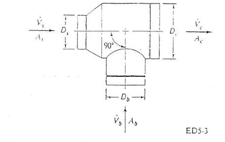

**Data Book Table 7. Converging tee, round, $D_c \ge$ 25 cm (ED5-3): branch $C_b$**

| $A_s/A_c$ | $A_b/A_c$ | $\dot V_b/\dot V_c$ = 0.1 | $\dot V_b/\dot V_c$ = 0.2 | $\dot V_b/\dot V_c$ = 0.3 | $\dot V_b/\dot V_c$ = 0.4 | $\dot V_b/\dot V_c$ = 0.5 | $\dot V_b/\dot V_c$ = 0.6 | $\dot V_b/\dot V_c$ = 0.7 | $\dot V_b/\dot V_c$ = 0.8 | $\dot V_b/\dot V_c$ = 0.9 |
|---|---|---|---|---|---|---|---|---|---|---|
| 0.5 | 0.2 | -7.26 | -0.62 | 0.43 | 0.75 | 0.86 | 0.91 | 0.93 | 0.93 | 0.90 |
| 0.5 | 0.3 | -16.99 | -2.35 | -0.07 | 0.57 | 0.80 | 0.89 | 0.91 | 0.90 | 0.87 |
| 0.5 | 0.4 | -30.49 | -4.67 | -0.72 | 0.38 | 0.76 | 0.89 | 0.92 | 0.90 | 0.85 |
| 0.5 | 0.5 | -47.82 | -7.61 | -1.50 | 0.19 | 0.75 | 0.93 | 0.97 | 0.93 | 0.85 |
| 0.5 | 0.6 | -69.03 | -11.17 | -2.42 | -0.03 | 0.76 | 1.01 | 1.05 | 0.98 | 0.88 |
| 0.5 | 0.7 | -94.17 | -15.37 | -3.49 | -0.26 | 0.80 | 1.13 | 1.17 | 1.07 | 0.93 |
| 0.5 | 0.8 | -123.30 | -20.22 | -4.71 | -0.50 | 0.87 | 1.29 | 1.33 | 1.20 | 1.02 |
| 0.5 | 0.9 | -156.48 | -25.73 | -6.09 | -0.77 | 0.96 | 1.48 | 1.53 | 1.36 | 1.13 |
| 0.5 | 1.0 | -193.74 | -31.92 | -7.63 | -1.07 | 1.06 | 1.71 | 1.77 | 1.56 | 1.28 |
| 1.0 | 0.2 | -1.54 | 0.39 | 0.74 | 0.87 | 0.92 | 0.95 | 0.97 | 0.99 | 1.03 |
| 1.0 | 0.3 | -3.75 | 0.03 | 0.64 | 0.83 | 0.90 | 0.94 | 0.97 | 1.00 | 1.08 |
| 1.0 | 0.4 | -6.57 | -0.32 | 0.61 | 0.85 | 0.93 | 0.97 | 0.99 | 1.03 | 1.16 |
| 1.0 | 0.5 | -10.05 | -0.65 | 0.64 | 0.94 | 1.02 | 1.03 | 1.04 | 1.08 | 1.26 |
| 1.0 | 0.6 | -14.24 | -0.98 | 0.74 | 1.10 | 1.16 | 1.15 | 1.13 | 1.16 | 1.40 |
| 1.0 | 0.7 | -19.20 | -1.32 | 0.91 | 1.33 | 1.37 | 1.31 | 1.26 | 1.27 | 1.57 |
| 1.0 | 0.8 | -24.98 | -1.69 | 1.14 | 1.63 | 1.63 | 1.53 | 1.43 | 1.41 | 1.78 |
| 1.0 | 0.9 | -31.62 | -2.10 | 1.42 | 2.00 | 1.96 | 1.80 | 1.64 | 1.59 | 2.02 |
| 1.0 | 1.0 | -39.19 | -2.55 | 1.76 | 2.43 | 2.35 | 2.12 | 1.90 | 1.81 | 2.30 |

**Data Book Table 7. Converging tee (ED5-3): main $C_s$**

| $A_s/A_c$ | $A_b/A_c$ | $\dot V_s/\dot V_c$ = 0.1 | $\dot V_s/\dot V_c$ = 0.2 | $\dot V_s/\dot V_c$ = 0.3 | $\dot V_s/\dot V_c$ = 0.4 | $\dot V_s/\dot V_c$ = 0.5 | $\dot V_s/\dot V_c$ = 0.6 | $\dot V_s/\dot V_c$ = 0.7 | $\dot V_s/\dot V_c$ = 0.8 | $\dot V_s/\dot V_c$ = 0.9 |
|---|---|---|---|---|---|---|---|---|---|---|
| 0.5 | 0.2 | 126.36 | 16.99 | 5.39 | 2.42 | 1.32 | 0.81 | 0.54 | 0.38 | 0.28 |
| 0.5 | 0.3 | 65.94 | 10.28 | 3.65 | 1.79 | 1.05 | 0.68 | 0.48 | 0.35 | 0.27 |
| 0.5 | 0.4 | 38.84 | 7.27 | 2.87 | 1.51 | 0.93 | 0.63 | 0.45 | 0.34 | 0.27 |
| 0.5 | 0.5 | 25.07 | 5.74 | 2.47 | 1.37 | 0.87 | 0.60 | 0.44 | 0.33 | 0.26 |
| 0.5 | 0.6 | 17.98 | 4.95 | 2.27 | 1.29 | 0.84 | 0.58 | 0.43 | 0.33 | 0.26 |
| 0.5 | 0.7 | 14.69 | 4.58 | 2.17 | 1.26 | 0.82 | 0.58 | 0.43 | 0.33 | 0.26 |
| 0.5 | 0.8 | 13.78 | 4.48 | 2.15 | 1.25 | 0.82 | 0.57 | 0.43 | 0.33 | 0.26 |
| 0.5 | 0.9 | 14.45 | 4.56 | 2.17 | 1.26 | 0.82 | 0.58 | 0.43 | 0.33 | 0.26 |
| 0.5 | 1.0 | 16.24 | 4.76 | 2.22 | 1.28 | 0.83 | 0.58 | 0.43 | 0.33 | 0.26 |
| 1.0 | 0.2 | -99.78 | -0.17 | 3.15 | 2.40 | 1.58 | 0.98 | 0.56 | 0.25 | 0.02 |
| 1.0 | 0.3 | -75.42 | 2.54 | 3.85 | 2.65 | 1.69 | 1.03 | 0.58 | 0.26 | 0.03 |
| 1.0 | 0.4 | -38.31 | 6.66 | 4.92 | 3.04 | 1.86 | 1.11 | 0.62 | 0.28 | 0.03 |
| 1.0 | 0.5 | 3.90 | 11.35 | 6.14 | 3.48 | 2.04 | 1.20 | 0.66 | 0.29 | 0.04 |
| 1.0 | 0.6 | 48.66 | 16.32 | 7.43 | 3.94 | 2.24 | 1.29 | 0.70 | 0.31 | 0.04 |
| 1.0 | 0.7 | 94.88 | 21.46 | 8.76 | 4.43 | 2.45 | 1.38 | 0.75 | 0.33 | 0.05 |
| 1.0 | 0.8 | 142.01 | 26.70 | 10.12 | 4.92 | 2.66 | 1.48 | 0.79 | 0.35 | 0.06 |
| 1.0 | 0.9 | 189.74 | 32.00 | 11.49 | 5.41 | 2.87 | 1.58 | 0.84 | 0.37 | 0.07 |
| 1.0 | 1.0 | 237.90 | 37.35 | 12.88 | 5.92 | 3.08 | 1.68 | 0.88 | 0.39 | 0.07 |

# Part IV. Cooling load (CLTD/CLF method)

## D13. Design conditions

**Data Book Table 9. Climatic conditions for different countries (summer and winter design)**

Temperatures in °C. The data book prints only the first 29 stations (page ends "(Contd.)"). The only Bangladesh station is Chittagong (Chattogram); use it for Dhaka too.

| Country | Station | Lat | ' | Long | ' | Elev m | W ext. °C | 99% | 97.5% | DB 1% | DB 2.5% | DB 5% | Daily range | WB 1% | WB 2.5% | WB 5% | Wind W | m/s | Wind S | flag |
|---|---|---|---|---|---|---|---|---|---|---|---|---|---|---|---|---|---|---|---|---|
| AFGHANISTAN | Kabul | 34 | 35N | 69 | 12E | 1816 | -17 | -14 | -13 | 37 | 36 | 34 | 18 | 19 | 18 | 18 | N | 2 | N |  |
| ALGERIA | Algiers | 36 | 46N | 3 | 03E | 59 | 3 | 6 | 7 | 35 | 33 | 32 | 8 | 25 | 24 | 24 |  |  |  |  |
| ARGENTINA | Buenos Aires | 34 | 35S | 58 | 29W | 27 | -3 | 0 | 1 | 33 | 32 | 30 | 12 | 25 | 24 | 24 | SW | 5 | NNE |  |
| ARGENTINA | Cordoba | 31 | 22S | 64 | 15W | 423 | -6 | -2 | 0 | 38 | 36 | 34 | 15 | 24 | 24 | 23 |  |  |  |  |
| ARGENTINA | Tucuman | 26 | 50S | 65 | 10W | 427 | -4 | 0 | 2 | 39 | 37 | 36 | 13 | 24 | 24 | 23 |  |  |  |  |
| AUSTRALIA | Adelaide | 34 | 56S | 138 | 35E | 43 | 2 | 3 | 4 | 37 | 34 | 33 | 14 | 22 | 21 | 20 | NE | 3 | NW |  |
| AUSTRALIA | Alice Springs | 23 | 48S | 133 | 53E | 547 | -2 | 1 | 3 | 40 | 39 | 38 | 15 | 24 | 23 | 22 | N | 3 | SE |  |
| AUSTRALIA | Brisbane | 27 | 28S | 153 | 02E | 42 | 4 | 7 | 8 | 33 | 31 | 30 | 10 | 25 | 24 | 24 | N | 4 | NNE |  |
| AUSTRALIA | Darwin | 12 | 28S | 130 | 51E | 27 | 16 | 18 | 19 | 34 | 34 | 33 | 9 | 28 | 27 | 27 | E | 5 | WNW |  |
| AUSTRALIA | Melbourne | 37 | 49S | 144 | 58E | 35 | -1 | 2 | 3 | 35 | 33 | 30 | 12 | 22 | 21 | 20 |  |  |  |  |
| AUSTRALIA | Perth | 31 | 57S | 115 | 51E | 64 | 3 | 4 | 6 | 38 | 36 | 34 | 12 | 24 | 23 | 23 | N | 3 | E |  |
| AUSTRALIA | Sydney | 33 | 52S | 151 | 12E | 42 | 3 | 4 | 6 | 32 | 29 | 27 | 7 | 23 | 23 | 22 | N | 4 | NE |  |
| AUSTRIA | Vienna | 48 | 15N | 16 | 22E | 196 | -19 | -14 | -12 | 31 | 30 | 28 | 9 | 22 | 21 | 19 | W | 7 | SSE |  |
| AZORES | Lajes (Terceira) | 38 | 45N | 27 | 05W | 52 | 6 | 8 | 9 | 27 | 26 | 25 | 6 | 23 | 22 | 22 | W | 5 | NW |  |
| BAHAMAS | Nassau | 25 | 05N | 77 | 21W | 3 | 13 | 16 | 17 | 32 | 32 | 31 | 7 | 27 | 27 | 26 |  |  |  |  |
| BANGLADESH | Chittagong | 22 | 21N | 91 | 50E | 27 | 9 | 11 | 12 | 34 | 33 | 32 | 11 | 28 | 27 | 27 |  |  |  |  |
| BELGIUM | Brussels | 50 | 48N | 4 | 21E | 100 | -11 | -9 | -7 | 28 | 26 | 25 | 11 | 21 | 20 | 19 | NE | 4 | ENE |  |
| BERMUDA | Kindley AFB | 33 | 22N | 64 | 41W | 9 | 8 | 12 | 13 | 31 | 30 | 29 | 7 | 26 | 26 | 26 | NW | 8 | S |  |
| BOLIVIA | La Paz | 16 | 20S | 68 | 09W | 2659 | -2 | -1 | 1 | 22 | 21 | 20 | 13 | 14 | 14 | 13 |  |  |  |  |
| BRAZIL | Belem | 1 | 27S | 48 | 29W | 13 | 19 | 21 | 22 | 32 | 32 | 31 | 11 | 27 | 26 | 26 | SE | 3 | E |  |
| BRAZIL | Belo Horizonte | 19 | 56S | 43 | 57W | 915 | 6 | 8 | 10 | 30 | 29 | 28 | 10 | 24 | 24 | 24 |  |  |  |  |
| BRAZIL | Brasilia | 5 | 52S | 47 | 55W | 1049 | 8 | 9 | 11 | 32 | 31 | 30 | 9 | 24 | 24 | 24 | N | 3 | E |  |
| BRAZIL | Curitiba | 25 | 25S | 49 | 17W | 949 | -2 | 1 | 3 | 30 | 29 | 28 | 12 | 24 | 23 | 23 |  |  |  |  |
| BRAZIL | Fonaleza | 3 | 46S | 38 | 33W | 27 | 19 | 21 | 21 | 33 | 32 | 9 | 26 | 26 | 26 |  |  |  |  | misprint: row shifted; see note |
| BRAZIL | Porto Alegre | 30 | 02S | 51 | 13W | 10 | 0 | 3 | 4 | 35 | 33 | 32 | 11 | 24 | 24 | 24 |  |  |  |  |
| BRAZIL | Recife | 8 | 04S | 34 | 53W | 30 | 19 | 21 | 21 | 31 | 31 | 30 | 6 | 26 | 25 | 25 | 5 | 4 | ESE | winter wind printed '5' (likely S) |
| BRAZIL | Rio De Janeiro | 22 | 55S | 43 | 12W | 61 | 13 | 14 | 16 | 34 | 33 | 32 | 6 | 27 | 26 | 26 | N | 3 | S |  |
| BRAZIL | Salvador | 13 | 00S | 38 | 30W | 47 | 18 | 19 | 20 | 31 | 31 | 30 | 7 | 26 | 26 | 26 |  |  |  |  |
| BRAZIL | Sao Paulo | 23 | 33S | 46 | 38W | 795 | 2 | 6 | 8 | 30 | 29 | 28 | 10 | 24 | 23 | 23 | N | 3 | W |  |

**Data Book Table 10. Surface conductance $h$ (W/m$^2$ °C) and resistance $R$ (m$^2$ °C/W) for air**

| Condition | Surface | Heat flow |   | $\varepsilon$=0.90 $h$ | $R$ | $\varepsilon$=0.20 $h$ | $R$ | $\varepsilon$=0.05 $h$ | $R$ |
|---|---|---|---|---|---|---|---|---|---|
| Still air | Horizontal | Upward | hi | 9.26 | 0.11 | 5.17 | 0.19 | 4.32 | 0.23 |
| Still air | Sloping-45° | Upward | hi | 9.09 | 0.11 | 5.00 | 0.20 | 4.15 | 0.24 |
| Still air | Vertical | Horizontal | hi | 8.29 | 0.12 | 4.20 | 0.24 | 3.35 | 0.30 |
| Still air | Sloping-45° | Downward | hi | 7.50 | 0.13 | 3.41 | 0.29 | 2.56 | 0.39 |
| Still air | Horizontal | Downward | hi | 6.13 | 0.16 | 2.10 | 0.48 | 1.25 | 0.80 |
| Moving air (any position) | Wind (for winter) 6.7 m/s (24 km/h) | Any | ho | 34.0 | 0.030 | - | - | - | - |
| Moving air (any position) | Wind (for summer) 3.4 m/s (12 km/h) | Any | ho | 22.7 | 0.044 | - | - | - | - |

**Data Book Table 11. Recommended indoor temperature and relative humidity for summer cooling**

| Type of premise | DB (°C) | Min. RH |
|---|---|---|
| Offices | 25.5 | 55% |
| Cafetarias | 24.0 | 55% |
| Auditoriums | 25.5 | 50% |
| Computer rooms | 24.0 | As needed |
| Department stores | 26.5 | 55% |
| Supermarkets | 25.5 | 55% |
| Factory | 22 | 50% |
| Residence | 25.5 | 55% |

## D14. Roofs and walls: construction and CLTD

**Data Book Table 12(a). Roof construction code**

Layer codes are explained in Table 16.

| Roof | Description | Code numbers of layers | flag |
|---|---|---|---|
| 1 | Steel Sheet with 25-mm insulation | A0, E2, E3, B5, A3, E0 |  |
| 2 | 25-mm wood with 25-mm insulation | A0, E2, E3, B5, B7, E0 |  |
| 3 | 100-mm l. w. concrete | A0, E2, E3, C14, E0 |  |
| 4 | 50-mm h.w. concrete with 25-mm insulation | A0, E2, E3, B5, C12, E0 |  |
| 5 | 25-mm wood with 50-mm insulation | A0, E2, E3, B6, B7, E0 |  |
|  |  | -A0, E2, E3, B5, C12, E0 | duplicate code line without description (paste-up repeat of roof 4) |
| 5 | 25-mm wood with 50-mm insulation | A0, E2, E3, B6, B7, E0 | duplicate of roof 5 row (paste-up repeat) |
| 6 | 150-mm l. w. concrete | A0, E2, E3, C15, E0 |  |
| 7 | 63-mm wood with 25-mm insulation | A0, E2, E3, B5, B8, E0 |  |
| 8 | 200-mm l. w. concrete | A0, E2, E3, C16, E0 |  |
| 9 | 100-mm h. w. concrete with 25-mm insulation | A0, E2, E3, B5, C5, E0 |  |
| 10 | 63-mm wood with 50-mm insulation | A0, E2, E3, B6, B8, E0 |  |
| 11 | Roof terrace system | A0, C12, B1, B6, E2, E3, C5, E0 |  |
| 12 | 150-mm h. w. concrete with 25-mm insulation | A0, E2, E3, B5, C13, E0 |  |
| 13 | 100-mm wood with 25-mm insulation | A0, E2, E3, B5, B9, E0 |  |

**Data Book Table 12(b). CLTD (°C) for calculating cooling load from flat roofs (solar time)**

ASHRAE Fundamentals 1989, Table 29. Values in parentheses in the book (alternative mass/U, e.g. 50 mm insulation) are in the CSV columns mass_alt and U_alt: roof 1: 39 kg/m$^2$, U 0.704; roof 4:  kg/m$^2$, U 0.693; roof 9: 254 kg/m$^2$, U 0.681; roof 12: 366 kg/m$^2$, U 0.664; roof 13: 88 kg/m$^2$, U 0.443; roof 1: 49 kg/m$^2$, U 0.522; roof 9: 264 kg/m$^2$, U 0.511; roof 13: 97 kg/m$^2$, U 0.363. Correct with Table 13 and $(25.5-T_R)+(T_o-29.4)$.

| Susp. ceiling | No. | Description | Mass kg/m$^2$ | $U$ W/m$^2$K | 1 | 2 | 3 | 4 | 5 | 6 | 7 | 8 | 9 | 10 | 11 | 12 | 13 | 14 | 15 | 16 | 17 | 18 | 19 | 20 | 21 | 22 | 23 | 24 | Hr max | Min | Max | Diff | flag |
|---|---|---|---|---|---|---|---|---|---|---|---|---|---|---|---|---|---|---|---|---|---|---|---|---|---|---|---|---|---|---|---|---|---|
| w/o | 1 | Steel sheet with 25 mm (or 50 mm) insulation | 34 | 1.209 | 0 | -1 | -2 | -2 | -3 | -2 | 3 | 11 | 19 | 27 | 34 | 40 | 43 | 44 | 43 | 39 | 33 | 25 | 17 | 10 | 7 | 5 | 3 | 1 | 14 | -3 | 44 | 47 |  |
| w/o | 2 | 25 mm wood with 25 mm insulation | 39 | 0.965 | 3 | 2 | 0 | -1 | -2 | -2 | -1 | 2 | 8 | 15 | 22 | 29 | 35 | 39 | 41 | 41 | 39 | 35 | 29 | 21 | 15 | 11 | 8 | 5 | 16 | -2 | 41 | 43 |  |
| w/o | 3 | 100 mm l.w. concrete | 88 | 1.209 | 5 | 3 | 1 | 0 | -1 | -2 | -2 | 1 | 5 | 11 | 18 | 25 | 31 | 36 | 39 | 40 | 40 | 37 | 32 | 25 | 19 | 14 | 10 | 7 | 16 | -2 | 40 | 42 |  |
| w/o | 4 | 50 mm h.w. concrete with 25 mm (or 50 mm) ins. | 142 | 1.170 | 7 | 5 | 3 | 2 | 0 | -1 | 0 | 2 | 6 | 11 | 17 | 23 | 28 | 33 | 36 | 37 | 37 | 34 | 30 | 25 | 20 | 16 | 12 | 10 | 16 | -1 | 37 | 38 |  |
| w/o | 5 | 25 mm wood with 50 mm insulation | 44 | 0.619 | 2 | 0 | -2 | -3 | -4 | 4 | -4 | -2 | 3 | 9 | 15 | 22 | 27 | 32 | 35 | 36 | 35 | 32 | 27 | 20 | 14 | 10 | 6 | 3 | 16 | -4 | 36 | 40 | h06 printed 4 without minus sign |
| w/o | 6 | 150 mm l.w. concrete | 117 | 0.897 | 12 | 10 | 7 | 5 | 3 | 2 | 1 | 0 | 2 | 4 | 8 | 13 | 18 | 24 | 29 | 33 | 35 | 36 | 35 | 32 | 28 | 24 | 19 | 16 | 18 | 0 | 36 | 36 |  |
| w/o | 7 | 60 mm wood with 25 mm insulation | 63 | 0.738 | 16 | 13 | 11 | 9 | 7 | 6 | 4 | 3 | 4 | 5 | 8 | 11 | 15 | 19 | 23 | 27 | 29 | 31 | 31 | 30 | 27 | 25 | 22 | 19 | 19 | 3 | 31 | 28 |  |
| w/o | 8 | 200 mm l.w. concrete | 151 | 0.715 | 20 | 17 | 14 | 12 | 10 | 8 | 6 | 5 | 4 | 4 | 5 | 7 | 11 | 14 | 18 | 22 | 25 | 28 | 30 | 30 | 29 | 27 | 25 | 22 | 20 | 4 | 30 | 26 |  |
| w/o | 9 | 100 mm h.w. concrete with 25 mm (or 50 mm) ins. | 254 | 1.136 | 14 | 12 | 10 | 8 | 7 | 5 | 4 | 4 | 6 | 8 | 11 | 15 | 18 | 22 | 25 | 28 | 29 | 30 | 29 | 27 | 24 | 21 | 19 | 16 | 18 | 4 | 30 | 26 |  |
| w/o | 10 | 60 mm wood will 50 mm insulation | 63 | 0.528 | 18 | 15 | 13 | 11 | 9 | 8 | 6 | 5 | 5 | 5 | 7 | 10 | 13 | 17 | 21 | 24 | 27 | 28 | 29 | 29 | 27 | 25 | 23 | 20 | 19 | 5 | 29 | 24 |  |
| w/o | 11 | Roof terrace system | 366 | 0.602 | 19 | 17 | 15 | 14 | 12 | 11 | 9 | 8 | 7 | 8 | 8 | 10 | 12 | 15 | 18 | 20 | 22 | 24 | 25 | 26 | 25 | 24 | 22 | 21 | 20 | 7 | 26 | 19 |  |
| w/o | 12 | 150 mm h.w. concrete with 25 mm (or 50 mm) ins. | 366 | 1.090 | 18 | 16 | 14 | 12 | 11 | 10 | 9 | 8 | 8 | 9 | 10 | 12 | 15 | 17 | 20 | 22 | 24 | 25 | 25 | 25 | 24 | 22 | 20 | 19 | 19 | 8 | 25 | 17 | primary U printed in parentheses as (1.090) |
| w/o | 13 | 100 mm wood with 25 mm (or 50 mm) insulation | 83 | 0.602 | 21 | 20 | 18 | 17 | 15 | 14 | 13 | 11 | 10 | 9 | 9 | 9 | 10 | 12 | 14 | 16 | 18 | 20 | 22 | 23 | 24 | 24 | 23 | 22 | 22 | 9 | 24 | 15 |  |
| with | 1 | Steel Sheet with 25 mm (or 50 mm) insulation | 44 | 0.761 | 1 | 0 | -1 | -2 | -3 | -3 | 0 | 5 | 13 | 20 | 28 | 35 | 40 | 43 | 43 | 41 | 37 | 31 | 23 | 15 | 10 | 7 | 5 | 3 | 15 | -3 | 43 | 46 |  |
| with | 2 | 25 mm wood with 25 mm insulation | 49 | 0.653 | 11 | 8 | 6 | 5 | 3 | 2 | 1 | 2 | 4 | 7 | 12 | 17 | 22 | 27 | 31 | 33 | 35 | 34 | 32 | 28 | 24 | 20 | 17 | 14 | 17 | 1 | 35 | 34 |  |
| with | 3 | 100 mm l.w. concrete | 97 | 0.761 | 10 | 8 | 6 | 4 | 2 | 1 | 0 | 0 | 2 | 6 | 10 | 16 | 21 | 27 | 31 | 34 | 36 | 36 | 34 | 30 | 26 | 21 | 17 | 13 | 17 | 0 | 36 | 36 |  |
| with | 4 | 50 mm h.w. concrete with 25 mm insulation | 146 | 0.744 | 16 | 14 | 13 | 11 | 10 | 8 | 7 | 7 | 8 | 9 | 11 | 14 | 17 | 19 | 22 | 24 | 25 | 26 | 26 | 25 | 23 | 21 | 20 | 18 | 18 | 7 | 26 | 19 |  |
| with | 5 | 25 mm wood with 50 mm insulation | 49 | 0.471 | 14 | 11 | 9 | 7 | 5 | 4 | 3 | 3 | 4 | 6 | 10 | 14 | 18 | 23 | 27 | 30 | 31 | 32 | 31 | 29 | 26 | 22 | 19 | 16 | 18 | 3 | 32 | 30 |  |
| with | 6 | 150 mm l.w. concrete | 127 | 0.619 | 18 | 15 | 13 | 11 | 9 | 7 | 6 | 4 | 4 | 4 | 6 | 9 | 12 | 16 | 20 | 24 | 27 | 29 | 30 | 30 | 28 | 26 | 23 | 20 | 20 | 4 | 30 | 26 |  |
| with | 7 | 60 mm wood with 25 mm insulation | 73 | 0.545 | 19 | 18 | 16 | 14 | 13 | 12 | 10 | 9 | 8 | 8 | 9 | 10 | 12 | 14 | 17 | 19 | 21 | 23 | 24 | 25 | 24 | 23 | 22 | 21 | 20 | 8 | 25 | 17 |  |
| with | 8 | 200 mm l.w. concrete | 161 | 0.528 | 22 | 20 | 18 | 16 | 15 | 13 | 11 | 10 | 9 | 8 | 8 | 8 | 9 | 11 | 14 | 16 | 19 | 21 | 23 | 25 | 25 | 25 | 24 | 23 | 20 | 8 | 25 | 17 |  |
| with | 9 | 100 mm h.w. concrete with 25 mm (or 50 mm) ins. | 259 | 0.727 | 17 | 16 | 15 | 14 | 13 | 13 | 12 | 11 | 11 | 11 | 12 | 13 | 15 | 16 | 18 | 19 | 20 | 21 | 21 | 21 | 21 | 20 | 19 | 18 | 19 | 11 | 21 | 10 |  |
| with | 10 | 60 mm wood with 50 mm insulation | 73 | 0.409 | 19 | 18 | 17 | 16 | 14 | 13 | 12 | 11 | 10 | 10 | 10 | 11 | 12 | 14 | 16 | 18 | 19 | 21 | 22 | 23 | 23 | 22 | 22 | 21 | 21 | 10 | 23 | 13 |  |
| with | 11 | Roof terrace system | 376 | 0.466 | 17 | 16 | 16 | 15 | 15 | 14 | 13 | 13 | 13 | 12 | 12 | 13 | 13 | 14 | 15 | 16 | 16 | 17 | 18 | 18 | 19 | 18 | 18 | 18 | 21 | 12 | 19 | 7 |  |
| with | 12 | 150 mm h.w. concrete with 25 mm (or 50 mm) ins. | 376 | 0.710 | 16 | 16 | 15 | 15 | 14 | 13 | 13 | 12 | 12 | 12 | 12 | 13 | 14 | 15 | 16 | 17 | 18 | 18 | 19 | 19 | 19 | 18 | 18 | 18 | 20 | 12 | 19 | 7 |  |
| with | 13 | 100 mm wood with 25 mm (or 50 mm) insulation | 93 | 0.465 | 20 | 19 | 19 | 18 | 17 | 16 | 15 | 14 | 14 | 13 | 12 | 12 | 12 | 12 | 12 | 13 | 14 | 15 | 16 | 18 | 19 | 20 | 20 | 20 | 23 | 12 | 20 | 8 |  |

**Data Book Table 13. CLTD correction (°C) for latitude and month, walls and roofs, north latitudes**

ASHRAE Fundamentals 1989, Table 32. The book stops at 32° N.

| Lat | Month | N | NNE/NNW | NE/NW | ENE/WNW | E/W | ESE/WSW | SE/SW | SSE/SSW | S | HOR |
|---|---|---|---|---|---|---|---|---|---|---|---|
| 0 | Dec | -1.6 | -2.7 | -2.7 | -2.7 | -1.1 | 0.0 | 1.6 | 3.3 | 5.0 | -0.5 |
| 0 | Jan/Nov | -1.6 | -2.7 | -2.2 | -2.2 | -0.5 | 0.0 | 1.1 | 2.2 | 3.8 | -0.5 |
| 0 | Feb/Oct | -1.6 | -1.1 | -1.1 | -1.1 | -0.5 | -0.5 | 0.0 | -0.5 | -3.8 | 0.0 |
| 0 | Mar/Sept | -1.6 | 0.0 | 0.5 | -0.5 | -0.5 | -1.6 | -1.6 | -2.7 | -4.4 | 0.0 |
| 0 | Apr/Aug | 2.7 | 2.2 | 1.6 | 0.0 | -1.1 | -2.7 | -3.3 | -4.4 | -4.4 | -1.1 |
| 0 | May/Jul | 5.5 | 3.8 | 2.7 | 0.0 | -1.6 | -3.8 | -4.4 | -5.0 | -4.4 | -2.2 |
| 0 | Jun | 6.6 | 5.0 | 2.7 | 0.0 | -1.6 | -3.8 | -5.0 | -5.5 | -4.4 | -2.7 |
| 8 | Dec | -2.2 | -3.3 | -3.3 | -3.3 | -1.6 | 0.0 | 2.2 | 4.4 | 6.6 | -2.7 |
| 8 | Jan/Nov | -1.6 | -2.7 | -3.3 | -2.7 | -1.1 | 0.0 | 1.6 | 3.3 | 5.5 | -2.2 |
| 8 | Feb/Oct | -1.6 | -2.2 | -1.6 | -1.6 | -0.5 | -0.5 | 0.5 | 1.1 | 2.2 | -0.5 |
| 8 | Mar/Sept | -1.6 | -1.1 | -0.5 | -0.5 | -0.5 | -1.1 | -1.1 | -1.6 | -2.2 | 0.0 |
| 8 | Apr/Aug | 1.1 | 1.1 | 1.1 | 0.0 | -0.5 | -2.2 | -2.7 | -3.8 | -3.8 | -0.5 |
| 8 | May/Jul | 3.8 | 2.7 | 2.2 | 0.0 | -1.1 | -2.7 | -3.8 | -5.0 | -3.8 | -1.1 |
| 8 | Jun | 5.0 | 3.3 | 2.2 | 0.0 | -1.1 | -3.3 | -4.4 | -5.0 | -3.8 | -1.1 |
| 16 | Dec | -2.2 | -3.3 | -4.4 | -4.4 | -2.2 | -0.5 | 2.2 | 5.0 | 7.2 | -5.0 |
| 16 | Jan/Nov | -2.2 | -3.3 | -3.8 | -3.8 | -2.2 | -0.5 | 2.2 | 4.4 | 6.6 | -3.8 |
| 16 | Feb/Oct | -1.6 | -2.7 | -2.7 | -2.2 | -1.1 | 0.0 | 1.1 | 2.7 | 3.8 | -2.2 |
| 16 | Mar/Sept | -1.6 | -1.6 | -1.1 | -1.1 | -0.5 | -0.5 | 0.0 | 0.0 | 0.0 | -0.5 |
| 16 | Apr/Aug | -0.5 | 0.0 | -0.5 | -0.5 | -0.5 | -1.6 | -1.6 | -2.7 | -3.3 | 0.0 |
| 16 | May/Jul | 2.2 | 1.6 | 1.6 | 0.0 | -0.5 | -2.2 | -2.7 | -3.8 | -3.8 | 0.0 |
| 16 | Jun | 3.3 | 2.2 | 2.2 | 0.5 | -0.5 | -2.2 | -3.3 | -4.4 | -3.8 | 0.0 |
| 24 | Dec | -2.7 | -3.8 | -5.0 | -5.5 | -3.8 | -1.6 | 1.6 | 5.0 | 7.2 | -7.2 |
| 24 | Jan/Nov | -2.2 | -3.3 | -4.4 | -5.0 | -3.3 | -1.6 | 1.6 | 5.0 | 7.2 | -6.1 |
| 24 | Feb/Oct | -2.2 | -2.7 | -3.3 | -3.3 | -1.6 | -0.5 | 1.6 | 3.8 | 5.5 | -3.8 |
| 24 | Mar/Sept | -1.6 | -2.2 | -1.6 | -1.6 | -0.5 | -0.5 | 0.5 | 1.1 | 2.2 | -1.6 |
| 24 | Apr/Aug | -1.1 | -0.5 | 0.0 | -0.5 | -0.5 | -1.1 | -0.5 | -1.1 | -1.6 | 0.0 |
| 24 | May/Jul | 0.5 | 1.1 | 1.1 | 0.0 | 0.0 | -1.6 | -1.6 | -2.7 | -3.3 | 0.5 |
| 24 | Jun | 1.6 | 1.6 | 1.6 | 0.5 | 0.0 | -1.6 | -2.2 | -3.3 | -3.3 | 0.5 |
| 32 | Dec | -2.7 | -3.8 | -5.5 | -6.1 | -4.4 | -2.7 | 1.1 | 5.0 | 6.6 | -9.4 |
| 32 | Jan/Nov | -2.7 | -3.8 | -5.0 | -6.1 | -4.4 | -2.2 | 1.1 | 5.0 | 6.6 | -8.3 |
| 32 | Feb/Oct | -2.2 | -3.3 | -3.8 | -4.4 | -2.2 | -1.1 | 2.2 | 4.4 | 6.1 | -5.5 |
| 32 | Mar/Sept | -1.6 | -2.2 | -2.2 | -2.2 | 1.1 | -0.5 | 1.6 | 2.7 | 3.8 | -2.7 |
| 32 | Apr/Aug | -1.1 | -1.1 | -0.5 | -1.1 | 0.0 | -0.5 | 0.0 | 0.5 | 0.5 | -0.5 |
| 32 | May/Jul | 0.5 | 0.5 | 0.5 | 0.0 | 0.0 | -0.5 | -0.5 | -1.6 | -1.6 | 0.5 |
| 32 | Jun | 0.5 | 1.1 | 1.1 | 0.5 | 0.0 | -1.1 | -1.1 | -2.2 | -2.2 | 1.1 |

**Data Book Table 14. Wall construction group description**

| Section | Description | Layer codes | Mass kg/m$^2$ | $U$ W/m$^2$K | Group | flag |
|---|---|---|---|---|---|---|
| 101.6-mm Face Brick + (Brick) | 101.6-mm Face Brick + (Brick) |  | 405 | 2.033 |  | mass/U printed on section-heading line (duplicate of next row) |
| 101.6-mm Face Brick + (Brick) | Air Space + 101.6-mm Face Brick | A0, A2, B1, A2, E0 | 405 | 2.033 | C |  |
| 101.6-mm Face Brick + (Brick) | 101.6-mm Common Brick | A0, A2, C4, E1, E0 | 439 | 2.356 | D |  |
| 101.6-mm Face Brick + (Brick) | 25.4-mm Insulation or Air Space + 101.6-mm Common Brick | A0, A2, C4, B1/B2, E1, E0 | 439 | 0.987-1.709 | C |  |
| 101.6-mm Face Brick + (Brick) | 50.8-mm Insulation + 101.6-mm Common Brick | A0, A2, B3, C4, E1, E0 | 430 | 0.630 | B |  |
| 101.6-mm Face Brick + (Brick) | 203.2-mm Common Brick | A0, A2, C9, E1, E0 | 635 | 1.714 | B |  |
| 101.6-mm Face Brick + (Brick) | Insulation or Air Space + 203.2-mm Common brick | A0, A2, C9, B1/B2, E1, E0 | 635 | 0.874-1.379 | A |  |
| 101.6-mm Face Brick + (H. W. Concrete) | Air Space + 50.8-mm Concrete | A0, A2, B1, C5, E1, E0 | 459 | 1.987 | C |  |
| 101.6-mm Face Brick + (H. W. Concrete) | 50.8-mm Insulation + 101.6-mm Concrete | A0, A2, B3, C5, E1, E0 | 474 | 0.658 | B |  |
| 101.6-mm Face Brick + (H. W. Concrete) | Air Space or Insulation + 203.2-mm or more Concrete | A0, A2, B1, C10/11, E1, E0 | 698-928 | 0.625-0.636 | A |  |
| 101.6-mm Face Brick + (L. W. or H. W. Concrete Block) | 101.6-mm Block | A0, A2, C2, E1, E0 | 303 | 1.811 | E |  |
| 101.6-mm Face Brick + (L. W. or H. W. Concrete Block) | Air Space or Insulation + 101.6-mm Block | A0, A2, C2, B1/B2, E1, E0 | 303 | 0.868-1.397 | D |  |
| 101.6-mm Face Brick + (L. W. or H. W. Concrete Block) | 203.2-mm Block | A0, A2, C7, A6, E0 | 342 | 1.555 | D |  |
| 101.6-mm Face Brick + (L. W. or H. W. Concrete Block) | Air Space or 25.4-mm Insulation + 152.4-mm or 203.2-mm Block | A0, A2, B1, C7/C8, E1, E0 | 356-434 | 1.255-1.561 | C |  |
| 101.6-mm Face Brick + (L. W. or H. W. Concrete Block) | 50.8-mm Insulation + 203.2-mm Block | A0, A2, B3, C7/C8, E1, E0 | 434 | 0.545-0.607 | B |  |
| 101.6-mm Face Brick + (Clay Tile) | 101.6-mm Tile | A0, A2, C1, E1, E0 | 347 | 2.163 | D |  |
| 101.6-mm Face Brick + (Clay Tile) | Air Space + 101.6-mm Tile | A0, A2, C1, B1, E1, E0 | 347 | 1.595 | D |  |
| 101.6-mm Face Brick + (Clay Tile) | Insulation + 101.6-mm Tile | A0, A2, C1, B2, E1, E0 | 347 | 0.959 | C |  |
| 101.6-mm Face Brick + (Clay Tile) | 203.2-mm Tile | A0, A2, C6, E1, E0 | 469 | 1.561 | C |  |
| 101.6-mm Face Brick + (Clay Tile) | Air Space or 25.4-mm Insulation + 203.2-mm Tile | A0, A2, C6, B1/B2, E1, E0 | 469 | 0.806-1.255 | B |  |
| 101.6-mm Face Brick + (Clay Tile) | 50.8-mm Insulation + 203.2-mm Tile | A0, A2, B3, C6, E1, E0 | 474 | 0.551 | A |  |
| H.W. Concrete Wall + (Finish) | 101.6-mm Concrete | A0, A1, C5, E1, E0 | 308 | 3.321 | E |  |
| H.W. Concrete Wall + (Finish) | 101.6-mm Concrete + 25.4-mm or 50.8-mm Insulation | A0, A1, C5, B2/B3, E1, E0 | 308 | 0.675-1.136 | D |  |
| H.W. Concrete Wall + (Finish) | 50.8-mm Insulation + 101.6-mm Concrete | A0, A1, B6, C5, E1, E0 | 308 | 0.675 | C |  |
| H.W. Concrete Wall + (Finish) | 203.2-mm Concrete | A0, A1, C10, E1, E0 | 532 | 2.782 | C |  |
| H.W. Concrete Wall + (Finish) | 203.2-mm Concrete + 25.4-mm or 50.8-mm Insulation | A0, A1, C10, B5/B6, E1, E0 | 537 | 0.653-1.061 | B |  |
| H.W. Concrete Wall + (Finish) | 50.8-mm Insulation + 203.2-mm Concrete | A0, A1, B3, C10, E1, E0 | 537 | 0.653 | A |  |
| H.W. Concrete Wall + (Finish) | 304.8-mm Concrete | A0, A1, C11, E1, E0 | 762 | 2.390 | B |  |
| H.W. Concrete Wall + (Finish) | 304.8-mm Concrete + Insulation | A0, C11, B6, A6, E0 | 762 | 0.642 | A |  |
| L. W. and H.W. Concrete Block + (Finish) | 101.6-mm Block + Air Space/Insulation | A0, A1, C2, B1/B2, E1, E0 | 142 | 0.914-1.493 | F |  |
| L. W. and H.W. Concrete Block + (Finish) | 50.8-mm Insulation + 101.6-mm Block | A0, A1, B3, C2/C3, E1, E0 | 142-181 | 0.596-0.647 | E |  |
| L. W. and H.W. Concrete Block + (Finish) | 203.2-mm Block | A0, A1, C7/C8, E1, E0 | 229-249 | 1.669-2.282 | E |  |
| L. W. and H.W. Concrete Block + (Finish) | 203.2-mm Block + Air Space/Insulation | A0, A1, C7/C8, B1/B2, E1, E0 | 200-278 | 0.846-0982 | D | U range printed 0.846-0982 (decimal point missing) |
| Clay Tile + (Finish) | 101.6-mm Tile | A0, A1, C1, E1, E0 | 190 | 2.379 | F |  |
| Clay Tile + (Finish) | 101.6-mm Tile + Air Space | A0, A1, C1, B1, E1, E0 | 190 | 1.720 | F |  |
| Clay Tile + (Finish) | 101.6-mm Tile + 25.4-mm Insulation | A0, A1, C1, B2, E1, E0 | 190 | 0.993 | E |  |
| Clay Tile + (Finish) | 50.8-mm Insulation + 101.6-mm Tile | A0, A1, B3, C1, E1, E0 | 195 | 0.625 | D |  |
| Clay Tile + (Finish) | 203.2-mm Tile | A0, A1, C6, B1/B2, E1, E0 | 308 | 1.681 | D | hand mark over layer code; codes identical to next row |
| Clay Tile + (Finish) | 203.2-mm Tile + Air Space/25.4-mm Insulation | A0, A1, C6, B1/B2, E1, E0 | 308 | 0.857-1.312 | C |  |
| Clay Tile + (Finish) | 50.8-mm Insulation + 203.2-mm Tile | A0, A1, B3, C6, E1, E0 | 308 | 0.562 | B |  |
| Metal Curtain Wall | With/without air Space + 25.4-mm/50.8-mm/76.2-mm Insulation | A0, A3, B5/B6/B12, A3, E0 | 24-29 | 0.516-1.306 | G |  |
| Frame Wall | 25.4-mm to 76.2-mm Insulation | A0, A1, B1, B2/B3/B4, E1, E0 | 78 | 0.459-1.010 | G |  |

**Data Book Table 15. CLTD (°C) for calculating cooling load from sunlit walls (solar time, 40° N, July)**

ASHRAE Fundamentals 1989, Table 30.

| Grp | Face | 1 | 2 | 3 | 4 | 5 | 6 | 7 | 8 | 9 | 10 | 11 | 12 | 13 | 14 | 15 | 16 | 17 | 18 | 19 | 20 | 21 | 22 | 23 | 24 | Hr max | Min | Max | Diff |
|---|---|---|---|---|---|---|---|---|---|---|---|---|---|---|---|---|---|---|---|---|---|---|---|---|---|---|---|---|---|
| A | N | 8 | 8 | 8 | 7 | 7 | 7 | 7 | 6 | 6 | 6 | 6 | 6 | 6 | 6 | 6 | 6 | 6 | 6 | 7 | 7 | 7 | 7 | 8 | 8 | 2 | 6 | 8 | 2 |
| A | NE | 11 | 11 | 10 | 10 | 10 | 9 | 9 | 9 | 8 | 8 | 8 | 9 | 9 | 9 | 9 | 10 | 10 | 10 | 11 | 11 | 11 | 11 | 11 | 11 | 22 | 8 | 11 | 3 |
| A | E | 14 | 13 | 13 | 13 | 12 | 12 | 11 | 11 | 10 | 10 | 10 | 11 | 11 | 12 | 12 | 13 | 13 | 13 | 14 | 14 | 14 | 14 | 14 | 14 | 22 | 10 | 14 | 4 |
| A | SE | 13 | 13 | 13 | 12 | 12 | 11 | 11 | 10 | 10 | 10 | 10 | 10 | 10 | 11 | 11 | 12 | 12 | 13 | 13 | 13 | 13 | 13 | 13 | 13 | 22 | 10 | 13 | 3 |
| A | S | 11 | 11 | 11 | 11 | 10 | 10 | 9 | 9 | 9 | 8 | 8 | 8 | 8 | 8 | 8 | 8 | 9 | 9 | 10 | 10 | 11 | 11 | 11 | 11 | 23 | 8 | 11 | 3 |
| A | SW | 14 | 14 | 14 | 14 | 13 | 13 | 12 | 12 | 11 | 11 | 10 | 10 | 10 | 9 | 9 | 10 | 10 | 10 | 11 | 12 | 13 | 13 | 14 | 14 | 24 | 9 | 14 | 5 |
| A | W | 15 | 15 | 15 | 14 | 14 | 14 | 13 | 13 | 12 | 12 | 11 | 11 | 10 | 10 | 10 | 10 | 10 | 11 | 11 | 12 | 13 | 14 | 14 | 15 | 1 | 10 | 15 | 5 |
| A | NW | 12 | 12 | 11 | 11 | 11 | 11 | 10 | 10 | 10 | 9 | 9 | 8 | 8 | 8 | 8 | 8 | 8 | 8 | 9 | 9 | 10 | 11 | 11 | 11 | 1 | 8 | 12 | 4 |
| B | N | 8 | 8 | 8 | 7 | 7 | 6 | 6 | 6 | 5 | 5 | 5 | 5 | 5 | 5 | 5 | 6 | 6 | 7 | 7 | 8 | 8 | 8 | 8 | 8 | 24 | 5 | 8 | 3 |
| B | NE | 11 | 10 | 10 | 9 | 9 | 8 | 7 | 7 | 7 | 7 | 8 | 8 | 9 | 9 | 10 | 10 | 11 | 11 | 11 | 12 | 12 | 12 | 11 | 11 | 21 | 7 | 12 | 5 |
| B | E | 13 | 13 | 12 | 11 | 10 | 10 | 9 | 8 | 8 | 9 | 9 | 10 | 12 | 13 | 13 | 14 | 14 | 15 | 15 | 15 | 15 | 15 | 14 | 14 | 20 | 8 | 15 | 7 |
| B | SE | 13 | 12 | 12 | 11 | 10 | 10 | 9 | 8 | 8 | 8 | 8 | 9 | 10 | 11 | 12 | 13 | 14 | 14 | 14 | 14 | 14 | 14 | 14 | 14 | 21 | 8 | 14 | 6 |
| B | S | 12 | 11 | 11 | 10 | 9 | 9 | 8 | 7 | 7 | 6 | 6 | 6 | 6 | 7 | 8 | 9 | 10 | 11 | 11 | 12 | 12 | 12 | 12 | 12 | 23 | 6 | 12 | 6 |
| B | SW | 15 | 15 | 14 | 13 | 13 | 12 | 11 | 10 | 9 | 9 | 8 | 8 | 7 | 7 | 8 | 9 | 10 | 11 | 13 | 14 | 15 | 15 | 16 | 16 | 24 | 7 | 16 | 9 |
| B | W | 16 | 16 | 15 | 14 | 14 | 13 | 12 | 11 | 10 | 9 | 9 | 8 | 8 | 8 | 8 | 8 | 9 | 11 | 12 | 14 | 15 | 16 | 16 | 17 | 24 | 8 | 17 | 9 |
| B | NW | 13 | 12 | 12 | 11 | 11 | 10 | 9 | 9 | 8 | 7 | 7 | 7 | 6 | 6 | 7 | 7 | 8 | 8 | 9 | 11 | 12 | 13 | 13 | 13 | 24 | 6 | 13 | 7 |
| C | N | 9 | 8 | 7 | 7 | 6 | 5 | 5 | 4 | 4 | 4 | 4 | 4 | 5 | 5 | 6 | 6 | 7 | 8 | 9 | 9 | 9 | 10 | 9 | 9 | 22 | 4 | 10 | 6 |
| C | NE | 10 | 10 | 9 | 8 | 7 | 6 | 6 | 6 | 6 | 7 | 8 | 10 | 10 | 11 | 12 | 12 | 12 | 13 | 13 | 13 | 13 | 12 | 12 | 11 | 20 | 6 | 13 | 7 |
| C | E | 13 | 12 | 11 | 10 | 9 | 8 | 7 | 7 | 8 | 9 | 11 | 13 | 14 | 15 | 16 | 16 | 17 | 17 | 16 | 16 | 16 | 15 | 14 | 13 | 18 | 7 | 17 | 10 |
| C | SE | 13 | 12 | 11 | 10 | 9 | 8 | 7 | 6 | 7 | 7 | 9 | 10 | 12 | 14 | 15 | 16 | 16 | 16 | 16 | 16 | 16 | 15 | 14 | 13 | 19 | 6 | 16 | 10 |
| C | S | 12 | 11 | 10 | 9 | 8 | 7 | 6 | 6 | 5 | 5 | 5 | 5 | 6 | 8 | 9 | 11 | 12 | 13 | 14 | 14 | 14 | 14 | 13 | 12 | 20 | 5 | 14 | 9 |
| C | SW | 16 | 15 | 14 | 12 | 11 | 10 | 9 | 8 | 7 | 7 | 6 | 6 | 6 | 7 | 8 | 10 | 12 | 14 | 16 | 18 | 18 | 18 | 18 | 17 | 22 | 6 | 18 | 12 |
| C | W | 17 | 16 | 15 | 14 | 12 | 11 | 10 | 9 | 8 | 7 | 7 | 7 | 7 | 7 | 8 | 9 | 11 | 13 | 15 | 18 | 19 | 20 | 19 | 18 | 22 | 7 | 20 | 13 |
| C | NW | 14 | 13 | 12 | 11 | 10 | 9 | 8 | 7 | 6 | 6 | 5 | 5 | 6 | 6 | 6 | 7 | 9 | 10 | 12 | 14 | 15 | 15 | 15 | 15 | 22 | 5 | 15 | 10 |
| D | N | 8 | 7 | 7 | 6 | 5 | 4 | 3 | 3 | 3 | 3 | 4 | 4 | 5 | 6 | 6 | 7 | 8 | 9 | 10 | 11 | 11 | 10 | 10 | 9 | 21 | 3 | 11 | 8 |
| D | NE | 9 | 8 | 7 | 6 | 5 | 5 | 4 | 4 | 6 | 8 | 10 | 11 | 12 | 13 | 13 | 13 | 14 | 14 | 14 | 13 | 13 | 12 | 11 | 10 | 19 | 4 | 14 | 10 |
| D | E | 11 | 10 | 8 | 7 | 6 | 5 | 5 | 5 | 7 | 10 | 13 | 15 | 17 | 18 | 18 | 18 | 18 | 18 | 17 | 17 | 16 | 15 | 13 | 12 | 16 | 5 | 18 | 13 |
| D | SE | 11 | 10 | 9 | 7 | 6 | 5 | 5 | 5 | 5 | 7 | 10 | 12 | 14 | 16 | 17 | 18 | 18 | 18 | 17 | 17 | 16 | 15 | 14 | 12 | 17 | 5 | 18 | 13 |
| D | S | 11 | 10 | 8 | 7 | 6 | 5 | 4 | 4 | 3 | 3 | 4 | 5 | 7 | 9 | 11 | 13 | 15 | 16 | 16 | 16 | 15 | 14 | 13 | 12 | 19 | 3 | 16 | 13 |
| D | SW | 15 | 14 | 12 | 10 | 9 | 8 | 6 | 5 | 5 | 4 | 4 | 5 | 5 | 7 | 9 | 12 | 15 | 18 | 20 | 21 | 21 | 20 | 19 | 17 | 21 | 4 | 21 | 17 |
| D | W | 17 | 15 | 13 | 12 | 10 | 9 | 7 | 6 | 5 | 5 | 5 | 5 | 6 | 6 | 8 | 10 | 13 | 17 | 20 | 22 | 23 | 22 | 21 | 19 | 21 | 5 | 23 | 18 |
| D | NW | 14 | 12 | 11 | 9 | 8 | 7 | 6 | 5 | 4 | 4 | 4 | 4 | 5 | 6 | 7 | 8 | 10 | 12 | 15 | 17 | 18 | 17 | 16 | 15 | 22 | 4 | 18 | 14 |
| E | N | 7 | 6 | 5 | 4 | 3 | 2 | 2 | 2 | 3 | 3 | 4 | 5 | 6 | 7 | 8 | 10 | 10 | 11 | 12 | 12 | 11 | 10 | 9 | 8 | 20 | 2 | 12 | 10 |
| E | NE | 7 | 6 | 5 | 4 | 3 | 2 | 3 | 5 | 8 | 11 | 13 | 14 | 14 | 14 | 14 | 14 | 15 | 14 | 14 | 13 | 12 | 11 | 9 | 8 | 16 | 2 | 15 | 13 |
| E | E | 8 | 7 | 6 | 5 | 4 | 3 | 3 | 6 | 10 | 15 | 18 | 20 | 21 | 21 | 20 | 19 | 18 | 18 | 17 | 15 | 14 | 12 | 11 | 9 | 13 | 3 | 21 | 18 |
| E | SE | 8 | 7 | 6 | 5 | 4 | 3 | 3 | 4 | 7 | 10 | 14 | 17 | 19 | 20 | 20 | 20 | 19 | 18 | 17 | 16 | 14 | 13 | 11 | 10 | 15 | 3 | 20 | 17 |
| E | S | 8 | 7 | 6 | 5 | 4 | 3 | 2 | 2 | 2 | 3 | 5 | 7 | 10 | 14 | 16 | 18 | 19 | 18 | 17 | 16 | 14 | 13 | 11 | 10 | 17 | 2 | 19 | 17 |
| E | SW | 12 | 10 | 8 | 7 | 6 | 4 | 4 | 3 | 3 | 3 | 4 | 5 | 7 | 10 | 14 | 18 | 21 | 24 | 25 | 24 | 22 | 19 | 17 | 14 | 19 | 3 | 25 | 22 |
| E | W | 14 | 12 | 10 | 8 | 6 | 5 | 4 | 3 | 3 | 4 | 4 | 5 | 6 | 8 | 11 | 15 | 20 | 24 | 27 | 27 | 25 | 22 | 19 | 16 | 20 | 3 | 27 | 24 |
| E | NW | 11 | 9 | 8 | 6 | 5 | 4 | 3 | 3 | 3 | 3 | 4 | 5 | 6 | 7 | 9 | 11 | 14 | 18 | 21 | 21 | 20 | 18 | 15 | 13 | 20 | 3 | 21 | 18 |
| F | N | 5 | 4 | 3 | 2 | 1 | 1 | 1 | 2 | 3 | 4 | 5 | 6 | 8 | 9 | 11 | 12 | 12 | 13 | 13 | 13 | 11 | 9 | 7 | 6 | 19 | 1 | 13 | 12 |
| F | NE | 5 | 4 | 3 | 2 | 1 | 1 | 3 | 8 | 13 | 16 | 17 | 16 | 16 | 15 | 15 | 15 | 15 | 14 | 13 | 12 | 10 | 9 | 7 | 6 | 11 | 1 | 17 | 16 |
| F | E | 5 | 4 | 3 | 2 | 2 | 1 | 4 | 9 | 16 | 21 | 24 | 25 | 24 | 22 | 20 | 19 | 18 | 17 | 15 | 13 | 11 | 10 | 8 | 7 | 12 | 1 | 25 | 24 |
| F | SE | 5 | 4 | 3 | 2 | 2 | 1 | 2 | 6 | 10 | 15 | 20 | 23 | 24 | 23 | 22 | 20 | 19 | 17 | 16 | 14 | 12 | 10 | 8 | 7 | 13 | 1 | 24 | 23 |
| F | S | 5 | 4 | 3 | 2 | 2 | 1 | 1 | 1 | 2 | 4 | 7 | 11 | 15 | 19 | 21 | 22 | 21 | 19 | 17 | 15 | 12 | 10 | 8 | 7 | 16 | 1 | 22 | 21 |
| F | SW | 8 | 6 | 5 | 4 | 3 | 2 | 1 | 1 | 2 | 3 | 4 | 6 | 10 | 14 | 20 | 24 | 28 | 30 | 29 | 25 | 20 | 16 | 13 | 10 | 18 | 1 | 30 | 29 |
| F | W | 9 | 7 | 5 | 4 | 3 | 2 | 2 | 2 | 2 | 3 | 4 | 6 | 8 | 11 | 16 | 22 | 27 | 32 | 33 | 30 | 24 | 19 | 15 | 12 | 19 | 2 | 33 | 31 |
| F | NW | 8 | 6 | 4 | 3 | 2 | 2 | 1 | 1 | 2 | 3 | 4 | 6 | 7 | 9 | 12 | 15 | 19 | 24 | 26 | 24 | 20 | 16 | 12 | 10 | 19 | 1 | 26 | 25 |
| G | N | 2 | 1 | 0 | 0 | 0 | 1 | 4 | 5 | 5 | 7 | 8 | 10 | 12 | 13 | 13 | 14 | 14 | 15 | 12 | 8 | 6 | 5 | 4 | 3 | 18 | 0 | 15 | 15 |
| G | NE | 2 | 1 | 1 | 0 | 0 | 5 | 15 | 20 | 22 | 20 | 16 | 15 | 15 | 15 | 15 | 15 | 14 | 12 | 10 | 8 | 6 | 5 | 4 | 3 | 9 | 0 | 22 | 22 |
| G | E | 2 | 1 | 1 | 0 | 0 | 6 | 17 | 26 | 30 | 31 | 28 | 22 | 19 | 17 | 17 | 16 | 15 | 13 | 11 | 8 | 7 | 5 | 4 | 3 | 10 | 0 | 31 | 31 |
| G | SE | 2 | 1 | 1 | 0 | 0 | 3 | 10 | 18 | 24 | 27 | 28 | 27 | 23 | 20 | 18 | 16 | 15 | 13 | 11 | 8 | 7 | 6 | 4 | 3 | 11 | 0 | 28 | 28 |
| G | S | 2 | 1 | 1 | 0 | 0 | 0 | 1 | 3 | 7 | 12 | 17 | 22 | 25 | 26 | 24 | 21 | 17 | 14 | 11 | 8 | 7 | 5 | 4 | 3 | 14 | 0 | 26 | 26 |
| G | SW | 3 | 2 | 2 | 1 | 0 | 0 | 1 | 3 | 4 | 6 | 9 | 14 | 21 | 28 | 33 | 35 | 34 | 29 | 20 | 13 | 10 | 7 | 6 | 4 | 16 | 0 | 35 | 35 |
| G | W | 4 | 3 | 2 | 1 | 1 | 1 | 1 | 3 | 5 | 6 | 8 | 10 | 15 | 23 | 31 | 37 | 40 | 37 | 27 | 16 | 11 | 8 | 6 | 5 | 17 | 1 | 40 | 39 |
| G | NW | 3 | 2 | 1 | 1 | 0 | 0 | 1 | 3 | 4 | 6 | 8 | 10 | 12 | 15 | 20 | 26 | 31 | 31 | 23 | 14 | 10 | 7 | 5 | 4 | 18 | 0 | 31 | 31 |

## D15. Building materials

**Data Book Table 16. Thermal properties and code numbers of layers used in wall and roof descriptions**

| Code | Description | $L$ mm | $k$ W/mK | $\rho$ kg/m$^3$ | $c_p$ kJ/kgK | $R$ m$^2$K/W | Mass kg/m$^2$ |
|---|---|---|---|---|---|---|---|
| A0 | Outside surface resistance | 0 | 0.000 | 0 | 0.00 | 0.059 | 0.00 |
| A1 | 25 mm stucco | 25 | 0.692 | 1858 | 0.84 | 0.037 | 47.34 |
| A2 | 100 mm facebrick | 100 | 1.333 | 2002 | 0.92 | 0.076 | 203.50 |
| A3 | Steel siding | 2 | 44.998 | 7689 | 0.42 | 0.000 | 11.71 |
| A4 | 12 mm slag | 13 | 0.190 | 1121 | 1.67 | 0.067 | 10.74 |
| A5 | Outside surface resistance | 0 | 0.000 | 0 | 0.00 | 0.059 | 0.00 |
| A6 | Finish | 13 | 0.415 | 1249 | 1.09 | 0.031 | 16.10 |
| A7 | 100 mm facebrick | 100 | 1.333 | 2002 | 0.92 | 0.076 | 203.50 |
| B1 | Air space resistance | 0 | 0.000 | 0 | 0.00 | 0.160 | 0.00 |
| B2 | 25 mm insulation | 25 | 0.043 | 32 | 0.84 | 0.587 | 0.98 |
| B3 | 50 mm insulation | 51 | 0.043 | 32 | 0.84 | 1.173 | 1.46 |
| B4 | 75 mm insulation | 76 | 0.043 | 32 | 0.84 | 1.760 | 2.44 |
| B5 | 25 mm insulation | 25 | 0.043 | 91 | 0.84 | 0.587 | 2.44 |
| B6 | 50 mm insulation | 51 | 0.043 | 91 | 0.84 | 1.173 | 4.88 |
| B7 | 25 mm wood | 25 | 0.121 | 593 | 2.51 | 1.760 | 15.13 |
| B8 | 62 mm wood | 63 | 0.121 | 593 | 2.51 | 0.524 | 37.55 |
| B9 | 100 mm wood | 101 | 0.121 | 593 | 2.51 | 0.837 | 60.02 |
| B10 | 50 mm wood | 51 | 0.121 | 593 | 2.51 | 0.420 | 30.26 |
| B11 | 75 mm wood | 76 | 0.121 | 593 | 2.51 | 0.628 | 45.38 |
| B12 | 75 mm insulation | 76 | 0.043 | 91 | 0.84 | 1.760 | 6.83 |
| B13 | 100 mm insulation | 100 | 0.043 | 91 | 0.84 | 2.347 | 9.27 |
| B14 | 125 mm insulation | 125 | 0.043 | 91 | 0.84 | 2.933 | 11.71 |
| B15 | 150 mm insulation | 150 | 0.043 | 91 | 0.84 | 3.520 | 14.15 |
| B16 | 4 mm insulation | 4 | 0.043 | 91 | 0.84 | 0.088 | 0.49 |
| B17 | 8 mm insulation | 8 | 0.043 | 91 | 0.84 | 0.176 | 0.49 |
| B18 | 12 mm insulation | 12 | 0.043 | 91 | 0.84 | 0.264 | 0.98 |
| B19 | 15 mm insulation | 15 | 0.043 | 91 | 0.84 | 0.352 | 1.46 |
| B20 | 20 mm insulation | 20 | 0.043 | 91 | 0.84 | 0.440 | 1.95 |
| B21 | 35 mm insulation | 35 | 0.043 | 91 | 0.84 | 0.792 | 2.93 |
| B22 | 42 mm insulation | 42 | 0.043 | 91 | 0.84 | 0.968 | 3.90 |
| B23 | 60 mm insulation | 62 | 0.043 | 91 | 0.84 | 1.408 | 5.86 |
| B24 | 70 mm insulation | 70 | 0.043 | 91 | 0.84 | 1.584 | 6.34 |
| B25 | 85 mm insulation | 85 | 0.043 | 91 | 0.84 | 1.936 | 7.81 |
| B26 | 92 mm insulation | 92 | 0.043 | 91 | 0.84 | 2.112 | 8.30 |
| B27 | 115 mm insulation | 115 | 0.043 | 91 | 0.84 | 2.640 | 10.74 |
| C1 | 100 mm clay tile | 100 | 0.571 | 1121 | 0.84 | 0.178 | 113.70 |
| C2 | 100 mm lightweight concrete block | 100 | 0.381 | 609 | 0.84 | 0.266 | 61.98 |
| C3 | 100 mm heavy weight concrete block | 100 | 0.813 | 977 | 0.84 | 0.125 | 99.06 |
| C4 | 100 mm common brick | 100 | 0.727 | 1922 | 0.84 | 0.140 | 195.20 |
| C5 | 100 mm heavy weight concrete | 100 | 1.731 | 2243 | 0.84 | 0.059 | 227.90 |
| C6 | 200 mm clay tile | 200 | 0.571 | 1121 | 0.84 | 0.352 | 227.90 |
| C7 | 200 mm lightweight concrete block | 200 | 0.571 | 609 | 0.84 | 0.352 | 123.46 |
| C8 | 200 mm heavy weight concrete block | 200 | 1.038 | 977 | 0.84 | 0.196 | 198.62 |
| C9 | 200 mm common brick | 200 | 0.727 | 1922 | 0.84 | 0.279 | 390.40 |
| C10 | 200 mm heavy weight concrete | 200 | 1.731 | 2243 | 0.84 | 0.117 | 455.79 |
| C11 | 300 mm heavy weight concrete | 300 | 1.731 | 2243 | 0.84 | 0.176 | 683.20 |
| C12 | 50 mm heavy weight concrete | 50 | 1.731 | 2243 | 0.84 | 0.029 | 113.70 |
| C13 | 150 mm heavy weight concrete | 150 | 1.731 | 2243 | 0.84 | 0.088 | 341.60 |
| C14 | 100 mm lightweight concrete | 100 | 0.173 | 641 | 0.84 | 0.587 | 64.90 |
| C15 | 150 mm lightweight concrete | 150 | 0.173 | 641 | 0.84 | 0.880 | 97.60 |
| C16 | 200 mm lightweight concrete | 200 | 0.173 | 641 | 0.84 | 1.173 | 130.30 |
| C17 | 200 mm lightweight conc blk. (filled) | 200 | 0.138 | 288 | 0.84 | 1.467 | 58.56 |
| C18 | 200 mm heavy weight conc. blk. (filled) | 200 | 0.588 | 849 | 0.84 | 0.345 | 172.75 |
| C19 | 300 mm lightweight conc. blk. (filled) | 300 | 0.138 | 304 | 0.84 | 2.200 | 92.72 |
| C20 | 300 mm heavy weight conc. blk. (filled) | 300 | 0.675 | 897 | 0.84 | 0.451 | 273.28 |
| E0 | Inside surface resistance | 0 | 0.000 | 0 | 0.00 | 0.121 | 0.00 |
| E1 | 20 mm plaster or gypsum | 20 | 0.7277 | 1602 | 0.84 | 0.026 | 30.74 |
| E2 | 12 mm slag or stone | 12 | 1.436 | 881 | 1.67 | 0.099 | 11.22 |
| E3 | 10 mm felt and membrane | 10 | 0.190 | 1121 | 1.67 | 0.050 | 10.74 |
| E4 | Ceiling air space | 0 | 0.000 | 0 | 0.00 | 0.176 | 0.00 |
| E5 | Acoustic tile | 19 | 0.061 | 481 | 0.84 | 0.314 | 9.27 |

**Data Book Table 17. Typical thermal properties of common building and insulating materials (design values)**

| Description | Thick. | $\rho$ kg/m$^3$ | $k$ W/mK | $C$ W/m$^2$K | $1/k$ mK/W | $R$ m$^2$K/W | $c_p$ kJ/kgK | flag |
|---|---|---|---|---|---|---|---|---|
| **INSULATING MATERIALS / Board and Slabs** | | | | | | | | |
| Expanded polystyrene molded beads |  | 16 | 0.03 | - | 26 | - | - |  |
| Expanded polystyrene molded beads |  | 20 | 0.036 | - | 27.0 | - | - |  |
| Expanded polystyrene molded beads |  | 24 | 0.035 | - | 28.9 | - | - |  |
| Expanded polystyrene molded beads |  | 28 | 0.035 | - | 28.9 | - | - |  |
| Expanded polystyrene molded beads |  | 32 | 0.033 | - | 30.2 | - | - |  |
| Cellular polyurethane polyisocyanurate (CFC-11exp.) (unfaced) |  | 24 | 0.023-0.026 | - | 43.3-38.5 | - | 1.59 |  |
| Cellular polyisocyanurate (CFC-11exp.) (gas permeable facer) |  | 24-40 | 0.023-0.026 | - | 43.3-38.5 | - | 0.92 |  |
| Cellular polyisocyanurate (CFC-11exp.) (gas impermeable facer) |  | 32 | 0.020 | - | 49.9 | - | 0.92 |  |
| Cellular phenolic (closed cell) (CFC-11, CFC 113 exp.) |  | 32 | 0.017 | - | 56.8 | - | - |  |
| Cellular phenolic (open cell) |  | 29-35 | 0.033 | - | 30.5 | - | - |  |
| Mineral fiber with resin binder |  | 240 | 0.042 | - | 23.9 | - | 0.71 |  |
| Mineral fiberboard wet felted |  |  |  |  |  |  |  |  |
| Core or roof insulation |  | 260-270 | 0.049 | - | 20.4 | - |  |  |
| Acoustical tile |  | 290 | 0.050 | - | 19.8 | - | 0.80 |  |
| Acoustical tile |  | 340 | 0.053 | - | 18.7 | - |  |  |
| Mineral fiberboard, wet molded |  |  |  |  |  |  |  |  |
| Acoustical tile |  | 370 | 0.060 | - | 16.5 | - | 0.59 |  |
| Wood or cane fiberboard |  |  |  |  |  |  |  |  |
| Acoustical tile | 12.7 mm | - | - | 0.80 | - | 1.25 | 1.30 |  |
| Acoustical tile | 19.0 mm | - | - | 0.53 | - | 1.89 |  |  |
| Interior finish (plank, tile) |  | 240 | 0.050 | - | 19.8 | - | 1.34 |  |
| Cement fiber slabs (shredded wood with Portland cement binder) |  | 400-430 | 0.072-0.076 | - | 13.9-13.1 | - | - |  |
| Cement fiber slabs (shredded wood with magnesia oxysulfide binder) |  | 350 | 0.082 | - | 12.1 | - | 1.30 |  |
| **INSULATING MATERIALS / Loose Fill** | | | | | | | | |
| Cellulosic insulation (milled paper or wood pulp) |  | 37-51 | 0.039-0.046 | - | 25.6-21.7 | - | 1.38 |  |
| Perlite expanded |  | 32-66 | 0.039-0.045 | - | 25.6-22.9 | - | 1.09 |  |
| Perlite expanded |  | 66-120 | 0.045-0.052 | - | 22.9-1.4 | - |  |  |
| Perlite expanded |  | 120-180 | 0.052-0.060 | - | 19.4-16.6 | - |  |  |
| Mineral fiber (rock, slag, or glass) |  |  |  |  |  |  |  |  |
| approx. 95-130 mm |  | 9.6-32 | - | - | - | 1.94 | 0.71 |  |
| approx. 170-220 mm |  | 9.6-32 | - | - | - | 3.35 |  |  |
| approx. 190-250 mm |  | 9.6-32 | - | - | - | 3.87 |  |  |
| approx 260-350 mm |  | 9.6-32 | - | - | - | 5.28 |  |  |
| Mineral fiber (rock, slag, or glass) |  |  |  |  |  |  |  |  |
| approx. 90 mm (closed sidewall application) |  | 32-56 | - | - | - | 2.1-2.5 |  |  |
| Vermiculite expliated |  | 110-130 | 0.068 | - | 14.8 | - | 1.34 |  |
| Vermiculite expliated |  | 64-96 | 0.063 | - | 15.7 | - |  |  |
| **INSULATING MATERIALS / Spray Applied** | | | | | | | | |
| Polyurethane foam |  | 24-40 | 0.023-0.026 | - | 43.3-38.5 | - |  |  |
| Urea formaldehyde foam |  | 11-26 | 0.032-0.040 | - | 31.5-24.7 | - |  |  |
| Cellulosic fiber |  | 56-96 | 0.042-0.049 | - | 23.9-20.4 | - |  |  |
| Glass fiber |  | 56-72 | 0.038-0.039 | - | 26.7-25.6 | - |  |  |
| **PLASTERING MATERIALS** | | | | | | | | |
| Cement plaster, sand aggregate |  | 1860 | 0.72 | - | 1.39 | - | 0.84 |  |
| Sand aggregate | 95 mm | - | - | 75.5 | - | 0.08 | 0.84 |  |
| Sand aggregate | 19 mm | - | - | 37.8 | - | 0.15 | 0.84 |  |
| Gypsum plaster: |  |  |  |  |  |  |  |  |
| Light weight aggregate | 127 mm | 720 | - | 17.7 | - | 0.32 | - |  |
| Light weight aggregate | 16 mm | 720 | - | 15.2 | - | 0.39 | - |  |
| Light weight agg. on metal lath | 19 mm | - | - | 12.1 | - | 0.47 | - |  |
| Perlite aggregate |  | 720 | 0.22 | - | 4.64 | - | 1.34 |  |
| Sand aggregate |  | 1680 | 0.81 | - | 1.25 | - | 0.84 |  |
| Sand aggregate | 127 mm | 1680 | - | 63.0 | - | 0.09 | - |  |
| Sand aggregate | 16 mm | 1680 | - | 51.7 | - | 0.11 | - |  |
| Sand aggregate on metal lath | 19 mm | - | - | 43.7 | - | 0.13 | - |  |
| Vermiculite aggregate |  | 720 | 0.24 | - | 4.09 | - | - |  |
| **MASONRY MATERIALS / Concretes** | | | | | | | | |
| Cement mortar |  | 1680-2160 | 0.72-1.51 | - | 1.39-0.69 | - | - |  |
| Light weight aggregates including expanded shale, clay or slate: expanded slags: cinders, pumice, vermiculite also cellular concretes |  | 1920 | 0.79-1.59 | - | 1.25-0.62 | - | - |  |
| Light weight aggregates including expanded shale, clay or slate: expanded slags: cinders, pumice, vermiculite also cellular concretes |  | 1600 | 0.53-0.85 | - | 1.87-1.18 | - | 0.84 |  |
| Light weight aggregates including expanded shale, clay or slate: expanded slags: cinders, pumice, vermiculite also cellular concretes |  | 1280 | 0.36-0.50 | - | 2.77-2.00 | - | 0.84 |  |
| Light weight aggregates including expanded shale, clay or slate: expanded slags: cinders, pumice, vermiculite also cellular concretes |  | 960 | 0.23-0.26 | - | 4.37-3.86 | - | - |  |
| Light weight aggregates including expanded shale, clay or slate: expanded slags: cinders, pumice, vermiculite also cellular concretes |  | 640 | 0.73-0.16 | - | 7.49-6.24 | - | - |  |
| Light weight aggregates including expanded shale, clay or slate: expanded slags: cinders, pumice, vermiculite also cellular concretes |  | 480 | 0.11-0.13 | - | 9.22-7.62 | - | 0.84 |  |
| Light weight aggregates including expanded shale, clay or slate: expanded slags: cinders, pumice, vermiculite also cellular concretes |  | 320 | 0.09-0.12 | - | 11.0-8.32 | - | - |  |
| Perlite expanded |  | 800 | 0.20-0.26 | - | 4.92-3.88 | - | - |  |
| Perlite expanded |  | 640 | 0.13 | - | 7.49 | - | 0.42 |  |
| Perlite expanded |  | 480 | 0.10 | - | 9.77 | - | - |  |
| Perlite expanded |  | 320 | 0.072 | - | 13.9 | - | 1.34 |  |
| Sand and gravel or stone aggregate (over dried) |  | 2240 | 1.15-2.30 | - | 0.90-0.42 | - | 0.75-0.92 |  |
| Sand and gravel or stone aggregate (not dried) |  | 2240 | 1.44-2.88 | - | 0.69-0.35 | - | 0.79-1.00 |  |
| Stucco |  | 1860 | 0.72 | - | 1.39 | - | - |  |
| **MASONRY MATERIALS / Masonry Units** | | | | | | | | |
| Brick, common |  | 1280 | 0.32-0.46 | - | 3.12-2.15 | - | - |  |
| Brick, common |  | 1440 | 0.39-0.53 | - | 2.56-1.87 | - | - |  |
| Brick, common |  | 1600 | 0.48-0.62 | - | 2.08-1.59 | - | - |  |
| Brick, common |  | 1760 | 0.50-0.80 | - | 2.01-1.25 | - | - |  |
| Brick, common |  | 1920 | 0.63-0.92 | - | 1.59-1.11 | - | 0.79 |  |
| Brick, common |  | 2080 | 0.78-1.30 | - | 1.32-0.76 | - | - |  |
| Clay tile hollow |  |  |  |  |  |  |  |  |
| 1 cell deep | 76 mm | - | - | 7.10 | - | 0.14 | 0.88 |  |
| 1 cell deep | 102 mm | - | - | 5.11 | - | 0.20 | - |  |
| 2 cells deep | 152 mm | - | - | 3.75 | - | 0.27 | - |  |
| 2 cells deep | 203 mm | - | - | 3.07 | - | 0.33 | - |  |
| 2 cells deep | 254 mm | - | - | 2.56 | - | 0.39 | - |  |
| 3 cells deep | 305 mm | - | - | 2.27 | - | 0.44 | - |  |
| **MASONRY MATERIALS / Masonry Units (inferred)** | | | | | | | | |
| Concrete blocks |  |  |  |  |  |  |  |  |
| Limestone aggregate |  |  |  |  |  |  |  |  |
| 200 mm, 16.3 kg, 2210 kg/m3 concrete, 2 cores |  | - | - | - | - | - | - |  |
| Same with perlite filled cores |  | - | - | 2.73 | - | 0.37 | - |  |
| 300 mm, 25 kg, 2210 kg/m3 concrete, 2 cores |  | - | - | - | - | - | - |  |
| Same with perlite filled cores |  | - | - | 1.53 | - | 0.65 | - |  |
| Normal weight aggregate (sand and gravel) |  |  |  |  |  |  |  |  |
| 200 mm. 15-16 kg, 2020-2180 kg/m3 concrete 2 or 3 cores |  | - | - | 5.1-5.8 | - | 0.20-0.17 | 0.92 |  |
| Same with perlite filled cores |  | - | - | 2.84 | - | 0.35 | - |  |
| Same with vermiculite filled cores |  | - | - | 3.0-4.1 | - | 0.34-0.24 | - |  |
| 300 mm, 22.7 kg, 2000 kg/m3 concrete, 2 cores |  | - | - | 4.60 | - | 0.217 | 0.92 |  |
| Medium weight aggregate (combinations of normal weight and lightweight aggregate) |  |  |  |  |  |  |  |  |
| 200 mm, 12-13 kg, 1550-1790 kg/m3 concrete 2 or 3 cores |  | - | - | 3.3-4.4 | - | 0.30-0.22 | - |  |
| Same with perlite filled cores |  | - | - | 1.5-2.5 | - | 0.65-0.41 | - |  |
| Same with vermiculite filled cores |  | - | - | 1.70 | - | 0.58 | - |  |
| Same with molded EPS (beads) filled cores |  | - | - | 1.82 | - | 0.56 | - |  |
| Same with molded EPS inserts in cores |  | - | - | 2.10 | - | 0.47 | - |  |
| Lightweight aggregate (expanded shale, clay, slate or slag, pumice) |  |  |  |  |  |  |  |  |
| 150 mm, 7.3-7.7 kg, 1360-1390 kg/m3 concrete 2 or 3 cores |  | - | - | 3.0-3.5 | - | 0.34-0.29 | - |  |
| Same with perlite filled cores |  | - | - | 1.36 | - | 0.74 | - |  |
| Same with vermiculite filled cores |  | - | - | 1.87 | - | 0.53 | - |  |
| 200 mm, 8.6-10.0 mm, 1150-1380 kg/m3 concrete |  | - | - | 1.8-3.1 | - | 0.56-0.33 | 0.88 |  |
| Same with perlite filled cores |  | - | - | 0.9-1.3 | - | 1.20-0.77 | - |  |
| Same with verm. filled cores |  | - | - | 1.1-1.5 | - | 0.93-0.69 | - |  |
| Same with molded EPS (beads) filled cores |  | - | - | 1.19 | - | 0.85 | - |  |
| Same with UF foam filled cores |  | - | - | 1.25 | - | 0.79 | - |  |
| Same with molded EPS inserts in cores |  | - | - | 1.65 | - | 0.62 | - |  |
| 300 mm, 14.5-16.3 kg, 1280-1450 kg/m3 concrete, 2 or 3 cores |  | - | - | 2.2-2.5 | - | 0.46-0.40 | - |  |
| Same with perlite filled cores |  | - | - | 0.6-0.9 | - | 1.6-1.1 | - |  |
| Same with vermiculite filled cores |  | - | - | 0.97 | - | 1.0 | - |  |
| Stone lime or sand |  | - | 1.80 | - | 0.09 | - |  | ** |
| Gypsum partition tile |  |  |  |  |  |  |  |  |
| 76 by 305 by 760, solid |  | - | - | 4.50 | - | 0.222 | 0.76 |  |
| 76 by 305 by 760, 2 cells |  | - | - | 4.20 | - | 0.236 |  |  |
| 102 by 305 by 760, 3 cells |  | - | - | 3.40 | - | 0.294 |  |  |
| **METALS** | | | | | | | | |
| (See Chapter 39, Table 3) |  |  |  |  |  |  |  |  |
| **ROOFING** | | | | | | | | |
| Asbestos-cement shingles |  | 1900 | - | 27.0 | - | 0.037 | 1.00 |  |
| Asphalt roll roofing |  | 1100 | - | 36.9 | - | 0.026 | 1.51 |  |
| Asphalt shingles |  | 1100 | - | 12.9 | - | 0.077 | 1.26 |  |
| Built-up roofing | 10 mm | 1100 | - | 17.0 | - | 0.058 | 1.46 |  |
| Slate | 13 mm | - | - | 114 | - | 0.009 | 1.26 |  |
| Wood shingles, plain and plastic film faced |  | - | - | 6.0 | - | 0.166 | 1.30 |  |
| **SIDING MATERIALS / Shingles** | | | | | | | | |
| Asbestos-cement |  | 1900 | - | 27.0 | - | 0.037 | - |  |
| Wood, 400 mm, 190 mm exposure |  | - | - | 6.53 | - | 0.15 | 1.30 |  |
| Wood, double, 400 mm, 300 mm exposure |  | - | - | 4.77 | - | 0.21 | 1.17 |  |
| Wood, plus insul. backer board, 8 mm |  | - | - | 4.03 | - | 0.25 | 1.30 |  |
| **SIDING MATERIALS / Siding** | | | | | | | | |
| Asbestos-cement, 6.4 mm, lapped |  | - | - | 27.0 | - | 0.037 | 1.01 |  |
| Asphalt roll siding |  | - | - | 36.9 | - | 0.026 | 1.47 |  |
| Asphalt insulating siding (12.7 mm bed) |  | - | - | 3.92 | - | 0.26 | 1.47 |  |
| Hardboard siding, 11 mm |  | - | - | 8.46 | - | 0.12 | 1.17 |  |
| Wood, drop, 20 by 200 mm |  | - | - | 7.21 | - | 0.14 | 1.17 |  |
| Wood, bevel, 13 by 200 mm, lapped |  | - | - | 6.98 | - | 0.14 | 1.17 |  |
| Wood, bevel, 19 by 250 mm, lapped |  | - | - | 5.40 | - | 0.18 | 1.17 |  |
| Wood, plywood, 9.5 mm, lapped |  | - | - | 9.03 | - | 0.10 | 1.22 |  |
| Aluminum or Steel, over sheathing |  |  |  |  |  |  |  |  |
| Hollow-backed |  | - | - | 9.14 | - | 0.11 | 1.22 |  |
| Insulating-board backed |  |  |  |  |  |  |  |  |
| 9.5 mm nominal |  | - | - | 3.12 | - | 0.32 | 1.34 |  |
| 9.5 mm nominal, foil backed |  | - | - | 1.93 | - | 0.52 | - |  |
| Architectural glass |  | - | - | 56.8 | - | 0.018 | 0.84 |  |
| **WOODS / Hardwoods** | | | | | | | | |
| Hardwoods |  |  |  |  |  |  | 1.63 |  |
| Oak |  | 659-749 | 0.16-0.18 | - | 6.2-5.5 | - |  |  |
| Birch |  | 682-726 | 0.167-0.176 | - | 6.0-5.7 | - |  |  |
| Maple |  | 637-704 | 0.157-0.171 | - | 6.4-5.8 | - |  |  |
| Ash |  | 614-670 | 0.153-0.164 | - | 6.5-6.1 | - |  |  |
| **WOODS / Softwoods** | | | | | | | | |
| Softwoods |  |  |  |  |  |  | 1.63 |  |
| Southern Pine |  | 570-659 | 0.144-0.161 | - | 6.9-6.2 | - |  |  |
| Douglas Fir-larch |  | 536-581 | 0.137-0.145 | - | 7.3-6.9 | - |  |  |
| Southern Cypress |  | 502-514 | 0.130-0.132 | - | 7.7-7.6 | - |  |  |
| Hem-Fir. Spruce-Pine-Fir |  | 392-502 | 0.107-0.130 | - | 9.3-7.7 | - |  |  |
| West Coast Woods, Cedars |  | 347-502 | 0.098-0.130 | - | 10.3-7.7 | - |  |  |
| California Redwood |  | 392-448 | 0.107-0.118 | - | 9.4-8.5 | - |  |  |
| **BUILDING BOARD** | | | | | | | | |
| Asbestos-cement board |  | 1900 | 0.58 | - | 1.73 | - | 1.00 |  |
| Asbestos-cement board | 3.2 mm | 1900 | - | 182.4 | - | 0.005 | - |  |
| Asbestos-cement board | 6.4 mm | 1900 | - | 93.3 | - | 0.011 | - |  |
| Gypsum or plaster board | 9.5 mm | 800 | - | 17.6 | - | 0.056 | 1.09 |  |
| Gypsum or plaster board | 12.7 mm | 800 | - | 12.6 | - | 0.079 | - |  |
| Gypsum or plaster board | 15.9 mm | 800 | - | 10.1 | - | 0.099 | - |  |
| Plywood (Douglas Fir) |  | 540 | 0.12 | - | 8.66 | - | 1.21 |  |
| Plywood (Douglas Fir) | 6.4 mm | 540 | - | 18.2 | - | 0.055 | - |  |
| Plywood (Douglas Fir) | 9.5 mm | 540 | - | 12.1 | - | 0.083 | - |  |
| Plywood (Douglas Fir) | 12.7 mm | 540 | - | 9.1 | - | 0.11 | - |  |
| Plywood (Douglas Fir) | 15.9 | 540 | - | 7.3 | - | 0.14 | - |  |
| Plywood or wood panels | 19.0 mm | 540 | - | 6.1 | - | 0.16 | 1.21 |  |
| Vegetable Fiber Board |  |  |  |  |  |  |  |  |
| Sheathing regular density | 12.7 mm | 290 | - | 4.3 | - | 0.23 | 1.30 |  |
| Sheathing regular density | 19.8 mm | 290 | - | 2.8 | - | 0.36 | - |  |
| Sheathing intermediate density | 12.7 mm | 350 | - | 5.2 | - | 0.19 | 1.30 |  |
| Nail-base sheathing | 12.7 mm | 400 | - | 5.3 | - | 0.19 | 1.30 |  |
| Shingle backer | 9.5 mm | 290 | - | 6.0 | - | 0.17 | 1.30 |  |
| Shingle backer | 7.9 mm | 290 | - | 7.3 | - | 0.14 | - |  |
| Sound deadening board | 12.7 mm | 240 | - | 4.2 | - | 0.24 | 1.26 |  |
| Tile and lay-in panels, plain or acoustic |  | 290 | 0.058 | - | 17.3 | - | 0.59 |  |
| Tile and lay-in panels, plain or acoustic | 12.7 mm | 290 | - | 4.5 | - | 0.22 | - |  |
| Tile and lay-in panels, plain or acoustic | 19.0 mm | 290 | - | 3.0 | - | 0.33 | - |  |
| Laminated paperboard |  | 480 | 0.072 | - | 13.9 | - | 1.38 |  |
| Homogeneous board from repulped paper |  | 480 | 0.072 | - | 13.9 | - | 1.17 |  |
| Hardboard |  |  |  |  |  |  |  |  |
| Medium density |  | 800 | 0.105 | - | 9.50 | - | 1.30 |  |
| High density, service temp. service underlay |  | 880 | 0.82 | - | 8.46 | - | 1.34 |  |
| High density, std. tempered |  | 1010 | 0.144 | - | 6.93 | - | 1.34 |  |
| Particleboard |  |  |  |  |  |  |  |  |
| Low density |  | 590 | 0.102 | - | 9.77 | - | 1.30 |  |
| Medium density |  | 800 | 0.135 | - | 7.35 | - | 1.30 |  |
| High density |  | 1000 | 0.170 | - | 5.90 | - | 1.30 |  |
| Underlayment | 15.9 mm | 640 | - | 6.9 | - | 0.14 | 1.21 |  |
| Waferboard |  | 590 | 0.01 | - | 11.0 | - | - |  |
| Wood subfloor | 19.0 mm | - | - | 6.0 | - | 0.17 | 1.38 |  |
| **BUILDING MEMBRANE** | | | | | | | | |
| Vapor—permeable felt |  | - | - | 94.9 | - | 0.011 |  |  |
| Vapor—seal, 2 layers of mopped 0.73 kg/m2 felt |  | - | - | 47.4 | - | 0.21 |  |  |
| Vapor—seal, plastic film |  | - | - | - | - | Negl. |  |  |
| **FINISH FLOORING MATERIALS** | | | | | | | | |
| Carpet and fibrous pad |  | - | - | 2.73 | - | 0.37 | 1.42 |  |
| Carpet and rubber pad |  | - | - | 4.60 | - | 0.22 | 1.38 |  |
| Cork tile | 3.2 mm | - | - | 20.4 | - | 0.049 | 2.01 |  |
| Terrazzo | 25 mm | - | - | 71.0 | - | 0.014 | 0.80 |  |
| Tile—asphalt, linoleum, vinyl, rubber |  | - | - | 113.6 | - | 0.009 | 1.26 |  |
| vinyl asbestos |  |  |  |  |  |  | 1.01 |  |
| ceramic |  |  |  |  |  |  | 0.80 |  |
| Wood, hardwood finish | 19 mm |  |  | 8.35 | - | 0.12 |  |  |
| **INSULATING MATERIALS / Blanker and Batt** | | | | | | | | |
| Blanker and Batt |  |  |  |  |  |  |  |  |
| Mineral Fiber, fibrous form processed from rock, slag, or glass |  |  |  |  |  |  |  |  |
| approx. 75-100 mm |  | 5-32 | - | 0.52 | - | 1.94 |  |  |
| approx. 90 mm |  | 5-32 | - | 0.44 | - | 2.29 |  |  |
| approx. 140-165 mm |  | 5-32 | - | 0.30 | - | 3.34 |  |  |
| approx. 150-190 mm |  | 5-32 | - | 0.26 | - | 3.87 |  |  |
| approx. 230-250 mm |  | 5-32 | - | 0.19 | - | 5.28 |  |  |
| approx. 300-330 mm |  | 5-32 | - | 0.15 | - | 6.69 |  |  |
| **INSULATING MATERIALS / Board and Slabs** | | | | | | | | |
| Board and Slabs |  |  |  |  |  |  |  |  |
| Cellular glass |  | 136 | 0.050 | - | 19.8 | - | 0.75 |  |
| Glass fiber, organic bonded |  | 64-140 | 0.036 | - | 27.7 | - | 0.96 |  |
| Expanded perlite organic bonded |  | 16 | 0.052 | - | 19.3 | - | 1.26 |  |
| Expanded rubber (rigid) |  | 72 | 0.032 | - | 31.6 | - | 1.68 |  |
| Expanded polystyrene extruded (smooth skin surface) (CFC-12 exp.) |  | 29-56 | 0.029 | - | 34.7 | - | 1.22 |  |

## D16. Glass: solar gain, CLF, conduction, shading

**Data Book Table 18(a). Maximum solar heat gain factor (W/m$^2$), sunlit glass, north latitudes**

Only the 24° N block survives in the book (first part of the table missing).

| Lat | Month | N | NNE/NNW | NE/NW | ENE/WNW | E/W | ESE/WSW | SE/SW | SSE/SSW | S | HOR |
|---|---|---|---|---|---|---|---|---|---|---|---|
| 24N | Jan. | 85 | 85 | 129 | 404 | 599 | 757 | 798 | 760 | 716 | 675 |
| 24N | Feb. | 95 | 95 | 252 | 521 | 694 | 770 | 767 | 672 | 606 | 786 |
| 24N | Mar. | 107 | 142 | 391 | 615 | 738 | 748 | 675 | 530 | 432 | 868 |
| 24N | Apr. | 117 | 278 | 502 | 659 | 719 | 669 | 533 | 338 | 237 | 893 |
| 24N | May | 136 | 369 | 562 | 675 | 688 | 599 | 416 | 211 | 145 | 890 |
| 24N | June | 174 | 401 | 581 | 675 | 669 | 565 | 369 | 174 | 136 | 880 |
| 24N | July | 142 | 366 | 555 | 663 | 672 | 584 | 407 | 205 | 145 | 877 |
| 24N | Aug. | 120 | 274 | 492 | 640 | 694 | 644 | 511 | 325 | 227 | 874 |
| 24N | Sep. | 110 | 133 | 375 | 584 | 700 | 710 | 650 | 514 | 423 | 839 |
| 24N | Oct. | 98 | 98 | 249 | 502 | 666 | 748 | 741 | 653 | 590 | 770 |
| 24N | Nov. | 85 | 85 | 133 | 398 | 590 | 745 | 786 | 748 | 707 | 672 |
| 24N | Dec. | 82 | 82 | 91 | 353 | 568 | 738 | 779 | 779 | 748 | 628 |

**Data Book Table 18(b). Maximum SHGF (W/m$^2$) for externally shaded glass (ground reflectance 0.2)**

| Month | N | NNE/NNW | NE/NW | ENE/WNW | E/W | ESE/WSW | SE/SW | SSE/SSW | S | HOR |
|---|---|---|---|---|---|---|---|---|---|---|
| Jan. | 98 | 98 | 98 | 101 | 107 | 114 | 117 | 117 | 120 | 50 |
| Feb. | 107 | 107 | 107 | 110 | 114 | 117 | 120 | 120 | 123 | 50 |
| Mar. | 114 | 114 | 117 | 120 | 123 | 126 | 126 | 123 | 123 | 60 |
| Apr. | 126 | 126 | 130 | 133 | 133 | 133 | 129 | 126 | 126 | 76 |
| May | 137 | 139 | 142 | 145 | 142 | 136 | 129 | 126 | 126 | 88 |
| June | 142 | 145 | 148 | 148 | 145 | 139 | 129 | 126 | 126 | 98 |
| July | 142 | 142 | 145 | 148 | 148 | 142 | 133 | 129 | 129 | 98 |
| Aug. | 133 | 133 | 136 | 142 | 145 | 142 | 136 | 133 | 133 | 88 |
| Sept. | 117 | 117 | 120 | 126 | 129 | 133 | 133 | 129 | 129 | 73 |
| Oct. | 107 | 107 | 107 | 114 | 120 | 123 | 126 | 126 | 126 | 60 |
| Nov. | 101 | 101 | 101 | 101 | 107 | 114 | 120 | 120 | 123 | 54 |
| Dec. | 95 | 95 | 95 | 98 | 101 | 107 | 114 | 117 | 117 | 47 |

**Data Book Table 19. Cooling load factors (CLF) for glass without interior shading, north latitudes**

Room construction L = light, M = medium, H = heavy. Solar time.

| Face | Room | 1 | 2 | 3 | 4 | 5 | 6 | 7 | 8 | 9 | 10 | 11 | 12 | 13 | 14 | 15 | 16 | 17 | 18 | 19 | 20 | 21 | 22 | 23 | 24 | flag |
|---|---|---|---|---|---|---|---|---|---|---|---|---|---|---|---|---|---|---|---|---|---|---|---|---|---|---|
| N (Shaded) | L | 0.17 | 0.14 | 0.11 | 0.09 | 0.08 | 0.33 | 0.42 | 0.48 | 0.56 | 0.63 | 0.71 | 0.76 | 0.80 | 0.82 | 0.82 | 0.79 | 0.75 | 0.84 | 0.61 | 0.48 | 0.38 | 0.31 | 0.25 | 0.20 |  |
| N (Shaded) | M | 0.23 | 0.20 | 0.18 | 0.16 | 0.14 | 0.34 | 0.41 | 0.46 | 0.53 | 0.59 | 0.65 | 0.70 | 0.73 | 0.75 | 0.76 | 0.74 | 0.75 | 0.79 | 0.61 | 0.50 | 0.42 | 0.36 | 0.31 | 0.27 |  |
| N (Shaded) | H | 0.25 | 0.23 | 0.21 | 0.20 | 0.19 | 0.38 | 0.45 | 0.49 | 0.55 | 0.60 | 0.65 | 0.69 | 0.72 | 0.72 | 0.72 | 0.70 | 0.70 | 0.75 | 0.57 | 0.46 | 0.39 | 0.34 | 0.21 | 0.28 |  |
| NNE | L | 0.06 | 0.05 | 0.04 | 0.03 | 0.03 | 0.26 | 0.43 | 0.47 | 0.44 | 0.41 | 0.40 | 0.39 | 0.39 | 0.38 | 0.36 | 0.33 | 0.30 | 0.26 | 0.20 | 0.16 | 0.13 | 0.10 | 0.08 | 0.07 |  |
| NNE | M | 0.09 | 0.08 | 0.07 | 0.06 | 0.06 | 0.24 | 0.38 | 0.42 | 0.39 | 0.37 | 0.37 | 0.36 | 0.36 | 0.36 | 0.34 | 0.33 | 0.30 | 0.27 | 0.22 | 0.18 | 0.16 | 0.14 | 0.12 | 0.10 |  |
| NNE | H | 0.11 | 0.10 | 0.09 | 0.09 | 0.08 | 0.26 | 0.39 | 0.42 | 0.39 | 0.36 | 0.35 | 0.34 | 0.34 | 0.33 | 0.32 | 0.31 | 0.28 | 0.25 | 0.21 | 0.18 | 0.16 | 0.14 | 0.13 | 0.12 |  |
| NE | L | 0.04 | 0.04 | 0.03 | 0.02 | 0.02 | 0.23 | 0.41 | 0.51 | 0.51 | 0.45 | 0.39 | 0.36 | 0.33 | 0.31 | 0.28 | 0.26 | 0.22 | 0.19 | 0.15 | 0.12 | 0.10 | 0.08 | 0.06 | 0.05 |  |
| NE | M | 0.07 | 0.06 | 0.06 | 0.05 | 0.04 | 0.21 | 0.36 | 0.44 | 0.45 | 0.40 | 0.36 | 0.33 | 0.31 | 0.30 | 0.28 | 0.26 | 0.23 | 0.21 | 0.17 | 0.15 | 0.13 | 0.11 | 0.09 | 0.08 |  |
| NE | H | 0.09 | 0.08 | 0.08 | 0.07 | 0.07 | 0.23 | 0.37 | 0.44 | 0.44 | 0.39 | 0.34 | 0.31 | 0.29 | 0.27 | 0.26 | 0.24 | 0.22 | 0.20 | 0.17 | 0.14 | 0.13 | 0.12 | 0.11 | 0.10 | hour_20 printed "014" (decimal point missing) |
| ENE | L | 0.04 | 0.03 | 0.03 | 0.02 | 0.02 | 0.21 | 0.40 | 0.52 | 0.57 | 0.53 | 0.45 | 0.39 | 0.34 | 0.31 | 0.28 | 0.25 | 0.22 | 0.18 | 0.14 | 0.12 | 0.09 | 0.08 | 0.06 | 0.05 |  |
| ENE | M | 0.07 | 0.06 | 0.05 | 0.05 | 0.04 | 0.20 | 0.35 | 0.45 | 0.49 | 0.47 | 0.41 | 0.36 | 0.33 | 0.30 | 0.28 | 0.26 | 0.23 | 0.20 | 0.17 | 0.14 | 0.12 | 0.11 | 0.09 | 0.08 |  |
| ENE | H | 0.09 | 0.09 | 0.08 | 0.07 | 0.07 | 0.22 | 0.36 | 0.46 | 0.49 | 0.45 | 0.38 | 0.33 | 0.30 | 0.27 | 0.25 | 0.25 | 0.21 | 0.19 | 0.16 | 0.14 | 0.12 | 0.12 | 0.11 | 0.10 |  |
| E | L | 0.04 | 0.03 | 0.03 | 0.02 | 0.02 | 0.19 | 0.37 | 0.51 | 0.57 | 0.57 | 0.50 | 0.42 | 0.37 | 0.32 | 0.29 | 0.25 | 0.22 | 0.19 | 0.15 | 0.12 | 0.10 | 0.08 | 0.00 | 0.05 |  |
| E | M | 0.07 | 0.06 | 0.06 | 0.05 | 0.05 | 0.18 | 0.33 | 0.44 | 0.50 | 0.51 | 0.40 | 0.39 | 0.35 | 0.31 | 0.29 | 0.26 | 0.23 | 0.21 | 0.17 | 0.15 | 0.12 | 0.11 | 0.10 | 0.08 |  |
| E | H | 0.09 | 0.09 | 0.08 | 0.08 | 0.07 | 0.20 | 0.34 | 0.45 | 0.49 | 0.49 | 0.43 | 0.36 | 0.32 | 0.29 | 0.26 | 0.24 | 0.22 | 0.19 | 0.17 | 0.15 | 0.13 | 0.12 | 0.11 | 0.10 |  |
| ESE | L | 0.05 | 0.04 | 0.03 | 0.03 | 0.02 | 0.17 | 0.34 | 0.49 | 0.58 | 0.61 | 0.57 | 0.48 | 0.41 | 0.36 | 0.32 | 0.28 | 0.24 | 0.20 | 0.16 | 0.13 | 0.10 | 0.09 | 0.07 | 0.06 |  |
| ESE | M | 0.08 | 0.07 | 0.06 | 0.05 | 0.05 | 0.16 | 0.31 | 0.43 | 0.51 | 0.54 | 0.51 | 0.44 | 0.39 | 0.35 | 0.32 | 0.29 | 0.26 | 0.22 | 0.19 | 0.16 | 0.14 | 0.12 | 0.11 | 0.09 |  |
| ESE | H | 0.10 | 0.09 | 0.09 | 0.08 | 0.08 | 0.19 | 0.32 | 0.43 | 0.50 | 0.52 | 0.49 | 0.41 | 0.36 | 0.32 | 0.29 | 0.26 | 0.24 | 0.21 | 0.18 | 0.16 | 0.14 | 0.13 | 0.12 | 0.11 |  |
| SE | L | 0.05 | 0.01 | 0.04 | 0.03 | 0.03 | 0.13 | 0.28 | 0.43 | 0.55 | 0.62 | 0.63 | 0.57 | 0.48 | 0.42 | 0.37 | 0.33 | 0.28 | 0.24 | 0.19 | 0.15 | 0.12 | 0.10 | 0.08 | 0.07 | hour_4 printed "003" (decimal point missing) |
| SE | M | 0.09 | 0.08 | 0.07 | 0.06 | 0.05 | 0.14 | 0.26 | 0.38 | 0.48 | 0.54 | 0.56 | 0.51 | 0.45 | 0.40 | 0.36 | 0.33 | 0.29 | 0.25 | 0.21 | 0.18 | 0.16 | 0.14 | 0.12 | 0.10 |  |
| SE | H | 0.11 | 0.10 | 0.10 | 0.09 | 0.08 | 0.17 | 0.28 | 0.40 | 0.49 | 0.53 | 0.53 | 0.48 | 0.41 | 0.36 | 0.33 | 0.30 | 0.27 | 0.24 | 0.20 | 0.18 | 0.16 | 0.14 | 0.13 | 0.12 |  |
| SSE | L | 0.07 | 0.05 | 0.04 | 0.04 | 0.03 | 0.06 | 0.15 | 0.29 | 0.43 | 0.55 | 0.63 | 0.64 | 0.60 | 0.52 | 0.45 | 0.40 | 0.35 | 0.29 | 0.23 | 0.18 | 0.15 | 0.12 | 0.10 | 0.08 |  |
| SSE | M | 0.11 | 0.09 | 0.08 | 0.07 | 0.06 | 0.08 | 0.16 | 0.26 | 0.38 | 0.48 | 0.55 | 0.57 | 0.54 | 0.48 | 0.43 | 0.39 | 0.35 | 0.30 | 0.25 | 0.21 | 0.18 | 0.16 | 0.14 | 0.12 |  |
| SSE | H | 0.12 | 0.11 | 0.11 | 0.10 | 0.09 | 0.12 | 0.19 | 0.29 | 0.40 | 0.49 | 0.54 | 0.55 | 0.51 | 0.44 | 0.39 | 0.35 | 0.31 | 0.27 | 0.23 | 0.20 | 0.18 | 0.16 | 0.15 | 0.13 |  |
| S | L | 0.08 | 0.07 | 0.05 | 0.04 | 0.04 | 0.06 | 0.09 | 0.14 | 0.22 | 0.31 | 0.48 | 0.59 | 0.65 | 0.65 | 0.59 | 0.50 | 0.43 | 0.36 | 0.28 | 0.22 | 0.18 | 0.15 | 0.12 | 0.10 |  |
| S | M | 0.12 | 0.11 | 0.09 | 0.08 | 0.07 | 0.08 | 0.11 | 0.14 | 0.21 | 0.31 | 0.42 | 0.52 | 0.57 | 0.58 | 0.53 | 0.47 | 0.41 | 0.36 | 0.29 | 0.25 | 0.21 | 0.18 | 0.16 | 0.14 |  |
| S | H | 0.13 | 0.12 | 0.12 | 0.11 | 0.10 | 0.11 | 0.14 | 0.17 | 0.24 | 0.33 | 0.43 | 0.51 | 0.56 | 0.55 | 0.50 | 0.43 | 0.37 | 0.32 | 0.26 | 0.22 | 0.20 | 0.18 | 0.16 | 0.15 |  |
| SSW | L | 0.10 | 0.08 | 0.07 | 0.06 | 0.05 | 0.06 | 0.09 | 0.11 | 0.15 | 0.19 | 0.27 | 0.39 | 0.52 | 0.62 | 0.67 | 0.65 | 0.58 | 0.46 | 0.36 | 0.28 | 0.23 | 0.19 | 0.15 | 0.12 |  |
| SSW | M | 0.14 | 0.12 | 0.11 | 0.09 | 0.08 | 0.09 | 0.11 | 0.13 | 0.15 | 0.18 | 0.25 | 0.35 | 0.46 | 0.55 | 0.59 | 0.59 | 0.53 | 0.44 | 0.35 | 0.30 | 0.25 | 0.22 | 0.19 | 0.16 |  |
| SSW | H | 0.15 | 0.14 | 0.13 | 0.12 | 0.11 | 0.12 | 0.14 | 0.16 | 0.18 | 0.21 | 0.27 | 0.37 | 0.46 | 0.53 | 0.57 | 0.55 | 0.49 | 0.40 | 0.32 | 0.26 | 0.23 | 0.20 | 0.18 | 0.16 |  |
| SW | L | 0.12 | 0.10 | 0.08 | 0.06 | 0.05 | 0.06 | 0.08 | 0.10 | 0.12 | 0.14 | 0.16 | 0.24 | 0.36 | 0.49 | 0.60 | 0.66 | 0.66 | 0.58 | 0.43 | 0.33 | 0.27 | 0.22 | 0.18 | 0.14 |  |
| SW | M | 0.15 | 0.14 | 0.12 | 0.10 | 0.09 | 0.09 | 0.10 | 0.12 | 0.13 | 0.15 | 0.17 | 0.23 | 0.33 | 0.44 | 0.53 | 0.58 | 0.59 | 0.53 | 0.41 | 0.33 | 0.28 | 0.24 | 0.21 | 0.18 |  |
| SW | H | 0.15 | 0.14 | 0.13 | 0.12 | 0.11 | 0.12 | 0.13 | 0.14 | 0.16 | 0.17 | 0.19 | 0.25 | 0.34 | 0.44 | 0.52 | 0.56 | 0.56 | 0.49 | 0.37 | 0.30 | 0.25 | 0.21 | 0.19 | 0.17 |  |
| WSW | L | 0.12 | 0.10 | 0.08 | 0.07 | 0.05 | 0.06 | 0.07 | 0.09 | 0.10 | 0.12 | 0.13 | 0.17 | 0.26 | 0.40 | 0.52 | 0.62 | 0.66 | 0.61 | 0.44 | 0.34 | 0.27 | 0.22 | 0.18 | 0.15 |  |
| WSW | M | 0.15 | 0.13 | 0.12 | 0.10 | 0.09 | 0.09 | 0.10 | 0.11 | 0.12 | 0.13 | 0.14 | 0.17 | 0.24 | 0.35 | 0.46 | 0.54 | 0.58 | 0.55 | 0.42 | 0.34 | 0.28 | 0.24 | 0.21 | 0.18 |  |
| WSW | H | 0.15 | 0.14 | 0.13 | 0.12 | 0.11 | 0.11 | 0.12 | 0.13 | 0.14 | 0.15 | 0.16 | 0.19 | 0.26 | 0.36 | 0.46 | 0.53 | 0.56 | 0.51 | 0.38 | 0.30 | 0.25 | 0.21 | 0.19 | 0.17 |  |
| W | L | 0.12 | 0.10 | 0.08 | 0.06 | 0.05 | 0.06 | 0.07 | 0.08 | 0.10 | 0.11 | 0.12 | 0.14 | 0.20 | 0.32 | 0.45 | 0.57 | 0.64 | 0.61 | 0.44 | 0.34 | 0.27 | 0.22 | 0.18 | 0.14 |  |
| W | M | 0.15 | 0.13 | 0.11 | 0.10 | 0.09 | 0.09 | 0.09 | 0.10 | 0.11 | 0.12 | 0.13 | 0.14 | 0.19 | 0.29 | 0.40 | 0.50 | 0.56 | 0.55 | 0.41 | 0.33 | 0.27 | 0.23 | 0.20 | 0.17 |  |
| W | H | 0.14 | 0.13 | 0.12 | 0.11 | 0.10 | 0.11 | 0.12 | 0.13 | 0.14 | 0.14 | 0.15 | 0.16 | 0.21 | 0.30 | 0.40 | 0.49 | 0.54 | 0.52 | 0.38 | 0.30 | 0.24 | 0.21 | 0.18 | 0.16 |  |
| WNW | L | 0.12 | 0.10 | 0.08 | 0.06 | 0.05 | 0.06 | 0.07 | 0.09 | 0.10 | 0.12 | 0.13 | 0.15 | 0.17 | 0.26 | 0.40 | 0.53 | 0.63 | 0.62 | 0.44 | 0.34 | 0.27 | 0.22 | 0.18 | 0.14 |  |
| WNW | M | 0.15 | 0.13 | 0.11 | 0.10 | 0.09 | 0.09 | 0.10 | 0.11 | 0.12 | 0.13 | 0.14 | 0.15 | 0.17 | 0.24 | 0.35 | 0.47 | 0.55 | 0.55 | 0.41 | 0.33 | 0.27 | 0.23 | 0.20 | 0.17 |  |
| WNW | H | 0.14 | 0.13 | 0.12 | 0.11 | 0.10 | 0.11 | 0.12 | 0.13 | 0.14 | 0.15 | 0.16 | 0.17 | 0.18 | 0.25 | 0.36 | 0.46 | 0.53 | 0.52 | 0.38 | 0.30 | 0.24 | 0.20 | 0.18 | 0.16 |  |
| NW | L | 0.11 | 0.09 | 0.08 | 0.06 | 0.05 | 0.06 | 0.08 | 0.10 | 0.12 | 0.14 | 0.16 | 0.17 | 0.19 | 0.23 | 0.33 | 0.47 | 0.59 | 0.60 | 0.42 | 0.33 | 0.26 | 0.21 | 0.17 | 0.14 |  |
| NW | M | 0.14 | 0.12 | 0.11 | 0.09 | 0.08 | 0.09 | 0.10 | 0.11 | 0.13 | 0.14 | 0.16 | 0.17 | 0.18 | 0.21 | 0.30 | 0.42 | 0.51 | 0.54 | 0.39 | 0.32 | 0.26 | 0.22 | 0.19 | 0.16 |  |
| NW | H | 0.14 | 0.12 | 0.11 | 0.10 | 0.10 | 0.10 | 0.12 | 0.13 | 0.15 | 0.16 | 0.18 | 0.18 | 0.19 | 0.22 | 0.30 | 0.41 | 0.50 | 0.51 | 0.36 | 0.29 | 0.23 | 0.20 | 0.17 | 0.15 |  |
| NNW | L | 0.12 | 0.09 | 0.08 | 0.06 | 0.05 | 0.07 | 0.11 | 0.14 | 0.18 | 0.22 | 0.25 | 0.27 | 0.29 | 0.30 | 0.33 | 0.44 | 0.57 | 0.62 | 0.44 | 0.33 | 0.26 | 0.21 | 0.17 | 0.14 |  |
| NNW | M | 0.15 | 0.13 | 0.11 | 0.10 | 0.09 | 0.10 | 0.12 | 0.15 | 0.18 | 0.21 | 0.23 | 0.26 | 0.27 | 0.28 | 0.31 | 0.39 | 0.51 | 0.56 | 0.41 | 0.33 | 0.27 | 0.23 | 0.20 | 0.17 |  |
| NNW | H | 0.14 | 0.13 | 0.12 | 0.11 | 0.10 | 0.12 | 0.15 | 0.17 | 0.20 | 0.23 | 0.25 | 0.26 | 0.28 | 0.28 | 0.31 | 0.38 | 0.49 | 0.53 | 0.38 | 0.30 | 0.25 | 0.21 | 0.18 | 0.16 |  |
| HOR | L | 0.11 | 0.09 | 0.07 | 0.06 | 0.05 | 0.07 | 0.14 | 0.24 | 0.36 | 0.48 | 0.58 | 0.66 | 0.72 | 0.74 | 0.73 | 0.67 | 0.59 | 0.47 | 0.37 | 0.29 | 0.24 | 0.19 | 0.16 | 0.13 |  |
| HOR | M | 0.16 | 0.14 | 0.12 | 0.11 | 0.09 | 0.11 | 0.16 | 0.24 | 0.33 | 0.43 | 0.52 | 0.59 | 0.64 | 0.67 | 0.66 | 0.62 | 0.56 | 0.47 | 0.38 | 0.32 | 0.28 | 0.24 | 0.21 | 0.18 |  |
| HOR | H | 0.17 | 0.16 | 0.15 | 0.14 | 0.13 | 0.15 | 0.20 | 0.28 | 0.36 | 0.45 | 0.52 | 0.59 | 0.62 | 0.64 | 0.62 | 0.58 | 0.51 | 0.42 | 0.35 | 0.29 | 0.26 | 0.23 | 0.21 | 0.19 |  |

**Data Book Table 20. CLTD for conduction through glass**

| Solar time | CLTD (°C) |
|---|---|
| 0100 | 1 |
| 0200 | 0 |
| 0300 | -1 |
| 0400 | -1 |
| 0500 | -1 |
| 0600 | -1 |
| 0700 | -1 |
| 0800 | 0 |
| 0900 | 1 |
| 1000 | 2 |
| 1100 | 4 |
| 1200 | 5 |
| 1300 | 7 |
| 1400 | 7 |
| 1500 | 8 |
| 1600 | 8 |
| 1700 | 7 |
| 1800 | 7 |
| 1900 | 6 |
| 2000 | 4 |
| 2100 | 3 |
| 2200 | 2 |
| 2300 | 2 |
| 2400 | 1 |

**Data Book Table 21. Shading coefficients for single glass and insulating glass**

The footnotes a–e of this table are not printed in the data book.

| Section | Type of glass | Thickness | Solar trans. | SC $h_o$=22.7 | SC $h_o$=7.0 | flag |
|---|---|---|---|---|---|---|
| A. Single Glass | Clear | 3 mm | 0.86 | 1.00 | 1.00 |  |
| A. Single Glass | Clear | 6 mm | 0.78 | 0.94 | 0.95 |  |
| A. Single Glass | Clear | 10 mm | 0.72 | 0.90 | 0.92 |  |
| A. Single Glass | Clear | 13 mm | 0.67 | 0.87 | 0.88 |  |
| A. Single Glass | Heat absorbing | 3 mm | 0.64 | 0.83 | 0.85 |  |
| A. Single Glass | Heat absorbing | 6 mm | 0.46 | 0.69 | 0.73 |  |
| A. Single Glass | Heat absorbing | 10 mm | 0.33 | 0.60 | 0.64 |  |
| A. Single Glass | Heat absorbing | 13 mm | 0.24 | 0.53 | 0.58 |  |
| B. Insulating Glass | Clear out, Clear in | 3 mm | 0.71 | 0.88 | 0.88 | thickness c; solar trans e |
| B. Insulating Glass | Clear out, Clear in | 6 mm | 0.61 | 0.81 | 0.82 |  |
| B. Insulating Glass | Heat absorbing Out, Clear in | 6 mm | 0.36 | 0.55 | 0.58 | type d |

## D17. Internal loads: lights, appliances, people

**Data Book Table 22. Design values of $a$ (lights CLF)**

| $a$ | Furnishings, air return | Air supply | Light fixture | flag |
|---|---|---|---|---|
| 0.45 | Heavyweight, simple furnishings, no carpet | Low rate; supply and return below ceiling (V <= 2.5) | Recessed, not vented | a |
| 0.55 | Ordinary furniture, no carpet | Medium to high ventilation rate; supply and return below ceiling or through ceiling grill and space (V >= 2.5) | Recessed, not vented | a |
| 0.65 | Ordinary furniture, with or without carpet | Medium to high ventilation rate or fan coil or induction type air-conditioning terminal unit; supply through ceiling or wall diffuser; return around light fixtures and through ceiling space. (V >= 2.5) | Vented | a |
| 0.75 or greater | Any type of furniture | Ducted returns through light fixtures | Vented or freehanging in air stream with ducted returns |  |

**Data Book Table 23. Design values of $b$ (lights CLF)**

| Room envelope construction | Floor mass kg/m$^2$ | Low | Medium | High | Very high |
|---|---|---|---|---|---|
| 50 mm Wood Floor | 50 | B | A | A | A |
| 75 mm Concrete Floor | 200 | B | B | B | A |
| 150 mm Concrete Floor | 370 | C | C | C | B |
| 200 mm Concrete Floor | 590 | D | D | C | C |
| 300 mm Concrete Floor | 780 | D | D | D | D |

**Data Book Table 24. Cooling load factors when lights are on for 8, 10, 12, 14 and 16 hours**

Columns = hours after the lights are turned on. Only the 8-hour table is numbered in the book.

| On h | $a$ | $b$ | 0 | 1 | 2 | 3 | 4 | 5 | 6 | 7 | 8 | 9 | 10 | 11 | 12 | 13 | 14 | 15 | 16 | 17 | 18 | 19 | 20 | 21 | 22 | 23 | flag |
|---|---|---|---|---|---|---|---|---|---|---|---|---|---|---|---|---|---|---|---|---|---|---|---|---|---|---|---|
| 8 | 0.45 | A | 0.02 | 0.46 | 0.57 | 0.65 | 0.72 | 0.77 | 0.82 | 0.85 | 0.88 | 0.46 | 0.37 | 0.30 | 0.24 | 0.19 | 0.15 | 0.12 | 0.10 | 0.08 | 0.06 | 0.05 | 0.04 | 0.03 | 0.03 | 0.02 |  |
| 8 | 0.45 | B | 0.07 | 0.51 | 0.56 | 0.61 | 0.65 | 0.68 | 0.71 | 0.74 | 0.77 | 0.34 | 0.31 | 0.28 | 0.25 | 0.22 | 0.20 | 0.18 | 0.16 | 0.15 | 0.13 | 0.12 | 0.11 | 0.10 | 0.09 | 0.08 |  |
| 8 | 0.45 | C | 0.11 | 0.55 | 0.58 | 0.60 | 0.63 | 0.65 | 0.67 | 0.69 | 0.71 | 0.28 | 0.26 | 0.25 | 0.23 | 0.22 | 0.20 | 0.19 | 0.18 | 0.17 | 0.16 | 0.15 | 0.14 | 0.13 | 0.12 | 0.12 |  |
| 8 | 0.45 | D | 0.14 | 0.58 | 0.60 | 0.61 | 0.62 | 0.63 | 0.64 | 0.65 | 0.66 | 0.22 | 0.22 | 0.21 | 0.20 | 0.20 | 0.19 | 0.19 | 0.18 | 0.18 | 0.17 | 0.16 | 0.16 | 0.16 | 0.15 | 0.15 |  |
| 8 | 0.55 | A | 0.01 | 0.56 | 0.65 | 0.72 | 0.77 | 0.82 | 0.85 | 0.88 | 0.90 | 0.37 | 0.30 | 0.24 | 0.19 | 0.16 | 0.13 | 0.10 | 0.08 | 0.07 | 0.05 | 0.04 | 0.03 | 0.03 | 0.02 | 0.02 |  |
| 8 | 0.55 | B | 0.06 | 0.60 | 0.64 | 0.68 | 0.71 | 0.74 | 0.76 | 0.79 | 0.81 | 0.28 | 0.25 | 0.23 | 0.20 | 0.18 | 0.16 | 0.15 | 0.13 | 0.12 | 0.11 | 0.10 | 0.09 | 0.08 | 0.07 | 0.06 |  |
| 8 | 0.55 | C | 0.09 | 0.63 | 0.66 | 0.68 | 0.70 | 0.71 | 0.73 | 0.75 | 0.76 | 0.23 | 0.21 | 0.20 | 0.19 | 0.18 | 0.17 | 0.16 | 0.15 | 0.14 | 0.13 | 0.12 | 0.11 | 0.11 | 0.10 | 0.10 |  |
| 8 | 0.55 | D | 0.11 | 0.66 | 0.67 | 0.68 | 0.69 | 0.70 | 0.71 | 0.72 | 0.72 | 0.18 | 0.18 | 0.17 | 0.17 | 0.16 | 0.16 | 0.15 | 0.15 | 0.14 | 0.14 | 0.13 | 0.13 | 0.13 | 0.12 | 0.12 |  |
| 8 | 0.65 | A | 0.01 | 0.66 | 0.73 | 0.78 | 0.82 | 0.86 | 0.88 | 0.91 | 0.93 | 0.29 | 0.23 | 0.19 | 0.15 | 0.12 | 0.10 | 0.08 | 0.06 | 0.05 | 0.04 | 0.03 | 0.03 | 0.02 | 0.02 | 0.01 |  |
| 8 | 0.65 | B | 0.04 | 0.69 | 0.72 | 0.75 | 0.77 | 0.80 | 0.82 | 0.84 | 0.85 | 0.22 | 0.19 | 0.18 | 0.16 | 0.14 | 0.13 | 0.12 | 0.10 | 0.09 | 0.08 | 0.08 | 0.07 | 0.06 | 0.06 | 0.05 |  |
| 8 | 0.65 | C | 0.07 | 0.72 | 0.23 | 0.75 | 0.76 | 0.78 | 0.79 | 0.80 | 0.82 | 0.18 | 0.17 | 0.16 | 0.15 | 0.14 | 0.13 | 0.12 | 0.11 | 0.11 | 0.10 | 0.10 | 0.09 | 0.08 | 0.08 | 0.07 | hour_2 printed 0.23 (suspected misprint for 0.73) |
| 8 | 0.65 | D | 0.09 | 0.73 | 0.74 | 0.75 | 0.76 | 0.77 | 0.77 | 0.78 | 0.79 | 0.14 | 0.14 | 0.13 | 0.13 | 0.13 | 0.12 | 0.12 | 0.11 | 0.11 | 0.11 | 0.10 | 0.10 | 0.10 | 0.10 | 0.09 |  |
| 8 | 0.75 | A | 0.01 | 0.76 | 0.80 | 0.84 | 0.87 | 0.90 | 0.92 | 0.93 | 0.95 | 0.21 | 0.17 | 0.13 | 0.11 | 0.09 | 0.07 | 0.06 | 0.05 | 0.04 | 0.03 | 0.02 | 0.02 | 0.02 | 0.01 | 0.01 |  |
| 8 | 0.75 | B | 0.03 | 0.78 | 0.80 | 0.82 | 0.84 | 0.85 | 0.87 | 0.88 | 0.89 | 0.15 | 0.14 | 0.13 | 0.11 | 0.10 | 0.09 | 0.08 | 0.07 | 0.07 | 0.06 | 0.05 | 0.05 | 0.04 | 0.04 | 0.04 |  |
| 8 | 0.75 | C | 0.05 | 0.80 | 0.81 | 0.82 | 0.83 | 0.84 | 0.85 | 0.86 | 0.87 | 0.13 | 0.12 | 0.11 | 0.10 | 0.10 | 0.09 | 0.09 | 0.08 | 0.08 | 0.07 | 0.07 | 0.06 | 0.06 | 0.06 | 0.05 |  |
| 8 | 0.75 | D | 0.06 | 0.81 | 0.82 | 0.82 | 0.83 | 0.83 | 0.84 | 0.84 | 0.85 | 0.10 | 0.10 | 0.10 | 0.09 | 0.09 | 0.09 | 0.09 | 0.08 | 0.08 | 0.08 | 0.08 | 0.07 | 0.07 | 0.07 | 0.07 |  |
| 10 | 0.45 | A | 0.03 | 0.47 | 0.58 | 0.66 | 0.73 | 0.78 | 0.82 | 0.86 | 0.88 | 0.91 | 0.93 | 0.49 | 0.39 | 0.32 | 0.26 | 0.21 | 0.17 | 0.13 | 0.11 | 0.09 | 0.07 | 0.06 | 0.05 | 0.04 |  |
| 10 | 0.45 | B | 0.10 | 0.54 | 0.59 | 0.63 | 0.66 | 0.70 | 0.73 | 0.76 | 0.78 | 0.80 | 0.82 | 0.39 | 0.35 | 0.32 | 0.28 | 0.26 | 0.23 | 0.21 | 0.19 | 0.17 | 0.15 | 0.14 | 0.12 | 0.11 |  |
| 10 | 0.45 | C | 0.15 | 0.59 | 0.61 | 0.64 | 0.66 | 0.68 | 0.70 | 0.72 | 0.73 | 0.75 | 0.76 | 0.33 | 0.31 | 0.29 | 0.27 | 0.26 | 0.24 | 0.23 | 0.21 | 0.20 | 0.19 | 0.18 | 0.17 | 0.16 |  |
| 10 | 0.45 | D | 0.18 | 0.62 | 0.63 | 0.64 | 0.66 | 0.67 | 0.68 | 0.69 | 0.69 | 0.70 | 0.71 | 0.27 | 0.26 | 0.26 | 0.25 | 0.24 | 0.23 | 0.23 | 0.22 | 0.21 | 0.21 | 0.20 | 0.19 | 0.19 |  |
| 10 | 0.55 | A | 0.02 | 0.57 | 0.65 | 0.72 | 0.78 | 0.82 | 0.85 | 0.88 | 0.91 | 0.92 | 0.94 | 0.40 | 0.32 | 0.26 | 0.21 | 0.17 | 0.14 | 0.11 | 0.09 | 0.07 | 0.06 | 0.05 | 0.04 | 0.03 |  |
| 10 | 0.55 | B | 0.08 | 0.62 | 0.66 | 0.69 | 0.73 | 0.75 | 0.78 | 0.80 | 0.82 | 0.84 | 0.85 | 0.32 | 0.29 | 0.26 | 0.23 | 0.21 | 0.19 | 0.17 | 0.15 | 0.14 | 0.12 | 0.11 | 0.10 | 0.09 |  |
| 10 | 0.55 | C | 0.12 | 0.66 | 0.68 | 0.70 | 0.72 | 0.74 | 0.75 | 0.77 | 0.78 | 0.79 | 0.81 | 0.27 | 0.25 | 0.24 | 0.22 | 0.21 | 0.20 | 0.19 | 0.17 | 0.16 | 0.15 | 0.14 | 0.14 | 0.13 |  |
| 10 | 0.55 | D | 0.15 | 0.69 | 0.70 | 0.71 | 0.72 | 0.73 | 0.73 | 0.74 | 0.75 | 0.76 | 0.76 | 0.22 | 0.22 | 0.21 | 0.20 | 0.20 | 0.19 | 0.18 | 0.18 | 0.17 | 0.17 | 0.16 | 0.16 | 0.15 |  |
| 10 | 0.65 | A | 0.02 | 0.66 | 0.73 | 0.78 | 0.83 | 0.86 | 0.89 | 0.91 | 0.93 | 0.94 | 0.95 | 0.31 | 0.25 | 0.20 | 0.16 | 0.13 | 0.11 | 0.08 | 0.07 | 0.05 | 0.04 | 0.04 | 0.03 | 0.02 |  |
| 10 | 0.65 | B | 0.06 | 0.71 | 0.74 | 0.76 | 0.79 | 0.81 | 0.83 | 0.84 | 0.86 | 0.87 | 0.89 | 0.25 | 0.22 | 0.20 | 0.18 | 0.16 | 0.15 | 0.13 | 0.12 | 0.11 | 0.10 | 0.09 | 0.08 | 0.07 | hour_22 printed '008' (decimal point missing) |
| 10 | 0.65 | C | 0.09 | 0.74 | 0.75 | 0.77 | 0.78 | 0.80 | 0.81 | 0.82 | 0.83 | 0.84 | 0.85 | 0.21 | 0.20 | 0.18 | 0.17 | 0.16 | 0.15 | 0.14 | 0.14 | 0.13 | 0.12 | 0.11 | 0.11 | 0.10 |  |
| 10 | 0.65 | D | 0.11 | 0.76 | 0.77 | 0.77 | 0.78 | 0.79 | 0.79 | 0.80 | 0.81 | 0.81 | 0.82 | 0.17 | 0.17 | 0.16 | 0.16 | 0.15 | 0.15 | 0.14 | 0.14 | 0.14 | 0.13 | 0.13 | 0.12 | 0.12 |  |
| 10 | 0.75 | A | 0.01 | 0.76 | 0.81 | 0.84 | 0.88 | 0.90 | 0.92 | 0.93 | 0.95 | 0.96 | 0.97 | 0.22 | 0.18 | 0.14 | 0.12 | 0.09 | 0.08 | 0.06 | 0.05 | 0.04 | 0.03 | 0.03 | 0.02 | 0.02 |  |
| 10 | 0.75 | B | 0.04 | 0.79 | 0.81 | 0.83 | 0.85 | 0.86 | 0.88 | 0.89 | 0.90 | 0.91 | 0.92 | 0.18 | 0.16 | 0.14 | 0.13 | 0.12 | 0.10 | 0.09 | 0.08 | 0.08 | 0.07 | 0.06 | 0.06 | 0.05 |  |
| 10 | 0.75 | C | 0.07 | 0.81 | 0.82 | 0.83 | 0.84 | 0.85 | 0.86 | 0.87 | 0.88 | 0.89 | 0.89 | 0.15 | 0.14 | 0.13 | 0.12 | 0.12 | 0.11 | 0.10 | 0.10 | 0.09 | 0.09 | 0.08 | 0.08 | 0.07 |  |
| 10 | 0.75 | D | 0.08 | 0.83 | 0.83 | 0.84 | 0.84 | 0.85 | 0.85 | 0.86 | 0.86 | 0.87 | 0.87 | 0.12 | 0.12 | 0.12 | 0.11 | 0.11 | 0.11 | 0.10 | 0.10 | 0.10 | 0.09 | 0.09 | 0.09 | 0.09 |  |
| 12 | 0.45 | A | 0.05 | 0.49 | 0.59 | 0.67 | 0.73 | 0.78 | 0.83 | 0.86 | 0.89 | 0.91 | 0.93 | 0.94 | 0.95 | 0.51 | 0.41 | 0.33 | 0.27 | 0.22 | 0.17 | 0.14 | 0.11 | 0.09 | 0.07 | 0.06 |  |
| 12 | 0.45 | B | 0.13 | 0.57 | 0.61 | 0.65 | 0.69 | 0.72 | 0.75 | 0.77 | 0.79 | 0.82 | 0.83 | 0.85 | 0.87 | 0.43 | 0.39 | 0.35 | 0.31 | 0.28 | 0.25 | 0.23 | 0.21 | 0.18 | 0.17 | 0.15 |  |
| 12 | 0.45 | C | 0.19 | 0.63 | 0.65 | 0.67 | 0.69 | 0.71 | 0.73 | 0.74 | 0.76 | 0.77 | 0.79 | 0.80 | 0.81 | 0.37 | 0.35 | 0.33 | 0.31 | 0.29 | 0.27 | 0.26 | 0.24 | 0.23 | 0.21 | 0.20 |  |
| 12 | 0.45 | D | 0.22 | 0.66 | 0.67 | 0.68 | 0.69 | 0.70 | 0.71 | 0.72 | 0.73 | 0.74 | 0.74 | 0.75 | 0.76 | 0.32 | 0.31 | 0.30 | 0.29 | 0.28 | 0.27 | 0.26 | 0.26 | 0.25 | 0.24 | 0.23 |  |
| 12 | 0.55 | A | 0.04 | 0.58 | 0.66 | 0.73 | 0.78 | 0.82 | 0.86 | 0.89 | 0.91 | 0.93 | 0.94 | 0.95 | 0.96 | 0.42 | 0.34 | 0.27 | 0.22 | 0.18 | 0.14 | 0.11 | 0.09 | 0.07 | 0.06 | 0.05 |  |
| 12 | 0.55 | B | 0.11 | 0.65 | 0.68 | 0.72 | 0.74 | 0.77 | 0.79 | 0.81 | 0.83 | 0.85 | 0.86 | 0.88 | 0.89 | 0.35 | 0.32 | 0.28 | 0.26 | 0.23 | 0.21 | 0.19 | 0.17 | 0.15 | 0.14 | 0.12 |  |
| 12 | 0.55 | C | 0.15 | 0.69 | 0.71 | 0.73 | 0.75 | 0.76 | 0.78 | 0.79 | 0.80 | 0.81 | 0.83 | 0.84 | 0.85 | 0.30 | 0.29 | 0.27 | 0.25 | 0.24 | 0.22 | 0.21 | 0.20 | 0.19 | 0.17 | 0.16 |  |
| 12 | 0.55 | D | 0.18 | 0.72 | 0.73 | 0.74 | 0.75 | 0.76 | 0.76 | 0.77 | 0.78 | 0.78 | 0.79 | 0.80 | 0.80 | 0.26 | 0.25 | 0.24 | 0.24 | 0.23 | 0.22 | 0.22 | 0.21 | 0.20 | 0.20 | 0.19 |  |
| 12 | 0.65 | A | 0.03 | 0.67 | 0.74 | 0.79 | 0.83 | 0.86 | 0.89 | 0.91 | 0.93 | 0.94 | 0.95 | 0.96 | 0.97 | 0.33 | 0.26 | 0.21 | 0.17 | 0.14 | 0.11 | 0.09 | 0.07 | 0.06 | 0.05 | 0.04 |  |
| 12 | 0.65 | B | 0.09 | 0.73 | 0.75 | 0.78 | 0.80 | 0.82 | 0.84 | 0.85 | 0.87 | 0.88 | 0.89 | 0.90 | 0.91 | 0.27 | 0.25 | 0.22 | 0.20 | 0.18 | 0.16 | 0.15 | 0.13 | 0.12 | 0.11 | 0.10 |  |
| 12 | 0.65 | C | 0.12 | 0.76 | 0.78 | 0.79 | 0.80 | 0.81 | 0.83 | 0.84 | 0.85 | 0.86 | 0.86 | 0.87 | 0.88 | 0.24 | 0.22 | 0.21 | 0.20 | 0.19 | 0.17 | 0.16 | 0.15 | 0.14 | 0.14 | 0.13 |  |
| 12 | 0.65 | D | 0.14 | 0.79 | 0.79 | 0.80 | 0.80 | 0.81 | 0.82 | 0.82 | 0.83 | 0.83 | 0.84 | 0.84 | 0.85 | 0.20 | 0.20 | 0.19 | 0.18 | 0.18 | 0.17 | 0.17 | 0.16 | 0.16 | 0.15 | 0.15 |  |
| 12 | 0.75 | A | 0.02 | 0.77 | 0.81 | 0.85 | 0.88 | 0.90 | 0.92 | 0.94 | 0.95 | 0.96 | 0.97 | 0.97 | 0.98 | 0.23 | 0.19 | 0.15 | 0.12 | 0.10 | 0.08 | 0.06 | 0.05 | 0.04 | 0.03 | 0.03 |  |
| 12 | 0.75 | B | 0.06 | 0.81 | 0.82 | 0.84 | 0.86 | 0.87 | 0.88 | 0.90 | 0.91 | 0.92 | 0.92 | 0.93 | 0.94 | 0.19 | 0.18 | 0.16 | 0.14 | 0.13 | 0.12 | 0.10 | 0.09 | 0.08 | 0.08 | 0.07 |  |
| 12 | 0.75 | C | 0.09 | 0.83 | 0.84 | 0.85 | 0.86 | 0.87 | 0.88 | 0.88 | 0.89 | 0.90 | 0.90 | 0.91 | 0.91 | 0.17 | 0.16 | 0.15 | 0.14 | 0.13 | 0.12 | 0.12 | 0.11 | 0.10 | 0.10 | 0.09 |  |
| 12 | 0.75 | D | 0.10 | 0.85 | 0.85 | 0.86 | 0.86 | 0.86 | 0.87 | 0.87 | 0.88 | 0.88 | 0.88 | 0.89 | 0.89 | 0.14 | 0.14 | 0.14 | 0.13 | 0.13 | 0.12 | 0.12 | 0.12 | 0.11 | 0.11 | 0.11 |  |
| 14 | 0.45 | A | 0.07 | 0.51 | 0.61 | 0.68 | 0.74 | 0.79 | 0.83 | 0.87 | 0.89 | 0.91 | 0.93 | 0.94 | 0.95 | 0.96 | 0.97 | 0.53 | 0.42 | 0.34 | 0.27 | 0.22 | 0.18 | 0.14 | 0.12 | 0.09 |  |
| 14 | 0.45 | B | 0.18 | 0.61 | 0.65 | 0.68 | 0.72 | 0.74 | 0.77 | 0.79 | 0.81 | 0.83 | 0.85 | 0.86 | 0.88 | 0.89 | 0.90 | 0.46 | 0.41 | 0.37 | 0.34 | 0.30 | 0.27 | 0.24 | 0.22 | 0.20 |  |
| 14 | 0.45 | C | 0.24 | 0.67 | 0.69 | 0.71 | 0.73 | 0.74 | 0.76 | 0.77 | 0.79 | 0.80 | 0.81 | 0.82 | 0.83 | 0.84 | 0.85 | 0.41 | 0.39 | 0.36 | 0.34 | 0.32 | 0.30 | 0.28 | 0.27 | 0.25 |  |
| 14 | 0.45 | D | 0.26 | 0.71 | 0.72 | 0.72 | 0.73 | 0.74 | 0.75 | 0.76 | 0.77 | 0.78 | 0.78 | 0.79 | 0.80 | 0.80 | 0.80 | 0.36 | 0.35 | 0.34 | 0.33 | 0.32 | 0.31 | 0.30 | 0.29 | 0.28 | hour_19 leading 0 broken in print |
| 14 | 0.55 | A | 0.06 | 0.69 | 0.68 | 0.74 | 0.79 | 0.83 | 0.86 | 0.89 | 0.91 | 0.93 | 0.94 | 0.95 | 0.96 | 0.97 | 0.98 | 0.43 | 0.35 | 0.28 | 0.22 | 0.18 | 0.15 | 0.12 | 0.09 | 0.08 | hour_1 0.69 > hour_2 0.68 (suspected misprint, likely 0.60); hour_23 smudged, read 0.08 |
| 14 | 0.55 | B | 0.15 | 0.68 | 0.71 | 0.74 | 0.77 | 0.79 | 0.81 | 0.83 | 0.85 | 0.86 | 0.88 | 0.89 | 0.90 | 0.91 | 0.92 | 0.38 | 0.34 | 0.31 | 0.27 | 0.25 | 0.22 | 0.20 | 0.18 | 0.16 |  |
| 14 | 0.55 | C | 0.19 | 0.73 | 0.75 | 0.76 | 0.78 | 0.79 | 0.80 | 0.81 | 0.83 | 0.84 | 0.85 | 0.86 | 0.86 | 0.87 | 0.88 | 0.34 | 0.32 | 0.30 | 0.28 | 0.26 | 0.25 | 0.23 | 0.22 | 0.21 |  |
| 14 | 0.55 | D | 0.22 | 0.76 | 0.77 | 0.77 | 0.78 | 0.79 | 0.79 | 0.80 | 0.81 | 0.81 | 0.82 | 0.82 | 0.83 | 0.83 | 0.84 | 0.29 | 0.28 | 0.28 | 0.27 | 0.26 | 0.25 | 0.24 | 0.24 | 0.23 |  |
| 14 | 0.65 | A | 0.05 | 0.69 | 0.75 | 0.80 | 0.84 | 0.87 | 0.89 | 0.92 | 0.93 | 0.95 | 0.96 | 0.96 | 0.97 | 0.98 | 0.98 | 0.34 | 0.27 | 0.22 | 0.17 | 0.14 | 0.11 | 0.09 | 0.07 | 0.06 |  |
| 14 | 0.65 | B | 0.11 | 0.75 | 0.78 | 0.80 | 0.82 | 0.64 | 0.85 | 0.87 | 0.88 | 0.89 | 0.90 | 0.91 | 0.92 | 0.93 | 0.94 | 0.29 | 0.26 | 0.24 | 0.21 | 0.19 | 0.17 | 0.16 | 0.14 | 0.13 | hour_5 printed 0.64 (suspected misprint for 0.84) |
| 14 | 0.65 | C | 0.15 | 0.79 | 0.80 | 0.82 | 0.83 | 0.84 | 0.85 | 0.86 | 0.86 | 0.87 | 0.88 | 0.89 | 0.89 | 0.90 | 0.91 | 0.26 | 0.25 | 0.23 | 0.22 | 0.20 | 0.19 | 0.18 | 0.17 | 0.16 |  |
| 14 | 0.65 | D | 0.17 | 0.81 | 0.82 | 0.82 | 0.83 | 0.83 | 0.84 | 0.84 | 0.85 | 0.85 | 0.86 | 0.86 | 0.87 | 0.87 | 0.87 | 0.23 | 0.22 | 0.21 | 0.21 | 0.20 | 0.20 | 0.19 | 0.18 | 0.18 |  |
| 14 | 0.75 | A | 0.03 | 0.78 | 0.82 | 0.86 | 0.88 | 0.91 | 0.92 | 0.94 | 0.95 | 0.96 | 0.97 | 0.97 | 0.98 | 0.99 | 0.24 | 0.19 | 0.16 | 0.12 | 0.10 | 0.08 | 0.07 | 0.05 | 0.04 |  | printed row misaligned: drop occurs at hour_14 instead of hour_15; hour_23 cell blank |
| 14 | 0.75 | B | 0.08 | 0.82 | 0.84 | 0.86 | 0.87 | 0.88 | 0.90 | 0.91 | 0.92 | 0.92 | 0.93 | 0.94 | 0.94 | 0.95 | 0.96 | 0.21 | 0.19 | 0.17 | 0.15 | 0.14 | 0.12 | 0.11 | 0.10 | 0.09 |  |
| 14 | 0.75 | C | 0.11 | 0.85 | 0.86 | 0.87 | 0.88 | 0.88 | 0.89 | 0.90 | 0.90 | 0.91 | 0.91 | 0.92 | 0.93 | 0.19 | 0.18 | 0.17 | 0.16 | 0.15 | 0.14 | 0.13 | 0.12 | 0.11 |  |  | printed row misaligned: drop occurs at hour_13 instead of hour_15; hour_22 and hour_23 cells blank |
| 14 | 0.75 | D | 0.12 | 0.87 | 0.87 | 0.87 | 0.88 | 0.88 | 0.88 | 0.89 | 0.89 | 0.89 | 0.90 | 0.90 | 0.90 | 0.90 | 0.91 | 0.91 | 0.16 | 0.16 | 0.15 | 0.15 | 0.14 | 0.14 | 0.14 | 0.13 | printed row misaligned: drop occurs at hour_16 instead of hour_15; extra value 0.13 printed beyond hour_23 column; hour_3 faint (0.87, could read 0.37) |
| 16 | 0.45 | A | 0.12 | 0.54 | 0.63 | 0.70 | 0.76 | 0.81 | 0.85 | 0.88 | 0.90 | 0.92 | 0.94 | 0.95 | 0.96 | 0.97 | 0.97 | 0.98 | 0.98 | 0.54 | 0.43 | 0.35 | 0.28 | 0.23 | 0.18 | 0.15 |  |
| 16 | 0.45 | B | 0.23 | 0.66 | 0.69 | 0.72 | 0.75 | 0.78 | 0.80 | 0.82 | 0.84 | 0.85 | 0.87 | 0.88 | 0.89 | 0.90 | 0.91 | 0.92 | 0.93 | 0.49 | 0.44 | 0.39 | 0.35 | 0.32 | 0.29 | 0.26 |  |
| 16 | 0.45 | C | 0.29 | 0.72 | 0.74 | 0.75 | 0.77 | 0.78 | 0.80 | 0.81 | 0.82 | 0.83 | 0.84 | 0.85 | 0.86 | 0.87 | 0.88 | 0.88 | 0.89 | 0.45 | 0.42 | 0.39 | 0.37 | 0.35 | 0.33 | 0.31 |  |
| 16 | 0.45 | D | 0.31 | 0.75 | 0.76 | 0.77 | 0.77 | 0.78 | 0.79 | 0.79 | 0.80 | 0.81 | 0.81 | 0.82 | 0.82 | 0.83 | 0.83 | 0.84 | 0.84 | 0.40 | 0.39 | 0.37 | 0.36 | 0.35 | 0.34 | 0.33 |  |
| 16 | 0.55 | A | 0.10 | 0.63 | 0.70 | 0.76 | 0.81 | 0.84 | 0.87 | 0.90 | 0.92 | 0.93 | 0.95 | 0.96 | 0.97 | 0.97 | 0.98 | 0.98 | 0.99 | 0.44 | 0.35 | 0.28 | 0.23 | 0.18 | 0.15 | 0.12 |  |
| 16 | 0.55 | B | 0.19 | 0.72 | 0.75 | 0.77 | 0.80 | 0.82 | 0.84 | 0.85 | 0.87 | 0.88 | 0.89 | 0.90 | 0.91 | 0.92 | 0.93 | 0.94 | 0.94 | 0.40 | 0.36 | 0.32 | 0.29 | 0.26 | 0.24 | 0.21 |  |
| 16 | 0.55 | C | 0.24 | 0.77 | 0.79 | 0.80 | 0.81 | 0.82 | 0.83 | 0.84 | 0.85 | 0.86 | 0.87 | 0.88 | 0.88 | 0.89 | 0.90 | 0.90 | 0.91 | 0.37 | 0.34 | 0.32 | 0.30 | 0.29 | 0.27 | 0.25 |  |
| 16 | 0.55 | D | 0.26 | 0.80 | 0.80 | 0.81 | 0.82 | 0.82 | 0.83 | 0.83 | 0.84 | 0.84 | 0.85 | 0.85 | 0.86 | 0.86 | 0.86 | 0.87 | 0.87 | 0.33 | 0.32 | 0.31 | 0.30 | 0.29 | 0.28 | 0.27 |  |
| 16 | 0.65 | A | 0.07 | 0.71 | 0.77 | 0.81 | 0.85 | 0.88 | 0.90 | 0.92 | 0.94 | 0.95 | 0.96 | 0.97 | 0.97 | 0.98 | 0.98 | 0.99 | 0.99 | 0.34 | 0.27 | 0.22 | 0.18 | 0.14 | 0.12 | 0.09 |  |
| 16 | 0.65 | B | 0.15 | 0.78 | 0.81 | 0.82 | 0.84 | 0.86 | 0.87 | 0.88 | 0.90 | 0.91 | 0.92 | 0.92 | 0.93 | 0.94 | 0.94 | 0.95 | 0.96 | 0.31 | 0.28 | 0.25 | 0.23 | 0.20 | 0.18 | 0.16 |  |
| 16 | 0.65 | C | 0.18 | 0.82 | 0.83 | 0.84 | 0.85 | 0.86 | 0.87 | 0.88 | 0.89 | 0.89 | 0.90 | 0.90 | 0.91 | 0.92 | 0.92 | 0.93 | 0.93 | 0.28 | 0.27 | 0.25 | 0.24 | 0.22 | 0.21 | 0.20 |  |
| 16 | 0.65 | D | 0.20 | 0.84 | 0.85 | 0.85 | 0.86 | 0.86 | 0.87 | 0.87 | 0.87 | 0.88 | 0.88 | 0.88 | 0.89 | 0.89 | 0.89 | 0.90 | 0.90 | 0.25 | 0.25 | 0.24 | 0.23 | 0.22 | 0.22 | 0.21 |  |
| 16 | 0.75 | A | 0.05 | 0.79 | 0.83 | 0.87 | 0.89 | 0.91 | 0.93 | 0.94 | 0.95 | 0.96 | 0.97 | 0.98 | 0.98 | 0.98 | 0.99 | 0.99 | 0.99 | 0.24 | 0.20 | 0.16 | 0.13 | 0.10 | 0.08 | 0.07 |  |
| 16 | 0.75 | B | 0.11 | 0.85 | 0.86 | 0.87 | 0.89 | 0.90 | 0.91 | 0.92 | 0.93 | 0.93 | 0.94 | 0.95 | 0.95 | 0.96 | 0.96 | 0.96 | 0.96 | 0.22 | 0.20 | 0.18 | 0.16 | 0.15 | 0.13 | 0.12 |  |
| 16 | 0.75 | C | 0.13 | 0.87 | 0.88 | 0.89 | 0.89 | 0.90 | 0.91 | 0.91 | 0.92 | 0.92 | 0.93 | 0.93 | 0.94 | 0.94 | 0.94 | 0.95 | 0.95 | 0.20 | 0.19 | 0.18 | 0.17 | 0.16 | 0.15 | 0.14 |  |
| 16 | 0.75 | D | 0.14 | 0.89 | 0.89 | 0.89 | 0.90 | 0.90 | 0.90 | 0.91 | 0.91 | 0.91 | 0.91 | 0.92 | 0.92 | 0.92 | 0.92 | 0.93 | 0.93 | 0.18 | 0.18 | 0.17 | 0.17 | 0.16 | 0.16 | 0.15 |  |

**Data Book Table 25. Sensible heat CLF for appliances, hooded**

Columns = hours after the appliances are on.

| Hours on | 1 | 2 | 3 | 4 | 5 | 6 | 7 | 8 | 9 | 10 | 11 | 12 | 13 | 14 | 15 | 16 | 17 | 18 | 19 | 20 | 21 | 22 | 23 | 24 |
|---|---|---|---|---|---|---|---|---|---|---|---|---|---|---|---|---|---|---|---|---|---|---|---|---|
| 2 | 0.27 | 0.40 | 0.25 | 0.18 | 0.14 | 0.11 | 0.09 | 0.08 | 0.07 | 0.06 | 0.05 | 0.04 | 0.04 | 0.03 | 0.03 | 0.03 | 0.02 | 0.02 | 0.02 | 0.02 | 0.01 | 0.01 | 0.01 | 0.01 |
| 4 | 0.28 | 0.41 | 0.51 | 0.59 | 0.39 | 0.30 | 0.24 | 0.19 | 0.16 | 0.14 | 0.12 | 0.10 | 0.09 | 0.08 | 0.07 | 0.06 | 0.05 | 0.05 | 0.04 | 0.04 | 0.03 | 0.03 | 0.02 | 0.02 |
| 6 | 0.29 | 0.42 | 0.52 | 0.59 | 0.65 | 0.70 | 0.48 | 0.37 | 0.30 | 0.25 | 0.21 | 0.18 | 0.16 | 0.14 | 0.12 | 0.11 | 0.09 | 0.08 | 0.07 | 0.06 | 0.05 | 0.05 | 0.04 | 0.04 |
| 8 | 0.31 | 0.44 | 0.54 | 0.61 | 0.66 | 0.71 | 0.75 | 0.78 | 0.55 | 0.43 | 0.35 | 0.30 | 0.25 | 0.22 | 0.19 | 0.16 | 0.14 | 0.13 | 0.11 | 0.10 | 0.08 | 0.07 | 0.06 | 0.06 |
| 10 | 0.33 | 0.46 | 0.55 | 0.62 | 0.68 | 0.72 | 0.76 | 0.79 | 0.81 | 0.84 | 0.60 | 0.48 | 0.39 | 0.33 | 0.28 | 0.24 | 0.21 | 0.18 | 0.16 | 0.14 | 0.12 | 0.11 | 0.09 | 0.08 |
| 12 | 0.36 | 0.49 | 0.58 | 0.64 | 0.69 | 0.74 | 0.77 | 0.80 | 0.82 | 0.85 | 0.87 | 0.88 | 0.64 | 0.51 | 0.42 | 0.36 | 0.31 | 0.26 | 0.23 | 0.20 | 0.18 | 0.15 | 0.13 | 0.12 |
| 14 | 0.40 | 0.52 | 0.61 | 0.67 | 0.72 | 0.76 | 0.79 | 0.82 | 0.84 | 0.86 | 0.88 | 0.89 | 0.91 | 0.92 | 0.67 | 0.54 | 0.45 | 0.38 | 0.32 | 0.28 | 0.24 | 0.21 | 0.19 | 0.16 |
| 16 | 0.45 | 0.57 | 0.65 | 0.70 | 0.75 | 0.78 | 0.81 | 0.84 | 0.86 | 0.87 | 0.89 | 0.90 | 0.92 | 0.93 | 0.94 | 0.94 | 0.69 | 0.56 | 0.46 | 0.39 | 0.34 | 0.29 | 0.25 | 0.22 |
| 18 | 0.52 | 0.63 | 0.70 | 0.75 | 0.79 | 0.82 | 0.84 | 0.86 | 0.88 | 0.89 | 0.91 | 0.92 | 0.93 | 0.94 | 0.95 | 0.95 | 0.96 | 0.96 | 0.71 | 0.58 | 0.48 | 0.41 | 0.35 | 0.30 |

**Data Book Table 26. Sensible heat CLF for appliances, unhooded**

Columns = hours after the appliances are on.

| Hours on | 1 | 2 | 3 | 4 | 5 | 6 | 7 | 8 | 9 | 10 | 11 | 12 | 13 | 14 | 15 | 16 | 17 | 18 | 19 | 20 | 21 | 22 | 23 | 24 |
|---|---|---|---|---|---|---|---|---|---|---|---|---|---|---|---|---|---|---|---|---|---|---|---|---|
| 2 | 0.56 | 0.64 | 0.15 | 0.11 | 0.08 | 0.07 | 0.06 | 0.05 | 0.04 | 0.04 | 0.03 | 0.03 | 0.02 | 0.02 | 0.02 | 0.02 | 0.01 | 0.01 | 0.01 | 0.01 | 0.01 | 0.01 | 0.01 | 0.01 |
| 4 | 0.57 | 0.65 | 0.71 | 0.75 | 0.23 | 0.18 | 0.14 | 0.12 | 0.10 | 0.08 | 0.07 | 0.06 | 0.05 | 0.05 | 0.04 | 0.04 | 0.03 | 0.03 | 0.02 | 0.02 | 0.02 | 0.02 | 0.01 | 0.01 |
| 6 | 0.57 | 0.65 | 0.71 | 0.76 | 0.79 | 0.82 | 0.29 | 0.22 | 0.18 | 0.15 | 0.13 | 0.11 | 0.10 | 0.08 | 0.07 | 0.06 | 0.06 | 0.05 | 0.04 | 0.04 | 0.03 | 0.03 | 0.03 | 0.02 |
| 8 | 0.58 | 0.66 | 0.72 | 0.76 | 0.80 | 0.82 | 0.85 | 0.87 | 0.33 | 0.26 | 0.21 | 0.18 | 0.15 | 0.13 | 0.11 | 0.10 | 0.09 | 0.08 | 0.07 | 0.06 | 0.05 | 0.04 | 0.04 | 0.03 |
| 10 | 0.60 | 0.68 | 0.73 | 0.77 | 0.81 | 0.83 | 0.85 | 0.87 | 0.89 | 0.90 | 0.36 | 0.29 | 0.24 | 0.20 | 0.17 | 0.15 | 0.13 | 0.11 | 0.10 | 0.08 | 0.07 | 0.07 | 0.06 | 0.05 |
| 12 | 0.62 | 0.69 | 0.75 | 0.79 | 0.82 | 0.84 | 0.86 | 0.88 | 0.89 | 0.91 | 0.92 | 0.93 | 0.38 | 0.31 | 0.25 | 0.21 | 0.18 | 0.16 | 0.14 | 0.12 | 0.11 | 0.09 | 0.08 | 0.07 |
| 14 | 0.64 | 0.71 | 0.76 | 0.80 | 0.83 | 0.85 | 0.87 | 0.89 | 0.90 | 0.92 | 0.93 | 0.93 | 0.94 | 0.95 | 0.40 | 0.32 | 0.27 | 0.23 | 0.19 | 0.17 | 0.15 | 0.13 | 0.11 | 0.10 |
| 16 | 0.67 | 0.74 | 0.79 | 0.82 | 0.85 | 0.87 | 0.89 | 0.90 | 0.91 | 0.92 | 0.93 | 0.94 | 0.95 | 0.96 | 0.96 | 0.97 | 0.42 | 0.34 | 0.28 | 0.24 | 0.20 | 0.18 | 0.15 | 0.13 |
| 18 | 0.71 | 0.78 | 0.82 | 0.85 | 0.87 | 0.89 | 0.90 | 0.92 | 0.93 | 0.94 | 0.94 | 0.95 | 0.96 | 0.96 | 0.97 | 0.97 | 0.97 | 0.98 | 0.43 | 0.35 | 0.29 | 0.24 | 0.21 | 0.18 |

**Data Book Table 27. Sensible heat cooling load factors for people**

Columns = hours after entry into the space. CLF = 1.0 when the cooling system is off at night or the density is high.

| Hours in space | 1 | 2 | 3 | 4 | 5 | 6 | 7 | 8 | 9 | 10 | 11 | 12 | 13 | 14 | 15 | 16 | 17 | 18 | 19 | 20 | 21 | 22 | 23 | 24 | flag |
|---|---|---|---|---|---|---|---|---|---|---|---|---|---|---|---|---|---|---|---|---|---|---|---|---|---|
| 2 | 0.49 | 0.58 | 0.17 | 0.13 | 0.10 | 0.08 | 0.07 | 0.06 | 0.05 | 0.04 | 0.04 | 0.03 | 0.03 | 0.02 | 0.02 | 0.02 | 0.02 | 0.01 | 0.01 | 0.01 | 0.01 | 0.01 | 0.01 | 0.01 | hour_24 printed '001' (decimal point missing) |
| 4 | 0.49 | 0.59 | 0.66 | 0.71 | 0.27 | 0.21 | 0.16 | 0.14 | 0.11 | 0.10 | 0.08 | 0.07 | 0.06 | 0.06 | 0.05 | 0.04 | 0.04 | 0.03 | 0.03 | 0.03 | 0.02 | 0.02 | 0.02 | 0.01 |  |
| 6 | 0.50 | 0.60 | 0.67 | 0.72 | 0.76 | 0.79 | 0.34 | 0.26 | 0.21 | 0.18 | 0.15 | 0.13 | 0.11 | 0.10 | 0.08 | 0.07 | 0.06 | 0.06 | 0.05 | 0.04 | 0.04 | 0.03 | 0.03 | 0.03 |  |
| 8 | 0.51 | 0.61 | 0.67 | 0.72 | 0.76 | 0.80 | 0.82 | 0.84 | 0.38 | 0.30 | 0.25 | 0.21 | 0.18 | 0.15 | 0.13 | 0.12 | 0.10 | 0.09 | 0.08 | 0.07 | 0.06 | 0.05 | 0.05 | 0.04 |  |
| 10 | 0.53 | 0.62 | 0.69 | 0.74 | 0.77 | 0.80 | 0.83 | 0.85 | 0.87 | 0.89 | 0.42 | 0.34 | 0.28 | 0.23 | 0.20 | 0.17 | 0.15 | 0.13 | 0.11 | 0.10 | 0.09 | 0.08 | 0.07 | 0.06 |  |
| 12 | 0.55 | 0.64 | 0.70 | 0.75 | 0.79 | 0.81 | 0.84 | 0.86 | 0.88 | 0.89 | 0.91 | 0.92 | 0.45 | 0.36 | 0.30 | 0.25 | 0.21 | 0.19 | 0.16 | 0.14 | 0.12 | 0.11 | 0.09 | 0.08 |  |
| 14 | 0.58 | 0.66 | 0.72 | 0.77 | 0.80 | 0.83 | 0.85 | 0.87 | 0.89 | 0.90 | 0.91 | 0.92 | 0.93 | 0.94 | 0.47 | 0.38 | 0.31 | 0.26 | 0.23 | 0.20 | 0.17 | 0.15 | 0.13 | 0.11 |  |
| 16 | 0.62 | 0.70 | 0.75 | 0.79 | 0.82 | 0.85 | 0.87 | 0.88 | 0.90 | 0.91 | 0.92 | 0.93 | 0.94 | 0.95 | 0.95 | 0.96 | 0.49 | 0.39 | 0.33 | 0.28 | 0.24 | 0.20 | 0.18 | 0.16 |  |
| 18 | 0.66 | 0.74 | 0.79 | 0.82 | 0.85 | 0.87 | 0.89 | 0.90 | 0.92 | 0.93 | 0.94 | 0.94 | 0.95 | 0.96 | 0.96 | 0.97 | 0.97 | 0.97 | 0.50 | 0.40 | 0.33 | 0.28 | 0.24 | 0.21 |  |

**Data Book Table 28. Rates of heat gain from occupants of conditioned spaces**

| Degree of activity | Typical application | Total adults, W | Total adjusted, W | Sensible W | Latent W |
|---|---|---|---|---|---|
| Moderately active office work | Office, Hotels, Apartments | 140 | 130 | 75 | 55 |
| Standing, Light work; Walking | Departmental store, Retail store | 160 | 130 | 75 | 55 |
| Walking, Standing | Drug store, Bank | 160 | 145 | 75 | 70 |
| Light bench work | Factory | 235 | 220 | 80 | 140 |
| Walking 3 mph; light machine work | Factory | 295 | 295 | 110 | 185 |
| Heavy work | Factory | 440 | 425 | 170 | 255 |
| Athletics | Gymnasium | 585 | 525 | 210 | 315 |

# Part V. Tables attached to the exam papers

## D18. Lifts: design tables T1-T6

**T1. Recommended elevator intervals and waiting times**

Attached to the ME415 papers (identical in 2012-13 to 2022-23); from Grondzik, Mechanical and Electrical Equipment for Buildings.

| Facility / service | Interval (s) | Waiting time* (s) |
|---|---|---|
| **OFFICE BUILDINGS** | | |
| Excellent service | 15–24 | 9–14 |
| Good service | 25–29 | 15–17 |
| Fair service | 30–39 | 18–23 |
| Poor service | 40–49 | 24–29 |
| Unacceptable service | 50+ | 30+ |
| **RESIDENTIAL** | | |
| Prestige apartments | 50–70 | 30–42 |
| Middle-income apartments | 60–80 | 36–48 |
| Low-income apartments | 80–120 | 48–72 |
| Dormitories | 60–80 | 36–48 |
| Hotels—first quality | 30–50 | 18–30 |
| Hotels—second quality | 50–70 | 30–42 |

* Average lobby waiting time $\approx 0.6\times$ interval.

**T2. Minimum passenger handling capacity (PHC)**

| Facility | PHC, % of population in 5 min |
|---|---|
| **OFFICE BUILDINGS** | |
| Center city | 12–14 |
| Investment | 11.5–13 |
| Single-purpose | 14–16 |
| **RESIDENTIAL** | |
| Prestige | 5–7 |
| Other | 6–8^a^ |
| Dormitories | 10–11 |
| Hotels—first quality | 12–15 |
| Hotels—second quality | 10–12 |

**T3. Car passenger capacity ($p$)**

| Capacity (lb) | (kg) | Max. passengers | Normal load per trip* ($p$) |
|---|---|---|---|
| 2000 | 907 | 12 | 10 |
| 2500 | 1134 | 17 | 13 |
| 3000 | 1361 | 20 | 16 |
| 3500 | 1588 | 23 | 19 |
| 4000 | 1814 | 28 | 22 |

* Use the normal load $p$ in $HC = 300p/I$.

**T4. Population of typical buildings**

| Type | Unit | Value |
|---|---|---|
| **OFFICE BUILDINGS** | | |
| Diversified (multiple tenancy) — Normal | ft2 per person (m2/person) | 110–130 (10–12)^a^ |
| Diversified (multiple tenancy) — Prestige | ft2 per person (m2/person) | 150–250 (14–23) |
| Single tenancy — Normal | ft2 per person (m2/person) | 90–110 (8–10) |
| Single tenancy — Prestige | ft2 per person (m2/person) | 130–200 (12–19) |
| **HOTELS** | | |
| Normal use | persons per sleeping room | 1.3 |
| Conventions | persons per sleeping room | 1.9 |
| **HOSPITALS** | | |
| General private | visitors and staff per bed^b^ | 3 |
| General public (large wards) | visitors and staff per bed^b^ | 3–4 |
| **APARTMENT HOUSES** | | |
| High-rental housing | persons per bedroom | 1.5 |
| Moderate-rental housing | persons per bedroom | 2.0 |
| Low-cost housing | persons per bedroom | 2.5–3.0 |

**T5. Office building occupancy (net usable area)**

| Building height | Floors | Net usable area, % of gross |
|---|---|---|
| 0–10 floors | all | approximately 80 |
| 0–20 floors | 1–10 | approximately 75 |
| 0–20 floors | 11–20 | approximately 80 |
| 0–30 floors | 1–10 | approximately 70 |
| 0–30 floors | 11–20 | approximately 75 |
| 0–30 floors | 21–30 | approximately 80 |
| 0–40 floors | 1–10 | approximately 70 |
| 0–40 floors | 11–20 | approximately 75 |
| 0–40 floors | 21–30 | approximately 80 |
| 0–40 floors | 31–40 | approximately 85 |

**T6. Elevator equipment recommendations**

| Building | Car capacity, lb (kg) | Rise (ft) | Rise (m) | Min. speed (fpm) | (m/s) |
|---|---|---|---|---|---|
| Office building | 2500 (1250); 3000 (1360); 3500 (1600) | 0–125 | 0–40 | 350–400 | 2.0 |
| Office building | 2500 (1250); 3000 (1360); 3500 (1600) | 126–225 | 41–70 | 500–600 | 2.5 |
| Office building | 2500 (1250); 3000 (1360); 3500 (1600) | 226–275 | 71–85 | 700 | 3.6 |
| Office building | 2500 (1250); 3000 (1360); 3500 (1600) | 276–375 | 86–115 | 800 | 4.0 |
| Office building | 2500 (1250); 3000 (1360); 3500 (1600) | Above 375 | >115 | 1000 | 5.0 |
| Hotel | 2500 (1250); 3000 (1360) | As above | As above | As above | As above |
| Hospital | 3500 (1600); 4000 (2000) | 0–60 | 0–20 | 150 | 0.63 |
| Hospital | 3500 (1600); 4000 (2000) | 61–100 | 21–30 | 200–250 | 1.0 |
| Hospital | 3500 (1600); 4000 (2000) | 101–125 | 31–40 | 250–300 | 1.6 |
| Hospital | 3500 (1600); 4000 (2000) | 126–175 | 41–55 | 350–400 | 2.0 |
| Hospital | 3500 (1600); 4000 (2000) | 176–250 | 56–75 | 500–600 | 2.5 |
| Hospital | 3500 (1600); 4000 (2000) | >250 | >75 | 700 | 3.6 |
| Apartments | 2000 (1000); 2500 (1250) | 0–75 | 0–25 | 100 | 0.63 |
| Apartments | 2000 (1000); 2500 (1250) | 76–125 | 26–40 | 200 | 1.0 |
| Apartments | 2000 (1000); 2500 (1250) | 126–200 | 41–60 | 250–300 | 1.6 |
| Apartments | 2000 (1000); 2500 (1250) | >200 | >60 | 350–400 | 2.0 |
| Stores | 3500 (1600); 4000 (2000); 5000 (2500) | 0–100 | 0–30 | 200 | 1.0 |
| Stores | 3500 (1600); 4000 (2000); 5000 (2500) | 101–150 | 31–45 | 250–300 | 1.6 |
| Stores | 3500 (1600); 4000 (2000); 5000 (2500) | 151–200 | 46–60 | 350–400 | 2.0 |
| Stores | 3500 (1600); 4000 (2000); 5000 (2500) | >200 | >60 | 500 | 2.5 |

## D19. Lifts: design charts C1-C2

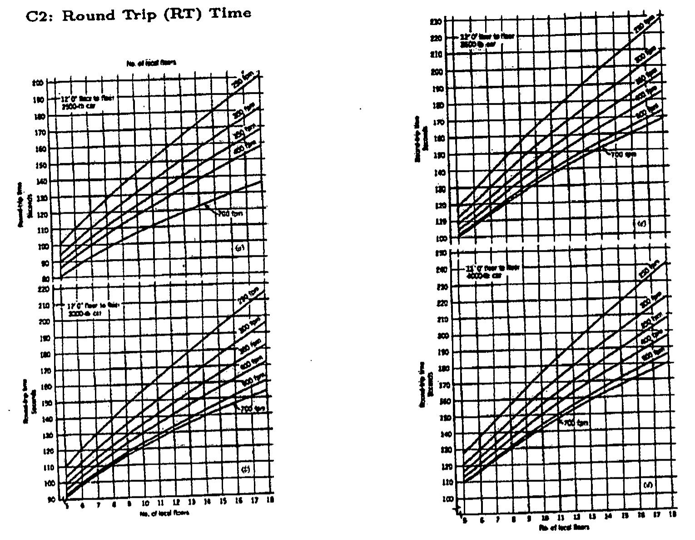

## D20. Fire protection water: BNBC Table 4.4.1

**BNBC 2006 Table 4.4.1. Water requirement for fire protection (as attached to the 2015-16 and 2016-17 papers)**

| Occupancy hazard | Sprinkler* (L/min) | Standpipe and hose* (L/min) | Duration** (min) |
|---|---|---|---|
| Light hazard-I | 1000 | 1000 | 30 |
| Light hazard-II | 1900 | 1900 | 50 |
| Ordinary hazard-I | 2650 | 1900 | 75 |
| Ordinary hazard-II | 3200 | 1900 | 75 |
| Ordinary hazard-III | 4800 | 1900 | 75 |

Storage = flow rate $\times$ duration. For a building with both systems, add the sprinkler and the standpipe flows (as taught in class; Module 3 shows the larger-demand alternative).

**BNBC 2020 Table 4.4.1. Water requirement for fire protection (as attached to the 2022-23 paper)**

| Occupancy hazard | Sprinkler (L/min) | Standpipe and hose (L/min) | Duration (min) $\le$ 51 m | 51–102 m | $>$ 102 m |
|---|---|---|---|---|---|
| Light hazard-I | 1000 | 1000 | 30 | 38 | 45 |
| Light hazard-II | 1900 | 1900 | 50 | 62 | 75 |
| Ordinary hazard-I | 2650 | 1900 | 75 | 95 | 112 |
| Ordinary hazard-II | 3200 | 1900 | 75 | 95 | 112 |
| Ordinary hazard-III | 4800 | 1900 | 75 | 95 | 112 |

Durations depend on building height in BNBC 2020.

