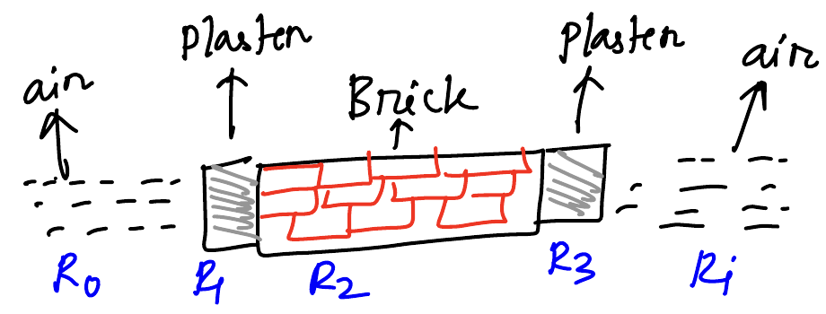
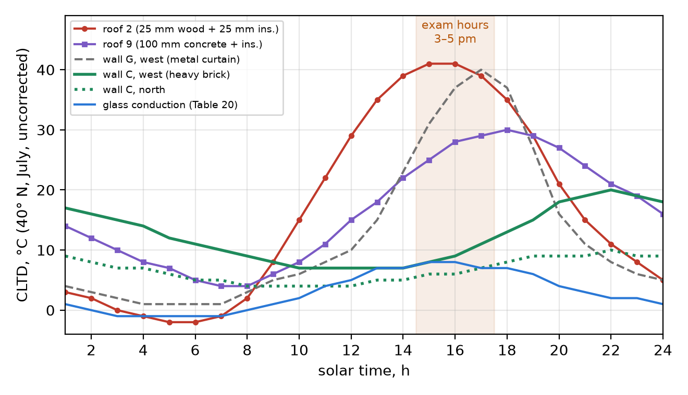
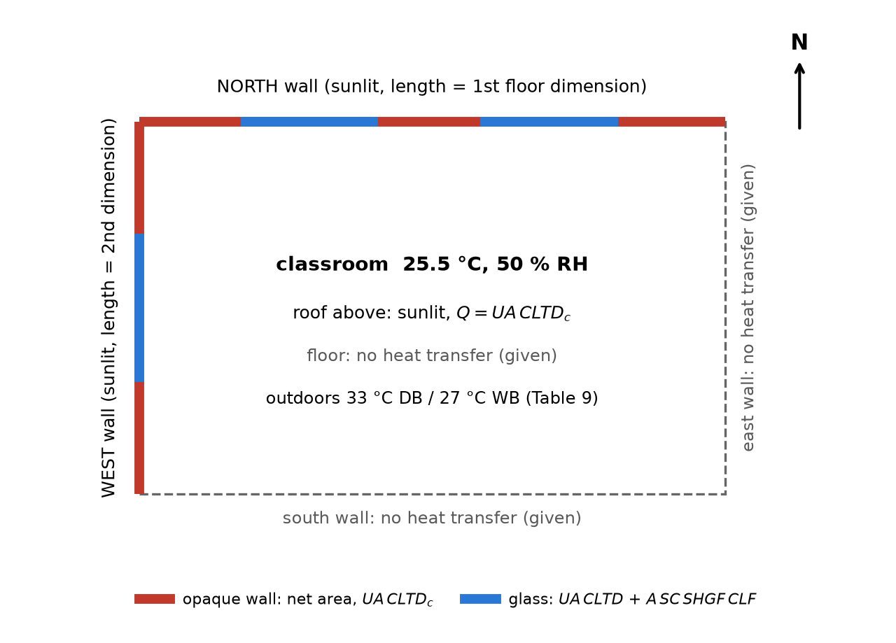

<!-- pagebreak -->
# 1. Cooling load estimation by the CLTD/CLF method

Cooling load is the single most valuable question in the course: 13.3% of all marks (405 of 3055 weighted marks), 35 marks a year and 45 in 2022-23 and 2023-24. It has appeared in every paper from 2011-12 to 2023-24, as Q1(a) of Section A (2011-12, 2012-13), Q8 of Section B (2013-14 to 2022-23) and the compulsory Q4 of Section A (2023-24). It is always one long numerical, "Estimate the cooling load of a class-room for N students at h pm", and no theory part has ever been asked. All the marks are for a correct, well-laid-out ledger with every data-book look-up shown.

> **KEY: What to take from this chapter**
>
> - **One archetype, every year: the cooling-load ledger.** Eleven papers, in three families: the *template classroom* (wood roof, 254 mm brick walls; seven papers, 2013-14 to 2023-24), the *concrete-roof classroom* (2012-13, 2018-19) and the *office* (2011-12, 2017-18). Only the numbers change.
> - **Seven loads, one formula each:** envelope $UA\,CLTD_c$; glass $UA\,CLTD$ + $A\,SC\,SHGF_{max}\,CLF$; people $nq_S$, $nq_L$; lights $PL\times A_{floor}\times1.2\times1\times0.85$; equipment $P$; outdoor air $1200\dot V\Delta T$ and $3010\times10^3\dot V\Delta\omega$.
> - **Corrected CLTD** $=[(CLTD+LM)K+(25.5-T_i)+(T_{o,av}-29.4)]f$, which for every Bangladesh question is $CLTD+LM-1.9$.
> - **Read the layers, not the type number:** "Type 5, 25 mm wood, 25 mm insulation" is roof 2 ($U=0.965$); the 254 mm brick wall is group C ($U=1.774$).
> - **Total** $=\sum Q_S+\sum Q_L$; 1 TR = 3.517 kW.

## 1.1 The cooling-load ledger (CLTD/CLF method)

### What a cooling load is

The **cooling load** of a room is the rate at which heat must be removed from the room air to hold it at the design dry bulb and humidity. The air-conditioner is sized for it.

It is not the same as the **heat gain**, the rate at which heat enters or is generated at that instant. Part of every gain is radiation (sun through glass, lamps, people, warm wall surfaces). Radiation does not heat the air directly: it is absorbed by the floor, furniture and walls, which give it to the air later by convection. So the cooling load **lags** the heat gain by a few hours, its peak is **smaller**, and a heavy building (brick, concrete) lags and damps more than a light one (steel sheet, metal curtain wall).

The CLTD/CLF method builds both effects into tabulated factors, so each item needs one multiplication:

- **CLTD** (cooling load temperature difference) is an equivalent temperature difference. Times $UA$, it gives the conduction load through a sunlit roof or wall at that hour, including the sun on the outer surface and the time lag of the wall.
- **CLF** (cooling load factor) is the fraction of an instantaneous gain (solar through glass, people, lights, equipment) that appears as cooling load at that hour.

**Sensible heat** raises the air dry bulb; **latent heat** is moisture added to the air (by people and humid outdoor air), which the coil must condense. Both are added for the total.

| No. | Component | Formula | Kind |
|---|---|---|---|
| 1 | Conduction through shaded partitions, doors, partition glass | $UA\,TD$ | sensible |
| 2 | Conduction through the sunlit roof, sunlit walls and glass | $UA\,CLTD_c$ (glass: $UA\,CLTD$) | sensible |
| 3 | Solar heat through glass | $A\,SC\,SHGF_{max}\,CLF$ | sensible |
| 4 | Outdoor air (infiltration or ventilation) | $1200\dot V\Delta T$; $3010\times10^3\dot V\Delta\omega$ | sensible + latent |
| 5 | Occupants | $nq_S\,CLF$; $nq_L$ | sensible + latent |
| 6 | Equipment | $P\,CLF$ | sensible |
| 7 | Lights | $W\,BF\,D\,CLF$ | sensible |

This is the seven-row summary of Arif sir's lecture example; end every answer with it. **1 TR** is the rate that freezes 1 short ton of water at 0 °C in 24 h: 12 000 Btu/h = **3.517 kW**.

### Design conditions (Tables 9 and 11)

**Outdoors, Data Book Table 9 (Data Book §D13).** Take the 2.5% design dry bulb, the coincident 2.5% wet bulb and the mean daily range. The only Bangladesh station printed is **Chittagong**: **[33]{.lookup t="9" row="Chittagong" col="summer_db_2.5pct_C"} °C DB, [27]{.lookup t="9" row="Chittagong" col="summer_wb_2.5pct_C"} °C WB, daily range [11]{.lookup t="9" row="Chittagong" col="summer_mean_daily_range_C"} °C**. Dhaka is not in the table; for a Dhaka paper write one line: "Dhaka is not listed; Chittagong, the only Bangladesh station, is used." The class solutions do the same.

The CLTD correction uses the **mean** outdoor temperature:

$$T_{o,av}=T_o-\dfrac{DR}{2}=33-\dfrac{11}{2}=27.5\ ^\circ\text{C}$$

**Indoors, Data Book Table 11 (Data Book §D13).** "Standard indoor conditions as recommended in ASHRAE" means this table. Office: **[25.5]{.lookup t="11" row="Offices" col="dry_bulb_C"} °C, [55%]{.lookup t="11" row="Offices" col="min_relative_humidity"}**. A classroom is not listed; take the nearest row, auditorium: **[25.5]{.lookup t="11" row="Auditoriums" col="dry_bulb_C"} °C, [50%]{.lookup t="11" row="Auditoriums" col="min_relative_humidity"}**.

**Humidity ratios** from the psychrometric chart (Data Book Chart 8, §D10): outdoor 33 °C / 27 °C, $\omega_o=0.0202$; indoor 25.5 °C / 50%, $\omega_i=0.0102$; indoor 25.5 °C / 55%, $\omega_i=0.0113$. So $\Delta\omega=0.0100$ for a classroom and $0.0089$ for an office.

::: {.mini #mini-design}
**Mini-example: design conditions.** An office in Dhaka. Find $T_o$, $T_{o,av}$, $T_i$ and $\Delta\omega$.

Dhaka is not in Table 9, so use Chittagong: $T_o=33$ °C, $DR=11$ °C, so $T_{o,av}=33-11/2=27.5$ °C. Table 11, offices: $T_i=25.5$ °C, 55%. Chart: $\omega_o=0.0202$, $\omega_i=0.0113$, so $\Delta\omega=0.0202-0.0113=0.0089$.
:::

### U-values from layers or from the tables

Heat crosses the outside film, each layer and the inside film in series:

$$R_{th}=R_o+\sum\dfrac{L}{k}+R_i,\qquad U=\dfrac{1}{R_{th}}\ \ \text{W/(m}^2\text{K)}$$

Use the Table 16 film codes **A0 = 0.059** (outside) and **E0 = 0.121** (inside) m²·K/W; the roof and wall tables were built with them. There are two routes to $U$:

1. **Read it from the table.** Table 12(b) prints $U$ for each roof, Table 14 for each wall construction (Data Book §D14). Use this whenever the construction is listed.
2. **Build it from layers** (Table 16 codes, Data Book §D15) only when it is not listed, using the *actual* thickness, $R=L/k$.

::: {.mini #mini-u}
**Mini-example: U from layers.** The template wall, 254 mm brick with 12.5 mm plaster on both sides, is not listed in Table 14. Find $U$.

Table 16: films A0 [0.059]{.lookup t="16" row="A0" col="R_m2K_W"} and E0 [0.121]{.lookup t="16" row="E0" col="R_m2K_W"} m²·K/W; C4 common brick $k=$ [0.727]{.lookup t="16" row="C4" col="k_W_mK"}, E1 plaster $k=$ [0.7277]{.lookup t="16" row="E1" col="k_W_mK"} W/m·K. Use the actual thicknesses, not the printed $R$:

$$R_{th}=0.059+\dfrac{0.0125}{0.7277}+\dfrac{0.254}{0.727}+\dfrac{0.0125}{0.7277}+0.121=0.059+0.0172+0.3494+0.0172+0.121=0.5638$$

$U=1/0.5638=\mathbf{1.774}$ W/m²·K (with 12.7 mm plaster, **1.772**).
:::

> **TRAP: The B7 misprint in Table 16**
>
> Table 16 prints $R=1.760$ for B7 (25 mm wood), but $L/k=0.025/0.121=0.207$. The class solution of 2021-22 used 1.760, got roof $U=0.374$, and its roof load came out 2.6 times too small. Take the roof $U$ straight from Table 12(b): **0.965** for roof 2.

### Corrected CLTD for the roof and walls

The CLTD tables were computed for **July 21, 40° N**, indoor 25.5 °C, mean outdoor 29.4 °C, dark surface. A Bangladesh room differs on every count, so the table value is corrected:

$$\boxed{CLTD_c=\big[(CLTD+LM)K+(25.5-T_i)+(T_{o,av}-29.4)\big]f}$$

| Term | Meaning | Value in the exam |
|---|---|---|
| $CLTD$ | Table 12(b) (roof number, with or without suspended ceiling, solar hour) or Table 15 (wall group, facing, hour) | read |
| $LM$ | Table 13: latitude, month, facing (HOR for roofs) | read |
| $K$ | colour: 1.0 dark, 0.5 light | 1.0 |
| $25.5-T_i$ | indoor temperature correction | 0 |
| $T_{o,av}-29.4$ | mean outdoor temperature correction | $27.5-29.4=-1.9$ °C |
| $f$ | attic fan: 1.0 none, 0.75 ventilated attic | 1.0 |

So for every past paper, $CLTD_c=CLTD+LM-1.9$. The course takes clock time as solar time (3 pm = hour 15).

**Reading Table 13 (Data Book §D14).** Use the **24° N** block for both Chattogram (22°21′ N) and Dhaka (23°43′ N), without interpolation. Months are paired: Apr/Aug, May/Jul, Jun alone. Facing: N for the north wall, E/W for the west wall, HOR for the roof.

**The roof: Table 12(b).** Pick the row by roof number (Table 12(a) describes each) and "without suspended ceiling".

> **TRAP: "Type 5" or roof 2? Read the layers, not the number**
>
> Seven papers say "Roof: Type 5, without suspended, 25 mm wood, 25 mm insulation". In Table 12(a), roof 5 is 25 mm wood with **50 mm** insulation; 25 mm wood with 25 mm insulation is **roof 2** ($U=0.965$, CLTD 41/41/39 at 3/4/5 pm). Likewise "type 4, 100 mm concrete" is **roof 9** ($U=1.136$; roof 4 has only 50 mm concrete). Write one line: "The layers given are roof 2 of Table 12(a); Table 12(b) row 2 is used." Never mix the two readings.

**The walls: Tables 14 and 15.** Table 15 gives CLTD for wall groups A (heaviest) to G (lightest); Table 14 tells you the group.

| Paper wall | Group | $U$ (W/m²·K) |
|---|---|---|
| 254 mm brick + plaster both sides (template) | **C** (not listed; see below) | 1.774 (layers) |
| 100 mm face brick + air space + 100 mm face brick ("type c") | C | 2.033 |
| 100 mm face brick + 100 mm common brick ("Type D") | D | 2.356 |
| Metal curtain wall ("Type G") | G | layers |

Table 14 lists about 200 mm of brick as group D and about 300 mm as group B. The 254 mm brick wall lies between them: **group C**. Say this in one line.

> **TRAP: Group G is a metal curtain wall, not brick**
>
> The class solution of 2021-22 "assumed Type-G" for the 254 mm brick wall. Group G is the lightest group: its west-wall CLTD at 5 pm is 40 °C, against 11 °C for group C. Using G roughly quadruples the wall load.

::: {.mini #mini-cltd}
**Mini-example: corrected CLTD.** Roof 2 (no suspended ceiling) and a north brick wall (group C), at 5 pm in April, 24° N. Find $CLTD_c$ for each.

- Roof: Table 12(b), roof 2, hour 17: CLTD = [39]{.lookup t="12b" row="without suspended ceiling;2" col="17"}. Table 13, 24° N, Apr/Aug, HOR: $LM=$ [0.0]{.lookup t="13" row="24;Apr/Aug" col="HOR"}. $CLTD_c=39+0.0-1.9=\mathbf{37.1}$ °C.
- North wall: Table 15, group C, N, hour 17: CLTD = [7]{.lookup t="15" row="C;N" col="17"}. Table 13, 24° N, Apr/Aug, N: $LM=$ [−1.1]{.lookup t="13" row="24;Apr/Aug" col="N"}. $CLTD_c=7-1.1-1.9=\mathbf{4.0}$ °C.

Then $Q=UA\,CLTD_c$: a 54 m² roof gives $0.965\times54\times37.1=1933.3$ W.
:::

The figure below shows why the roof dominates the template answer. At 3–5 pm the light wood roof is at its peak, about 40 °C, while the heavy brick wall is still near its minimum; its afternoon sun arrives late in the evening.

### Glass: conduction and solar

Glass gains heat two ways:

1. **Conduction:** $Q=U\,A\,CLTD$, with CLTD from **Table 20** (Data Book §D16): 8 °C at 15–16 h, 7 °C at 17 h. **No correction.**
2. **Solar:** $Q=A\cdot SC\cdot SHGF_{max}\cdot CLF$.

| Factor | Table (Data Book §D16) | How to read it |
|---|---|---|
| $SC$ | 21 | single clear glass by thickness, column $h_o=7.0$: **10 mm 0.92**, **13 mm 0.88** |
| $SHGF_{max}$, W/m² | 18(a) | 24° N block, month row, facing column (N; E/W) |
| $CLF$ | 19 | facing (north glass: "N (Shaded)" row), room construction, solar hour |

Room construction for Table 19: brick-walled classrooms are **M** (medium); the metal-curtain-wall office is **L**.

> **TRAP: Gross wall area or net wall area**
>
> Glass is "x% of wall area". Compute the **gross** wall area (length × height), take x% as glass, and use the **net** area for the opaque wall. Otherwise the glass is counted twice. And never set the north solar gain to zero: north glass gets diffuse sky radiation (Table 18(a) gives 117–174 W/m²).

::: {.mini #mini-geometry}
**Mini-example: geometry.** A room 9 m × 6 m, 3 m high; the north wall is the 9 m side; windows are 15% of wall area on the north and west walls. Find every area and the volume.

| Quantity | North wall | West wall |
|---|---|---|
| gross area | $9\times3=27$ m² | $6\times3=18$ m² |
| glass, 15% | 4.05 m² | 2.7 m² |
| net opaque wall | $27-4.05=22.95$ m² | $18-2.7=15.3$ m² |

Floor (= roof) area $9\times6=54$ m²; volume $54\times3=162$ m³. The floor area also feeds the lights; the volume feeds the infiltration.
:::

::: {.mini #mini-glass-cond}
**Mini-example: glass conduction.** 4.05 m² of north glass, $U=2.8$ W/m²·K, at 5 pm.

Table 20, hour 17: CLTD = [7]{.lookup t="20" row="1700" col="CLTD_C"} °C, not corrected. $Q=UA\,CLTD=2.8\times4.05\times7=\mathbf{79.4}$ W. The same CLTD serves every facing.
:::

::: {.mini #mini-glass-solar}
**Mini-example: glass solar gain.** 2.7 m² of west glass, 13 mm single clear, brick room (M), at 4 pm in April.

- Table 21, single clear 13 mm, column $h_o=7.0$: $SC=$ [0.88]{.lookup t="21" row="A. Single Glass;Clear;13 mm" col="SC_ho_7.0_W_m2K"}.
- Table 18(a), 24° N, April, E/W column: $SHGF_{max}=$ [719]{.lookup t="18a" row="Apr." col="E_W"} W/m².
- Table 19, W row, M, hour 16: $CLF=$ [0.50]{.lookup t="19" row="W;M" col="16"}.

$Q=A\,SC\,SHGF_{max}\,CLF=2.7\times0.88\times719\times0.50=\mathbf{854.2}$ W. For north glass use the N column of Table 18(a) and the "N (Shaded)" row of Table 19.
:::

### Partitions, people, lights, equipment

**Partitions.** A wall, door or glass next to an unconditioned space or a shaded outdoor face needs no CLTD: $Q=UA\,TD$, with $TD=T_{un}-T_i$ (e.g. $30-25.5=4.5$ °C) or $T_o-T_i$ (7.5 °C). In every past paper "no heat transfer through floor, south and east walls" removes this group: write **partition load = 0** as a ledger row.

::: {.mini #mini-partition}
**Mini-example: partition.** The 15 m² east wall (template brick, $U=1.774$) faces an unconditioned corridor at 30 °C; the room is at 25.5 °C.

$TD=30-25.5=4.5$ °C, no CLTD. $Q=UA\,TD=1.774\times15\times4.5=\mathbf{119.7}$ W. If the question says "no heat transfer through the east wall", the row is **0 W**.
:::

**People (Data Book Tables 27–28, §D17).**

$$Q_S=n\,q_S\,CLF,\qquad Q_L=n\,q_L$$

Students seated and writing: Table 28 "moderately active office work", **[75]{.lookup t="28" row="Moderately active office work" col="sensible_heat_W"} W sensible, [55]{.lookup t="28" row="Moderately active office work" col="latent_heat_W"} W latent**. Table 27's footnote gives **CLF = 1** when the system is shut down at night and for high occupant densities; a classroom is both. Latent heat has no CLF.

::: {.mini #mini-people}
**Mini-example: people.** 40 students in a classroom.

Table 28, moderately active office work: 75 W / 55 W; CLF = 1 (Table 27 footnote). $Q_S=40\times75\times1=\mathbf{3000}$ W, $Q_L=40\times55=\mathbf{2200}$ W. The latent goes in its own column.
:::

**Lights (Tables 22–24, §D17).**

$$Q_S=(PL\times A_{floor})\times BF\times D\times CLF$$

$PL$ is the lighting power density, W/m², times the **floor** area; ballast factor $BF=1.2$ fluorescent (1.0 incandescent); diversity $D=1$; $CLF=0.85$ (the course value).

::: {.mini #mini-lights}
**Mini-example: lights.** "Light: 15 W/m² fluorescent", floor 9 m × 6 m.

$Q_S=(15\times54)\times1.2\times1\times0.85=\mathbf{826.2}$ W. No Table 24 look-up unless the question gives the furnishing and floor data for Tables 22–23.
:::

> **TRAP: Do not multiply W/m² by a number of lamps**
>
> "Light: 22 W/m²" is already the total per square metre of floor. Multiply by the floor area and stop. The class solution of 2021-22 multiplied again by "10 lights" and got 15 708 W instead of 1570.8 W.

**Equipment.** $Q=P\times CLF$ with $CLF=1$. "Assume reasonable electrical appliances": state what you assume. For a classroom take **one projector (300 W) + one computer (200 W) = 500 W**. For offices the computers are given.

::: {.mini #mini-equipment}
**Mini-example: equipment.** A seminar room, "assume reasonable appliances".

Write the assumption: one projector 300 W + two computers 2 × 200 W. $Q_S=(300+400)\times1=\mathbf{700}$ W. Equipment is all sensible.
:::

### Outdoor air: infiltration or ventilation

Outdoor air at $T_o,\omega_o$ must be cooled and dried to $T_i,\omega_i$:

$$Q_S=1200\,\dot V\,(T_o-T_i),\qquad Q_L=3010\times10^3\,\dot V\,(\omega_o-\omega_i)\quad\text{W},\ \dot V\text{ in m}^3/\text{s}$$

The constants are $\rho c_p\approx1200$ J/m³·K and $\rho h_{fg}\approx3010$ kJ/m³. Use the **design** dry bulb $T_o=33$ °C here, not $T_{o,av}$.

How much air:

- **No ventilation rate asked** (the template classroom): infiltration **1 air change per hour**, $\dot V=\text{room volume}/3600$. This is the course default (Arif sir's example, the class solution).
- **"Fresh air / ventilation as recommended in ASHRAE"** (2011-12, 2012-13, 2017-18): ASHRAE 62, **8 L/s per student**, **10 L/s per office worker**, and no separate infiltration.

Never add both for the same air. State the choice in the assumptions: for a 60-student room, ASHRAE ventilation instead of 1 ACH nearly doubles the total.

::: {.mini #mini-air}
**Mini-example: outdoor air.** A 162 m³ classroom for 40 students; $T_o=33$ °C, $T_i=25.5$ °C, $\Delta\omega=0.0100$.

- No ventilation rate asked, so 1 ACH: $\dot V=162/3600=0.045$ m³/s. $Q_S=1200\times0.045\times7.5=\mathbf{405}$ W; $Q_L=3010\times10^3\times0.045\times0.0100=\mathbf{1354.5}$ W.
- If the paper asked for ASHRAE ventilation instead: $\dot V=40\times8=320$ L/s $=0.32$ m³/s, $Q_S=2880$ W, $Q_L=9632$ W. One or the other, never both.
:::

### The ledger order

Examiners mark the look-ups, so lay out every answer the same way:

1. **Assumptions:** outdoor and indoor design data; 24° N; solar time = clock time; $K=f=1$; roof row; wall group; Table 19 construction; air flow; appliances.
2. **Geometry:** floor area, volume, gross wall areas (N, W), glass areas, net wall areas.
3. **U-values:** roof, walls, glass (given).
4. **CLTD table:** roof, N wall, W wall: CLTD, LM, $CLTD_c$; glass CLTD.
5. **Loads 1–7**, each with its formula.
6. **Summary:** sensible and latent columns, total in W, kW and **TR**.

> **EXAMPLE 1.1** `[PP 23-24 Q4, 45]` Estimate the cooling load of a class-room for 60 students at 3 pm for the following conditions: Location: Chattogram. Date: June 15. Floor: 11 m × 7 m, 3.3 m height. Roof: Type 5, without suspended, 25 mm wood, 25 mm insulation. Walls: 254 mm brick with 12.5 mm plaster on both sides. Windows: 22% of wall area on north and west walls, 10 mm clear glass, $U=2.9$ W/m²·°C. Light: 20 W/m² fluorescent bulbs. (i) Assume standard indoor conditions as recommended in ASHRAE. (ii) Assume no heat transfer through floor, south and east walls. (iii) Assume reasonable electrical appliances.

**Solution.** Try each step yourself; open the hint if stuck, the step if still stuck.

::: {.problem #ex-1-1}

::: {.step title="Step 0. Assumptions"}
::: hint
Outdoor: Table 9 (Chittagong). Indoor: Table 11 (no classroom row). $\omega$ from the chart. Then decide the roof row, the wall group, the Table 19 construction, the air flow and the appliances. See the [design-conditions mini-example](#mini-design) and the roof and wall TRAPs.
:::
- Outdoor, Data Book Table 9 (Chattogram, 2.5%): $T_o=$ [33]{.lookup t="9" row="Chittagong" col="summer_db_2.5pct_C"} °C DB, [27]{.lookup t="9" row="Chittagong" col="summer_wb_2.5pct_C"} °C WB, $DR=$ [11]{.lookup t="9" row="Chittagong" col="summer_mean_daily_range_C"} °C, so $T_{o,av}=27.5$ °C.
- Indoor, Data Book Table 11 (classroom not listed; auditorium row): $T_i=$ [25.5]{.lookup t="11" row="Auditoriums" col="dry_bulb_C"} °C, [50%]{.lookup t="11" row="Auditoriums" col="min_relative_humidity"} RH.
- Chart: $\omega_o=0.0202$, $\omega_i=0.0102$, $\Delta\omega=0.0100$.
- 24° N block of Tables 13 and 18(a); 3 pm = 15 h; June → "Jun" (Table 13), "June" (Table 18(a)).
- Roof: the layers (25 mm wood + 25 mm insulation) are **roof 2** of Table 12(a). Table 12(b), roof 2, no suspended ceiling: $U=$ [0.965]{.lookup t="12b" row="without suspended ceiling;2" col="U_W_m2K"}.
- Walls: 254 mm brick, between Table 14's groups D and B: **group C**. $K=1$, $f=1$.
- Glass: Table 19 medium construction (M). Outdoor air: infiltration 1 ACH. Appliances: projector 300 W + computer 200 W = 500 W. North wall = 11 m side.
:::

::: {.step title="Step 1. Geometry"}
::: hint
Gross wall = length × height; glass = 22% of gross; net = gross − glass. Floor area for the roof and lights, volume for the air. See the [geometry mini-example](#mini-geometry).
:::
| Quantity | North wall | West wall |
|---|---|---|
| gross area | $11\times3.3=36.3$ m² | $7\times3.3=23.1$ m² |
| glass, 22% | 7.986 m² | 5.082 m² |
| net opaque wall | 28.314 m² | 18.018 m² |

Floor (= roof) area $11\times7=77$ m²; volume $77\times3.3=254.1$ m³.
:::

::: {.step title="Step 2. U-values"}
::: hint
Roof: read $U$ from Table 12(b), roof 2. Wall: not listed, so build it from the Table 16 layers. Glass: given. See the [U-value mini-example](#mini-u).
:::
Roof $U=$ [0.965]{.lookup t="12b" row="without suspended ceiling;2" col="U_W_m2K"} (Data Book Table 12(b), roof 2). Wall from layers: $R_{th}=0.059+0.0172+0.3494+0.0172+0.121=0.5638$, $U=1.774$ W/m²·K. Glass $U=2.9$ (given).
:::

::: {.step title="Step 3. Corrected CLTD, roof and walls"}
::: hint
$CLTD_c=CLTD+LM-1.9$. CLTD: Table 12(b) (roof 2, hour 15) and Table 15 (group C, N and W, hour 15). LM: Table 13, 24° N, Jun, columns HOR, N, E/W. See the [corrected-CLTD mini-example](#mini-cltd).
:::
| Surface | CLTD at 15 h | $LM$ (Table 13, 24° N, Jun) | $CLTD_c$ (°C) |
|---|---|---|---|
| Roof 2 | [41]{.lookup t="12b" row="without suspended ceiling;2" col="15"} (Table 12(b), roof 2, no ceiling) | [+0.5]{.lookup t="13" row="24;Jun" col="HOR"} (HOR) | $41+0.5-1.9=39.6$ |
| N wall | [6]{.lookup t="15" row="C;N" col="15"} (Table 15, group C, N) | [+1.6]{.lookup t="13" row="24;Jun" col="N"} (N) | $6+1.6-1.9=5.7$ |
| W wall | [8]{.lookup t="15" row="C;W" col="15"} (Table 15, group C, W) | [0.0]{.lookup t="13" row="24;Jun" col="E_W"} (E/W) | $8+0-1.9=6.1$ |

| Item | Calculation | $Q_S$ (W) |
|:---|:---|---:|
| Roof | $0.965\times77\times39.6$ | 2942.5 |
| North wall (net) | $1.774\times28.314\times5.7$ | 286.3 |
| West wall (net) | $1.774\times18.018\times6.1$ | 195.0 |
:::

::: {.step title="Step 4. Glass conduction"}
::: hint
$Q=UA\,CLTD$ with the glass areas of Step 1. CLTD from Table 20 at hour 15, **not corrected**. See the [glass-conduction mini-example](#mini-glass-cond).
:::
Table 20, hour 15: CLTD = [8]{.lookup t="20" row="1500" col="CLTD_C"} °C.

| Item | Calculation | $Q_S$ (W) |
|:---|:---|---:|
| Glass conduction, N | $2.9\times7.986\times8$ | 185.3 |
| Glass conduction, W | $2.9\times5.082\times8$ | 117.9 |
:::

::: {.step title="Step 5. Glass solar gain"}
::: hint
$Q=A\,SC\,SHGF_{max}\,CLF$. SC: Table 21 (10 mm clear, $h_o=7.0$). SHGF: Table 18(a), 24° N, June, N and E/W columns. CLF: Table 19, M, hour 15, rows "N (Shaded)" and W. See the [glass-solar mini-example](#mini-glass-solar).
:::
Data Book Table 21 (10 mm clear, $h_o=7.0$): SC = [0.92]{.lookup t="21" row="A. Single Glass;Clear;10 mm" col="SC_ho_7.0_W_m2K"}. Data Book Table 18(a) (24° N, June): $SHGF_{max}$ N [174]{.lookup t="18a" row="June" col="N"}, W [669]{.lookup t="18a" row="June" col="E_W"} W/m². Data Book Table 19 (M, 15 h): CLF N (shaded) [0.76]{.lookup t="19" row="N (Shaded);M" col="15"}, W [0.40]{.lookup t="19" row="W;M" col="15"}.

| Item | Calculation | $Q_S$ (W) |
|:---|:---|---:|
| Glass solar, N | $7.986\times0.92\times174\times0.76$ | 971.6 |
| Glass solar, W | $5.082\times0.92\times669\times0.40$ | 1251.1 |
:::

::: {.step title="Step 6. Partitions"}
::: hint
Read assumption (ii) of the question. See the [partition mini-example](#mini-partition).
:::
South, east and floor are excluded by the question → **0 W**. Keep the row in the ledger.
:::

::: {.step title="Step 7. People"}
::: hint
Table 28, the seated-and-writing row; CLF from the Table 27 footnote; latent has no CLF. See the [people mini-example](#mini-people).
:::
Table 28: [75]{.lookup t="28" row="Moderately active office work" col="sensible_heat_W"} W / [55]{.lookup t="28" row="Moderately active office work" col="latent_heat_W"} W; CLF = 1 (Table 27 footnote).

| Item | Calculation | $Q_S$ (W) | $Q_L$ (W) |
|:---|:---|---:|---:|
| People | $60\times75$; $60\times55$ | 4500.0 | 3300.0 |
:::

::: {.step title="Step 8. Lights"}
::: hint
W/m² × **floor** area × 1.2 × 1 × 0.85. Never × number of lamps. See the [lights mini-example](#mini-lights).
:::
| Item | Calculation | $Q_S$ (W) |
|:---|:---|---:|
| Lights | $20\times77\times1.2\times0.85$ | 1570.8 |
:::

::: {.step title="Step 9. Equipment"}
::: hint
"Reasonable appliances": state them. For a classroom, projector 300 W + computer 200 W, CLF = 1. See the [equipment mini-example](#mini-equipment).
:::
| Item | Calculation | $Q_S$ (W) |
|:---|:---|---:|
| Equipment | projector 300 + PC 200 | 500.0 |
:::

::: {.step title="Step 10. Outdoor air"}
::: hint
No ventilation rate asked → 1 ACH, $\dot V=$ volume/3600. Use the design $T_o=33$ °C (not $T_{o,av}$) and $\Delta\omega$ from Step 0. See the [outdoor-air mini-example](#mini-air).
:::
1 ACH: $\dot V=254.1/3600=0.0706$ m³/s, $\Delta T=33-25.5=7.5$ °C.

| Item | Calculation | $Q_S$ (W) | $Q_L$ (W) |
|:---|:---|---:|---:|
| Outdoor air, 1 ACH | $1200(0.0706)(7.5)$; $3010\times10^3(0.0706)(0.0100)$ | 635.4 | 2125.1 |
:::

::: {.step title="Step 11. The ledger and the total"}
::: hint
Collect every row in two columns, sensible and latent; add; convert with 1 TR = 3.517 kW.
:::
| Item | Calculation | $Q_S$ (W) | $Q_L$ (W) |
|:-------------------|:--------------------------------------|---------:|---------:|
| Partitions | none | 0 | |
| Roof | $0.965\times77\times39.6$ | 2942.5 | |
| North wall (net) | $1.774\times28.314\times5.7$ | 286.3 | |
| West wall (net) | $1.774\times18.018\times6.1$ | 195.0 | |
| Glass conduction, N | $2.9\times7.986\times8$ | 185.3 | |
| Glass conduction, W | $2.9\times5.082\times8$ | 117.9 | |
| Glass solar, N | $7.986\times0.92\times174\times0.76$ | 971.6 | |
| Glass solar, W | $5.082\times0.92\times669\times0.40$ | 1251.1 | |
| People | $60\times75$; $60\times55$ | 4500.0 | 3300.0 |
| Lights | $20\times77\times1.2\times0.85$ | 1570.8 | |
| Equipment | projector 300 + PC 200 | 500.0 | |
| Outdoor air, 1 ACH | $1200(0.0706)(7.5)$; $3010\times10^3(0.0706)(0.0100)$ | 635.4 | 2125.1 |
| **Sum** | | **13155.9** | **5425.1** |

$$Q_T=13155.9+5425.1=18581.0\ \text{W}=18.58\ \text{kW},\qquad \dfrac{18.58}{3.517}=5.28\ \text{TR}$$

**Cooling load = 18581.0 W ≈ 18.6 kW ≈ 5.3 TR** (SHR = 0.71).
:::

:::

For reference: the literal "roof 5" reading ($U=0.619$, $CLTD_c=33.6$) gives 4.90 TR; ASHRAE ventilation (8 L/s × 60 students) instead of 1 ACH gives 9.83 TR. This is why the roof and air assumptions must be written down.

> **TIP: The template answer is reusable**
>
> Seven papers use this room. For any of them, change only the hour (CLTD, CLF), the month (LM, SHGF), the dimensions, the glass % and $U$, the lighting density and the number of students. Learn the ledger once.

> **PRACTICE 1.1** `[PP 22-23 Q8, 45]` Estimate the cooling load of a class-room for 50 students at 4 pm for the following conditions: Location: Chattogram. Date: July 15. Floor: 12 m × 8 m, 3.5 m height. Roof: Type 5, without suspended, 25 mm wood, 25 mm insulation. Walls: 254 mm brick with 12.5 mm plaster on both sides. Windows: 20% of wall area on north and west walls, 10 mm clear glass, $U=2.5$ W/m²·°C. Light: 30 W/m² fluorescent bulbs. (i) Assume standard indoor conditions as recommended in ASHRAE. (ii) Assume no heat transfer through floor, south and east walls. (iii) Assume reasonable electric appliances.

**Solution.** Work it in the steps of Example 1.1; open a step only to check it.

::: {.problem #pr-1-1}

::: {.step title="Step 0. Assumptions"}
::: hint
As Example 1.1, Step 0, except: 4 pm = hour 16; July → "May/Jul" in Table 13 and "July" in Table 18(a).
:::
As Example 1.1 (Chattogram 33 °C / 27 °C, $T_{o,av}=27.5$ °C; auditorium 25.5 °C / 50%; $\Delta\omega=0.0100$; roof 2; wall group C; Table 19 M; 1 ACH; 500 W of appliances), with hour 16 and July.
:::

::: {.step title="Step 1. Geometry"}
::: hint
North wall is the 12 m side; glass 20% of gross. See the [geometry mini-example](#mini-geometry).
:::
North wall $12\times3.5=42$ m² (glass 8.4, net 33.6), west wall $8\times3.5=28$ m² (glass 5.6, net 22.4); floor 96 m², volume 336 m³.
:::

::: {.step title="Step 2. U-values"}
::: hint
Unchanged from Example 1.1 except the glass, which is given.
:::
Roof 0.965, wall 1.774, glass 2.5 W/m²·K.
:::

::: {.step title="Step 3. Corrected CLTD, roof and walls"}
::: hint
Table 12(b) and Table 15 at hour 16; Table 13, 24° N, **May/Jul**. See the [corrected-CLTD mini-example](#mini-cltd).
:::
Roof 2 CLTD [41]{.lookup t="12b" row="without suspended ceiling;2" col="16"}, LM(HOR) [+0.5]{.lookup t="13" row="24;May/Jul" col="HOR"} → 39.6; N wall CLTD [6]{.lookup t="15" row="C;N" col="16"}, LM [+0.5]{.lookup t="13" row="24;May/Jul" col="N"} → 4.6; W wall CLTD [9]{.lookup t="15" row="C;W" col="16"}, LM [0.0]{.lookup t="13" row="24;May/Jul" col="E_W"} → 7.1.

| Item | Calculation | $Q_S$ (W) |
|:---|:---|---:|
| Roof | $0.965\times96\times39.6$ | 3668.5 |
| North wall (net) | $1.774\times33.6\times4.6$ | 274.2 |
| West wall (net) | $1.774\times22.4\times7.1$ | 282.1 |
:::

::: {.step title="Step 4. Glass conduction"}
::: hint
Table 20 at hour 16, uncorrected. See the [glass-conduction mini-example](#mini-glass-cond).
:::
Table 20, hour 16: CLTD = [8]{.lookup t="20" row="1600" col="CLTD_C"} °C.

| Item | Calculation | $Q_S$ (W) |
|:---|:---|---:|
| Glass conduction, N | $2.5\times8.4\times8$ | 168.0 |
| Glass conduction, W | $2.5\times5.6\times8$ | 112.0 |
:::

::: {.step title="Step 5. Glass solar gain"}
::: hint
SC as Example 1.1; Table 18(a) **July**; Table 19, M, **hour 16**. See the [glass-solar mini-example](#mini-glass-solar).
:::
SC 0.92. SHGF July: N [142]{.lookup t="18a" row="July" col="N"}, W [672]{.lookup t="18a" row="July" col="E_W"}. CLF (M, 16 h): N [0.74]{.lookup t="19" row="N (Shaded);M" col="16"}, W [0.50]{.lookup t="19" row="W;M" col="16"}.

| Item | Calculation | $Q_S$ (W) |
|:---|:---|---:|
| Glass solar, N | $8.4\times0.92\times142\times0.74$ | 812.1 |
| Glass solar, W | $5.6\times0.92\times672\times0.50$ | 1731.1 |
:::

::: {.step title="Step 6. Partitions, people, lights, equipment"}
::: hint
Partitions excluded; 50 students at 75 W / 55 W; 30 W/m² over 96 m²; 500 W of appliances. See the mini-examples for [people](#mini-people) and [lights](#mini-lights).
:::
| Item | Calculation | $Q_S$ (W) | $Q_L$ (W) |
|:---|:---|---:|---:|
| Partitions | none | 0 | |
| People | $50\times75$; $50\times55$ | 3750.0 | 2750.0 |
| Lights | $30\times96\times1.2\times0.85$ | 2937.6 | |
| Equipment | projector 300 + PC 200 | 500.0 | |
:::

::: {.step title="Step 7. Outdoor air"}
::: hint
1 ACH on the 336 m³ volume. See the [outdoor-air mini-example](#mini-air).
:::
$\dot V=336/3600=0.0933$ m³/s.

| Item | Calculation | $Q_S$ (W) | $Q_L$ (W) |
|:---|:---|---:|---:|
| Outdoor air, 1 ACH | $1200(0.0933)(7.5)$; $3010\times10^3(0.0933)(0.0100)$ | 839.7 | 2808.3 |
:::

::: {.step title="Step 8. The total"}
::: hint
Add the two columns; 1 TR = 3.517 kW.
:::
$\sum Q_S=15075.3$ W, $\sum Q_L=5558.3$ W. **Total $=20633.6$ W $=20.63$ kW $=5.87$ TR** (SHR $=0.73$).
:::

:::

::: answer
**Answer.** $Q_S=15075.3$ W, $Q_L=5558.3$ W; total **20633.6 W ≈ 20.6 kW ≈ 5.87 TR** (SHR 0.73).
:::

Full solution: Module 1, Solution 1.2.

## 1.2 Theory questions asked

No theory question on cooling load has been asked in any paper from 2011-12 to 2023-24. All the marks are for the numerical (→ §1.1). A viva or short question would most likely be one of these, all answered in §1.1:

- Why is the cooling load at an hour different from the heat gain? (→ §1.1, *What a cooling load is*)
- What are CLTD and CLF? (→ §1.1, *What a cooling load is*)
- Why is the CLTD corrected, and which outdoor temperature goes into the correction? (→ §1.1, *Corrected CLTD*)

## 1.3 On one page

> **KEY: Cooling load on one page**
>
> - **Ledger order:** assumptions → geometry (gross, glass, net) → U → CLTD table → loads 1–7 → $\sum Q_S+\sum Q_L$ → W, kW, **TR** (1 TR = 3.517 kW).
> - **Design data:** Table 9 Chittagong (also for Dhaka): 33 °C DB, 27 °C WB, DR 11 → $T_{o,av}=27.5$ °C. Table 11: office 25.5 °C / 55%; classroom → auditorium 25.5 °C / 50%. Chart: $\omega_o=0.0202$, $\omega_i=0.0102$ (50%) or 0.0113 (55%).
> - **U:** $1/(R_o+\sum L/k+R_i)$, A0 = 0.059, E0 = 0.121. 254 mm brick + 12.5 mm plaster: **1.774**. Roof 2: **0.965**; roof 9: 1.136 (0.681 with 50 mm insulation). Groups: cavity brick C 2.033, D 2.356.
> - **Roof and walls:** $CLTD_c=[(CLTD+LM)K+(25.5-T_i)+(T_{o,av}-29.4)]f=CLTD+LM-1.9$. Table 13 at **24° N**; Apr/Aug, May/Jul, Jun; HOR for roofs.
> - **Glass:** $UA\,CLTD$ (Table 20: 8 at 15–16 h, 7 at 17 h, uncorrected) + $A\,SC\,SHGF_{max}\,CLF$ (SC 0.92 for 10 mm, 0.88 for 13 mm; Table 18(a) 24° N; Table 19, M for brick rooms).
> - **People:** 75 W + 55 W each, CLF = 1. **Lights:** W/m² × floor × 1.2 × 1 × 0.85. **Equipment:** classroom 500 W. **Partitions:** 0 in every paper (say so).
> - **Air:** $1200\dot V(33-25.5)$ and $3010\times10^3\dot V\Delta\omega$; 1 ACH = volume/3600, or ASHRAE 8 L/s per student, 10 L/s per office worker when asked. Not both.
> - **Traps:** "Type 5, 25 mm wood, 25 mm insulation" = roof 2; "type 4, 100 mm concrete" = roof 9. 254 mm brick = group C, never G. B7 is 0.207, not 1.760. Net wall = gross − glass. North glass is never zero. W/m² is never × number of lamps.
> - **Answers (TR):** 23-24: 5.28 · 22-23: 5.87 · 21-22: 4.97 · 20-21: 4.57 · 16-17: 4.15 · 15-16: 3.81 · 13-14: 3.84 · 12-13: 5.42 · 18-19: 4.26 · 17-18: 3.07 · 11-12: 2.30.
