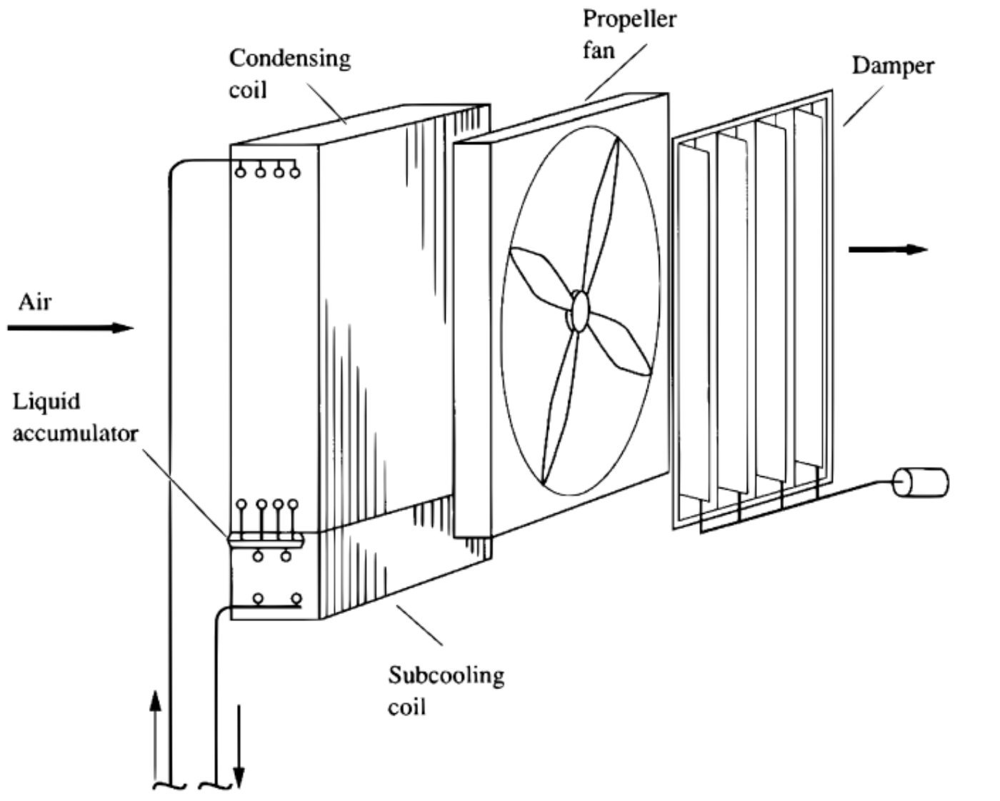
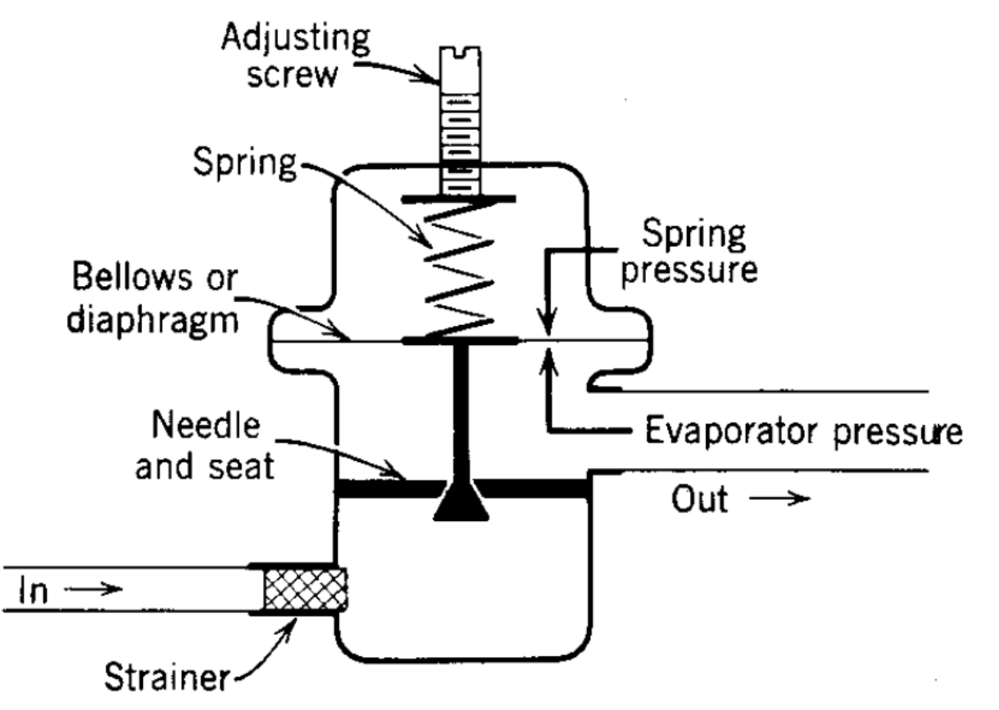
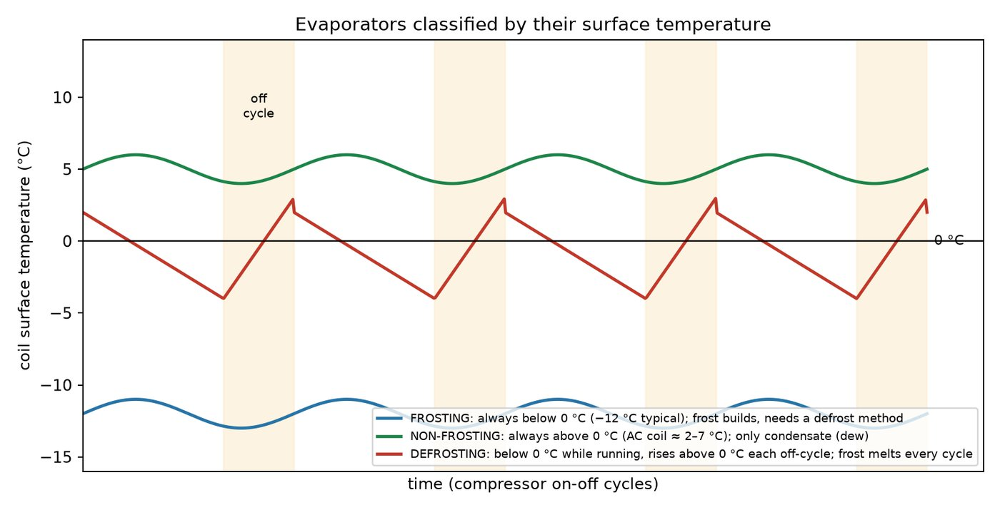

<!-- pagebreak -->
# 7. Refrigeration components: compressors, condensers, expansion devices, evaporators

<!-- ok: 131 106 -->

A vapour-compression plant has four components in a closed loop: compressor → condenser → expansion device → evaporator. This chapter covers how each type works. The topic appears in ten of the eleven papers. From 2015-16 to 2022-23 it filled **Q5 and Q6 of Section B every year**, and in 2023-24 three parts of Section A. It carries **12.5% of all marks** (381 of 3055 weighted marks, 27 parts). It is **all theory**: no numerical has ever been set. A typical part is 15–18 marks: "classify / describe with a neat sketch / explain how it works". The sketch earns a large share of the marks, so each section gives you the figure to draw.

> **KEY: What to take from this chapter**
>
> - **Compressors** (9 parts, 131 marks): "classify compressors, then describe the working principle of a **scroll**" (2016-17, 2020-21, 2022-23) or a **sliding/rotary vane** (2017-18, 2021-22, 2023-24) is the commonest question of the topic. Also centrifugal (3 times), hermetic, volumetric efficiency.
> - **Condensers** (7 parts, 106 marks): **air-cooled condenser** with sketch (4 times), twice with "**on days when maximum cooling is needed, the least is available**" (2022-23, 2023-24, word for word); evaporative condenser (2 times).
> - **Expansion devices** (7 parts, 95 marks): **EXV benefits and controller** (2015-16, 2017-18, 2020-21, near word for word); TXV superheat; AXV bellows; capillary tube.
> - **Evaporators** (4 parts, 49 marks): **liquid overfeed for multiple evaporators** (2016-17, 2018-19); frosting/defrosting.
> - **Facts that carry the chapter:** capacity ranges (kW): rolling piston 0.25–22, scroll 6.5–100, rotary vane 7–300, reciprocating 0.25–1000, screw 75–6000, turbo 270–36 000. $\eta_{vc}=1+C-C(p_d/p_s)^{1/n}$. Air-cooled condenser $Q_c\approx(UA)(T_c-T_{db})$. TXV: $p_{bulb}=p_e+p_{spring}$. AXV: $p_{spring}=p_e$.

## 7.1 Compressors: classification, scroll, vane, centrifugal

### Classification and capacity ranges

> **ASKED** `[PP 16-17 Q5(a), 17]` `[PP 20-21 Q5(a), 17]` Classify different types of compressors used in refrigeration systems … (then scroll).
> `[PP 17-18 Q5(a), 17]` What are the different types of compressors … (then rotary sliding vane).
> `[PP 21-22 Q5(a), 17]` Classify … **along with their capacity ranges** … (then sliding and rotary vane).

**Positive-displacement** compressors trap a volume of vapour and **reduce the volume**, which raises the pressure. **Dynamic** compressors **raise the velocity** of the gas and then slow it down so that the pressure rises. Draw the classification as a tree:

- **Positive displacement**: **reciprocating**; **rotary**: vane, scroll, rolling piston, screw
- **Dynamic**: **turbo** (centrifugal, axial); **ejector** (jet)

A second classification is **by motor arrangement**: hermetic, semi-hermetic, open. Name both in a "classify" answer, e.g. "a hermetic scroll", "an open screw".

| Type | Capacity (kW) | Typical use |
|---|---|---|
| Rolling piston | 0.25–22 | lowest: refrigerators, window and split AC |
| Scroll | 6.5–100 | split and packaged AC, heat pumps |
| Rotary vane | 7–300 | small commercial; booster duty |
| Reciprocating | 0.25–1000 | **widest range** |
| Screw | 75–6000 | chillers, industrial and ammonia plant |
| Turbo (centrifugal) | 270–36 000 | **highest**: large water chillers |

> **ASKED** `[PP 23-24 Q1(a), 15]` Why are a wide range of capacities and types for compressor used in HVAC application?

One mechanism cannot serve every duty efficiently. (1) **Loads** run from about 0.1 kW (a refrigerator) to about 36 000 kW (district cooling), and each type is economical only in its own band. (2) **Volume flow** decides the mechanism: small flows suit pistons, rollers and scrolls; large flows of low-density gas need screws and centrifugals. A centrifugal cannot be built small, and a piston machine becomes huge at large flows. (3) **Pressure ratio**: AC (about 3) suits centrifugals and scrolls; freezers (about 8–15) need pistons, screws or two stages. (4) **Refrigerant**: ammonia attacks copper windings and needs open machines; high-pressure R410A suits scrolls. (5) **Part-load control**: unloading, slide valve, guide vanes, variable speed. (6) Efficiency, noise, size, reliability, first cost and serviceability.

### Hermetic compressors, and why they are not centrifugal

A **hermetic** compressor has its motor inside a **welded** shell, cooled by the suction gas; it has no shaft seal (no leak path) but cannot be repaired in the field. A **semi-hermetic** has a **bolted** housing that can be opened. An **open** compressor has an external motor, air-cooled, driving through a shaft with a **shaft seal**; it is used for large and ammonia plant.

> **ASKED** `[PP 12-13 Q6(a), 5]` Hermetically sealed compressors are not generally centrifugal compressor – why?

1. **Speed.** A centrifugal needs an impeller tip speed of up to about 300 m/s. At the 2900 rpm of a two-pole motor the impeller would be about 2 m across, so real machines run at about 10 000 rpm through step-up gears. A small welded hermetic runs directly at line speed.
2. **Size.** A centrifugal cannot be built small (at least about 270 kW); hermetics are small machines.
3. **Service.** Gears, bearings and guide vanes must be opened for repair; a welded shell cannot be.
4. **Motor heat.** A large motor would heat the suction gas and cut the capacity.

So centrifugals are **open** or **semi-hermetic**; fully hermetic units are reciprocating, rolling-piston and scroll machines.

### Volumetric efficiency

> **ASKED** `[PP 22-23 Q5(a), 15]` Why does volumetric efficiency decrease with pressure ratio for compressor? Find out the reasons due to which scroll compressor attains maximum volumetric efficiency.

$$\eta_v=\frac{\text{actual volume flow at suction }(p_1,T_1)}{\text{compressor displacement}}$$

In a reciprocating compressor some high-pressure gas stays in the **clearance volume** $V_c$ at the top of the stroke. On the down-stroke it must **re-expand** below suction pressure before the suction valve opens. With $C=V_c/V_s$ and $pV^n=$ const it expands to $V_c(p_d/p_s)^{1/n}$, so

$$\eta_{vc}=1+C-C\left(\frac{p_d}{p_s}\right)^{1/n}$$

$\eta_v$ falls as the pressure ratio rises because: (1) the clearance gas **re-expands** to a larger volume, leaving less of the stroke for fresh gas (with $C=0.05$, $n=1.1$: 91.4% at ratio 3, 75.7% at 7, 49.9% at 14); (2) **leakage** past rings and valves grows with the pressure difference; (3) the hotter discharge heats the cylinder and so the **incoming gas**; (4) **valve pressure drops** are a larger fraction of a low suction pressure. The scroll's $\eta_v$ stays high and nearly flat; the reasons follow.

### Scroll compressor

> **ASKED** `[PP 16-17 Q5(a), 17]` `[PP 20-21 Q5(a), 17]` `[PP 22-23 Q5(a), 15]` Describe the working principle of a scroll compressor (with proper schematic diagram).

Two interleaved spirals (**scrolls**) form the machine. One is **fixed**. The other **orbits**: an eccentric on the motor shaft drives it, and an **Oldham coupling** stops it from turning. The scrolls touch along **contact lines** that seal off crescent-shaped **pockets**. Gas enters a pocket at the **rim**; as the orbiting scroll moves, the pocket is sealed, carried inward along the spiral and **shrinks**, so the pressure rises; at the **centre** it uncovers the **discharge port**. All six pockets are at different stages at once, so suction, compression and discharge are **simultaneous and continuous**: the flow is smooth and quiet.

**Why the scroll has the highest volumetric efficiency:**

1. **No clearance volume**, so no re-expansion: each pocket is swept fully into the discharge port.
2. **No suction valve** (usually no discharge valve): no valve pressure drop or valve leakage.
3. **Contacting seals**: the slow orbit lets the flanks and tips touch, so leakage is very low.
4. **Small pressure difference across each seal**: compression is shared by several pockets in series.
5. **No direct path from discharge to suction** (centre vs rim): little leakage or heating of the suction gas.

### Sliding-vane and rotary-vane compressors

> **ASKED** `[PP 17-18 Q5(a), 17]` `[PP 21-22 Q5(a), 17]` `[PP 23-24 Q1(a), 15]` Describe the working principle of rotary sliding vane type / a sliding and rotary vane compressor (with proper schematic diagram).

The course slide puts two machines under the title "Sliding and Rotary Vane Compressor". Describe and draw both.

**(a) Multi-vane rotary (sliding-vane).** A cylindrical **casing** holds an **eccentric rotor** that nearly touches it on one side. Several **vanes** slide in radial **slots** in the rotor; **centrifugal force** (helped by springs or oil) throws them out against the casing. Each pair of vanes traps a pocket. Where the rotor moves away from the casing the pockets **grow** and draw gas through the **suction port**; once the trailing vane passes the port the pocket is sealed; towards the point of near-contact it **shrinks** and compresses the gas, which leaves through the **discharge port**. Large types need no valves and have no clearance volume. Vane-tip thrust limits them to low pressure ratios (booster duty).

**(b) Rolling-piston (fixed vane).** A **roller** on the shaft **eccentric** rolls round a **cylindrical housing**, touching it along one moving line. One **stationary vane**, pressed on the roller by a **spring**, separates suction from compression. Behind the contact line the space grows and fills through the **suction port** beside the vane; ahead of it the space shrinks and compresses the gas trapped in the previous revolution, which leaves through a **discharge (reed) valve** on the other side of the vane. It is used in refrigerators and room/split AC (up to about 22 kW).

> **TRAP: one machine or two?** Do not describe only one. In (a) the vanes **rotate with the rotor** and no valves are needed; in (b) the vane is **stationary** and a discharge valve is needed. Say this in one line.

### Centrifugal compressor

> **ASKED** `[PP 15-16 Q5(a), 18]` When centrifugal compressor is suitable for air-conditioning application? Describe a centrifugal compressor and its different components with neat sketch.

**Components:** (1) **suction pipe and inlet guide vanes (IGV)**, adjustable vanes ahead of the eye that control capacity; (2) **impeller**, a wheel of backward-curved blades turning at about 10 000 rpm: gas enters **axially at the eye** and is thrown **radially outward**, gaining velocity and some pressure; (3) **diffuser**, an annular passage of growing area where the gas slows and its pressure rises; (4) **volute casing**, a spiral collector of growing area that converts more kinetic energy to pressure and leads to the **discharge**; (5) shaft, bearings, seal, motor, gears; return channels in multi-stage machines. One stage gives a pressure ratio of about 3–5.

> **TRAP: where the pressure rises.** The slide says the gas "is forced through the narrow outlet opening, thus increasing its pressure". A narrowing *lowers* the pressure. Write that the static pressure rises in the **diverging diffuser and volute** (area up, velocity down, pressure up).

**When it suits AC:** (1) **large capacity**, above about 270–350 kW, up to 36 000 kW; (2) **low pressure ratio**: AC evaporates at about 5 °C and condenses at about 40 °C, for R134a 349.8 kPa to 1016.6 kPa, a ratio of 2.9, which one or two stages give easily; (3) **large volume flow** of low-density vapour; (4) **variable load**: IGV and speed give step-less capacity down to about 10–20%; (5) packaged **water chillers** with a water-cooled condenser that keeps the head pressure low and steady.

> **ASKED** `[PP 11-12 Q7(a), 10]` What are the advantages and disadvantages of centrifugal compressor over reciprocating compressors?

**Advantages:** smooth, pulsation-free flow, little vibration; very large volume flows, compact per kW; few moving parts (no valves, rings or crank), low maintenance; step-less capacity control with good part-load efficiency; oil-free refrigerant possible. **Disadvantages:** uneconomic below about 270 kW; low pressure ratio per stage (3–5, against 8–10 for a piston); **surge** at low flow or high head; capacity very sensitive to condensing pressure; very high speed needs gears and precise balancing; high first cost.

> **EXAMPLE 7.1** `[PP 16-17 Q5(a), 17]` `[PP 20-21 Q5(a), 17]` Classify different types of compressors used in refrigeration systems. Describe the working principle of a scroll compressor (with proper schematic diagram).

**Solution.** (Model answer: about 6 marks for the classification, 11 for the scroll.)

**Classification.**

- **By working principle:** (i) **positive displacement** (traps a volume and reduces it): reciprocating; rotary: vane, scroll, rolling piston, screw. (ii) **dynamic** (raises velocity, then converts it to pressure): turbo (centrifugal, axial); ejector (jet).
- **By motor arrangement:** hermetic (welded shell, refrigerant-cooled motor), semi-hermetic (bolted, can be opened), open (external drive, shaft seal).
- **Capacity ranges (kW):** rolling piston 0.25–22, scroll 6.5–100, rotary vane 7–300, reciprocating 0.25–1000, screw 75–6000, turbo 270–36 000.

**Scroll compressor.** Draw the four-position sketch: fixed and orbiting scrolls, contact lines, one shaded pocket moving inward, suction at the rim, discharge port at the centre; label the eccentric shaft and the Oldham ring.

1. **Construction:** two identical interleaved involute scrolls; one fixed, the other orbiting, driven by an eccentric on the motor shaft and kept from rotating by an **Oldham coupling**. Contact lines seal off crescent pockets. Suction at the rim, discharge port at the centre. Usually hermetic.
2. **Suction:** the outermost pockets open to the suction gas and fill (1st revolution).
3. **Sealing:** further orbiting closes each pocket with a new contact line.
4. **Compression:** the pocket is carried inward and shrinks, raising the pressure (2nd to about 3.5th revolution).
5. **Discharge:** at the centre the pocket opens to the discharge port (about 3.5th to 4.5th revolution).
6. All six pockets are at different stages at once, so suction, compression and discharge are **simultaneous and continuous**: smooth and quiet.
7. **Features:** no clearance volume, no suction valve, contacting seals, few moving parts; highest volumetric efficiency; 6.5–100 kW; split and packaged AC, heat pumps.

> **PRACTICE 7.1** `[PP 23-24 Q1(a), 15]` Why are a wide range of capacities and types for compressor used in HVAC application? Describe the working principle of a sliding and rotary vane compressor with proper schematic diagram.

**Answer.** *Wide range (6 marks):* the six reasons of §7.1 (loads, volume flow, pressure ratio, refrigerant, part-load control, cost and service), quoting the capacity ranges. *Vane compressors (9 marks):* both sketches; (a) multi-vane: eccentric rotor, vanes thrown out by centrifugal force, pockets grow at suction and shrink to discharge, no valves; (b) rolling piston: roller on the eccentric, stationary spring-loaded vane, discharge valve.
Full solution: Module 7, Solution 7.9.

## 7.2 Condensers: air-cooled and evaporative

The condenser rejects $Q_c=Q_e+W$ in three stages: **de-superheating** the hot gas, **condensing** at $T_c$ (most of the surface) and **sub-cooling** the liquid. By cooling medium it is **water-cooled** (shell-and-tube, shell-and-coil, double-tube), **air-cooled** or **evaporative** (air and water together).

### Air-cooled condenser

> **ASKED** `[PP 15-16 Q6(a), 12]` Describe with neat sketches an air-cooled condenser used in an air-conditioning system.
> `[PP 16-17 Q5(b), 18]` What are the characteristics of an air-cooled condenser? Describe with neat sketches …

A **finned coil** (copper tubes, aluminium plate fins) and a **propeller fan** that moves outdoor air across it. Hot vapour enters the **top header**; the air removes first the superheat, then the latent heat; the condensate drains **down by gravity** to a **liquid accumulator** and is **sub-cooled** in a bottom coil by the coolest air. The air leaves about 9–12 K warmer through a **damper** that can throttle the air flow. In a split AC this is the outdoor unit.

**Characteristics:** (1) compact, cheap and easy to install, with no water, pumps or tower; (2) capacity varied by the air flow (fans, dampers); (3) hot air disposed of easily outdoors; (4) fins easy to clean by blowing air; (5) little maintenance, no water treatment; (6) **higher power per ton of refrigeration** (head pressure 10–20% above water-cooled); (7) **on days when maximum cooling is needed, the least is available**; (8) large air volumes (about 0.093 kg/s per kW), fan noise, shorter compressor life.

### "On days when maximum cooling is needed, the least is available"

> **ASKED** `[PP 22-23 Q6(b), 15]` `[PP 23-24 Q2(b), 15]` Describe an air-cooled condenser … with proper schematic diagram. Justify the statement "On days when maximum cooling is needed, the least is available" with the context of climate of Bangladesh.

The condenser rejects heat by sensibly heating outdoor air, so its capacity depends on the condensing temperature minus the outdoor **dry bulb**:

$$Q_c\approx(UA)\,(T_c-T_{db})$$

The hottest Bangladesh days (35–40 °C dry bulb, strong sun) bring the peak cooling load and, at the same moment, the hottest condenser air. $T_c-T_{db}$ shrinks, so the system must raise $T_c$ and the head pressure until the heat is rejected (e.g. $T_c$ from 50 °C on a 35 °C day to 56 °C on a 40 °C day). A higher pressure ratio cuts the volumetric efficiency and mass flow, and hotter liquid cuts the refrigerating effect per kg, so **capacity falls and power rises** just when cooling is most needed. Humidity does not help: an air-cooled condenser is governed by the dry bulb, while water-cooled and evaporative condensers work against the lower **wet bulb**.

> **ASKED** `[PP 11-12 Q7(b), 10]` Give the comparison of air-cooled condenser and water cooled condenser.

| | Air-cooled | Water-cooled |
|---|---|---|
| Limited by | outdoor **dry bulb** | **wet bulb** (tower) or water source temperature |
| Heat-transfer coefficient | low; large finned surface | high; less surface |
| Head pressure, power per TR | higher | lower |
| Hottest days | least capacity | little affected |
| Auxiliaries, water | fan only; no water | pumps, tower, piping; make-up and treatment |
| Maintenance, first cost | low; cheap and compact | high (scale, corrosion); higher cost |
| Size range, compressor life | small and medium; shorter life | all sizes, large chillers; longer life |

### Evaporative condenser

> **ASKED** `[PP 17-18 Q5(b), 18]` Describe with neat sketches a counter-flow forced draft evaporative condenser. What are the benefits of using forced draft condenser?
> `[PP 20-21 Q5(b), 18]` Describe the working principle of an evaporative condenser with necessary diagram. Identify the major components … and mention their functions.

The **refrigerant coil itself** sits inside a cooling-tower-like casing: condenser and tower in one unit.

| Component | Function |
|---|---|
| **Condensing coil** | carries the refrigerant: vapour in at the top, liquid out at the bottom to the receiver |
| **Spray header and nozzles** | wet the whole outer tube surface evenly |
| **Recirculating pump** | lifts basin water to the sprays |
| **Water basin (sump)** | collects the water; make-up float valve, overflow, blow-down |
| **Fan** (centrifugal forced draft, or axial induced draft) | moves ambient air through the unit |
| **Drift eliminators** | catch droplets carried by the air; cut water loss |
| **Fill** (some designs); casing, louvres | pre-cool the water; enclose the unit and admit air |

**Working principle.** The sprayed water forms a thin film on the tubes. Heat flows from the condensing refrigerant through the tube wall into the film, and the air **evaporates a small part of the water** (about 0.41 g/s per kW, latent heat about 2430 kJ/kg), which carries the heat away. The film approaches the air's **wet-bulb** temperature, so $T_c$ is lower than in an air-cooled condenser. The rest of the water falls to the basin and is recirculated; **make-up** replaces evaporation, drift and blow-down; **blow-down** limits dissolved solids.

**Counter-flow forced draft:** the fan sits at the **air inlet** (bottom side) and **pushes** air in; the air rises **against** the falling water. (Induced draft: the fan at the top pulls the air.)

**Benefits of the forced-draft evaporative condenser:** (1) evaporation gives **more capacity per unit surface** and a **lower condensing temperature**, so less compressor power; (2) **less fan power** than an air-cooled condenser, no condenser-water pump head; (3) **saves space**: condenser and tower in one; (4) far **less water** than a once-through water-cooled condenser; (5) the fan and motor work in **dry, cool entering air** (longer life, easy access), centrifugal fans overcome the high resistance and are **quiet**, and the unit can be ducted indoors. Drawbacks: water treatment, scaling, freezing, drift and Legionella control.

> **EXAMPLE 7.2** `[PP 22-23 Q6(b), 15]` `[PP 23-24 Q2(b), 15]` Describe an air-cooled condenser used in air conditioning system with proper schematic diagram. Justify the statement "On days when maximum cooling is needed, the least is available" with the context of climate of Bangladesh.

**Solution.** (Model answer: about 8 marks for the description, 7 for the justification.)

**Description.** Draw the air-cooled condenser sketch and label every part.

1. **Construction:** copper tubes with aluminium plate fins (area ratio 5:1 to 10:1); inlet header at the top, outlet at the bottom so the condensate drains by gravity; sub-cooling rows at the bottom; propeller fans; dampers.
2. Hot vapour from the compressor enters the top header; the fan moves ambient air across the fins.
3. The air removes first the superheat, then the latent heat; the refrigerant condenses at $T_c$.
4. The liquid collects in the accumulator and is sub-cooled by the coolest air; it goes to the receiver and expansion valve. The air leaves 9–12 K warmer.
5. Capacity is controlled by varying the air flow (fan cycling, speed, dampers).

**Justification.**

1. The condenser rejects heat by sensibly heating outdoor air, $Q_c\approx(UA)(T_c-T_{db})$, so its capacity falls as the dry bulb rises.
2. In Bangladesh, April–September brings 35–40 °C dry bulb, intense sun and humid air: the cooling load is at its **maximum**, and the condenser air is at its hottest (more near hot roofs or with recirculation between units).
3. The system must raise $T_c$ and the head pressure. For example, a condenser rated 0.8 kW/K running at 50 °C on a 35 °C day must condense at 56 °C on a 40 °C day with 12.8 kW to reject: R134a pressure rises from 1317.9 to 1528.2 kPa, the pressure ratio (evaporator at 5 °C) from 3.77 to 4.37.
4. A higher ratio lowers the volumetric efficiency and mass flow; hotter liquid gives less refrigerating effect per kg; the work per kg rises. **Capacity falls and power rises**; the high-pressure cut-out may trip. Humidity does not help: the dry bulb governs, while water-cooled and evaporative condensers follow the wet bulb (about 27–29 °C).
5. Remedies: size for 40 °C or more, shade the unit, avoid recirculation, keep the fins clean, or use water-cooled or evaporative condensers.

> **PRACTICE 7.2** `[PP 17-18 Q5(b), 18]` Describe with neat sketches a counter-flow forced draft evaporative condenser. What are the benefits of using forced draft condenser?

**Answer.** *Description (12 marks):* the forced-draft sketch: coil, spray header above it, drift eliminators above that, basin with make-up float valve and blow-down, recirculating pump, centrifugal fan at the bottom air inlet; fan pushes air up against the falling water; the water film takes the heat and part of it evaporates, so the film approaches the wet bulb; liquid to the receiver; water recirculated. *Benefits (6 marks):* lower $T_c$ and more capacity per surface; less fan power; condenser and tower in one; little water; fan in dry cool air, quiet, can be indoors.
Full solution: Module 7, Solution 7.15.

## 7.3 Expansion devices: EXV, TXV, AXV, capillary

An expansion device (1) **meters** liquid into the evaporator at the rate it boils off, and (2) **maintains the pressure difference** between condenser and evaporator.

| Device | Holds constant | Typical use |
|---|---|---|
| Capillary tube | nothing (fixed bore and length) | refrigerators, room AC |
| Automatic expansion valve (AXV) | **evaporator pressure** | small steady-load units |
| Thermostatic expansion valve (TXV) | **suction superheat** | most DX evaporators |
| Electronic expansion valve (EXV) | superheat, computed by a controller | modern AC, VRF, chillers |
| Low-side float valve | **liquid level** | flooded evaporators |

### Electronic expansion valve (EXV)

> **ASKED** `[PP 15-16 Q5(b), 17]` `[PP 17-18 Q6(a), 17]` `[PP 20-21 Q6(b), 18]` (Describe an EXV.) What are the benefits of electronics expansion valve (EXV) used in a refrigeration system? Also explain how its controller system works (describe with necessary diagram).

An EXV is an electrically driven metering valve at the evaporator inlet: usually a needle moved in small steps by a **stepper motor**; alternatively a solenoid valve pulsed open and shut (**pulse-width modulation**) or a heat-motor actuator. It has no bulb or spring of its own. A **controller** reads a pressure transducer and a thermistor at the evaporator outlet, computes the superheat $=T_{suction}-T_{sat}(p_e)$, compares it with a set point, and moves the valve: superheat too high → open, too low → close. Because the valve is positioned by electronics, it can run at a low superheat, respond quickly over a wide range, and shut tight when the plant stops. The points to write are in Example 7.3.

### Thermostatic expansion valve (TXV)

> **ASKED** `[PP 21-22 Q5(b), 18]` Describe the working principle of a thermostatic expansion device with necessary schematic diagram and identify its major components. Hence, explain how does it maintain a constant degree of suction superheat at the evaporator outlet.

**Why superheat.** No liquid may return to the compressor, so the last part of a DX coil superheats the vapour by about 5 K. The refrigerant boils at $T_e$, $p_e$, then superheats to $T_s$ at the outlet. A bulb of the same refrigerant clamped there holds $p_s=p_{sat}(T_s)>p_e$. The difference $p_s-p_e$ is a pressure signal of the superheat.

**Components:** (1) **sensing bulb (phial)** on the suction line at the evaporator outlet; (2) **capillary** carrying $p_s$ to (3) the top of the **diaphragm**; (4) **push-pin, needle and seat**; (5) **superheat spring** with adjusting spindle under the diaphragm; (6) **equaliser** bringing $p_e$ under the diaphragm (internal, or external from the evaporator outlet); (7) body with strainer.

$$\underbrace{p_s}_{\text{bulb: opens}}=\underbrace{p_e}_{\text{evaporator: closes}}+\underbrace{p_{spring}}_{\text{spring: closes}}$$

Both $p_s$ and $p_e$ are saturation pressures, so the spring setting fixes $T_s-T_e$, the **superheat**.

**In numbers.** An R134a evaporator at 0 °C, set for 5 K superheat (Data Book §D3, R134a saturated; 5 °C interpolated): $p_e=292.8$ kPa, bulb at 5 °C $p_s=349.8$ kPa, so $p_{spring}=349.8-292.8=$ **57.0 kPa**. At 8 K superheat $p_s=387.6$ kPa: net $+37.8$ kPa, the valve opens. At 2 K $p_s=314.6$ kPa: net $-35.2$ kPa, it closes.

**How it keeps the superheat constant:**

1. **Load rises:** the liquid boils off earlier, more of the coil superheats, $T_s$ and $p_s$ rise above $p_e+p_{spring}$; the diaphragm moves down and opens the valve; more liquid enters and the superheat falls back.
2. **Load falls:** liquid travels further, $T_s$ and $p_s$ fall; the spring and $p_e$ **close** the valve, so no liquid reaches the compressor.
3. In equilibrium the valve passes exactly what the load evaporates, at the set superheat (typically 4–7 K).
4. **External equaliser:** with a large coil pressure drop, $p_e$ is taken from the evaporator **outlet** so the true outlet superheat is held.

### Automatic (constant-pressure) expansion valve (AXV)

> **ASKED** `[PP 23-24 Q2(a), 15]` How are the bellows in an automatic expansion valve remain in equilibrium? Describe with necessary diagram the controlling principle of refrigerant flow during the operation of an automatic expansion valve.

A needle and seat; a **bellows (diaphragm)** on the needle stem; **evaporator pressure** under it; an **adjustable spring** (adjusting screw) on top; an inlet strainer. The spring pushes **down to open**, the evaporator pressure pushes **up to close**. The bellows is in equilibrium when

$$F_{spring}=p_e\,A \quad\Longleftrightarrow\quad p_{spring}=p_e$$

so the adjusting screw sets the evaporator pressure the valve holds.

**Control principle:**

1. $p_e$ below the setting (compressor removes vapour faster than it forms): the spring wins, the needle opens, more liquid enters until $p_e$ rises back.
2. $p_e$ above the setting: the bellows is pushed up and the valve throttles down.
3. So it holds a **constant evaporator pressure (and temperature)**.
4. When the compressor **stops**, $p_e$ rises and the valve **closes tightly** until the next start.
5. It responds **inversely to load**: a load rise raises $p_e$ and closes the valve (evaporator starved); a load fall opens it (risk of flooding the compressor). So it suits only small units with a **nearly constant load**.

> **TRAP: AXV vs TXV.** The AXV holds the evaporator **pressure** constant; the TXV holds the **superheat** constant. Do not draw a bulb on an AXV.

### Capillary tube, and solenoid vs expansion valve

> **ASKED** `[PP 11-12 Q7(c), 5]` Explain in brief as to why capillary tube is preferred to other throttling devices in household refrigerator.

A capillary is a fixed length (1–6 m) of small-bore tube (0.5–2 mm); friction drops the pressure. In a household refrigerator it is preferred because: (1) it is the **simplest and cheapest**, with no moving parts; (2) **pressures equalise in the off cycle**, so the compressor restarts unloaded and a cheap low-starting-torque motor will do; (3) **no receiver, small charge**, which suits a sealed hermetic unit; (4) the load is **small and nearly steady**, so no adjustment is needed; (5) it can be soldered to the suction line as a heat exchanger.

> **ASKED** `[PP 12-13 Q6(b), 5]` What are the differences between solenoid valve and expansion valve?

A **solenoid valve** is an electrically operated **on–off shut-off** valve (coil energised → fully open; de-energised → fully closed). It has negligible pressure drop, does not meter, and sits in the liquid line ahead of the expansion valve. An **expansion valve** **meters** the flow and **throttles** it from condensing to evaporating pressure, with a modulating opening set by a bulb and spring, evaporator pressure, electronics or a float.

> **EXAMPLE 7.3** `[PP 15-16 Q5(b), 17]` `[PP 17-18 Q6(a), 17]` `[PP 20-21 Q6(b), 18]` What are the benefits of electronics expansion valve (EXV) used in a refrigeration system? Also explain how its controller system works.

**Solution.** (Model answer: about 8 marks for the benefits, 9 for the controller. For 2020-21, open with the description of the valve from the theory above.)

**Benefits.**

1. Precise flow control over a wide range of capacities (about 10–100%).
2. Rapid response to load changes (e.g. a cinema hall filling with an audience).
3. Better control at low superheat: less evaporator surface is spent on superheating, more on boiling, so the evaporating temperature and the efficiency rise.
4. Electrical connections give flexibility in system layout; important for compact systems.
5. The valve closes when the system shuts down, which eliminates a separate shut-off solenoid valve.
6. Stable at part load and with low (floating) condensing pressure, where a TXV hunts.

**How the controller works.** Draw the EXV control loop (or a block diagram: inputs → controller → outputs).

1. **Main inputs:** a pressure transducer gives the evaporating temperature $T_{sat}$; a thermistor on the outlet pipe gives the suction temperature $T_{suc}$.
2. The microprocessor, configured for the refrigerant and valve, computes the superheat $=T_{suc}-T_{sat}$.
3. It compares the superheat with the set point (e.g. 4–5 K); a PI/PID algorithm gives the output signal.
4. **Main output:** steps to the stepper motor (or the open fraction of a PWM valve). Superheat too high (load rising) → valve opens; too low → valve closes.
5. **Other inputs:** room and ambient temperature, for space-temperature control and to adapt to the condensing condition.
6. **Other outputs:** compressor start/stop, condenser fan speed, defrost cycle, room temperature display, maximum operating pressure (MOP) limit.
7. On power loss or shutdown the controller closes the valve.

> **PRACTICE 7.3** `[PP 21-22 Q5(b), 18]` Describe the working principle of a thermostatic expansion device with necessary schematic diagram and identify its major components. Hence, explain how does it maintain a constant degree of suction superheat at the evaporator outlet.

**Answer.** TXV sketch with force arrows. *Components (5 marks):* bulb, capillary, diaphragm, push-pin/needle/seat, superheat spring and spindle, equaliser, body and strainer. *Working (7 marks):* bulb pressure $p_s=p_{sat}(T_s)$ opens; $p_e$ and spring close; $p_s=p_e+p_{spring}$ fixes the superheat (R134a at 0 °C, 5 K: spring 57.0 kPa). *Constant superheat (6 marks):* load up → $T_s$, $p_s$ up → opens; load down → closes, no flood-back; equilibrium at 4–7 K; external equaliser.
Full solution: Module 7, Solution 7.22.

## 7.4 Evaporators: liquid overfeed and frosting

Evaporators are **air coolers** (finned coils) or **liquid coolers** (chill water or brine). By refrigerant feed:

| | DX (dry expansion) | Flooded | Liquid overfeed |
|---|---|---|---|
| Liquid fed | exactly what evaporates | more (natural circulation, surge drum) | 2–6 times what evaporates, **pumped** |
| Outlet | superheated vapour | liquid + vapour to the drum | liquid + vapour to a low-pressure receiver |
| Wetted surface | part (superheat zone dry) | all | all |
| Control | TXV/EXV per evaporator | float per evaporator | one level control at the receiver |
| Use | most popular: AC coils | chillers, ammonia plant | multiple evaporators, cold stores |

### Liquid-overfeed evaporator

> **ASKED** `[PP 16-17 Q6(a), 17]` `[PP 18-19 Q5(a), 17]` Why is liquid over feed evaporator suitable for (economically employed in) multiple evaporator air-conditioning system? Describe this evaporator with necessary (schematic) diagram.

The liquid circulated is **considerably more than can be vaporised**. Liquid from the condenser enters a **low-pressure receiver** through a **float valve**. A **pump** draws liquid from the receiver and sends it through a supply header to each evaporator, via a **hand valve or orifice** that only balances the flow. Each evaporator boils part of it (circulation ratio $n$ = pumped/evaporated, usually 2–6), so its whole surface stays wet. The mixture returns through a **wet-return line** to the receiver; liquid falls back, and **dry saturated vapour** goes to the compressor.

It suits many evaporators because **one receiver, one pump and one level control serve them all**, where DX needs a TXV per evaporator and flooded a drum and float per evaporator. The pump gives **positive feed** to every evaporator, however far or high; the coils are **fully wetted**; liquid is **separated centrally**, protecting the compressor; and oil is flushed back to one place. The cost is a larger charge, a pump and a large receiver.

### Frosting, non-frosting and defrosting evaporators

> **ASKED** `[PP 11-12 Q7(d), 10]` Discuss the frosting, non-frosting and defrosting evaporators.

Moisture condenses on a coil below the dew point; below 0 °C it freezes as **frost**, which insulates the surface and blocks the air flow, so capacity falls. The types differ in coil surface temperature:

1. **Non-frosting:** **always above 0 °C** (about 1–7 °C); condensate drains; no frost. AC coils, liquid chillers, fruit and vegetable coolers.
2. **Frosting:** **always below 0 °C**; frost builds up continuously and does not melt in the off cycle. Freezers, frozen-food stores. Needs periodic defrost, wide fin spacing, heated drains.
3. **Defrosting:** below 0 °C **while running**, above 0 °C **in every off cycle** (space above about 1–4 °C), so the frost melts each cycle. Fresh-food compartments, display cases.

**Defrost methods:** off-cycle or timed shut-down; electric heaters; **hot gas** (discharge gas through a solenoid valve into the evaporator); reverse cycle; water spray.

> **ASKED** `[PP 12-13 Q6(c), 5]` What are the factors that affect the heat transfer capacity of an evaporator?

From $Q=U\,A\,\Delta T_m$: surface area (tubes, fins, fin spacing); temperature difference between medium and refrigerant; velocities of the medium and the refrigerant; wetted inner surface (flooded beats DX); material, thickness and fin-to-tube contact; surface condition (frost, oil, scale and dirt reduce $U$).

> **EXAMPLE 7.4** `[PP 16-17 Q6(a), 17]` `[PP 18-19 Q5(a), 17]` Why is liquid over feed evaporator suitable for multiple evaporator air-conditioning system? Describe this evaporator with necessary diagram.

**Solution.** (Model answer: 2 marks definition, 7 reasons, 8 description.)

**Definition.** An evaporator in which the liquid refrigerant circulated is **considerably more than can be vaporised**, supplied by a mechanical pump or by gas pressure.

**Why it suits multiple-evaporator systems.**

1. One **low-pressure receiver, one pump and one level control** serve all the evaporators, instead of a TXV per DX evaporator or a surge drum and float per flooded one: "most commonly and economically employed in multiple evaporator systems".
2. **Positive, even feed** to every evaporator, whatever its distance, height or load.
3. All inner surfaces **wetted** (no superheat zone): high heat transfer, smaller coils, higher evaporating temperature.
4. Liquid separated centrally: only **dry saturated vapour** reaches the compressor; no superheat control needed.
5. High liquid velocity **flushes oil** back to the receiver, drained in one place.
6. Stable with fluctuating loads; simple automatic operation and hot-gas defrost.

**Description.** Draw the liquid-overfeed sketch.

1. High-pressure liquid enters the **low-pressure receiver** through a **float (level-control) valve**; flash vapour separates.
2. The **pump** draws saturated liquid from the bottom of the receiver into a supply header.
3. Each evaporator takes liquid through a **hand-operated regulating valve or orifice**; part of it boils (circulation ratio $n$ about 2–6).
4. The mixture returns by a **wet-return line**; liquid drops back for recirculation.
5. **Dry saturated vapour** leaves the top of the receiver to the compressor; a relief valve protects the pump.
6. Drawbacks: larger charge, pump power and maintenance, a large receiver.

> **PRACTICE 7.4** `[PP 11-12 Q7(d), 10]` Discuss the frosting, non-frosting and defrosting evaporators.

**Answer.** Why frost matters (insulates the coil, blocks air flow); the surface-temperature sketch. *Non-frosting (3 marks):* always above 0 °C; AC coils, chillers. *Frosting (3 marks):* always below 0 °C; freezers; needs artificial defrost and wide fins. *Defrosting (2 marks):* below 0 °C running, above 0 °C each off cycle; display cases, fresh-food compartments. *Defrost methods (2 marks):* off-cycle, electric, hot gas, reverse cycle, water spray.
Full solution: Module 7, Solution 7.24.

## 7.5 Theory questions asked

- **Classify compressors + scroll** `[PP 16-17 Q5(a), 17]` `[PP 20-21 Q5(a), 17]`; **types + rotary sliding vane** `[PP 17-18 Q5(a), 17]`; **classify with capacity ranges + sliding and rotary vane** `[PP 21-22 Q5(a), 17]`; **why a wide range of capacities and types + vane** `[PP 23-24 Q1(a), 15]`; **$\eta_v$ vs pressure ratio, scroll's maximum $\eta_v$, scroll working** `[PP 22-23 Q5(a), 15]` → §7.1
- **Centrifugal** vs reciprocating `[PP 11-12 Q7(a), 10]`; hermetics not centrifugal `[PP 12-13 Q6(a), 5]`; when centrifugal suits AC, describe `[PP 15-16 Q5(a), 18]` → §7.1
- **Air-cooled condenser** with sketch `[PP 15-16 Q6(a), 12]`, with characteristics `[PP 16-17 Q5(b), 18]`; with "maximum cooling needed, least available" `[PP 22-23 Q6(b), 15]` `[PP 23-24 Q2(b), 15]`; air vs water-cooled `[PP 11-12 Q7(b), 10]` → §7.2
- **Evaporative condenser**: counter-flow forced draft and benefits `[PP 17-18 Q5(b), 18]`; working, components, functions `[PP 20-21 Q5(b), 18]` → §7.2
- **EXV** benefits and controller `[PP 15-16 Q5(b), 17]` `[PP 17-18 Q6(a), 17]` `[PP 20-21 Q6(b), 18]`; **TXV** constant superheat `[PP 21-22 Q5(b), 18]`; **AXV** bellows equilibrium `[PP 23-24 Q2(a), 15]`; **capillary** in refrigerators `[PP 11-12 Q7(c), 5]`; **solenoid vs expansion valve** `[PP 12-13 Q6(b), 5]` → §7.3
- **Liquid overfeed** for multiple evaporators `[PP 16-17 Q6(a), 17]` `[PP 18-19 Q5(a), 17]`; **frosting/non-frosting/defrosting** `[PP 11-12 Q7(d), 10]`; **evaporator heat-transfer factors** `[PP 12-13 Q6(c), 5]` → §7.4

## 7.6 On one page

> **KEY: Components on one page**
>
> - **Classify:** positive displacement (reciprocating; rotary: vane, scroll, rolling piston, screw) vs dynamic (centrifugal, axial; ejector); and hermetic / semi-hermetic / open. **kW:** rolling piston 0.25–22, scroll 6.5–100, rotary vane 7–300, reciprocating 0.25–1000 (widest), screw 75–6000, turbo 270–36 000 (highest).
> - **Hermetic not centrifugal:** needs about 10 000 rpm (gears), never below about 270 kW, must be opened for service.
> - **$\eta_{vc}=1+C-C(p_d/p_s)^{1/n}$**; falls with ratio: re-expansion, leakage, gas heating, valve losses.
> - **Scroll:** fixed + orbiting (Oldham); rim → pockets shrink inward → centre port; six pockets at once. Max $\eta_v$: no clearance, no valves, contact seals, small Δp per pocket.
> - **Vane:** draw both. Multi-vane: eccentric rotor, vanes out by centrifugal force, no valves. Rolling piston: roller on eccentric, stationary spring vane, discharge valve.
> - **Centrifugal:** IGV → eye → impeller → diffuser → volute (pressure rises where area grows). AC: large, ratio 2.9, big volume flow, variable load.
> - **Air-cooled condenser:** finned coil, fan, top inlet, bottom sub-cooler, damper. Hot day: $Q_c\approx UA(T_c-T_{db})$ → $T_c$ and head up → capacity down, power up; dry bulb governs.
> - **Evaporative condenser:** coil + sprays + eliminators + basin + pump + fan; wet-bulb limited; forced draft = fan at inlet pushing air up against the water.
> - **EXV:** P + T sensors → SH $=T_{suc}-T_{sat}$ → PID → stepper/PWM. Wide range, fast, low SH, flexible layout, shuts off (no solenoid).
> - **TXV:** $p_{bulb}$ (opens) $=p_e+p_{spring}$ → constant superheat. **AXV:** $p_{spring}=p_e$ → constant $p_e$; inverse to load.
> - **Capillary:** cheap, no moving parts, off-cycle equalisation (low-torque motor), small charge.
> - **Overfeed:** pump, $n$ = 2–6; one receiver + pump + level control for all evaporators; wetted coils; dry vapour to the compressor.
> - **Frost:** non-frosting always above 0 °C; frosting always below; defrosting below running, above each off cycle.
