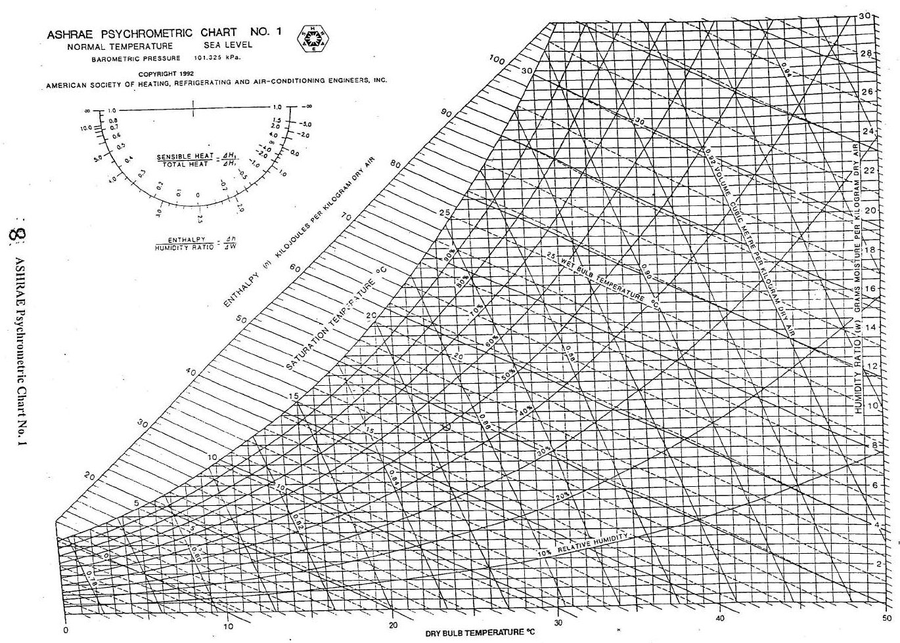
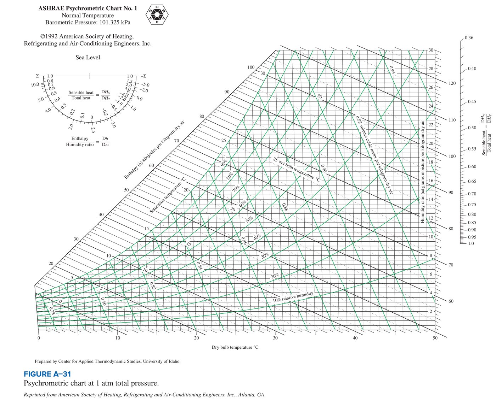

<!-- pagebreak -->
# Module 1: Cooling load estimation by the CLTD/CLF method

| | |
|---|---|
| **Where it appears** | Every paper, 2011-12 to 2023-24: Q1(a) of Section A (2011-12, 2012-13), Q8 of Section B (2013-14 to 2022-23), compulsory Q4 of Section A (2023-24) |
| **Share of all marks** | 13.3% (405 of 3055 weighted marks): 35 marks a year, 45 in 2022-23 and 2023-24. The single most valuable question in the course. |
| **Time** | core 3 h (§1.1–1.9 and Solution 1.1), full 5 h (all eleven solutions) |
| **Sources** | Arif pp.32–59; Note pp.97–117; Rifat pp.15–28; Data Book Tables 9–28; Ameen §10.1 |

**How it has been asked:**

- **Always one long numerical**, "Estimate the cooling load of a class-room for N students at h pm for the following conditions", with location, date, floor size, roof, walls, windows and lights given, and three standing assumptions: "(i) Assume standard indoor conditions as recommended in ASHRAE. (ii) Assume no heat transfer through floor, south and east walls. (iii) Assume reasonable electrical appliances."
- **The template classroom (seven papers):** "Roof: **Type 5, without suspended, 25 mm wood, 25 mm insulation**; Walls: **254 mm brick with 12.5 mm plaster on both sides**; Windows: x% of wall area on **north and west walls**, 10 mm clear glass" (**2013-14, 2015-16, 2016-17, 2020-21, 2021-22, 2022-23, 2023-24**). Only the number of students (30–65), the floor size, the hour (3, 4 or 5 pm), the date (April 15 to July 15), the glass percentage (12–22%), the glass U (2.5–2.9) and the lighting density (20–30 W/m²) change.
- **The concrete-roof classroom:** "Roof: type 4, 100 mm concrete, 25 mm insulation; Walls: 100 mm face brick + air space + 100 mm face brick (type c)", 10 m × 10 m × 3 m (**2012-13, 2018-19**, nearly identical). 2012-13 adds "fresh air supply required for 25 students, as recommended in ASHRAE".
- **The office:** "office room … Roof: Type 4 … Walls: Type G, metal curtain wall" (2011-12) and "Type 4, 100 mm concrete with 50 mm insulation; Walls: 100 mm face brick + 100 mm common brick (Type D) … 9 people using 3 computers @ 90 W … ASHRAE standard in door design conditions and ventilation air supply" (2017-18).
- No theory part has ever been asked. All the marks are for a correct, well-laid-out ledger with every data-book look-up shown.

> **KEY: Toolkit for this module**
>
> - $U$ = overall heat transfer coefficient, W/(m²·K) $=1/R_{th}$; $R_{th}=\sum R$ for layers in series, m²·K/W. $A$ = area, m².
> - $T_i$ (also $T_R$) = room design dry bulb, 25.5 °C. $T_{o}$ = outdoor design dry bulb (Table 9, 2.5% column). $DR$ = mean daily range. $T_{o,av}=T_o-DR/2$ = mean outdoor temperature.
> - **Shaded partition, door or glass next to a known temperature:** $Q=UA\,(T_{adj}-T_i)$.
> - **Sunlit roof or wall:** $Q=UA\,CLTD_c$ with
> $$CLTD_c=\big[(CLTD+LM)K+(25.5-T_i)+(T_{o,av}-29.4)\big]f$$
>   CLTD from Table 12(b) (roofs) or Table 15 (walls); $LM$ from Table 13; $K=1$ dark, 0.5 light; $f=1$ (no attic fan), 0.75 (ventilated attic).
> - **Glass:** conduction $Q=UA\,CLTD$ (Table 20, uncorrected); solar $Q=A\cdot SC\cdot SHGF_{max}\cdot CLF$ (Tables 21, 18(a), 19).
> - **People:** $Q_S=n\,q_S\,CLF$, $Q_L=n\,q_L$ (Table 28; CLF from Table 27, = 1 for a classroom).
> - **Lights:** $Q=(\text{W/m}^2\times A_{floor})\times BF\times D\times CLF$; $BF=1.2$ fluorescent, 1.0 incandescent; $D=1$; $CLF=0.85$ (or Table 24).
> - **Equipment:** $Q=P\times CLF$, $CLF=1$.
> - **Outdoor air:** $Q_S=1200\,\dot V\,(T_o-T_i)$, $Q_L=3010\times10^3\,\dot V\,(\omega_o-\omega_i)$, with $\dot V$ in m³/s. 1 ACH: $\dot V=\text{room volume}/3600$.
> - **Total:** $Q_T=\sum Q_S+\sum Q_L$ in W; 1 TR = 3.517 kW.

## 1.1 What a cooling load is ★

The **cooling load** of a room is the rate at which heat must be removed from the room air to hold it at the design dry bulb and humidity. It is what the air-conditioner must be sized for [Arif p.36; Ameen ch.13].

It is not the same as the **heat gain**, the rate at which heat enters or is generated in the room at that instant. Part of every heat gain is radiation (sun through glass, lamps, people, warm wall surfaces). Radiation does not heat the air directly. It is first absorbed by the floor, furniture and walls, which warm up and give the heat to the air later by convection. So:

- the cooling load **lags** the heat gain by a few hours;
- the peak cooling load is **smaller** than the peak heat gain;
- a heavy building (thick brick, concrete) lags and damps more than a light one (steel sheet, metal curtain wall).

The CLTD/CLF method builds both effects into tabulated factors, so that the cooling load at a given hour comes from one multiplication per item.

- **CLTD** (cooling load temperature difference) is an equivalent temperature difference. Multiplied by $UA$, it gives the cooling load due to conduction through a sunlit roof or wall at that hour. It includes the sun on the outer surface and the time lag of the wall [Arif p.36].
- **CLF** (cooling load factor) is the fraction of an instantaneous gain (solar through glass, people, lights, equipment) that appears as cooling load at the hour in question.

**Sensible and latent load.** Sensible heat raises the air dry bulb. Latent heat is the moisture added to the air (by people and by humid outdoor air), which the cooling coil must condense. The coil removes both, so both are added for the total. Their ratio, the sensible heat ratio $SHR=Q_S/Q_T$, is needed later to find the supply-air state (Module 6).

**The components of the load** [Arif pp.36–58; Note pp.97–101]:

| No. | Component | Formula | Kind |
|---|---|---|---|
| 1 | Conduction through shaded partitions, doors, partition glass | $UA\,TD$ | sensible |
| 2 | Conduction through the sunlit roof, sunlit walls and glass | $UA\,CLTD_c$ (glass: $UA\,CLTD$) | sensible |
| 3 | Solar heat through glass | $A\,SC\,SHGF_{max}\,CLF$ | sensible |
| 4 | Outdoor air (infiltration or ventilation) | $1200\dot V\Delta T$; $3010\times10^3\dot V\Delta\omega$ | sensible + latent |
| 5 | Occupants | $nq_S\,CLF$; $nq_L$ | sensible + latent |
| 6 | Equipment | $P\,CLF$ | sensible |
| 7 | Lights | $W\,BF\,D\,CLF$ | sensible |

This is exactly the seven-row summary table of Arif sir's example [Arif p.58]; end every answer with it.

**Ton of refrigeration.** 1 TR is the rate of heat removal that freezes 1 short ton (2000 lb) of water at 0 °C in 24 h: $2000\times144$ Btu / 24 h = 12 000 Btu/h = **3.517 kW** (the notes round it to 3.516) [Rifat p.15].

## 1.2 Design conditions (Tables 9 and 11) ★

**Outdoors: Table 9** [Data Book Table 9; Note p.97]. Take the **2.5% summer design dry bulb** (exceeded only 2.5% of the summer hours), the **coincident 2.5% wet bulb** and the **mean daily range**. The only Bangladesh station printed is **Chittagong** (22°21′ N): 

| Station | DB 1% | **DB 2.5%** | DB 5% | **Daily range** | WB 1% | **WB 2.5%** |
|---|---|---|---|---|---|---|
| Chittagong | 34 | **33 °C** | 32 | **11 °C** | 28 | **27 °C** |

> **TIP: Dhaka is not in Table 9**
>
> The data book's Table 9 stops after Brazil and has no Dhaka row. For a Dhaka question (2011-12, 2012-13, 2020-21), write "Dhaka is not listed; Chittagong, the only Bangladesh station, is used: 33 °C DB, 27 °C WB, daily range 11 °C." Both cities are near 23° N and have similar summer design conditions, and this is what the class solutions do [Note p.106; Arif p.43].

**Mean outdoor temperature** for the CLTD correction [Arif p.46]:

$$T_{o,av}=T_{o}-\frac{DR}{2}=33-\frac{11}{2}=27.5\ ^\circ\text{C}$$

**Indoors: Table 11** [Data Book Table 11]. "Standard indoor conditions as recommended in ASHRAE" means this table:

| Premise | DB | RH (min) | Use for |
|---|---|---|---|
| Offices | 25.5 °C | 55% | the office questions (2011-12, 2015-16, 2017-18) |
| Auditoriums | 25.5 °C | 50% | **classrooms** (not listed; an auditorium is the nearest: seated, dense occupancy) |

Arif sir's example uses 25.5 °C and 50% RH [Arif p.33]. With $T_i=25.5$ °C the term $(25.5-T_i)$ in the CLTD correction is zero.

**Humidity ratios** from the psychrometric chart (end of this module) [Note p.109]:

| State | Reading | $\omega$ (kg/kg dry air) |
|---|---|---|
| Outdoor, 33 °C DB, 27 °C WB | chart | **0.0202** (CoolProp 0.02023) |
| Indoor, 25.5 °C, 50% RH | chart | **0.0102** (CoolProp 0.01023) |
| Indoor, 25.5 °C, 55% RH | chart | **0.0113** (CoolProp 0.01127) |

So $\Delta\omega=0.0100$ for a classroom and $0.0089$ for an office.

::: {.mini #m-mini-design}
**Mini-example: design conditions.** An office in Dhaka. Find $T_o$, $T_{o,av}$, $T_i$ and $\Delta\omega$.

Dhaka is not in Table 9, so use Chittagong: $T_o=33$ °C, $DR=11$ °C, so $T_{o,av}=33-11/2=27.5$ °C. Table 11, offices: $T_i=25.5$ °C, 55%. Chart: $\omega_o=0.0202$, $\omega_i=0.0113$, so $\Delta\omega=0.0202-0.0113=0.0089$.
:::

## 1.3 U-values from layers or from the tables ★

**Resistances** [Arif p.37]. Heat crosses the outside air film, each layer, and the inside air film in series:

$$R_{th}=R_o+\sum\frac{L}{k}+R_i,\qquad U=\frac{1}{R_{th}}$$

(for parallel paths the conductances add: $1/R_{th}=\sum 1/R_i$, area-weighted).

![Fig. 1: Wall section: outside film, plaster, brick, plaster, inside film, in series [Note p.105]](figures/001.png "w=0.45")

**Film resistances.** The course uses the Table 16 codes **A0 = 0.059** (outside) and **E0 = 0.121** (inside) m²·K/W in every calculation [Arif pp.39–42; Note pp.104–112]. Table 10 gives the same films from first principles: inside still air, vertical wall, $R=0.12$; outside summer wind 3.4 m/s, $R=0.044$ (winter 0.030) [Arif p.37]. Use A0 and E0; they are what the roof and wall tables were built with.

**Two routes to U** [Arif p.38]:

1. **Build it from layers.** Table 12(a) gives the layer codes of each roof, Table 14 those of each wall group. Table 16 gives each code's $R$ (or $L$ and $k$; use the *actual* thickness with $R=L/k$). Table 17 gives $k$ for other materials (oak door: $k=0.16$ W/m·K [Arif p.42]).
2. **Read it from the table.** Table 12(b) prints $U$ for each of the 13 roofs (with the "or 50 mm insulation" value in brackets); Table 14 prints $U$ for each wall construction.

**Rule for this guide:** when the roof or wall matches a listed construction, take $U$ **from Table 12(b) or Table 14**. Build from layers only when it does not (the 254 mm brick wall; a roof with 75 mm insulation). This sidesteps the B7 misprint below.

> **EXAMPLE 1.2** `[Note pp.111–112; walls and roof of the template classroom]` (a) Find $U$ for a 254 mm brick wall with 12.5 mm plaster on both sides, and with 12.7 mm plaster. (b) Find $U$ for roof 2 of Table 12(a) (25 mm wood + 25 mm insulation) from its layers, and compare with Table 12(b).
>
> **[TUTOR-GENERATED]** (method of Note p.112)
>
> (a) Table 16: C4 common brick $k=0.727$; E1 plaster $k=0.7277$ W/m·K. Use the actual thicknesses.
>
> | Layer | Code | $R$ (m²·K/W) |
> |---|---|---|
> | outside film | A0 | 0.059 |
> | 12.5 mm plaster | E1, $0.0125/0.7277$ | 0.0172 |
> | 254 mm brick | C4, $0.254/0.727$ | 0.3494 |
> | 12.5 mm plaster | E1 | 0.0172 |
> | inside film | E0 | 0.121 |
> | **total** | | **0.5638** |
>
> $U=1/0.5638=\mathbf{1.774}$ W/m²·K. With 12.7 mm plaster, $R=0.0127/0.7277=0.0175$ per side, $R_{th}=0.5644$ and $U=\mathbf{1.772}$ W/m²·K. (The class note rounds each layer first and gets 1.776; any of these earns full marks.)
>
> (b) Roof 2 layers (Table 12(a)): A0, E2, E3, B5, B7, E0. B7 is 25 mm wood with $k=0.121$, so $R_{B7}=0.025/0.121=0.207$:
> $$R_{th}=0.059+0.099+0.050+0.587+0.207+0.121=1.123,\qquad U=0.890\ \text{W/m}^2\text{K}$$
> Table 12(b) prints $U=\mathbf{0.965}$ for roof 2 (and 0.619 for roof 5, with 50 mm insulation). With the misprinted $R_{B7}=1.760$ the sum would be 2.676 and $U=0.374$, which is far too low. **Use 0.965.**

> **TRAP: The B7 misprint in Table 16**
>
> Table 16 prints $R=1.760$ for B7 (25 mm wood), but $L/k=0.025/0.121=0.207$. The 1.760 belongs to the 75 mm insulation rows (B4, B12) just above and below. The class solution of 2021-22 used it and got roof $U=0.374$, so its roof load came out 2.6 times too small [Note p.111]. Take $U=0.965$ (roof 2) or 0.619 (roof 5) straight from Table 12(b); if you must build from layers, use 0.207.

> **TRAP: Plaster thickness**
>
> Code E1 is 20 mm plaster ($R=0.026$). For 12.5 mm or 25 mm plaster do not copy 0.026: use $R=L/k$ with the real thickness ($k=0.7277$). The class note's room example used 0.026 for 25 mm plaster and got $U=2.46$ instead of 2.36 [Note p.105; Arif p.41].

::: {.mini #m-mini-u}
**Mini-example: U from layers.** The template wall, 254 mm brick with 12.5 mm plaster on both sides, is not listed in Table 14. Find $U$.

Table 16: films A0 [0.059]{.lookup t="16" row="A0" col="R_m2K_W"} and E0 [0.121]{.lookup t="16" row="E0" col="R_m2K_W"} m²·K/W; C4 common brick $k=$ [0.727]{.lookup t="16" row="C4" col="k_W_mK"}, E1 plaster $k=$ [0.7277]{.lookup t="16" row="E1" col="k_W_mK"} W/m·K. Use the actual thicknesses, not the printed $R$:

$$R_{th}=0.059+\dfrac{0.0125}{0.7277}+\dfrac{0.254}{0.727}+\dfrac{0.0125}{0.7277}+0.121=0.059+0.0172+0.3494+0.0172+0.121=0.5638$$

$U=1/0.5638=\mathbf{1.774}$ W/m²·K (with 12.7 mm plaster, **1.772**).
:::

## 1.4 Corrected CLTD for roofs and walls (Tables 12(b), 13, 14, 15) ★

### What the tables assume

ASHRAE computed the CLTD tables for one set of conditions [Arif p.44]: **July 21, 40° N latitude**, indoor 25.5 °C, mean outdoor 29.4 °C, dark surface, solar time. A Bangladesh room in April at 24° N differs on every count, so the table value is corrected [Arif p.45; Note p.98]:

$$\boxed{CLTD_c=\big[(CLTD+LM)K+(25.5-T_i)+(T_{o,av}-29.4)\big]f}$$

| Term | Meaning | Value in the exam |
|---|---|---|
| $CLTD$ | Table 12(b) (roof number, with or without suspended ceiling, solar hour) or Table 15 (wall group, facing, solar hour) | read |
| $LM$ | Table 13: latitude, month and facing (HOR for roofs) | read |
| $K$ | colour: 1.0 dark, 0.5 light (the slides; ASHRAE uses 0.65 for a medium colour) | 1.0, unless "light coloured" is stated |
| $25.5-T_i$ | indoor temperature correction | 0 for $T_i=25.5$ |
| $T_{o,av}-29.4$ | mean outdoor temperature correction | $27.5-29.4=-1.9$ °C |
| $f$ | attic fan factor: 1.0 none, 0.75 positive ventilation | 1.0 |

So for every Bangladesh question with $T_i=25.5$ °C:

$$CLTD_c=CLTD+LM-1.9$$

**Solar time.** The tables are in solar time. The course takes the clock time as solar time (3 pm = hour 15) [Rifat p.23].

### Reading Table 13

- **Latitude.** Table 13 has blocks only for 0°, 8°, 16°, 24° and 32° N. Chattogram is at 22°21′ N and Dhaka at 23°43′ N; both are nearest the **24° N** block, so use it without interpolation [Note pp.98, 107]. (Interpolating to 22.35° between 16° and 24° changes $LM$ by at most 0.3 °C; it is not expected.)
- **Month.** Months are paired by the sun's declination: Apr/Aug, May/Jul, Jun on its own. "April 15" → Apr/Aug; "May 15, May 16, July 15" → May/Jul; "June 15" → Jun.
- **Facing.** N for the north wall, E/W for the west wall, **HOR** for the roof.

The values you will need (24° N):

| Month | N | E/W | S | HOR |
|---|---|---|---|---|
| Apr/Aug | −1.1 | −0.5 | −1.6 | 0.0 |
| May/Jul | 0.5 | 0.0 | −3.3 | 0.5 |
| Jun | 1.6 | 0.0 | −3.3 | 0.5 |

> **TRAP: Table 13 stops at 32° N**
>
> The data book's Table 13 ends "(Contd.)" at 32° N; the higher latitudes are missing. This never matters for Bangladesh (use 24° N), but do not invent a 40° N row: at 40° N in July the correction is by definition about zero, which is why the CLTD tables are "for 40° N, July".

### Roofs: Table 12(b)

Pick the row by **roof number** (Table 12(a) describes each) and by **with or without suspended ceiling**. The roofs that appear in the papers, without suspended ceiling:

| Roof | Description | $U$ | CLTD at 15 | 16 | 17 h |
|---|---|---|---|---|---|
| 2 | 25 mm wood + 25 mm insulation | 0.965 | 41 | 41 | 39 |
| 4 | 50 mm h.w. concrete + 25 (or 50) mm insulation | 1.170 (0.693) | 36 | 37 | 37 |
| 5 | 25 mm wood + 50 mm insulation | 0.619 | 35 | 36 | 35 |
| 9 | 100 mm h.w. concrete + 25 (or 50) mm insulation | 1.136 (0.681) | 25 | 28 | 29 |

> **TRAP: "Type 5" or roof 2? Read the layers, not the number**
>
> Seven papers say "Roof: Type 5, without suspended, **25 mm wood, 25 mm insulation**". In Table 12(a), **roof 5 is 25 mm wood with 50 mm insulation**; 25 mm wood with **25 mm** insulation is **roof 2**. In the same way, "type 4, 100 mm concrete" (2011-12, 2012-13, 2017-18, 2018-19) describes **roof 9** (100 mm h.w. concrete); roof 4 has only 50 mm concrete.
>
> The description fixes the mass and the insulation, and those fix the CLTD and the $U$. So this guide uses the described construction: **roof 2** ($U=0.965$, CLTD 41/41/39 at 3/4/5 pm) for the template classroom, **roof 9** for the "100 mm concrete" roofs. The class solution of 2021-22 did the same [Note pp.111, 113]. Write one line in the exam: "The layers given (25 mm wood + 25 mm insulation) are roof 2 of Table 12(a); Table 12(b) row 2 is used." Each template solution also gives the total for the literal "roof 5" reading. Never mix them, e.g. the roof-5 CLTD with the roof-2 $U$.

### Walls: Tables 14 and 15

Table 15 gives CLTD for **wall groups A (heaviest) to G (lightest)**; Table 14 tells you the group of a construction. The constructions in the papers:

| Paper wall | Table 14 match | Group | $U$ |
|---|---|---|---|
| 100 mm face brick + air space + 100 mm face brick (2012-13, 2018-19: "type c") | "Air space + 101.6 mm face brick" | **C** | 2.033 |
| 100 mm face brick + 100 mm common brick (2017-18: "Type D") | "101.6 mm common brick" | **D** | 2.356 |
| Metal curtain wall (2011-12: "Type G") | metal curtain wall with insulation | **G** | 0.516–1.306 (layers) |
| **254 mm brick + plaster both sides** (template) | not listed | **C** (see below) | 1.774 (layers) |

**Choosing the group for the 254 mm brick wall.** Table 14 lists 100 mm face brick + 100 mm common brick (about 200 mm of brick, 439 kg/m²) as **group D** and 100 mm face brick + 200 mm common brick (about 300 mm, 635 kg/m²) as **group B**. A 254 mm solid brick wall with plaster (about 530 kg/m²) lies between them, so it is **group C**. The examiner's own label for the similar cavity-brick wall of 2012-13 and 2018-19 is "type c". Say this in one line.

> **TRAP: Group G is a metal curtain wall, not brick**
>
> The class solution of 2021-22 "assumed Type-G" for the 254 mm brick wall [Note p.114]. Group G is the lightest group (steel siding): its west-wall CLTD at 5 pm is 40 °C, against 11 °C for group C. A heavy brick wall delays the afternoon sun until late evening (Table 15, group C west peaks at 22 h). Using G roughly quadruples the wall load.

Group C values needed (Table 15):

| Facing | 15 h | 16 h | 17 h |
|---|---|---|---|
| N | 6 | 6 | 7 |
| W | 8 | 9 | 11 |

The figure also shows why the roof dominates the template answer: at 3–5 pm the light wood roof is at its peak (about 40 °C), while the brick walls are still near their minimum.

::: {.mini #m-mini-cltd}
**Mini-example: corrected CLTD.** Roof 2 (no suspended ceiling) and a north brick wall (group C), at 5 pm in April, 24° N. Find $CLTD_c$ for each.

- Roof: Table 12(b), roof 2, hour 17: CLTD = [39]{.lookup t="12b" row="without suspended ceiling;2" col="17"}. Table 13, 24° N, Apr/Aug, HOR: $LM=$ [0.0]{.lookup t="13" row="24;Apr/Aug" col="HOR"}. $CLTD_c=39+0.0-1.9=\mathbf{37.1}$ °C.
- North wall: Table 15, group C, N, hour 17: CLTD = [7]{.lookup t="15" row="C;N" col="17"}. Table 13, 24° N, Apr/Aug, N: $LM=$ [−1.1]{.lookup t="13" row="24;Apr/Aug" col="N"}. $CLTD_c=7-1.1-1.9=\mathbf{4.0}$ °C.

Then $Q=UA\,CLTD_c$: a 54 m² roof gives $0.965\times54\times37.1=1933.3$ W.
:::

## 1.5 Glass: conduction and solar gain ★

Glass gains heat two ways [Arif pp.50–51]:

1. **Conduction** from the warm outdoor air: $Q=U\,A\,CLTD$, with $CLTD$ from **Table 20** (a single row by solar hour: 8 °C at 15–16 h, 7 °C at 17 h). The course applies **no correction** to it [Arif p.49; Note p.98].
2. **Solar radiation** transmitted and absorbed:

$$Q=A\cdot SC\cdot SHGF_{max}\cdot CLF$$

| Factor | Table | How to read it |
|---|---|---|
| $SC$, shading coefficient | 21 | single clear glass by thickness, column $h_o=7.0$ (the course's "summer" column [Note p.99]): 6 mm 0.95, **10 mm 0.92**, **13 mm 0.88** |
| $SHGF_{max}$, W/m² | 18(a) | 24° N block, month row, facing column (N; E/W) |
| $CLF$ | 19 | facing (north glass: the "N (Shaded)" row), room construction L/M/H, solar hour |

The 24° N values you need:

| Month (Table 18(a)) | N | E/W |
|---|---|---|
| Apr. | 117 | 719 |
| May | 136 | 688 |
| June | 174 | 669 |
| July | 142 | 672 |

**Room construction for Table 19.** L = light (frame wall, about 146 kg/m² of floor), M = medium (100 mm concrete wall and slab, 340 kg/m²), H = heavy (150 mm concrete, 630 kg/m²). Brick-walled classrooms are taken as **M** [Note p.115]; the metal-curtain-wall office as **L** [Arif p.52].

| Table 19, M | 15 h | 16 h | 17 h |
|---|---|---|---|
| N (shaded) | 0.76 | 0.74 | 0.75 |
| W | 0.40 | 0.50 | 0.56 |

(L: N 0.82, W 0.45 at 15 h.)

> **TRAP: Table 18(a) has only the 24° N block**
>
> The first part of Table 18(a) (the other latitudes) is missing from the data book; p.40 begins "(Contd.)" with 24° N. This is the right block for Bangladesh, so nothing is lost, but do not look for 22° or 23° N. Table 18(b) is for **externally shaded** glass and is not used for ordinary windows.

> **TRAP: Gross wall area or net wall area**
>
> Glass is "x% of wall area". Compute the **gross** wall area (length × height), take x% of it as glass, and use the **net** area $=(1-x)\times$ gross for the opaque wall. The class solution of 2021-22 used the gross areas for the walls and then counted the glass again [Note p.114]. A door in a wall is subtracted the same way [Arif p.43].

> **TIP: North glass still gets sun**
>
> North glass receives diffuse sky radiation and, in May–July at 24° N, some direct sun in the early morning and late afternoon. Table 18(a) gives 117–174 W/m² for N, and Table 19 has a full "N (Shaded)" row. Never set the north solar gain to zero.

::: {.mini #m-mini-geometry}
**Mini-example: geometry.** A room 9 m × 6 m, 3 m high; the north wall is the 9 m side; windows are 15% of wall area on the north and west walls. Find every area and the volume.

| Quantity | North wall | West wall |
|---|---|---|
| gross area | $9\times3=27$ m² | $6\times3=18$ m² |
| glass, 15% | 4.05 m² | 2.7 m² |
| net opaque wall | $27-4.05=22.95$ m² | $18-2.7=15.3$ m² |

Floor (= roof) area $9\times6=54$ m²; volume $54\times3=162$ m³. The floor area also feeds the lights; the volume feeds the infiltration.
:::

::: {.mini #m-mini-glass-cond}
**Mini-example: glass conduction.** 4.05 m² of north glass, $U=2.8$ W/m²·K, at 5 pm.

Table 20, hour 17: CLTD = [7]{.lookup t="20" row="1700" col="CLTD_C"} °C, not corrected. $Q=UA\,CLTD=2.8\times4.05\times7=\mathbf{79.4}$ W. The same CLTD serves every facing.
:::

::: {.mini #m-mini-glass-solar}
**Mini-example: glass solar gain.** 2.7 m² of west glass, 13 mm single clear, brick room (M), at 4 pm in April.

- Table 21, single clear 13 mm, column $h_o=7.0$: $SC=$ [0.88]{.lookup t="21" row="A. Single Glass;Clear;13 mm" col="SC_ho_7.0_W_m2K"}.
- Table 18(a), 24° N, April, E/W column: $SHGF_{max}=$ [719]{.lookup t="18a" row="Apr." col="E_W"} W/m².
- Table 19, W row, M, hour 16: $CLF=$ [0.50]{.lookup t="19" row="W;M" col="16"}.

$Q=A\,SC\,SHGF_{max}\,CLF=2.7\times0.88\times719\times0.50=\mathbf{854.2}$ W. For north glass use the N column of Table 18(a) and the "N (Shaded)" row of Table 19.
:::

## 1.6 Partitions, doors and floors

A wall, door or glass between the room and an **unconditioned** space or a **shaded** outdoor face receives no sun, so no CLTD is needed [Arif p.43; Note p.97]:

$$Q=U\,A\,TD,\qquad TD=\begin{cases}T_{un}-T_i&\text{next to an unconditioned room (e.g. }30-25.5=4.5\text{ °C)}\\T_o-T_i&\text{shaded outdoor face (e.g. }33-25.5=7.5\text{ °C)}\end{cases}$$

A door's $U$ comes from $R=L/k$ with $k$ from Table 17 (hardwood, oak: 0.16 W/m·K), plus the two films [Arif p.42]. Subtract the door area from the wall it is in. A floor on the ground, or over another conditioned floor, is neglected.

In every past paper the statement "no heat transfer through floor, south and east walls" removes this whole group: **partition load = 0**. Say so in one line of the ledger; do not leave the row out silently.

::: {.mini #m-mini-partition}
**Mini-example: partition.** The 15 m² east wall (template brick, $U=1.774$) faces an unconditioned corridor at 30 °C; the room is at 25.5 °C.

$TD=30-25.5=4.5$ °C, no CLTD. $Q=UA\,TD=1.774\times15\times4.5=\mathbf{119.7}$ W. If the question says "no heat transfer through the east wall", the row is **0 W**.
:::

## 1.7 Internal loads: people, lights, equipment ★

### People (Tables 27 and 28)

$$Q_S=n\,q_S\,CLF,\qquad Q_L=n\,q_L$$

Table 28 [Data Book Table 28; Arif p.55]:

| Activity | Application | Sensible $q_S$ | Latent $q_L$ |
|---|---|---|---|
| **Moderately active office work** | office, hotel, apartment | **75 W** | **55 W** |
| Standing, light work; walking | stores | 75 | 55 |
| Light bench work | factory | 80 | 140 |
| Heavy work | factory | 170 | 255 |

Students in a classroom are seated and writing: use the **75 W / 55 W** row, as the slides and the class solutions do [Arif p.55; Note p.116].

**CLF for people (Table 27).** The sensible part is partly radiant, so Table 27 gives a CLF by hours in the space. But the table's own footnote says **CLF = 1.0 when the cooling system is shut down at night, and for high occupant densities** (theatres, auditoriums). A classroom is both, so $CLF=1$. Latent heat goes straight into the air: **no CLF**.

::: {.mini #m-mini-people}
**Mini-example: people.** 40 students in a classroom.

Table 28, moderately active office work: 75 W / 55 W; CLF = 1 (Table 27 footnote). $Q_S=40\times75\times1=\mathbf{3000}$ W, $Q_L=40\times55=\mathbf{2200}$ W. The latent goes in its own column.
:::

### Lights (Tables 22–24)

The general ASHRAE form is $Q=W\,F_u\,F_s\,CLF$: installed wattage, use factor (fraction switched on), special allowance factor (ballast losses) and CLF. The slides write the same thing as [Arif p.57; Note p.101]:

$$Q_S=(PL\times A_{floor})\times BF\times D\times CLF$$

- $PL$ = lighting power density, W/m², times the **floor** area;
- $BF$ = ballast factor ($=F_s$): **1.2 fluorescent**, 1.0 incandescent;
- $D$ = diversity ($=F_u$): **1.0** (all on);
- $CLF$ = **0.85** (the course value), or from Table 24.

**Table 24 route.** Table 24 gives the CLF by the hours the lights are on (8, 10, 12, 14, 16 h) and the hours since switch-on, for a coefficient $a$ (Table 22: furnishings, air supply and return, fixture type) and a class $b$ (Table 23: floor mass and air circulation).

> **EXAMPLE 1.3** `[Arif p.57; Data Book Tables 22–24]` Lights in a classroom are on from 8 am to 6 pm. Ordinary furniture, no carpet, medium ventilation, supply and return below the ceiling; 150 mm concrete floor, medium circulation. Find the lights CLF at 3, 4 and 5 pm, and compare with the course value 0.85.
>
> **[TUTOR-GENERATED]**
>
> - Table 22: ordinary furniture, no carpet, medium-to-high ventilation, supply and return below the ceiling → $a=0.55$.
> - Table 23: 150 mm concrete floor, medium circulation → $b=$ C.
> - Lights on for 10 h (8 am to 6 pm), so use the 10-hour table. At 3, 4 and 5 pm they have been on 7, 8 and 9 h: $CLF=$ **0.77, 0.78, 0.79**.
> - These are a little below 0.85, so the course value is slightly conservative (about 8% more light load). Use 0.85 unless the question gives the data for Tables 22–23. If the air-conditioning is switched off at night with the lights, ASHRAE takes $CLF=1$.

> **TRAP: Do not multiply W/m² by a number of lamps**
>
> "Light: 22 W/m²" is already the total lighting power per square metre of floor. Multiply by the floor area and stop. The class solution of 2021-22 multiplied again by an assumed "10 lights" and got 15 708 W instead of 1570.8 W, which by itself almost doubled the answer [Note p.116].

::: {.mini #m-mini-lights}
**Mini-example: lights.** "Light: 15 W/m² fluorescent", floor 9 m × 6 m.

$Q_S=(15\times54)\times1.2\times1\times0.85=\mathbf{826.2}$ W. No Table 24 look-up unless the question gives the furnishing and floor data for Tables 22–23.
:::

### Equipment (Tables 25, 26)

$$Q=P\times CLF$$

$P$ is the total rating of the appliances; the course takes $CLF=1$ [Arif p.56]. (Tables 25 and 26 give CLFs for hooded and unhooded appliances by hours of operation; they matter for kitchens, not offices.) "Assume reasonable electrical appliances": state what you assume. This guide takes, for every classroom, **one multimedia projector (300 W) + one computer (200 W, the slides' value) = 500 W**. For the offices the computers are given.

::: {.mini #m-mini-equipment}
**Mini-example: equipment.** A seminar room, "assume reasonable appliances".

Write the assumption: one projector 300 W + two computers 2 × 200 W. $Q_S=(300+400)\times1=\mathbf{700}$ W. Equipment is all sensible.
:::

## 1.8 Outdoor air: infiltration and ventilation ★

Outdoor air entering the room at $T_o,\omega_o$ must be cooled and dried to $T_i,\omega_i$ [Arif p.53; Note p.100]:

$$Q_S=\rho c_p\,\dot V\,(T_o-T_i)=1200\,\dot V\,(T_o-T_i)\ \text{W}$$

$$Q_L=\rho h_{fg}\,\dot V\,(\omega_o-\omega_i)=3010\times10^3\,\dot V\,(\omega_o-\omega_i)\ \text{W}$$

with $\dot V$ in m³/s. The constants are $\rho c_p\approx1.2\times1005\approx1200$ J/m³·K and $\rho h_{fg}\approx1.2\times2508\approx3010$ kJ/m³. (ASHRAE writes the same as $1.23\,Q\,\Delta T$ and $3010\,Q\,\Delta\omega$ with $Q$ in L/s; use the slides' 1200.) Note that the **design dry bulb** $T_o=33$ °C is used here, not the mean $T_{o,av}$.

**How much air?**

| Case | Flow | Source |
|---|---|---|
| Infiltration through cracks and doors | **1 air change per hour**: $\dot V=\dfrac{\text{room volume}}{3600}$ m³/s | Arif p.54 (the course default) |
| Ventilation "as recommended in ASHRAE" | ASHRAE Standard 62-1989: about 15 cfm per person, i.e. **8 L/s per person in classrooms**, **10 L/s per person in offices** | Ameen §10.1 (Arif p.97b quotes ASHRAE 62-1992: 7 L/s per student; this guide uses Ameen's 8 L/s, and either is fine if stated) |

**Rule for this guide.** When the question asks for ASHRAE fresh air or ventilation (2011-12, 2012-13, 2017-18), use the per-person rate, and take the room as slightly pressurized by it, so there is no separate infiltration. Otherwise (the template classroom), use **1 ACH**, exactly as Arif sir's example and the class solution of 2021-22 do [Note p.115]. Never add both for the same air.

> **TIP: State the air assumption in a box at the top**
>
> For a 60-student classroom, 1 ACH is only about 1.2 L/s per student, while ASHRAE ventilation (8 L/s each) would multiply the outdoor-air load by about 7 and the total by nearly 2 (Solution 1.1 shows both). Examiners accept either if it is stated. Write "Outdoor air: infiltration 1 ACH (no ventilation rate given)" in your list of assumptions.

> **TRAP: Arif sir's $\omega_o$ slip**
>
> On the slide, the latent load uses $\omega_o=20.5\times10^{-3}$, but the next line reads $W_o=21.5\times10^{-3}$ [Arif p.54], and Rifat vai's copy gives the indoor state as "55% RH" for 50% [Rifat p.26]. The chart gives 20.2 g/kg at 33 °C / 27 °C and 10.2 g/kg at 25.5 °C / 50%. Use $\Delta\omega=0.0100$.

::: {.mini #m-mini-air}
**Mini-example: outdoor air.** A 162 m³ classroom for 40 students; $T_o=33$ °C, $T_i=25.5$ °C, $\Delta\omega=0.0100$.

- No ventilation rate asked, so 1 ACH: $\dot V=162/3600=0.045$ m³/s. $Q_S=1200\times0.045\times7.5=\mathbf{405}$ W; $Q_L=3010\times10^3\times0.045\times0.0100=\mathbf{1354.5}$ W.
- If the paper asked for ASHRAE ventilation instead: $\dot V=40\times8=320$ L/s $=0.32$ m³/s, $Q_S=2880$ W, $Q_L=9632$ W. One or the other, never both.
:::

## 1.9 The ledger: putting it together ★

Lay out every answer in the same order, with the look-up beside each number. Examiners mark the look-ups.

1. **Assumptions box:** outdoor and indoor design conditions; latitude 24° N; solar time = clock time; K = 1, f = 1; roof row; wall group; room construction for Table 19; air flow; appliances.
2. **Geometry:** floor area, volume, gross wall areas (N, W), glass areas, net wall areas.
3. **U-values:** roof, walls, glass (given), doors.
4. **CLTD table:** for roof, N wall, W wall: CLTD, LM, $CLTD_c$; glass CLTD.
5. **Loads 1–7** (the table in §1.1), each with its formula.
6. **Summary:** sensible column, latent column, total in W, kW and **TR**.

> **EXAMPLE 1.1** `[Arif pp.33–59; Rifat pp.16–28]` (the lecture example) An office, 10 m × 10 m × 3.0 m high, at 25.5 °C and 50% RH, on 12 April at 5 pm. West and south walls: metal curtain wall, construction type G with 75 mm insulation, sunlit, dark. Partition walls N and E: 127 mm brick with 25 mm plaster on both sides; 30 °C unconditioned space to the north, open (shaded) space to the east. Roof: type 4 with 50 mm insulation, no suspended ceiling. Windows: 6 m² on the west and 6 m² on the east wall, $U=2.86$ W/m²·K, 13 mm, light construction. No heat transfer through the floor. 1.0 air change per hour. Lights and occupants from 8 am to 6 pm; 25 W/m² fluorescent. Five occupants seated, using one computer. Door in the north wall: 2 m × 1 m, 25 mm hardwood. Find the cooling load.
>
> ![Fig. 3: Room plan of the lecture example [Arif p.33]](figures/003.png "w=0.34")
>
> **[FROM SOURCE: Arif pp.33–59]**
>
> *U-values.* Roof 4 with B5 replaced by B6 (50 mm insulation): $R_{th}=0.059+0.099+0.050+1.173+0.029+0.121=1.531$, $U=0.653$ (the slide prints 1.581, a misprint; its $U$ is right). Curtain wall A0, A3, B12, A3, E0: $R=0.059+0+1.76+0+0.121=1.94$, $U=0.52$. Partition: $0.059+2(0.0343)+0.127/0.727+0.121=0.4236$, $U=2.36$. Door: $R=0.025/0.16=0.156$, $R_{th}=0.336$, $U=2.98$.
>
> *1. Partitions* ($TD=30-25.5=4.5$ to the north, $33-25.5=7.5$ to the shaded east):
>
> | Item | $A$ | $U$ | $TD$ | $Q$ (W) |
> |---|---|---|---|---|
> | N partition | $30-2=28$ | 2.36 | 4.5 | 297.4 |
> | Door | 2 | 2.98 | 4.5 | 26.8 |
> | E partition | $30-6=24$ | 2.36 | 7.5 | 424.8 |
> | E glass (shaded) | 6 | 2.86 | 7.5 | 128.7 |
> | **Total** | | | | **877.7** |
>
> *2. Sunlit surfaces.* Roof 4 at 17 h: CLTD 37, LM (24° N, Apr, HOR) 0 → $CLTD_c=37+0-1.9=35.1$. West wall G at 17 h: $40-0.5-1.9=37.6$. South wall G: $17-1.6-1.9=13.5$. Glass at 17 h: 7.
>
> | Item | $A$ | $U$ | $CLTD_c$ | $Q$ (W) |
> |---|---|---|---|---|
> | Roof | 100 | 0.653 | 35.1 | 2292.0 |
> | S wall | 30 | 0.52 | 13.5 | 210.6 |
> | W wall | $30-6=24$ | 0.52 | 37.6 | 469.2 |
> | W glass | 6 | 2.86 | 7 | 120.1 |
> | **Total** | | | | **3092.0** |
>
> *3. Solar, west glass:* $6\times0.88\times719\times0.64=2429.6\approx2430$ W (SC 13 mm, $h_o=7$; SHGF April W; CLF W, L, 17 h).
>
> *4. Air:* $\dot V=300/3600=0.0833$ m³/s; $Q_S=1200(0.0833)(7.5)=750$ W; $Q_L=3010\times10^3(0.0833)(0.0205-0.0100)=2632.7$ W.
>
> *5. People:* $5\times75=375$ W, $5\times55=275$ W. *6. Equipment:* one computer, 200 W. *7. Lights:* $25\times100\times1.2\times1\times0.85=2550$ W.
>
> | Load | $Q_S$ | $Q_L$ |
> |---|---|---|
> | 1. Partitions | 877.7 | |
> | 2. Roof, sunlit walls, glass | 3092.0 | |
> | 3. Solar through glass | 2430 | |
> | 4. Air exchange | 750 | 2632.7 |
> | 5. Occupants | 375 | 275 |
> | 6. Equipment | 200 | |
> | 7. Lights | 2550 | |
> | **Total** | **10274.7** | **2907.7** |
>
> $Q_T=13182.4$ W $=13.18$ kW $=\mathbf{3.75}$ **TR**. With the chart values $\Delta\omega=0.0100$ (TRAP in §1.8) the air latent load is 2507 W and the total 3.71 TR; the slide's answer stands to two figures.

<!-- pagebreak -->

## 1.10 Term-final questions with solutions

All eleven questions are one archetype. They come in three families:

| Family | Papers | Roof (Table 12(b)) | Wall (Table 15) | Solved in full |
|---|---|---|---|---|
| A. Template classroom | 23-24, 22-23, 21-22, 20-21, 16-17, 15-16, 13-14 | roof 2, $U=0.965$ | 254 mm brick, group C, $U=1.774$ / 1.772 | Solution 1.1 |
| B. Concrete-roof classroom | 12-13, 18-19 | roof 9, $U=1.136$ | cavity face brick, group C, $U=2.033$ | Solution 1.8 |
| C. Office | 17-18, 11-12 | roof 9, $U=0.681$ / layers | group D / group G | Solution 1.11 |

Standing assumptions, used in every solution unless the solution says otherwise:

- Outdoor: Table 9, Chittagong (also for Dhaka): 33 °C DB, 27 °C WB, daily range 11 °C, $T_{o,av}=27.5$ °C; $\omega_o=0.0202$.
- Indoor: Table 11: classroom → auditorium 25.5 °C, 50% ($\omega_i=0.0102$); office 25.5 °C, 55% ($\omega_i=0.0113$).
- Latitude 24° N for Tables 13 and 18(a); solar time = clock time; dark surfaces $K=1$; no attic fan $f=1$; so $CLTD_c=CLTD+LM-1.9$.
- "North and west walls" exposed; the **first** floor dimension is the north wall, the second the west wall. South, east, floor: no heat transfer, so the partition load is zero.
- Glass: SC from Table 21 ($h_o=7.0$); Table 19 medium construction (M) for brick rooms; glass CLTD from Table 20, uncorrected.
- People 75 W / 55 W, CLF 1; lights $\times1.2\times1\times0.85$; equipment 500 W per classroom, CLF 1.
- Outdoor air 1 ACH unless ASHRAE ventilation is asked.

### Family A: the template classroom

> **TRY 1.1** `[PP 23-24 Q4, 45]` Estimate the cooling load of a class-room for 60 students at 3 pm for the following conditions:
>
> - Location: Chattogram
> - Date: June 15
> - Floor: 11 m × 7 m, 3.3 m height
> - Roof: Type 5, without suspended, 25 mm wood, 25 mm insulation
> - Walls: 254 mm brick with 12.5 mm plaster on both sides
> - Windings: 22% of wall area on north and west walls. 10 mm clear glass, $U=2.9$ W/m²·°C
> - Light: 20 W/m² fluorescent bulbs
>
> (i) Assume standard indoor conditions as recommended in ASHRAE. (ii) Assume no heat transfer through floor, south and east walls. (iii) Assume reasonable electrical appliances.

**Solution 1.1** **[TUTOR-GENERATED]** (method of Arif pp.33–59 and Note pp.111–117, with the errata of §1.3–1.8 corrected). This is the model answer for every template paper. Work it step by step; open a hint if stuck, the step to check.

::: {.problem #sol-1-1}

::: {.step title="Step 0. Assumptions"}
::: hint
Outdoor: Table 9 (Chittagong; also for Dhaka). Indoor: Table 11 (classroom → auditorium, office → offices). $\omega$ from the chart. Then fix the roof row, the wall group, the Table 19 construction, the air flow and the appliances. See the [design-conditions mini-example](#m-mini-design) and the standing assumptions of §1.10.
:::
- Outdoor design (Table 9, Chattogram, 2.5%): $T_o=33$ °C DB, 27 °C WB, $DR=11$ °C, so $T_{o,av}=33-11/2=27.5$ °C.
- Indoor (Table 11; a classroom is not listed, the auditorium row is the nearest): $T_i=25.5$ °C, 50% RH.
- $\omega_o=0.0202$ (33 °C / 27 °C), $\omega_i=0.0102$ (25.5 °C / 50%), from the chart: $\Delta\omega=0.0100$.
- Latitude 22°21′ N → 24° N block of Tables 13 and 18(a). Solar time = clock time: 3 pm = 15 h. June → "Jun" in Table 13, "June" in Table 18(a).
- Roof: the layers described (25 mm wood + 25 mm insulation) are **roof 2** of Table 12(a) (roof 5 has 50 mm insulation). Table 12(b), roof 2, no suspended ceiling: $U=0.965$.
- Walls: 254 mm brick lies between Table 14's group D (200 mm brick) and group B (300 mm brick): **group C**. Dark: $K=1$; no attic fan: $f=1$.
- Glass: Table 19 medium construction (M). Outdoor air: infiltration 1 ACH. Appliances: projector 300 W + computer 200 W = 500 W. North wall = 11 m side.
:::

::: {.step title="Step 1. Geometry"}
::: hint
North wall = first floor dimension, west wall = second. Glass = 22% of the gross area; net = gross − glass. See the [geometry mini-example](#m-mini-geometry).
:::
| Quantity | North wall | West wall |
|---|---|---|
| gross area | $11\times3.3=36.3$ m² | $7\times3.3=23.1$ m² |
| glass, 22% | 7.986 m² | 5.082 m² |
| net opaque wall | 28.314 m² | 18.018 m² |

Floor (= roof) area $11\times7=77$ m²; volume $77\times3.3=254.1$ m³.
:::

::: {.step title="Step 2. U-values"}
::: hint
Roof: read $U$ from Table 12(b). Wall: not listed, so build it from Table 16 layers. Glass: given. See the [U-value mini-example](#m-mini-u).
:::
Roof 2: $U=$ [0.965]{.lookup t="12b" row="without suspended ceiling;2" col="U_W_m2K"} (Table 12(b)). Wall, 12.5 mm plaster, from Table 16 layers (Example 1.2): $R_{th}=0.059+0.0172+0.3494+0.0172+0.121=0.5638$, $U=1.774$ W/m²·K. Glass $U=2.9$ (given).
:::

::: {.step title="Step 3. Corrected CLTD, roof and walls"}
::: hint
$CLTD_c=CLTD+LM-1.9$. CLTD: Table 12(b), roof 2, hour 15; Table 15, group C, N and W, hour 15. LM: Table 13, 24° N, **Jun**, columns HOR, N, E/W. See the [corrected-CLTD mini-example](#m-mini-cltd).
:::
| Surface | CLTD at 15 h | $LM$ (24° N, Jun) | $CLTD_c$ (°C) |
|---|---|---|---|
| Roof 2 | [41]{.lookup t="12b" row="without suspended ceiling;2" col="15"} | [+0.5]{.lookup t="13" row="24;Jun" col="HOR"} (HOR) | $41+0.5-1.9=39.6$ |
| N wall, group C | [6]{.lookup t="15" row="C;N" col="15"} | [+1.6]{.lookup t="13" row="24;Jun" col="N"} (N) | $6+1.6-1.9=5.7$ |
| W wall, group C | [8]{.lookup t="15" row="C;W" col="15"} | [0.0]{.lookup t="13" row="24;Jun" col="E_W"} (E/W) | $8+0.0-1.9=6.1$ |

| Item | Calculation | $Q_S$ (W) |
|:---|:---|---:|
| Roof | $0.965\times77\times39.6$ | 2942.5 |
| North wall (net) | $1.774\times28.314\times5.7$ | 286.3 |
| West wall (net) | $1.774\times18.018\times6.1$ | 195.0 |
:::

::: {.step title="Step 4. Glass conduction"}
::: hint
$Q=UA\,CLTD$ with the glass areas of Step 1; CLTD from Table 20 at hour 15, **not corrected**. See the [glass-conduction mini-example](#m-mini-glass-cond).
:::
Table 20, hour 15: CLTD = [8]{.lookup t="20" row="1500" col="CLTD_C"} °C.

| Item | Calculation | $Q_S$ (W) |
|:---|:---|---:|
| Glass conduction, N | $2.9\times7.986\times8$ | 185.3 |
| Glass conduction, W | $2.9\times5.082\times8$ | 117.9 |
:::

::: {.step title="Step 5. Glass solar gain"}
::: hint
$Q=A\,SC\,SHGF_{max}\,CLF$. SC: Table 21, 10 mm clear, $h_o=7.0$. SHGF: Table 18(a), 24° N, **June**, N and E/W columns. CLF: Table 19, medium (M), hour 15, rows “N (Shaded)” and W. See the [glass-solar mini-example](#m-mini-glass-solar).
:::
SC = [0.92]{.lookup t="21" row="A. Single Glass;Clear;10 mm" col="SC_ho_7.0_W_m2K"} (Table 21). $SHGF_{max}$ (Table 18(a), 24° N, June): N [174]{.lookup t="18a" row="June" col="N"}, W [669]{.lookup t="18a" row="June" col="E_W"} W/m². CLF (Table 19, M, 15 h): N [0.76]{.lookup t="19" row="N (Shaded);M" col="15"}, W [0.40]{.lookup t="19" row="W;M" col="15"}.

| Item | Calculation | $Q_S$ (W) |
|:---|:---|---:|
| Glass solar, N | $7.986\times0.92\times174\times0.76$ | 971.6 |
| Glass solar, W | $5.082\times0.92\times669\times0.40$ | 1251.1 |
:::

::: {.step title="Step 6. Partitions"}
::: hint
Read the question's assumptions about the floor and the south and east walls. See the [partition mini-example](#m-mini-partition).
:::
Floor, south and east walls: no heat transfer (given) → **0 W**. Keep the row in the ledger.
:::

::: {.step title="Step 7. People"}
::: hint
Table 28, moderately active office work; CLF = 1 (Table 27 footnote); latent has no CLF. See the [people mini-example](#m-mini-people).
:::
Table 28: [75]{.lookup t="28" row="Moderately active office work" col="sensible_heat_W"} W / [55]{.lookup t="28" row="Moderately active office work" col="latent_heat_W"} W; CLF = 1.

| Item | Calculation | $Q_S$ (W) | $Q_L$ (W) |
|:---|:---|---:|---:|
| People | $60\times75$; $60\times55$ | 4500.0 | 3300.0 |
:::

::: {.step title="Step 8. Lights"}
::: hint
W/m² × **floor** area × 1.2 × 1 × 0.85. Never × a number of lamps. See the [lights mini-example](#m-mini-lights).
:::
| Item | Calculation | $Q_S$ (W) |
|:---|:---|---:|
| Lights | $20\times77\times1.2\times0.85$ | 1570.8 |
:::

::: {.step title="Step 9. Equipment"}
::: hint
“Reasonable appliances”: state them; for a classroom, projector 300 W + computer 200 W. See the [equipment mini-example](#m-mini-equipment).
:::
| Item | Calculation | $Q_S$ (W) |
|:---|:---|---:|
| Equipment | projector 300 + PC 200 | 500.0 |
:::

::: {.step title="Step 10. Outdoor air"}
::: hint
No ventilation rate asked → 1 ACH, $\dot V=$ volume/3600. Use the design $T_o=33$ °C (not $T_{o,av}$) and $\Delta\omega$ from Step 0. See the [outdoor-air mini-example](#m-mini-air).
:::
1 ACH: $\dot V=254.1/3600=0.0706$ m³/s. $\Delta T=33-25.5=7.5$ °C, $\Delta\omega=0.0100$.

| Item | Calculation | $Q_S$ (W) | $Q_L$ (W) |
|:---|:---|---:|---:|
| Outdoor air, 1 ACH | $1200(0.0706)(7.5)$; $3010\times10^3(0.0706)(0.0100)$ | 635.4 | 2125.1 |
:::

::: {.step title="Step 11. The ledger and the total"}
::: hint
Collect every row in two columns, sensible and latent; add; convert with 1 TR = 3.517 kW.
:::
| Item | Calculation | $Q_S$ (W) | $Q_L$ (W) |
|:-------------------|:--------------------------------------|---------:|---------:|
| Partitions | none | 0 | |
| Roof | $0.965\times77\times39.6$ | 2942.5 | |
| North wall (net) | $1.774\times28.314\times5.7$ | 286.3 | |
| West wall (net) | $1.774\times18.018\times6.1$ | 195.0 | |
| Glass conduction, N | $2.9\times7.986\times8$ | 185.3 | |
| Glass conduction, W | $2.9\times5.082\times8$ | 117.9 | |
| Glass solar, N | $7.986\times0.92\times174\times0.76$ | 971.6 | |
| Glass solar, W | $5.082\times0.92\times669\times0.40$ | 1251.1 | |
| People | $60\times75$; $60\times55$ | 4500.0 | 3300.0 |
| Lights | $20\times77\times1.2\times0.85$ | 1570.8 | |
| Equipment | projector 300 + PC 200 | 500.0 | |
| Outdoor air, 1 ACH | $1200(0.0706)(7.5)$; $3010\times10^3(0.0706)(0.0100)$ | 635.4 | 2125.1 |
| **Sum** | | **13155.9** | **5425.1** |

**Total $= 13155.9+5425.1 = 18581.0$ W $= 18.58$ kW $= 5.28$ TR** (SHR $= 0.71$).
:::

:::

::: answer
**Answer: cooling load = 18581.0 W ≈ 18.6 kW ≈ 5.3 TR** (for example two 3-TR split units).
:::

Two alternative readings, for reference (state them in one line if you have time):

- *Literal "Type 5" roof* (roof 5: $U=0.619$, CLTD 35 at 15 h, $CLTD_c=35+0.5-1.9=33.6$): roof $0.619\times77\times33.6=1601.5$ W, total $17240.0$ W $=4.90$ TR.
- *ASHRAE ventilation instead of 1 ACH* (8 L/s × 60 = 0.480 m³/s): $Q_S=4320.0$ W, $Q_L=14448.0$ W, total $34588.5$ W $=9.83$ TR. The air is then the largest load, which is why the assumption must be stated.

> **TRY 1.2** `[PP 22-23 Q8, 45]` Estimate the cooling load of a class-room for 50 students at 4 pm for the following conditions:
>
> - Location: Chattogram
> - Date: July 15
> - Floor: 12 m × 8 m, 3.5 m height
> - Roof: Type 5, without suspended, 25 mm wood, 25 mm insulation
> - Walls: 254 mm brick with 12.5 mm plaster on both sides
> - Windings: 20% of wall area on north and west walls. 10 mm clear glass, $U=2.5$ W/m²·°C
> - Light: 30 W/m² fluorescent bubls
>
> (i) Assume standard indoor conditions as recommended in ASHRAE. (ii) Assume no heat transfer through floor, south and east walls. (iii) Assume reasonable electric appliances.

**Solution 1.2** **[TUTOR-GENERATED]** Work it step by step; open a hint if stuck, the step to check.

::: {.problem #sol-1-2}

::: {.step title="Step 0. Assumptions"}
::: hint
Outdoor: Table 9 (Chittagong; also for Dhaka). Indoor: Table 11 (classroom → auditorium, office → offices). $\omega$ from the chart. Then fix the roof row, the wall group, the Table 19 construction, the air flow and the appliances. See the [design-conditions mini-example](#m-mini-design) and the standing assumptions of §1.10.
:::
As Solution 1.1, with these changes. 4 pm = 16 h; July → May/Jul (Table 13) and July (Table 18(a)). North wall $12\times3.5=42$ m² (glass 8.4, net 33.6), west wall $8\times3.5=28$ m² (glass 5.6, net 22.4); floor 96 m², volume 336 m³.
:::

::: {.step title="Step 1. Geometry"}
::: hint
North wall = first floor dimension, west wall = second. Glass = 20% of the gross area; net = gross − glass. See the [geometry mini-example](#m-mini-geometry).
:::
| Quantity | North wall | West wall |
|---|---|---|
| gross area | $12\times3.5=42$ m² | $8\times3.5=28$ m² |
| glass, 20% | 8.4 m² | 5.6 m² |
| net opaque wall | 33.6 m² | 22.4 m² |

Floor (= roof) area $12\times8=96$ m²; volume $96\times3.5=336.0$ m³.
:::

::: {.step title="Step 2. U-values"}
::: hint
Roof: read $U$ from Table 12(b). Wall: not listed, so build it from Table 16 layers. Glass: given. See the [U-value mini-example](#m-mini-u).
:::
Roof 2: $U=$ [0.965]{.lookup t="12b" row="without suspended ceiling;2" col="U_W_m2K"} (Table 12(b)). Wall, 12.5 mm plaster, from Table 16 layers (Example 1.2): $R_{th}=0.059+0.0172+0.3494+0.0172+0.121=0.5638$, $U=1.774$ W/m²·K. Glass $U=2.5$ (given).
:::

::: {.step title="Step 3. Corrected CLTD, roof and walls"}
::: hint
$CLTD_c=CLTD+LM-1.9$. CLTD: Table 12(b), roof 2, hour 16; Table 15, group C, N and W, hour 16. LM: Table 13, 24° N, **May/Jul**, columns HOR, N, E/W. See the [corrected-CLTD mini-example](#m-mini-cltd).
:::
| Surface | CLTD at 16 h | $LM$ (24° N, May/Jul) | $CLTD_c$ (°C) |
|---|---|---|---|
| Roof 2 | [41]{.lookup t="12b" row="without suspended ceiling;2" col="16"} | [+0.5]{.lookup t="13" row="24;May/Jul" col="HOR"} (HOR) | $41+0.5-1.9=39.6$ |
| N wall, group C | [6]{.lookup t="15" row="C;N" col="16"} | [+0.5]{.lookup t="13" row="24;May/Jul" col="N"} (N) | $6+0.5-1.9=4.6$ |
| W wall, group C | [9]{.lookup t="15" row="C;W" col="16"} | [0.0]{.lookup t="13" row="24;May/Jul" col="E_W"} (E/W) | $9+0.0-1.9=7.1$ |

| Item | Calculation | $Q_S$ (W) |
|:---|:---|---:|
| Roof | $0.965\times96\times39.6$ | 3668.5 |
| North wall (net) | $1.774\times33.6\times4.6$ | 274.2 |
| West wall (net) | $1.774\times22.4\times7.1$ | 282.1 |
:::

::: {.step title="Step 4. Glass conduction"}
::: hint
$Q=UA\,CLTD$ with the glass areas of Step 1; CLTD from Table 20 at hour 16, **not corrected**. See the [glass-conduction mini-example](#m-mini-glass-cond).
:::
Table 20, hour 16: CLTD = [8]{.lookup t="20" row="1600" col="CLTD_C"} °C.

| Item | Calculation | $Q_S$ (W) |
|:---|:---|---:|
| Glass conduction, N | $2.5\times8.4\times8$ | 168.0 |
| Glass conduction, W | $2.5\times5.6\times8$ | 112.0 |
:::

::: {.step title="Step 5. Glass solar gain"}
::: hint
$Q=A\,SC\,SHGF_{max}\,CLF$. SC: Table 21, 10 mm clear, $h_o=7.0$. SHGF: Table 18(a), 24° N, **July**, N and E/W columns. CLF: Table 19, medium (M), hour 16, rows “N (Shaded)” and W. See the [glass-solar mini-example](#m-mini-glass-solar).
:::
SC = [0.92]{.lookup t="21" row="A. Single Glass;Clear;10 mm" col="SC_ho_7.0_W_m2K"} (Table 21). $SHGF_{max}$ (Table 18(a), 24° N, July): N [142]{.lookup t="18a" row="July" col="N"}, W [672]{.lookup t="18a" row="July" col="E_W"} W/m². CLF (Table 19, M, 16 h): N [0.74]{.lookup t="19" row="N (Shaded);M" col="16"}, W [0.50]{.lookup t="19" row="W;M" col="16"}.

| Item | Calculation | $Q_S$ (W) |
|:---|:---|---:|
| Glass solar, N | $8.4\times0.92\times142\times0.74$ | 812.1 |
| Glass solar, W | $5.6\times0.92\times672\times0.50$ | 1731.1 |
:::

::: {.step title="Step 6. Partitions"}
::: hint
Read the question's assumptions about the floor and the south and east walls. See the [partition mini-example](#m-mini-partition).
:::
Floor, south and east walls: no heat transfer (given) → **0 W**. Keep the row in the ledger.
:::

::: {.step title="Step 7. People"}
::: hint
Table 28, moderately active office work; CLF = 1 (Table 27 footnote); latent has no CLF. See the [people mini-example](#m-mini-people).
:::
Table 28: [75]{.lookup t="28" row="Moderately active office work" col="sensible_heat_W"} W / [55]{.lookup t="28" row="Moderately active office work" col="latent_heat_W"} W; CLF = 1.

| Item | Calculation | $Q_S$ (W) | $Q_L$ (W) |
|:---|:---|---:|---:|
| People | $50\times75$; $50\times55$ | 3750.0 | 2750.0 |
:::

::: {.step title="Step 8. Lights"}
::: hint
W/m² × **floor** area × 1.2 × 1 × 0.85. Never × a number of lamps. See the [lights mini-example](#m-mini-lights).
:::
| Item | Calculation | $Q_S$ (W) |
|:---|:---|---:|
| Lights | $30\times96\times1.2\times0.85$ | 2937.6 |
:::

::: {.step title="Step 9. Equipment"}
::: hint
“Reasonable appliances”: state them; for a classroom, projector 300 W + computer 200 W. See the [equipment mini-example](#m-mini-equipment).
:::
| Item | Calculation | $Q_S$ (W) |
|:---|:---|---:|
| Equipment | projector 300 + PC 200 | 500.0 |
:::

::: {.step title="Step 10. Outdoor air"}
::: hint
No ventilation rate asked → 1 ACH, $\dot V=$ volume/3600. Use the design $T_o=33$ °C (not $T_{o,av}$) and $\Delta\omega$ from Step 0. See the [outdoor-air mini-example](#m-mini-air).
:::
1 ACH: $\dot V=336.0/3600=0.0933$ m³/s. $\Delta T=33-25.5=7.5$ °C, $\Delta\omega=0.0100$.

| Item | Calculation | $Q_S$ (W) | $Q_L$ (W) |
|:---|:---|---:|---:|
| Outdoor air, 1 ACH | $1200(0.0933)(7.5)$; $3010\times10^3(0.0933)(0.0100)$ | 839.7 | 2808.3 |
:::

::: {.step title="Step 11. The ledger and the total"}
::: hint
Collect every row in two columns, sensible and latent; add; convert with 1 TR = 3.517 kW.
:::
| Item | Calculation | $Q_S$ (W) | $Q_L$ (W) |
|:-------------------|:--------------------------------------|---------:|---------:|
| Partitions | none | 0 | |
| Roof | $0.965\times96\times39.6$ | 3668.5 | |
| North wall (net) | $1.774\times33.6\times4.6$ | 274.2 | |
| West wall (net) | $1.774\times22.4\times7.1$ | 282.1 | |
| Glass conduction, N | $2.5\times8.4\times8$ | 168.0 | |
| Glass conduction, W | $2.5\times5.6\times8$ | 112.0 | |
| Glass solar, N | $8.4\times0.92\times142\times0.74$ | 812.1 | |
| Glass solar, W | $5.6\times0.92\times672\times0.50$ | 1731.1 | |
| People | $50\times75$; $50\times55$ | 3750.0 | 2750.0 |
| Lights | $30\times96\times1.2\times0.85$ | 2937.6 | |
| Equipment | projector 300 + PC 200 | 500.0 | |
| Outdoor air, 1 ACH | $1200(0.0933)(7.5)$; $3010\times10^3(0.0933)(0.0100)$ | 839.7 | 2808.3 |
| **Sum** | | **15075.3** | **5558.3** |

**Total $= 15075.3+5558.3 = 20633.6$ W $= 20.63$ kW $= 5.87$ TR** (SHR $= 0.73$).
:::

:::

::: answer
**Answer: 20633.6 W ≈ 20.6 kW ≈ 5.9 TR.** (Literal roof-5 reading: 5.41 TR.)
:::

> **TRY 1.3** `[PP 21-22 Q8, 35]` Estimate the cooling load of a class-room for 65 students at 5 pm for the following conditions:
>
> - Location: Chattogram
> - Date: June 15
> - Floor: 10 m × 7 m, 3.0 m height
> - Roof: Type 5, without suspended ceiling, 25 mm wood, 25 mm insulation
> - Walls: 254 mm brick with 12.5 mm plaster on both sides.
> - Windings: 13% of wall area on north and west walls. 10 mm clear glass, $U=2.7$ W/m²·°C
> - Light: 22 W/m² fluorescent bulbs
>
> (i) Assume standard indoor conditions as recommended in ASHRAE. (ii) Assume no heat transfer through floor, south and east walls. (iii) Assume reasonable electrical appliances.

**Solution 1.3** **[TUTOR-GENERATED]** Work it step by step; open a hint if stuck, the step to check.

::: {.problem #sol-1-3}

::: {.step title="Step 0. Assumptions"}
::: hint
Outdoor: Table 9 (Chittagong; also for Dhaka). Indoor: Table 11 (classroom → auditorium, office → offices). $\omega$ from the chart. Then fix the roof row, the wall group, the Table 19 construction, the air flow and the appliances. See the [design-conditions mini-example](#m-mini-design) and the standing assumptions of §1.10.
:::
(the class solution [Note pp.111–117] got 8.9 TR; see the corrections below). As Solution 1.1, with: 5 pm = 17 h; June. North wall $10\times3=30$ m² (glass 3.9, net 26.1), west wall $7\times3=21$ m² (glass 2.73, net 18.27); floor 70 m², volume 210 m³.
:::

::: {.step title="Step 1. Geometry"}
::: hint
North wall = first floor dimension, west wall = second. Glass = 13% of the gross area; net = gross − glass. See the [geometry mini-example](#m-mini-geometry).
:::
| Quantity | North wall | West wall |
|---|---|---|
| gross area | $10\times3=30$ m² | $7\times3=21$ m² |
| glass, 13% | 3.9 m² | 2.73 m² |
| net opaque wall | 26.1 m² | 18.27 m² |

Floor (= roof) area $10\times7=70$ m²; volume $70\times3=210.0$ m³.
:::

::: {.step title="Step 2. U-values"}
::: hint
Roof: read $U$ from Table 12(b). Wall: not listed, so build it from Table 16 layers. Glass: given. See the [U-value mini-example](#m-mini-u).
:::
Roof 2: $U=$ [0.965]{.lookup t="12b" row="without suspended ceiling;2" col="U_W_m2K"} (Table 12(b)). Wall, 12.5 mm plaster, from Table 16 layers (Example 1.2): $R_{th}=0.059+0.0172+0.3494+0.0172+0.121=0.5638$, $U=1.774$ W/m²·K. Glass $U=2.7$ (given).
:::

::: {.step title="Step 3. Corrected CLTD, roof and walls"}
::: hint
$CLTD_c=CLTD+LM-1.9$. CLTD: Table 12(b), roof 2, hour 17; Table 15, group C, N and W, hour 17. LM: Table 13, 24° N, **Jun**, columns HOR, N, E/W. See the [corrected-CLTD mini-example](#m-mini-cltd).
:::
| Surface | CLTD at 17 h | $LM$ (24° N, Jun) | $CLTD_c$ (°C) |
|---|---|---|---|
| Roof 2 | [39]{.lookup t="12b" row="without suspended ceiling;2" col="17"} | [+0.5]{.lookup t="13" row="24;Jun" col="HOR"} (HOR) | $39+0.5-1.9=37.6$ |
| N wall, group C | [7]{.lookup t="15" row="C;N" col="17"} | [+1.6]{.lookup t="13" row="24;Jun" col="N"} (N) | $7+1.6-1.9=6.7$ |
| W wall, group C | [11]{.lookup t="15" row="C;W" col="17"} | [0.0]{.lookup t="13" row="24;Jun" col="E_W"} (E/W) | $11+0.0-1.9=9.1$ |

| Item | Calculation | $Q_S$ (W) |
|:---|:---|---:|
| Roof | $0.965\times70\times37.6$ | 2539.9 |
| North wall (net) | $1.774\times26.1\times6.7$ | 310.2 |
| West wall (net) | $1.774\times18.27\times9.1$ | 294.9 |
:::

::: {.step title="Step 4. Glass conduction"}
::: hint
$Q=UA\,CLTD$ with the glass areas of Step 1; CLTD from Table 20 at hour 17, **not corrected**. See the [glass-conduction mini-example](#m-mini-glass-cond).
:::
Table 20, hour 17: CLTD = [7]{.lookup t="20" row="1700" col="CLTD_C"} °C.

| Item | Calculation | $Q_S$ (W) |
|:---|:---|---:|
| Glass conduction, N | $2.7\times3.9\times7$ | 73.7 |
| Glass conduction, W | $2.7\times2.73\times7$ | 51.6 |
:::

::: {.step title="Step 5. Glass solar gain"}
::: hint
$Q=A\,SC\,SHGF_{max}\,CLF$. SC: Table 21, 10 mm clear, $h_o=7.0$. SHGF: Table 18(a), 24° N, **June**, N and E/W columns. CLF: Table 19, medium (M), hour 17, rows “N (Shaded)” and W. See the [glass-solar mini-example](#m-mini-glass-solar).
:::
SC = [0.92]{.lookup t="21" row="A. Single Glass;Clear;10 mm" col="SC_ho_7.0_W_m2K"} (Table 21). $SHGF_{max}$ (Table 18(a), 24° N, June): N [174]{.lookup t="18a" row="June" col="N"}, W [669]{.lookup t="18a" row="June" col="E_W"} W/m². CLF (Table 19, M, 17 h): N [0.75]{.lookup t="19" row="N (Shaded);M" col="17"}, W [0.56]{.lookup t="19" row="W;M" col="17"}.

| Item | Calculation | $Q_S$ (W) |
|:---|:---|---:|
| Glass solar, N | $3.9\times0.92\times174\times0.75$ | 468.2 |
| Glass solar, W | $2.73\times0.92\times669\times0.56$ | 940.9 |
:::

::: {.step title="Step 6. Partitions"}
::: hint
Read the question's assumptions about the floor and the south and east walls. See the [partition mini-example](#m-mini-partition).
:::
Floor, south and east walls: no heat transfer (given) → **0 W**. Keep the row in the ledger.
:::

::: {.step title="Step 7. People"}
::: hint
Table 28, moderately active office work; CLF = 1 (Table 27 footnote); latent has no CLF. See the [people mini-example](#m-mini-people).
:::
Table 28: [75]{.lookup t="28" row="Moderately active office work" col="sensible_heat_W"} W / [55]{.lookup t="28" row="Moderately active office work" col="latent_heat_W"} W; CLF = 1.

| Item | Calculation | $Q_S$ (W) | $Q_L$ (W) |
|:---|:---|---:|---:|
| People | $65\times75$; $65\times55$ | 4875.0 | 3575.0 |
:::

::: {.step title="Step 8. Lights"}
::: hint
W/m² × **floor** area × 1.2 × 1 × 0.85. Never × a number of lamps. See the [lights mini-example](#m-mini-lights).
:::
| Item | Calculation | $Q_S$ (W) |
|:---|:---|---:|
| Lights | $22\times70\times1.2\times0.85$ | 1570.8 |
:::

::: {.step title="Step 9. Equipment"}
::: hint
“Reasonable appliances”: state them; for a classroom, projector 300 W + computer 200 W. See the [equipment mini-example](#m-mini-equipment).
:::
| Item | Calculation | $Q_S$ (W) |
|:---|:---|---:|
| Equipment | projector 300 + PC 200 | 500.0 |
:::

::: {.step title="Step 10. Outdoor air"}
::: hint
No ventilation rate asked → 1 ACH, $\dot V=$ volume/3600. Use the design $T_o=33$ °C (not $T_{o,av}$) and $\Delta\omega$ from Step 0. See the [outdoor-air mini-example](#m-mini-air).
:::
1 ACH: $\dot V=210.0/3600=0.0583$ m³/s. $\Delta T=33-25.5=7.5$ °C, $\Delta\omega=0.0100$.

| Item | Calculation | $Q_S$ (W) | $Q_L$ (W) |
|:---|:---|---:|---:|
| Outdoor air, 1 ACH | $1200(0.0583)(7.5)$; $3010\times10^3(0.0583)(0.0100)$ | 524.7 | 1754.8 |
:::

::: {.step title="Step 11. The ledger and the total"}
::: hint
Collect every row in two columns, sensible and latent; add; convert with 1 TR = 3.517 kW.
:::
| Item | Calculation | $Q_S$ (W) | $Q_L$ (W) |
|:-------------------|:--------------------------------------|---------:|---------:|
| Partitions | none | 0 | |
| Roof | $0.965\times70\times37.6$ | 2539.9 | |
| North wall (net) | $1.774\times26.1\times6.7$ | 310.2 | |
| West wall (net) | $1.774\times18.27\times9.1$ | 294.9 | |
| Glass conduction, N | $2.7\times3.9\times7$ | 73.7 | |
| Glass conduction, W | $2.7\times2.73\times7$ | 51.6 | |
| Glass solar, N | $3.9\times0.92\times174\times0.75$ | 468.2 | |
| Glass solar, W | $2.73\times0.92\times669\times0.56$ | 940.9 | |
| People | $65\times75$; $65\times55$ | 4875.0 | 3575.0 |
| Lights | $22\times70\times1.2\times0.85$ | 1570.8 | |
| Equipment | projector 300 + PC 200 | 500.0 | |
| Outdoor air, 1 ACH | $1200(0.0583)(7.5)$; $3010\times10^3(0.0583)(0.0100)$ | 524.7 | 1754.8 |
| **Sum** | | **12149.9** | **5329.8** |

**Total $= 12149.9+5329.8 = 17479.7$ W $= 17.48$ kW $= 4.97$ TR** (SHR $= 0.70$).
:::

:::

::: answer
**Answer: 17479.7 W ≈ 17.5 kW ≈ 5.0 TR.** (Literal roof-5 reading: 4.66 TR.)
:::

How this differs from the class solution: roof $U$ 0.965, not 0.374 (B7 misprint) and 2539.9 W, not 938.37 W (which was also an arithmetic slip for 984.37); wall group C, not G; net wall areas; lights 1570.8 W, not 15 708 W; projector + PC 500 W instead of 262.5 W. The class solution's glass solar rows (468.2 W and 940.9 W) and its air and people rows agree with this ledger.

> **TRY 1.4** `[PP 20-21 Q8, 35]` Estimate the cooling load of a class-room for 60 students at 4 pm for the following conditions:
>
> - Location: Dhaka
> - Date: April 15
> - Floor: 8 m × 7 m, 3.5 m height
> - Roof: Type 5, without suspended ceiling and added with 25 mm wood, 25 mm insulation.
> - Walls: 254 mm brick with 12.5 mm plaster on both sides
> - Windows: 15% of wall area on north and west walls. 10 mm clear glass, $U=2.9$ W/m²·°C
> - Light: 25 W/m² fluorescent bulbs.
>
> (i) Assume standard indoor conditions as recommended in ASHRAE. (ii) Assume no heat transfer through floor, south and east walls. (iii) Assume reasonable electrical appliances.

**Solution 1.4** **[TUTOR-GENERATED]** Work it step by step; open a hint if stuck, the step to check.

::: {.problem #sol-1-4}

::: {.step title="Step 0. Assumptions"}
::: hint
Outdoor: Table 9 (Chittagong; also for Dhaka). Indoor: Table 11 (classroom → auditorium, office → offices). $\omega$ from the chart. Then fix the roof row, the wall group, the Table 19 construction, the air flow and the appliances. See the [design-conditions mini-example](#m-mini-design) and the standing assumptions of §1.10.
:::
As Solution 1.1, with: Dhaka (23°43′ N) → Chittagong design data and the 24° N tables (TIP in §1.2); 16 h; April → Apr/Aug and Apr. North wall $8\times3.5=28$ m² (glass 4.2, net 23.8), west wall $7\times3.5=24.5$ m² (glass 3.675, net 20.825); floor 56 m², volume 196 m³.
:::

::: {.step title="Step 1. Geometry"}
::: hint
North wall = first floor dimension, west wall = second. Glass = 15% of the gross area; net = gross − glass. See the [geometry mini-example](#m-mini-geometry).
:::
| Quantity | North wall | West wall |
|---|---|---|
| gross area | $8\times3.5=28$ m² | $7\times3.5=24.5$ m² |
| glass, 15% | 4.2 m² | 3.675 m² |
| net opaque wall | 23.8 m² | 20.825 m² |

Floor (= roof) area $8\times7=56$ m²; volume $56\times3.5=196.0$ m³.
:::

::: {.step title="Step 2. U-values"}
::: hint
Roof: read $U$ from Table 12(b). Wall: not listed, so build it from Table 16 layers. Glass: given. See the [U-value mini-example](#m-mini-u).
:::
Roof 2: $U=$ [0.965]{.lookup t="12b" row="without suspended ceiling;2" col="U_W_m2K"} (Table 12(b)). Wall, 12.5 mm plaster, from Table 16 layers (Example 1.2): $R_{th}=0.059+0.0172+0.3494+0.0172+0.121=0.5638$, $U=1.774$ W/m²·K. Glass $U=2.9$ (given).
:::

::: {.step title="Step 3. Corrected CLTD, roof and walls"}
::: hint
$CLTD_c=CLTD+LM-1.9$. CLTD: Table 12(b), roof 2, hour 16; Table 15, group C, N and W, hour 16. LM: Table 13, 24° N, **Apr/Aug**, columns HOR, N, E/W. See the [corrected-CLTD mini-example](#m-mini-cltd).
:::
| Surface | CLTD at 16 h | $LM$ (24° N, Apr/Aug) | $CLTD_c$ (°C) |
|---|---|---|---|
| Roof 2 | [41]{.lookup t="12b" row="without suspended ceiling;2" col="16"} | [0.0]{.lookup t="13" row="24;Apr/Aug" col="HOR"} (HOR) | $41+0.0-1.9=39.1$ |
| N wall, group C | [6]{.lookup t="15" row="C;N" col="16"} | [−1.1]{.lookup t="13" row="24;Apr/Aug" col="N"} (N) | $6-1.1-1.9=3.0$ |
| W wall, group C | [9]{.lookup t="15" row="C;W" col="16"} | [−0.5]{.lookup t="13" row="24;Apr/Aug" col="E_W"} (E/W) | $9-0.5-1.9=6.6$ |

| Item | Calculation | $Q_S$ (W) |
|:---|:---|---:|
| Roof | $0.965\times56\times39.1$ | 2113.0 |
| North wall (net) | $1.774\times23.8\times3.0$ | 126.7 |
| West wall (net) | $1.774\times20.825\times6.6$ | 243.8 |
:::

::: {.step title="Step 4. Glass conduction"}
::: hint
$Q=UA\,CLTD$ with the glass areas of Step 1; CLTD from Table 20 at hour 16, **not corrected**. See the [glass-conduction mini-example](#m-mini-glass-cond).
:::
Table 20, hour 16: CLTD = [8]{.lookup t="20" row="1600" col="CLTD_C"} °C.

| Item | Calculation | $Q_S$ (W) |
|:---|:---|---:|
| Glass conduction, N | $2.9\times4.2\times8$ | 97.4 |
| Glass conduction, W | $2.9\times3.675\times8$ | 85.3 |
:::

::: {.step title="Step 5. Glass solar gain"}
::: hint
$Q=A\,SC\,SHGF_{max}\,CLF$. SC: Table 21, 10 mm clear, $h_o=7.0$. SHGF: Table 18(a), 24° N, **April**, N and E/W columns. CLF: Table 19, medium (M), hour 16, rows “N (Shaded)” and W. See the [glass-solar mini-example](#m-mini-glass-solar).
:::
SC = [0.92]{.lookup t="21" row="A. Single Glass;Clear;10 mm" col="SC_ho_7.0_W_m2K"} (Table 21). $SHGF_{max}$ (Table 18(a), 24° N, April): N [117]{.lookup t="18a" row="Apr." col="N"}, W [719]{.lookup t="18a" row="Apr." col="E_W"} W/m². CLF (Table 19, M, 16 h): N [0.74]{.lookup t="19" row="N (Shaded);M" col="16"}, W [0.50]{.lookup t="19" row="W;M" col="16"}.

| Item | Calculation | $Q_S$ (W) |
|:---|:---|---:|
| Glass solar, N | $4.2\times0.92\times117\times0.74$ | 334.5 |
| Glass solar, W | $3.675\times0.92\times719\times0.50$ | 1215.5 |
:::

::: {.step title="Step 6. Partitions"}
::: hint
Read the question's assumptions about the floor and the south and east walls. See the [partition mini-example](#m-mini-partition).
:::
Floor, south and east walls: no heat transfer (given) → **0 W**. Keep the row in the ledger.
:::

::: {.step title="Step 7. People"}
::: hint
Table 28, moderately active office work; CLF = 1 (Table 27 footnote); latent has no CLF. See the [people mini-example](#m-mini-people).
:::
Table 28: [75]{.lookup t="28" row="Moderately active office work" col="sensible_heat_W"} W / [55]{.lookup t="28" row="Moderately active office work" col="latent_heat_W"} W; CLF = 1.

| Item | Calculation | $Q_S$ (W) | $Q_L$ (W) |
|:---|:---|---:|---:|
| People | $60\times75$; $60\times55$ | 4500.0 | 3300.0 |
:::

::: {.step title="Step 8. Lights"}
::: hint
W/m² × **floor** area × 1.2 × 1 × 0.85. Never × a number of lamps. See the [lights mini-example](#m-mini-lights).
:::
| Item | Calculation | $Q_S$ (W) |
|:---|:---|---:|
| Lights | $25\times56\times1.2\times0.85$ | 1428.0 |
:::

::: {.step title="Step 9. Equipment"}
::: hint
“Reasonable appliances”: state them; for a classroom, projector 300 W + computer 200 W. See the [equipment mini-example](#m-mini-equipment).
:::
| Item | Calculation | $Q_S$ (W) |
|:---|:---|---:|
| Equipment | projector 300 + PC 200 | 500.0 |
:::

::: {.step title="Step 10. Outdoor air"}
::: hint
No ventilation rate asked → 1 ACH, $\dot V=$ volume/3600. Use the design $T_o=33$ °C (not $T_{o,av}$) and $\Delta\omega$ from Step 0. See the [outdoor-air mini-example](#m-mini-air).
:::
1 ACH: $\dot V=196.0/3600=0.0544$ m³/s. $\Delta T=33-25.5=7.5$ °C, $\Delta\omega=0.0100$.

| Item | Calculation | $Q_S$ (W) | $Q_L$ (W) |
|:---|:---|---:|---:|
| Outdoor air, 1 ACH | $1200(0.0544)(7.5)$; $3010\times10^3(0.0544)(0.0100)$ | 489.6 | 1637.4 |
:::

::: {.step title="Step 11. The ledger and the total"}
::: hint
Collect every row in two columns, sensible and latent; add; convert with 1 TR = 3.517 kW.
:::
| Item | Calculation | $Q_S$ (W) | $Q_L$ (W) |
|:-------------------|:--------------------------------------|---------:|---------:|
| Partitions | none | 0 | |
| Roof | $0.965\times56\times39.1$ | 2113.0 | |
| North wall (net) | $1.774\times23.8\times3.0$ | 126.7 | |
| West wall (net) | $1.774\times20.825\times6.6$ | 243.8 | |
| Glass conduction, N | $2.9\times4.2\times8$ | 97.4 | |
| Glass conduction, W | $2.9\times3.675\times8$ | 85.3 | |
| Glass solar, N | $4.2\times0.92\times117\times0.74$ | 334.5 | |
| Glass solar, W | $3.675\times0.92\times719\times0.50$ | 1215.5 | |
| People | $60\times75$; $60\times55$ | 4500.0 | 3300.0 |
| Lights | $25\times56\times1.2\times0.85$ | 1428.0 | |
| Equipment | projector 300 + PC 200 | 500.0 | |
| Outdoor air, 1 ACH | $1200(0.0544)(7.5)$; $3010\times10^3(0.0544)(0.0100)$ | 489.6 | 1637.4 |
| **Sum** | | **11133.8** | **4937.4** |

**Total $= 11133.8+4937.4 = 16071.2$ W $= 16.07$ kW $= 4.57$ TR** (SHR $= 0.69$).
:::

:::

::: answer
**Answer: 16071.2 W ≈ 16.1 kW ≈ 4.6 TR.** (Literal roof-5 reading: 4.30 TR.)
:::

> **TRY 1.5** `[PP 16-17 Q8, 35]` Estimate the cooling load of a class-room for 40 students at 3 pm for the following conditions:
>
> - Location: Chittagong
> - Date: April 15
> - Floor: 8 m × 8 m, 4 m height
> - Roof: Type 5, without suspended, 25 mm wood, 25 mm insulation
> - Walls: 254 mm brick with 12.7 mm plaster on both sides
> - Windings: 13% of wall area on north and west walls. 10 mm clear glass, $U=2.8$ W/m²·°C
> - Light: 25 W/m² flourescent bulbs
>
> (i) Assume standard indoor conditions as recommended in ASHRAE. (ii) Assume no heat transfer through floor, south and east walls. (iii) Assume reasonable electrical appliances.

**Solution 1.5** **[TUTOR-GENERATED]** Work it step by step; open a hint if stuck, the step to check.

::: {.problem #sol-1-5}

::: {.step title="Step 0. Assumptions"}
::: hint
Outdoor: Table 9 (Chittagong; also for Dhaka). Indoor: Table 11 (classroom → auditorium, office → offices). $\omega$ from the chart. Then fix the roof row, the wall group, the Table 19 construction, the air flow and the appliances. See the [design-conditions mini-example](#m-mini-design) and the standing assumptions of §1.10.
:::
As Solution 1.1, with: 12.7 mm plaster → wall $U=1.772$ (Example 1.2); 15 h; April. Both walls $8\times4=32$ m² (glass 4.16, net 27.84 each); floor 64 m², volume 256 m³.
:::

::: {.step title="Step 1. Geometry"}
::: hint
North wall = first floor dimension, west wall = second. Glass = 13% of the gross area; net = gross − glass. See the [geometry mini-example](#m-mini-geometry).
:::
| Quantity | North wall | West wall |
|---|---|---|
| gross area | $8\times4=32$ m² | $8\times4=32$ m² |
| glass, 13% | 4.16 m² | 4.16 m² |
| net opaque wall | 27.84 m² | 27.84 m² |

Floor (= roof) area $8\times8=64$ m²; volume $64\times4=256.0$ m³.
:::

::: {.step title="Step 2. U-values"}
::: hint
Roof: read $U$ from Table 12(b). Wall: not listed, so build it from Table 16 layers. Glass: given. See the [U-value mini-example](#m-mini-u).
:::
Roof 2: $U=$ [0.965]{.lookup t="12b" row="without suspended ceiling;2" col="U_W_m2K"} (Table 12(b)). Wall, 12.7 mm plaster, from Table 16 layers (Example 1.2): $R_{th}=0.059+0.0175+0.3494+0.0175+0.121=0.5644$, $U=1.772$ W/m²·K. Glass $U=2.8$ (given).
:::

::: {.step title="Step 3. Corrected CLTD, roof and walls"}
::: hint
$CLTD_c=CLTD+LM-1.9$. CLTD: Table 12(b), roof 2, hour 15; Table 15, group C, N and W, hour 15. LM: Table 13, 24° N, **Apr/Aug**, columns HOR, N, E/W. See the [corrected-CLTD mini-example](#m-mini-cltd).
:::
| Surface | CLTD at 15 h | $LM$ (24° N, Apr/Aug) | $CLTD_c$ (°C) |
|---|---|---|---|
| Roof 2 | [41]{.lookup t="12b" row="without suspended ceiling;2" col="15"} | [0.0]{.lookup t="13" row="24;Apr/Aug" col="HOR"} (HOR) | $41+0.0-1.9=39.1$ |
| N wall, group C | [6]{.lookup t="15" row="C;N" col="15"} | [−1.1]{.lookup t="13" row="24;Apr/Aug" col="N"} (N) | $6-1.1-1.9=3.0$ |
| W wall, group C | [8]{.lookup t="15" row="C;W" col="15"} | [−0.5]{.lookup t="13" row="24;Apr/Aug" col="E_W"} (E/W) | $8-0.5-1.9=5.6$ |

| Item | Calculation | $Q_S$ (W) |
|:---|:---|---:|
| Roof | $0.965\times64\times39.1$ | 2414.8 |
| North wall (net) | $1.772\times27.84\times3.0$ | 148.0 |
| West wall (net) | $1.772\times27.84\times5.6$ | 276.3 |
:::

::: {.step title="Step 4. Glass conduction"}
::: hint
$Q=UA\,CLTD$ with the glass areas of Step 1; CLTD from Table 20 at hour 15, **not corrected**. See the [glass-conduction mini-example](#m-mini-glass-cond).
:::
Table 20, hour 15: CLTD = [8]{.lookup t="20" row="1500" col="CLTD_C"} °C.

| Item | Calculation | $Q_S$ (W) |
|:---|:---|---:|
| Glass conduction, N | $2.8\times4.16\times8$ | 93.2 |
| Glass conduction, W | $2.8\times4.16\times8$ | 93.2 |
:::

::: {.step title="Step 5. Glass solar gain"}
::: hint
$Q=A\,SC\,SHGF_{max}\,CLF$. SC: Table 21, 10 mm clear, $h_o=7.0$. SHGF: Table 18(a), 24° N, **April**, N and E/W columns. CLF: Table 19, medium (M), hour 15, rows “N (Shaded)” and W. See the [glass-solar mini-example](#m-mini-glass-solar).
:::
SC = [0.92]{.lookup t="21" row="A. Single Glass;Clear;10 mm" col="SC_ho_7.0_W_m2K"} (Table 21). $SHGF_{max}$ (Table 18(a), 24° N, April): N [117]{.lookup t="18a" row="Apr." col="N"}, W [719]{.lookup t="18a" row="Apr." col="E_W"} W/m². CLF (Table 19, M, 15 h): N [0.76]{.lookup t="19" row="N (Shaded);M" col="15"}, W [0.40]{.lookup t="19" row="W;M" col="15"}.

| Item | Calculation | $Q_S$ (W) |
|:---|:---|---:|
| Glass solar, N | $4.16\times0.92\times117\times0.76$ | 340.3 |
| Glass solar, W | $4.16\times0.92\times719\times0.40$ | 1100.7 |
:::

::: {.step title="Step 6. Partitions"}
::: hint
Read the question's assumptions about the floor and the south and east walls. See the [partition mini-example](#m-mini-partition).
:::
Floor, south and east walls: no heat transfer (given) → **0 W**. Keep the row in the ledger.
:::

::: {.step title="Step 7. People"}
::: hint
Table 28, moderately active office work; CLF = 1 (Table 27 footnote); latent has no CLF. See the [people mini-example](#m-mini-people).
:::
Table 28: [75]{.lookup t="28" row="Moderately active office work" col="sensible_heat_W"} W / [55]{.lookup t="28" row="Moderately active office work" col="latent_heat_W"} W; CLF = 1.

| Item | Calculation | $Q_S$ (W) | $Q_L$ (W) |
|:---|:---|---:|---:|
| People | $40\times75$; $40\times55$ | 3000.0 | 2200.0 |
:::

::: {.step title="Step 8. Lights"}
::: hint
W/m² × **floor** area × 1.2 × 1 × 0.85. Never × a number of lamps. See the [lights mini-example](#m-mini-lights).
:::
| Item | Calculation | $Q_S$ (W) |
|:---|:---|---:|
| Lights | $25\times64\times1.2\times0.85$ | 1632.0 |
:::

::: {.step title="Step 9. Equipment"}
::: hint
“Reasonable appliances”: state them; for a classroom, projector 300 W + computer 200 W. See the [equipment mini-example](#m-mini-equipment).
:::
| Item | Calculation | $Q_S$ (W) |
|:---|:---|---:|
| Equipment | projector 300 + PC 200 | 500.0 |
:::

::: {.step title="Step 10. Outdoor air"}
::: hint
No ventilation rate asked → 1 ACH, $\dot V=$ volume/3600. Use the design $T_o=33$ °C (not $T_{o,av}$) and $\Delta\omega$ from Step 0. See the [outdoor-air mini-example](#m-mini-air).
:::
1 ACH: $\dot V=256.0/3600=0.0711$ m³/s. $\Delta T=33-25.5=7.5$ °C, $\Delta\omega=0.0100$.

| Item | Calculation | $Q_S$ (W) | $Q_L$ (W) |
|:---|:---|---:|---:|
| Outdoor air, 1 ACH | $1200(0.0711)(7.5)$; $3010\times10^3(0.0711)(0.0100)$ | 639.9 | 2140.1 |
:::

::: {.step title="Step 11. The ledger and the total"}
::: hint
Collect every row in two columns, sensible and latent; add; convert with 1 TR = 3.517 kW.
:::
| Item | Calculation | $Q_S$ (W) | $Q_L$ (W) |
|:-------------------|:--------------------------------------|---------:|---------:|
| Partitions | none | 0 | |
| Roof | $0.965\times64\times39.1$ | 2414.8 | |
| North wall (net) | $1.772\times27.84\times3.0$ | 148.0 | |
| West wall (net) | $1.772\times27.84\times5.6$ | 276.3 | |
| Glass conduction, N | $2.8\times4.16\times8$ | 93.2 | |
| Glass conduction, W | $2.8\times4.16\times8$ | 93.2 | |
| Glass solar, N | $4.16\times0.92\times117\times0.76$ | 340.3 | |
| Glass solar, W | $4.16\times0.92\times719\times0.40$ | 1100.7 | |
| People | $40\times75$; $40\times55$ | 3000.0 | 2200.0 |
| Lights | $25\times64\times1.2\times0.85$ | 1632.0 | |
| Equipment | projector 300 + PC 200 | 500.0 | |
| Outdoor air, 1 ACH | $1200(0.0711)(7.5)$; $3010\times10^3(0.0711)(0.0100)$ | 639.9 | 2140.1 |
| **Sum** | | **10238.4** | **4340.1** |

**Total $= 10238.4+4340.1 = 14578.5$ W $= 14.58$ kW $= 4.15$ TR** (SHR $= 0.70$).
:::

:::

::: answer
**Answer: 14578.5 W ≈ 14.6 kW ≈ 4.1 TR.** (Literal roof-5 reading: 3.83 TR.)
:::

> **TRY 1.6** `[PP 15-16 Q8, 35]` Estimate the cooling load of an office room for 35 persons at 4:00 pm for the following conditions:
>
> - Location: Chittagong
> - Date: April 15
> - Floor: 8 m × 8 m, 3.5 m height
> - Roof: Type 5, without suspended, 25 mm wood, 25 mm insulation
> - Walls: 254 mm brick with 12.7 mm plaster on both sides
> - Windings: 12% of wall area on North and West walls. 10 mm clear glass, $U=2.6$ W/m²·°C.
> - Light: 27 W/m² flourescent Bulbs.
>
> (i) Assume standard indoor conditions as recommended in ASHRAE. (ii) Assume no heat transfer through floor, South and East walls. (iii) Assume reasonable electrical appliances.

**Solution 1.6** **[TUTOR-GENERATED]** Work it step by step; open a hint if stuck, the step to check.

::: {.problem #sol-1-6}

::: {.step title="Step 0. Assumptions"}
::: hint
Outdoor: Table 9 (Chittagong; also for Dhaka). Indoor: Table 11 (classroom → auditorium, office → offices). $\omega$ from the chart. Then fix the roof row, the wall group, the Table 19 construction, the air flow and the appliances. See the [design-conditions mini-example](#m-mini-design) and the standing assumptions of §1.10.
:::
As Solution 1.1, with: an **office**, so Table 11 gives 25.5 °C and **55% RH**: $\omega_i=0.0113$, $\Delta\omega=0.0202-0.0113=0.0089$; 12.7 mm plaster → $U=1.772$; 16 h; April. Both walls $8\times3.5=28$ m² (glass 3.36, net 24.64 each); floor 64 m², volume 224 m³. Appliances 500 W, as for the classrooms.
:::

::: {.step title="Step 1. Geometry"}
::: hint
North wall = first floor dimension, west wall = second. Glass = 12% of the gross area; net = gross − glass. See the [geometry mini-example](#m-mini-geometry).
:::
| Quantity | North wall | West wall |
|---|---|---|
| gross area | $8\times3.5=28$ m² | $8\times3.5=28$ m² |
| glass, 12% | 3.36 m² | 3.36 m² |
| net opaque wall | 24.64 m² | 24.64 m² |

Floor (= roof) area $8\times8=64$ m²; volume $64\times3.5=224.0$ m³.
:::

::: {.step title="Step 2. U-values"}
::: hint
Roof: read $U$ from Table 12(b). Wall: not listed, so build it from Table 16 layers. Glass: given. See the [U-value mini-example](#m-mini-u).
:::
Roof 2: $U=$ [0.965]{.lookup t="12b" row="without suspended ceiling;2" col="U_W_m2K"} (Table 12(b)). Wall, 12.7 mm plaster, from Table 16 layers (Example 1.2): $R_{th}=0.059+0.0175+0.3494+0.0175+0.121=0.5644$, $U=1.772$ W/m²·K. Glass $U=2.6$ (given).
:::

::: {.step title="Step 3. Corrected CLTD, roof and walls"}
::: hint
$CLTD_c=CLTD+LM-1.9$. CLTD: Table 12(b), roof 2, hour 16; Table 15, group C, N and W, hour 16. LM: Table 13, 24° N, **Apr/Aug**, columns HOR, N, E/W. See the [corrected-CLTD mini-example](#m-mini-cltd).
:::
| Surface | CLTD at 16 h | $LM$ (24° N, Apr/Aug) | $CLTD_c$ (°C) |
|---|---|---|---|
| Roof 2 | [41]{.lookup t="12b" row="without suspended ceiling;2" col="16"} | [0.0]{.lookup t="13" row="24;Apr/Aug" col="HOR"} (HOR) | $41+0.0-1.9=39.1$ |
| N wall, group C | [6]{.lookup t="15" row="C;N" col="16"} | [−1.1]{.lookup t="13" row="24;Apr/Aug" col="N"} (N) | $6-1.1-1.9=3.0$ |
| W wall, group C | [9]{.lookup t="15" row="C;W" col="16"} | [−0.5]{.lookup t="13" row="24;Apr/Aug" col="E_W"} (E/W) | $9-0.5-1.9=6.6$ |

| Item | Calculation | $Q_S$ (W) |
|:---|:---|---:|
| Roof | $0.965\times64\times39.1$ | 2414.8 |
| North wall (net) | $1.772\times24.64\times3.0$ | 131.0 |
| West wall (net) | $1.772\times24.64\times6.6$ | 288.2 |
:::

::: {.step title="Step 4. Glass conduction"}
::: hint
$Q=UA\,CLTD$ with the glass areas of Step 1; CLTD from Table 20 at hour 16, **not corrected**. See the [glass-conduction mini-example](#m-mini-glass-cond).
:::
Table 20, hour 16: CLTD = [8]{.lookup t="20" row="1600" col="CLTD_C"} °C.

| Item | Calculation | $Q_S$ (W) |
|:---|:---|---:|
| Glass conduction, N | $2.6\times3.36\times8$ | 69.9 |
| Glass conduction, W | $2.6\times3.36\times8$ | 69.9 |
:::

::: {.step title="Step 5. Glass solar gain"}
::: hint
$Q=A\,SC\,SHGF_{max}\,CLF$. SC: Table 21, 10 mm clear, $h_o=7.0$. SHGF: Table 18(a), 24° N, **April**, N and E/W columns. CLF: Table 19, medium (M), hour 16, rows “N (Shaded)” and W. See the [glass-solar mini-example](#m-mini-glass-solar).
:::
SC = [0.92]{.lookup t="21" row="A. Single Glass;Clear;10 mm" col="SC_ho_7.0_W_m2K"} (Table 21). $SHGF_{max}$ (Table 18(a), 24° N, April): N [117]{.lookup t="18a" row="Apr." col="N"}, W [719]{.lookup t="18a" row="Apr." col="E_W"} W/m². CLF (Table 19, M, 16 h): N [0.74]{.lookup t="19" row="N (Shaded);M" col="16"}, W [0.50]{.lookup t="19" row="W;M" col="16"}.

| Item | Calculation | $Q_S$ (W) |
|:---|:---|---:|
| Glass solar, N | $3.36\times0.92\times117\times0.74$ | 267.6 |
| Glass solar, W | $3.36\times0.92\times719\times0.50$ | 1111.3 |
:::

::: {.step title="Step 6. Partitions"}
::: hint
Read the question's assumptions about the floor and the south and east walls. See the [partition mini-example](#m-mini-partition).
:::
Floor, south and east walls: no heat transfer (given) → **0 W**. Keep the row in the ledger.
:::

::: {.step title="Step 7. People"}
::: hint
Table 28, moderately active office work; CLF = 1 (Table 27 footnote); latent has no CLF. See the [people mini-example](#m-mini-people).
:::
Table 28: [75]{.lookup t="28" row="Moderately active office work" col="sensible_heat_W"} W / [55]{.lookup t="28" row="Moderately active office work" col="latent_heat_W"} W; CLF = 1.

| Item | Calculation | $Q_S$ (W) | $Q_L$ (W) |
|:---|:---|---:|---:|
| People | $35\times75$; $35\times55$ | 2625.0 | 1925.0 |
:::

::: {.step title="Step 8. Lights"}
::: hint
W/m² × **floor** area × 1.2 × 1 × 0.85. Never × a number of lamps. See the [lights mini-example](#m-mini-lights).
:::
| Item | Calculation | $Q_S$ (W) |
|:---|:---|---:|
| Lights | $27\times64\times1.2\times0.85$ | 1762.6 |
:::

::: {.step title="Step 9. Equipment"}
::: hint
“Reasonable appliances”: state them; for a classroom, projector 300 W + computer 200 W. See the [equipment mini-example](#m-mini-equipment).
:::
| Item | Calculation | $Q_S$ (W) |
|:---|:---|---:|
| Equipment | projector 300 + PC 200 | 500.0 |
:::

::: {.step title="Step 10. Outdoor air"}
::: hint
No ventilation rate asked → 1 ACH, $\dot V=$ volume/3600. Use the design $T_o=33$ °C (not $T_{o,av}$) and $\Delta\omega$ from Step 0. See the [outdoor-air mini-example](#m-mini-air).
:::
1 ACH: $\dot V=224.0/3600=0.0622$ m³/s. $\Delta T=33-25.5=7.5$ °C, $\Delta\omega=0.0089$.

| Item | Calculation | $Q_S$ (W) | $Q_L$ (W) |
|:---|:---|---:|---:|
| Outdoor air, 1 ACH | $1200(0.0622)(7.5)$; $3010\times10^3(0.0622)(0.0089)$ | 559.8 | 1666.3 |
:::

::: {.step title="Step 11. The ledger and the total"}
::: hint
Collect every row in two columns, sensible and latent; add; convert with 1 TR = 3.517 kW.
:::
| Item | Calculation | $Q_S$ (W) | $Q_L$ (W) |
|:-------------------|:--------------------------------------|---------:|---------:|
| Partitions | none | 0 | |
| Roof | $0.965\times64\times39.1$ | 2414.8 | |
| North wall (net) | $1.772\times24.64\times3.0$ | 131.0 | |
| West wall (net) | $1.772\times24.64\times6.6$ | 288.2 | |
| Glass conduction, N | $2.6\times3.36\times8$ | 69.9 | |
| Glass conduction, W | $2.6\times3.36\times8$ | 69.9 | |
| Glass solar, N | $3.36\times0.92\times117\times0.74$ | 267.6 | |
| Glass solar, W | $3.36\times0.92\times719\times0.50$ | 1111.3 | |
| People | $35\times75$; $35\times55$ | 2625.0 | 1925.0 |
| Lights | $27\times64\times1.2\times0.85$ | 1762.6 | |
| Equipment | projector 300 + PC 200 | 500.0 | |
| Outdoor air, 1 ACH | $1200(0.0622)(7.5)$; $3010\times10^3(0.0622)(0.0089)$ | 559.8 | 1666.3 |
| **Sum** | | **9800.1** | **3591.3** |

**Total $= 9800.1+3591.3 = 13391.4$ W $= 13.39$ kW $= 3.81$ TR** (SHR $= 0.73$).
:::

:::

::: answer
**Answer: 13391.4 W ≈ 13.4 kW ≈ 3.8 TR.** (Literal roof-5 reading: 3.51 TR.)
:::

> **TRY 1.7** `[PP 13-14 Q8(a), 35]` Estimate the cooling load of a class-room for 30 students at 4:00 pm for the following conditions:
>
> - Location: Chittagong
> - Date: April 15
> - Floor: 8 m × 8 m, 3.5 m height
> - Roof: Type 5, without suspended, 25 mm wood, 25 mm insulation
> - Walls: 254 mm brick with 12.7 mm plaster on both sides.
> - Windings: 15% of wall area on north and west walls. 10 mm clear glass, $U=2.5$ W/m²·°C
> - Light: 30 W/m² fluorescent Bulbs.
>
> (i) Assume standard indoor conditions as recommended in ASHRAE. (ii) Assume no heat transfer through floor, south and east walls. (iii) Assume reasonable electrical appliances.

**Solution 1.7** **[TUTOR-GENERATED]** Work it step by step; open a hint if stuck, the step to check.

::: {.problem #sol-1-7}

::: {.step title="Step 0. Assumptions"}
::: hint
Outdoor: Table 9 (Chittagong; also for Dhaka). Indoor: Table 11 (classroom → auditorium, office → offices). $\omega$ from the chart. Then fix the roof row, the wall group, the Table 19 construction, the air flow and the appliances. See the [design-conditions mini-example](#m-mini-design) and the standing assumptions of §1.10.
:::
As Solution 1.6 (same room, 16 h, April) but a classroom (50% RH, $\Delta\omega=0.0100$), 30 students, 15% glass with $U=2.5$, 30 W/m². Both walls 28 m² (glass 4.2, net 23.8 each).
:::

::: {.step title="Step 1. Geometry"}
::: hint
North wall = first floor dimension, west wall = second. Glass = 15% of the gross area; net = gross − glass. See the [geometry mini-example](#m-mini-geometry).
:::
| Quantity | North wall | West wall |
|---|---|---|
| gross area | $8\times3.5=28$ m² | $8\times3.5=28$ m² |
| glass, 15% | 4.2 m² | 4.2 m² |
| net opaque wall | 23.8 m² | 23.8 m² |

Floor (= roof) area $8\times8=64$ m²; volume $64\times3.5=224.0$ m³.
:::

::: {.step title="Step 2. U-values"}
::: hint
Roof: read $U$ from Table 12(b). Wall: not listed, so build it from Table 16 layers. Glass: given. See the [U-value mini-example](#m-mini-u).
:::
Roof 2: $U=$ [0.965]{.lookup t="12b" row="without suspended ceiling;2" col="U_W_m2K"} (Table 12(b)). Wall, 12.7 mm plaster, from Table 16 layers (Example 1.2): $R_{th}=0.059+0.0175+0.3494+0.0175+0.121=0.5644$, $U=1.772$ W/m²·K. Glass $U=2.5$ (given).
:::

::: {.step title="Step 3. Corrected CLTD, roof and walls"}
::: hint
$CLTD_c=CLTD+LM-1.9$. CLTD: Table 12(b), roof 2, hour 16; Table 15, group C, N and W, hour 16. LM: Table 13, 24° N, **Apr/Aug**, columns HOR, N, E/W. See the [corrected-CLTD mini-example](#m-mini-cltd).
:::
| Surface | CLTD at 16 h | $LM$ (24° N, Apr/Aug) | $CLTD_c$ (°C) |
|---|---|---|---|
| Roof 2 | [41]{.lookup t="12b" row="without suspended ceiling;2" col="16"} | [0.0]{.lookup t="13" row="24;Apr/Aug" col="HOR"} (HOR) | $41+0.0-1.9=39.1$ |
| N wall, group C | [6]{.lookup t="15" row="C;N" col="16"} | [−1.1]{.lookup t="13" row="24;Apr/Aug" col="N"} (N) | $6-1.1-1.9=3.0$ |
| W wall, group C | [9]{.lookup t="15" row="C;W" col="16"} | [−0.5]{.lookup t="13" row="24;Apr/Aug" col="E_W"} (E/W) | $9-0.5-1.9=6.6$ |

| Item | Calculation | $Q_S$ (W) |
|:---|:---|---:|
| Roof | $0.965\times64\times39.1$ | 2414.8 |
| North wall (net) | $1.772\times23.8\times3.0$ | 126.5 |
| West wall (net) | $1.772\times23.8\times6.6$ | 278.3 |
:::

::: {.step title="Step 4. Glass conduction"}
::: hint
$Q=UA\,CLTD$ with the glass areas of Step 1; CLTD from Table 20 at hour 16, **not corrected**. See the [glass-conduction mini-example](#m-mini-glass-cond).
:::
Table 20, hour 16: CLTD = [8]{.lookup t="20" row="1600" col="CLTD_C"} °C.

| Item | Calculation | $Q_S$ (W) |
|:---|:---|---:|
| Glass conduction, N | $2.5\times4.2\times8$ | 84.0 |
| Glass conduction, W | $2.5\times4.2\times8$ | 84.0 |
:::

::: {.step title="Step 5. Glass solar gain"}
::: hint
$Q=A\,SC\,SHGF_{max}\,CLF$. SC: Table 21, 10 mm clear, $h_o=7.0$. SHGF: Table 18(a), 24° N, **April**, N and E/W columns. CLF: Table 19, medium (M), hour 16, rows “N (Shaded)” and W. See the [glass-solar mini-example](#m-mini-glass-solar).
:::
SC = [0.92]{.lookup t="21" row="A. Single Glass;Clear;10 mm" col="SC_ho_7.0_W_m2K"} (Table 21). $SHGF_{max}$ (Table 18(a), 24° N, April): N [117]{.lookup t="18a" row="Apr." col="N"}, W [719]{.lookup t="18a" row="Apr." col="E_W"} W/m². CLF (Table 19, M, 16 h): N [0.74]{.lookup t="19" row="N (Shaded);M" col="16"}, W [0.50]{.lookup t="19" row="W;M" col="16"}.

| Item | Calculation | $Q_S$ (W) |
|:---|:---|---:|
| Glass solar, N | $4.2\times0.92\times117\times0.74$ | 334.5 |
| Glass solar, W | $4.2\times0.92\times719\times0.50$ | 1389.1 |
:::

::: {.step title="Step 6. Partitions"}
::: hint
Read the question's assumptions about the floor and the south and east walls. See the [partition mini-example](#m-mini-partition).
:::
Floor, south and east walls: no heat transfer (given) → **0 W**. Keep the row in the ledger.
:::

::: {.step title="Step 7. People"}
::: hint
Table 28, moderately active office work; CLF = 1 (Table 27 footnote); latent has no CLF. See the [people mini-example](#m-mini-people).
:::
Table 28: [75]{.lookup t="28" row="Moderately active office work" col="sensible_heat_W"} W / [55]{.lookup t="28" row="Moderately active office work" col="latent_heat_W"} W; CLF = 1.

| Item | Calculation | $Q_S$ (W) | $Q_L$ (W) |
|:---|:---|---:|---:|
| People | $30\times75$; $30\times55$ | 2250.0 | 1650.0 |
:::

::: {.step title="Step 8. Lights"}
::: hint
W/m² × **floor** area × 1.2 × 1 × 0.85. Never × a number of lamps. See the [lights mini-example](#m-mini-lights).
:::
| Item | Calculation | $Q_S$ (W) |
|:---|:---|---:|
| Lights | $30\times64\times1.2\times0.85$ | 1958.4 |
:::

::: {.step title="Step 9. Equipment"}
::: hint
“Reasonable appliances”: state them; for a classroom, projector 300 W + computer 200 W. See the [equipment mini-example](#m-mini-equipment).
:::
| Item | Calculation | $Q_S$ (W) |
|:---|:---|---:|
| Equipment | projector 300 + PC 200 | 500.0 |
:::

::: {.step title="Step 10. Outdoor air"}
::: hint
No ventilation rate asked → 1 ACH, $\dot V=$ volume/3600. Use the design $T_o=33$ °C (not $T_{o,av}$) and $\Delta\omega$ from Step 0. See the [outdoor-air mini-example](#m-mini-air).
:::
1 ACH: $\dot V=224.0/3600=0.0622$ m³/s. $\Delta T=33-25.5=7.5$ °C, $\Delta\omega=0.0100$.

| Item | Calculation | $Q_S$ (W) | $Q_L$ (W) |
|:---|:---|---:|---:|
| Outdoor air, 1 ACH | $1200(0.0622)(7.5)$; $3010\times10^3(0.0622)(0.0100)$ | 559.8 | 1872.2 |
:::

::: {.step title="Step 11. The ledger and the total"}
::: hint
Collect every row in two columns, sensible and latent; add; convert with 1 TR = 3.517 kW.
:::
| Item | Calculation | $Q_S$ (W) | $Q_L$ (W) |
|:-------------------|:--------------------------------------|---------:|---------:|
| Partitions | none | 0 | |
| Roof | $0.965\times64\times39.1$ | 2414.8 | |
| North wall (net) | $1.772\times23.8\times3.0$ | 126.5 | |
| West wall (net) | $1.772\times23.8\times6.6$ | 278.3 | |
| Glass conduction, N | $2.5\times4.2\times8$ | 84.0 | |
| Glass conduction, W | $2.5\times4.2\times8$ | 84.0 | |
| Glass solar, N | $4.2\times0.92\times117\times0.74$ | 334.5 | |
| Glass solar, W | $4.2\times0.92\times719\times0.50$ | 1389.1 | |
| People | $30\times75$; $30\times55$ | 2250.0 | 1650.0 |
| Lights | $30\times64\times1.2\times0.85$ | 1958.4 | |
| Equipment | projector 300 + PC 200 | 500.0 | |
| Outdoor air, 1 ACH | $1200(0.0622)(7.5)$; $3010\times10^3(0.0622)(0.0100)$ | 559.8 | 1872.2 |
| **Sum** | | **9979.4** | **3522.2** |

**Total $= 9979.4+3522.2 = 13501.6$ W $= 13.50$ kW $= 3.84$ TR** (SHR $= 0.74$).
:::

:::

::: answer
**Answer: 13501.6 W ≈ 13.5 kW ≈ 3.8 TR.** (Literal roof-5 reading: 3.54 TR.)
:::

### Family B: the concrete-roof classroom

> **TRY 1.8** `[PP 12-13 Q1(a), 35]` Estimate the cooling load of a class-room at 3.00 pm for the following conditions:
>
> - Location: Dhaka
> - Date: May 16
> - Floor: 10 m × 10 m, 3 m height
> - Roof: type 4, 100 mm concrete, 25 mm insulation
> - Walls: 100 mm face brick + air space + 100 mm face brick (type c)
> - Windings: 20% of wall area on north and west walls. 13 mm clear glass, $U=2.5$ W/m²·°C.
> - Light: 20 W/m², florescent bulbs.
>
> Assume standard indoor conditions and fresh air supply required for 25 students, as recommended in ASHRAE. Assume no heat transfer through floor, south and east walls. Assume reasonable electrical appliances.

**Solution 1.8** **[TUTOR-GENERATED]** The method is that of Solution 1.1; the roof, wall, glass and air change. Work it step by step; open a hint if stuck, the step to check.

::: {.problem #sol-1-8}

::: {.step title="Step 0. Assumptions"}
::: hint
Outdoor: Table 9 (Chittagong; also for Dhaka). Indoor: Table 11 (classroom → auditorium, office → offices). $\omega$ from the chart. Then fix the roof row, the wall group, the Table 19 construction, the air flow and the appliances. See the [design-conditions mini-example](#m-mini-design) and the standing assumptions of §1.10.
:::
- Design: Dhaka → Chittagong data (33 °C / 27 °C, $T_{o,av}=27.5$ °C); classroom 25.5 °C, 50%; $\Delta\omega=0.0100$. 3 pm = 15 h; May → May/Jul and May.
- Roof: "100 mm concrete, 25 mm insulation" is **roof 9** of Table 12(a) (roof 4 is 50 mm concrete; TRAP in §1.4). Table 12(b), roof 9, no suspended ceiling: $U=1.136$, CLTD 25 at 15 h.
- Walls: Table 14, "air space + 101.6 mm face brick", **group C**, $U=2.033$ (check: A0 + A2 + B1 + A2 + E0 $=0.059+0.076+0.160+0.076+0.121=0.492$, $1/0.492=2.033$).
- Glass: 13 mm clear, SC = 0.88; M construction.
- Fresh air (ASHRAE 62, classroom): $25\times8$ L/s $=0.200$ m³/s; no separate infiltration.
- Geometry: floor 100 m²; each wall $10\times3=30$ m² gross, glass 6 m², net 24 m².
:::

::: {.step title="Step 1. Geometry"}
::: hint
North wall = first floor dimension, west wall = second. Glass = 20% of the gross area; net = gross − glass. See the [geometry mini-example](#m-mini-geometry).
:::
| Quantity | North wall | West wall |
|---|---|---|
| gross area | $10\times3=30$ m² | $10\times3=30$ m² |
| glass, 20% | 6 m² | 6 m² |
| net opaque wall | 24 m² | 24 m² |

Floor (= roof) area $10\times10=100$ m²; volume $100\times3=300.0$ m³.
:::

::: {.step title="Step 2. U-values"}
::: hint
Both constructions are tabulated: roof from Table 12(b), wall from Table 14. Glass $U$ is given.
:::
Roof 9: $U=$ [1.136]{.lookup t="12b" row="without suspended ceiling;9" col="U_W_m2K"} (Table 12(b)). Wall: Table 14, air space + face brick, group C: $U=$ [2.033]{.lookup t="14" row="C;Air Space + 101.6-mm Face Brick" col="U_W_m2K"}. Glass $U=2.5$ (given).
:::

::: {.step title="Step 3. Corrected CLTD, roof and walls"}
::: hint
$CLTD_c=CLTD+LM-1.9$. CLTD: Table 12(b), roof 9, hour 15; Table 15, group C, N and W, hour 15. LM: Table 13, 24° N, **May/Jul**, columns HOR, N, E/W. See the [corrected-CLTD mini-example](#m-mini-cltd).
:::
| Surface | CLTD at 15 h | $LM$ (24° N, May/Jul) | $CLTD_c$ (°C) |
|---|---|---|---|
| Roof 9 | [25]{.lookup t="12b" row="without suspended ceiling;9" col="15"} | [+0.5]{.lookup t="13" row="24;May/Jul" col="HOR"} (HOR) | $25+0.5-1.9=23.6$ |
| N wall, group C | [6]{.lookup t="15" row="C;N" col="15"} | [+0.5]{.lookup t="13" row="24;May/Jul" col="N"} (N) | $6+0.5-1.9=4.6$ |
| W wall, group C | [8]{.lookup t="15" row="C;W" col="15"} | [0.0]{.lookup t="13" row="24;May/Jul" col="E_W"} (E/W) | $8+0.0-1.9=6.1$ |

| Item | Calculation | $Q_S$ (W) |
|:---|:---|---:|
| Roof | $1.136\times100\times23.6$ | 2681.0 |
| North wall (net) | $2.033\times24\times4.6$ | 224.4 |
| West wall (net) | $2.033\times24\times6.1$ | 297.6 |
:::

::: {.step title="Step 4. Glass conduction"}
::: hint
$Q=UA\,CLTD$ with the glass areas of Step 1; CLTD from Table 20 at hour 15, **not corrected**. See the [glass-conduction mini-example](#m-mini-glass-cond).
:::
Table 20, hour 15: CLTD = [8]{.lookup t="20" row="1500" col="CLTD_C"} °C.

| Item | Calculation | $Q_S$ (W) |
|:---|:---|---:|
| Glass conduction, N | $2.5\times6\times8$ | 120.0 |
| Glass conduction, W | $2.5\times6\times8$ | 120.0 |
:::

::: {.step title="Step 5. Glass solar gain"}
::: hint
$Q=A\,SC\,SHGF_{max}\,CLF$. SC: Table 21, 13 mm clear, $h_o=7.0$. SHGF: Table 18(a), 24° N, **May**, N and E/W columns. CLF: Table 19, medium (M), hour 15, rows “N (Shaded)” and W. See the [glass-solar mini-example](#m-mini-glass-solar).
:::
SC = [0.88]{.lookup t="21" row="A. Single Glass;Clear;13 mm" col="SC_ho_7.0_W_m2K"} (Table 21). $SHGF_{max}$ (Table 18(a), 24° N, May): N [136]{.lookup t="18a" row="May" col="N"}, W [688]{.lookup t="18a" row="May" col="E_W"} W/m². CLF (Table 19, M, 15 h): N [0.76]{.lookup t="19" row="N (Shaded);M" col="15"}, W [0.40]{.lookup t="19" row="W;M" col="15"}.

| Item | Calculation | $Q_S$ (W) |
|:---|:---|---:|
| Glass solar, N | $6\times0.88\times136\times0.76$ | 545.7 |
| Glass solar, W | $6\times0.88\times688\times0.40$ | 1453.1 |
:::

::: {.step title="Step 6. Partitions"}
::: hint
Read the question's assumptions about the floor and the south and east walls. See the [partition mini-example](#m-mini-partition).
:::
Floor, south and east walls: no heat transfer (given) → **0 W**. Keep the row in the ledger.
:::

::: {.step title="Step 7. People"}
::: hint
Table 28, moderately active office work; CLF = 1 (Table 27 footnote); latent has no CLF. See the [people mini-example](#m-mini-people).
:::
Table 28: [75]{.lookup t="28" row="Moderately active office work" col="sensible_heat_W"} W / [55]{.lookup t="28" row="Moderately active office work" col="latent_heat_W"} W; CLF = 1.

| Item | Calculation | $Q_S$ (W) | $Q_L$ (W) |
|:---|:---|---:|---:|
| People | $25\times75$; $25\times55$ | 1875.0 | 1375.0 |
:::

::: {.step title="Step 8. Lights"}
::: hint
W/m² × **floor** area × 1.2 × 1 × 0.85. Never × a number of lamps. See the [lights mini-example](#m-mini-lights).
:::
| Item | Calculation | $Q_S$ (W) |
|:---|:---|---:|
| Lights | $20\times100\times1.2\times0.85$ | 2040.0 |
:::

::: {.step title="Step 9. Equipment"}
::: hint
“Reasonable appliances”: state them; for a classroom, projector 300 W + computer 200 W. See the [equipment mini-example](#m-mini-equipment).
:::
| Item | Calculation | $Q_S$ (W) |
|:---|:---|---:|
| Equipment | projector 300 + PC 200 | 500.0 |
:::

::: {.step title="Step 10. Outdoor air"}
::: hint
The question asks for ASHRAE ventilation: 8 L/s per person, and no separate infiltration. Use the design $T_o=33$ °C (not $T_{o,av}$) and $\Delta\omega$ from Step 0. See the [outdoor-air mini-example](#m-mini-air).
:::
Ventilation: $25\times8$ L/s $=0.200$ m³/s. $\Delta T=33-25.5=7.5$ °C, $\Delta\omega=0.0100$.

| Item | Calculation | $Q_S$ (W) | $Q_L$ (W) |
|:---|:---|---:|---:|
| Outdoor air, 8 L/s p.p. | $1200(0.200)(7.5)$; $3010\times10^3(0.200)(0.0100)$ | 1800.0 | 6020.0 |
:::

::: {.step title="Step 11. The ledger and the total"}
::: hint
Collect every row in two columns, sensible and latent; add; convert with 1 TR = 3.517 kW.
:::
| Item | Calculation | $Q_S$ (W) | $Q_L$ (W) |
|:-------------------|:--------------------------------------|---------:|---------:|
| Partitions | none | 0 | |
| Roof | $1.136\times100\times23.6$ | 2681.0 | |
| North wall (net) | $2.033\times24\times4.6$ | 224.4 | |
| West wall (net) | $2.033\times24\times6.1$ | 297.6 | |
| Glass conduction, N | $2.5\times6\times8$ | 120.0 | |
| Glass conduction, W | $2.5\times6\times8$ | 120.0 | |
| Glass solar, N | $6\times0.88\times136\times0.76$ | 545.7 | |
| Glass solar, W | $6\times0.88\times688\times0.40$ | 1453.1 | |
| People | $25\times75$; $25\times55$ | 1875.0 | 1375.0 |
| Lights | $20\times100\times1.2\times0.85$ | 2040.0 | |
| Equipment | projector 300 + PC 200 | 500.0 | |
| Outdoor air, 8 L/s p.p. | $1200(0.200)(7.5)$; $3010\times10^3(0.200)(0.0100)$ | 1800.0 | 6020.0 |
| **Sum** | | **11656.8** | **7395.0** |

**Total $= 11656.8+7395.0 = 19051.8$ W $= 19.05$ kW $= 5.42$ TR** (SHR $= 0.61$).
:::

:::

::: answer
**Answer: 19051.8 W ≈ 19.1 kW ≈ 5.4 TR.** The ventilation air for 25 students (7.8 kW) is the largest single item.
:::

> **TRY 1.9** `[PP 18-19 Q8, 35]` Estimate the cooling load of a class-room for 30 students at 3.00 pm for the following conditions:
>
> - Location: Chittagong
> - Date: April 15
> - Floor: 10 m × 10 m, 3 m height
> - Roof: Type 4, 100 mm concrete, 25 mm insulation
> - Walls: 100 mm face brick + air space + 100 mm face brick (type C)
> - Windows: 15% of wall area on north and west walls, 12.5 mm clear glass, $U=3$ W/m²·°C
> - Light: 25 W/m², florescent bulbs
>
> (i) Assume standard indoor conditions as recommended in ASHRAE. (ii) Assume no heat transfer through floor, south and east walls. (iii) Assume reasonable electrical appliances.

**Solution 1.9** **[TUTOR-GENERATED]** Work it step by step; open a hint if stuck, the step to check.

::: {.problem #sol-1-9}

::: {.step title="Step 0. Assumptions"}
::: hint
Outdoor: Table 9 (Chittagong; also for Dhaka). Indoor: Table 11 (classroom → auditorium, office → offices). $\omega$ from the chart. Then fix the roof row, the wall group, the Table 19 construction, the air flow and the appliances. See the [design-conditions mini-example](#m-mini-design) and the standing assumptions of §1.10.
:::
As Solution 1.8 (roof 9, $U=1.136$; group C wall, $U=2.033$; 15 h), with: April; 30 students; 15% glass, 12.5 mm → 13 mm row, SC 0.88, $U=3$; 25 W/m²; **no ventilation rate asked, so 1 ACH**: $\dot V=300/3600=0.0833$ m³/s. Each wall 30 m² gross, glass 4.5 m², net 25.5 m².
:::

::: {.step title="Step 1. Geometry"}
::: hint
North wall = first floor dimension, west wall = second. Glass = 15% of the gross area; net = gross − glass. See the [geometry mini-example](#m-mini-geometry).
:::
| Quantity | North wall | West wall |
|---|---|---|
| gross area | $10\times3=30$ m² | $10\times3=30$ m² |
| glass, 15% | 4.5 m² | 4.5 m² |
| net opaque wall | 25.5 m² | 25.5 m² |

Floor (= roof) area $10\times10=100$ m²; volume $100\times3=300.0$ m³.
:::

::: {.step title="Step 2. U-values"}
::: hint
Both constructions are tabulated: roof from Table 12(b), wall from Table 14. Glass $U$ is given.
:::
Roof 9: $U=$ [1.136]{.lookup t="12b" row="without suspended ceiling;9" col="U_W_m2K"} (Table 12(b)). Wall: Table 14, air space + face brick, group C: $U=$ [2.033]{.lookup t="14" row="C;Air Space + 101.6-mm Face Brick" col="U_W_m2K"}. Glass $U=3$ (given).
:::

::: {.step title="Step 3. Corrected CLTD, roof and walls"}
::: hint
$CLTD_c=CLTD+LM-1.9$. CLTD: Table 12(b), roof 9, hour 15; Table 15, group C, N and W, hour 15. LM: Table 13, 24° N, **Apr/Aug**, columns HOR, N, E/W. See the [corrected-CLTD mini-example](#m-mini-cltd).
:::
| Surface | CLTD at 15 h | $LM$ (24° N, Apr/Aug) | $CLTD_c$ (°C) |
|---|---|---|---|
| Roof 9 | [25]{.lookup t="12b" row="without suspended ceiling;9" col="15"} | [0.0]{.lookup t="13" row="24;Apr/Aug" col="HOR"} (HOR) | $25+0.0-1.9=23.1$ |
| N wall, group C | [6]{.lookup t="15" row="C;N" col="15"} | [−1.1]{.lookup t="13" row="24;Apr/Aug" col="N"} (N) | $6-1.1-1.9=3.0$ |
| W wall, group C | [8]{.lookup t="15" row="C;W" col="15"} | [−0.5]{.lookup t="13" row="24;Apr/Aug" col="E_W"} (E/W) | $8-0.5-1.9=5.6$ |

| Item | Calculation | $Q_S$ (W) |
|:---|:---|---:|
| Roof | $1.136\times100\times23.1$ | 2624.2 |
| North wall (net) | $2.033\times25.5\times3.0$ | 155.5 |
| West wall (net) | $2.033\times25.5\times5.6$ | 290.3 |
:::

::: {.step title="Step 4. Glass conduction"}
::: hint
$Q=UA\,CLTD$ with the glass areas of Step 1; CLTD from Table 20 at hour 15, **not corrected**. See the [glass-conduction mini-example](#m-mini-glass-cond).
:::
Table 20, hour 15: CLTD = [8]{.lookup t="20" row="1500" col="CLTD_C"} °C.

| Item | Calculation | $Q_S$ (W) |
|:---|:---|---:|
| Glass conduction, N | $3\times4.5\times8$ | 108.0 |
| Glass conduction, W | $3\times4.5\times8$ | 108.0 |
:::

::: {.step title="Step 5. Glass solar gain"}
::: hint
$Q=A\,SC\,SHGF_{max}\,CLF$. SC: Table 21, 13 mm clear, $h_o=7.0$. SHGF: Table 18(a), 24° N, **April**, N and E/W columns. CLF: Table 19, medium (M), hour 15, rows “N (Shaded)” and W. See the [glass-solar mini-example](#m-mini-glass-solar).
:::
SC = [0.88]{.lookup t="21" row="A. Single Glass;Clear;13 mm" col="SC_ho_7.0_W_m2K"} (Table 21). $SHGF_{max}$ (Table 18(a), 24° N, April): N [117]{.lookup t="18a" row="Apr." col="N"}, W [719]{.lookup t="18a" row="Apr." col="E_W"} W/m². CLF (Table 19, M, 15 h): N [0.76]{.lookup t="19" row="N (Shaded);M" col="15"}, W [0.40]{.lookup t="19" row="W;M" col="15"}.

| Item | Calculation | $Q_S$ (W) |
|:---|:---|---:|
| Glass solar, N | $4.5\times0.88\times117\times0.76$ | 352.1 |
| Glass solar, W | $4.5\times0.88\times719\times0.40$ | 1138.9 |
:::

::: {.step title="Step 6. Partitions"}
::: hint
Read the question's assumptions about the floor and the south and east walls. See the [partition mini-example](#m-mini-partition).
:::
Floor, south and east walls: no heat transfer (given) → **0 W**. Keep the row in the ledger.
:::

::: {.step title="Step 7. People"}
::: hint
Table 28, moderately active office work; CLF = 1 (Table 27 footnote); latent has no CLF. See the [people mini-example](#m-mini-people).
:::
Table 28: [75]{.lookup t="28" row="Moderately active office work" col="sensible_heat_W"} W / [55]{.lookup t="28" row="Moderately active office work" col="latent_heat_W"} W; CLF = 1.

| Item | Calculation | $Q_S$ (W) | $Q_L$ (W) |
|:---|:---|---:|---:|
| People | $30\times75$; $30\times55$ | 2250.0 | 1650.0 |
:::

::: {.step title="Step 8. Lights"}
::: hint
W/m² × **floor** area × 1.2 × 1 × 0.85. Never × a number of lamps. See the [lights mini-example](#m-mini-lights).
:::
| Item | Calculation | $Q_S$ (W) |
|:---|:---|---:|
| Lights | $25\times100\times1.2\times0.85$ | 2550.0 |
:::

::: {.step title="Step 9. Equipment"}
::: hint
“Reasonable appliances”: state them; for a classroom, projector 300 W + computer 200 W. See the [equipment mini-example](#m-mini-equipment).
:::
| Item | Calculation | $Q_S$ (W) |
|:---|:---|---:|
| Equipment | projector 300 + PC 200 | 500.0 |
:::

::: {.step title="Step 10. Outdoor air"}
::: hint
No ventilation rate asked → 1 ACH, $\dot V=$ volume/3600. Use the design $T_o=33$ °C (not $T_{o,av}$) and $\Delta\omega$ from Step 0. See the [outdoor-air mini-example](#m-mini-air).
:::
1 ACH: $\dot V=300.0/3600=0.0833$ m³/s. $\Delta T=33-25.5=7.5$ °C, $\Delta\omega=0.0100$.

| Item | Calculation | $Q_S$ (W) | $Q_L$ (W) |
|:---|:---|---:|---:|
| Outdoor air, 1 ACH | $1200(0.0833)(7.5)$; $3010\times10^3(0.0833)(0.0100)$ | 749.7 | 2507.3 |
:::

::: {.step title="Step 11. The ledger and the total"}
::: hint
Collect every row in two columns, sensible and latent; add; convert with 1 TR = 3.517 kW.
:::
| Item | Calculation | $Q_S$ (W) | $Q_L$ (W) |
|:-------------------|:--------------------------------------|---------:|---------:|
| Partitions | none | 0 | |
| Roof | $1.136\times100\times23.1$ | 2624.2 | |
| North wall (net) | $2.033\times25.5\times3.0$ | 155.5 | |
| West wall (net) | $2.033\times25.5\times5.6$ | 290.3 | |
| Glass conduction, N | $3\times4.5\times8$ | 108.0 | |
| Glass conduction, W | $3\times4.5\times8$ | 108.0 | |
| Glass solar, N | $4.5\times0.88\times117\times0.76$ | 352.1 | |
| Glass solar, W | $4.5\times0.88\times719\times0.40$ | 1138.9 | |
| People | $30\times75$; $30\times55$ | 2250.0 | 1650.0 |
| Lights | $25\times100\times1.2\times0.85$ | 2550.0 | |
| Equipment | projector 300 + PC 200 | 500.0 | |
| Outdoor air, 1 ACH | $1200(0.0833)(7.5)$; $3010\times10^3(0.0833)(0.0100)$ | 749.7 | 2507.3 |
| **Sum** | | **10826.7** | **4157.3** |

**Total $= 10826.7+4157.3 = 14984.0$ W $= 14.98$ kW $= 4.26$ TR** (SHR $= 0.72$).
:::

:::

::: answer
**Answer: 14984.0 W ≈ 15.0 kW ≈ 4.3 TR.**
:::

### Family C: the office

> **TRY 1.10** `[PP 17-18 Q8, 35]` Estimate the cooling load of an office room at 4 pm for the following conditions:
>
> - Location: Chittagong
> - Date: 15 May
> - Floor: 9 m × 9 m, Height 3.8 m
> - Roof: Type 4, 100 mm concrete with 50 mm insulation
> - Walls: 100 mm face brick + 100 mm common brick (Type – D)
> - Window: 18% of wall area, 12.5 m clear glass, $U=2.8$ W/m²·°C
> - Light: 13 W/m², fluorescent bulb
>
> 9 people using 3 computers @ 90 W. Assume negligible heat transfer through south and east walls. Also assume ASHRAE standard in door design conditions and ventilation air supply.

**Solution 1.10** **[TUTOR-GENERATED]** Work it step by step; open a hint if stuck, the step to check.

::: {.problem #sol-1-10}

::: {.step title="Step 0. Assumptions"}
::: hint
Outdoor: Table 9 (Chittagong; also for Dhaka). Indoor: Table 11 (classroom → auditorium, office → offices). $\omega$ from the chart. Then fix the roof row, the wall group, the Table 19 construction, the air flow and the appliances. See the [design-conditions mini-example](#m-mini-design) and the standing assumptions of §1.10.
:::
As Solution 1.8, with these changes.

- Office: Table 11, 25.5 °C, **55%**, $\Delta\omega=0.0089$. 4 pm = 16 h; May.
- Roof: 100 mm concrete with **50 mm** insulation → roof 9, the bracketed value of Table 12(b): $U=0.681$; CLTD 28 at 16 h.
- Walls: Table 14, "101.6 mm common brick" behind face brick, **group D**, $U=2.356$.
- Windows: 18% of the north and west walls (the only exposed walls); "12.5 m" is 12.5 mm → 13 mm row, SC 0.88.
- Equipment: $3\times90=270$ W. Ventilation (ASHRAE 62, office): $9\times10$ L/s $=0.090$ m³/s.
- Floor: not mentioned; taken as on the ground, no heat transfer.
- Each wall $9\times3.8=34.2$ m² gross, glass 6.156 m², net 28.044 m²; floor 81 m².
:::

::: {.step title="Step 1. Geometry"}
::: hint
North wall = first floor dimension, west wall = second. Glass = 18% of the gross area; net = gross − glass. See the [geometry mini-example](#m-mini-geometry).
:::
| Quantity | North wall | West wall |
|---|---|---|
| gross area | $9\times3.8=34.2$ m² | $9\times3.8=34.2$ m² |
| glass, 18% | 6.156 m² | 6.156 m² |
| net opaque wall | 28.044 m² | 28.044 m² |

Floor (= roof) area $9\times9=81$ m²; volume $81\times3.8=307.8$ m³.
:::

::: {.step title="Step 2. U-values"}
::: hint
Roof 9 with 50 mm insulation is the bracketed $U$ of Table 12(b); the wall is tabulated in Table 14. Glass $U$ is given.
:::
Roof 9 with 50 mm insulation: the bracketed value, $U=$ [0.681]{.lookup t="12b" row="without suspended ceiling;9" col="U_alt_W_m2K"} (Table 12(b)). Wall: Table 14, face brick + common brick, group D: $U=$ [2.356]{.lookup t="14" row="D;101.6-mm Common Brick" col="U_W_m2K"}. Glass $U=2.8$ (given).
:::

::: {.step title="Step 3. Corrected CLTD, roof and walls"}
::: hint
$CLTD_c=CLTD+LM-1.9$. CLTD: Table 12(b), roof 9, hour 16; Table 15, group D, N and W, hour 16. LM: Table 13, 24° N, **May/Jul**, columns HOR, N, E/W. See the [corrected-CLTD mini-example](#m-mini-cltd).
:::
| Surface | CLTD at 16 h | $LM$ (24° N, May/Jul) | $CLTD_c$ (°C) |
|---|---|---|---|
| Roof 9 | [28]{.lookup t="12b" row="without suspended ceiling;9" col="16"} | [+0.5]{.lookup t="13" row="24;May/Jul" col="HOR"} (HOR) | $28+0.5-1.9=26.6$ |
| N wall, group D | [7]{.lookup t="15" row="D;N" col="16"} | [+0.5]{.lookup t="13" row="24;May/Jul" col="N"} (N) | $7+0.5-1.9=5.6$ |
| W wall, group D | [10]{.lookup t="15" row="D;W" col="16"} | [0.0]{.lookup t="13" row="24;May/Jul" col="E_W"} (E/W) | $10+0.0-1.9=8.1$ |

| Item | Calculation | $Q_S$ (W) |
|:---|:---|---:|
| Roof | $0.681\times81\times26.6$ | 1467.3 |
| North wall (net) | $2.356\times28.044\times5.6$ | 370.0 |
| West wall (net) | $2.356\times28.044\times8.1$ | 535.2 |
:::

::: {.step title="Step 4. Glass conduction"}
::: hint
$Q=UA\,CLTD$ with the glass areas of Step 1; CLTD from Table 20 at hour 16, **not corrected**. See the [glass-conduction mini-example](#m-mini-glass-cond).
:::
Table 20, hour 16: CLTD = [8]{.lookup t="20" row="1600" col="CLTD_C"} °C.

| Item | Calculation | $Q_S$ (W) |
|:---|:---|---:|
| Glass conduction, N | $2.8\times6.156\times8$ | 137.9 |
| Glass conduction, W | $2.8\times6.156\times8$ | 137.9 |
:::

::: {.step title="Step 5. Glass solar gain"}
::: hint
$Q=A\,SC\,SHGF_{max}\,CLF$. SC: Table 21, 13 mm clear, $h_o=7.0$. SHGF: Table 18(a), 24° N, **May**, N and E/W columns. CLF: Table 19, medium (M), hour 16, rows “N (Shaded)” and W. See the [glass-solar mini-example](#m-mini-glass-solar).
:::
SC = [0.88]{.lookup t="21" row="A. Single Glass;Clear;13 mm" col="SC_ho_7.0_W_m2K"} (Table 21). $SHGF_{max}$ (Table 18(a), 24° N, May): N [136]{.lookup t="18a" row="May" col="N"}, W [688]{.lookup t="18a" row="May" col="E_W"} W/m². CLF (Table 19, M, 16 h): N [0.74]{.lookup t="19" row="N (Shaded);M" col="16"}, W [0.50]{.lookup t="19" row="W;M" col="16"}.

| Item | Calculation | $Q_S$ (W) |
|:---|:---|---:|
| Glass solar, N | $6.156\times0.88\times136\times0.74$ | 545.2 |
| Glass solar, W | $6.156\times0.88\times688\times0.50$ | 1863.5 |
:::

::: {.step title="Step 6. Partitions"}
::: hint
Read the question's assumptions about the floor and the south and east walls. See the [partition mini-example](#m-mini-partition).
:::
Floor, south and east walls: no heat transfer (given) → **0 W**. Keep the row in the ledger.
:::

::: {.step title="Step 7. People"}
::: hint
Table 28, moderately active office work; CLF = 1 (Table 27 footnote); latent has no CLF. See the [people mini-example](#m-mini-people).
:::
Table 28: [75]{.lookup t="28" row="Moderately active office work" col="sensible_heat_W"} W / [55]{.lookup t="28" row="Moderately active office work" col="latent_heat_W"} W; CLF = 1.

| Item | Calculation | $Q_S$ (W) | $Q_L$ (W) |
|:---|:---|---:|---:|
| People | $9\times75$; $9\times55$ | 675.0 | 495.0 |
:::

::: {.step title="Step 8. Lights"}
::: hint
W/m² × **floor** area × 1.2 × 1 × 0.85. Never × a number of lamps. See the [lights mini-example](#m-mini-lights).
:::
| Item | Calculation | $Q_S$ (W) |
|:---|:---|---:|
| Lights | $13\times81\times1.2\times0.85$ | 1074.1 |
:::

::: {.step title="Step 9. Equipment"}
::: hint
The appliances are given in the question; CLF = 1. See the [equipment mini-example](#m-mini-equipment).
:::
| Item | Calculation | $Q_S$ (W) |
|:---|:---|---:|
| Equipment | $3\times90$ | 270.0 |
:::

::: {.step title="Step 10. Outdoor air"}
::: hint
The question asks for ASHRAE ventilation: 10 L/s per person, and no separate infiltration. Use the design $T_o=33$ °C (not $T_{o,av}$) and $\Delta\omega$ from Step 0. See the [outdoor-air mini-example](#m-mini-air).
:::
Ventilation: $9\times10$ L/s $=0.090$ m³/s. $\Delta T=33-25.5=7.5$ °C, $\Delta\omega=0.0089$.

| Item | Calculation | $Q_S$ (W) | $Q_L$ (W) |
|:---|:---|---:|---:|
| Outdoor air, 10 L/s p.p. | $1200(0.090)(7.5)$; $3010\times10^3(0.090)(0.0089)$ | 810.0 | 2411.0 |
:::

::: {.step title="Step 11. The ledger and the total"}
::: hint
Collect every row in two columns, sensible and latent; add; convert with 1 TR = 3.517 kW.
:::
| Item | Calculation | $Q_S$ (W) | $Q_L$ (W) |
|:-------------------|:--------------------------------------|---------:|---------:|
| Partitions | none | 0 | |
| Roof | $0.681\times81\times26.6$ | 1467.3 | |
| North wall (net) | $2.356\times28.044\times5.6$ | 370.0 | |
| West wall (net) | $2.356\times28.044\times8.1$ | 535.2 | |
| Glass conduction, N | $2.8\times6.156\times8$ | 137.9 | |
| Glass conduction, W | $2.8\times6.156\times8$ | 137.9 | |
| Glass solar, N | $6.156\times0.88\times136\times0.74$ | 545.2 | |
| Glass solar, W | $6.156\times0.88\times688\times0.50$ | 1863.5 | |
| People | $9\times75$; $9\times55$ | 675.0 | 495.0 |
| Lights | $13\times81\times1.2\times0.85$ | 1074.1 | |
| Equipment | $3\times90$ | 270.0 | |
| Outdoor air, 10 L/s p.p. | $1200(0.090)(7.5)$; $3010\times10^3(0.090)(0.0089)$ | 810.0 | 2411.0 |
| **Sum** | | **7886.1** | **2906.0** |

**Total $= 7886.1+2906.0 = 10792.1$ W $= 10.79$ kW $= 3.07$ TR** (SHR $= 0.73$).
:::

:::

::: answer
**Answer: 10792.1 W ≈ 10.8 kW ≈ 3.1 TR.**
:::

> **TRY 1.11** `[PP 11-12 Q1(a), 35]` Estimate the cooling load of an office room at 3:00 PM for the following conditions:
>
> - Location: Dhaka
> - Date: 21st April
> - Floor: 10 m × 10 m, height = 3.5 m
> - Roof: Type 4, 100 mm concrete with 75 mm insulation
> - Walls: Type G, metal curtain wall
> - Windows: 25% of wall area, 13 mm clear glass, $U=2.5$ W/m²°C
> - Light: 12 W/m², fluorescent bulb
> - People: 3 person, doing office work
> - Equipment: 3 computers @ 75 W
>
> Assume negligible heat transfer through floor, south and east walls. Assume ASHRAE standard outdoor design conditions and ventilation air supply.

**Solution 1.11** **[TUTOR-GENERATED]** This is closest to Arif sir's lecture example (Example 1.1): a light metal-curtain-wall office. Work it step by step; open a hint if stuck, the step to check.

::: {.problem #sol-1-11}

::: {.step title="Step 0. Assumptions"}
::: hint
Outdoor: Table 9 (Chittagong; also for Dhaka). Indoor: Table 11 (classroom → auditorium, office → offices). $\omega$ from the chart. Then fix the roof row, the wall group, the Table 19 construction, the air flow and the appliances. See the [design-conditions mini-example](#m-mini-design) and the standing assumptions of §1.10.
:::
- Outdoor: Dhaka → Table 9 Chittagong, 33 °C / 27 °C, $T_{o,av}=27.5$ °C. Indoor (office, Table 11): 25.5 °C, 55%; $\Delta\omega=0.0202-0.0113=0.0089$.
- 3 pm = 15 h; April → Apr/Aug and Apr; latitude 24° N.
- Roof: "100 mm concrete" is roof 9 of Table 12(a), so take the **CLTD from roof 9**. Table 12(b) has no 75 mm insulation, so build $U$ from the roof-9 layers with B5 replaced by B12 (75 mm insulation): A0, E2, E3, B12, C5, E0:
$$R_{th}=0.059+0.099+0.050+1.760+0.059+0.121=2.148,\qquad U=0.466\ \text{W/m}^2\text{K}$$
- Walls: metal curtain wall, group G. The insulation is not given; take 75 mm as in the lecture example [Arif p.40]: A0, A3, B12, A3, E0, $R_{th}=0.059+0+1.760+0+0.121=1.940$, $U=0.515$ W/m²·K.
- Windows: 25% of the north and west walls. 13 mm clear, SC 0.88. Light construction (L) for Table 19, as in the lecture example.
- People: 3, office work: 75 W / 55 W. Equipment: $3\times75=225$ W. Ventilation (ASHRAE 62, office): $3\times10$ L/s $=0.030$ m³/s.
:::

::: {.step title="Step 1. Geometry"}
::: hint
North wall = first floor dimension, west wall = second. Glass = 25% of the gross area; net = gross − glass. See the [geometry mini-example](#m-mini-geometry).
:::
| Quantity | North wall | West wall |
|---|---|---|
| gross area | $10\times3.5=35$ m² | $10\times3.5=35$ m² |
| glass, 25% | 8.75 m² | 8.75 m² |
| net opaque wall | 26.25 m² | 26.25 m² |

Floor (= roof) area $10\times10=100$ m²; volume $100\times3.5=350.0$ m³.
:::

::: {.step title="Step 2. U-values"}
::: hint
Neither the 75 mm-insulated roof nor the curtain wall is tabulated: build both from Table 16 layers. See the [U-value mini-example](#m-mini-u).
:::
Roof $U=0.466$ and wall $U=0.515$, built from layers in Step 0 (neither construction is in Tables 12(b) or 14). Glass $U=2.5$ (given).
:::

::: {.step title="Step 3. Corrected CLTD, roof and walls"}
::: hint
$CLTD_c=CLTD+LM-1.9$. CLTD: Table 12(b), roof 9, hour 15; Table 15, group G, N and W, hour 15. LM: Table 13, 24° N, **Apr/Aug**, columns HOR, N, E/W. See the [corrected-CLTD mini-example](#m-mini-cltd).
:::
| Surface | CLTD at 15 h | $LM$ (24° N, Apr/Aug) | $CLTD_c$ (°C) |
|---|---|---|---|
| Roof 9 | [25]{.lookup t="12b" row="without suspended ceiling;9" col="15"} | [0.0]{.lookup t="13" row="24;Apr/Aug" col="HOR"} (HOR) | $25+0.0-1.9=23.1$ |
| N wall, group G | [13]{.lookup t="15" row="G;N" col="15"} | [−1.1]{.lookup t="13" row="24;Apr/Aug" col="N"} (N) | $13-1.1-1.9=10.0$ |
| W wall, group G | [31]{.lookup t="15" row="G;W" col="15"} | [−0.5]{.lookup t="13" row="24;Apr/Aug" col="E_W"} (E/W) | $31-0.5-1.9=28.6$ |

| Item | Calculation | $Q_S$ (W) |
|:---|:---|---:|
| Roof | $0.466\times100\times23.1$ | 1076.5 |
| North wall (net) | $0.515\times26.25\times10.0$ | 135.2 |
| West wall (net) | $0.515\times26.25\times28.6$ | 386.6 |
:::

::: {.step title="Step 4. Glass conduction"}
::: hint
$Q=UA\,CLTD$ with the glass areas of Step 1; CLTD from Table 20 at hour 15, **not corrected**. See the [glass-conduction mini-example](#m-mini-glass-cond).
:::
Table 20, hour 15: CLTD = [8]{.lookup t="20" row="1500" col="CLTD_C"} °C.

| Item | Calculation | $Q_S$ (W) |
|:---|:---|---:|
| Glass conduction, N | $2.5\times8.75\times8$ | 175.0 |
| Glass conduction, W | $2.5\times8.75\times8$ | 175.0 |
:::

::: {.step title="Step 5. Glass solar gain"}
::: hint
$Q=A\,SC\,SHGF_{max}\,CLF$. SC: Table 21, 13 mm clear, $h_o=7.0$. SHGF: Table 18(a), 24° N, **April**, N and E/W columns. CLF: Table 19, light (L), hour 15, rows “N (Shaded)” and W. See the [glass-solar mini-example](#m-mini-glass-solar).
:::
SC = [0.88]{.lookup t="21" row="A. Single Glass;Clear;13 mm" col="SC_ho_7.0_W_m2K"} (Table 21). $SHGF_{max}$ (Table 18(a), 24° N, April): N [117]{.lookup t="18a" row="Apr." col="N"}, W [719]{.lookup t="18a" row="Apr." col="E_W"} W/m². CLF (Table 19, L, 15 h): N [0.82]{.lookup t="19" row="N (Shaded);L" col="15"}, W [0.45]{.lookup t="19" row="W;L" col="15"}.

| Item | Calculation | $Q_S$ (W) |
|:---|:---|---:|
| Glass solar, N | $8.75\times0.88\times117\times0.82$ | 738.7 |
| Glass solar, W | $8.75\times0.88\times719\times0.45$ | 2491.3 |
:::

::: {.step title="Step 6. Partitions"}
::: hint
Read the question's assumptions about the floor and the south and east walls. See the [partition mini-example](#m-mini-partition).
:::
Floor, south and east walls: no heat transfer (given) → **0 W**. Keep the row in the ledger.
:::

::: {.step title="Step 7. People"}
::: hint
Table 28, moderately active office work; CLF = 1 (Table 27 footnote); latent has no CLF. See the [people mini-example](#m-mini-people).
:::
Table 28: [75]{.lookup t="28" row="Moderately active office work" col="sensible_heat_W"} W / [55]{.lookup t="28" row="Moderately active office work" col="latent_heat_W"} W; CLF = 1.

| Item | Calculation | $Q_S$ (W) | $Q_L$ (W) |
|:---|:---|---:|---:|
| People | $3\times75$; $3\times55$ | 225.0 | 165.0 |
:::

::: {.step title="Step 8. Lights"}
::: hint
W/m² × **floor** area × 1.2 × 1 × 0.85. Never × a number of lamps. See the [lights mini-example](#m-mini-lights).
:::
| Item | Calculation | $Q_S$ (W) |
|:---|:---|---:|
| Lights | $12\times100\times1.2\times0.85$ | 1224.0 |
:::

::: {.step title="Step 9. Equipment"}
::: hint
The appliances are given in the question; CLF = 1. See the [equipment mini-example](#m-mini-equipment).
:::
| Item | Calculation | $Q_S$ (W) |
|:---|:---|---:|
| Equipment | $3\times75$ | 225.0 |
:::

::: {.step title="Step 10. Outdoor air"}
::: hint
The question asks for ASHRAE ventilation: 10 L/s per person, and no separate infiltration. Use the design $T_o=33$ °C (not $T_{o,av}$) and $\Delta\omega$ from Step 0. See the [outdoor-air mini-example](#m-mini-air).
:::
Ventilation: $3\times10$ L/s $=0.030$ m³/s. $\Delta T=33-25.5=7.5$ °C, $\Delta\omega=0.0089$.

| Item | Calculation | $Q_S$ (W) | $Q_L$ (W) |
|:---|:---|---:|---:|
| Outdoor air, 10 L/s p.p. | $1200(0.030)(7.5)$; $3010\times10^3(0.030)(0.0089)$ | 270.0 | 803.7 |
:::

::: {.step title="Step 11. The ledger and the total"}
::: hint
Collect every row in two columns, sensible and latent; add; convert with 1 TR = 3.517 kW.
:::
| Item | Calculation | $Q_S$ (W) | $Q_L$ (W) |
|:-------------------|:--------------------------------------|---------:|---------:|
| Partitions | none | 0 | |
| Roof | $0.466\times100\times23.1$ | 1076.5 | |
| North wall (net) | $0.515\times26.25\times10.0$ | 135.2 | |
| West wall (net) | $0.515\times26.25\times28.6$ | 386.6 | |
| Glass conduction, N | $2.5\times8.75\times8$ | 175.0 | |
| Glass conduction, W | $2.5\times8.75\times8$ | 175.0 | |
| Glass solar, N | $8.75\times0.88\times117\times0.82$ | 738.7 | |
| Glass solar, W | $8.75\times0.88\times719\times0.45$ | 2491.3 | |
| People | $3\times75$; $3\times55$ | 225.0 | 165.0 |
| Lights | $12\times100\times1.2\times0.85$ | 1224.0 | |
| Equipment | $3\times75$ | 225.0 | |
| Outdoor air, 10 L/s p.p. | $1200(0.030)(7.5)$; $3010\times10^3(0.030)(0.0089)$ | 270.0 | 803.7 |
| **Sum** | | **7122.3** | **968.7** |

**Total $= 7122.3+968.7 = 8091.0$ W $= 8.09$ kW $= 2.30$ TR** (SHR $= 0.88$).
:::

:::

::: answer
**Answer: 8091.0 W ≈ 8.1 kW ≈ 2.3 TR.** With only three people, the load is dominated by the west glass (sun) and the light west wall, and the sensible heat ratio is high (0.88).
:::

<!-- pagebreak -->

## 1.11 Summary sheet

> **KEY: Module 1 on one page**
>
> - **Ledger order:** assumptions → geometry (gross, glass, net) → U → CLTD table → loads 1–7 → sensible + latent → W, kW, **TR** (1 TR = 3.517 kW).
> - **Design data:** Table 9 Chittagong (also for Dhaka): 33 °C DB, 27 °C WB, DR 11 → $T_{o,av}=27.5$. Table 11: office 25.5 °C / 55%; classroom → auditorium 25.5 °C / 50%. Chart: $\omega_o=0.0202$, $\omega_i=0.0102$ (50%) or 0.0113 (55%).
> - **U:** $1/(R_o+\sum L/k+R_i)$ with A0 = 0.059, E0 = 0.121. 254 mm brick + 12.5 mm plaster: **1.774**. Roof 2: **0.965**, roof 5: 0.619, roof 9: 1.136 (0.681 with 50 mm). Table 14: group C cavity brick 2.033, group D 2.356. B7 misprint: $R$ = 0.207, not 1.760.
> - **Roof and walls:** $CLTD_c=[(CLTD+LM)K+(25.5-T_i)+(T_{o,av}-29.4)]f=CLTD+LM-1.9$. Table 13 at **24° N** (Chattogram 22.4°, Dhaka 23.7°); Apr/Aug, May/Jul, Jun; HOR for roofs.
> - **Type numbers lie:** "Type 5, 25 mm wood, 25 mm insulation" is roof 2; "type 4, 100 mm concrete" is roof 9. 254 mm brick → wall group C (between D and B), never G.
> - **Glass:** $UA\,CLTD$ (Table 20: 8 at 15–16 h, 7 at 17 h, uncorrected) + $A\,SC\,SHGF\,CLF$ (SC 0.92 for 10 mm, 0.88 for 13 mm; SHGF 24° N, Table 18(a); CLF Table 19, M for brick, L for curtain wall). North glass is never zero.
> - **Partitions:** $UA\,TD$ with $TD=4.5$ (30 °C unconditioned) or 7.5 (shaded outdoor); zero in all past papers.
> - **People:** 75 W + 55 W each (Table 28), CLF = 1 (Table 27 note). **Lights:** W/m² × floor × 1.2 × 1 × 0.85, never × number of lamps. **Equipment:** P × 1 (classroom: assume 500 W).
> - **Air:** $1200\dot V(33-25.5)$ and $3010\times10^3\dot V\Delta\omega$; 1 ACH = volume/3600, or ASHRAE 8 L/s per student, 10 L/s per office worker. Not both.
> - **Template answers (TR):** 23-24: 5.28 · 22-23: 5.87 · 21-22: 4.97 · 20-21: 4.57 · 16-17: 4.15 · 15-16: 3.81 · 13-14: 3.84 · 12-13: 5.42 · 18-19: 4.26 · 17-18: 3.07 · 11-12: 2.30.

## 1.12 Self-test

1. Why is the cooling load at an hour different from the heat gain at that hour?
2. Which outdoor temperature goes into the CLTD correction, and which into the ventilation load?
3. Write the corrected CLTD formula and its value for Chattogram with $T_i=25.5$ °C.
4. A paper says "Type 5, 25 mm wood, 25 mm insulation". Which row of Table 12(b) do you use, and why?
5. Which latitude block of Table 13 do you use for Dhaka, and why?
6. A 254 mm brick wall is not in Table 14. Which group do you take?
7. Why must the glass area be subtracted from the wall area?
8. Lights are given as 25 W/m² fluorescent in a 70 m² room. What is the light load in the course method?
9. When is the CLF for people taken as 1?
10. What is $\rho h_{fg}$ in the latent-air formula, and what are its units?
11. What is wrong with $R=1.760$ for B7?
12. Convert 18 581 W to TR.

**Answers.**

1. Radiant gains are stored in the structure and furniture and reach the air later, so the load lags and is damped.
2. The mean $T_{o,av}=T_o-DR/2$ (27.5 °C) in the CLTD correction; the design dry bulb $T_o$ (33 °C) in the outdoor-air load.
3. $CLTD_c=[(CLTD+LM)K+(25.5-T_i)+(T_{o,av}-29.4)]f$; with $K=f=1$, $CLTD_c=CLTD+LM-1.9$.
4. Roof 2 ($U=0.965$): its layers are 25 mm wood + 25 mm insulation; roof 5 has 50 mm insulation.
5. 24° N: Dhaka is at 23.7° N, the nearest block (the table has 0, 8, 16, 24, 32° N only).
6. Group C: it lies between the 200 mm brick wall (group D) and the 300 mm brick wall (group B).
7. Otherwise the glass area is counted twice, once as wall and once as glass.
8. $25\times70\times1.2\times1\times0.85=1785$ W.
9. When the system is shut down at night, and for dense occupancy such as classrooms and auditoriums (Table 27 footnote).
10. About $1.2\times2508\approx3010$ kJ/m³, i.e. $3010\times10^3$ J/m³; multiplied by $\dot V$ (m³/s) and $\Delta\omega$ it gives W.
11. It is a misprint: $L/k=0.025/0.121=0.207$ m²·K/W.
12. $18.581/3.517=5.28$ TR.

<!-- BEGIN DATA TABLES (generated by build/make_tables.py; do not edit) -->
<!-- pagebreak -->
## 1.T Tables for Module 1

**Data Book Table 9. Climatic conditions for different countries (summer and winter design)**

Temperatures in °C. The data book prints only the first 29 stations (page ends "(Contd.)"). The only Bangladesh station is Chittagong (Chattogram); use it for Dhaka too.

| Country | Station | Lat | ' | Long | ' | Elev m | W ext. °C | 99% | 97.5% | DB 1% | DB 2.5% | DB 5% | Daily range | WB 1% | WB 2.5% | WB 5% | Wind W | m/s | Wind S | flag |
|---|---|---|---|---|---|---|---|---|---|---|---|---|---|---|---|---|---|---|---|---|
| AFGHANISTAN | Kabul | 34 | 35N | 69 | 12E | 1816 | -17 | -14 | -13 | 37 | 36 | 34 | 18 | 19 | 18 | 18 | N | 2 | N |  |
| ALGERIA | Algiers | 36 | 46N | 3 | 03E | 59 | 3 | 6 | 7 | 35 | 33 | 32 | 8 | 25 | 24 | 24 |  |  |  |  |
| ARGENTINA | Buenos Aires | 34 | 35S | 58 | 29W | 27 | -3 | 0 | 1 | 33 | 32 | 30 | 12 | 25 | 24 | 24 | SW | 5 | NNE |  |
| ARGENTINA | Cordoba | 31 | 22S | 64 | 15W | 423 | -6 | -2 | 0 | 38 | 36 | 34 | 15 | 24 | 24 | 23 |  |  |  |  |
| ARGENTINA | Tucuman | 26 | 50S | 65 | 10W | 427 | -4 | 0 | 2 | 39 | 37 | 36 | 13 | 24 | 24 | 23 |  |  |  |  |
| AUSTRALIA | Adelaide | 34 | 56S | 138 | 35E | 43 | 2 | 3 | 4 | 37 | 34 | 33 | 14 | 22 | 21 | 20 | NE | 3 | NW |  |
| AUSTRALIA | Alice Springs | 23 | 48S | 133 | 53E | 547 | -2 | 1 | 3 | 40 | 39 | 38 | 15 | 24 | 23 | 22 | N | 3 | SE |  |
| AUSTRALIA | Brisbane | 27 | 28S | 153 | 02E | 42 | 4 | 7 | 8 | 33 | 31 | 30 | 10 | 25 | 24 | 24 | N | 4 | NNE |  |
| AUSTRALIA | Darwin | 12 | 28S | 130 | 51E | 27 | 16 | 18 | 19 | 34 | 34 | 33 | 9 | 28 | 27 | 27 | E | 5 | WNW |  |
| AUSTRALIA | Melbourne | 37 | 49S | 144 | 58E | 35 | -1 | 2 | 3 | 35 | 33 | 30 | 12 | 22 | 21 | 20 |  |  |  |  |
| AUSTRALIA | Perth | 31 | 57S | 115 | 51E | 64 | 3 | 4 | 6 | 38 | 36 | 34 | 12 | 24 | 23 | 23 | N | 3 | E |  |
| AUSTRALIA | Sydney | 33 | 52S | 151 | 12E | 42 | 3 | 4 | 6 | 32 | 29 | 27 | 7 | 23 | 23 | 22 | N | 4 | NE |  |
| AUSTRIA | Vienna | 48 | 15N | 16 | 22E | 196 | -19 | -14 | -12 | 31 | 30 | 28 | 9 | 22 | 21 | 19 | W | 7 | SSE |  |
| AZORES | Lajes (Terceira) | 38 | 45N | 27 | 05W | 52 | 6 | 8 | 9 | 27 | 26 | 25 | 6 | 23 | 22 | 22 | W | 5 | NW |  |
| BAHAMAS | Nassau | 25 | 05N | 77 | 21W | 3 | 13 | 16 | 17 | 32 | 32 | 31 | 7 | 27 | 27 | 26 |  |  |  |  |
| BANGLADESH | Chittagong | 22 | 21N | 91 | 50E | 27 | 9 | 11 | 12 | 34 | 33 | 32 | 11 | 28 | 27 | 27 |  |  |  |  |
| BELGIUM | Brussels | 50 | 48N | 4 | 21E | 100 | -11 | -9 | -7 | 28 | 26 | 25 | 11 | 21 | 20 | 19 | NE | 4 | ENE |  |
| BERMUDA | Kindley AFB | 33 | 22N | 64 | 41W | 9 | 8 | 12 | 13 | 31 | 30 | 29 | 7 | 26 | 26 | 26 | NW | 8 | S |  |
| BOLIVIA | La Paz | 16 | 20S | 68 | 09W | 2659 | -2 | -1 | 1 | 22 | 21 | 20 | 13 | 14 | 14 | 13 |  |  |  |  |
| BRAZIL | Belem | 1 | 27S | 48 | 29W | 13 | 19 | 21 | 22 | 32 | 32 | 31 | 11 | 27 | 26 | 26 | SE | 3 | E |  |
| BRAZIL | Belo Horizonte | 19 | 56S | 43 | 57W | 915 | 6 | 8 | 10 | 30 | 29 | 28 | 10 | 24 | 24 | 24 |  |  |  |  |
| BRAZIL | Brasilia | 5 | 52S | 47 | 55W | 1049 | 8 | 9 | 11 | 32 | 31 | 30 | 9 | 24 | 24 | 24 | N | 3 | E |  |
| BRAZIL | Curitiba | 25 | 25S | 49 | 17W | 949 | -2 | 1 | 3 | 30 | 29 | 28 | 12 | 24 | 23 | 23 |  |  |  |  |
| BRAZIL | Fonaleza | 3 | 46S | 38 | 33W | 27 | 19 | 21 | 21 | 33 | 32 | 9 | 26 | 26 | 26 |  |  |  |  | misprint: row shifted; see note |
| BRAZIL | Porto Alegre | 30 | 02S | 51 | 13W | 10 | 0 | 3 | 4 | 35 | 33 | 32 | 11 | 24 | 24 | 24 |  |  |  |  |
| BRAZIL | Recife | 8 | 04S | 34 | 53W | 30 | 19 | 21 | 21 | 31 | 31 | 30 | 6 | 26 | 25 | 25 | 5 | 4 | ESE | winter wind printed '5' (likely S) |
| BRAZIL | Rio De Janeiro | 22 | 55S | 43 | 12W | 61 | 13 | 14 | 16 | 34 | 33 | 32 | 6 | 27 | 26 | 26 | N | 3 | S |  |
| BRAZIL | Salvador | 13 | 00S | 38 | 30W | 47 | 18 | 19 | 20 | 31 | 31 | 30 | 7 | 26 | 26 | 26 |  |  |  |  |
| BRAZIL | Sao Paulo | 23 | 33S | 46 | 38W | 795 | 2 | 6 | 8 | 30 | 29 | 28 | 10 | 24 | 23 | 23 | N | 3 | W |  |

**Data Book Table 10. Surface conductance $h$ (W/m$^2$ °C) and resistance $R$ (m$^2$ °C/W) for air**

| Condition | Surface | Heat flow |   | $\varepsilon$=0.90 $h$ | $R$ | $\varepsilon$=0.20 $h$ | $R$ | $\varepsilon$=0.05 $h$ | $R$ |
|---|---|---|---|---|---|---|---|---|---|
| Still air | Horizontal | Upward | hi | 9.26 | 0.11 | 5.17 | 0.19 | 4.32 | 0.23 |
| Still air | Sloping-45° | Upward | hi | 9.09 | 0.11 | 5.00 | 0.20 | 4.15 | 0.24 |
| Still air | Vertical | Horizontal | hi | 8.29 | 0.12 | 4.20 | 0.24 | 3.35 | 0.30 |
| Still air | Sloping-45° | Downward | hi | 7.50 | 0.13 | 3.41 | 0.29 | 2.56 | 0.39 |
| Still air | Horizontal | Downward | hi | 6.13 | 0.16 | 2.10 | 0.48 | 1.25 | 0.80 |
| Moving air (any position) | Wind (for winter) 6.7 m/s (24 km/h) | Any | ho | 34.0 | 0.030 | - | - | - | - |
| Moving air (any position) | Wind (for summer) 3.4 m/s (12 km/h) | Any | ho | 22.7 | 0.044 | - | - | - | - |

**Data Book Table 11. Recommended indoor temperature and relative humidity for summer cooling**

| Type of premise | DB (°C) | Min. RH |
|---|---|---|
| Offices | 25.5 | 55% |
| Cafetarias | 24.0 | 55% |
| Auditoriums | 25.5 | 50% |
| Computer rooms | 24.0 | As needed |
| Department stores | 26.5 | 55% |
| Supermarkets | 25.5 | 55% |
| Factory | 22 | 50% |
| Residence | 25.5 | 55% |

**Data Book Table 12(a). Roof construction code**

Layer codes are explained in Table 16.

| Roof | Description | Code numbers of layers | flag |
|---|---|---|---|
| 1 | Steel Sheet with 25-mm insulation | A0, E2, E3, B5, A3, E0 |  |
| 2 | 25-mm wood with 25-mm insulation | A0, E2, E3, B5, B7, E0 |  |
| 3 | 100-mm l. w. concrete | A0, E2, E3, C14, E0 |  |
| 4 | 50-mm h.w. concrete with 25-mm insulation | A0, E2, E3, B5, C12, E0 |  |
| 5 | 25-mm wood with 50-mm insulation | A0, E2, E3, B6, B7, E0 |  |
|  |  | -A0, E2, E3, B5, C12, E0 | duplicate code line without description (paste-up repeat of roof 4) |
| 5 | 25-mm wood with 50-mm insulation | A0, E2, E3, B6, B7, E0 | duplicate of roof 5 row (paste-up repeat) |
| 6 | 150-mm l. w. concrete | A0, E2, E3, C15, E0 |  |
| 7 | 63-mm wood with 25-mm insulation | A0, E2, E3, B5, B8, E0 |  |
| 8 | 200-mm l. w. concrete | A0, E2, E3, C16, E0 |  |
| 9 | 100-mm h. w. concrete with 25-mm insulation | A0, E2, E3, B5, C5, E0 |  |
| 10 | 63-mm wood with 50-mm insulation | A0, E2, E3, B6, B8, E0 |  |
| 11 | Roof terrace system | A0, C12, B1, B6, E2, E3, C5, E0 |  |
| 12 | 150-mm h. w. concrete with 25-mm insulation | A0, E2, E3, B5, C13, E0 |  |
| 13 | 100-mm wood with 25-mm insulation | A0, E2, E3, B5, B9, E0 |  |

**Data Book Table 12(b). CLTD (°C) for calculating cooling load from flat roofs (solar time)**

ASHRAE Fundamentals 1989, Table 29. Values in parentheses in the book (alternative mass/U, e.g. 50 mm insulation) are in the CSV columns mass_alt and U_alt: roof 1: 39 kg/m$^2$, U 0.704; roof 4:  kg/m$^2$, U 0.693; roof 9: 254 kg/m$^2$, U 0.681; roof 12: 366 kg/m$^2$, U 0.664; roof 13: 88 kg/m$^2$, U 0.443; roof 1: 49 kg/m$^2$, U 0.522; roof 9: 264 kg/m$^2$, U 0.511; roof 13: 97 kg/m$^2$, U 0.363. Correct with Table 13 and $(25.5-T_R)+(T_o-29.4)$.

| Susp. ceiling | No. | Description | Mass kg/m$^2$ | $U$ W/m$^2$K | 1 | 2 | 3 | 4 | 5 | 6 | 7 | 8 | 9 | 10 | 11 | 12 | 13 | 14 | 15 | 16 | 17 | 18 | 19 | 20 | 21 | 22 | 23 | 24 | Hr max | Min | Max | Diff | flag |
|---|---|---|---|---|---|---|---|---|---|---|---|---|---|---|---|---|---|---|---|---|---|---|---|---|---|---|---|---|---|---|---|---|---|
| w/o | 1 | Steel sheet with 25 mm (or 50 mm) insulation | 34 | 1.209 | 0 | -1 | -2 | -2 | -3 | -2 | 3 | 11 | 19 | 27 | 34 | 40 | 43 | 44 | 43 | 39 | 33 | 25 | 17 | 10 | 7 | 5 | 3 | 1 | 14 | -3 | 44 | 47 |  |
| w/o | 2 | 25 mm wood with 25 mm insulation | 39 | 0.965 | 3 | 2 | 0 | -1 | -2 | -2 | -1 | 2 | 8 | 15 | 22 | 29 | 35 | 39 | 41 | 41 | 39 | 35 | 29 | 21 | 15 | 11 | 8 | 5 | 16 | -2 | 41 | 43 |  |
| w/o | 3 | 100 mm l.w. concrete | 88 | 1.209 | 5 | 3 | 1 | 0 | -1 | -2 | -2 | 1 | 5 | 11 | 18 | 25 | 31 | 36 | 39 | 40 | 40 | 37 | 32 | 25 | 19 | 14 | 10 | 7 | 16 | -2 | 40 | 42 |  |
| w/o | 4 | 50 mm h.w. concrete with 25 mm (or 50 mm) ins. | 142 | 1.170 | 7 | 5 | 3 | 2 | 0 | -1 | 0 | 2 | 6 | 11 | 17 | 23 | 28 | 33 | 36 | 37 | 37 | 34 | 30 | 25 | 20 | 16 | 12 | 10 | 16 | -1 | 37 | 38 |  |
| w/o | 5 | 25 mm wood with 50 mm insulation | 44 | 0.619 | 2 | 0 | -2 | -3 | -4 | 4 | -4 | -2 | 3 | 9 | 15 | 22 | 27 | 32 | 35 | 36 | 35 | 32 | 27 | 20 | 14 | 10 | 6 | 3 | 16 | -4 | 36 | 40 | h06 printed 4 without minus sign |
| w/o | 6 | 150 mm l.w. concrete | 117 | 0.897 | 12 | 10 | 7 | 5 | 3 | 2 | 1 | 0 | 2 | 4 | 8 | 13 | 18 | 24 | 29 | 33 | 35 | 36 | 35 | 32 | 28 | 24 | 19 | 16 | 18 | 0 | 36 | 36 |  |
| w/o | 7 | 60 mm wood with 25 mm insulation | 63 | 0.738 | 16 | 13 | 11 | 9 | 7 | 6 | 4 | 3 | 4 | 5 | 8 | 11 | 15 | 19 | 23 | 27 | 29 | 31 | 31 | 30 | 27 | 25 | 22 | 19 | 19 | 3 | 31 | 28 |  |
| w/o | 8 | 200 mm l.w. concrete | 151 | 0.715 | 20 | 17 | 14 | 12 | 10 | 8 | 6 | 5 | 4 | 4 | 5 | 7 | 11 | 14 | 18 | 22 | 25 | 28 | 30 | 30 | 29 | 27 | 25 | 22 | 20 | 4 | 30 | 26 |  |
| w/o | 9 | 100 mm h.w. concrete with 25 mm (or 50 mm) ins. | 254 | 1.136 | 14 | 12 | 10 | 8 | 7 | 5 | 4 | 4 | 6 | 8 | 11 | 15 | 18 | 22 | 25 | 28 | 29 | 30 | 29 | 27 | 24 | 21 | 19 | 16 | 18 | 4 | 30 | 26 |  |
| w/o | 10 | 60 mm wood will 50 mm insulation | 63 | 0.528 | 18 | 15 | 13 | 11 | 9 | 8 | 6 | 5 | 5 | 5 | 7 | 10 | 13 | 17 | 21 | 24 | 27 | 28 | 29 | 29 | 27 | 25 | 23 | 20 | 19 | 5 | 29 | 24 |  |
| w/o | 11 | Roof terrace system | 366 | 0.602 | 19 | 17 | 15 | 14 | 12 | 11 | 9 | 8 | 7 | 8 | 8 | 10 | 12 | 15 | 18 | 20 | 22 | 24 | 25 | 26 | 25 | 24 | 22 | 21 | 20 | 7 | 26 | 19 |  |
| w/o | 12 | 150 mm h.w. concrete with 25 mm (or 50 mm) ins. | 366 | 1.090 | 18 | 16 | 14 | 12 | 11 | 10 | 9 | 8 | 8 | 9 | 10 | 12 | 15 | 17 | 20 | 22 | 24 | 25 | 25 | 25 | 24 | 22 | 20 | 19 | 19 | 8 | 25 | 17 | primary U printed in parentheses as (1.090) |
| w/o | 13 | 100 mm wood with 25 mm (or 50 mm) insulation | 83 | 0.602 | 21 | 20 | 18 | 17 | 15 | 14 | 13 | 11 | 10 | 9 | 9 | 9 | 10 | 12 | 14 | 16 | 18 | 20 | 22 | 23 | 24 | 24 | 23 | 22 | 22 | 9 | 24 | 15 |  |
| with | 1 | Steel Sheet with 25 mm (or 50 mm) insulation | 44 | 0.761 | 1 | 0 | -1 | -2 | -3 | -3 | 0 | 5 | 13 | 20 | 28 | 35 | 40 | 43 | 43 | 41 | 37 | 31 | 23 | 15 | 10 | 7 | 5 | 3 | 15 | -3 | 43 | 46 |  |
| with | 2 | 25 mm wood with 25 mm insulation | 49 | 0.653 | 11 | 8 | 6 | 5 | 3 | 2 | 1 | 2 | 4 | 7 | 12 | 17 | 22 | 27 | 31 | 33 | 35 | 34 | 32 | 28 | 24 | 20 | 17 | 14 | 17 | 1 | 35 | 34 |  |
| with | 3 | 100 mm l.w. concrete | 97 | 0.761 | 10 | 8 | 6 | 4 | 2 | 1 | 0 | 0 | 2 | 6 | 10 | 16 | 21 | 27 | 31 | 34 | 36 | 36 | 34 | 30 | 26 | 21 | 17 | 13 | 17 | 0 | 36 | 36 |  |
| with | 4 | 50 mm h.w. concrete with 25 mm insulation | 146 | 0.744 | 16 | 14 | 13 | 11 | 10 | 8 | 7 | 7 | 8 | 9 | 11 | 14 | 17 | 19 | 22 | 24 | 25 | 26 | 26 | 25 | 23 | 21 | 20 | 18 | 18 | 7 | 26 | 19 |  |
| with | 5 | 25 mm wood with 50 mm insulation | 49 | 0.471 | 14 | 11 | 9 | 7 | 5 | 4 | 3 | 3 | 4 | 6 | 10 | 14 | 18 | 23 | 27 | 30 | 31 | 32 | 31 | 29 | 26 | 22 | 19 | 16 | 18 | 3 | 32 | 30 |  |
| with | 6 | 150 mm l.w. concrete | 127 | 0.619 | 18 | 15 | 13 | 11 | 9 | 7 | 6 | 4 | 4 | 4 | 6 | 9 | 12 | 16 | 20 | 24 | 27 | 29 | 30 | 30 | 28 | 26 | 23 | 20 | 20 | 4 | 30 | 26 |  |
| with | 7 | 60 mm wood with 25 mm insulation | 73 | 0.545 | 19 | 18 | 16 | 14 | 13 | 12 | 10 | 9 | 8 | 8 | 9 | 10 | 12 | 14 | 17 | 19 | 21 | 23 | 24 | 25 | 24 | 23 | 22 | 21 | 20 | 8 | 25 | 17 |  |
| with | 8 | 200 mm l.w. concrete | 161 | 0.528 | 22 | 20 | 18 | 16 | 15 | 13 | 11 | 10 | 9 | 8 | 8 | 8 | 9 | 11 | 14 | 16 | 19 | 21 | 23 | 25 | 25 | 25 | 24 | 23 | 20 | 8 | 25 | 17 |  |
| with | 9 | 100 mm h.w. concrete with 25 mm (or 50 mm) ins. | 259 | 0.727 | 17 | 16 | 15 | 14 | 13 | 13 | 12 | 11 | 11 | 11 | 12 | 13 | 15 | 16 | 18 | 19 | 20 | 21 | 21 | 21 | 21 | 20 | 19 | 18 | 19 | 11 | 21 | 10 |  |
| with | 10 | 60 mm wood with 50 mm insulation | 73 | 0.409 | 19 | 18 | 17 | 16 | 14 | 13 | 12 | 11 | 10 | 10 | 10 | 11 | 12 | 14 | 16 | 18 | 19 | 21 | 22 | 23 | 23 | 22 | 22 | 21 | 21 | 10 | 23 | 13 |  |
| with | 11 | Roof terrace system | 376 | 0.466 | 17 | 16 | 16 | 15 | 15 | 14 | 13 | 13 | 13 | 12 | 12 | 13 | 13 | 14 | 15 | 16 | 16 | 17 | 18 | 18 | 19 | 18 | 18 | 18 | 21 | 12 | 19 | 7 |  |
| with | 12 | 150 mm h.w. concrete with 25 mm (or 50 mm) ins. | 376 | 0.710 | 16 | 16 | 15 | 15 | 14 | 13 | 13 | 12 | 12 | 12 | 12 | 13 | 14 | 15 | 16 | 17 | 18 | 18 | 19 | 19 | 19 | 18 | 18 | 18 | 20 | 12 | 19 | 7 |  |
| with | 13 | 100 mm wood with 25 mm (or 50 mm) insulation | 93 | 0.465 | 20 | 19 | 19 | 18 | 17 | 16 | 15 | 14 | 14 | 13 | 12 | 12 | 12 | 12 | 12 | 13 | 14 | 15 | 16 | 18 | 19 | 20 | 20 | 20 | 23 | 12 | 20 | 8 |  |

**Data Book Table 13. CLTD correction (°C) for latitude and month, walls and roofs, north latitudes**

ASHRAE Fundamentals 1989, Table 32. The book stops at 32° N.

| Lat | Month | N | NNE/NNW | NE/NW | ENE/WNW | E/W | ESE/WSW | SE/SW | SSE/SSW | S | HOR |
|---|---|---|---|---|---|---|---|---|---|---|---|
| 0 | Dec | -1.6 | -2.7 | -2.7 | -2.7 | -1.1 | 0.0 | 1.6 | 3.3 | 5.0 | -0.5 |
| 0 | Jan/Nov | -1.6 | -2.7 | -2.2 | -2.2 | -0.5 | 0.0 | 1.1 | 2.2 | 3.8 | -0.5 |
| 0 | Feb/Oct | -1.6 | -1.1 | -1.1 | -1.1 | -0.5 | -0.5 | 0.0 | -0.5 | -3.8 | 0.0 |
| 0 | Mar/Sept | -1.6 | 0.0 | 0.5 | -0.5 | -0.5 | -1.6 | -1.6 | -2.7 | -4.4 | 0.0 |
| 0 | Apr/Aug | 2.7 | 2.2 | 1.6 | 0.0 | -1.1 | -2.7 | -3.3 | -4.4 | -4.4 | -1.1 |
| 0 | May/Jul | 5.5 | 3.8 | 2.7 | 0.0 | -1.6 | -3.8 | -4.4 | -5.0 | -4.4 | -2.2 |
| 0 | Jun | 6.6 | 5.0 | 2.7 | 0.0 | -1.6 | -3.8 | -5.0 | -5.5 | -4.4 | -2.7 |
| 8 | Dec | -2.2 | -3.3 | -3.3 | -3.3 | -1.6 | 0.0 | 2.2 | 4.4 | 6.6 | -2.7 |
| 8 | Jan/Nov | -1.6 | -2.7 | -3.3 | -2.7 | -1.1 | 0.0 | 1.6 | 3.3 | 5.5 | -2.2 |
| 8 | Feb/Oct | -1.6 | -2.2 | -1.6 | -1.6 | -0.5 | -0.5 | 0.5 | 1.1 | 2.2 | -0.5 |
| 8 | Mar/Sept | -1.6 | -1.1 | -0.5 | -0.5 | -0.5 | -1.1 | -1.1 | -1.6 | -2.2 | 0.0 |
| 8 | Apr/Aug | 1.1 | 1.1 | 1.1 | 0.0 | -0.5 | -2.2 | -2.7 | -3.8 | -3.8 | -0.5 |
| 8 | May/Jul | 3.8 | 2.7 | 2.2 | 0.0 | -1.1 | -2.7 | -3.8 | -5.0 | -3.8 | -1.1 |
| 8 | Jun | 5.0 | 3.3 | 2.2 | 0.0 | -1.1 | -3.3 | -4.4 | -5.0 | -3.8 | -1.1 |
| 16 | Dec | -2.2 | -3.3 | -4.4 | -4.4 | -2.2 | -0.5 | 2.2 | 5.0 | 7.2 | -5.0 |
| 16 | Jan/Nov | -2.2 | -3.3 | -3.8 | -3.8 | -2.2 | -0.5 | 2.2 | 4.4 | 6.6 | -3.8 |
| 16 | Feb/Oct | -1.6 | -2.7 | -2.7 | -2.2 | -1.1 | 0.0 | 1.1 | 2.7 | 3.8 | -2.2 |
| 16 | Mar/Sept | -1.6 | -1.6 | -1.1 | -1.1 | -0.5 | -0.5 | 0.0 | 0.0 | 0.0 | -0.5 |
| 16 | Apr/Aug | -0.5 | 0.0 | -0.5 | -0.5 | -0.5 | -1.6 | -1.6 | -2.7 | -3.3 | 0.0 |
| 16 | May/Jul | 2.2 | 1.6 | 1.6 | 0.0 | -0.5 | -2.2 | -2.7 | -3.8 | -3.8 | 0.0 |
| 16 | Jun | 3.3 | 2.2 | 2.2 | 0.5 | -0.5 | -2.2 | -3.3 | -4.4 | -3.8 | 0.0 |
| 24 | Dec | -2.7 | -3.8 | -5.0 | -5.5 | -3.8 | -1.6 | 1.6 | 5.0 | 7.2 | -7.2 |
| 24 | Jan/Nov | -2.2 | -3.3 | -4.4 | -5.0 | -3.3 | -1.6 | 1.6 | 5.0 | 7.2 | -6.1 |
| 24 | Feb/Oct | -2.2 | -2.7 | -3.3 | -3.3 | -1.6 | -0.5 | 1.6 | 3.8 | 5.5 | -3.8 |
| 24 | Mar/Sept | -1.6 | -2.2 | -1.6 | -1.6 | -0.5 | -0.5 | 0.5 | 1.1 | 2.2 | -1.6 |
| 24 | Apr/Aug | -1.1 | -0.5 | 0.0 | -0.5 | -0.5 | -1.1 | -0.5 | -1.1 | -1.6 | 0.0 |
| 24 | May/Jul | 0.5 | 1.1 | 1.1 | 0.0 | 0.0 | -1.6 | -1.6 | -2.7 | -3.3 | 0.5 |
| 24 | Jun | 1.6 | 1.6 | 1.6 | 0.5 | 0.0 | -1.6 | -2.2 | -3.3 | -3.3 | 0.5 |
| 32 | Dec | -2.7 | -3.8 | -5.5 | -6.1 | -4.4 | -2.7 | 1.1 | 5.0 | 6.6 | -9.4 |
| 32 | Jan/Nov | -2.7 | -3.8 | -5.0 | -6.1 | -4.4 | -2.2 | 1.1 | 5.0 | 6.6 | -8.3 |
| 32 | Feb/Oct | -2.2 | -3.3 | -3.8 | -4.4 | -2.2 | -1.1 | 2.2 | 4.4 | 6.1 | -5.5 |
| 32 | Mar/Sept | -1.6 | -2.2 | -2.2 | -2.2 | 1.1 | -0.5 | 1.6 | 2.7 | 3.8 | -2.7 |
| 32 | Apr/Aug | -1.1 | -1.1 | -0.5 | -1.1 | 0.0 | -0.5 | 0.0 | 0.5 | 0.5 | -0.5 |
| 32 | May/Jul | 0.5 | 0.5 | 0.5 | 0.0 | 0.0 | -0.5 | -0.5 | -1.6 | -1.6 | 0.5 |
| 32 | Jun | 0.5 | 1.1 | 1.1 | 0.5 | 0.0 | -1.1 | -1.1 | -2.2 | -2.2 | 1.1 |

**Data Book Table 14. Wall construction group description**

| Section | Description | Layer codes | Mass kg/m$^2$ | $U$ W/m$^2$K | Group | flag |
|---|---|---|---|---|---|---|
| 101.6-mm Face Brick + (Brick) | 101.6-mm Face Brick + (Brick) |  | 405 | 2.033 |  | mass/U printed on section-heading line (duplicate of next row) |
| 101.6-mm Face Brick + (Brick) | Air Space + 101.6-mm Face Brick | A0, A2, B1, A2, E0 | 405 | 2.033 | C |  |
| 101.6-mm Face Brick + (Brick) | 101.6-mm Common Brick | A0, A2, C4, E1, E0 | 439 | 2.356 | D |  |
| 101.6-mm Face Brick + (Brick) | 25.4-mm Insulation or Air Space + 101.6-mm Common Brick | A0, A2, C4, B1/B2, E1, E0 | 439 | 0.987-1.709 | C |  |
| 101.6-mm Face Brick + (Brick) | 50.8-mm Insulation + 101.6-mm Common Brick | A0, A2, B3, C4, E1, E0 | 430 | 0.630 | B |  |
| 101.6-mm Face Brick + (Brick) | 203.2-mm Common Brick | A0, A2, C9, E1, E0 | 635 | 1.714 | B |  |
| 101.6-mm Face Brick + (Brick) | Insulation or Air Space + 203.2-mm Common brick | A0, A2, C9, B1/B2, E1, E0 | 635 | 0.874-1.379 | A |  |
| 101.6-mm Face Brick + (H. W. Concrete) | Air Space + 50.8-mm Concrete | A0, A2, B1, C5, E1, E0 | 459 | 1.987 | C |  |
| 101.6-mm Face Brick + (H. W. Concrete) | 50.8-mm Insulation + 101.6-mm Concrete | A0, A2, B3, C5, E1, E0 | 474 | 0.658 | B |  |
| 101.6-mm Face Brick + (H. W. Concrete) | Air Space or Insulation + 203.2-mm or more Concrete | A0, A2, B1, C10/11, E1, E0 | 698-928 | 0.625-0.636 | A |  |
| 101.6-mm Face Brick + (L. W. or H. W. Concrete Block) | 101.6-mm Block | A0, A2, C2, E1, E0 | 303 | 1.811 | E |  |
| 101.6-mm Face Brick + (L. W. or H. W. Concrete Block) | Air Space or Insulation + 101.6-mm Block | A0, A2, C2, B1/B2, E1, E0 | 303 | 0.868-1.397 | D |  |
| 101.6-mm Face Brick + (L. W. or H. W. Concrete Block) | 203.2-mm Block | A0, A2, C7, A6, E0 | 342 | 1.555 | D |  |
| 101.6-mm Face Brick + (L. W. or H. W. Concrete Block) | Air Space or 25.4-mm Insulation + 152.4-mm or 203.2-mm Block | A0, A2, B1, C7/C8, E1, E0 | 356-434 | 1.255-1.561 | C |  |
| 101.6-mm Face Brick + (L. W. or H. W. Concrete Block) | 50.8-mm Insulation + 203.2-mm Block | A0, A2, B3, C7/C8, E1, E0 | 434 | 0.545-0.607 | B |  |
| 101.6-mm Face Brick + (Clay Tile) | 101.6-mm Tile | A0, A2, C1, E1, E0 | 347 | 2.163 | D |  |
| 101.6-mm Face Brick + (Clay Tile) | Air Space + 101.6-mm Tile | A0, A2, C1, B1, E1, E0 | 347 | 1.595 | D |  |
| 101.6-mm Face Brick + (Clay Tile) | Insulation + 101.6-mm Tile | A0, A2, C1, B2, E1, E0 | 347 | 0.959 | C |  |
| 101.6-mm Face Brick + (Clay Tile) | 203.2-mm Tile | A0, A2, C6, E1, E0 | 469 | 1.561 | C |  |
| 101.6-mm Face Brick + (Clay Tile) | Air Space or 25.4-mm Insulation + 203.2-mm Tile | A0, A2, C6, B1/B2, E1, E0 | 469 | 0.806-1.255 | B |  |
| 101.6-mm Face Brick + (Clay Tile) | 50.8-mm Insulation + 203.2-mm Tile | A0, A2, B3, C6, E1, E0 | 474 | 0.551 | A |  |
| H.W. Concrete Wall + (Finish) | 101.6-mm Concrete | A0, A1, C5, E1, E0 | 308 | 3.321 | E |  |
| H.W. Concrete Wall + (Finish) | 101.6-mm Concrete + 25.4-mm or 50.8-mm Insulation | A0, A1, C5, B2/B3, E1, E0 | 308 | 0.675-1.136 | D |  |
| H.W. Concrete Wall + (Finish) | 50.8-mm Insulation + 101.6-mm Concrete | A0, A1, B6, C5, E1, E0 | 308 | 0.675 | C |  |
| H.W. Concrete Wall + (Finish) | 203.2-mm Concrete | A0, A1, C10, E1, E0 | 532 | 2.782 | C |  |
| H.W. Concrete Wall + (Finish) | 203.2-mm Concrete + 25.4-mm or 50.8-mm Insulation | A0, A1, C10, B5/B6, E1, E0 | 537 | 0.653-1.061 | B |  |
| H.W. Concrete Wall + (Finish) | 50.8-mm Insulation + 203.2-mm Concrete | A0, A1, B3, C10, E1, E0 | 537 | 0.653 | A |  |
| H.W. Concrete Wall + (Finish) | 304.8-mm Concrete | A0, A1, C11, E1, E0 | 762 | 2.390 | B |  |
| H.W. Concrete Wall + (Finish) | 304.8-mm Concrete + Insulation | A0, C11, B6, A6, E0 | 762 | 0.642 | A |  |
| L. W. and H.W. Concrete Block + (Finish) | 101.6-mm Block + Air Space/Insulation | A0, A1, C2, B1/B2, E1, E0 | 142 | 0.914-1.493 | F |  |
| L. W. and H.W. Concrete Block + (Finish) | 50.8-mm Insulation + 101.6-mm Block | A0, A1, B3, C2/C3, E1, E0 | 142-181 | 0.596-0.647 | E |  |
| L. W. and H.W. Concrete Block + (Finish) | 203.2-mm Block | A0, A1, C7/C8, E1, E0 | 229-249 | 1.669-2.282 | E |  |
| L. W. and H.W. Concrete Block + (Finish) | 203.2-mm Block + Air Space/Insulation | A0, A1, C7/C8, B1/B2, E1, E0 | 200-278 | 0.846-0982 | D | U range printed 0.846-0982 (decimal point missing) |
| Clay Tile + (Finish) | 101.6-mm Tile | A0, A1, C1, E1, E0 | 190 | 2.379 | F |  |
| Clay Tile + (Finish) | 101.6-mm Tile + Air Space | A0, A1, C1, B1, E1, E0 | 190 | 1.720 | F |  |
| Clay Tile + (Finish) | 101.6-mm Tile + 25.4-mm Insulation | A0, A1, C1, B2, E1, E0 | 190 | 0.993 | E |  |
| Clay Tile + (Finish) | 50.8-mm Insulation + 101.6-mm Tile | A0, A1, B3, C1, E1, E0 | 195 | 0.625 | D |  |
| Clay Tile + (Finish) | 203.2-mm Tile | A0, A1, C6, B1/B2, E1, E0 | 308 | 1.681 | D | hand mark over layer code; codes identical to next row |
| Clay Tile + (Finish) | 203.2-mm Tile + Air Space/25.4-mm Insulation | A0, A1, C6, B1/B2, E1, E0 | 308 | 0.857-1.312 | C |  |
| Clay Tile + (Finish) | 50.8-mm Insulation + 203.2-mm Tile | A0, A1, B3, C6, E1, E0 | 308 | 0.562 | B |  |
| Metal Curtain Wall | With/without air Space + 25.4-mm/50.8-mm/76.2-mm Insulation | A0, A3, B5/B6/B12, A3, E0 | 24-29 | 0.516-1.306 | G |  |
| Frame Wall | 25.4-mm to 76.2-mm Insulation | A0, A1, B1, B2/B3/B4, E1, E0 | 78 | 0.459-1.010 | G |  |

**Data Book Table 15. CLTD (°C) for calculating cooling load from sunlit walls (solar time, 40° N, July)**

ASHRAE Fundamentals 1989, Table 30.

| Grp | Face | 1 | 2 | 3 | 4 | 5 | 6 | 7 | 8 | 9 | 10 | 11 | 12 | 13 | 14 | 15 | 16 | 17 | 18 | 19 | 20 | 21 | 22 | 23 | 24 | Hr max | Min | Max | Diff |
|---|---|---|---|---|---|---|---|---|---|---|---|---|---|---|---|---|---|---|---|---|---|---|---|---|---|---|---|---|---|
| A | N | 8 | 8 | 8 | 7 | 7 | 7 | 7 | 6 | 6 | 6 | 6 | 6 | 6 | 6 | 6 | 6 | 6 | 6 | 7 | 7 | 7 | 7 | 8 | 8 | 2 | 6 | 8 | 2 |
| A | NE | 11 | 11 | 10 | 10 | 10 | 9 | 9 | 9 | 8 | 8 | 8 | 9 | 9 | 9 | 9 | 10 | 10 | 10 | 11 | 11 | 11 | 11 | 11 | 11 | 22 | 8 | 11 | 3 |
| A | E | 14 | 13 | 13 | 13 | 12 | 12 | 11 | 11 | 10 | 10 | 10 | 11 | 11 | 12 | 12 | 13 | 13 | 13 | 14 | 14 | 14 | 14 | 14 | 14 | 22 | 10 | 14 | 4 |
| A | SE | 13 | 13 | 13 | 12 | 12 | 11 | 11 | 10 | 10 | 10 | 10 | 10 | 10 | 11 | 11 | 12 | 12 | 13 | 13 | 13 | 13 | 13 | 13 | 13 | 22 | 10 | 13 | 3 |
| A | S | 11 | 11 | 11 | 11 | 10 | 10 | 9 | 9 | 9 | 8 | 8 | 8 | 8 | 8 | 8 | 8 | 9 | 9 | 10 | 10 | 11 | 11 | 11 | 11 | 23 | 8 | 11 | 3 |
| A | SW | 14 | 14 | 14 | 14 | 13 | 13 | 12 | 12 | 11 | 11 | 10 | 10 | 10 | 9 | 9 | 10 | 10 | 10 | 11 | 12 | 13 | 13 | 14 | 14 | 24 | 9 | 14 | 5 |
| A | W | 15 | 15 | 15 | 14 | 14 | 14 | 13 | 13 | 12 | 12 | 11 | 11 | 10 | 10 | 10 | 10 | 10 | 11 | 11 | 12 | 13 | 14 | 14 | 15 | 1 | 10 | 15 | 5 |
| A | NW | 12 | 12 | 11 | 11 | 11 | 11 | 10 | 10 | 10 | 9 | 9 | 8 | 8 | 8 | 8 | 8 | 8 | 8 | 9 | 9 | 10 | 11 | 11 | 11 | 1 | 8 | 12 | 4 |
| B | N | 8 | 8 | 8 | 7 | 7 | 6 | 6 | 6 | 5 | 5 | 5 | 5 | 5 | 5 | 5 | 6 | 6 | 7 | 7 | 8 | 8 | 8 | 8 | 8 | 24 | 5 | 8 | 3 |
| B | NE | 11 | 10 | 10 | 9 | 9 | 8 | 7 | 7 | 7 | 7 | 8 | 8 | 9 | 9 | 10 | 10 | 11 | 11 | 11 | 12 | 12 | 12 | 11 | 11 | 21 | 7 | 12 | 5 |
| B | E | 13 | 13 | 12 | 11 | 10 | 10 | 9 | 8 | 8 | 9 | 9 | 10 | 12 | 13 | 13 | 14 | 14 | 15 | 15 | 15 | 15 | 15 | 14 | 14 | 20 | 8 | 15 | 7 |
| B | SE | 13 | 12 | 12 | 11 | 10 | 10 | 9 | 8 | 8 | 8 | 8 | 9 | 10 | 11 | 12 | 13 | 14 | 14 | 14 | 14 | 14 | 14 | 14 | 14 | 21 | 8 | 14 | 6 |
| B | S | 12 | 11 | 11 | 10 | 9 | 9 | 8 | 7 | 7 | 6 | 6 | 6 | 6 | 7 | 8 | 9 | 10 | 11 | 11 | 12 | 12 | 12 | 12 | 12 | 23 | 6 | 12 | 6 |
| B | SW | 15 | 15 | 14 | 13 | 13 | 12 | 11 | 10 | 9 | 9 | 8 | 8 | 7 | 7 | 8 | 9 | 10 | 11 | 13 | 14 | 15 | 15 | 16 | 16 | 24 | 7 | 16 | 9 |
| B | W | 16 | 16 | 15 | 14 | 14 | 13 | 12 | 11 | 10 | 9 | 9 | 8 | 8 | 8 | 8 | 8 | 9 | 11 | 12 | 14 | 15 | 16 | 16 | 17 | 24 | 8 | 17 | 9 |
| B | NW | 13 | 12 | 12 | 11 | 11 | 10 | 9 | 9 | 8 | 7 | 7 | 7 | 6 | 6 | 7 | 7 | 8 | 8 | 9 | 11 | 12 | 13 | 13 | 13 | 24 | 6 | 13 | 7 |
| C | N | 9 | 8 | 7 | 7 | 6 | 5 | 5 | 4 | 4 | 4 | 4 | 4 | 5 | 5 | 6 | 6 | 7 | 8 | 9 | 9 | 9 | 10 | 9 | 9 | 22 | 4 | 10 | 6 |
| C | NE | 10 | 10 | 9 | 8 | 7 | 6 | 6 | 6 | 6 | 7 | 8 | 10 | 10 | 11 | 12 | 12 | 12 | 13 | 13 | 13 | 13 | 12 | 12 | 11 | 20 | 6 | 13 | 7 |
| C | E | 13 | 12 | 11 | 10 | 9 | 8 | 7 | 7 | 8 | 9 | 11 | 13 | 14 | 15 | 16 | 16 | 17 | 17 | 16 | 16 | 16 | 15 | 14 | 13 | 18 | 7 | 17 | 10 |
| C | SE | 13 | 12 | 11 | 10 | 9 | 8 | 7 | 6 | 7 | 7 | 9 | 10 | 12 | 14 | 15 | 16 | 16 | 16 | 16 | 16 | 16 | 15 | 14 | 13 | 19 | 6 | 16 | 10 |
| C | S | 12 | 11 | 10 | 9 | 8 | 7 | 6 | 6 | 5 | 5 | 5 | 5 | 6 | 8 | 9 | 11 | 12 | 13 | 14 | 14 | 14 | 14 | 13 | 12 | 20 | 5 | 14 | 9 |
| C | SW | 16 | 15 | 14 | 12 | 11 | 10 | 9 | 8 | 7 | 7 | 6 | 6 | 6 | 7 | 8 | 10 | 12 | 14 | 16 | 18 | 18 | 18 | 18 | 17 | 22 | 6 | 18 | 12 |
| C | W | 17 | 16 | 15 | 14 | 12 | 11 | 10 | 9 | 8 | 7 | 7 | 7 | 7 | 7 | 8 | 9 | 11 | 13 | 15 | 18 | 19 | 20 | 19 | 18 | 22 | 7 | 20 | 13 |
| C | NW | 14 | 13 | 12 | 11 | 10 | 9 | 8 | 7 | 6 | 6 | 5 | 5 | 6 | 6 | 6 | 7 | 9 | 10 | 12 | 14 | 15 | 15 | 15 | 15 | 22 | 5 | 15 | 10 |
| D | N | 8 | 7 | 7 | 6 | 5 | 4 | 3 | 3 | 3 | 3 | 4 | 4 | 5 | 6 | 6 | 7 | 8 | 9 | 10 | 11 | 11 | 10 | 10 | 9 | 21 | 3 | 11 | 8 |
| D | NE | 9 | 8 | 7 | 6 | 5 | 5 | 4 | 4 | 6 | 8 | 10 | 11 | 12 | 13 | 13 | 13 | 14 | 14 | 14 | 13 | 13 | 12 | 11 | 10 | 19 | 4 | 14 | 10 |
| D | E | 11 | 10 | 8 | 7 | 6 | 5 | 5 | 5 | 7 | 10 | 13 | 15 | 17 | 18 | 18 | 18 | 18 | 18 | 17 | 17 | 16 | 15 | 13 | 12 | 16 | 5 | 18 | 13 |
| D | SE | 11 | 10 | 9 | 7 | 6 | 5 | 5 | 5 | 5 | 7 | 10 | 12 | 14 | 16 | 17 | 18 | 18 | 18 | 17 | 17 | 16 | 15 | 14 | 12 | 17 | 5 | 18 | 13 |
| D | S | 11 | 10 | 8 | 7 | 6 | 5 | 4 | 4 | 3 | 3 | 4 | 5 | 7 | 9 | 11 | 13 | 15 | 16 | 16 | 16 | 15 | 14 | 13 | 12 | 19 | 3 | 16 | 13 |
| D | SW | 15 | 14 | 12 | 10 | 9 | 8 | 6 | 5 | 5 | 4 | 4 | 5 | 5 | 7 | 9 | 12 | 15 | 18 | 20 | 21 | 21 | 20 | 19 | 17 | 21 | 4 | 21 | 17 |
| D | W | 17 | 15 | 13 | 12 | 10 | 9 | 7 | 6 | 5 | 5 | 5 | 5 | 6 | 6 | 8 | 10 | 13 | 17 | 20 | 22 | 23 | 22 | 21 | 19 | 21 | 5 | 23 | 18 |
| D | NW | 14 | 12 | 11 | 9 | 8 | 7 | 6 | 5 | 4 | 4 | 4 | 4 | 5 | 6 | 7 | 8 | 10 | 12 | 15 | 17 | 18 | 17 | 16 | 15 | 22 | 4 | 18 | 14 |
| E | N | 7 | 6 | 5 | 4 | 3 | 2 | 2 | 2 | 3 | 3 | 4 | 5 | 6 | 7 | 8 | 10 | 10 | 11 | 12 | 12 | 11 | 10 | 9 | 8 | 20 | 2 | 12 | 10 |
| E | NE | 7 | 6 | 5 | 4 | 3 | 2 | 3 | 5 | 8 | 11 | 13 | 14 | 14 | 14 | 14 | 14 | 15 | 14 | 14 | 13 | 12 | 11 | 9 | 8 | 16 | 2 | 15 | 13 |
| E | E | 8 | 7 | 6 | 5 | 4 | 3 | 3 | 6 | 10 | 15 | 18 | 20 | 21 | 21 | 20 | 19 | 18 | 18 | 17 | 15 | 14 | 12 | 11 | 9 | 13 | 3 | 21 | 18 |
| E | SE | 8 | 7 | 6 | 5 | 4 | 3 | 3 | 4 | 7 | 10 | 14 | 17 | 19 | 20 | 20 | 20 | 19 | 18 | 17 | 16 | 14 | 13 | 11 | 10 | 15 | 3 | 20 | 17 |
| E | S | 8 | 7 | 6 | 5 | 4 | 3 | 2 | 2 | 2 | 3 | 5 | 7 | 10 | 14 | 16 | 18 | 19 | 18 | 17 | 16 | 14 | 13 | 11 | 10 | 17 | 2 | 19 | 17 |
| E | SW | 12 | 10 | 8 | 7 | 6 | 4 | 4 | 3 | 3 | 3 | 4 | 5 | 7 | 10 | 14 | 18 | 21 | 24 | 25 | 24 | 22 | 19 | 17 | 14 | 19 | 3 | 25 | 22 |
| E | W | 14 | 12 | 10 | 8 | 6 | 5 | 4 | 3 | 3 | 4 | 4 | 5 | 6 | 8 | 11 | 15 | 20 | 24 | 27 | 27 | 25 | 22 | 19 | 16 | 20 | 3 | 27 | 24 |
| E | NW | 11 | 9 | 8 | 6 | 5 | 4 | 3 | 3 | 3 | 3 | 4 | 5 | 6 | 7 | 9 | 11 | 14 | 18 | 21 | 21 | 20 | 18 | 15 | 13 | 20 | 3 | 21 | 18 |
| F | N | 5 | 4 | 3 | 2 | 1 | 1 | 1 | 2 | 3 | 4 | 5 | 6 | 8 | 9 | 11 | 12 | 12 | 13 | 13 | 13 | 11 | 9 | 7 | 6 | 19 | 1 | 13 | 12 |
| F | NE | 5 | 4 | 3 | 2 | 1 | 1 | 3 | 8 | 13 | 16 | 17 | 16 | 16 | 15 | 15 | 15 | 15 | 14 | 13 | 12 | 10 | 9 | 7 | 6 | 11 | 1 | 17 | 16 |
| F | E | 5 | 4 | 3 | 2 | 2 | 1 | 4 | 9 | 16 | 21 | 24 | 25 | 24 | 22 | 20 | 19 | 18 | 17 | 15 | 13 | 11 | 10 | 8 | 7 | 12 | 1 | 25 | 24 |
| F | SE | 5 | 4 | 3 | 2 | 2 | 1 | 2 | 6 | 10 | 15 | 20 | 23 | 24 | 23 | 22 | 20 | 19 | 17 | 16 | 14 | 12 | 10 | 8 | 7 | 13 | 1 | 24 | 23 |
| F | S | 5 | 4 | 3 | 2 | 2 | 1 | 1 | 1 | 2 | 4 | 7 | 11 | 15 | 19 | 21 | 22 | 21 | 19 | 17 | 15 | 12 | 10 | 8 | 7 | 16 | 1 | 22 | 21 |
| F | SW | 8 | 6 | 5 | 4 | 3 | 2 | 1 | 1 | 2 | 3 | 4 | 6 | 10 | 14 | 20 | 24 | 28 | 30 | 29 | 25 | 20 | 16 | 13 | 10 | 18 | 1 | 30 | 29 |
| F | W | 9 | 7 | 5 | 4 | 3 | 2 | 2 | 2 | 2 | 3 | 4 | 6 | 8 | 11 | 16 | 22 | 27 | 32 | 33 | 30 | 24 | 19 | 15 | 12 | 19 | 2 | 33 | 31 |
| F | NW | 8 | 6 | 4 | 3 | 2 | 2 | 1 | 1 | 2 | 3 | 4 | 6 | 7 | 9 | 12 | 15 | 19 | 24 | 26 | 24 | 20 | 16 | 12 | 10 | 19 | 1 | 26 | 25 |
| G | N | 2 | 1 | 0 | 0 | 0 | 1 | 4 | 5 | 5 | 7 | 8 | 10 | 12 | 13 | 13 | 14 | 14 | 15 | 12 | 8 | 6 | 5 | 4 | 3 | 18 | 0 | 15 | 15 |
| G | NE | 2 | 1 | 1 | 0 | 0 | 5 | 15 | 20 | 22 | 20 | 16 | 15 | 15 | 15 | 15 | 15 | 14 | 12 | 10 | 8 | 6 | 5 | 4 | 3 | 9 | 0 | 22 | 22 |
| G | E | 2 | 1 | 1 | 0 | 0 | 6 | 17 | 26 | 30 | 31 | 28 | 22 | 19 | 17 | 17 | 16 | 15 | 13 | 11 | 8 | 7 | 5 | 4 | 3 | 10 | 0 | 31 | 31 |
| G | SE | 2 | 1 | 1 | 0 | 0 | 3 | 10 | 18 | 24 | 27 | 28 | 27 | 23 | 20 | 18 | 16 | 15 | 13 | 11 | 8 | 7 | 6 | 4 | 3 | 11 | 0 | 28 | 28 |
| G | S | 2 | 1 | 1 | 0 | 0 | 0 | 1 | 3 | 7 | 12 | 17 | 22 | 25 | 26 | 24 | 21 | 17 | 14 | 11 | 8 | 7 | 5 | 4 | 3 | 14 | 0 | 26 | 26 |
| G | SW | 3 | 2 | 2 | 1 | 0 | 0 | 1 | 3 | 4 | 6 | 9 | 14 | 21 | 28 | 33 | 35 | 34 | 29 | 20 | 13 | 10 | 7 | 6 | 4 | 16 | 0 | 35 | 35 |
| G | W | 4 | 3 | 2 | 1 | 1 | 1 | 1 | 3 | 5 | 6 | 8 | 10 | 15 | 23 | 31 | 37 | 40 | 37 | 27 | 16 | 11 | 8 | 6 | 5 | 17 | 1 | 40 | 39 |
| G | NW | 3 | 2 | 1 | 1 | 0 | 0 | 1 | 3 | 4 | 6 | 8 | 10 | 12 | 15 | 20 | 26 | 31 | 31 | 23 | 14 | 10 | 7 | 5 | 4 | 18 | 0 | 31 | 31 |

**Data Book Table 16. Thermal properties and code numbers of layers used in wall and roof descriptions**

| Code | Description | $L$ mm | $k$ W/mK | $\rho$ kg/m$^3$ | $c_p$ kJ/kgK | $R$ m$^2$K/W | Mass kg/m$^2$ |
|---|---|---|---|---|---|---|---|
| A0 | Outside surface resistance | 0 | 0.000 | 0 | 0.00 | 0.059 | 0.00 |
| A1 | 25 mm stucco | 25 | 0.692 | 1858 | 0.84 | 0.037 | 47.34 |
| A2 | 100 mm facebrick | 100 | 1.333 | 2002 | 0.92 | 0.076 | 203.50 |
| A3 | Steel siding | 2 | 44.998 | 7689 | 0.42 | 0.000 | 11.71 |
| A4 | 12 mm slag | 13 | 0.190 | 1121 | 1.67 | 0.067 | 10.74 |
| A5 | Outside surface resistance | 0 | 0.000 | 0 | 0.00 | 0.059 | 0.00 |
| A6 | Finish | 13 | 0.415 | 1249 | 1.09 | 0.031 | 16.10 |
| A7 | 100 mm facebrick | 100 | 1.333 | 2002 | 0.92 | 0.076 | 203.50 |
| B1 | Air space resistance | 0 | 0.000 | 0 | 0.00 | 0.160 | 0.00 |
| B2 | 25 mm insulation | 25 | 0.043 | 32 | 0.84 | 0.587 | 0.98 |
| B3 | 50 mm insulation | 51 | 0.043 | 32 | 0.84 | 1.173 | 1.46 |
| B4 | 75 mm insulation | 76 | 0.043 | 32 | 0.84 | 1.760 | 2.44 |
| B5 | 25 mm insulation | 25 | 0.043 | 91 | 0.84 | 0.587 | 2.44 |
| B6 | 50 mm insulation | 51 | 0.043 | 91 | 0.84 | 1.173 | 4.88 |
| B7 | 25 mm wood | 25 | 0.121 | 593 | 2.51 | 1.760 | 15.13 |
| B8 | 62 mm wood | 63 | 0.121 | 593 | 2.51 | 0.524 | 37.55 |
| B9 | 100 mm wood | 101 | 0.121 | 593 | 2.51 | 0.837 | 60.02 |
| B10 | 50 mm wood | 51 | 0.121 | 593 | 2.51 | 0.420 | 30.26 |
| B11 | 75 mm wood | 76 | 0.121 | 593 | 2.51 | 0.628 | 45.38 |
| B12 | 75 mm insulation | 76 | 0.043 | 91 | 0.84 | 1.760 | 6.83 |
| B13 | 100 mm insulation | 100 | 0.043 | 91 | 0.84 | 2.347 | 9.27 |
| B14 | 125 mm insulation | 125 | 0.043 | 91 | 0.84 | 2.933 | 11.71 |
| B15 | 150 mm insulation | 150 | 0.043 | 91 | 0.84 | 3.520 | 14.15 |
| B16 | 4 mm insulation | 4 | 0.043 | 91 | 0.84 | 0.088 | 0.49 |
| B17 | 8 mm insulation | 8 | 0.043 | 91 | 0.84 | 0.176 | 0.49 |
| B18 | 12 mm insulation | 12 | 0.043 | 91 | 0.84 | 0.264 | 0.98 |
| B19 | 15 mm insulation | 15 | 0.043 | 91 | 0.84 | 0.352 | 1.46 |
| B20 | 20 mm insulation | 20 | 0.043 | 91 | 0.84 | 0.440 | 1.95 |
| B21 | 35 mm insulation | 35 | 0.043 | 91 | 0.84 | 0.792 | 2.93 |
| B22 | 42 mm insulation | 42 | 0.043 | 91 | 0.84 | 0.968 | 3.90 |
| B23 | 60 mm insulation | 62 | 0.043 | 91 | 0.84 | 1.408 | 5.86 |
| B24 | 70 mm insulation | 70 | 0.043 | 91 | 0.84 | 1.584 | 6.34 |
| B25 | 85 mm insulation | 85 | 0.043 | 91 | 0.84 | 1.936 | 7.81 |
| B26 | 92 mm insulation | 92 | 0.043 | 91 | 0.84 | 2.112 | 8.30 |
| B27 | 115 mm insulation | 115 | 0.043 | 91 | 0.84 | 2.640 | 10.74 |
| C1 | 100 mm clay tile | 100 | 0.571 | 1121 | 0.84 | 0.178 | 113.70 |
| C2 | 100 mm lightweight concrete block | 100 | 0.381 | 609 | 0.84 | 0.266 | 61.98 |
| C3 | 100 mm heavy weight concrete block | 100 | 0.813 | 977 | 0.84 | 0.125 | 99.06 |
| C4 | 100 mm common brick | 100 | 0.727 | 1922 | 0.84 | 0.140 | 195.20 |
| C5 | 100 mm heavy weight concrete | 100 | 1.731 | 2243 | 0.84 | 0.059 | 227.90 |
| C6 | 200 mm clay tile | 200 | 0.571 | 1121 | 0.84 | 0.352 | 227.90 |
| C7 | 200 mm lightweight concrete block | 200 | 0.571 | 609 | 0.84 | 0.352 | 123.46 |
| C8 | 200 mm heavy weight concrete block | 200 | 1.038 | 977 | 0.84 | 0.196 | 198.62 |
| C9 | 200 mm common brick | 200 | 0.727 | 1922 | 0.84 | 0.279 | 390.40 |
| C10 | 200 mm heavy weight concrete | 200 | 1.731 | 2243 | 0.84 | 0.117 | 455.79 |
| C11 | 300 mm heavy weight concrete | 300 | 1.731 | 2243 | 0.84 | 0.176 | 683.20 |
| C12 | 50 mm heavy weight concrete | 50 | 1.731 | 2243 | 0.84 | 0.029 | 113.70 |
| C13 | 150 mm heavy weight concrete | 150 | 1.731 | 2243 | 0.84 | 0.088 | 341.60 |
| C14 | 100 mm lightweight concrete | 100 | 0.173 | 641 | 0.84 | 0.587 | 64.90 |
| C15 | 150 mm lightweight concrete | 150 | 0.173 | 641 | 0.84 | 0.880 | 97.60 |
| C16 | 200 mm lightweight concrete | 200 | 0.173 | 641 | 0.84 | 1.173 | 130.30 |
| C17 | 200 mm lightweight conc blk. (filled) | 200 | 0.138 | 288 | 0.84 | 1.467 | 58.56 |
| C18 | 200 mm heavy weight conc. blk. (filled) | 200 | 0.588 | 849 | 0.84 | 0.345 | 172.75 |
| C19 | 300 mm lightweight conc. blk. (filled) | 300 | 0.138 | 304 | 0.84 | 2.200 | 92.72 |
| C20 | 300 mm heavy weight conc. blk. (filled) | 300 | 0.675 | 897 | 0.84 | 0.451 | 273.28 |
| E0 | Inside surface resistance | 0 | 0.000 | 0 | 0.00 | 0.121 | 0.00 |
| E1 | 20 mm plaster or gypsum | 20 | 0.7277 | 1602 | 0.84 | 0.026 | 30.74 |
| E2 | 12 mm slag or stone | 12 | 1.436 | 881 | 1.67 | 0.099 | 11.22 |
| E3 | 10 mm felt and membrane | 10 | 0.190 | 1121 | 1.67 | 0.050 | 10.74 |
| E4 | Ceiling air space | 0 | 0.000 | 0 | 0.00 | 0.176 | 0.00 |
| E5 | Acoustic tile | 19 | 0.061 | 481 | 0.84 | 0.314 | 9.27 |

**Data Book Table 17. Typical thermal properties of common building and insulating materials (design values)**

| Description | Thick. | $\rho$ kg/m$^3$ | $k$ W/mK | $C$ W/m$^2$K | $1/k$ mK/W | $R$ m$^2$K/W | $c_p$ kJ/kgK | flag |
|---|---|---|---|---|---|---|---|---|
| **INSULATING MATERIALS / Board and Slabs** | | | | | | | | |
| Expanded polystyrene molded beads |  | 16 | 0.03 | - | 26 | - | - |  |
| Expanded polystyrene molded beads |  | 20 | 0.036 | - | 27.0 | - | - |  |
| Expanded polystyrene molded beads |  | 24 | 0.035 | - | 28.9 | - | - |  |
| Expanded polystyrene molded beads |  | 28 | 0.035 | - | 28.9 | - | - |  |
| Expanded polystyrene molded beads |  | 32 | 0.033 | - | 30.2 | - | - |  |
| Cellular polyurethane polyisocyanurate (CFC-11exp.) (unfaced) |  | 24 | 0.023-0.026 | - | 43.3-38.5 | - | 1.59 |  |
| Cellular polyisocyanurate (CFC-11exp.) (gas permeable facer) |  | 24-40 | 0.023-0.026 | - | 43.3-38.5 | - | 0.92 |  |
| Cellular polyisocyanurate (CFC-11exp.) (gas impermeable facer) |  | 32 | 0.020 | - | 49.9 | - | 0.92 |  |
| Cellular phenolic (closed cell) (CFC-11, CFC 113 exp.) |  | 32 | 0.017 | - | 56.8 | - | - |  |
| Cellular phenolic (open cell) |  | 29-35 | 0.033 | - | 30.5 | - | - |  |
| Mineral fiber with resin binder |  | 240 | 0.042 | - | 23.9 | - | 0.71 |  |
| Mineral fiberboard wet felted |  |  |  |  |  |  |  |  |
| Core or roof insulation |  | 260-270 | 0.049 | - | 20.4 | - |  |  |
| Acoustical tile |  | 290 | 0.050 | - | 19.8 | - | 0.80 |  |
| Acoustical tile |  | 340 | 0.053 | - | 18.7 | - |  |  |
| Mineral fiberboard, wet molded |  |  |  |  |  |  |  |  |
| Acoustical tile |  | 370 | 0.060 | - | 16.5 | - | 0.59 |  |
| Wood or cane fiberboard |  |  |  |  |  |  |  |  |
| Acoustical tile | 12.7 mm | - | - | 0.80 | - | 1.25 | 1.30 |  |
| Acoustical tile | 19.0 mm | - | - | 0.53 | - | 1.89 |  |  |
| Interior finish (plank, tile) |  | 240 | 0.050 | - | 19.8 | - | 1.34 |  |
| Cement fiber slabs (shredded wood with Portland cement binder) |  | 400-430 | 0.072-0.076 | - | 13.9-13.1 | - | - |  |
| Cement fiber slabs (shredded wood with magnesia oxysulfide binder) |  | 350 | 0.082 | - | 12.1 | - | 1.30 |  |
| **INSULATING MATERIALS / Loose Fill** | | | | | | | | |
| Cellulosic insulation (milled paper or wood pulp) |  | 37-51 | 0.039-0.046 | - | 25.6-21.7 | - | 1.38 |  |
| Perlite expanded |  | 32-66 | 0.039-0.045 | - | 25.6-22.9 | - | 1.09 |  |
| Perlite expanded |  | 66-120 | 0.045-0.052 | - | 22.9-1.4 | - |  |  |
| Perlite expanded |  | 120-180 | 0.052-0.060 | - | 19.4-16.6 | - |  |  |
| Mineral fiber (rock, slag, or glass) |  |  |  |  |  |  |  |  |
| approx. 95-130 mm |  | 9.6-32 | - | - | - | 1.94 | 0.71 |  |
| approx. 170-220 mm |  | 9.6-32 | - | - | - | 3.35 |  |  |
| approx. 190-250 mm |  | 9.6-32 | - | - | - | 3.87 |  |  |
| approx 260-350 mm |  | 9.6-32 | - | - | - | 5.28 |  |  |
| Mineral fiber (rock, slag, or glass) |  |  |  |  |  |  |  |  |
| approx. 90 mm (closed sidewall application) |  | 32-56 | - | - | - | 2.1-2.5 |  |  |
| Vermiculite expliated |  | 110-130 | 0.068 | - | 14.8 | - | 1.34 |  |
| Vermiculite expliated |  | 64-96 | 0.063 | - | 15.7 | - |  |  |
| **INSULATING MATERIALS / Spray Applied** | | | | | | | | |
| Polyurethane foam |  | 24-40 | 0.023-0.026 | - | 43.3-38.5 | - |  |  |
| Urea formaldehyde foam |  | 11-26 | 0.032-0.040 | - | 31.5-24.7 | - |  |  |
| Cellulosic fiber |  | 56-96 | 0.042-0.049 | - | 23.9-20.4 | - |  |  |
| Glass fiber |  | 56-72 | 0.038-0.039 | - | 26.7-25.6 | - |  |  |
| **PLASTERING MATERIALS** | | | | | | | | |
| Cement plaster, sand aggregate |  | 1860 | 0.72 | - | 1.39 | - | 0.84 |  |
| Sand aggregate | 95 mm | - | - | 75.5 | - | 0.08 | 0.84 |  |
| Sand aggregate | 19 mm | - | - | 37.8 | - | 0.15 | 0.84 |  |
| Gypsum plaster: |  |  |  |  |  |  |  |  |
| Light weight aggregate | 127 mm | 720 | - | 17.7 | - | 0.32 | - |  |
| Light weight aggregate | 16 mm | 720 | - | 15.2 | - | 0.39 | - |  |
| Light weight agg. on metal lath | 19 mm | - | - | 12.1 | - | 0.47 | - |  |
| Perlite aggregate |  | 720 | 0.22 | - | 4.64 | - | 1.34 |  |
| Sand aggregate |  | 1680 | 0.81 | - | 1.25 | - | 0.84 |  |
| Sand aggregate | 127 mm | 1680 | - | 63.0 | - | 0.09 | - |  |
| Sand aggregate | 16 mm | 1680 | - | 51.7 | - | 0.11 | - |  |
| Sand aggregate on metal lath | 19 mm | - | - | 43.7 | - | 0.13 | - |  |
| Vermiculite aggregate |  | 720 | 0.24 | - | 4.09 | - | - |  |
| **MASONRY MATERIALS / Concretes** | | | | | | | | |
| Cement mortar |  | 1680-2160 | 0.72-1.51 | - | 1.39-0.69 | - | - |  |
| Light weight aggregates including expanded shale, clay or slate: expanded slags: cinders, pumice, vermiculite also cellular concretes |  | 1920 | 0.79-1.59 | - | 1.25-0.62 | - | - |  |
| Light weight aggregates including expanded shale, clay or slate: expanded slags: cinders, pumice, vermiculite also cellular concretes |  | 1600 | 0.53-0.85 | - | 1.87-1.18 | - | 0.84 |  |
| Light weight aggregates including expanded shale, clay or slate: expanded slags: cinders, pumice, vermiculite also cellular concretes |  | 1280 | 0.36-0.50 | - | 2.77-2.00 | - | 0.84 |  |
| Light weight aggregates including expanded shale, clay or slate: expanded slags: cinders, pumice, vermiculite also cellular concretes |  | 960 | 0.23-0.26 | - | 4.37-3.86 | - | - |  |
| Light weight aggregates including expanded shale, clay or slate: expanded slags: cinders, pumice, vermiculite also cellular concretes |  | 640 | 0.73-0.16 | - | 7.49-6.24 | - | - |  |
| Light weight aggregates including expanded shale, clay or slate: expanded slags: cinders, pumice, vermiculite also cellular concretes |  | 480 | 0.11-0.13 | - | 9.22-7.62 | - | 0.84 |  |
| Light weight aggregates including expanded shale, clay or slate: expanded slags: cinders, pumice, vermiculite also cellular concretes |  | 320 | 0.09-0.12 | - | 11.0-8.32 | - | - |  |
| Perlite expanded |  | 800 | 0.20-0.26 | - | 4.92-3.88 | - | - |  |
| Perlite expanded |  | 640 | 0.13 | - | 7.49 | - | 0.42 |  |
| Perlite expanded |  | 480 | 0.10 | - | 9.77 | - | - |  |
| Perlite expanded |  | 320 | 0.072 | - | 13.9 | - | 1.34 |  |
| Sand and gravel or stone aggregate (over dried) |  | 2240 | 1.15-2.30 | - | 0.90-0.42 | - | 0.75-0.92 |  |
| Sand and gravel or stone aggregate (not dried) |  | 2240 | 1.44-2.88 | - | 0.69-0.35 | - | 0.79-1.00 |  |
| Stucco |  | 1860 | 0.72 | - | 1.39 | - | - |  |
| **MASONRY MATERIALS / Masonry Units** | | | | | | | | |
| Brick, common |  | 1280 | 0.32-0.46 | - | 3.12-2.15 | - | - |  |
| Brick, common |  | 1440 | 0.39-0.53 | - | 2.56-1.87 | - | - |  |
| Brick, common |  | 1600 | 0.48-0.62 | - | 2.08-1.59 | - | - |  |
| Brick, common |  | 1760 | 0.50-0.80 | - | 2.01-1.25 | - | - |  |
| Brick, common |  | 1920 | 0.63-0.92 | - | 1.59-1.11 | - | 0.79 |  |
| Brick, common |  | 2080 | 0.78-1.30 | - | 1.32-0.76 | - | - |  |
| Clay tile hollow |  |  |  |  |  |  |  |  |
| 1 cell deep | 76 mm | - | - | 7.10 | - | 0.14 | 0.88 |  |
| 1 cell deep | 102 mm | - | - | 5.11 | - | 0.20 | - |  |
| 2 cells deep | 152 mm | - | - | 3.75 | - | 0.27 | - |  |
| 2 cells deep | 203 mm | - | - | 3.07 | - | 0.33 | - |  |
| 2 cells deep | 254 mm | - | - | 2.56 | - | 0.39 | - |  |
| 3 cells deep | 305 mm | - | - | 2.27 | - | 0.44 | - |  |
| **MASONRY MATERIALS / Masonry Units (inferred)** | | | | | | | | |
| Concrete blocks |  |  |  |  |  |  |  |  |
| Limestone aggregate |  |  |  |  |  |  |  |  |
| 200 mm, 16.3 kg, 2210 kg/m3 concrete, 2 cores |  | - | - | - | - | - | - |  |
| Same with perlite filled cores |  | - | - | 2.73 | - | 0.37 | - |  |
| 300 mm, 25 kg, 2210 kg/m3 concrete, 2 cores |  | - | - | - | - | - | - |  |
| Same with perlite filled cores |  | - | - | 1.53 | - | 0.65 | - |  |
| Normal weight aggregate (sand and gravel) |  |  |  |  |  |  |  |  |
| 200 mm. 15-16 kg, 2020-2180 kg/m3 concrete 2 or 3 cores |  | - | - | 5.1-5.8 | - | 0.20-0.17 | 0.92 |  |
| Same with perlite filled cores |  | - | - | 2.84 | - | 0.35 | - |  |
| Same with vermiculite filled cores |  | - | - | 3.0-4.1 | - | 0.34-0.24 | - |  |
| 300 mm, 22.7 kg, 2000 kg/m3 concrete, 2 cores |  | - | - | 4.60 | - | 0.217 | 0.92 |  |
| Medium weight aggregate (combinations of normal weight and lightweight aggregate) |  |  |  |  |  |  |  |  |
| 200 mm, 12-13 kg, 1550-1790 kg/m3 concrete 2 or 3 cores |  | - | - | 3.3-4.4 | - | 0.30-0.22 | - |  |
| Same with perlite filled cores |  | - | - | 1.5-2.5 | - | 0.65-0.41 | - |  |
| Same with vermiculite filled cores |  | - | - | 1.70 | - | 0.58 | - |  |
| Same with molded EPS (beads) filled cores |  | - | - | 1.82 | - | 0.56 | - |  |
| Same with molded EPS inserts in cores |  | - | - | 2.10 | - | 0.47 | - |  |
| Lightweight aggregate (expanded shale, clay, slate or slag, pumice) |  |  |  |  |  |  |  |  |
| 150 mm, 7.3-7.7 kg, 1360-1390 kg/m3 concrete 2 or 3 cores |  | - | - | 3.0-3.5 | - | 0.34-0.29 | - |  |
| Same with perlite filled cores |  | - | - | 1.36 | - | 0.74 | - |  |
| Same with vermiculite filled cores |  | - | - | 1.87 | - | 0.53 | - |  |
| 200 mm, 8.6-10.0 mm, 1150-1380 kg/m3 concrete |  | - | - | 1.8-3.1 | - | 0.56-0.33 | 0.88 |  |
| Same with perlite filled cores |  | - | - | 0.9-1.3 | - | 1.20-0.77 | - |  |
| Same with verm. filled cores |  | - | - | 1.1-1.5 | - | 0.93-0.69 | - |  |
| Same with molded EPS (beads) filled cores |  | - | - | 1.19 | - | 0.85 | - |  |
| Same with UF foam filled cores |  | - | - | 1.25 | - | 0.79 | - |  |
| Same with molded EPS inserts in cores |  | - | - | 1.65 | - | 0.62 | - |  |
| 300 mm, 14.5-16.3 kg, 1280-1450 kg/m3 concrete, 2 or 3 cores |  | - | - | 2.2-2.5 | - | 0.46-0.40 | - |  |
| Same with perlite filled cores |  | - | - | 0.6-0.9 | - | 1.6-1.1 | - |  |
| Same with vermiculite filled cores |  | - | - | 0.97 | - | 1.0 | - |  |
| Stone lime or sand |  | - | 1.80 | - | 0.09 | - |  | ** |
| Gypsum partition tile |  |  |  |  |  |  |  |  |
| 76 by 305 by 760, solid |  | - | - | 4.50 | - | 0.222 | 0.76 |  |
| 76 by 305 by 760, 2 cells |  | - | - | 4.20 | - | 0.236 |  |  |
| 102 by 305 by 760, 3 cells |  | - | - | 3.40 | - | 0.294 |  |  |
| **METALS** | | | | | | | | |
| (See Chapter 39, Table 3) |  |  |  |  |  |  |  |  |
| **ROOFING** | | | | | | | | |
| Asbestos-cement shingles |  | 1900 | - | 27.0 | - | 0.037 | 1.00 |  |
| Asphalt roll roofing |  | 1100 | - | 36.9 | - | 0.026 | 1.51 |  |
| Asphalt shingles |  | 1100 | - | 12.9 | - | 0.077 | 1.26 |  |
| Built-up roofing | 10 mm | 1100 | - | 17.0 | - | 0.058 | 1.46 |  |
| Slate | 13 mm | - | - | 114 | - | 0.009 | 1.26 |  |
| Wood shingles, plain and plastic film faced |  | - | - | 6.0 | - | 0.166 | 1.30 |  |
| **SIDING MATERIALS / Shingles** | | | | | | | | |
| Asbestos-cement |  | 1900 | - | 27.0 | - | 0.037 | - |  |
| Wood, 400 mm, 190 mm exposure |  | - | - | 6.53 | - | 0.15 | 1.30 |  |
| Wood, double, 400 mm, 300 mm exposure |  | - | - | 4.77 | - | 0.21 | 1.17 |  |
| Wood, plus insul. backer board, 8 mm |  | - | - | 4.03 | - | 0.25 | 1.30 |  |
| **SIDING MATERIALS / Siding** | | | | | | | | |
| Asbestos-cement, 6.4 mm, lapped |  | - | - | 27.0 | - | 0.037 | 1.01 |  |
| Asphalt roll siding |  | - | - | 36.9 | - | 0.026 | 1.47 |  |
| Asphalt insulating siding (12.7 mm bed) |  | - | - | 3.92 | - | 0.26 | 1.47 |  |
| Hardboard siding, 11 mm |  | - | - | 8.46 | - | 0.12 | 1.17 |  |
| Wood, drop, 20 by 200 mm |  | - | - | 7.21 | - | 0.14 | 1.17 |  |
| Wood, bevel, 13 by 200 mm, lapped |  | - | - | 6.98 | - | 0.14 | 1.17 |  |
| Wood, bevel, 19 by 250 mm, lapped |  | - | - | 5.40 | - | 0.18 | 1.17 |  |
| Wood, plywood, 9.5 mm, lapped |  | - | - | 9.03 | - | 0.10 | 1.22 |  |
| Aluminum or Steel, over sheathing |  |  |  |  |  |  |  |  |
| Hollow-backed |  | - | - | 9.14 | - | 0.11 | 1.22 |  |
| Insulating-board backed |  |  |  |  |  |  |  |  |
| 9.5 mm nominal |  | - | - | 3.12 | - | 0.32 | 1.34 |  |
| 9.5 mm nominal, foil backed |  | - | - | 1.93 | - | 0.52 | - |  |
| Architectural glass |  | - | - | 56.8 | - | 0.018 | 0.84 |  |
| **WOODS / Hardwoods** | | | | | | | | |
| Hardwoods |  |  |  |  |  |  | 1.63 |  |
| Oak |  | 659-749 | 0.16-0.18 | - | 6.2-5.5 | - |  |  |
| Birch |  | 682-726 | 0.167-0.176 | - | 6.0-5.7 | - |  |  |
| Maple |  | 637-704 | 0.157-0.171 | - | 6.4-5.8 | - |  |  |
| Ash |  | 614-670 | 0.153-0.164 | - | 6.5-6.1 | - |  |  |
| **WOODS / Softwoods** | | | | | | | | |
| Softwoods |  |  |  |  |  |  | 1.63 |  |
| Southern Pine |  | 570-659 | 0.144-0.161 | - | 6.9-6.2 | - |  |  |
| Douglas Fir-larch |  | 536-581 | 0.137-0.145 | - | 7.3-6.9 | - |  |  |
| Southern Cypress |  | 502-514 | 0.130-0.132 | - | 7.7-7.6 | - |  |  |
| Hem-Fir. Spruce-Pine-Fir |  | 392-502 | 0.107-0.130 | - | 9.3-7.7 | - |  |  |
| West Coast Woods, Cedars |  | 347-502 | 0.098-0.130 | - | 10.3-7.7 | - |  |  |
| California Redwood |  | 392-448 | 0.107-0.118 | - | 9.4-8.5 | - |  |  |
| **BUILDING BOARD** | | | | | | | | |
| Asbestos-cement board |  | 1900 | 0.58 | - | 1.73 | - | 1.00 |  |
| Asbestos-cement board | 3.2 mm | 1900 | - | 182.4 | - | 0.005 | - |  |
| Asbestos-cement board | 6.4 mm | 1900 | - | 93.3 | - | 0.011 | - |  |
| Gypsum or plaster board | 9.5 mm | 800 | - | 17.6 | - | 0.056 | 1.09 |  |
| Gypsum or plaster board | 12.7 mm | 800 | - | 12.6 | - | 0.079 | - |  |
| Gypsum or plaster board | 15.9 mm | 800 | - | 10.1 | - | 0.099 | - |  |
| Plywood (Douglas Fir) |  | 540 | 0.12 | - | 8.66 | - | 1.21 |  |
| Plywood (Douglas Fir) | 6.4 mm | 540 | - | 18.2 | - | 0.055 | - |  |
| Plywood (Douglas Fir) | 9.5 mm | 540 | - | 12.1 | - | 0.083 | - |  |
| Plywood (Douglas Fir) | 12.7 mm | 540 | - | 9.1 | - | 0.11 | - |  |
| Plywood (Douglas Fir) | 15.9 | 540 | - | 7.3 | - | 0.14 | - |  |
| Plywood or wood panels | 19.0 mm | 540 | - | 6.1 | - | 0.16 | 1.21 |  |
| Vegetable Fiber Board |  |  |  |  |  |  |  |  |
| Sheathing regular density | 12.7 mm | 290 | - | 4.3 | - | 0.23 | 1.30 |  |
| Sheathing regular density | 19.8 mm | 290 | - | 2.8 | - | 0.36 | - |  |
| Sheathing intermediate density | 12.7 mm | 350 | - | 5.2 | - | 0.19 | 1.30 |  |
| Nail-base sheathing | 12.7 mm | 400 | - | 5.3 | - | 0.19 | 1.30 |  |
| Shingle backer | 9.5 mm | 290 | - | 6.0 | - | 0.17 | 1.30 |  |
| Shingle backer | 7.9 mm | 290 | - | 7.3 | - | 0.14 | - |  |
| Sound deadening board | 12.7 mm | 240 | - | 4.2 | - | 0.24 | 1.26 |  |
| Tile and lay-in panels, plain or acoustic |  | 290 | 0.058 | - | 17.3 | - | 0.59 |  |
| Tile and lay-in panels, plain or acoustic | 12.7 mm | 290 | - | 4.5 | - | 0.22 | - |  |
| Tile and lay-in panels, plain or acoustic | 19.0 mm | 290 | - | 3.0 | - | 0.33 | - |  |
| Laminated paperboard |  | 480 | 0.072 | - | 13.9 | - | 1.38 |  |
| Homogeneous board from repulped paper |  | 480 | 0.072 | - | 13.9 | - | 1.17 |  |
| Hardboard |  |  |  |  |  |  |  |  |
| Medium density |  | 800 | 0.105 | - | 9.50 | - | 1.30 |  |
| High density, service temp. service underlay |  | 880 | 0.82 | - | 8.46 | - | 1.34 |  |
| High density, std. tempered |  | 1010 | 0.144 | - | 6.93 | - | 1.34 |  |
| Particleboard |  |  |  |  |  |  |  |  |
| Low density |  | 590 | 0.102 | - | 9.77 | - | 1.30 |  |
| Medium density |  | 800 | 0.135 | - | 7.35 | - | 1.30 |  |
| High density |  | 1000 | 0.170 | - | 5.90 | - | 1.30 |  |
| Underlayment | 15.9 mm | 640 | - | 6.9 | - | 0.14 | 1.21 |  |
| Waferboard |  | 590 | 0.01 | - | 11.0 | - | - |  |
| Wood subfloor | 19.0 mm | - | - | 6.0 | - | 0.17 | 1.38 |  |
| **BUILDING MEMBRANE** | | | | | | | | |
| Vapor—permeable felt |  | - | - | 94.9 | - | 0.011 |  |  |
| Vapor—seal, 2 layers of mopped 0.73 kg/m2 felt |  | - | - | 47.4 | - | 0.21 |  |  |
| Vapor—seal, plastic film |  | - | - | - | - | Negl. |  |  |
| **FINISH FLOORING MATERIALS** | | | | | | | | |
| Carpet and fibrous pad |  | - | - | 2.73 | - | 0.37 | 1.42 |  |
| Carpet and rubber pad |  | - | - | 4.60 | - | 0.22 | 1.38 |  |
| Cork tile | 3.2 mm | - | - | 20.4 | - | 0.049 | 2.01 |  |
| Terrazzo | 25 mm | - | - | 71.0 | - | 0.014 | 0.80 |  |
| Tile—asphalt, linoleum, vinyl, rubber |  | - | - | 113.6 | - | 0.009 | 1.26 |  |
| vinyl asbestos |  |  |  |  |  |  | 1.01 |  |
| ceramic |  |  |  |  |  |  | 0.80 |  |
| Wood, hardwood finish | 19 mm |  |  | 8.35 | - | 0.12 |  |  |
| **INSULATING MATERIALS / Blanker and Batt** | | | | | | | | |
| Blanker and Batt |  |  |  |  |  |  |  |  |
| Mineral Fiber, fibrous form processed from rock, slag, or glass |  |  |  |  |  |  |  |  |
| approx. 75-100 mm |  | 5-32 | - | 0.52 | - | 1.94 |  |  |
| approx. 90 mm |  | 5-32 | - | 0.44 | - | 2.29 |  |  |
| approx. 140-165 mm |  | 5-32 | - | 0.30 | - | 3.34 |  |  |
| approx. 150-190 mm |  | 5-32 | - | 0.26 | - | 3.87 |  |  |
| approx. 230-250 mm |  | 5-32 | - | 0.19 | - | 5.28 |  |  |
| approx. 300-330 mm |  | 5-32 | - | 0.15 | - | 6.69 |  |  |
| **INSULATING MATERIALS / Board and Slabs** | | | | | | | | |
| Board and Slabs |  |  |  |  |  |  |  |  |
| Cellular glass |  | 136 | 0.050 | - | 19.8 | - | 0.75 |  |
| Glass fiber, organic bonded |  | 64-140 | 0.036 | - | 27.7 | - | 0.96 |  |
| Expanded perlite organic bonded |  | 16 | 0.052 | - | 19.3 | - | 1.26 |  |
| Expanded rubber (rigid) |  | 72 | 0.032 | - | 31.6 | - | 1.68 |  |
| Expanded polystyrene extruded (smooth skin surface) (CFC-12 exp.) |  | 29-56 | 0.029 | - | 34.7 | - | 1.22 |  |

**Data Book Table 18(a). Maximum solar heat gain factor (W/m$^2$), sunlit glass, north latitudes**

Only the 24° N block survives in the book (first part of the table missing).

| Lat | Month | N | NNE/NNW | NE/NW | ENE/WNW | E/W | ESE/WSW | SE/SW | SSE/SSW | S | HOR |
|---|---|---|---|---|---|---|---|---|---|---|---|
| 24N | Jan. | 85 | 85 | 129 | 404 | 599 | 757 | 798 | 760 | 716 | 675 |
| 24N | Feb. | 95 | 95 | 252 | 521 | 694 | 770 | 767 | 672 | 606 | 786 |
| 24N | Mar. | 107 | 142 | 391 | 615 | 738 | 748 | 675 | 530 | 432 | 868 |
| 24N | Apr. | 117 | 278 | 502 | 659 | 719 | 669 | 533 | 338 | 237 | 893 |
| 24N | May | 136 | 369 | 562 | 675 | 688 | 599 | 416 | 211 | 145 | 890 |
| 24N | June | 174 | 401 | 581 | 675 | 669 | 565 | 369 | 174 | 136 | 880 |
| 24N | July | 142 | 366 | 555 | 663 | 672 | 584 | 407 | 205 | 145 | 877 |
| 24N | Aug. | 120 | 274 | 492 | 640 | 694 | 644 | 511 | 325 | 227 | 874 |
| 24N | Sep. | 110 | 133 | 375 | 584 | 700 | 710 | 650 | 514 | 423 | 839 |
| 24N | Oct. | 98 | 98 | 249 | 502 | 666 | 748 | 741 | 653 | 590 | 770 |
| 24N | Nov. | 85 | 85 | 133 | 398 | 590 | 745 | 786 | 748 | 707 | 672 |
| 24N | Dec. | 82 | 82 | 91 | 353 | 568 | 738 | 779 | 779 | 748 | 628 |

**Data Book Table 18(b). Maximum SHGF (W/m$^2$) for externally shaded glass (ground reflectance 0.2)**

| Month | N | NNE/NNW | NE/NW | ENE/WNW | E/W | ESE/WSW | SE/SW | SSE/SSW | S | HOR |
|---|---|---|---|---|---|---|---|---|---|---|
| Jan. | 98 | 98 | 98 | 101 | 107 | 114 | 117 | 117 | 120 | 50 |
| Feb. | 107 | 107 | 107 | 110 | 114 | 117 | 120 | 120 | 123 | 50 |
| Mar. | 114 | 114 | 117 | 120 | 123 | 126 | 126 | 123 | 123 | 60 |
| Apr. | 126 | 126 | 130 | 133 | 133 | 133 | 129 | 126 | 126 | 76 |
| May | 137 | 139 | 142 | 145 | 142 | 136 | 129 | 126 | 126 | 88 |
| June | 142 | 145 | 148 | 148 | 145 | 139 | 129 | 126 | 126 | 98 |
| July | 142 | 142 | 145 | 148 | 148 | 142 | 133 | 129 | 129 | 98 |
| Aug. | 133 | 133 | 136 | 142 | 145 | 142 | 136 | 133 | 133 | 88 |
| Sept. | 117 | 117 | 120 | 126 | 129 | 133 | 133 | 129 | 129 | 73 |
| Oct. | 107 | 107 | 107 | 114 | 120 | 123 | 126 | 126 | 126 | 60 |
| Nov. | 101 | 101 | 101 | 101 | 107 | 114 | 120 | 120 | 123 | 54 |
| Dec. | 95 | 95 | 95 | 98 | 101 | 107 | 114 | 117 | 117 | 47 |

**Data Book Table 19. Cooling load factors (CLF) for glass without interior shading, north latitudes**

Room construction L = light, M = medium, H = heavy. Solar time.

| Face | Room | 1 | 2 | 3 | 4 | 5 | 6 | 7 | 8 | 9 | 10 | 11 | 12 | 13 | 14 | 15 | 16 | 17 | 18 | 19 | 20 | 21 | 22 | 23 | 24 | flag |
|---|---|---|---|---|---|---|---|---|---|---|---|---|---|---|---|---|---|---|---|---|---|---|---|---|---|---|
| N (Shaded) | L | 0.17 | 0.14 | 0.11 | 0.09 | 0.08 | 0.33 | 0.42 | 0.48 | 0.56 | 0.63 | 0.71 | 0.76 | 0.80 | 0.82 | 0.82 | 0.79 | 0.75 | 0.84 | 0.61 | 0.48 | 0.38 | 0.31 | 0.25 | 0.20 |  |
| N (Shaded) | M | 0.23 | 0.20 | 0.18 | 0.16 | 0.14 | 0.34 | 0.41 | 0.46 | 0.53 | 0.59 | 0.65 | 0.70 | 0.73 | 0.75 | 0.76 | 0.74 | 0.75 | 0.79 | 0.61 | 0.50 | 0.42 | 0.36 | 0.31 | 0.27 |  |
| N (Shaded) | H | 0.25 | 0.23 | 0.21 | 0.20 | 0.19 | 0.38 | 0.45 | 0.49 | 0.55 | 0.60 | 0.65 | 0.69 | 0.72 | 0.72 | 0.72 | 0.70 | 0.70 | 0.75 | 0.57 | 0.46 | 0.39 | 0.34 | 0.21 | 0.28 |  |
| NNE | L | 0.06 | 0.05 | 0.04 | 0.03 | 0.03 | 0.26 | 0.43 | 0.47 | 0.44 | 0.41 | 0.40 | 0.39 | 0.39 | 0.38 | 0.36 | 0.33 | 0.30 | 0.26 | 0.20 | 0.16 | 0.13 | 0.10 | 0.08 | 0.07 |  |
| NNE | M | 0.09 | 0.08 | 0.07 | 0.06 | 0.06 | 0.24 | 0.38 | 0.42 | 0.39 | 0.37 | 0.37 | 0.36 | 0.36 | 0.36 | 0.34 | 0.33 | 0.30 | 0.27 | 0.22 | 0.18 | 0.16 | 0.14 | 0.12 | 0.10 |  |
| NNE | H | 0.11 | 0.10 | 0.09 | 0.09 | 0.08 | 0.26 | 0.39 | 0.42 | 0.39 | 0.36 | 0.35 | 0.34 | 0.34 | 0.33 | 0.32 | 0.31 | 0.28 | 0.25 | 0.21 | 0.18 | 0.16 | 0.14 | 0.13 | 0.12 |  |
| NE | L | 0.04 | 0.04 | 0.03 | 0.02 | 0.02 | 0.23 | 0.41 | 0.51 | 0.51 | 0.45 | 0.39 | 0.36 | 0.33 | 0.31 | 0.28 | 0.26 | 0.22 | 0.19 | 0.15 | 0.12 | 0.10 | 0.08 | 0.06 | 0.05 |  |
| NE | M | 0.07 | 0.06 | 0.06 | 0.05 | 0.04 | 0.21 | 0.36 | 0.44 | 0.45 | 0.40 | 0.36 | 0.33 | 0.31 | 0.30 | 0.28 | 0.26 | 0.23 | 0.21 | 0.17 | 0.15 | 0.13 | 0.11 | 0.09 | 0.08 |  |
| NE | H | 0.09 | 0.08 | 0.08 | 0.07 | 0.07 | 0.23 | 0.37 | 0.44 | 0.44 | 0.39 | 0.34 | 0.31 | 0.29 | 0.27 | 0.26 | 0.24 | 0.22 | 0.20 | 0.17 | 0.14 | 0.13 | 0.12 | 0.11 | 0.10 | hour_20 printed "014" (decimal point missing) |
| ENE | L | 0.04 | 0.03 | 0.03 | 0.02 | 0.02 | 0.21 | 0.40 | 0.52 | 0.57 | 0.53 | 0.45 | 0.39 | 0.34 | 0.31 | 0.28 | 0.25 | 0.22 | 0.18 | 0.14 | 0.12 | 0.09 | 0.08 | 0.06 | 0.05 |  |
| ENE | M | 0.07 | 0.06 | 0.05 | 0.05 | 0.04 | 0.20 | 0.35 | 0.45 | 0.49 | 0.47 | 0.41 | 0.36 | 0.33 | 0.30 | 0.28 | 0.26 | 0.23 | 0.20 | 0.17 | 0.14 | 0.12 | 0.11 | 0.09 | 0.08 |  |
| ENE | H | 0.09 | 0.09 | 0.08 | 0.07 | 0.07 | 0.22 | 0.36 | 0.46 | 0.49 | 0.45 | 0.38 | 0.33 | 0.30 | 0.27 | 0.25 | 0.25 | 0.21 | 0.19 | 0.16 | 0.14 | 0.12 | 0.12 | 0.11 | 0.10 |  |
| E | L | 0.04 | 0.03 | 0.03 | 0.02 | 0.02 | 0.19 | 0.37 | 0.51 | 0.57 | 0.57 | 0.50 | 0.42 | 0.37 | 0.32 | 0.29 | 0.25 | 0.22 | 0.19 | 0.15 | 0.12 | 0.10 | 0.08 | 0.00 | 0.05 |  |
| E | M | 0.07 | 0.06 | 0.06 | 0.05 | 0.05 | 0.18 | 0.33 | 0.44 | 0.50 | 0.51 | 0.40 | 0.39 | 0.35 | 0.31 | 0.29 | 0.26 | 0.23 | 0.21 | 0.17 | 0.15 | 0.12 | 0.11 | 0.10 | 0.08 |  |
| E | H | 0.09 | 0.09 | 0.08 | 0.08 | 0.07 | 0.20 | 0.34 | 0.45 | 0.49 | 0.49 | 0.43 | 0.36 | 0.32 | 0.29 | 0.26 | 0.24 | 0.22 | 0.19 | 0.17 | 0.15 | 0.13 | 0.12 | 0.11 | 0.10 |  |
| ESE | L | 0.05 | 0.04 | 0.03 | 0.03 | 0.02 | 0.17 | 0.34 | 0.49 | 0.58 | 0.61 | 0.57 | 0.48 | 0.41 | 0.36 | 0.32 | 0.28 | 0.24 | 0.20 | 0.16 | 0.13 | 0.10 | 0.09 | 0.07 | 0.06 |  |
| ESE | M | 0.08 | 0.07 | 0.06 | 0.05 | 0.05 | 0.16 | 0.31 | 0.43 | 0.51 | 0.54 | 0.51 | 0.44 | 0.39 | 0.35 | 0.32 | 0.29 | 0.26 | 0.22 | 0.19 | 0.16 | 0.14 | 0.12 | 0.11 | 0.09 |  |
| ESE | H | 0.10 | 0.09 | 0.09 | 0.08 | 0.08 | 0.19 | 0.32 | 0.43 | 0.50 | 0.52 | 0.49 | 0.41 | 0.36 | 0.32 | 0.29 | 0.26 | 0.24 | 0.21 | 0.18 | 0.16 | 0.14 | 0.13 | 0.12 | 0.11 |  |
| SE | L | 0.05 | 0.01 | 0.04 | 0.03 | 0.03 | 0.13 | 0.28 | 0.43 | 0.55 | 0.62 | 0.63 | 0.57 | 0.48 | 0.42 | 0.37 | 0.33 | 0.28 | 0.24 | 0.19 | 0.15 | 0.12 | 0.10 | 0.08 | 0.07 | hour_4 printed "003" (decimal point missing) |
| SE | M | 0.09 | 0.08 | 0.07 | 0.06 | 0.05 | 0.14 | 0.26 | 0.38 | 0.48 | 0.54 | 0.56 | 0.51 | 0.45 | 0.40 | 0.36 | 0.33 | 0.29 | 0.25 | 0.21 | 0.18 | 0.16 | 0.14 | 0.12 | 0.10 |  |
| SE | H | 0.11 | 0.10 | 0.10 | 0.09 | 0.08 | 0.17 | 0.28 | 0.40 | 0.49 | 0.53 | 0.53 | 0.48 | 0.41 | 0.36 | 0.33 | 0.30 | 0.27 | 0.24 | 0.20 | 0.18 | 0.16 | 0.14 | 0.13 | 0.12 |  |
| SSE | L | 0.07 | 0.05 | 0.04 | 0.04 | 0.03 | 0.06 | 0.15 | 0.29 | 0.43 | 0.55 | 0.63 | 0.64 | 0.60 | 0.52 | 0.45 | 0.40 | 0.35 | 0.29 | 0.23 | 0.18 | 0.15 | 0.12 | 0.10 | 0.08 |  |
| SSE | M | 0.11 | 0.09 | 0.08 | 0.07 | 0.06 | 0.08 | 0.16 | 0.26 | 0.38 | 0.48 | 0.55 | 0.57 | 0.54 | 0.48 | 0.43 | 0.39 | 0.35 | 0.30 | 0.25 | 0.21 | 0.18 | 0.16 | 0.14 | 0.12 |  |
| SSE | H | 0.12 | 0.11 | 0.11 | 0.10 | 0.09 | 0.12 | 0.19 | 0.29 | 0.40 | 0.49 | 0.54 | 0.55 | 0.51 | 0.44 | 0.39 | 0.35 | 0.31 | 0.27 | 0.23 | 0.20 | 0.18 | 0.16 | 0.15 | 0.13 |  |
| S | L | 0.08 | 0.07 | 0.05 | 0.04 | 0.04 | 0.06 | 0.09 | 0.14 | 0.22 | 0.31 | 0.48 | 0.59 | 0.65 | 0.65 | 0.59 | 0.50 | 0.43 | 0.36 | 0.28 | 0.22 | 0.18 | 0.15 | 0.12 | 0.10 |  |
| S | M | 0.12 | 0.11 | 0.09 | 0.08 | 0.07 | 0.08 | 0.11 | 0.14 | 0.21 | 0.31 | 0.42 | 0.52 | 0.57 | 0.58 | 0.53 | 0.47 | 0.41 | 0.36 | 0.29 | 0.25 | 0.21 | 0.18 | 0.16 | 0.14 |  |
| S | H | 0.13 | 0.12 | 0.12 | 0.11 | 0.10 | 0.11 | 0.14 | 0.17 | 0.24 | 0.33 | 0.43 | 0.51 | 0.56 | 0.55 | 0.50 | 0.43 | 0.37 | 0.32 | 0.26 | 0.22 | 0.20 | 0.18 | 0.16 | 0.15 |  |
| SSW | L | 0.10 | 0.08 | 0.07 | 0.06 | 0.05 | 0.06 | 0.09 | 0.11 | 0.15 | 0.19 | 0.27 | 0.39 | 0.52 | 0.62 | 0.67 | 0.65 | 0.58 | 0.46 | 0.36 | 0.28 | 0.23 | 0.19 | 0.15 | 0.12 |  |
| SSW | M | 0.14 | 0.12 | 0.11 | 0.09 | 0.08 | 0.09 | 0.11 | 0.13 | 0.15 | 0.18 | 0.25 | 0.35 | 0.46 | 0.55 | 0.59 | 0.59 | 0.53 | 0.44 | 0.35 | 0.30 | 0.25 | 0.22 | 0.19 | 0.16 |  |
| SSW | H | 0.15 | 0.14 | 0.13 | 0.12 | 0.11 | 0.12 | 0.14 | 0.16 | 0.18 | 0.21 | 0.27 | 0.37 | 0.46 | 0.53 | 0.57 | 0.55 | 0.49 | 0.40 | 0.32 | 0.26 | 0.23 | 0.20 | 0.18 | 0.16 |  |
| SW | L | 0.12 | 0.10 | 0.08 | 0.06 | 0.05 | 0.06 | 0.08 | 0.10 | 0.12 | 0.14 | 0.16 | 0.24 | 0.36 | 0.49 | 0.60 | 0.66 | 0.66 | 0.58 | 0.43 | 0.33 | 0.27 | 0.22 | 0.18 | 0.14 |  |
| SW | M | 0.15 | 0.14 | 0.12 | 0.10 | 0.09 | 0.09 | 0.10 | 0.12 | 0.13 | 0.15 | 0.17 | 0.23 | 0.33 | 0.44 | 0.53 | 0.58 | 0.59 | 0.53 | 0.41 | 0.33 | 0.28 | 0.24 | 0.21 | 0.18 |  |
| SW | H | 0.15 | 0.14 | 0.13 | 0.12 | 0.11 | 0.12 | 0.13 | 0.14 | 0.16 | 0.17 | 0.19 | 0.25 | 0.34 | 0.44 | 0.52 | 0.56 | 0.56 | 0.49 | 0.37 | 0.30 | 0.25 | 0.21 | 0.19 | 0.17 |  |
| WSW | L | 0.12 | 0.10 | 0.08 | 0.07 | 0.05 | 0.06 | 0.07 | 0.09 | 0.10 | 0.12 | 0.13 | 0.17 | 0.26 | 0.40 | 0.52 | 0.62 | 0.66 | 0.61 | 0.44 | 0.34 | 0.27 | 0.22 | 0.18 | 0.15 |  |
| WSW | M | 0.15 | 0.13 | 0.12 | 0.10 | 0.09 | 0.09 | 0.10 | 0.11 | 0.12 | 0.13 | 0.14 | 0.17 | 0.24 | 0.35 | 0.46 | 0.54 | 0.58 | 0.55 | 0.42 | 0.34 | 0.28 | 0.24 | 0.21 | 0.18 |  |
| WSW | H | 0.15 | 0.14 | 0.13 | 0.12 | 0.11 | 0.11 | 0.12 | 0.13 | 0.14 | 0.15 | 0.16 | 0.19 | 0.26 | 0.36 | 0.46 | 0.53 | 0.56 | 0.51 | 0.38 | 0.30 | 0.25 | 0.21 | 0.19 | 0.17 |  |
| W | L | 0.12 | 0.10 | 0.08 | 0.06 | 0.05 | 0.06 | 0.07 | 0.08 | 0.10 | 0.11 | 0.12 | 0.14 | 0.20 | 0.32 | 0.45 | 0.57 | 0.64 | 0.61 | 0.44 | 0.34 | 0.27 | 0.22 | 0.18 | 0.14 |  |
| W | M | 0.15 | 0.13 | 0.11 | 0.10 | 0.09 | 0.09 | 0.09 | 0.10 | 0.11 | 0.12 | 0.13 | 0.14 | 0.19 | 0.29 | 0.40 | 0.50 | 0.56 | 0.55 | 0.41 | 0.33 | 0.27 | 0.23 | 0.20 | 0.17 |  |
| W | H | 0.14 | 0.13 | 0.12 | 0.11 | 0.10 | 0.11 | 0.12 | 0.13 | 0.14 | 0.14 | 0.15 | 0.16 | 0.21 | 0.30 | 0.40 | 0.49 | 0.54 | 0.52 | 0.38 | 0.30 | 0.24 | 0.21 | 0.18 | 0.16 |  |
| WNW | L | 0.12 | 0.10 | 0.08 | 0.06 | 0.05 | 0.06 | 0.07 | 0.09 | 0.10 | 0.12 | 0.13 | 0.15 | 0.17 | 0.26 | 0.40 | 0.53 | 0.63 | 0.62 | 0.44 | 0.34 | 0.27 | 0.22 | 0.18 | 0.14 |  |
| WNW | M | 0.15 | 0.13 | 0.11 | 0.10 | 0.09 | 0.09 | 0.10 | 0.11 | 0.12 | 0.13 | 0.14 | 0.15 | 0.17 | 0.24 | 0.35 | 0.47 | 0.55 | 0.55 | 0.41 | 0.33 | 0.27 | 0.23 | 0.20 | 0.17 |  |
| WNW | H | 0.14 | 0.13 | 0.12 | 0.11 | 0.10 | 0.11 | 0.12 | 0.13 | 0.14 | 0.15 | 0.16 | 0.17 | 0.18 | 0.25 | 0.36 | 0.46 | 0.53 | 0.52 | 0.38 | 0.30 | 0.24 | 0.20 | 0.18 | 0.16 |  |
| NW | L | 0.11 | 0.09 | 0.08 | 0.06 | 0.05 | 0.06 | 0.08 | 0.10 | 0.12 | 0.14 | 0.16 | 0.17 | 0.19 | 0.23 | 0.33 | 0.47 | 0.59 | 0.60 | 0.42 | 0.33 | 0.26 | 0.21 | 0.17 | 0.14 |  |
| NW | M | 0.14 | 0.12 | 0.11 | 0.09 | 0.08 | 0.09 | 0.10 | 0.11 | 0.13 | 0.14 | 0.16 | 0.17 | 0.18 | 0.21 | 0.30 | 0.42 | 0.51 | 0.54 | 0.39 | 0.32 | 0.26 | 0.22 | 0.19 | 0.16 |  |
| NW | H | 0.14 | 0.12 | 0.11 | 0.10 | 0.10 | 0.10 | 0.12 | 0.13 | 0.15 | 0.16 | 0.18 | 0.18 | 0.19 | 0.22 | 0.30 | 0.41 | 0.50 | 0.51 | 0.36 | 0.29 | 0.23 | 0.20 | 0.17 | 0.15 |  |
| NNW | L | 0.12 | 0.09 | 0.08 | 0.06 | 0.05 | 0.07 | 0.11 | 0.14 | 0.18 | 0.22 | 0.25 | 0.27 | 0.29 | 0.30 | 0.33 | 0.44 | 0.57 | 0.62 | 0.44 | 0.33 | 0.26 | 0.21 | 0.17 | 0.14 |  |
| NNW | M | 0.15 | 0.13 | 0.11 | 0.10 | 0.09 | 0.10 | 0.12 | 0.15 | 0.18 | 0.21 | 0.23 | 0.26 | 0.27 | 0.28 | 0.31 | 0.39 | 0.51 | 0.56 | 0.41 | 0.33 | 0.27 | 0.23 | 0.20 | 0.17 |  |
| NNW | H | 0.14 | 0.13 | 0.12 | 0.11 | 0.10 | 0.12 | 0.15 | 0.17 | 0.20 | 0.23 | 0.25 | 0.26 | 0.28 | 0.28 | 0.31 | 0.38 | 0.49 | 0.53 | 0.38 | 0.30 | 0.25 | 0.21 | 0.18 | 0.16 |  |
| HOR | L | 0.11 | 0.09 | 0.07 | 0.06 | 0.05 | 0.07 | 0.14 | 0.24 | 0.36 | 0.48 | 0.58 | 0.66 | 0.72 | 0.74 | 0.73 | 0.67 | 0.59 | 0.47 | 0.37 | 0.29 | 0.24 | 0.19 | 0.16 | 0.13 |  |
| HOR | M | 0.16 | 0.14 | 0.12 | 0.11 | 0.09 | 0.11 | 0.16 | 0.24 | 0.33 | 0.43 | 0.52 | 0.59 | 0.64 | 0.67 | 0.66 | 0.62 | 0.56 | 0.47 | 0.38 | 0.32 | 0.28 | 0.24 | 0.21 | 0.18 |  |
| HOR | H | 0.17 | 0.16 | 0.15 | 0.14 | 0.13 | 0.15 | 0.20 | 0.28 | 0.36 | 0.45 | 0.52 | 0.59 | 0.62 | 0.64 | 0.62 | 0.58 | 0.51 | 0.42 | 0.35 | 0.29 | 0.26 | 0.23 | 0.21 | 0.19 |  |

**Data Book Table 20. CLTD for conduction through glass**

| Solar time | CLTD (°C) |
|---|---|
| 0100 | 1 |
| 0200 | 0 |
| 0300 | -1 |
| 0400 | -1 |
| 0500 | -1 |
| 0600 | -1 |
| 0700 | -1 |
| 0800 | 0 |
| 0900 | 1 |
| 1000 | 2 |
| 1100 | 4 |
| 1200 | 5 |
| 1300 | 7 |
| 1400 | 7 |
| 1500 | 8 |
| 1600 | 8 |
| 1700 | 7 |
| 1800 | 7 |
| 1900 | 6 |
| 2000 | 4 |
| 2100 | 3 |
| 2200 | 2 |
| 2300 | 2 |
| 2400 | 1 |

**Data Book Table 21. Shading coefficients for single glass and insulating glass**

The footnotes a–e of this table are not printed in the data book.

| Section | Type of glass | Thickness | Solar trans. | SC $h_o$=22.7 | SC $h_o$=7.0 | flag |
|---|---|---|---|---|---|---|
| A. Single Glass | Clear | 3 mm | 0.86 | 1.00 | 1.00 |  |
| A. Single Glass | Clear | 6 mm | 0.78 | 0.94 | 0.95 |  |
| A. Single Glass | Clear | 10 mm | 0.72 | 0.90 | 0.92 |  |
| A. Single Glass | Clear | 13 mm | 0.67 | 0.87 | 0.88 |  |
| A. Single Glass | Heat absorbing | 3 mm | 0.64 | 0.83 | 0.85 |  |
| A. Single Glass | Heat absorbing | 6 mm | 0.46 | 0.69 | 0.73 |  |
| A. Single Glass | Heat absorbing | 10 mm | 0.33 | 0.60 | 0.64 |  |
| A. Single Glass | Heat absorbing | 13 mm | 0.24 | 0.53 | 0.58 |  |
| B. Insulating Glass | Clear out, Clear in | 3 mm | 0.71 | 0.88 | 0.88 | thickness c; solar trans e |
| B. Insulating Glass | Clear out, Clear in | 6 mm | 0.61 | 0.81 | 0.82 |  |
| B. Insulating Glass | Heat absorbing Out, Clear in | 6 mm | 0.36 | 0.55 | 0.58 | type d |

**Data Book Table 22. Design values of $a$ (lights CLF)**

| $a$ | Furnishings, air return | Air supply | Light fixture | flag |
|---|---|---|---|---|
| 0.45 | Heavyweight, simple furnishings, no carpet | Low rate; supply and return below ceiling (V <= 2.5) | Recessed, not vented | a |
| 0.55 | Ordinary furniture, no carpet | Medium to high ventilation rate; supply and return below ceiling or through ceiling grill and space (V >= 2.5) | Recessed, not vented | a |
| 0.65 | Ordinary furniture, with or without carpet | Medium to high ventilation rate or fan coil or induction type air-conditioning terminal unit; supply through ceiling or wall diffuser; return around light fixtures and through ceiling space. (V >= 2.5) | Vented | a |
| 0.75 or greater | Any type of furniture | Ducted returns through light fixtures | Vented or freehanging in air stream with ducted returns |  |

**Data Book Table 23. Design values of $b$ (lights CLF)**

| Room envelope construction | Floor mass kg/m$^2$ | Low | Medium | High | Very high |
|---|---|---|---|---|---|
| 50 mm Wood Floor | 50 | B | A | A | A |
| 75 mm Concrete Floor | 200 | B | B | B | A |
| 150 mm Concrete Floor | 370 | C | C | C | B |
| 200 mm Concrete Floor | 590 | D | D | C | C |
| 300 mm Concrete Floor | 780 | D | D | D | D |

**Data Book Table 24. Cooling load factors when lights are on for 8, 10, 12, 14 and 16 hours**

Columns = hours after the lights are turned on. Only the 8-hour table is numbered in the book.

| On h | $a$ | $b$ | 0 | 1 | 2 | 3 | 4 | 5 | 6 | 7 | 8 | 9 | 10 | 11 | 12 | 13 | 14 | 15 | 16 | 17 | 18 | 19 | 20 | 21 | 22 | 23 | flag |
|---|---|---|---|---|---|---|---|---|---|---|---|---|---|---|---|---|---|---|---|---|---|---|---|---|---|---|---|
| 8 | 0.45 | A | 0.02 | 0.46 | 0.57 | 0.65 | 0.72 | 0.77 | 0.82 | 0.85 | 0.88 | 0.46 | 0.37 | 0.30 | 0.24 | 0.19 | 0.15 | 0.12 | 0.10 | 0.08 | 0.06 | 0.05 | 0.04 | 0.03 | 0.03 | 0.02 |  |
| 8 | 0.45 | B | 0.07 | 0.51 | 0.56 | 0.61 | 0.65 | 0.68 | 0.71 | 0.74 | 0.77 | 0.34 | 0.31 | 0.28 | 0.25 | 0.22 | 0.20 | 0.18 | 0.16 | 0.15 | 0.13 | 0.12 | 0.11 | 0.10 | 0.09 | 0.08 |  |
| 8 | 0.45 | C | 0.11 | 0.55 | 0.58 | 0.60 | 0.63 | 0.65 | 0.67 | 0.69 | 0.71 | 0.28 | 0.26 | 0.25 | 0.23 | 0.22 | 0.20 | 0.19 | 0.18 | 0.17 | 0.16 | 0.15 | 0.14 | 0.13 | 0.12 | 0.12 |  |
| 8 | 0.45 | D | 0.14 | 0.58 | 0.60 | 0.61 | 0.62 | 0.63 | 0.64 | 0.65 | 0.66 | 0.22 | 0.22 | 0.21 | 0.20 | 0.20 | 0.19 | 0.19 | 0.18 | 0.18 | 0.17 | 0.16 | 0.16 | 0.16 | 0.15 | 0.15 |  |
| 8 | 0.55 | A | 0.01 | 0.56 | 0.65 | 0.72 | 0.77 | 0.82 | 0.85 | 0.88 | 0.90 | 0.37 | 0.30 | 0.24 | 0.19 | 0.16 | 0.13 | 0.10 | 0.08 | 0.07 | 0.05 | 0.04 | 0.03 | 0.03 | 0.02 | 0.02 |  |
| 8 | 0.55 | B | 0.06 | 0.60 | 0.64 | 0.68 | 0.71 | 0.74 | 0.76 | 0.79 | 0.81 | 0.28 | 0.25 | 0.23 | 0.20 | 0.18 | 0.16 | 0.15 | 0.13 | 0.12 | 0.11 | 0.10 | 0.09 | 0.08 | 0.07 | 0.06 |  |
| 8 | 0.55 | C | 0.09 | 0.63 | 0.66 | 0.68 | 0.70 | 0.71 | 0.73 | 0.75 | 0.76 | 0.23 | 0.21 | 0.20 | 0.19 | 0.18 | 0.17 | 0.16 | 0.15 | 0.14 | 0.13 | 0.12 | 0.11 | 0.11 | 0.10 | 0.10 |  |
| 8 | 0.55 | D | 0.11 | 0.66 | 0.67 | 0.68 | 0.69 | 0.70 | 0.71 | 0.72 | 0.72 | 0.18 | 0.18 | 0.17 | 0.17 | 0.16 | 0.16 | 0.15 | 0.15 | 0.14 | 0.14 | 0.13 | 0.13 | 0.13 | 0.12 | 0.12 |  |
| 8 | 0.65 | A | 0.01 | 0.66 | 0.73 | 0.78 | 0.82 | 0.86 | 0.88 | 0.91 | 0.93 | 0.29 | 0.23 | 0.19 | 0.15 | 0.12 | 0.10 | 0.08 | 0.06 | 0.05 | 0.04 | 0.03 | 0.03 | 0.02 | 0.02 | 0.01 |  |
| 8 | 0.65 | B | 0.04 | 0.69 | 0.72 | 0.75 | 0.77 | 0.80 | 0.82 | 0.84 | 0.85 | 0.22 | 0.19 | 0.18 | 0.16 | 0.14 | 0.13 | 0.12 | 0.10 | 0.09 | 0.08 | 0.08 | 0.07 | 0.06 | 0.06 | 0.05 |  |
| 8 | 0.65 | C | 0.07 | 0.72 | 0.23 | 0.75 | 0.76 | 0.78 | 0.79 | 0.80 | 0.82 | 0.18 | 0.17 | 0.16 | 0.15 | 0.14 | 0.13 | 0.12 | 0.11 | 0.11 | 0.10 | 0.10 | 0.09 | 0.08 | 0.08 | 0.07 | hour_2 printed 0.23 (suspected misprint for 0.73) |
| 8 | 0.65 | D | 0.09 | 0.73 | 0.74 | 0.75 | 0.76 | 0.77 | 0.77 | 0.78 | 0.79 | 0.14 | 0.14 | 0.13 | 0.13 | 0.13 | 0.12 | 0.12 | 0.11 | 0.11 | 0.11 | 0.10 | 0.10 | 0.10 | 0.10 | 0.09 |  |
| 8 | 0.75 | A | 0.01 | 0.76 | 0.80 | 0.84 | 0.87 | 0.90 | 0.92 | 0.93 | 0.95 | 0.21 | 0.17 | 0.13 | 0.11 | 0.09 | 0.07 | 0.06 | 0.05 | 0.04 | 0.03 | 0.02 | 0.02 | 0.02 | 0.01 | 0.01 |  |
| 8 | 0.75 | B | 0.03 | 0.78 | 0.80 | 0.82 | 0.84 | 0.85 | 0.87 | 0.88 | 0.89 | 0.15 | 0.14 | 0.13 | 0.11 | 0.10 | 0.09 | 0.08 | 0.07 | 0.07 | 0.06 | 0.05 | 0.05 | 0.04 | 0.04 | 0.04 |  |
| 8 | 0.75 | C | 0.05 | 0.80 | 0.81 | 0.82 | 0.83 | 0.84 | 0.85 | 0.86 | 0.87 | 0.13 | 0.12 | 0.11 | 0.10 | 0.10 | 0.09 | 0.09 | 0.08 | 0.08 | 0.07 | 0.07 | 0.06 | 0.06 | 0.06 | 0.05 |  |
| 8 | 0.75 | D | 0.06 | 0.81 | 0.82 | 0.82 | 0.83 | 0.83 | 0.84 | 0.84 | 0.85 | 0.10 | 0.10 | 0.10 | 0.09 | 0.09 | 0.09 | 0.09 | 0.08 | 0.08 | 0.08 | 0.08 | 0.07 | 0.07 | 0.07 | 0.07 |  |
| 10 | 0.45 | A | 0.03 | 0.47 | 0.58 | 0.66 | 0.73 | 0.78 | 0.82 | 0.86 | 0.88 | 0.91 | 0.93 | 0.49 | 0.39 | 0.32 | 0.26 | 0.21 | 0.17 | 0.13 | 0.11 | 0.09 | 0.07 | 0.06 | 0.05 | 0.04 |  |
| 10 | 0.45 | B | 0.10 | 0.54 | 0.59 | 0.63 | 0.66 | 0.70 | 0.73 | 0.76 | 0.78 | 0.80 | 0.82 | 0.39 | 0.35 | 0.32 | 0.28 | 0.26 | 0.23 | 0.21 | 0.19 | 0.17 | 0.15 | 0.14 | 0.12 | 0.11 |  |
| 10 | 0.45 | C | 0.15 | 0.59 | 0.61 | 0.64 | 0.66 | 0.68 | 0.70 | 0.72 | 0.73 | 0.75 | 0.76 | 0.33 | 0.31 | 0.29 | 0.27 | 0.26 | 0.24 | 0.23 | 0.21 | 0.20 | 0.19 | 0.18 | 0.17 | 0.16 |  |
| 10 | 0.45 | D | 0.18 | 0.62 | 0.63 | 0.64 | 0.66 | 0.67 | 0.68 | 0.69 | 0.69 | 0.70 | 0.71 | 0.27 | 0.26 | 0.26 | 0.25 | 0.24 | 0.23 | 0.23 | 0.22 | 0.21 | 0.21 | 0.20 | 0.19 | 0.19 |  |
| 10 | 0.55 | A | 0.02 | 0.57 | 0.65 | 0.72 | 0.78 | 0.82 | 0.85 | 0.88 | 0.91 | 0.92 | 0.94 | 0.40 | 0.32 | 0.26 | 0.21 | 0.17 | 0.14 | 0.11 | 0.09 | 0.07 | 0.06 | 0.05 | 0.04 | 0.03 |  |
| 10 | 0.55 | B | 0.08 | 0.62 | 0.66 | 0.69 | 0.73 | 0.75 | 0.78 | 0.80 | 0.82 | 0.84 | 0.85 | 0.32 | 0.29 | 0.26 | 0.23 | 0.21 | 0.19 | 0.17 | 0.15 | 0.14 | 0.12 | 0.11 | 0.10 | 0.09 |  |
| 10 | 0.55 | C | 0.12 | 0.66 | 0.68 | 0.70 | 0.72 | 0.74 | 0.75 | 0.77 | 0.78 | 0.79 | 0.81 | 0.27 | 0.25 | 0.24 | 0.22 | 0.21 | 0.20 | 0.19 | 0.17 | 0.16 | 0.15 | 0.14 | 0.14 | 0.13 |  |
| 10 | 0.55 | D | 0.15 | 0.69 | 0.70 | 0.71 | 0.72 | 0.73 | 0.73 | 0.74 | 0.75 | 0.76 | 0.76 | 0.22 | 0.22 | 0.21 | 0.20 | 0.20 | 0.19 | 0.18 | 0.18 | 0.17 | 0.17 | 0.16 | 0.16 | 0.15 |  |
| 10 | 0.65 | A | 0.02 | 0.66 | 0.73 | 0.78 | 0.83 | 0.86 | 0.89 | 0.91 | 0.93 | 0.94 | 0.95 | 0.31 | 0.25 | 0.20 | 0.16 | 0.13 | 0.11 | 0.08 | 0.07 | 0.05 | 0.04 | 0.04 | 0.03 | 0.02 |  |
| 10 | 0.65 | B | 0.06 | 0.71 | 0.74 | 0.76 | 0.79 | 0.81 | 0.83 | 0.84 | 0.86 | 0.87 | 0.89 | 0.25 | 0.22 | 0.20 | 0.18 | 0.16 | 0.15 | 0.13 | 0.12 | 0.11 | 0.10 | 0.09 | 0.08 | 0.07 | hour_22 printed '008' (decimal point missing) |
| 10 | 0.65 | C | 0.09 | 0.74 | 0.75 | 0.77 | 0.78 | 0.80 | 0.81 | 0.82 | 0.83 | 0.84 | 0.85 | 0.21 | 0.20 | 0.18 | 0.17 | 0.16 | 0.15 | 0.14 | 0.14 | 0.13 | 0.12 | 0.11 | 0.11 | 0.10 |  |
| 10 | 0.65 | D | 0.11 | 0.76 | 0.77 | 0.77 | 0.78 | 0.79 | 0.79 | 0.80 | 0.81 | 0.81 | 0.82 | 0.17 | 0.17 | 0.16 | 0.16 | 0.15 | 0.15 | 0.14 | 0.14 | 0.14 | 0.13 | 0.13 | 0.12 | 0.12 |  |
| 10 | 0.75 | A | 0.01 | 0.76 | 0.81 | 0.84 | 0.88 | 0.90 | 0.92 | 0.93 | 0.95 | 0.96 | 0.97 | 0.22 | 0.18 | 0.14 | 0.12 | 0.09 | 0.08 | 0.06 | 0.05 | 0.04 | 0.03 | 0.03 | 0.02 | 0.02 |  |
| 10 | 0.75 | B | 0.04 | 0.79 | 0.81 | 0.83 | 0.85 | 0.86 | 0.88 | 0.89 | 0.90 | 0.91 | 0.92 | 0.18 | 0.16 | 0.14 | 0.13 | 0.12 | 0.10 | 0.09 | 0.08 | 0.08 | 0.07 | 0.06 | 0.06 | 0.05 |  |
| 10 | 0.75 | C | 0.07 | 0.81 | 0.82 | 0.83 | 0.84 | 0.85 | 0.86 | 0.87 | 0.88 | 0.89 | 0.89 | 0.15 | 0.14 | 0.13 | 0.12 | 0.12 | 0.11 | 0.10 | 0.10 | 0.09 | 0.09 | 0.08 | 0.08 | 0.07 |  |
| 10 | 0.75 | D | 0.08 | 0.83 | 0.83 | 0.84 | 0.84 | 0.85 | 0.85 | 0.86 | 0.86 | 0.87 | 0.87 | 0.12 | 0.12 | 0.12 | 0.11 | 0.11 | 0.11 | 0.10 | 0.10 | 0.10 | 0.09 | 0.09 | 0.09 | 0.09 |  |
| 12 | 0.45 | A | 0.05 | 0.49 | 0.59 | 0.67 | 0.73 | 0.78 | 0.83 | 0.86 | 0.89 | 0.91 | 0.93 | 0.94 | 0.95 | 0.51 | 0.41 | 0.33 | 0.27 | 0.22 | 0.17 | 0.14 | 0.11 | 0.09 | 0.07 | 0.06 |  |
| 12 | 0.45 | B | 0.13 | 0.57 | 0.61 | 0.65 | 0.69 | 0.72 | 0.75 | 0.77 | 0.79 | 0.82 | 0.83 | 0.85 | 0.87 | 0.43 | 0.39 | 0.35 | 0.31 | 0.28 | 0.25 | 0.23 | 0.21 | 0.18 | 0.17 | 0.15 |  |
| 12 | 0.45 | C | 0.19 | 0.63 | 0.65 | 0.67 | 0.69 | 0.71 | 0.73 | 0.74 | 0.76 | 0.77 | 0.79 | 0.80 | 0.81 | 0.37 | 0.35 | 0.33 | 0.31 | 0.29 | 0.27 | 0.26 | 0.24 | 0.23 | 0.21 | 0.20 |  |
| 12 | 0.45 | D | 0.22 | 0.66 | 0.67 | 0.68 | 0.69 | 0.70 | 0.71 | 0.72 | 0.73 | 0.74 | 0.74 | 0.75 | 0.76 | 0.32 | 0.31 | 0.30 | 0.29 | 0.28 | 0.27 | 0.26 | 0.26 | 0.25 | 0.24 | 0.23 |  |
| 12 | 0.55 | A | 0.04 | 0.58 | 0.66 | 0.73 | 0.78 | 0.82 | 0.86 | 0.89 | 0.91 | 0.93 | 0.94 | 0.95 | 0.96 | 0.42 | 0.34 | 0.27 | 0.22 | 0.18 | 0.14 | 0.11 | 0.09 | 0.07 | 0.06 | 0.05 |  |
| 12 | 0.55 | B | 0.11 | 0.65 | 0.68 | 0.72 | 0.74 | 0.77 | 0.79 | 0.81 | 0.83 | 0.85 | 0.86 | 0.88 | 0.89 | 0.35 | 0.32 | 0.28 | 0.26 | 0.23 | 0.21 | 0.19 | 0.17 | 0.15 | 0.14 | 0.12 |  |
| 12 | 0.55 | C | 0.15 | 0.69 | 0.71 | 0.73 | 0.75 | 0.76 | 0.78 | 0.79 | 0.80 | 0.81 | 0.83 | 0.84 | 0.85 | 0.30 | 0.29 | 0.27 | 0.25 | 0.24 | 0.22 | 0.21 | 0.20 | 0.19 | 0.17 | 0.16 |  |
| 12 | 0.55 | D | 0.18 | 0.72 | 0.73 | 0.74 | 0.75 | 0.76 | 0.76 | 0.77 | 0.78 | 0.78 | 0.79 | 0.80 | 0.80 | 0.26 | 0.25 | 0.24 | 0.24 | 0.23 | 0.22 | 0.22 | 0.21 | 0.20 | 0.20 | 0.19 |  |
| 12 | 0.65 | A | 0.03 | 0.67 | 0.74 | 0.79 | 0.83 | 0.86 | 0.89 | 0.91 | 0.93 | 0.94 | 0.95 | 0.96 | 0.97 | 0.33 | 0.26 | 0.21 | 0.17 | 0.14 | 0.11 | 0.09 | 0.07 | 0.06 | 0.05 | 0.04 |  |
| 12 | 0.65 | B | 0.09 | 0.73 | 0.75 | 0.78 | 0.80 | 0.82 | 0.84 | 0.85 | 0.87 | 0.88 | 0.89 | 0.90 | 0.91 | 0.27 | 0.25 | 0.22 | 0.20 | 0.18 | 0.16 | 0.15 | 0.13 | 0.12 | 0.11 | 0.10 |  |
| 12 | 0.65 | C | 0.12 | 0.76 | 0.78 | 0.79 | 0.80 | 0.81 | 0.83 | 0.84 | 0.85 | 0.86 | 0.86 | 0.87 | 0.88 | 0.24 | 0.22 | 0.21 | 0.20 | 0.19 | 0.17 | 0.16 | 0.15 | 0.14 | 0.14 | 0.13 |  |
| 12 | 0.65 | D | 0.14 | 0.79 | 0.79 | 0.80 | 0.80 | 0.81 | 0.82 | 0.82 | 0.83 | 0.83 | 0.84 | 0.84 | 0.85 | 0.20 | 0.20 | 0.19 | 0.18 | 0.18 | 0.17 | 0.17 | 0.16 | 0.16 | 0.15 | 0.15 |  |
| 12 | 0.75 | A | 0.02 | 0.77 | 0.81 | 0.85 | 0.88 | 0.90 | 0.92 | 0.94 | 0.95 | 0.96 | 0.97 | 0.97 | 0.98 | 0.23 | 0.19 | 0.15 | 0.12 | 0.10 | 0.08 | 0.06 | 0.05 | 0.04 | 0.03 | 0.03 |  |
| 12 | 0.75 | B | 0.06 | 0.81 | 0.82 | 0.84 | 0.86 | 0.87 | 0.88 | 0.90 | 0.91 | 0.92 | 0.92 | 0.93 | 0.94 | 0.19 | 0.18 | 0.16 | 0.14 | 0.13 | 0.12 | 0.10 | 0.09 | 0.08 | 0.08 | 0.07 |  |
| 12 | 0.75 | C | 0.09 | 0.83 | 0.84 | 0.85 | 0.86 | 0.87 | 0.88 | 0.88 | 0.89 | 0.90 | 0.90 | 0.91 | 0.91 | 0.17 | 0.16 | 0.15 | 0.14 | 0.13 | 0.12 | 0.12 | 0.11 | 0.10 | 0.10 | 0.09 |  |
| 12 | 0.75 | D | 0.10 | 0.85 | 0.85 | 0.86 | 0.86 | 0.86 | 0.87 | 0.87 | 0.88 | 0.88 | 0.88 | 0.89 | 0.89 | 0.14 | 0.14 | 0.14 | 0.13 | 0.13 | 0.12 | 0.12 | 0.12 | 0.11 | 0.11 | 0.11 |  |
| 14 | 0.45 | A | 0.07 | 0.51 | 0.61 | 0.68 | 0.74 | 0.79 | 0.83 | 0.87 | 0.89 | 0.91 | 0.93 | 0.94 | 0.95 | 0.96 | 0.97 | 0.53 | 0.42 | 0.34 | 0.27 | 0.22 | 0.18 | 0.14 | 0.12 | 0.09 |  |
| 14 | 0.45 | B | 0.18 | 0.61 | 0.65 | 0.68 | 0.72 | 0.74 | 0.77 | 0.79 | 0.81 | 0.83 | 0.85 | 0.86 | 0.88 | 0.89 | 0.90 | 0.46 | 0.41 | 0.37 | 0.34 | 0.30 | 0.27 | 0.24 | 0.22 | 0.20 |  |
| 14 | 0.45 | C | 0.24 | 0.67 | 0.69 | 0.71 | 0.73 | 0.74 | 0.76 | 0.77 | 0.79 | 0.80 | 0.81 | 0.82 | 0.83 | 0.84 | 0.85 | 0.41 | 0.39 | 0.36 | 0.34 | 0.32 | 0.30 | 0.28 | 0.27 | 0.25 |  |
| 14 | 0.45 | D | 0.26 | 0.71 | 0.72 | 0.72 | 0.73 | 0.74 | 0.75 | 0.76 | 0.77 | 0.78 | 0.78 | 0.79 | 0.80 | 0.80 | 0.80 | 0.36 | 0.35 | 0.34 | 0.33 | 0.32 | 0.31 | 0.30 | 0.29 | 0.28 | hour_19 leading 0 broken in print |
| 14 | 0.55 | A | 0.06 | 0.69 | 0.68 | 0.74 | 0.79 | 0.83 | 0.86 | 0.89 | 0.91 | 0.93 | 0.94 | 0.95 | 0.96 | 0.97 | 0.98 | 0.43 | 0.35 | 0.28 | 0.22 | 0.18 | 0.15 | 0.12 | 0.09 | 0.08 | hour_1 0.69 > hour_2 0.68 (suspected misprint, likely 0.60); hour_23 smudged, read 0.08 |
| 14 | 0.55 | B | 0.15 | 0.68 | 0.71 | 0.74 | 0.77 | 0.79 | 0.81 | 0.83 | 0.85 | 0.86 | 0.88 | 0.89 | 0.90 | 0.91 | 0.92 | 0.38 | 0.34 | 0.31 | 0.27 | 0.25 | 0.22 | 0.20 | 0.18 | 0.16 |  |
| 14 | 0.55 | C | 0.19 | 0.73 | 0.75 | 0.76 | 0.78 | 0.79 | 0.80 | 0.81 | 0.83 | 0.84 | 0.85 | 0.86 | 0.86 | 0.87 | 0.88 | 0.34 | 0.32 | 0.30 | 0.28 | 0.26 | 0.25 | 0.23 | 0.22 | 0.21 |  |
| 14 | 0.55 | D | 0.22 | 0.76 | 0.77 | 0.77 | 0.78 | 0.79 | 0.79 | 0.80 | 0.81 | 0.81 | 0.82 | 0.82 | 0.83 | 0.83 | 0.84 | 0.29 | 0.28 | 0.28 | 0.27 | 0.26 | 0.25 | 0.24 | 0.24 | 0.23 |  |
| 14 | 0.65 | A | 0.05 | 0.69 | 0.75 | 0.80 | 0.84 | 0.87 | 0.89 | 0.92 | 0.93 | 0.95 | 0.96 | 0.96 | 0.97 | 0.98 | 0.98 | 0.34 | 0.27 | 0.22 | 0.17 | 0.14 | 0.11 | 0.09 | 0.07 | 0.06 |  |
| 14 | 0.65 | B | 0.11 | 0.75 | 0.78 | 0.80 | 0.82 | 0.64 | 0.85 | 0.87 | 0.88 | 0.89 | 0.90 | 0.91 | 0.92 | 0.93 | 0.94 | 0.29 | 0.26 | 0.24 | 0.21 | 0.19 | 0.17 | 0.16 | 0.14 | 0.13 | hour_5 printed 0.64 (suspected misprint for 0.84) |
| 14 | 0.65 | C | 0.15 | 0.79 | 0.80 | 0.82 | 0.83 | 0.84 | 0.85 | 0.86 | 0.86 | 0.87 | 0.88 | 0.89 | 0.89 | 0.90 | 0.91 | 0.26 | 0.25 | 0.23 | 0.22 | 0.20 | 0.19 | 0.18 | 0.17 | 0.16 |  |
| 14 | 0.65 | D | 0.17 | 0.81 | 0.82 | 0.82 | 0.83 | 0.83 | 0.84 | 0.84 | 0.85 | 0.85 | 0.86 | 0.86 | 0.87 | 0.87 | 0.87 | 0.23 | 0.22 | 0.21 | 0.21 | 0.20 | 0.20 | 0.19 | 0.18 | 0.18 |  |
| 14 | 0.75 | A | 0.03 | 0.78 | 0.82 | 0.86 | 0.88 | 0.91 | 0.92 | 0.94 | 0.95 | 0.96 | 0.97 | 0.97 | 0.98 | 0.99 | 0.24 | 0.19 | 0.16 | 0.12 | 0.10 | 0.08 | 0.07 | 0.05 | 0.04 |  | printed row misaligned: drop occurs at hour_14 instead of hour_15; hour_23 cell blank |
| 14 | 0.75 | B | 0.08 | 0.82 | 0.84 | 0.86 | 0.87 | 0.88 | 0.90 | 0.91 | 0.92 | 0.92 | 0.93 | 0.94 | 0.94 | 0.95 | 0.96 | 0.21 | 0.19 | 0.17 | 0.15 | 0.14 | 0.12 | 0.11 | 0.10 | 0.09 |  |
| 14 | 0.75 | C | 0.11 | 0.85 | 0.86 | 0.87 | 0.88 | 0.88 | 0.89 | 0.90 | 0.90 | 0.91 | 0.91 | 0.92 | 0.93 | 0.19 | 0.18 | 0.17 | 0.16 | 0.15 | 0.14 | 0.13 | 0.12 | 0.11 |  |  | printed row misaligned: drop occurs at hour_13 instead of hour_15; hour_22 and hour_23 cells blank |
| 14 | 0.75 | D | 0.12 | 0.87 | 0.87 | 0.87 | 0.88 | 0.88 | 0.88 | 0.89 | 0.89 | 0.89 | 0.90 | 0.90 | 0.90 | 0.90 | 0.91 | 0.91 | 0.16 | 0.16 | 0.15 | 0.15 | 0.14 | 0.14 | 0.14 | 0.13 | printed row misaligned: drop occurs at hour_16 instead of hour_15; extra value 0.13 printed beyond hour_23 column; hour_3 faint (0.87, could read 0.37) |
| 16 | 0.45 | A | 0.12 | 0.54 | 0.63 | 0.70 | 0.76 | 0.81 | 0.85 | 0.88 | 0.90 | 0.92 | 0.94 | 0.95 | 0.96 | 0.97 | 0.97 | 0.98 | 0.98 | 0.54 | 0.43 | 0.35 | 0.28 | 0.23 | 0.18 | 0.15 |  |
| 16 | 0.45 | B | 0.23 | 0.66 | 0.69 | 0.72 | 0.75 | 0.78 | 0.80 | 0.82 | 0.84 | 0.85 | 0.87 | 0.88 | 0.89 | 0.90 | 0.91 | 0.92 | 0.93 | 0.49 | 0.44 | 0.39 | 0.35 | 0.32 | 0.29 | 0.26 |  |
| 16 | 0.45 | C | 0.29 | 0.72 | 0.74 | 0.75 | 0.77 | 0.78 | 0.80 | 0.81 | 0.82 | 0.83 | 0.84 | 0.85 | 0.86 | 0.87 | 0.88 | 0.88 | 0.89 | 0.45 | 0.42 | 0.39 | 0.37 | 0.35 | 0.33 | 0.31 |  |
| 16 | 0.45 | D | 0.31 | 0.75 | 0.76 | 0.77 | 0.77 | 0.78 | 0.79 | 0.79 | 0.80 | 0.81 | 0.81 | 0.82 | 0.82 | 0.83 | 0.83 | 0.84 | 0.84 | 0.40 | 0.39 | 0.37 | 0.36 | 0.35 | 0.34 | 0.33 |  |
| 16 | 0.55 | A | 0.10 | 0.63 | 0.70 | 0.76 | 0.81 | 0.84 | 0.87 | 0.90 | 0.92 | 0.93 | 0.95 | 0.96 | 0.97 | 0.97 | 0.98 | 0.98 | 0.99 | 0.44 | 0.35 | 0.28 | 0.23 | 0.18 | 0.15 | 0.12 |  |
| 16 | 0.55 | B | 0.19 | 0.72 | 0.75 | 0.77 | 0.80 | 0.82 | 0.84 | 0.85 | 0.87 | 0.88 | 0.89 | 0.90 | 0.91 | 0.92 | 0.93 | 0.94 | 0.94 | 0.40 | 0.36 | 0.32 | 0.29 | 0.26 | 0.24 | 0.21 |  |
| 16 | 0.55 | C | 0.24 | 0.77 | 0.79 | 0.80 | 0.81 | 0.82 | 0.83 | 0.84 | 0.85 | 0.86 | 0.87 | 0.88 | 0.88 | 0.89 | 0.90 | 0.90 | 0.91 | 0.37 | 0.34 | 0.32 | 0.30 | 0.29 | 0.27 | 0.25 |  |
| 16 | 0.55 | D | 0.26 | 0.80 | 0.80 | 0.81 | 0.82 | 0.82 | 0.83 | 0.83 | 0.84 | 0.84 | 0.85 | 0.85 | 0.86 | 0.86 | 0.86 | 0.87 | 0.87 | 0.33 | 0.32 | 0.31 | 0.30 | 0.29 | 0.28 | 0.27 |  |
| 16 | 0.65 | A | 0.07 | 0.71 | 0.77 | 0.81 | 0.85 | 0.88 | 0.90 | 0.92 | 0.94 | 0.95 | 0.96 | 0.97 | 0.97 | 0.98 | 0.98 | 0.99 | 0.99 | 0.34 | 0.27 | 0.22 | 0.18 | 0.14 | 0.12 | 0.09 |  |
| 16 | 0.65 | B | 0.15 | 0.78 | 0.81 | 0.82 | 0.84 | 0.86 | 0.87 | 0.88 | 0.90 | 0.91 | 0.92 | 0.92 | 0.93 | 0.94 | 0.94 | 0.95 | 0.96 | 0.31 | 0.28 | 0.25 | 0.23 | 0.20 | 0.18 | 0.16 |  |
| 16 | 0.65 | C | 0.18 | 0.82 | 0.83 | 0.84 | 0.85 | 0.86 | 0.87 | 0.88 | 0.89 | 0.89 | 0.90 | 0.90 | 0.91 | 0.92 | 0.92 | 0.93 | 0.93 | 0.28 | 0.27 | 0.25 | 0.24 | 0.22 | 0.21 | 0.20 |  |
| 16 | 0.65 | D | 0.20 | 0.84 | 0.85 | 0.85 | 0.86 | 0.86 | 0.87 | 0.87 | 0.87 | 0.88 | 0.88 | 0.88 | 0.89 | 0.89 | 0.89 | 0.90 | 0.90 | 0.25 | 0.25 | 0.24 | 0.23 | 0.22 | 0.22 | 0.21 |  |
| 16 | 0.75 | A | 0.05 | 0.79 | 0.83 | 0.87 | 0.89 | 0.91 | 0.93 | 0.94 | 0.95 | 0.96 | 0.97 | 0.98 | 0.98 | 0.98 | 0.99 | 0.99 | 0.99 | 0.24 | 0.20 | 0.16 | 0.13 | 0.10 | 0.08 | 0.07 |  |
| 16 | 0.75 | B | 0.11 | 0.85 | 0.86 | 0.87 | 0.89 | 0.90 | 0.91 | 0.92 | 0.93 | 0.93 | 0.94 | 0.95 | 0.95 | 0.96 | 0.96 | 0.96 | 0.96 | 0.22 | 0.20 | 0.18 | 0.16 | 0.15 | 0.13 | 0.12 |  |
| 16 | 0.75 | C | 0.13 | 0.87 | 0.88 | 0.89 | 0.89 | 0.90 | 0.91 | 0.91 | 0.92 | 0.92 | 0.93 | 0.93 | 0.94 | 0.94 | 0.94 | 0.95 | 0.95 | 0.20 | 0.19 | 0.18 | 0.17 | 0.16 | 0.15 | 0.14 |  |
| 16 | 0.75 | D | 0.14 | 0.89 | 0.89 | 0.89 | 0.90 | 0.90 | 0.90 | 0.91 | 0.91 | 0.91 | 0.91 | 0.92 | 0.92 | 0.92 | 0.92 | 0.93 | 0.93 | 0.18 | 0.18 | 0.17 | 0.17 | 0.16 | 0.16 | 0.15 |  |

**Data Book Table 25. Sensible heat CLF for appliances, hooded**

Columns = hours after the appliances are on.

| Hours on | 1 | 2 | 3 | 4 | 5 | 6 | 7 | 8 | 9 | 10 | 11 | 12 | 13 | 14 | 15 | 16 | 17 | 18 | 19 | 20 | 21 | 22 | 23 | 24 |
|---|---|---|---|---|---|---|---|---|---|---|---|---|---|---|---|---|---|---|---|---|---|---|---|---|
| 2 | 0.27 | 0.40 | 0.25 | 0.18 | 0.14 | 0.11 | 0.09 | 0.08 | 0.07 | 0.06 | 0.05 | 0.04 | 0.04 | 0.03 | 0.03 | 0.03 | 0.02 | 0.02 | 0.02 | 0.02 | 0.01 | 0.01 | 0.01 | 0.01 |
| 4 | 0.28 | 0.41 | 0.51 | 0.59 | 0.39 | 0.30 | 0.24 | 0.19 | 0.16 | 0.14 | 0.12 | 0.10 | 0.09 | 0.08 | 0.07 | 0.06 | 0.05 | 0.05 | 0.04 | 0.04 | 0.03 | 0.03 | 0.02 | 0.02 |
| 6 | 0.29 | 0.42 | 0.52 | 0.59 | 0.65 | 0.70 | 0.48 | 0.37 | 0.30 | 0.25 | 0.21 | 0.18 | 0.16 | 0.14 | 0.12 | 0.11 | 0.09 | 0.08 | 0.07 | 0.06 | 0.05 | 0.05 | 0.04 | 0.04 |
| 8 | 0.31 | 0.44 | 0.54 | 0.61 | 0.66 | 0.71 | 0.75 | 0.78 | 0.55 | 0.43 | 0.35 | 0.30 | 0.25 | 0.22 | 0.19 | 0.16 | 0.14 | 0.13 | 0.11 | 0.10 | 0.08 | 0.07 | 0.06 | 0.06 |
| 10 | 0.33 | 0.46 | 0.55 | 0.62 | 0.68 | 0.72 | 0.76 | 0.79 | 0.81 | 0.84 | 0.60 | 0.48 | 0.39 | 0.33 | 0.28 | 0.24 | 0.21 | 0.18 | 0.16 | 0.14 | 0.12 | 0.11 | 0.09 | 0.08 |
| 12 | 0.36 | 0.49 | 0.58 | 0.64 | 0.69 | 0.74 | 0.77 | 0.80 | 0.82 | 0.85 | 0.87 | 0.88 | 0.64 | 0.51 | 0.42 | 0.36 | 0.31 | 0.26 | 0.23 | 0.20 | 0.18 | 0.15 | 0.13 | 0.12 |
| 14 | 0.40 | 0.52 | 0.61 | 0.67 | 0.72 | 0.76 | 0.79 | 0.82 | 0.84 | 0.86 | 0.88 | 0.89 | 0.91 | 0.92 | 0.67 | 0.54 | 0.45 | 0.38 | 0.32 | 0.28 | 0.24 | 0.21 | 0.19 | 0.16 |
| 16 | 0.45 | 0.57 | 0.65 | 0.70 | 0.75 | 0.78 | 0.81 | 0.84 | 0.86 | 0.87 | 0.89 | 0.90 | 0.92 | 0.93 | 0.94 | 0.94 | 0.69 | 0.56 | 0.46 | 0.39 | 0.34 | 0.29 | 0.25 | 0.22 |
| 18 | 0.52 | 0.63 | 0.70 | 0.75 | 0.79 | 0.82 | 0.84 | 0.86 | 0.88 | 0.89 | 0.91 | 0.92 | 0.93 | 0.94 | 0.95 | 0.95 | 0.96 | 0.96 | 0.71 | 0.58 | 0.48 | 0.41 | 0.35 | 0.30 |

**Data Book Table 26. Sensible heat CLF for appliances, unhooded**

Columns = hours after the appliances are on.

| Hours on | 1 | 2 | 3 | 4 | 5 | 6 | 7 | 8 | 9 | 10 | 11 | 12 | 13 | 14 | 15 | 16 | 17 | 18 | 19 | 20 | 21 | 22 | 23 | 24 |
|---|---|---|---|---|---|---|---|---|---|---|---|---|---|---|---|---|---|---|---|---|---|---|---|---|
| 2 | 0.56 | 0.64 | 0.15 | 0.11 | 0.08 | 0.07 | 0.06 | 0.05 | 0.04 | 0.04 | 0.03 | 0.03 | 0.02 | 0.02 | 0.02 | 0.02 | 0.01 | 0.01 | 0.01 | 0.01 | 0.01 | 0.01 | 0.01 | 0.01 |
| 4 | 0.57 | 0.65 | 0.71 | 0.75 | 0.23 | 0.18 | 0.14 | 0.12 | 0.10 | 0.08 | 0.07 | 0.06 | 0.05 | 0.05 | 0.04 | 0.04 | 0.03 | 0.03 | 0.02 | 0.02 | 0.02 | 0.02 | 0.01 | 0.01 |
| 6 | 0.57 | 0.65 | 0.71 | 0.76 | 0.79 | 0.82 | 0.29 | 0.22 | 0.18 | 0.15 | 0.13 | 0.11 | 0.10 | 0.08 | 0.07 | 0.06 | 0.06 | 0.05 | 0.04 | 0.04 | 0.03 | 0.03 | 0.03 | 0.02 |
| 8 | 0.58 | 0.66 | 0.72 | 0.76 | 0.80 | 0.82 | 0.85 | 0.87 | 0.33 | 0.26 | 0.21 | 0.18 | 0.15 | 0.13 | 0.11 | 0.10 | 0.09 | 0.08 | 0.07 | 0.06 | 0.05 | 0.04 | 0.04 | 0.03 |
| 10 | 0.60 | 0.68 | 0.73 | 0.77 | 0.81 | 0.83 | 0.85 | 0.87 | 0.89 | 0.90 | 0.36 | 0.29 | 0.24 | 0.20 | 0.17 | 0.15 | 0.13 | 0.11 | 0.10 | 0.08 | 0.07 | 0.07 | 0.06 | 0.05 |
| 12 | 0.62 | 0.69 | 0.75 | 0.79 | 0.82 | 0.84 | 0.86 | 0.88 | 0.89 | 0.91 | 0.92 | 0.93 | 0.38 | 0.31 | 0.25 | 0.21 | 0.18 | 0.16 | 0.14 | 0.12 | 0.11 | 0.09 | 0.08 | 0.07 |
| 14 | 0.64 | 0.71 | 0.76 | 0.80 | 0.83 | 0.85 | 0.87 | 0.89 | 0.90 | 0.92 | 0.93 | 0.93 | 0.94 | 0.95 | 0.40 | 0.32 | 0.27 | 0.23 | 0.19 | 0.17 | 0.15 | 0.13 | 0.11 | 0.10 |
| 16 | 0.67 | 0.74 | 0.79 | 0.82 | 0.85 | 0.87 | 0.89 | 0.90 | 0.91 | 0.92 | 0.93 | 0.94 | 0.95 | 0.96 | 0.96 | 0.97 | 0.42 | 0.34 | 0.28 | 0.24 | 0.20 | 0.18 | 0.15 | 0.13 |
| 18 | 0.71 | 0.78 | 0.82 | 0.85 | 0.87 | 0.89 | 0.90 | 0.92 | 0.93 | 0.94 | 0.94 | 0.95 | 0.96 | 0.96 | 0.97 | 0.97 | 0.97 | 0.98 | 0.43 | 0.35 | 0.29 | 0.24 | 0.21 | 0.18 |

**Data Book Table 27. Sensible heat cooling load factors for people**

Columns = hours after entry into the space. CLF = 1.0 when the cooling system is off at night or the density is high.

| Hours in space | 1 | 2 | 3 | 4 | 5 | 6 | 7 | 8 | 9 | 10 | 11 | 12 | 13 | 14 | 15 | 16 | 17 | 18 | 19 | 20 | 21 | 22 | 23 | 24 | flag |
|---|---|---|---|---|---|---|---|---|---|---|---|---|---|---|---|---|---|---|---|---|---|---|---|---|---|
| 2 | 0.49 | 0.58 | 0.17 | 0.13 | 0.10 | 0.08 | 0.07 | 0.06 | 0.05 | 0.04 | 0.04 | 0.03 | 0.03 | 0.02 | 0.02 | 0.02 | 0.02 | 0.01 | 0.01 | 0.01 | 0.01 | 0.01 | 0.01 | 0.01 | hour_24 printed '001' (decimal point missing) |
| 4 | 0.49 | 0.59 | 0.66 | 0.71 | 0.27 | 0.21 | 0.16 | 0.14 | 0.11 | 0.10 | 0.08 | 0.07 | 0.06 | 0.06 | 0.05 | 0.04 | 0.04 | 0.03 | 0.03 | 0.03 | 0.02 | 0.02 | 0.02 | 0.01 |  |
| 6 | 0.50 | 0.60 | 0.67 | 0.72 | 0.76 | 0.79 | 0.34 | 0.26 | 0.21 | 0.18 | 0.15 | 0.13 | 0.11 | 0.10 | 0.08 | 0.07 | 0.06 | 0.06 | 0.05 | 0.04 | 0.04 | 0.03 | 0.03 | 0.03 |  |
| 8 | 0.51 | 0.61 | 0.67 | 0.72 | 0.76 | 0.80 | 0.82 | 0.84 | 0.38 | 0.30 | 0.25 | 0.21 | 0.18 | 0.15 | 0.13 | 0.12 | 0.10 | 0.09 | 0.08 | 0.07 | 0.06 | 0.05 | 0.05 | 0.04 |  |
| 10 | 0.53 | 0.62 | 0.69 | 0.74 | 0.77 | 0.80 | 0.83 | 0.85 | 0.87 | 0.89 | 0.42 | 0.34 | 0.28 | 0.23 | 0.20 | 0.17 | 0.15 | 0.13 | 0.11 | 0.10 | 0.09 | 0.08 | 0.07 | 0.06 |  |
| 12 | 0.55 | 0.64 | 0.70 | 0.75 | 0.79 | 0.81 | 0.84 | 0.86 | 0.88 | 0.89 | 0.91 | 0.92 | 0.45 | 0.36 | 0.30 | 0.25 | 0.21 | 0.19 | 0.16 | 0.14 | 0.12 | 0.11 | 0.09 | 0.08 |  |
| 14 | 0.58 | 0.66 | 0.72 | 0.77 | 0.80 | 0.83 | 0.85 | 0.87 | 0.89 | 0.90 | 0.91 | 0.92 | 0.93 | 0.94 | 0.47 | 0.38 | 0.31 | 0.26 | 0.23 | 0.20 | 0.17 | 0.15 | 0.13 | 0.11 |  |
| 16 | 0.62 | 0.70 | 0.75 | 0.79 | 0.82 | 0.85 | 0.87 | 0.88 | 0.90 | 0.91 | 0.92 | 0.93 | 0.94 | 0.95 | 0.95 | 0.96 | 0.49 | 0.39 | 0.33 | 0.28 | 0.24 | 0.20 | 0.18 | 0.16 |  |
| 18 | 0.66 | 0.74 | 0.79 | 0.82 | 0.85 | 0.87 | 0.89 | 0.90 | 0.92 | 0.93 | 0.94 | 0.94 | 0.95 | 0.96 | 0.96 | 0.97 | 0.97 | 0.97 | 0.50 | 0.40 | 0.33 | 0.28 | 0.24 | 0.21 |  |

**Data Book Table 28. Rates of heat gain from occupants of conditioned spaces**

| Degree of activity | Typical application | Total adults, W | Total adjusted, W | Sensible W | Latent W |
|---|---|---|---|---|---|
| Moderately active office work | Office, Hotels, Apartments | 140 | 130 | 75 | 55 |
| Standing, Light work; Walking | Departmental store, Retail store | 160 | 130 | 75 | 55 |
| Walking, Standing | Drug store, Bank | 160 | 145 | 75 | 70 |
| Light bench work | Factory | 235 | 220 | 80 | 140 |
| Walking 3 mph; light machine work | Factory | 295 | 295 | 110 | 185 |
| Heavy work | Factory | 440 | 425 | 170 | 255 |
| Athletics | Gymnasium | 585 | 525 | 210 | 315 |

<!-- END DATA TABLES -->
