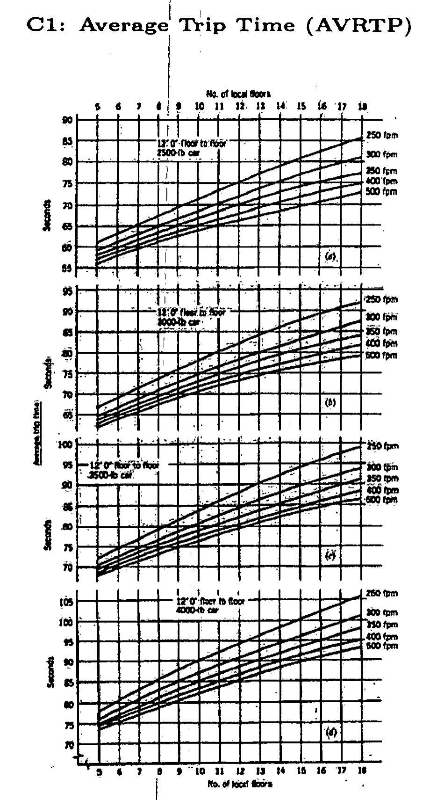
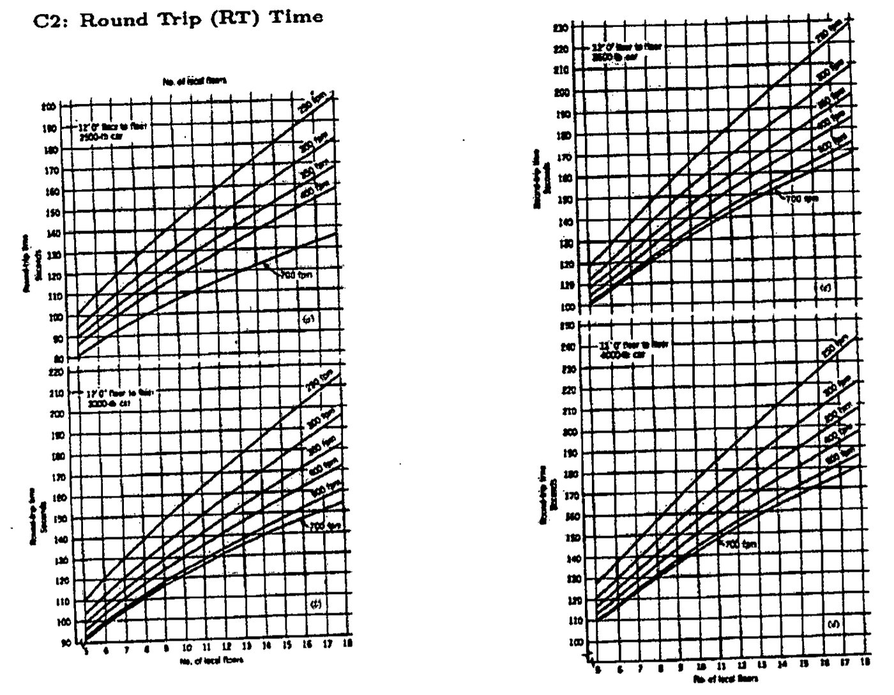

<!-- pagebreak -->
# Module 2: Lifts and escalators

| | |
|---|---|
| **Where it appears** | All 11 papers, 2011-12 to 2023-24: one full question of Section A (Q3 or Q4) in 2011-12 and 2013-14 to 2022-23, Q8 of Section B in 2012-13, and Q5(c), Q5(d) and all of Q7 in 2023-24 |
| **Share of all marks** | 13.1% (400 of 3055 weighted marks, 30 parts). Normally one 35-mark question a year; 55 marks in 2023-24. Lift design numerical (LI1) 155 marks, lift theory (LI2) 205, escalators (LI3) 40. |
| **Time** | core 3 h (§2.3–2.10, Solution 2.1, Solution 2.6, Solution 2.25), full 5 h (all thirty solutions) |
| **Sources** | Kanak pp.164–197; Grondzik Ch. 31 (§31.1–31.39) and Ch. 33 (§33.1–33.10); exam attachments T1–T6, C1, C2; 2023-24 equation sheet |

**How it has been asked:**

- **The design numerical (eight papers):** "For an **office building, downtown, diversified use**, N **rentable floors above the lobby, each A m² net. Floor-to-floor height = 3.7 m, determine a workable elevator system arrangement**." The floors and areas were 15 × 1500 (2012-13), **12 × 2000 (2013-14 and 2016-17, verbatim)**, 10 × 2000 (2015-16), 18 × 3000 (2017-18), 16 × 3500 (2018-19) and 12 × 1500 (2022-23). The attachments T1–T6, C1 and C2 come with the paper.
- **2023-24 Q7(c) changed method:** "A building has 10 floors above the main terminal … arrival rate of 15% … Evaluate the actual interval and the handling capacity … compliant or wasteful design", with an equation sheet for the CIBSE round-trip time.
- **Traction lift schematic:** "**Draw the schematic diagram of an electric traction lift and show its different components**" (**2016-17, 2018-19, 2020-21, 2022-23**); "Describe different components of traction elevator system with schematic diagram" (2021-22); "Counterweight, Guide rails, Buffer, and Sheave" (2023-24).
- **Short theory items:** "**What are the requirements for the ideal performance of passenger elevators?**" (**2012-13, 2017-18**); "**Draw the schematic diagram of different arrangements of elevator doors**" (**2013-14, 2018-19**); gearless vs geared (2015-16); roping arrangements (2011-12, 2012-13); safety devices (2011-12, 2013-14); hydraulic lift (2011-12); classify elevators (2020-21, 2022-23); design factors (2020-21); zoning and grouping, elevator vs escalator (2021-22); definitions of I, HC, PHC, RT and average trip time (2017-18, 2018-19, 2023-24); passenger vs freight vs hospital elevators and quality vs quantity of service (2023-24).
- **Escalator capacity:** "For an escalator of **35° incline, two passengers per step**, speed of 0.5 m/s and 500 mm tread or step length, determine the number of persons moved per hour" (**2012-13, 2016-17**); the same with 0.6 m/s and 600 mm (**2018-19, 2020-21, 2022-23**).
- **Escalator arrangements:** "**Draw the schematic diagram of different arrangements of escalator**" (**2015-16, 2020-21, 2022-23**).

> **KEY: Toolkit for this module**
>
> - $I$ = interval (lobby dispatch time), s. $RT$ = round-trip time, s. $N$ = number of cars in the group. $p$ = normal passenger load per trip (T3, about 80% of the maximum). $AVRTP$ = average trip time, s.
> - **Interval:** $I=\dfrac{RT}{N}$. **Average lobby waiting time** $=0.6\,I$.
> - **Five-minute handling capacity:** $HC=\dfrac{300\,p}{I}$ persons per 5 min (300 = seconds in 5 minutes). At $I=30$ s, $HC=10p$. One car alone: $h=300p/RT$, so $HC=N h$.
> - **Percent handling capacity:** $PHC=\dfrac{HC}{\text{population}}\times100\%$. Population $=\dfrac{\text{net area}}{\text{m}^2/\text{person (T4)}}$; net area = % of gross (T5).
> - **Design:** $HC_{req}=PHC\times\text{population}$, $I_{req}=\dfrac{300p}{HC_{req}}$, $N=\dfrac{RT}{I_{req}}=\dfrac{HC_{req}\,RT}{300\,p}$, round to whole cars, then check $I$ (T1) and $PHC$ (T2).
> - **Criteria (office):** $I$: excellent 15–24 s, good 25–29 s, fair 30–39 s. PHC: centre city 12–14% (use 13% to design, 12% as the floor). AVRTP: < 60 s highly desirable, 75 s acceptable, 90 s annoying, 120 s limit.
> - **Units on C1, C2, T6:** 100 fpm = 0.508 m/s (1 m/s ≈ 197 fpm); 1 kg = 2.2 lb; 12 ft = 3.66 m ≈ 3.7 m floor height. 2.0 m/s ↔ 400 fpm, 2.5 m/s ↔ 500 fpm, 3.6 m/s ↔ 700 fpm.
> - **Zoning:** upper-zone $RT=RT_{C2}(\text{local floors})+2t_e$, express time $t_e\approx H_e/v$.
> - **Escalator:** $N=\dfrac{3600\,P\,V\cos\theta}{L}$ persons/h, with $P$ persons per step, $V$ speed along the incline (m/s), $L$ horizontal tread (step) length (m).
> - **CIBSE up-peak (2023-24):** $RTT=2Ht_v+(S+1)(t_f-t_v+t_{do}+t_{dc}+t_{sd}-t_{ao})+P(t_{pi}+t_{po})$, $HC\%=\dfrac{300PL}{RTT\cdot U}$, $I=RTT/L$.

## 2.1 Vertical transportation and the classes of elevator ★

**Vertical transportation** is the equipment that moves people and goods between the levels of a building: lifts (elevators), escalators, hydraulic hoists, passenger conveyors (moving walks) and so on. In a high-rise building it is the most important building service [Kanak p.164]. In a 25-storey office building the lifts can cost about 10% of the construction cost, and the quality of lift service affects which building tenants choose [Grondzik §31.1].

A **lift** (elevator) is a transport device that moves goods or people vertically. **BNBC 2020 (Part 8, Ch. 4): lifts shall be provided in buildings of more than six storeys or more than 20 m height**, and must be installed according to the Lift Act and its rules [Kanak p.164].

### Classification

Elevators are classified in four ways [Kanak pp.165–168; Grondzik §31.2–31.11]:

| Basis | Classes |
|---|---|
| **Usage** | passenger (office, residential, hotel, hospital, institution); goods (freight, service, cargo); hospital (bed or stretcher); dumbwaiter; vehicle (car lift); scissor lift |
| **Drive system** | hydraulic (conventional plunger, hole-less telescopic, roped); electric traction (geared, gearless) |
| **Machine location** | penthouse (overhead) machine room; basement machine room (underslung roping); machine-room-less (disc motor on the guide rail) |
| **Control** | single automatic push-button; collective; selective collective; group supervisory (computer) control |

![Fig. 1: Usage classification of elevators: a tree with "Usage" at the top and five branches, Passenger, Goods, Vehicle, Dumbwaiter and Scissor [Kanak p.165]](figures/001.png "w=0.6")

**The usage classes** [Kanak pp.165–167]:

- **Passenger lift:** moves people between floors. Its capacity and speed depend on the available floor space, the building height and the number of people to be moved. Sub-types: hospital, residential, hotel, office, institution.
- **Goods (freight, service) lift:** carries goods, with an attendant or the people needed to load and unload them. Used in shopping complexes, airports, hotels and warehouses.
- **Hospital lift:** a passenger lift with a deep car for a patient on a stretcher or a bed, with attendants (see below).
- **Dumbwaiter:** a small freight lift for food or small goods, not for people; usually ends in a kitchen (restaurants, schools, hospitals, homes).
- **Vehicle lift:** lifts a car in a multi-storey car park or showroom; hydraulic or traction, traction for higher speed.
- **Scissor lift:** a self-contained, movable platform raised by a criss-cross (scissor) linkage. Short height, up and down only, can carry several workers; driven hydraulically, by diesel, electrically or pneumatically. Used for construction, maintenance and installation, indoors and outdoors.

### Passenger, freight and hospital elevators compared

| | Passenger | Freight (goods, service) | Hospital |
|---|---|---|---|
| Design objective | short waiting and trip time, comfort, frequent stops | carry heavy, bulky loads; ruggedness | carry a bed or stretcher with attendants; smooth ride |
| Car | 2500–3500 lb (1250–1600 kg) in offices (T6), shallow, decorated | 4000–5000 lb (1800–2300 kg) or more; no dropped ceiling, wall pads; heavy platform | 3500–4000 lb (1600–2000 kg), **deep**: 2300–2500 mm deep cars [Kanak p.166] |
| Door | 1.07 m centre-opening | wide two-speed or two-speed centre-opening, 1.2–1.5 m | 1.2–1.5 m centre-opening |
| Speed, control | high speed, group supervisory control | low speed, often attendant-operated | moderate speed, self-service collective control, ride smooth and level |
| Rope safety factor | 7.6–12.0 | 6.6–11.0 | as passenger |
| Rules | interval and handling capacity (T1, T2) | load capacity | BNBC: at least one hospital lift in a multi-storey hospital; operable in fire; firemen take over |

Sources: [Grondzik §31.4, §31.12, §31.38; Kanak pp.166–167].

**Hospital lifts, BNBC 2020 Part 8 Ch. 4** [Kanak p.166]: a hospital lift takes **one bed or stretcher along its depth**, with room for **at least three attendants plus the operator**. Every multi-storey hospital needs **at least one hospital lift with a stretcher facility**, and all stretcher and hospital lifts must be **operable during a fire**, with provision for firemen to take over the control (fire mode, §2.8). BNBC Table 8.4.5 gives car sizes:

| Persons | kg | Car width × depth (mm) | Well width × depth (mm) | Entrance (mm) |
|---|---|---|---|---|
| 12 | 1020 | 1000 × 2400 | 1800 × 3000 | 800 |
| 20 | 1360 | 1300 × 2400 | 2200 × 3000 | 1200 |
| 26 | 1768 | 1600 × 2400 | 2400 × 3000 | 1200 |

![Fig. 2: Hospital lift car plans: left, a car 2300 mm deep and 1100 mm wide holding a 620 × 1880 mm stretcher; right, a car 2500 mm deep and 1200 mm wide holding a 720 × 2040 mm bed and a 550 × 550 mm anaesthesia dolly; doors on the front wall [Kanak p.166]](figures/002.png "w=0.5")

Grondzik adds that hospital cars, being deep, hold more than 20 people if used as passenger cars and so give slow service; large hospitals add ordinary passenger cars. A carrying capacity of 45 passengers in 5 minutes, counting each vehicle (bed, cart) as 9 passengers, and an interval of at most 1 minute are adequate [Grondzik §31.38].

## 2.2 Hydraulic lifts ★

### Working principle

A hydraulic lift is pushed up from below by a **plunger (ram)** in a **cylinder**. A pump forces oil from a tank through a valve into the cylinder, and the oil pressure raises the plunger and the car on it. To go down, the valve opens and the weight of the car pushes the oil back to the tank at a controlled rate; closing the valve stops the car. The pump runs only on the way up [Kanak p.169; Grondzik §31.9].

It works on **Pascal's principle**: pressure applied to a confined fluid is transmitted equally, $P_1=F_1/A_1=P_2=F_2/A_2$, so a small force on a small area produces a large force on a large area. With $A_2=10A_1$, $F_2=10F_1$ [Kanak p.170].

![Fig. 3: Hydraulic elevator schematic: the car sits on a piston (plunger) that slides in a cylinder; an oil line runs from the bottom of the cylinder through a valve to a pump, which draws oil from a tank [Kanak p.169]](figures/003.png "w=0.5")

**Main components** [Kanak p.170]:

- **Tank:** holds the oil. Oil is used because it is nearly incompressible and self-lubricating.
- **Pump and motor:** force oil from the tank into the cylinder.
- **Valve:** open, it lets oil return (low pressure, car descends); closed, it holds pressure. It is a solenoid valve worked by the control system.
- **Control system:** opens and closes the valve and switches the pump on and off.
- Cylinder and plunger, guide rails, car buffers in the pit.

### Types

| Type | How the car is supported | Notes |
|---|---|---|
| **Conventional (holed, direct-acting)** | plunger fixed under the car, running in a cylinder sunk in a drilled hole below the pit | simplest; up to about 20 m rise, 1 m/s; buried cylinder can corrode and leak oil into the ground |
| **Hole-less** | one or two **telescopic** jacks above ground beside the car | no drilled hole; a single jack loads the building sideways (cantilevered car), so twin jacks are usual; short rise |
| **Roped hydraulic (indirect-acting)** | a jack carries a sheave; ropes over it lift the car by **2:1 roping**, so the car travels twice the plunger stroke | most common low-rise hydraulic type; needs a slack-rope safety device |

Sources: [Kanak p.168; Grondzik §31.9–31.11].

![Fig. 4: Two hydraulic elevators in 3-D cutaway. Left, conventional in-ground type: the car is pushed by one central piston running into an in-ground cylinder below the pit, with two car buffers in the pit and the fluid tank and controller beside the hoistway. Right, hole-less type: two plungers in above-ground cylinders beside the car, one car buffer [Kanak p.168]](figures/004.jpg "w=0.55")

### Advantages and disadvantages

| Advantages | Disadvantages |
|---|---|
| Lower first cost and maintenance than traction (about half) | Limited to low rise (about 5–8 storeys, 20 m) and low speed (≤ 1 m/s); slower than traction |
| **No overhead machine room or penthouse**; machine room can be up to 15 m away | **High running cost**: not counterweighted, so a large pump motor; all lifting energy is lost as heat (relative energy use 10, against 2.5–3 for a VVVF traction lift) |
| Load carried by the ground, **no vertical load on the building structure**, smaller columns near the hoistway | **Ride erratic as the oil temperature changes** (viscosity); pump room temperature must be controlled |
| Smaller hoistway (no counterweight or its rails); about 9.6 m² less floor space | **No safety device against falling** like a traction safety gear; depends entirely on the oil pressure |
| Almost no limit on load: best for freight and vehicle lifts | Inherently heat-producing; high inrush current at each start; pump noise |
| Car can be lowered by hand through the valve in a power failure | Buried cylinder can leak oil into the ground water |

Sources: [Kanak p.171; Grondzik §31.9].

**Applications:** low-rise offices and residences (two to five floors), low-rise stores and malls, parking shuttles, stage lifts, heavy freight, access for the disabled [Kanak p.169; Grondzik §31.9].

## 2.3 The electric traction lift and its components ★

In a **traction lift** the car hangs from steel ropes that pass over a grooved, motor-driven **drive sheave** to a **counterweight** on the other side. The car is moved by the **friction (traction)** between the ropes and the sheave grooves. Because the counterweight balances the car and part of the load, the motor only supplies the unbalanced load and the friction [Kanak pp.172–173; Grondzik §31.4].

![Fig. 5: Electric traction passenger lift, labelled cutaway. Machine room at the top: controller, drive motor, brake, drive sheave and overspeed governor. In the shaft: suspension ropes from the drive sheave to the car and the counterweight, the door operator on the car, car doors, apron, car guide rails, safety gear on the car frame, travelling cables hanging from the car, landing doors with landing indicator and push-button, counterweight and its guide rails, limit switches. In the pit: car buffer, counterweight buffer and the governor tension sheave [Kanak p.172]](figures/005.jpg "w=0.55")

::: {.liftdraw #lift-draw caption="How to draw it in the exam (2 minutes). This is the finished answer; press Draw along to draw it stage by stage. Each stage stops once it is drawn; copy it on paper, then draw the next. The labels stay, so by the last stage you have the whole labelled answer."}
**How to draw it in the exam (2 minutes).** Draw a tall rectangle (the hoistway) with a box on top (machine room). In the machine room draw the motor, the brake, the drive sheave and the controller. From the sheave, drop ropes to the car on one side and to the counterweight (a box with horizontal lines) on the other. Draw two vertical lines beside the car (car guide rails) and two beside the counterweight. Mark the governor beside the sheave with its rope running down to the car safety gear. In the pit draw two spring buffers, one under the car and one under the counterweight. Label every item.
:::

**The principal parts** [Kanak pp.172–173; Grondzik §31.4, §31.8]:

| Component | What it is and what it does |
|---|---|
| **Car** | a cage of fire-resistant material on a structural frame; the ropes are fastened to the top member (crosshead). Guide shoes on the frame run on the guide rails. It has power doors, a car operating panel, floor indicators, lighting, ventilation and an emergency exit. |
| **Hoist ropes (cables)** | 4 to 8 steel wire ropes in parallel, depending on speed and capacity. Several ropes give more traction area on the sheave and a higher safety factor; each rope can usually carry the whole load. Minimum factor of safety **7.6–12.0 for passenger lifts, 6.6–11.0 for freight lifts**. |
| **Drive sheave** | the grooved pulley turned by the machine; the ropes lie in its grooves and the car moves by rope-to-groove friction. A **deflector (secondary) sheave** guides the ropes to the counterweight side and, with double wrap, adds traction. |
| **Counterweight** | cut steel plates stacked in a frame on the other end of the ropes, running on its own guide rails at the back of the shaft. **Weight = empty car + 40% of the rated load.** It gives enough traction at the sheave, reduces the size of the machine and the power and energy used. Cost: the machine-room floor must carry its load. |
| **Machine** | motor, brake and sheave (with a worm gear in a geared machine) on a bedplate in the machine room (§2.4). |
| **Brake** | on the motor shaft; holds the car at the floor after the motor has slowed it. |
| **Guide rails** | steel T-section rails fixed to the shaft walls, two for the car and two for the counterweight. They guide the car and counterweight vertically, stop sway, and are what the **safety gear grips** in an emergency. |
| **Overspeed governor** | a centrifugal (or electronic) speed sensor in the machine room, driven by a governor rope tied to the car; on overspeed it cuts the power and then trips the safety gear (§2.6). |
| **Safety gear (safeties)** | wedge clamps under the car, one on each rail, which grip the rails and stop a car that is overspeeding downwards. |
| **Buffers** | oil or spring buffers in the pit under the car and the counterweight. They do **not** stop a falling car; they give a cushioned stop if the car overtravels the bottom landing. |
| **Controller (control system)** | the drive control (speed, acceleration, levelling), operating control (doors, calls, signals) and supervisory control (group dispatching). |
| **Hoistway (shaft)** | the vertical passage for the car and counterweight, with the guide rails and limit switches on its walls. |
| **Machine room (penthouse)** | above the shaft, about twice the shaft area, with the machine, controller and governor; its floor carries the whole load. |
| **Pit** | the bottom of the shaft below the lowest landing, with the buffers and the governor tension sheave. |
| **Travelling cable, compensating ropes** | the flexible cable carries power and signals to the car; compensating ropes from car bottom to counterweight bottom balance the weight of the hoist ropes in tall buildings. |

About 75% of the energy spent lifting a traction car is regenerated when it comes down (the motor acts as a generator) [Grondzik §31.4].

![Fig. 6: Grondzik Fig. 31.1, components of a geared traction elevator installation: machine room above the hoistway with the geared machine, controller and governor; the car with its crosshead, guide shoes and safeties; the counterweight and its rails; compensating ropes; car and counterweight buffers in the pit [Grondzik §31.4]](figures/006.jpg "w=0.55")

## 2.4 Traction machines: gearless and geared ★

**Gearless machine** [Kanak p.173; Grondzik §31.5]. A d.c. or a.c. motor whose shaft is **directly connected to the brake wheel and the drive sheave**. With no gear the motor must turn as slowly as the sheave, so it is a large, low-speed motor (15–300 kW). Used for **high-speed lifts, 2.5 m/s (500 fpm) and above, up to 10 m/s**, and for rises above about 76 m.

![Fig. 7: Gearless traction machine: a drive motor directly coupled to the brake drum and the drive sheave on one bedplate, with a double-wrap sheave below; a line sketch shows the ropes wrapping the drive sheave and the double-wrap sheave, one end going to the counterweight and the other to the car [Kanak p.173]](figures/007.png "w=0.35")

**Geared machine** [Kanak p.174; Grondzik §31.6]. A **worm and gear** sits between the motor and the sheave. The motor can therefore be a **smaller, cheaper, high-speed** motor. Used for car speeds **up to 2.3 m/s (450 fpm)** and rises up to about **90 m**. With a good drive it rides almost as well as a gearless machine.

![Fig. 8: Geared traction machine on a steel bedplate: the drive motor turns the drive sheave through a worm-gear box; the brake is on the motor shaft; a deflector sheave sits below and a sound-isolation pad under the bedplate [Kanak p.174]](figures/008.jpg "w=0.35")

| | Gearless | Geared |
|---|---|---|
| Drive | motor shaft directly on the brake wheel and sheave | worm and gear between motor and sheave |
| Motor | large, slow, 15–300 kW, expensive | small, fast, cheap |
| Car speed | ≥ 2.5 m/s, up to 10 m/s | ≤ 2.3 m/s |
| Rise | high rise (> 76 m typical) | up to about 90 m |
| Efficiency | higher (traction equipment about 80%); losses about half | lower (about 65%; gear friction) |
| Noise, maintenance, life | quieter, less maintenance, longer life (no gear to wear) | noisier; worm and gear wear out in 30–40 years |
| First cost | higher | lower |
| Use | high-speed passenger lifts in tall buildings | low- and medium-speed lifts, freight |

Between 2.0 and 2.5 m/s and 46–76 m rise, both types are available and the choice is economic [Grondzik §31.5, §31.18, §31.43].

**Advantages of gearless drives** (2011-12): more efficient, quieter, less maintenance, longer life, smoother high-speed ride, suits unlimited rise and speeds above 2.5 m/s [Kanak p.173].

## 2.5 Roping arrangements ★

The rope runs from the car, over the drive sheave, to the counterweight. Four arrangements are used [Kanak p.175; Grondzik §31.7]:

1. **1:1 roping, single wrap.** The ropes pass once over the drive sheave T (half a turn) and go down to the car on one side and, over a deflector sheave S, to the counterweight on the other. The deflector only spaces the counterweight away from the car. The car moves at the rope speed (no mechanical advantage). This is the simplest arrangement and the scheme of most high-speed passenger lifts.
2. **1:1 roping, double wrap.** The rope passes over T, round the secondary sheave S, back over T a second time, and then to the counterweight. The rope wraps the drive sheave twice, so the contact (wrap) angle and therefore the **traction are greater**; used in high-speed gearless lifts.
3. **2:1 roping (double wrap).** The rope ends are dead-anchored to the overhead structure. The rope passes down under a sheave on top of the car, up over the drive sheave, and down under a sheave on the counterweight. The car moves at **half the rope speed** and each rope carries half the load: a **mechanical advantage of 2**, so a smaller, faster, cheaper, lower-torque machine can be used. Used for medium-speed gearless passenger lifts (2.5–3.6 m/s) and for heavy, slow freight lifts.
4. **Basement machine (underslung), 1:1.** The machine is at the bottom of the shaft; the ropes run up to idler sheaves at the top and down to the car and the counterweight. It **removes the penthouse** where the building cannot have one. Only for low speed (up to about 2 m/s, geared) and limited rise, because the overhead sheaves and the structure take double the rope load.

Arrangements 1–3 have the machine in a **penthouse machine room** above the shaft. All can be used with any car capacity.

![Fig. 9: Hand sketches of four roping arrangements. Each shows the drive sheave (large circle), the secondary or deflector sheave (small circle), the car (plain box) and the counterweight (box with horizontal lines). (1) 1:1 roping, single wrap: rope once over the drive sheave, one end to the car, the other over the deflector to the counterweight. (2) 1:1 roping, double wrap: rope wraps the drive and secondary sheaves twice before going to car and counterweight. (3) 2:1 roping, double wrap: rope ends anchored to the overhead structure, rope passes under a sheave on the car and under a sheave on the counterweight. Arrangements 1 to 3 are grouped as "penthouse machine room". (4) 1:1 roping with the drive at the bottom, labelled "basement": two idler sheaves at the top, car on one side and counterweight on the other [Kanak p.175]](figures/009.jpg "w=0.75")

![Fig. 10: Grondzik Fig. 31.3, elevator roping and sheave arrangements: (a) single-wrap 1:1, (b) double-wrap 1:1, (c) 2:1 roping, (d) basement machine roping; T is the traction (drive) sheave, S the deflector or secondary sheave, CW the counterweight [Grondzik §31.7]](figures/010.jpg "w=0.75")

> **TIP: What the roping ratio means**
>
> In $n:1$ roping the car moves $1/n$ as fast as the rope, and each rope fall carries $1/n$ of the load. So 2:1 halves the torque at the sheave and doubles the motor speed needed for a given car speed: that is why it suits small high-speed motors and heavy freight. Double wrap does not change the ratio; it only increases the grip.

## 2.6 Safety devices ★

A traction lift has several independent protections [Kanak p.176; Grondzik §31.8, §31.12]:

1. **Main brake.** Mounted directly on the machine shaft. The car is first slowed by **dynamic braking** of the motor; the brake then clamps the brake drum and holds the car still at the floor. It is spring-applied and electrically released, so it sets on a power failure.
2. **Overspeed governor, first stage.** A **centrifugal governor** (or electronic speed sensor) cuts the power to the traction motor and sets the brake at a limited overspeed. This usually stops the car.
3. **Safety gear (rail clamps), second stage.** If the speed still rises, the governor rope trips **two safety rail clamps** mounted at the bottom of the car, one on each side. They grip the guide rails by wedging action and bring the car to a smooth stop. [Elisha Otis](https://en.wikipedia.org/wiki/Elisha_Otis)'s[Elisha Graves Otis (1811–1861), an American mechanic, made the first lift that could not fall. A spring on top of the car, held flat by the rope's tension, sprang open if the rope went slack and pushed pawls into ratchet teeth along the guide rails. He showed it at the New York Crystal Palace exhibition in 1854, standing on the platform while the rope was cut. The company he founded, Otis Elevator, is still one of the largest lift makers.]{.aside} original safety (1853) worked the same way when the rope went slack.
4. **Buffers.** Oil or spring buffers in the pit, under the car and the counterweight. Their purpose is **not to stop a falling car** but to bring an over-travelling car to a cushioned stop below the bottom landing.
5. **Limit (travel) switches.** At the top and bottom of the shaft; if the car over-travels, they cut the motor and set the brake.
6. **Door interlocks and door safety.** The car cannot move unless all doors are closed and locked. A **safety edge** on the car door, **photocells** or a **multi-beam infrared curtain** reverse a closing door that meets a person or obstruction.
7. **Emergency features.** Alarm bell, emergency stop switch and intercom in the car; emergency lighting; fireman's control and recall to the lobby (§2.8); slack-rope switch on roped hydraulic lifts.

![Fig. 11: Grondzik Fig. 31.4, elevator safety devices: the overspeed governor in the machine room with its governor (safety trip) rope running to the car, and the safety jaws (rail clamps) under the car acting on the guide rails [Grondzik §31.8]](figures/011.jpg "w=0.6")

![Fig. 12: Lift door safety devices, front view of a two-panel centre-opening door hung from a door track: inside the leading edge of the door panel is a reversal switch behind the mechanical safety edge; two photocells low on the left panel send beams across the opening to reflectors on the right panel [Kanak p.177]](figures/012.png "w=0.4")

## 2.7 Lift doors and their arrangements ★

Passenger lift doors are **power-operated** and synchronised with the levelling control, so they are fully open as the car stops. For safety the kinetic energy of a closing door is limited to about 9.5 N·m (7 ft·lb) and the closing force to 13.6 kg (30 lb); a **centre-opening** door closes fastest within these limits. A clear opening of **1.07 m (42 in.)** lets people enter and leave at the same time; openings under 0.9 m (36 in.) delay loading until unloading is complete, so they are used only in houses and small buildings [Grondzik §31.12].

**The four arrangements** (Fig. 31.12 of Grondzik, drawn in plan) [Grondzik §31.12]:

| Type | How it moves | Width | Use |
|---|---|---|---|
| **Single-slide** | one panel slides to one side | 0.6–0.9 m (24–36 in.) | small commercial, residential |
| **Centre-opening** | two panels part from the middle, each moving half the width, at the same speed | 1.07 m (42 in.) offices; 1.2–1.5 m hospitals and service cars | standard commercial passenger doors; fastest |
| **Two-speed (side-opening)** | two panels, each half the opening, on two parallel tracks, slide to the same side and stack there; the far panel travels twice as far as the near one in the same time, so it moves twice as fast (2v against v) | 1.07 m (42 in.) | general commercial, where space dictates or a wide opening is needed |
| **Two-speed centre-opening** | four panels, two each side; each side is a two-speed pair | 1.5 m (60 in.) | department stores, freight, hospital, service |

![Fig. 13: Grondzik Fig. 31.12, typical hoistway door arrangements in plan: (a) single-slide, one panel; (b) centre-opening, two panels parting at the middle; (c) two-speed, two panels stacking to one side; (d) two-speed centre-opening, four panels, two to each side [Grondzik §31.12]](figures/013.jpg "w=0.6")

**Two-speed doors, explained.** Take a clear opening of width $W$. A single-slide door is one panel $W$ wide, so when open it needs $W$ of wall beside the opening to slide into. A **two-speed** door splits the panel into two, each $W/2$ wide, on **two parallel tracks**. Opened, the two panels lie side by side, one on each track, in a space only $W/2$ wide beside the opening. To get there, the panel farther from that space travels the whole $W$, the nearer one only $W/2$. They start and stop together, so the far panel moves **twice as fast**: it is marked **2v** and the near one **v**. These are the "two speeds". The gain is wall space: for the same opening a two-speed door needs only half the space of a single-slide, and on one side only (a centre-opening door needs $W/2$ on *both* sides). A **two-speed centre-opening** door is two such pairs, one on each side: four panels of $W/4$, the inner two at 2v and the outer two at v, stacking in only $W/4$ on each side. That is why it gives the widest openings (1.5 m) [Grondzik §31.12].

**How to draw them (in plan, seen from above).**

1. Draw the landing wall as two thick, hatched bars with a gap between them: the clear opening $W$. Mark $W$ with a dimension line.
2. Below the wall draw the track as a thin line: one track for single-slide and centre-opening, two parallel tracks for the two-speed types.
3. Draw each panel **closed** as a narrow solid rectangle on its track; together the panels fill the gap. Draw each panel **open** as a dashed rectangle where it ends up, beside the opening, and mark the space it needs ($W$, $W/2$ or $W/4$).
4. Draw an arrow from each closed panel to its open place and write its speed: **v**, or **2v** for a panel that travels twice as far.

The four sketches: **single-slide**, one panel $W$ to one side; **centre-opening**, two panels $W/2$ parting to both sides; **two-speed**, two panels $W/2$ on two tracks, both stacking on one side, the far one 2v; **two-speed centre-opening**, four panels $W/4$, a two-speed pair on each side.

::: {.doordraw #door-draw caption="The four arrangements in plan. Choose one, then open and close it with the button or the slider; the drawing at 0% is the exam sketch."}
:::

**Door safety** [Kanak p.177; Grondzik §31.12]: ANSI requires a **safety edge** on the car door of every automatic lift that reopens the car and landing doors on touching an obstruction; **photocells** or a **multi-beam infrared sensor** along the whole door edge reverse the door without contact; an electronic sensor can watch a wide area of the landing (children, wheelchairs, beds). Some doors "nudge" closed slowly after a set time.

## 2.8 Control of lifts

**Three levels of control** act together [Grondzik §31.4, §31.15]:

1. **Motion (drive) control:** the car's acceleration, speed, braking, levelling, regenerative braking and the door motion.
2. **Operating control:** when and where the car and doors move; it handles the car buttons, landing calls, lanterns and indicators.
3. **Supervisory control:** runs a group (bank) of cars as one system and decides which car answers which call.

**Operating control schemes** [Grondzik §31.21–31.24]:

| Scheme | How it works | Where used |
|---|---|---|
| **Single automatic push-button** | answers one call at a time, without interruption; a landing call registers only when the car is idle | private houses, light freight |
| **Collective** | stops at every floor with a call, whatever the direction | slow and annoying; no longer used in new work |
| **Selective collective** | collects all "up" calls on the way up and all "down" calls on the way down; stores calls; reverses at the highest and lowest call | apartments, small offices; groups of 2–3 cars (cars bunch, so more than three is not feasible) |
| **Group supervisory (computer) control** | microprocessor allocates each call to the best car, minimising interval, waiting and trip time; zones and parks cars by traffic pattern; priority and timed-out calls; fire and emergency modes | all office groups today |

**Fire mode** [Grondzik §31.46]: on a fire signal, all cars close their doors and return non-stop to the lobby (or a designated floor), park with doors open, and then run only under the **firefighter's key**; car and hall calls are cancelled and door sensors are disabled.

**Drive (speed control) systems** [Grondzik §31.15–31.18]: the Ward–Leonard (motor–generator set feeding a d.c. motor, classic but inefficient), thyristor (SCR) control of a d.c. or a.c. motor, and **variable-voltage variable-frequency (VVVF)** control of an a.c. squirrel-cage motor. VVVF is now standard: high efficiency at all speeds, power factor near unity, 98% solid-state, motors 10–15% smaller, energy bills up to 35% lower, and the lowest relative energy use (2.5–3 against 10 for hydraulic).

<!-- pagebreak -->

## 2.9 Elevator terminology and the service criteria ★

**Definitions** [Kanak pp.178–180; Grondzik §31.29]:

- **Interval (I), or lobby dispatch time:** the average time between departures of cars from the lobby. With $N$ cars of round-trip time $RT$, $I=RT/N$. The shorter, the better.
- **Average lobby waiting time:** the average time a person spends between arriving in the lobby and leaving it in a car. Passengers arrive at random, so it would be half the interval; field data give **0.6 × I**.
- **Registration time:** the waiting time at an upper floor after a call is registered.
- **Handling capacity (HC):** the maximum number of passengers the system can carry in a given period, normally **5 minutes**: $HC=300p/I$. It depends only on the car size and the interval, **not on the number of cars** (imagine one door opening every $I$ seconds and letting out $p$ people).
- **Percent handling capacity (PHC):** HC expressed as a percentage of the building population: the minimum percentage of the population the system must carry in 5 minutes (T2). The higher, the better.
- **Travel time, or average trip time (AVRTP):** the average time from a passenger's arrival in the lobby to leaving the car at an upper floor: **lobby waiting time + travel time to the median floor stop**. Read from chart C1. Below 1 minute is highly desirable.
- **Round-trip time (RT):** the average time for a car to leave the lower terminal and return to it, including a statistical number of stops on the way up and the express return. It is made of **(1) acceleration and deceleration, (2) door opening and closing at every stop, (3) passenger loading and unloading, (4) running time at rated speed**. Read from chart C2. Acceleration is kept ≤ 1.2 m/s² for comfort.
- **Zone:** a group of floors served as a unit by one bank of cars.

![Fig. 14: Sketch of the shape of chart C1: average trip time (y) against number of local floors (x); three straight lines rise to the right, one per car speed in fpm, the slowest speed highest [Kanak p.180]](figures/014.png "w=0.5")

> **TRAP: The interval is not the time from floor to floor**
>
> Kanak vai's note glosses the interval as "the time to go from one floor to another" [Kanak p.178]. It is the time between successive car departures from the lobby, $I=RT/N$. Kanak vai's note's p.179 heading also says "Percent Handling Time"; it is Percent Handling **Capacity**. And Kanak vai's note's "PHC 6–8% recommended" is the residential "Other" row of T2; for a diversified office the minimum is 12% [Kanak p.179].

**Why the five-minute handling capacity.** The heaviest traffic in an office is the morning up-peak, when most of the population arrives within a short time. The busiest 5 minutes have historically been taken as the measure of a system's peak capacity: short enough to capture the intensity of the peak, long enough to average out the random arrivals and the cycles of the cars. A system sized for the peak 5 minutes handles every other period easily [Grondzik §31.29, §31.31]. HC is expressed in **persons per 5 minutes**, and as PHC in **% of the population per 5 minutes**.

**Quality and quantity of service** (2023-24). Lift traffic design judges a system on two kinds of measure [Grondzik §31.28]:

- **Quality of service:** how well each passenger is served: the **interval and average waiting time**, and the **travel (trip) time** to the destination (with ride comfort). Short waits and short trips are high quality.
- **Quantity of service:** how many people the system can move: the **handling capacity** HC (persons per 5 min) or **PHC**. It must at least equal the peak arrival rate.

A design must satisfy both: enough capacity for the peak, with acceptable waiting and travel times.

**The criteria** (office buildings) [Grondzik §31.30–31.32; T1, T2]:

| Measure | Excellent | Good | Fair | Poor | Unacceptable |
|---|---|---|---|---|---|
| Interval (s) | 15–24 | 25–29 | 30–39 | 40–49 | 50+ |
| Waiting = 0.6 I (s) | 9–14 | 15–17 | 18–23 | 24–29 | 30+ |

| Measure | Value |
|---|---|
| PHC, centre-city (diversified) office | 12–14% (no less than 12%) |
| PHC, investment / single-purpose office | 11.5–13% / 14–16% |
| AVRTP | < 60 s highly desirable, 75 s acceptable, 90 s annoying, 120 s limit of tolerance |

### Ideal performance of passenger elevators

An ideal installation provides [Kanak p.177; Grondzik §31.2]:

1. minimum waiting time for a car at any floor;
2. comfortable acceleration and rapid transportation;
3. smooth and rapid braking;
4. accurate automatic levelling at landings;
5. rapid loading and unloading at all stops;
6. quick, quiet operation of the doors;
7. good floor-status and travel-direction indication, in the car and at the landings;
8. easily operated car and landing call buttons;
9. smooth, quiet and safe operation of all equipment under all loads;
10. comfortable lighting, reliable emergency and security equipment, and a pleasant car.

### Factors in the design of elevators

The designer considers [Grondzik §31.2, §31.28, §31.34–31.39; Kanak p.165]:

- **Traffic:** building type and population (T4, T5), peak arrival rate (PHC, T2), interfloor traffic.
- **Service quality:** interval and waiting time (T1), trip time (C1), round-trip time (C2).
- **Equipment:** car size (building size) and car speed (rise) (T6), number of cars, geared or gearless, hydraulic or traction, door type and width, control system.
- **Building layout:** number of floors and height, zoning, lobby location and size (0.5 m² per waiting person), grouping (≤ 4 cars in a row), shaft and machine-room space (machine room ≈ 2 × shaft area), structural loads.
- **Economics:** first cost, energy and maintenance, rentable space lost to shafts; life-cycle cost.
- **Codes and safety:** BNBC (lifts above 6 storeys or 20 m, fire lift, hospital lift), access for the disabled, emergency power, fire recall.

## 2.10 The lift-design method ★

Every design numerical is solved with the same nine steps, using the attached tables T1–T6 and charts C1, C2 (data book D18 and D19; the PDF also prints them at the end of this module) [Kanak pp.185–189; Grondzik §31.34–31.36]. Learn them as a fixed procedure.

![Fig. 15: The nine-step lift-design procedure as a flow: (1) building type gives the interval from T1 and the PHC from T2; (2) population = net area divided by m² per person from T4, net area from T5 if gross is given; (3) required HC = PHC × population; (4) rise = floors × floor height; (5) car speed from the rise, T6; (6) car size from T6 and its normal load p from T3; (7) read RT from C2 and AVRTP from C1, choosing the panel by car size, the curve by speed and the x value by the number of floors; (8) N = RT / I_req with I_req = 300p / HC_req, rounded to whole cars; (9) check I = RT/N against T1 and PHC = (300p/I)/population against T2, and iterate (change car size, speed, or zone) if a check fails](figures/015.png "w=0.65")

**Step 1. Service criteria (T1, T2).** "Office building, downtown, diversified use" → T2 *office, centre city*: PHC 12–14%; design with **13%**, and treat **12%** as the minimum. T1 *office*: aim for **good service, 25–29 s**; anything in 15–24 s (excellent) is also acceptable if the handling capacity forces it.

**Step 2. Population (T4, T5).** T4 *office, diversified (multiple tenancy), normal*: 10–12 m²/person, use **11 m²/person**.
$$\text{population}=\frac{\text{floors}\times\text{net area per floor}}{11}$$
If the question gives the **gross** floor area, first take the net usable area from T5 (e.g. 0–10 floors: 80% of gross).

**Step 3. Required handling capacity.** $HC_{req}=PHC\times\text{population}$, persons per 5 minutes.

::: {.mini #m-mini-lift-demand}
**Mini-example: demand (steps 1–3).** A centre-city office, diversified use, 10 floors above the lobby, each 1200 m² net.

- T2, office, centre city: 12–14%, take **PHC = 13%**. T1, office, good service: **I = 25–29 s**.
- T4, diversified, normal: 10–12 m²/person, take 11. Population $=10\times1200/11=1090.9\approx$ **1091 persons**. (Had the question given 1500 m² **gross**, T5 for 0–10 floors gives 80% net: $0.80\times1500=1200$ m².)
- $HC_{req}=0.13\times1090.9=$ **141.8 persons per 5 min**.
:::

**Step 4. Rise.** Rise = floors above the lobby × floor height (3.7 m).

**Step 5. Car speed (T6).** T6 *office building*, by rise: 0–40 m → **2.0 m/s (350–400 fpm)**; 41–70 m → **2.5 m/s (500–600 fpm)**; 71–85 m → 3.6 m/s (700 fpm); 86–115 m → 4.0 m/s; above 115 m → 5.0 m/s. Use the lower fpm figure (400 or 500) as the curve on C1 and C2.

**Step 6. Car size (T6, T3).** T6 gives 2500, 3000 or 3500 lb (1250, 1360, 1600 kg) for offices: "car capacity is determined by building size, car speed by rise". Small buildings: 3000 lb; large: 3500 lb. T3 gives the **normal load per trip $p$**: 2500 lb → 13, **3000 lb → 16**, **3500 lb → 19**, 4000 lb → 22. Use $p$, not the maximum capacity.

::: {.mini #m-mini-lift-equipment}
**Mini-example: rise, speed and car (steps 4–6).** The 10-floor office above, 3.7 m floor to floor.

- Rise $=10\times3.7=$ **37.0 m**. T6, office, 0–40 m: **2.0 m/s (350–400 fpm)**: read the 400-fpm curves.
- A modest floor plate: try **3000 lb (1360 kg)**. T3: normal load **p = 16**.
:::

**Step 7. Chart readings (C1, C2).** See the box below. Read RT (C2, Fig. 23) and AVRTP (C1, Fig. 22) for the chosen car (panel), speed (curve) and number of local floors (x axis).

::: {.mini #m-mini-lift-charts}
**Mini-example: chart readings (step 7).** 3000-lb car, 400 fpm, 10 local floors.

- C2 (round trip), panel (b) 3000 lb, the 400-fpm curve, at 10 floors on the x axis: **RT = 130 s**.
- C1 (average trip), the same panel, curve and floors: **AVRTP = 72 s**.

Write it as "C2, panel (b) 3000 lb, 400-fpm curve, 10 floors: RT = 130 s". Panel = car, curve = speed, x = floors.
:::

**Step 8. Number of cars.**
$$I_{req}=\frac{300\,p}{HC_{req}},\qquad N=\frac{RT}{I_{req}}$$
$N$ is almost never a whole number. Write down both neighbours (e.g. 5.4 → 5 or 6).

**Step 9. Check both criteria for each option, and choose.** For each whole $N$:
$$I=\frac{RT}{N},\qquad HC=\frac{300\,p}{I},\qquad PHC=\frac{HC}{\text{population}}$$
The interval must be in T1 (≤ 29 s for good service) and PHC ≥ 12%. Choose the **cheapest option that passes both** (fewer cars, smaller cars, lower speed). If no option passes, change the car size or the speed and repeat from step 6; if a single group would need more than about 8 cars, **zone the building** (§2.11). Finish with a one-line answer: number of cars × car size (lb and kg) × speed (m/s), with I, PHC and AVRTP.

::: {.mini #m-mini-lift-cars}
**Mini-example: number of cars and the check (steps 8–9).** $HC_{req}=141.8$, $p=16$, RT = 130 s.

$I_{req}=300\times16/141.8=33.8$ s; $N=130/33.8=$ **3.84**: try 4 and 5.

| Option | $I=RT/N$ | $HC=300p/I$ | PHC | Verdict |
|---|---|---|---|---|
| 4 × 3000 lb | 32.5 s (fair) | 147.7 | 13.5% | PHC passes, but the interval is only fair |
| 5 × 3000 lb | 26.0 s (good) | 184.6 | 16.9% | **passes both** |

Here the **interval** decides it: **5 cars**. (In Solution 2.1 it is the handling capacity.)
:::

> **KEY: Reading C1 and C2**
>
> - Both charts are in I-P units and drawn for **12 ft (3.66 m) floor to floor** (the 3.7 m of the papers) and a 30-s interval.
> - **Panel = car size:** (a) 2500 lb, (b) 3000 lb, (c) 3500 lb, (d) 4000 lb. On C1 the panels run (a)–(d) from top to bottom; the label of panel (c) is blurred in the scan and looks like "2500-lb", but it is the 3500-lb car. On C2 the left column is (a) 2500 lb (top) and (b) 3000 lb (bottom), the right column (c) 3500 lb and (d) 4000 lb.
> - **Curve = car speed in fpm:** 400 fpm for 2.0 m/s, 500 fpm for 2.5 m/s, 700 fpm for 3.6 m/s. The slowest speed is the highest curve. C2 panel (a) has no 500-fpm curve.
> - **x = number of local floors** served above the lobby (5 to 18).
> - Read to the nearest second. Two careful readers differ by about ±2 s; the curves themselves are statistical and only about ±15% accurate [Grondzik §31.32]. State the reading in the form "C2, panel (b) 3000 lb, 500-fpm curve, 14 floors: RT = 143 s".

**The readings used in this module** (taken once, and used consistently in every solution):

| Car (panel) | Speed (curve) | Local floors | RT from C2 (s) | AVRTP from C1 (s) | Used in |
|---|---|---|---|---|---|
| 3000 lb (b) | 500 fpm | 14 | 143 | 76 | Example 2.1 |
| 3500 lb (c) | 500 fpm | 14 | 155 | 82 | Example 2.1 |
| 3500 lb (c) | 500 fpm | 12 | 145 | 79 | Solutions 2.1, 2.2, 2.5 |
| 3000 lb (b) | 500 fpm | 12 | 133 | 73 | Solutions 2.1, 2.5 |
| 3000 lb (b) | 400 fpm | 10 | 130 | 72 | Solution 2.3 |
| 3500 lb (c) | 400 fpm | 10 | 140 | 77 | Solution 2.3 |
| 3500 lb (c) | 500 fpm | 15 | 160 | 83 | Solution 2.4 |
| 3000 lb (b) | 500 fpm | 15 | 148 | 77 | Solution 2.4 |
| 3500 lb (c) | 500 fpm | 18 | 174 | 86 | Solution 2.6 (single bank) |
| 3500 lb (c) | 400 fpm | 9 | 134 | 77 | Solution 2.6 (low zone) |
| 3500 lb (c) | 500 fpm | 9 | 129 | 75 | Solution 2.6 (high zone) |
| 3500 lb (c) | 700 fpm | 9 | 126 | — | Solution 2.6 (high zone, faster option) |
| 3500 lb (c) | 500 fpm | 16 | 165 | 85 | Solution 2.7 (single bank) |
| 3500 lb (c) | 400 fpm | 8 | 127 | 74 | Solution 2.7 (low zone) |
| 3500 lb (c) | 500 fpm | 8 | 123 | 73 | Solution 2.7 (high zone) |

These agree with Grondzik's own readings where he gives them (3000 lb, 500 fpm, 14 floors: RT 143 s, AVRTP 76 s; 3500 lb: RT 155 s, AVRTP 82 s) [Grondzik §31.36].

> **EXAMPLE 2.1** `[Kanak pp.185–188; Grondzik Ex. 31.1]` Office building, downtown, diversified use, 14 rentable floors above the lobby, each 1115 m² net. Floor-to-floor height = 3.7 m. Determine a workable elevator system arrangement.
>
> **[FROM SOURCE: Kanak pp.185–188, Grondzik §31.36]**, with Kanak vai's note's arithmetic corrected.
>
> 1. T2, office, centre city: 12–14%, take **PHC = 13%**. T1, office, good service: **25–29 s**.
> 2. T4, diversified, normal: 10–12 m²/person, take 11. Population $=14\times1115/11=1419.1$, say **1419 persons**.
> 3. $HC_{req}=0.13\times1419.1=$ **184.5 persons/5 min**.
> 4. Rise $=14\times3.7=$ **51.8 m**.
> 5. T6, office, 41–70 m: **2.5 m/s (500 fpm)**.
> 6. Try **3000 lb (1360 kg)**: T3 normal load $p=16$.
> 7. C2, panel (b) 3000 lb, 500-fpm curve, 14 floors: **RT = 143 s**. C1, panel (b), 500 fpm, 14 floors: **AVRTP = 76 s**.
> 8. $I_{req}=300\times16/184.5=26.0$ s; $N=143/26.0=$ **5.50 cars**: 5 or 6.
> 9. Options:
>
> | Option | $I=RT/N$ (s) | $HC=300p/I$ | PHC | Verdict |
> |---|---|---|---|---|
> | 5 × 3000 lb | $143/5=28.6$ (good) | 167.8 | 11.8% | interval good; PHC 0.2 point under 12% |
> | 6 × 3000 lb | $143/6=23.8$ (excellent) | 201.4 | 14.2% | passes both; above the band, costly |
> | 5 × 3500 lb ($p=19$, RT 155, AVRTP 82; $I_{req}=30.9$ s, $N=5.02$) | $155/5=31.0$ (fair) | 183.9 | 13.0% | PHC good; interval just fair |
>
> **Answer:** **5 cars of 3000 lb (1360 kg) at 2.5 m/s** (I = 28.6 s, PHC = 11.8%, AVRTP = 76 s) is the economical, workable choice, as in Kanak vai's note and Grondzik: the PHC shortfall (0.2 percentage point) is far inside the ±15% accuracy of the charts. If the 12% minimum must be met strictly, use **6 such cars** (I = 23.8 s, PHC = 14.2%). With 5 cars, AVRTP = 76 s is about "acceptable" (75 s).

> **TRAP: Kanak vai's note's arithmetic in the 14-floor example**
>
> Kanak vai's note rounds the population to 1400 (it is $14\times1115/11=1419$) and prints $I=143/5=28.4$ s (it is **28.6 s**); Grondzik's book has the same 28.4 slip [Kanak pp.185–187; Grondzik §31.36]. With 1400 persons the 5-car PHC comes out exactly 12%; with the correct 1419 it is 11.8%. Kanak vai's note also writes the rise as 51 m (it is 51.8 m) and the density as "person/m²" (it is m²/person). None of this changes the speed band or the choice of 5 cars, but write the correct numbers.

> **EXAMPLE 2.2** `[TUTOR-GENERATED; T4, T5]` An office building, diversified use, normal occupancy, has 20 floors above the lobby, each of **2000 m² gross**. Find the population and the required 5-minute handling capacity.
>
> **[TUTOR-GENERATED]**
>
> T5, 0–20 floors: floors 1–10 about 75% net, floors 11–20 about 80% net.
> $$\text{net area}=10\times2000\times0.75+10\times2000\times0.80=15\,000+16\,000=31\,000\ \text{m}^2$$
> T4, diversified normal: 11 m²/person. Population $=31\,000/11=$ **2818 persons**. T2 centre city 13%: $HC_{req}=0.13\times2818.2=$ **366.4 persons/5 min**. (A 20-storey building is at the limit where Grondzik recommends zoning, §2.11.)

<!-- pagebreak -->

## 2.11 Zoning and grouping of elevators {#zoning}

### Zoning

A **zone** is a group of floors served as a unit by one bank of cars. In a tall building a single bank serving all floors would need too many cars, each making many stops on a long run, with a long round trip and trip time. So the floors are split: a **low-rise bank** serves the lower floors, and a **high-rise bank** runs **express** (non-stop, in a **blind shaft** with no doors) through the low-rise floors and then serves the upper floors locally [Grondzik §31.29, §31.37].

**When to zone** [Grondzik §31.37]: fewer than 15 storeys, single zone; **more than 20 storeys, two or more zones**; 16–19 storeys, either, depending on the population density and the required interval. In practice: **if a single bank needs more than about 8 cars** (the largest standard group, §31.39), zone.

**Advantages:** shorter round trips and trip times; fewer stops per trip; upper-zone cars can be faster and lower-zone cars slower and cheaper; the lower floors gain rentable space above the low-rise shafts, which stop at the top of their zone. **Cost:** extra lobby space, and the express run adds to the high-rise round trip.

**Round trip of the high-rise bank** [Grondzik §31.33]:
$$RT_{high}=RT_{C2}(\text{local floors of the zone})+2\,t_e,\qquad t_e\approx\frac{H_e}{v}$$
where $H_e$ is the height of the express run (the floors skipped × 3.7 m) and $v$ the car speed. The acceleration and deceleration are already in the C2 value, so only the extra running at full speed is added, once up and once down.

> **TIP: Do not use Grondzik's express-run chart for 3.7 m floors**
>
> Grondzik's Fig. 31.24 (one-way express run time) is not attached to the papers, and its times correspond to about 3 m (10 ft) per express floor: e.g. 500 fpm, 5 floors reads 6 s, which is $5\times10\ \text{ft}/500\ \text{fpm}$. For 3.7 m floors compute $t_e=H_e/v$ directly: 9 floors at 2.5 m/s give $33.3/2.5=13.3$ s.

### Grouping

A **group (bank)** is a set of cars side by side, controlled together by one supervisory system and sharing one lobby. Rules [Grondzik §31.39]:

- Cars of a group must be close together so a waiting passenger can see all the hall lanterns and reach any car before its doors close.
- **No more than 4 cars in a row**; larger groups face each other across a lobby: 3 and 3 opposing (lobby 2.4–3 m wide), 4 and 4 opposing (lobby at least 3 m, open at both ends). Eight cars is the largest normal group.
- Lobbies on all floors are stacked one above the other; the main lobby (lower terminal) is near the main entrance. Lobby area: at least **0.5 m² per waiting person** at peak.
- Multizone groups place the low-rise and high-rise banks in separate, adjacent lobbies.
- About 1 service car per 10 passenger cars.

![Fig. 17: Grondzik Fig. 31.27, lobby groupings for single-zone systems in plan: three cars in line and three opposing (lobby 1.8–2.4 m), four in line, six cars opposing (lobby 2.4–3 m) and eight cars opposing (lobby at least 3 m) [Grondzik §31.39]](figures/017.jpg "w=0.75")

![Fig. 18: Grondzik Fig. 31.28, lobby groupings for multiple-zone systems in plan: a low-rise bank and a high-rise bank, each in its own lobby, in six- and eight-car arrangements [Grondzik §31.39]](figures/018.jpg "w=0.4")

## 2.12 The CIBSE round-trip time calculation (2023-24) {#cibse}

The 2023-24 paper replaced the charts with an equation sheet. These are the **CIBSE Guide D up-peak formulas**: the round-trip time is computed instead of read. The symbols ("usual meaning") are:

| Symbol | Meaning |
|---|---|
| $N$ | number of floors above the main terminal |
| $U$ | building population; $L$ number of lifts; $CC$ rated car load (persons) |
| $P$ | average number of passengers in the car per trip |
| $H$ | highest reversal floor (the average highest floor reached): $H=N-\sum_{i=1}^{N-1}\left(\dfrac{i}{N}\right)^P$ |
| $S$ | probable number of stops above the terminal: $S=N\left[1-\left(1-\dfrac{1}{N}\right)^P\right]$ |
| $d_f$ | floor height; $v$ rated speed; $a$ acceleration; $j$ jerk |
| $t_v=d_f/v$ | time to pass one floor at rated speed |
| $t_f$ | flight time for a one-floor run (start to stop) |
| $t_{do}$, $t_{dc}$ | door opening and closing times |
| $t_{sd}$ | motor start delay; $t_{ao}$ advance door opening time (both 0 if not given) |
| $t_{pi}$, $t_{po}$ | time for one passenger to board, to alight |

$$RTT=2H\,t_v+(S+1)\left(t_f-t_v+t_{do}+t_{dc}+t_{sd}-t_{ao}\right)+P\,(t_{pi}+t_{po})$$

The three terms are the running time up to the reversal floor and back at full speed, the time lost at each of the $S$ stops and the lobby stop (accelerating, decelerating, doors), and the passenger transfer time.

**One-floor flight time.** The sheet gives the condition $d_f\ge\dfrac{a^2v+v^2j}{aj}$. When it holds, the car reaches rated speed within one floor, and the flight time is
$$t_f=\frac{d_f}{v}+\frac{v}{a}+\frac{a}{j}$$
(the run at speed plus the extra time spent accelerating and decelerating with a limited jerk). This formula is not on the sheet; remember it.

**Handling capacity and interval.** $HC\%=\dfrac{300\,P\,L}{RTT\cdot U}\times100$ (percentage of the population carried in 5 min); $I=RTT/L$.

**The design procedure:**

1. Passengers per trip needed to carry the arrivals at the target interval: $P=\dfrac{\text{arrival rate (persons/5 min)}}{300}\times I_{target}$. Check that $P\le0.8\,CC$ (cars loaded to at most 80%).
2. Compute $H$, $S$, $t_v$, $t_f$ and $RTT$.
3. Number of lifts $L=RTT/I_{target}$, rounded up.
4. Actual interval $I=RTT/L$ and $HC\%$. **Compliant** if $I\le I_{target}$ and $HC\%\ge$ arrival rate. **Wasteful** if it passes with a large margin (an extra lift needed only for a small fraction).

<!-- pagebreak -->

## 2.13 Escalators ★

### What an escalator is

An **escalator** is a power-driven, inclined, continuous moving stairway that carries people between floors. Grooved steps (treads and risers) are attached to a continuous **step chain** driven by a motor through sprockets, and supported on a steel **truss** spanning between the two floors. A **handrail** on each side moves at the same speed as the steps. At the top and bottom the steps flatten into a level platform, so that people can step on and off easily [Kanak p.193; Grondzik §33.1].

**Features** [Kanak p.193; Grondzik §33.1–33.4]:

- power-driven, inclined, continuous stairway; moves large numbers of people **continuously**, with no waiting at the boarding level;
- used in low- to medium-rise buildings: airports, metro stations, department stores, malls;
- no operator; large capacity and low power consumption;
- **reversible** in direction; normally installed **in pairs**, placed where traffic is heavy, in the main line of travel;
- standard incline **30°**; standard speed **0.5 m/s (100 fpm)**, maximum 0.64 m/s (125 fpm); tread widths 0.61 m (one person per step) and 1.02 m (two persons per step);
- cannot trap passengers on a power failure; if stopped it can be walked like a stair.

![Fig. 19: Escalator cutaway: inclined truss carrying the steps on step chains, running over a top sprocket assembly driven by the electric motor and round a bottom sprocket assembly; step rollers run on rail guides; the handrail loop is driven by the handrail drive assembly. Labels: handrail drive assembly, handrail, steps, electric motor, top sprocket assembly, rail guide, step rollers, step chains, bottom sprocket assembly [Kanak p.193]](figures/019.jpg "w=0.4")

**Components** [Grondzik §33.5]:

| Component | Function |
|---|---|
| Truss | welded steel frame between the floors; carries everything |
| Steps and step chain | the moving treads, linked to a continuous chain on each side |
| Tracks | steel angles on the truss that guide the step rollers and keep the treads level |
| Drive machine, sprockets | motor, gearbox and main drive chain turn the top sprocket, which pulls the step chain |
| Handrail and handrail drive | rubber handrail driven from the top sprocket, synchronised with the steps |
| Balustrade | side panels (glass, metal) carrying the handrail; designed not to catch clothing |
| Comb plates and floor plates | at each landing; the comb teeth mesh with the step grooves so nothing is drawn in |
| Controller, brake | control cabinet; automatic brake; emergency stop buttons at both ends; key switches to start, stop and reverse |

**Safety** [Grondzik §33.6]: steps and handrail at the same speed; two or three level steps at each end; comb plates; an automatic brake that stops the stair if a chain breaks or stretches, something jams at the handrail inlet, skirt or between steps, the power fails, an emergency stop is pressed, a fire detector operates, or a step sags; a governor stops it on over- or under-speed and **prevents reversal**.

### Arrangements: parallel and crisscross

Escalators between more than two floors are arranged in one of two basic ways [Kanak pp.196–197; Grondzik §33.2]:

**Crisscross arrangement.** The up and down escalators of each storey cross each other, like an X in side elevation, and the escalators of successive storeys nest into one another. The entrance and exit of the up and down units are separated by the horizontal length of one escalator.

- *Spiral (continuous) crisscross:* a rider leaving one up escalator turns 180° and steps straight onto the next one. Rapid, pleasant, and **very economical of space**, because the stairs nest. Serves up to about five floors comfortably.
- *Walk-around crisscross:* the second-level directions are reversed, so the rider walks round the whole length of the escalator to continue. Stores use this to lead customers past merchandise.

**Parallel arrangement.** The up and down escalators of each storey run side by side and face the same direction.

- *Parallel spiral (multiple parallel):* units in each storey are side by side; the rider turns and continues in the same direction. Banks of 3–4 parallel units in terminals can run all but one in the direction of heaviest traffic.
- *Stacked parallel (walk-around):* the units are stacked vertically one storey above another; the rider walks the whole length of the escalator at each floor.

::: {.escdraw #esc-draw caption="Fig. 20: The four arrangements in side elevation, over four floors. Choose one; solid runs go up, dashed runs come down, and the arrows follow the rider, walking along the floor where the arrangement needs it."}

:::

| | Crisscross | Parallel |
|---|---|---|
| Layout | up and down units cross; storeys nest | up and down units side by side, same direction |
| Floor space, structure | **minimum** space and structure | more space and structure |
| Cost | lower | higher |
| Continuity | spiral mode: continuous, a 180° turn | spiral: turn and continue; stacked: walk the full length |
| Appearance | ordinary | impressive, attracts people |
| Used in | most multi-floor stores and offices | terminals and public buildings (often 2 floors only), malls |

Sources: [Grondzik §33.2; Kanak p.197].

### Capacity ★ {#escalator-capacity}

Steps pass the landing at a steady rate, and each carries $P$ persons. Let $V$ be the speed **along the incline**, $\theta$ the incline, and $L$ the **tread (step) length measured horizontally**. The steps form a staircase whose horizontal pitch is $L$, and the staircase moves horizontally at $V\cos\theta$. So [Kanak p.195]:

$$\text{steps per second}=\frac{V\cos\theta}{L},\qquad \boxed{N=\frac{3600\,P\,V\cos\theta}{L}\ \text{persons/h}}$$

Equivalently, along the incline the step pitch is $L/\cos\theta$, and $N=3600\,P\,V/(L/\cos\theta)$: the same formula.

**Reconciling with Grondzik.** Grondzik gives only a table (Table 33.1): a 32-in. unit (0.61 m tread) at 0.5 m/s carries 5200 persons/h theoretical maximum, 4000 nominal (heavy) and 2300 observed; a 48-in. unit (1.02 m tread, about 2 persons per step) carries 9000, 6750 and 4500. His figures correspond to $N=3600\,P\,V/s$ with $s\approx0.4$ m the step pitch **measured along the direction of travel**, with no $\cos\theta$: $3600\times2\times0.51/0.406\approx9040$ persons/h. The two formulas are the same physics with $L$ measured differently:

| Formula | $L$ measured | 35°, 2 per step, 0.5 m/s, 0.5 m |
|---|---|---|
| Note: $3600PV\cos\theta/L$ | horizontally (tread depth) | **5898 persons/h** |
| Grondzik / CIBSE: $3600PV/s$ | along the travel (step pitch) | 7200 persons/h |

The papers give the incline and call $L$ the "tread or step length", so the incline is meant to be used: **use Kanak vai's note's formula** and say that $L$ is the horizontal tread length. These are theoretical maxima; in practice nominal capacity is about 75% and observed about 45–50% of them (Table 33.1 ratios), because people leave steps empty.

> **TRAP: Do not drop the cosine, and do not use degrees as radians**
>
> Leaving out $\cos\theta$ gives 7200 instead of 5898. With the calculator in radian mode, $\cos35=-0.904$ and the answer comes out negative. Note also that the 0.5 m/s, 500 mm and the 0.6 m/s, 600 mm variants have the same $V/L$ (1 step per second), so both give 5898 persons/h.

> **TIP: Real escalators**
>
> Standard escalators are 30° (US practice, Grondzik). The European standard EN 115 allows 35° only for rises up to 6 m and speeds up to 0.5 m/s, so the "35°, 0.6 m/s" of the papers is an exam combination, not a real product. Use the data as given.

> **EXAMPLE 2.3** `[Kanak p.195]` An escalator of 30° incline carries one passenger per step at a speed of 0.5 m/s, with 400 mm tread or step length. Find the number of persons moved per hour.
>
> **[FROM SOURCE: Kanak p.195]** $\theta=30°$, $P=1$, $V=0.5$ m/s, $L=0.4$ m:
> $$N=\frac{3600\times1\times0.5\times\cos30°}{0.4}=\frac{3600\times0.5\times0.8660}{0.4}=\mathbf{3897\ persons/h}$$

### Elevators and escalators compared

| | Elevator (lift) | Escalator |
|---|---|---|
| Motion | vertical, in closed cars in a shaft | inclined, open moving stair |
| Flow | in batches (car loads); passengers wait (0.6 I) | continuous; no waiting |
| Best for | long trips, many floors, tall buildings | short trips of 1–2 floors, heavy flows |
| Capacity | 5-min HC = 300p/I per group | 2300–9000 persons/h per unit |
| Speed | fast: 1–10 m/s | slow: 0.5 m/s, about 20 s per floor |
| Space | shaft, lobby, machine room; little floor area per floor | takes floor area like a stair; less space for equal capacity |
| Drive | counterweight and traction ropes, or hydraulic ram | motor-driven step chain over sprockets |
| Entrapment, emergency power | can trap people; emergency power needed | cannot trap; emergency power rarely needed |
| Goods, wheelchairs | yes | no (use lifts or ramps) |
| Location | can be set apart in a lobby | must be in the main line of traffic |

Sources: [Kanak p.194; Grondzik §33.10].

Typical division of traffic by number of floors travelled [Kanak p.194]: 1 floor, 90% escalator / 10% lift; 2 floors, 75/25; 3 floors, 50/50; 4 floors, 25/75; 5 floors, 10/90. A four-storey escalator trip takes about 75 s against at most 60 s by lift [Grondzik §33.10].

<!-- pagebreak -->

## 2.14 Term-final questions with solutions

The thirty parts fall into five families:

| Family | Papers | Solved in full |
|---|---|---|
| A. Lift design numerical (LI1) | 16-17, 13-14, 15-16, 12-13, 22-23, 17-18, 18-19, 23-24 | Solution 2.1 (single zone), 2.6 (zoned), 2.8 (CIBSE) |
| B. Traction lift and its components | 21-22, 16-17, 18-19, 20-21, 23-24 | Solution 2.9 |
| C. Machines, roping, safety, doors, hydraulic | 15-16, 12-13, 13-14, 11-12 | each |
| D. Service, performance, special lifts, zoning | 12-13, 17-18, 23-24, 21-22 | each |
| E. Escalators (LI3) | 12-13, 16-17, 18-19, 15-16, 20-21, 22-23 | Solution 2.25 (capacity), 2.28 (arrangements) |

Standing assumptions for every design numerical (Family A), unless the solution says otherwise:

- "Downtown, diversified use" → T2 office, centre city, **PHC 13%** (12% minimum); T1 office, **good service 25–29 s**; T4 diversified normal, **11 m²/person**. The areas are given **net**, so T5 is not needed.
- Floor height 3.7 m = the 12 ft of the charts. Speed from T6 by rise; RT and AVRTP from the readings table of §2.10.
- $p$ from T3: 3000 lb → 16, 3500 lb → 19. Masses quoted as in T6: 3000 lb = 1360 kg, 3500 lb = 1600 kg.

### Family A: the lift design numerical

> **TRY 2.1** `[PP 16-17 Q4(b), 15]` For an office building, downtown, diversified use, 12 rentable floors above the lobby, each $2000\ \mathrm{m^2}$ net. Floor-to-floor height = 3.7 m, determine a workable elevator system arrangement.

**Solution 2.1** **[TUTOR-GENERATED]** (method of Kanak pp.185–189 and Grondzik §31.36). This is the model answer for every single-zone design.

::: {.problem #sol-2-1}

::: {.step title="Step 1. Service criteria"}
::: hint
T2 (minimum PHC) and T1 (interval) for an office building. Design with the middle of the PHC band. See the [demand mini-example](#m-mini-lift-demand).
:::
T2, office, centre city: [12–14]{.lookup t="T2" row="Center city" col="percent_of_population_carried_in_5_minutes"}%, take **PHC = 13%**. T1, office, good service: **I = [25–29]{.lookup t="T1" row="Good service" col="interval_sec"} s**.
:::

::: {.step title="Step 2. Population"}
::: hint
T4: m² of net area per person for a diversified, normal office; the middle of the band. (Net area is given; for gross area use T5.) See the [demand mini-example](#m-mini-lift-demand).
:::
T4, office, diversified, normal: [10–12]{.lookup t="T4" row="Diversified (multiple tenancy) — Normal" col="value"} m²/person, take 11.
$$\text{population}=\frac{12\times2000}{11}=2181.8\approx\mathbf{2182\ persons}$$
:::

::: {.step title="Step 3. Required handling capacity"}
::: hint
$HC_{req}=PHC\times\text{population}$, persons per 5 minutes.
:::
$HC_{req}=0.13\times2181.8=\mathbf{283.6}$ persons per 5 min.
:::

::: {.step title="Step 4. Rise"}
::: hint
Floors above the lobby × floor-to-floor height. See the [equipment mini-example](#m-mini-lift-equipment).
:::
Rise $=12\times3.7=\mathbf{44.4\ m}$.
:::

::: {.step title="Step 5. Car speed"}
::: hint
T6, office building: the speed band that contains the rise. Use the lower fpm figure to pick the chart curve.
:::
T6, office, rise 41–70 m: **[2.5]{.lookup t="T6" row="Office building;41–70" col="min_car_speed_m_s"} m/s ([500–600]{.lookup t="T6" row="Office building;41–70" col="min_car_speed_fpm"} fpm)**; use the 500-fpm curves.
:::

::: {.step title="Step 6. Car size and load"}
::: hint
Large floor plates take the 3500-lb car, smaller ones 3000 lb; T3 gives the normal load per trip $p$.
:::
Try **3500 lb (1600 kg)**; T3: $p=$ [19]{.lookup t="T3" row="3500" col="normal_passenger_load_per_trip*"}.
:::

::: {.step title="Step 7. Chart readings"}
::: hint
C2 for RT, C1 for AVRTP: panel (c) = 3500 lb, the 500-fpm curve, 12 local floors on the x axis. See the [chart mini-example](#m-mini-lift-charts).
:::
C2, panel (c) 3500 lb, 500-fpm curve, 12 floors: **RT = [145 s]{.lookup t="C2"}**. C1, panel (c), 500 fpm, 12 floors: **AVRTP = [79 s]{.lookup t="C1"}**.
:::

::: {.step title="Step 8. Number of cars"}
::: hint
$I_{req}=300p/HC_{req}$, then $N=RT/I_{req}$. $N$ is almost never whole: take both neighbours. See the [cars mini-example](#m-mini-lift-cars).
:::
$$I_{req}=\frac{300\times19}{283.6}=20.1\ \text{s},\qquad N=\frac{145}{20.1}=\mathbf{7.22}\ \text{cars}$$
:::

::: {.step title="Step 9. Check the options and choose"}
::: hint
For each whole $N$: $I=RT/N$, $HC=300p/I$, $PHC=HC/\text{population}$. Interval ≤ 29 s (good) and PHC ≥ 12%; choose the cheapest option that passes both. See the [cars mini-example](#m-mini-lift-cars).
:::
| Option | $I=RT/N$ | $HC=300p/I$ | PHC | Verdict |
|---|---|---|---|---|
| 7 × 3500 lb | $145/7=20.7$ s (excellent) | $300\times19/20.7=275.2$ | $275.2/2181.8=12.6\%$ | **passes both** |
| 8 × 3500 lb | $145/8=18.1$ s | 314.5 | 14.4% | passes; above the band, one more car |
| 8 × 3000 lb ($p=16$, RT 133 s, AVRTP 73 s; $I_{req}=16.9$ s, $N=7.86$) | $133/8=16.6$ s | 288.7 | 13.2% | passes; one more car than 7 × 3500 |

The interval is "excellent" rather than "good" because the handling capacity governs: 6 cars would give $I=24.2$ s but a PHC of only 10.8%.
:::

:::

::: answer
**Answer: 7 cars of 3500 lb (1600 kg) at 2.5 m/s (500 fpm)**, single zone: $I=20.7$ s, waiting time $0.6\times20.7=12.4$ s, $HC=275.2$ persons/5 min, **PHC = 12.6%**, AVRTP = 79 s (between "acceptable" 75 s and "annoying" 90 s). Lobby: 3 and 4 cars opposing.
:::

> **TRY 2.2** `[PP 13-14 Q4(c), 20]` For an office building, downtown, diversified use, 12 rentable floors above the lobby, each 2000 m$^2$. net. Floor-to-floor height = 3.7 m, determine a workable elevator system.

**Solution 2.2** **[TUTOR-GENERATED]** A verbatim repeat of TRY 2.1: work it again.

::: {.problem #sol-2-2}

::: {.step title="Step 1. Service criteria"}
::: hint
T2 (minimum PHC) and T1 (interval) for an office building. Design with the middle of the PHC band. See the [demand mini-example](#m-mini-lift-demand).
:::
T2, office, centre city: [12–14]{.lookup t="T2" row="Center city" col="percent_of_population_carried_in_5_minutes"}%, take **PHC = 13%**. T1, office, good service: **I = [25–29]{.lookup t="T1" row="Good service" col="interval_sec"} s**.
:::

::: {.step title="Step 2. Population"}
::: hint
T4: m² of net area per person for a diversified, normal office; the middle of the band. (Net area is given; for gross area use T5.) See the [demand mini-example](#m-mini-lift-demand).
:::
T4, office, diversified, normal: [10–12]{.lookup t="T4" row="Diversified (multiple tenancy) — Normal" col="value"} m²/person, take 11.
$$\text{population}=\frac{12\times2000}{11}=2181.8\approx\mathbf{2182\ persons}$$
:::

::: {.step title="Step 3. Required handling capacity"}
::: hint
$HC_{req}=PHC\times\text{population}$, persons per 5 minutes.
:::
$HC_{req}=0.13\times2181.8=\mathbf{283.6}$ persons per 5 min.
:::

::: {.step title="Step 4. Rise"}
::: hint
Floors above the lobby × floor-to-floor height. See the [equipment mini-example](#m-mini-lift-equipment).
:::
Rise $=12\times3.7=\mathbf{44.4\ m}$.
:::

::: {.step title="Step 5. Car speed"}
::: hint
T6, office building: the speed band that contains the rise. Use the lower fpm figure to pick the chart curve.
:::
T6, office, rise 41–70 m: **[2.5]{.lookup t="T6" row="Office building;41–70" col="min_car_speed_m_s"} m/s ([500–600]{.lookup t="T6" row="Office building;41–70" col="min_car_speed_fpm"} fpm)**; use the 500-fpm curves.
:::

::: {.step title="Step 6. Car size and load"}
::: hint
Large floor plates take the 3500-lb car, smaller ones 3000 lb; T3 gives the normal load per trip $p$.
:::
Try **3500 lb (1600 kg)**; T3: $p=$ [19]{.lookup t="T3" row="3500" col="normal_passenger_load_per_trip*"}.
:::

::: {.step title="Step 7. Chart readings"}
::: hint
C2 for RT, C1 for AVRTP: panel (c) = 3500 lb, the 500-fpm curve, 12 local floors on the x axis. See the [chart mini-example](#m-mini-lift-charts).
:::
C2, panel (c) 3500 lb, 500-fpm curve, 12 floors: **RT = [145 s]{.lookup t="C2"}**. C1, panel (c), 500 fpm, 12 floors: **AVRTP = [79 s]{.lookup t="C1"}**.
:::

::: {.step title="Step 8. Number of cars"}
::: hint
$I_{req}=300p/HC_{req}$, then $N=RT/I_{req}$. $N$ is almost never whole: take both neighbours. See the [cars mini-example](#m-mini-lift-cars).
:::
$$I_{req}=\frac{300\times19}{283.6}=20.1\ \text{s},\qquad N=\frac{145}{20.1}=\mathbf{7.22}\ \text{cars}$$
:::

::: {.step title="Step 9. Check the options and choose"}
::: hint
For each whole $N$: $I=RT/N$, $HC=300p/I$, $PHC=HC/\text{population}$. Interval ≤ 29 s (good) and PHC ≥ 12%; choose the cheapest option that passes both. See the [cars mini-example](#m-mini-lift-cars).
:::
| Option | $I=RT/N$ | $HC=300p/I$ | PHC | Verdict |
|---|---|---|---|---|
| 7 × 3500 lb | $145/7=20.7$ s (excellent) | $300\times19/20.7=275.2$ | $275.2/2181.8=12.6\%$ | **passes both** |
| 8 × 3500 lb | $145/8=18.1$ s | 314.5 | 14.4% | passes; above the band, one more car |
| 8 × 3000 lb ($p=16$, RT 133 s, AVRTP 73 s; $I_{req}=16.9$ s, $N=7.86$) | $133/8=16.6$ s | 288.7 | 13.2% | passes; one more car than 7 × 3500 |

The interval is "excellent" rather than "good" because the handling capacity governs: 6 cars would give $I=24.2$ s but a PHC of only 10.8%.
:::

:::

::: answer
**Answer: 7 cars of 3500 lb (1600 kg) at 2.5 m/s, I = 20.7 s, PHC = 12.6%.** For 20 marks, show the 8 × 3000 lb alternative as well (I = 16.6 s, PHC 13.2%) and say why 7 × 3500 lb is preferred (one car and one shaft fewer).
:::

> **TRY 2.3** `[PP 15-16 Q3(b), 15]` For an office building, downtown, diversified use, 10 rentable floors above the lobby, each $2000\ \mathrm{m^2}$. net. Floor-to-floor height = 3.7 m, determine a workable elevator system arrangement.

**Solution 2.3** **[TUTOR-GENERATED]**

::: {.problem #sol-2-3}

::: {.step title="Step 1. Service criteria"}
::: hint
T2 (minimum PHC) and T1 (interval) for an office building. Design with the middle of the PHC band. See the [demand mini-example](#m-mini-lift-demand).
:::
T2, office, centre city: [12–14]{.lookup t="T2" row="Center city" col="percent_of_population_carried_in_5_minutes"}%, take **PHC = 13%**. T1, office, good service: **I = [25–29]{.lookup t="T1" row="Good service" col="interval_sec"} s**.
:::

::: {.step title="Step 2. Population"}
::: hint
T4: m² of net area per person for a diversified, normal office; the middle of the band. (Net area is given; for gross area use T5.) See the [demand mini-example](#m-mini-lift-demand).
:::
T4, office, diversified, normal: [10–12]{.lookup t="T4" row="Diversified (multiple tenancy) — Normal" col="value"} m²/person, take 11.
$$\text{population}=\frac{10\times2000}{11}=1818.2\approx\mathbf{1818\ persons}$$
:::

::: {.step title="Step 3. Required handling capacity"}
::: hint
$HC_{req}=PHC\times\text{population}$, persons per 5 minutes.
:::
$HC_{req}=0.13\times1818.2=\mathbf{236.4}$ persons per 5 min.
:::

::: {.step title="Step 4. Rise"}
::: hint
Floors above the lobby × floor-to-floor height. See the [equipment mini-example](#m-mini-lift-equipment).
:::
Rise $=10\times3.7=\mathbf{37.0\ m}$.
:::

::: {.step title="Step 5. Car speed"}
::: hint
T6, office building: the speed band that contains the rise. Use the lower fpm figure to pick the chart curve.
:::
T6, office, rise 0–40 m: **[2.0]{.lookup t="T6" row="Office building;0–40" col="min_car_speed_m_s"} m/s ([350–400]{.lookup t="T6" row="Office building;0–40" col="min_car_speed_fpm"} fpm)**; use the 400-fpm curves.
:::

::: {.step title="Step 6. Car size and load"}
::: hint
Large floor plates take the 3500-lb car, smaller ones 3000 lb; T3 gives the normal load per trip $p$.
:::
Try **3000 lb (1360 kg)**; T3: $p=$ [16]{.lookup t="T3" row="3000" col="normal_passenger_load_per_trip*"}.
:::

::: {.step title="Step 7. Chart readings"}
::: hint
C2 for RT, C1 for AVRTP: panel (b) = 3000 lb, the 400-fpm curve, 10 local floors on the x axis. See the [chart mini-example](#m-mini-lift-charts).
:::
C2, panel (b) 3000 lb, 400-fpm curve, 10 floors: **RT = [130 s]{.lookup t="C2"}**. C1, panel (b), 400 fpm, 10 floors: **AVRTP = [72 s]{.lookup t="C1"}**.
:::

::: {.step title="Step 8. Number of cars"}
::: hint
$I_{req}=300p/HC_{req}$, then $N=RT/I_{req}$. $N$ is almost never whole: take both neighbours. See the [cars mini-example](#m-mini-lift-cars).
:::
$$I_{req}=\frac{300\times16}{236.4}=20.3\ \text{s},\qquad N=\frac{130}{20.3}=\mathbf{6.40}\ \text{cars}$$
:::

::: {.step title="Step 9. Check the options and choose"}
::: hint
For each whole $N$: $I=RT/N$, $HC=300p/I$, $PHC=HC/\text{population}$. Interval ≤ 29 s (good) and PHC ≥ 12%; choose the cheapest option that passes both. See the [cars mini-example](#m-mini-lift-cars).
:::
| Option | $I$ | $HC$ | PHC | Verdict |
|---|---|---|---|---|
| 6 × 3000 lb | $130/6=21.7$ s | 221.5 | 12.2% | **passes both** |
| 7 × 3000 lb | 18.6 s | 258.5 | 14.2% | one more car |
| 5 × 3500 lb ($p=19$, RT 140 s, AVRTP 77 s; $I_{req}=24.1$ s, $N=5.81$) | 28.0 s | 203.6 | 11.2% | fails PHC |
| 6 × 3500 lb | 23.3 s | 244.3 | 13.4% | passes; bigger cars, same number |
:::

:::

::: answer
**Answer: 6 cars of 3000 lb (1360 kg) at 2.0 m/s (400 fpm)**: I = 21.7 s, PHC = 12.2%, AVRTP = 72 s (below the 75-s "acceptable" limit). Lobby: 3 and 3 opposing.
:::

> **TRY 2.4** `[PP 12-13 Q8(c), 20]` For an office building, downtown, diversified use, 15 rentable floors above the lobby, each 1500 m$^2$ net. Floor-to-floor height = 3.7 m, determine a workable elevator system arrangement.

**Solution 2.4** **[TUTOR-GENERATED]** Fifteen storeys is still a single zone (Grondzik: below 16 storeys, one zone).

::: {.problem #sol-2-4}

::: {.step title="Step 1. Service criteria"}
::: hint
T2 (minimum PHC) and T1 (interval) for an office building. Design with the middle of the PHC band. See the [demand mini-example](#m-mini-lift-demand).
:::
T2, office, centre city: [12–14]{.lookup t="T2" row="Center city" col="percent_of_population_carried_in_5_minutes"}%, take **PHC = 13%**. T1, office, good service: **I = [25–29]{.lookup t="T1" row="Good service" col="interval_sec"} s**.
:::

::: {.step title="Step 2. Population"}
::: hint
T4: m² of net area per person for a diversified, normal office; the middle of the band. (Net area is given; for gross area use T5.) See the [demand mini-example](#m-mini-lift-demand).
:::
T4, office, diversified, normal: [10–12]{.lookup t="T4" row="Diversified (multiple tenancy) — Normal" col="value"} m²/person, take 11.
$$\text{population}=\frac{15\times1500}{11}=2045.5\approx\mathbf{2045\ persons}$$
:::

::: {.step title="Step 3. Required handling capacity"}
::: hint
$HC_{req}=PHC\times\text{population}$, persons per 5 minutes.
:::
$HC_{req}=0.13\times2045.5=\mathbf{265.9}$ persons per 5 min.
:::

::: {.step title="Step 4. Rise"}
::: hint
Floors above the lobby × floor-to-floor height. See the [equipment mini-example](#m-mini-lift-equipment).
:::
Rise $=15\times3.7=\mathbf{55.5\ m}$.
:::

::: {.step title="Step 5. Car speed"}
::: hint
T6, office building: the speed band that contains the rise. Use the lower fpm figure to pick the chart curve.
:::
T6, office, rise 41–70 m: **[2.5]{.lookup t="T6" row="Office building;41–70" col="min_car_speed_m_s"} m/s ([500–600]{.lookup t="T6" row="Office building;41–70" col="min_car_speed_fpm"} fpm)**; use the 500-fpm curves.
:::

::: {.step title="Step 6. Car size and load"}
::: hint
Large floor plates take the 3500-lb car, smaller ones 3000 lb; T3 gives the normal load per trip $p$.
:::
Try **3500 lb (1600 kg)**; T3: $p=$ [19]{.lookup t="T3" row="3500" col="normal_passenger_load_per_trip*"}.
:::

::: {.step title="Step 7. Chart readings"}
::: hint
C2 for RT, C1 for AVRTP: panel (c) = 3500 lb, the 500-fpm curve, 15 local floors on the x axis. See the [chart mini-example](#m-mini-lift-charts).
:::
C2, panel (c) 3500 lb, 500-fpm curve, 15 floors: **RT = [160 s]{.lookup t="C2"}**. C1, panel (c), 500 fpm, 15 floors: **AVRTP = [83 s]{.lookup t="C1"}**.
:::

::: {.step title="Step 8. Number of cars"}
::: hint
$I_{req}=300p/HC_{req}$, then $N=RT/I_{req}$. $N$ is almost never whole: take both neighbours. See the [cars mini-example](#m-mini-lift-cars).
:::
$$I_{req}=\frac{300\times19}{265.9}=21.4\ \text{s},\qquad N=\frac{160}{21.4}=\mathbf{7.46}\ \text{cars}$$
:::

::: {.step title="Step 9. Check the options and choose"}
::: hint
For each whole $N$: $I=RT/N$, $HC=300p/I$, $PHC=HC/\text{population}$. Interval ≤ 29 s (good) and PHC ≥ 12%; choose the cheapest option that passes both. See the [cars mini-example](#m-mini-lift-cars).
:::
| Option | $I$ | $HC$ | PHC | Verdict |
|---|---|---|---|---|
| 7 × 3500 lb | $160/7=22.9$ s | 249.4 | 12.2% | **passes both** |
| 8 × 3500 lb | 20.0 s | 285.0 | 13.9% | one more car |
| 8 × 3000 lb ($p=16$, RT 148 s, AVRTP 77 s; $I_{req}=18.1$ s, $N=8.20$) | 18.5 s | 259.5 | 12.7% | passes; one more car |
:::

:::

::: answer
**Answer: 7 cars of 3500 lb (1600 kg) at 2.5 m/s**: I = 22.9 s, PHC = 12.2%, AVRTP = 83 s ("acceptable" to "annoying"; the 3500-lb car is near its 16-floor limit for a 90-s trip [Grondzik §31.32]). Lobby: 3 and 4 opposing.
:::

> **TRY 2.5** `[PP 22-23 Q4(a), 25]` Classify elevator in different way. Draw the schematic diagram of an electric traction lift and show its different components. For an office building, downtown, diversified use, 12 rentable floors above the lobby, each $1500\ \mathrm{m}^2$ net. Floor-to-floor height = 3.7 m, determine a workable elevator system arrangement.

**Solution 2.5** **[TUTOR-GENERATED]**

::: {.answer label="Show answer: (i) classification and (ii) the schematic"}

*(i) Classification* (5 marks) [Kanak pp.165–168]:

- **By usage:** passenger (office, hotel, residential, institution), goods/freight, hospital (bed and stretcher), dumbwaiter (small goods, food), vehicle (car park), scissor lift (movable work platform).
- **By drive:** hydraulic (conventional plunger, hole-less telescopic, roped 2:1) and electric traction (geared up to 2.3 m/s, gearless 2.5–10 m/s).
- **By machine location:** penthouse (overhead) machine room, basement (underslung) machine, machine-room-less.
- **By control:** single automatic push-button, collective, selective collective, group supervisory control.

*(ii) Traction lift schematic* (5 marks). Draw the sketch of §2.3 (Fig. 5[; [draw it along, stage by stage](#lift-draw)]{.web}): machine room on top with **motor, brake, drive sheave, governor and controller**; **hoist ropes** down to the **car** on one side and the **counterweight** on the other; **car and counterweight guide rails** on the shaft walls; **safety gear** under the car linked to the governor rope; **landing doors** and **car doors**; **buffers** in the **pit** under the car and counterweight; travelling cable to the car. One line per item: the sheave moves the ropes by traction; the counterweight (car + 40% of the rated load) balances the car; the guide rails guide the car and are gripped by the safety gear; the governor trips the safety gear on overspeed; the buffers cushion an over-travelling car.

:::

*(iii) Design* (15 marks).
::: {.problem #sol-2-5}

::: {.step title="Step 1. Service criteria"}
::: hint
T2 (minimum PHC) and T1 (interval) for an office building. Design with the middle of the PHC band. See the [demand mini-example](#m-mini-lift-demand).
:::
T2, office, centre city: [12–14]{.lookup t="T2" row="Center city" col="percent_of_population_carried_in_5_minutes"}%, take **PHC = 13%**. T1, office, good service: **I = [25–29]{.lookup t="T1" row="Good service" col="interval_sec"} s**.
:::

::: {.step title="Step 2. Population"}
::: hint
T4: m² of net area per person for a diversified, normal office; the middle of the band. (Net area is given; for gross area use T5.) See the [demand mini-example](#m-mini-lift-demand).
:::
T4, office, diversified, normal: [10–12]{.lookup t="T4" row="Diversified (multiple tenancy) — Normal" col="value"} m²/person, take 11.
$$\text{population}=\frac{12\times1500}{11}=1636.4\approx\mathbf{1636\ persons}$$
:::

::: {.step title="Step 3. Required handling capacity"}
::: hint
$HC_{req}=PHC\times\text{population}$, persons per 5 minutes.
:::
$HC_{req}=0.13\times1636.4=\mathbf{212.7}$ persons per 5 min.
:::

::: {.step title="Step 4. Rise"}
::: hint
Floors above the lobby × floor-to-floor height. See the [equipment mini-example](#m-mini-lift-equipment).
:::
Rise $=12\times3.7=\mathbf{44.4\ m}$.
:::

::: {.step title="Step 5. Car speed"}
::: hint
T6, office building: the speed band that contains the rise. Use the lower fpm figure to pick the chart curve.
:::
T6, office, rise 41–70 m: **[2.5]{.lookup t="T6" row="Office building;41–70" col="min_car_speed_m_s"} m/s ([500–600]{.lookup t="T6" row="Office building;41–70" col="min_car_speed_fpm"} fpm)**; use the 500-fpm curves.
:::

::: {.step title="Step 6. Car size and load"}
::: hint
Large floor plates take the 3500-lb car, smaller ones 3000 lb; T3 gives the normal load per trip $p$.
:::
Try **3500 lb (1600 kg)**; T3: $p=$ [19]{.lookup t="T3" row="3500" col="normal_passenger_load_per_trip*"}.
:::

::: {.step title="Step 7. Chart readings"}
::: hint
C2 for RT, C1 for AVRTP: panel (c) = 3500 lb, the 500-fpm curve, 12 local floors on the x axis. See the [chart mini-example](#m-mini-lift-charts).
:::
C2, panel (c) 3500 lb, 500-fpm curve, 12 floors: **RT = [145 s]{.lookup t="C2"}**. C1, panel (c), 500 fpm, 12 floors: **AVRTP = [79 s]{.lookup t="C1"}**.
:::

::: {.step title="Step 8. Number of cars"}
::: hint
$I_{req}=300p/HC_{req}$, then $N=RT/I_{req}$. $N$ is almost never whole: take both neighbours. See the [cars mini-example](#m-mini-lift-cars).
:::
$$I_{req}=\frac{300\times19}{212.7}=26.8\ \text{s},\qquad N=\frac{145}{26.8}=\mathbf{5.41}\ \text{cars}$$
:::

::: {.step title="Step 9. Check the options and choose"}
::: hint
For each whole $N$: $I=RT/N$, $HC=300p/I$, $PHC=HC/\text{population}$. Interval ≤ 29 s (good) and PHC ≥ 12%; choose the cheapest option that passes both. See the [cars mini-example](#m-mini-lift-cars).
:::
- Try 3000 lb, $p=16$: C2, panel (b), 500 fpm, 12 floors: RT = 133 s; C1: AVRTP = 73 s. $I_{req}=4800/212.7=22.6$ s; $N=133/22.6=$ **5.89**.

| Option | $I$ | $HC$ | PHC | Verdict |
|---|---|---|---|---|
| 5 × 3500 lb | $145/5=29.0$ s (good) | 196.6 | 12.0% | passes both, at the edges |
| 6 × 3500 lb | 24.2 s | 235.9 | 14.4% | above the band |
| 5 × 3000 lb | 26.6 s | 180.5 | 11.0% | fails PHC |
| 6 × 3000 lb | $133/6=22.2$ s | 216.5 | 13.2% | passes both, with margin |
:::

:::

::: answer
**Answer: 5 cars of 3500 lb (1600 kg) at 2.5 m/s**: I = 29.0 s (good), PHC = 12.0%, AVRTP = 79 s. It needs one car and one shaft fewer than 6 × 3000 lb (relative first cost about 5 × 155 = 775 against 6 × 150 = 900 units, Grondzik Table 31.10). If more margin is wanted, **6 × 3000 lb** (I = 22.2 s, PHC = 13.2%, AVRTP = 73 s) is the alternative.
:::

> **TRY 2.6** `[PP 17-18 Q4(b), 25]` Define Interval (I) time, Handling capacity (HC) and Round Trip (RT) time for elevator. For an office building, downtown, diversified use, 18 rentable floors above the lobby, each $3000\ \mathrm{m^2}$ net, floor-to-floor height = 3.7 m, determine a working elevator system arrangement.

**Solution 2.6** **[TUTOR-GENERATED]** (the zoning answer; see the TRAP after it for Kanak vai's note's approach).

::: {.answer label="Show answer: the definitions (6 marks)"}
*Definitions* (6 marks) [Grondzik §31.29]:

- **Interval (I):** the average time between successive departures of cars from the lobby; $I=RT/N$. Average lobby waiting time $\approx0.6I$.
- **Handling capacity (HC):** the maximum number of passengers the system can carry in 5 minutes (the peak period): $HC=300p/I$, where $p$ is the normal load per trip. It depends on the car size and the interval only.
- **Round-trip time (RT):** the average time for a car to start from the lower terminal (lobby), serve its upper stops and return to the lobby; it is the sum of the acceleration and deceleration time, door operation at all stops, passenger loading and unloading, and the running time.
:::

*Design.* Work it step by step; open a hint if stuck.

::: {.problem #sol-2-6}

::: {.step title="Step 1. Demand, as one zone"}
::: hint
Steps 1–3 of the method: T2 and T1, then T4, then $HC_{req}$. See the [demand mini-example](#m-mini-lift-demand).
:::
PHC 13%, I 25–29 s (T2 [12–14]{.lookup t="T2" row="Center city" col="percent_of_population_carried_in_5_minutes"}%, T1 [25–29]{.lookup t="T1" row="Good service" col="interval_sec"} s). Population $=18\times3000/11=4909.1\approx$ **4909 persons**; $HC_{req}=0.13\times4909.1=$ **638.2**.
:::

::: {.step title="Step 2. Rise, speed and car"}
::: hint
Rise from the floors; T6 for the speed band; the largest office car in T6, and its $p$ from T3.
:::
Rise $=18\times3.7=$ **66.6 m** → T6, 41–70 m: **[2.5]{.lookup t="T6" row="Office building;41–70" col="min_car_speed_m_s"} m/s (500 fpm)**. Largest office car, 3500 lb, $p=$ [19]{.lookup t="T3" row="3500" col="normal_passenger_load_per_trip*"}.
:::

::: {.step title="Step 3. One bank? Charts and number of cars"}
::: hint
C2 panel (c), 500-fpm curve, 18 floors; then $N=RT/I_{req}$. A group has at most 8 cars: if $N$ is far above that, the building must be zoned (§2.11, [zoning](#zoning)).
:::
- C2, panel (c) 3500 lb, 500 fpm, 18 floors: **RT = [174 s]{.lookup t="C2"}**; C1, panel (c): AVRTP = [86 s]{.lookup t="C1"}.
- $I_{req}=300\times19/638.2=8.93$ s; $N=174/8.93=$ **19.5 cars**.

One bank of 20 cars is not workable: the largest group is 8 cars (4 opposite 4; no more than 4 in a row [Grondzik §31.39]); with 20 cars no waiting passenger could reach a car in time, and an 18-floor local run gives an 86-s trip. The building (eighteen storeys, in Grondzik's 16–19 "either way" band) has too much population for one zone. **Zone it.**
:::

::: {.step title="Step 4. Two zones: the demand of each"}
::: hint
Split the floors in two equal halves; each zone's population and $HC_{req}$ are found as in step 1, then $I_{req}=300p/HC_{req}$.
:::
Low zone floors 1–9, high zone floors 10–18 (Fig. 16). Each zone: $9\times3000=27\,000$ m², population $=27\,000/11=2454.5\approx$ **2455**, $HC_{req}=0.13\times2454.5=$ **319.1**, and with 3500-lb cars $I_{req}=300\times19/319.1=$ **17.9 s**.
:::

::: {.step title="Step 5. Low-rise bank (floors 1–9)"}
::: hint
A single-zone design for the low floors: rise → T6 speed → C2/C1 at 9 floors → $N$ → check the options.
:::
Rise $=9\times3.7=33.3$ m → T6, 0–40 m: **[2.0]{.lookup t="T6" row="Office building;0–40" col="min_car_speed_m_s"} m/s (400 fpm)**. C2, panel (c), 400 fpm, 9 floors: **RT = [134 s]{.lookup t="C2"}**; C1: **AVRTP = [77 s]{.lookup t="C1"}**. $N=134/17.9=$ **7.50**.

| Option | $I$ | $HC$ | PHC | Verdict |
|---|---|---|---|---|
| 7 cars | $134/7=19.1$ s | 297.8 | 12.1% | **passes both** |
| 8 cars | 16.8 s | 340.3 | 13.9% | one more car |
:::

::: {.step title="Step 6. High-rise bank (floors 10–18), with the express run"}
::: hint
The speed follows the rise to the **top** floor. Read C2 at the zone's **local** floors (9) and add the express run twice: $RT_{high}=RT_{C2}+2t_e$, $t_e=H_e/v$ (§2.11, [zoning](#zoning)).
:::
Rise to the top 66.6 m → **2.5 m/s (500 fpm)**. Express run through floors 1–9: $H_e=9\times3.7=33.3$ m, $t_e=33.3/2.5=$ **13.3 s** one way. C2, panel (c), 500 fpm, **9 local floors**: [129 s]{.lookup t="C2"}, so
$$RT_{high}=129+2\times13.3=\mathbf{155.6\ s},\qquad AVRTP\approx75+13.3=88\ \text{s}$$
(C1, panel (c), 500 fpm, 9 floors, plus the one-way express run). $N=155.6/17.9=$ **8.71**.

| Option | $I$ | $HC$ | PHC | Verdict |
|---|---|---|---|---|
| 8 cars | $155.6/8=19.4$ s | 293.1 | 11.9% | interval excellent; PHC 0.1 point under 12% |
| 9 cars | 17.3 s | 329.7 | 13.4% | 9 cars exceed the 8-car group |

Take **8 cars**: the shortfall of 0.1 percentage point is far inside the chart accuracy (as in Example 2.1). If 12% must be met strictly, raise the high-rise cars to 3.6 m/s (700 fpm, gearless): C2, panel (c), 700 fpm, 9 floors, 126 s; $t_e=33.3/3.6=9.25$ s; $RT=126+2\times9.25=144.5$ s; $N=8.09$; 8 cars give $I=18.1$ s and PHC = 12.9%, at a higher first cost.
:::

:::

::: answer
**Answer: a two-zone system of 15 cars of 3500 lb (1600 kg):**

| Bank | Floors | Cars | Speed | RT (s) | I (s) | PHC | AVRTP (s) |
|---|---|---|---|---|---|---|---|
| Low-rise | 1–9 | 7 | 2.0 m/s | 134 | 19.1 | 12.1% | 77 |
| High-rise | 10–18 (express 1–9) | 8 | 2.5 m/s | 155.6 | 19.4 | 11.9% | ≈ 88 |

The two banks together carry $297.8+293.1=590.9$ persons per 5 min, **12.0%** of the 4909 people. Each bank has its own lobby (3 + 4 and 4 + 4 opposing); the high-rise cars run in blind shafts through floors 1–9.
:::

> **TRAP: Kanak vai's note's answer to this question**
>
> Kanak vai's note first found $I_{req}=7.54$ s and called it impossible ("?? (25–29)"), then **changed the occupancy to "prestige" (20 m²/person) and the service to "excellent"**, which cut the population from 4909 to 2700 and gave 10 cars of 3500 lb with $I=17$ s [Kanak pp.190–192]. That is not a design decision: the question says diversified use, normal occupancy, and the population of the building does not change because the numbers are inconvenient. A small interval such as 7.54 s is not a contradiction: it is the *system* interval the population demands, and $N=RT/I_{req}$ then shows that one bank would need about 20 cars, so the building must be **zoned**. Even Kanak vai's note's 10-car single group exceeds the 8-car limit. (Kanak vai's note's own arithmetic also slips: with 10 cars the PHC is $13\times10/10.47=12.4\%$, not 12.12%, and C2 panel (c) at 18 floors reads about 174 s on the 500-fpm curve; 170 s is nearer the 700-fpm curve.)

> **TRY 2.7** `[PP 18-19 Q4(b), 20]` Define Interval (I) time, Percent Handling Capacity (PHC) and Average Trip Time for elevator. For an office building, downtown, diversified use, 16 rentable floors above the lobby, each $3500\ \mathrm{m^2}$. net. Floor-to-floor height = 37 m, determine a workable elevator system arrangement.

**Solution 2.7** **[TUTOR-GENERATED]** "37 m" is a misprint for **3.7 m** (a 37-m storey is impossible; every other paper has 3.7 m). The method is that of Solution 2.6.

::: {.answer label="Show answer: the definitions"}
*Definitions:* **Interval** as in Solution 2.6. **Percent handling capacity (PHC):** the 5-minute handling capacity as a percentage of the building population, $PHC=HC/\text{population}$; T2 gives the minimum (12–14% for a centre-city office). **Average trip time (AVRTP):** the average time from a passenger's arrival in the lobby to leaving the car at the destination floor, i.e. the lobby waiting time plus the travel time to the median stop; under 60 s is highly desirable, 90 s annoying.
:::

*Design.* Work it step by step; open a hint if stuck.

::: {.problem #sol-2-7}

::: {.step title="Step 1. One zone: demand, speed, charts, number of cars"}
::: hint
As steps 1–3 of Solution 2.6: population and $HC_{req}$; rise → T6; 3500 lb, $p=19$; C2 panel (c) at 16 floors; $N=RT/I_{req}$. More than 8 cars in one group means zoning (§2.11, [zoning](#zoning)).
:::
Population $=16\times3500/11=5090.9\approx$ **5091**; $HC_{req}=0.13\times5090.9=$ **661.8**. Rise $16\times3.7=59.2$ m → [2.5]{.lookup t="T6" row="Office building;41–70" col="min_car_speed_m_s"} m/s. 3500 lb: C2, panel (c), 500 fpm, 16 floors: RT = [165 s]{.lookup t="C2"} (AVRTP 85 s). $I_{req}=5700/661.8=8.61$ s; $N=165/8.61=$ **19.2 cars**: not workable in one group, so **zone** (16 storeys is in the 16–19 band, and the population decides).
:::

::: {.step title="Step 2. Two zones: the demand of each"}
::: hint
Two zones of 8 floors; each zone's population, $HC_{req}$ and $I_{req}$ as in step 4 of Solution 2.6.
:::
Each: $8\times3500/11=2545.5\approx2545$ persons, $HC_{req}=$ **330.9**, $I_{req}=5700/330.9=$ **17.2 s**.
:::

::: {.step title="Step 3. Low-rise bank (floors 1–8)"}
::: hint
Rise → T6 speed → C2/C1 panel (c) at 8 floors → $N$ → the nearest whole number that passes.
:::
Rise 29.6 m → **[2.0]{.lookup t="T6" row="Office building;0–40" col="min_car_speed_m_s"} m/s (400 fpm)**. C2 (c), 400 fpm, 8 floors: **RT = [127 s]{.lookup t="C2"}**; C1: AVRTP = [74 s]{.lookup t="C1"}. $N=127/17.2=$ **7.37** → **7 cars**: $I=127/7=18.1$ s, $HC=314.2$, **PHC = 12.3%** (passes).
:::

::: {.step title="Step 4. High-rise bank (floors 9–16), with the express run"}
::: hint
Speed from the rise to the top; C2 at the zone's 8 local floors plus $2t_e$, $t_e=H_e/v$ for the 8 express floors.
:::
**2.5 m/s**; express $H_e=8\times3.7=29.6$ m, $t_e=29.6/2.5=11.84$ s. C2 (c), 500 fpm, 8 floors: [123 s]{.lookup t="C2"}; $RT_{high}=123+2\times11.84=$ **146.7 s**; AVRTP $\approx73+11.8=85$ s. $N=146.7\times330.9/5700=$ **8.52** → **8 cars**: $I=18.3$ s, $HC=310.8$, **PHC = 12.2%** (passes).
:::

:::

::: answer
**Answer: two zones, 15 cars of 3500 lb (1600 kg): 7 cars at 2.0 m/s for floors 1–8 (I = 18.1 s, PHC 12.3%) and 8 cars at 2.5 m/s, express to floor 9, for floors 9–16 (I = 18.3 s, PHC 12.2%).**
:::

> **TRY 2.8** `[PP 23-24 Q7(c), 15]` A building has 10 floors above the main terminal, has an arrival rate of 15% of the building population in the busiest five minutes. A total building population of 1000 persons is equally distributed on the 10 floors. The floor heights are equal with a value of 4.3 m. Use a rated car-load of 20 persons. The target interval is 30 s.
> Evaluate the actual interval and the handling capacity of the elevator system and comment on whether it is a compliant or wasteful design. In case of a wasteful design, provide your suggestions to improve the design.
> Assume the following parameters: Rated speed 1.6 m/s; Rated acceleration $1\ \mathrm{m/s^2}$; Rated jerk $1\ \mathrm{m/s^3}$; Door opening time 2 s; Door closing time 3 s; Passenger boarding/alighting time 1.2 s. The necessary equations are provided in the question paper.
>
> Equations provided: $H=N-\sum_{i=1}^{N-1}\left(\frac{i}{N}\right)^P$; $S=N\left[1-\left(1-\frac{1}{N}\right)^P\right]$; $d_f\ge\frac{a^2v+v^2j}{aj}$; $\tau=2H\frac{d_f}{v}+(S+1)\left(t_f-\frac{d_f}{v}+t_{do}+t_{dc}+t_{sd}-t_{ao}\right)+P(t_{pi}+t_{po})$; $HC\%=\frac{300PL}{RTT\cdot U}$.

**Solution 2.8** **[TUTOR-GENERATED]** (CIBSE Guide D up-peak method, §2.12; the start delay $t_{sd}$ and advance door opening $t_{ao}$ are not given and are taken as 0; boarding and alighting are 1.2 s each). Work it step by step; the equations are those printed in the question ([§2.12](#cibse)).

::: {.problem #sol-2-8}

::: {.step title="Step 1. Passengers per trip"}
::: hint
Arrivals in 5 min = arrival rate × population; per second, divide by 300. A car leaving every $I$ seconds carries $P=$ (arrivals per s) × $I$. Check $P$ against 80% of the rated load.
:::
Arrivals $=0.15\times1000=150$ persons in 5 min $=0.5$ persons/s. At the target interval of 30 s each car must carry
$$P=0.5\times30=\mathbf{15\ persons}\qquad(P/CC=15/20=75\%\le80\%,\ \text{acceptable})$$
:::

::: {.step title="Step 2. Flight time over one floor"}
::: hint
First check that the car reaches rated speed within one floor: $d_f\ge(a^2v+v^2j)/(aj)$. Then $t_v=d_f/v$ and $t_f=d_f/v+v/a+a/j$.
:::
$$\frac{a^2v+v^2j}{aj}=\frac{1^2(1.6)+1.6^2(1)}{1\times1}=4.16\ \text{m}\le d_f=4.3\ \text{m}$$
so the car reaches rated speed in one floor, and
$$t_v=\frac{d_f}{v}=\frac{4.3}{1.6}=2.6875\ \text{s},\qquad t_f=\frac{d_f}{v}+\frac{v}{a}+\frac{a}{j}=2.6875+1.6+1.0=5.2875\ \text{s}$$
:::

::: {.step title="Step 3. Highest reversal floor and probable stops"}
::: hint
$S=N[1-(1-1/N)^P]$ and $H=N-\sum_{i=1}^{N-1}(i/N)^P$, with $N=10$ floors and $P$ from step 1. Most terms of the sum are negligible.
:::
($N=10$, $P=15$):
$$S=10\left[1-0.9^{15}\right]=10(1-0.2059)=\mathbf{7.941}$$
$$H=10-\left(0.9^{15}+0.8^{15}+0.7^{15}+0.6^{15}+\dots\right)=10-(0.2059+0.0352+0.0047+0.0005+\dots)=\mathbf{9.754}$$
:::

::: {.step title="Step 4. Round-trip time"}
::: hint
$RTT=2H\,t_v+(S+1)(t_f-t_v+t_{do}+t_{dc}+t_{sd}-t_{ao})+P(t_{pi}+t_{po})$: running, stopping, boarding and alighting.
:::
Stop time per stop $t_f-t_v+t_{do}+t_{dc}=5.2875-2.6875+2+3=7.6$ s.
$$RTT=2(9.754)(2.6875)+(7.941+1)(7.6)+15(1.2+1.2)=52.43+67.95+36.00=\mathbf{156.4\ s}$$
:::

::: {.step title="Step 5. Number of lifts"}
::: hint
$L=RTT/I_{target}$, rounded **up** to meet the target interval.
:::
$L=RTT/I_{target}=156.4/30=5.21$, so **6 lifts** are needed (5 would not meet the target).
:::

::: {.step title="Step 6. Actual interval and handling capacity"}
::: hint
$I=RTT/L$ and $HC\%=300PL/(RTT\cdot U)\times100$, with $U$ the population.
:::
$$I=\frac{RTT}{L}=\frac{156.4}{6}=\mathbf{26.1\ s},\qquad HC\%=\frac{300\times15\times6}{156.4\times1000}\times100=\mathbf{17.3\%}$$
:::

::: {.step title="Step 7. Compliant or wasteful? Suggestions"}
::: hint
Compliant: $I\le$ target and $HC\%\ge$ the arrival rate. Wasteful: how much of the last lift is really needed, and how full the cars run. To save a lift, cut the stop time (doors) rather than add cars.
:::
With 6 lifts the design is **compliant**: $I=26.1\ \text{s}\le30$ s and $HC=17.3\%\ge15\%$. But it is **wasteful**: the sixth lift is needed for only 0.21 of a car, the capacity is 15% above the demand (17.3 against 15%), and at the actual interval only $0.5\times26.1=13$ people arrive per trip, so the 20-person cars run 65% full. With **5 lifts** as specified it is not compliant: $I=156.4/5=31.3$ s and $HC=14.4\%$, both just short.

*Suggestions.* Cut the stop time instead of adding a sixth lift:

- **Faster doors** (centre-opening, closing in 2 s instead of 3 s): stop time 6.6 s, $RTT=52.43+8.941\times6.6+36.0=147.4$ s; with 5 lifts $I=29.5$ s and $HC=15.3\%$: **compliant with 5 lifts**.
- **Advance door opening** ($t_{ao}\approx1$ s, doors start opening while the car levels) has the same effect.
- Other options: a higher-performance drive (higher acceleration and jerk shorten $t_f$), or a 26-person car with 5 lifts if the arrival rate is expected to grow.
:::

:::

::: answer
**Answer: RTT = 156.4 s; 6 lifts give I = 26.1 s and HC = 17.3% (compliant but over-provided, wasteful); 5 lifts with 2-s door closing give I = 29.5 s and HC = 15.3%, compliant with one lift fewer.** (If $P$ is taken as 80% of the rated load, $P=16$: $RTT=160.5$ s, 6 lifts, $I=26.8$ s, $HC=17.9\%$: the same conclusion.)
:::

### Family B: the traction lift and its components

> **TRY 2.9** `[PP 21-22 Q4(a), 20]` Describe different components of traction elevator system with schematic diagram.

::: {.answer label="Show answer"}
**Solution 2.9** **[FROM SOURCE: Kanak pp.172–176; Grondzik §31.4–31.8]**

*Schematic* (6 marks). Draw the labelled sketch of §2.3 (Fig. 5[; [draw it along, stage by stage](#lift-draw)]{.web}): hoistway with machine room above; in the machine room the motor, brake, drive sheave (and deflector sheave), overspeed governor and controller; hoist ropes from the sheave to the car and to the counterweight; car guide rails and counterweight guide rails; safety gear under the car tied to the governor rope; car and landing doors; limit switches near the top and bottom; car buffer and counterweight buffer in the pit; travelling cable hanging from the car.

*Components* (14 marks, about one point each):

1. **Car:** a fire-resistant cage on a steel frame; the ropes are fixed to its crosshead; guide shoes run on the rails; it carries the doors, the car operating panel, indicators, lighting, ventilation and an emergency exit.
2. **Hoist ropes:** 4–8 steel wire ropes in parallel; more ropes give more traction area and a higher safety factor (7.6–12 for passenger, 6.6–11 for freight); each can carry the whole load.
3. **Drive sheave:** the grooved pulley on the machine shaft; it moves the ropes, and so the car, by friction between rope and groove (traction).
4. **Deflector (secondary) sheave:** spaces the counterweight ropes from the car; in double wrap it doubles the rope's contact with the drive sheave for more traction.
5. **Traction machine:** motor, brake and sheave on a bedplate; **gearless** (motor directly on the sheave, for ≥ 2.5 m/s) or **geared** (worm gear, ≤ 2.3 m/s).
6. **Brake:** on the machine shaft; after dynamic braking of the motor, it clamps the drum and holds the car at the floor; it sets on power failure.
7. **Counterweight:** stacked steel plates in a frame, on its own rails; weight = car + 40% of the rated load; it provides traction, reduces the motor size and the energy.
8. **Guide rails:** steel T-rails on the shaft walls for the car and the counterweight; they guide the vertical travel, prevent sway, and are gripped by the safety gear.
9. **Overspeed governor:** a centrifugal speed sensor driven by a rope from the car; at overspeed it cuts the motor and sets the brake, then trips the safety gear.
10. **Safety gear:** wedge clamps under the car that grip the guide rails and stop an overspeeding car.
11. **Buffers:** oil or spring buffers in the pit under car and counterweight; they cushion an over-travelling car (they do not stop a free fall).
12. **Controller:** drive control (speed, acceleration, levelling), operating control (doors, calls, signals) and supervisory group control.
13. **Doors and door operator:** power-operated car doors coupled to the landing doors; interlocks prevent motion with a door open; safety edge or light curtain reverses a closing door.
14. **Hoistway, machine room and pit:** the shaft for the car and counterweight, the room above it (about twice the shaft area) carrying the machine, and the pit below the lowest landing with the buffers; plus limit switches, the travelling cable and, in tall buildings, compensating ropes.
:::

> **TRY 2.10** `[PP 16-17 Q4(a), 15]` Draw a schematic diagram of electric traction lift and show its different components.

::: {.answer label="Show answer"}
**Solution 2.10** **[FROM SOURCE: Kanak p.172]** As Solution 2.9: the sketch carries most of the marks. Label at least these 15 parts and add a few words to each: (1) machine room, (2) drive motor, (3) brake, (4) drive sheave, (5) overspeed governor, (6) controller, (7) suspension (hoist) ropes, (8) car with car doors and door operator, (9) landing doors with landing push-buttons and indicator, (10) car guide rails, (11) counterweight and (12) its guide rails, (13) safety gear on the car frame, (14) travelling cable, (15) car and counterweight buffers in the pit, with the governor tension sheave and limit switches.
:::

> **TRY 2.11** `[PP 18-19 Q4(a), 10]` Draw the schematic diagram of a electric traction lift and show its different components. Draw the schematic diagram of different arrangements of elevator doors.

::: {.answer label="Show answer"}
**Solution 2.11** **[FROM SOURCE: Kanak p.172; Grondzik §31.12]**

*Traction lift* (5 marks): the labelled sketch of Solution 2.10 (machine room with motor, brake, sheave, governor, controller; ropes; car; counterweight; guide rails; safety gear; buffers in the pit).

*Door arrangements* (5 marks): four plan sketches (car rectangle, opening in front, panels drawn closed and dashed open, arrows for travel):

- **Single-slide:** one panel slides to one side; 0.6–0.9 m; small buildings and houses.
- **Centre-opening:** two panels part at the middle at equal speed; 1.07 m offices, 1.2–1.5 m hospitals; fastest, standard for passenger cars.
- **Two-speed:** two panels on parallel tracks slide to the same side, the leading one twice as fast, so both stack together; 1.07 m; where the side space is limited.
- **Two-speed centre-opening:** two two-speed pairs parting at the middle; 1.5 m; freight, hospital and department-store cars.
:::

> **TRY 2.12** `[PP 20-21 Q4(a), 25]` Classify elevators. Draw the schematic diagram of an electric traction lift and show its different components. What are the typical factors to be considered in the design of elevators?

::: {.answer label="Show answer"}
**Solution 2.12** **[FROM SOURCE: Kanak pp.165–172; Grondzik §31.2, §31.28–31.39]**

*(i) Classification* (7 marks): by **usage**: passenger (office, residential, hotel, hospital, institution), goods/freight, hospital, dumbwaiter, vehicle, scissor lift; by **drive**: hydraulic (conventional, hole-less, roped) and traction (geared, gearless); by **machine location**: penthouse, basement, machine-room-less; by **control**: single automatic push-button, collective, selective collective, group supervisory. Add one line on each usage class (Solution 2.5 (i) and §2.1).

*(ii) Traction lift schematic* (8 marks): the labelled sketch and component list of Solution 2.10.

*(iii) Design factors* (10 marks):

1. building type, population and its distribution (T4, T5);
2. peak traffic: the 5-minute arrival rate to be handled (PHC, T2);
3. quality of service: interval and lobby waiting time (T1), average trip time (C1);
4. round-trip time, which fixes the number of cars (C2);
5. car capacity, set by the building size (T6, T3);
6. car speed, set by the rise (T6); geared or gearless, traction or hydraulic;
7. number of cars, zoning of tall buildings, grouping and lobby layout;
8. door type and width, and the control system;
9. space and structure: shafts, machine room (about twice the shaft area), pit, loads on the structure;
10. economics, energy, safety and codes: first and life-cycle cost; BNBC (lifts above 6 storeys or 20 m, fire and hospital lifts), disabled access, emergency power.
:::

> **TRY 2.13** `[PP 23-24 Q7(b), 10]` Describe the essential features and functions of the following components of a traction elevator system – Counterweight, Guide rails, Buffer, and Sheave.

::: {.answer label="Show answer"}
**Solution 2.13** **[FROM SOURCE: Kanak pp.172–176; Grondzik §31.4, §31.7, §31.8]**

- **Counterweight** (2.5 marks). *Features:* cut steel plates stacked in a steel frame, hung on the opposite end of the hoist ropes from the car, running on its own pair of guide rails at the back of the shaft, with its own buffer. Its weight is the **empty car plus about 40% of the rated load**. *Functions:* it balances the car, so the motor lifts only the unbalanced load; it keeps the ropes pressed into the sheave grooves, giving the **traction** needed to move the car; it reduces the machine size, the power demand and the energy cost. *Cost:* the machine-room floor and structure must carry its weight.
- **Guide rails** (2.5 marks). *Features:* machined steel T-section rails bolted to the hoistway walls with brackets, two for the car and two for the counterweight, running the full height of the shaft. *Functions:* they guide the car (through its guide shoes or rollers) and the counterweight in straight vertical travel, prevent sway and contact with the shaft, and provide the surface that the **safety gear grips** to stop an overspeeding car; they carry the braking load during a safety stop.
- **Buffer** (2.5 marks). *Features:* oil (hydraulic, a plunger forcing oil through orifices) or spring buffers mounted in the pit under the car and under the counterweight; oil buffers for higher speeds. *Functions:* to bring a car or counterweight that **over-travels the bottom terminal** to a cushioned stop by absorbing its kinetic energy. They are **not** meant to stop a free-falling car; that is the job of the governor and safety gear.
- **Sheave** (2.5 marks). *Features:* a cast-iron or steel pulley with machined V or U grooves, one per rope, on the machine shaft (drive or traction sheave); a deflector or secondary sheave guides the ropes to the counterweight. *Functions:* the drive sheave turns and moves the ropes by friction (traction) between the ropes and its grooves, and so raises and lowers the car; the groove shape and the wrap angle (single or double wrap) fix the traction; in 2:1 roping, sheaves on the car and counterweight give a mechanical advantage of 2.
:::

### Family C: machines, roping, safety, doors and the hydraulic lift

> **TRY 2.14** `[PP 15-16 Q3(a), 10]` Make a brief comparison between gearless and geared traction machine for lift.

::: {.answer label="Show answer"}
**Solution 2.14** **[FROM SOURCE: Kanak pp.173–174; Grondzik §31.5–31.6]**

| Point | Gearless traction machine | Geared traction machine |
|---|---|---|
| Construction | motor shaft directly coupled to the brake wheel and drive sheave | worm and gear between the motor and the sheave |
| Motor | large, low-speed (runs at sheave speed), 15–300 kW | small, cheap, high-speed |
| Car speed | high: 2.5 m/s and above, up to 10 m/s | up to 2.3 m/s |
| Rise | high-rise, unlimited (typically > 76 m) | up to about 90 m |
| Efficiency | higher, about 80%; losses about half | lower, about 65% (gear friction) |
| Noise and ride | quieter, smoother | more noise; good ride with modern drives |
| Maintenance and life | less maintenance, longer life | gear wear; worm and gear last 30–40 years |
| Cost | higher first cost | lower first cost |
| Typical use | high-speed passenger lifts in tall buildings | low- and medium-rise passenger and freight lifts |

Conclusion: the gearless machine is superior (efficient, quiet, low maintenance, long life) but dearer; it is chosen where speed exceeds about 2.5 m/s [Kanak p.173].
:::

> **TRY 2.15** `[PP 12-13 Q8(a), 5]` Draw the different arrangement of elevator machines, sheaves and ropes.

::: {.answer label="Show answer"}
**Solution 2.15** **[FROM SOURCE: Kanak p.175; Grondzik §31.7]** Draw the four sketches of §2.5, Figs. 9 and 10 (drive sheave = large circle, deflector = small circle, car = plain box, counterweight = hatched box), each with one line:

1. **1:1 single wrap, penthouse machine:** rope once over the drive sheave, down to the car, and over the deflector sheave to the counterweight; car speed = rope speed.
2. **1:1 double wrap:** the rope passes twice round the drive and secondary sheaves; more traction, for high-speed gearless lifts.
3. **2:1 roping:** rope ends anchored at the top; the rope runs under sheaves on the car and the counterweight; mechanical advantage 2, so a smaller, faster motor; car speed = half the rope speed.
4. **Basement machine (1:1):** machine at the bottom, ropes over idler sheaves at the top; no penthouse; low speed only.
:::

> **TRY 2.16** `[PP 13-14 Q4(a), 5]` What are the common safety used in a lift?

::: {.answer label="Show answer"}
**Solution 2.16** **[FROM SOURCE: Kanak pp.176–177; Grondzik §31.8]**

1. **Main brake** on the machine shaft: holds the car at the floor after dynamic braking; sets on power failure.
2. **Overspeed governor:** at a limited overspeed it cuts the motor power and applies the brake.
3. **Safety gear:** if the overspeed continues, the governor trips two rail clamps under the car that wedge onto the guide rails and stop it.
4. **Buffers** (oil or spring) in the pit: cushion an over-travelling car.
5. **Limit switches** at the terminals; **door interlocks**, safety edge and light curtain on the doors; alarm, emergency stop and intercom in the car.
:::

> **TRY 2.17** `[PP 13-14 Q4(b), 10]` Draw the schematic diagram of different arrangements of elevator doors.

::: {.answer label="Show answer"}
**Solution 2.17** **[FROM SOURCE: Grondzik §31.12]** (Kanak vai's note covers only door safety; Grondzik Fig. 31.12 is the source.) Draw the four plan views of §2.7 (Fig. 13), each showing the car, the hoistway opening, the panels closed (solid) and open (dashed), and the direction of travel:

| Sketch | Description | Width, use |
|---|---|---|
| (a) Single-slide | one panel slides to one side | 0.6–0.9 m; small commercial and residential |
| (b) Centre-opening | two panels part from the centre at equal speed | 1.07 m offices; 1.2–1.5 m hospital and service cars; fastest closing |
| (c) Two-speed | two panels on parallel tracks slide the same way; the leading panel moves twice as fast, so both arrive together and stack | 1.07 m; general commercial; where side space is limited |
| (d) Two-speed centre-opening | two two-speed pairs, one each side | 1.5 m; department stores, freight, hospitals |

Add one line on safety: all automatic doors carry a safety edge or an infrared light curtain that reopens the door on an obstruction, and the closing force and energy are limited.
:::

> **TRY 2.18** `[PP 11-12 Q4, 35]` Write short notes on (any 5)
> (i) Hydraulic lift (ii) Roping of traction lift (iii) Safety devices used in conventional lifts (iv) Modes of fire extinguishments (v) Types of fire extinguishers (vi) Fire extinguisher marking as per NFPA (vii) Advantages of gearless lift drives

::: {.answer label="Show answer"}
**Solution 2.18** **[FROM SOURCE: Kanak pp.168–176; Grondzik §31.5–31.11]** Seven marks per note. The four lift notes are below, with (iv) as the fifth; (v) and (vi) belong to fire protection (Module 3).

**(i) Hydraulic lift.** The car sits on a plunger (ram) in an oil cylinder. A pump forces oil from a tank through a solenoid valve into the cylinder, raising the car (Pascal's principle); to descend, the valve opens and the car's weight returns the oil. Types: conventional (in-ground cylinder), hole-less (telescopic jacks above ground) and roped (2:1, the car moves twice the plunger stroke). *Advantages:* low first cost, no overhead machine room, no load on the building structure, smaller hoistway, very high load capacity (freight, vehicles). *Disadvantages:* low rise (about 20 m) and slow (≤ 1 m/s), high energy use and heat (no counterweight), ride varies with oil temperature, risk of oil leaks. Used in buildings of 2–5 floors.

**(ii) Roping of traction lift.** The hoist ropes run from the car over the drive sheave to the counterweight. *1:1 single wrap:* rope once over the sheave, with a deflector to the counterweight; the car moves at rope speed. *1:1 double wrap:* rope wraps the drive and secondary sheaves twice, for more traction in high-speed lifts. *2:1:* rope ends anchored overhead, rope under sheaves on the car and counterweight; mechanical advantage 2, smaller faster motor, used for medium-speed gearless and heavy freight lifts. *Basement (underslung):* machine at the bottom, ropes over overhead idlers; no penthouse, low speed only. Sketch each (§2.5).

**(iii) Safety devices.** Main brake on the machine shaft (holds the car after dynamic braking; fails safe); dual overspeed protection: a centrifugal governor first cuts power and sets the brake, then trips the safety rail clamps under the car that wedge onto the guide rails; oil or spring buffers in the pit for over-travel (not for free fall); terminal limit switches; door interlocks, safety edge and infrared light curtain; alarm, emergency stop, intercom, emergency lighting and fireman's control.

**(iv) Modes of fire extinguishment.** A fire needs fuel, heat, oxygen and the chemical chain reaction (the fire tetrahedron); removing any one puts it out. **Cooling** removes heat (water); **smothering** cuts off the oxygen (foam, CO₂, fire blanket, sand); **starving** removes or isolates the fuel (closing a gas valve, removing combustibles); **inhibition** breaks the chain reaction (dry chemical powder, halon substitutes).

**(vii) Advantages of gearless lift drives.** With the motor directly on the sheave and no worm gear: higher efficiency (losses about half those of geared); quieter and smoother operation; less maintenance and longer life (no gear wear); suitable for high speeds (2.5–10 m/s) and unlimited rise; good levelling and ride quality. The price is a larger, slower, more expensive motor and a higher first cost.
:::

### Family D: service quality, performance, special lifts, zoning

> **TRY 2.19** `[PP 12-13 Q8(b), 5]` What are the requirements for the ideal performance of passenger elevators?

::: {.answer label="Show answer"}
**Solution 2.19** **[FROM SOURCE: Kanak p.177; Grondzik §31.2]** An ideal installation provides: (1) minimum waiting time for a car at any floor; (2) comfortable acceleration and rapid transportation; (3) smooth, rapid braking and accurate automatic levelling; (4) quick, quiet door operation and rapid loading and unloading; (5) good floor and direction indication, easy call buttons, smooth, quiet and safe operation of all equipment, comfortable lighting and reliable emergency and security equipment.
:::

> **TRY 2.20** `[PP 17-18 Q4(a), 10]` What are the requirements for the ideal performance of passenger elevators?

::: {.answer label="Show answer"}
**Solution 2.20** **[FROM SOURCE: Kanak p.177; Grondzik §31.2]** A verbatim repeat of TRY 2.19, now for 10 marks: give the full list of §2.9, one point per mark: minimum waiting time at every floor; comfortable acceleration; rapid transportation; smooth and rapid braking; accurate automatic levelling at landings; rapid loading and unloading at all stops; quick, quiet operation of doors; good floor-status and travel-direction indication in the car and at landings; easily operated car and landing call buttons; smooth, quiet, safe operation of all equipment under all loads, with comfortable lighting, reliable emergency and security equipment and a pleasant car.
:::

> **TRY 2.21** `[PP 23-24 Q5(d), 13]` Define "Passenger handling capacity" of an elevator system. How is it typically expressed? Why is the "Five-Minute Handling Capacity" a particularly important metric use in elevator traffic design?

::: {.answer label="Show answer"}
**Solution 2.21** **[FROM SOURCE: Grondzik §31.29, §31.31; Kanak pp.178–179]**

*Definition* (4 marks). The passenger handling capacity (HC) of an elevator system is the maximum number of passengers it can carry in a given period, usually 5 minutes, during peak traffic. One door opening every interval $I$ and letting out $p$ passengers gives
$$HC=\frac{300\,p}{I}=N\,\frac{300\,p}{RT}$$
with $p$ the normal load per trip (about 80% of the maximum, T3). It depends on the car size and the interval, not on the number of cars as such.

*How it is expressed* (4 marks). As **persons per 5 minutes** (e.g. 275 persons/5 min), or as the **percent handling capacity**, $PHC=HC/\text{population}\times100\%$, the percentage of the building population carried in 5 minutes. T2 gives minimum PHCs: centre-city office 12–14%, single-purpose office 14–16%, hotels 10–15%, apartments 5–8%. (CIBSE writes it as $HC\%=300PL/(RTT\,U)$.)

*Why five minutes* (5 marks). The design load for lifts is the **up-peak**, when most of the population arrives within a short period (morning arrival, after lunch). The intensity of the peak is best measured over its busiest 5 minutes: a shorter period would be dominated by random bunching of arrivals, a longer one would average the peak away with quieter periods. Five minutes is also long enough to contain one or two round trips of every car, so the HC is a stable property of the system. It has historically been the standard measure, so arrival rates (e.g. 12–15% in 5 min) and capacities are tabulated on it, and a system that handles the peak 5 minutes handles all other periods. Peak-period waiting is tolerated, but delay outside the peaks is a serious drawback for a building.
:::

> **TRY 2.22** `[PP 23-24 Q7(a), 5]` Define "Quality of service and "Quantity of service" in the context of elevator systems.

::: {.answer label="Show answer"}
**Solution 2.22** **[FROM SOURCE: Grondzik §31.28–31.32]**

- **Quality of service** measures how well each passenger is served: chiefly the **interval** and the **average lobby waiting time** ($\approx0.6I$; e.g. office "good" 25–29 s interval, 15–17 s wait), and the **average trip (travel) time** to the destination (< 60 s highly desirable, 90 s annoying), together with ride comfort.
- **Quantity of service** measures how many people the system can move: the **handling capacity** in persons per 5 minutes, or the **PHC**, which must at least equal the peak arrival rate (e.g. 12–14% of the population in 5 min for a centre-city office).
:::

> **TRY 2.23** `[PP 23-24 Q5(c), 12]` How do passenger elevators differ in their design objectives and typical features from freight elevators? What unique design requirements and features distinguish hospital elevators from standard passenger elevators?

::: {.answer label="Show answer"}
**Solution 2.23** **[FROM SOURCE: Kanak pp.165–167; Grondzik §31.4, §31.12, §31.38; BNBC 2020 Part 8 Ch. 4]**

*Passenger vs freight* (6 marks):

| | Passenger elevator | Freight elevator |
|---|---|---|
| Objective | move many people quickly and comfortably: short waiting and trip time, smooth ride | move heavy, bulky goods safely; capacity and ruggedness over speed |
| Car | moderate size (2500–3500 lb, 1250–1600 kg in offices), finished interior, lighting, ventilation | large (4000–5000 lb and more), heavy platform, wall pads, no dropped ceiling, high ceiling |
| Doors | centre-opening, 1.07 m, fast | wide two-speed or vertical bi-parting doors, 1.2–1.5 m or more |
| Speed, control | high speed, group supervisory control, frequent stops | low speed, attendant or simple control, few stops |
| Safety factor of ropes | 7.6–12 | 6.6–11 |
| Design basis | traffic: interval and handling capacity | load: rated capacity and loading class |

*Hospital elevators* (6 marks):

- a **deep car** to take a patient on a bed or stretcher along its depth, with **at least three attendants** besides the operator (BNBC); e.g. 1300 × 2400 mm car for 20 persons (1360 kg), entrance 1.2 m (BNBC Table 8.4.5);
- **wide centre-opening doors** (1.2–1.5 m) with long, sensor-controlled door-open times;
- smooth acceleration and **accurate levelling** so beds roll in and out without a jolt;
- 3500–4000 lb (1600–2000 kg) cars; interval up to 1 minute; capacity counted with each vehicle as 9 passengers (45 passengers in 5 min adequate);
- at least one hospital lift in every multi-storey hospital; hospital lifts **operable during fire** with firemen's control, and connected to **emergency power**;
- grouped centrally but separated by use; ordinary passenger cars added in large hospitals; dumbwaiters for food trays.
:::

> **TRY 2.24** `[PP 21-22 Q4(b), 15]` Write short notes about zoning of elevators and grouping of elevators. Compare elevator and escalator systems.

::: {.answer label="Show answer"}
**Solution 2.24** **[FROM SOURCE: Grondzik §31.37, §31.39, §33.10; Kanak p.194]**

*Zoning* (5 marks). A zone is a group of floors served as a unit by one bank of lifts. In a tall building, one bank serving every floor would need too many cars with too many stops, so the floors are split into a low-rise zone served by one bank and a high-rise zone served by another bank that runs express, in blind shafts, through the low-rise floors. Single zone below about 15 storeys; two or more zones above 20; either between 16 and 19 storeys, depending on population and the interval. Zoning shortens the round trip and trip time and allows faster cars only where needed; the upper-zone round trip adds twice the express run time; the low-rise shafts stop at their top floor, freeing space above. Modern group control can also zone dynamically.

*Grouping* (4 marks). A group (bank) is a set of cars controlled together and sharing a lobby. Cars of a group are placed close together so a passenger can see every hall lantern and reach any car in time; **no more than four in a row**; larger groups face each other across the lobby (3 + 3 in a 2.4–3 m lobby, 4 + 4 in a lobby of at least 3 m, open at both ends); eight cars is the largest group. Lobbies are stacked on every floor, the main lobby near the entrance, with 0.5 m² per waiting person. In a zoned building each bank has its own lobby.

*Elevator vs escalator* (6 marks): the comparison table of §2.13: lifts carry batches vertically in closed cars, are fast and best for long trips and tall buildings, need shafts and machine rooms, can trap passengers and need emergency power, and carry wheelchairs and goods; escalators carry people continuously with no waiting, at about 0.5 m/s, are best for 1–2 floor trips and heavy flows (2300–9000 persons/h), must lie in the main line of traffic, cannot trap people, and are unsuitable for wheelchairs and goods. Typical split: 1 floor 90% by escalator, 3 floors 50/50, 5 floors 90% by lift.
:::

### Family E: escalators

> **TRY 2.25** `[PP 12-13 Q8(d), 5]` For an escalator of 35° incline, two passengers per step, speed of 0.5 m/s and 500 mm tread or step length, determine the number of persons moved per hour.

**Solution 2.25** **[FROM SOURCE: Kanak p.195]** (formula of §2.13, $L$ = horizontal tread length) Work it in three steps.

::: {.problem #sol-2-25}

::: {.step title="Step 1. The data"}
::: hint
What is $L$? The papers' "tread or step length" is the horizontal tread depth, so the incline enters through $\cos\theta$ ([escalator capacity](#escalator-capacity)).
:::
$\theta=35°$, $P=2$ per step, $V=0.5$ m/s along the incline, $L=0.5$ m (horizontal tread length).
:::

::: {.step title="Step 2. Steps per second"}
::: hint
The staircase moves horizontally at $V\cos\theta$; one step passes every $L$ of that. Calculator in **degrees**.
:::
$V\cos\theta/L=0.5\times0.8192/0.5=0.8192$ steps/s.
:::

::: {.step title="Step 3. Persons per hour"}
::: hint
$N=3600\,P\,V\cos\theta/L$: steps per second × persons per step × 3600.
:::
$$N=\frac{3600\times2\times0.5\times\cos35°}{0.5}=\mathbf{5898\ persons/h}$$
:::

:::

::: answer
**Solution 2.25** **[FROM SOURCE: Kanak p.195]** (formula of §2.13, $L$ = horizontal tread length). $\theta=35°$, $P=2$, $V=0.5$ m/s, $L=0.5$ m. The steps pass at $V\cos\theta/L=0.5\times0.8192/0.5=0.8192$ steps/s, so
$$N=\frac{3600\,P\,V\cos\theta}{L}=\frac{3600\times2\times0.5\times\cos35°}{0.5}=7200\times0.8192=\mathbf{5898\ persons/h}$$
This is the theoretical maximum. (If the 500 mm were the step pitch along the incline, the result would be $3600\times2\times0.5/0.5=7200$ persons/h; say which you assume.)

:::

> **TRY 2.26** `[PP 16-17 Q4(c), 5]` For an escalator of $35^\circ$ incline, two passenger per step, speed of 0.5 m/s and 500 mm tread or step length, determine the number of persons moved per hour.

**Solution 2.26** **[FROM SOURCE: Kanak p.195]** Work it in three steps.

::: {.problem #sol-2-26}

::: {.step title="Step 1. The data"}
::: hint
What is $L$? The papers' "tread or step length" is the horizontal tread depth, so the incline enters through $\cos\theta$ ([escalator capacity](#escalator-capacity)).
:::
$\theta=35°$, $P=2$ per step, $V=0.5$ m/s along the incline, $L=0.5$ m (horizontal tread length).
:::

::: {.step title="Step 2. Steps per second"}
::: hint
The staircase moves horizontally at $V\cos\theta$; one step passes every $L$ of that. Calculator in **degrees**.
:::
$V\cos\theta/L=0.5\times0.8192/0.5=0.8192$ steps/s.
:::

::: {.step title="Step 3. Persons per hour"}
::: hint
$N=3600\,P\,V\cos\theta/L$: steps per second × persons per step × 3600.
:::
$$N=\frac{3600\times2\times0.5\times\cos35°}{0.5}=\mathbf{5898\ persons/h}$$
:::

:::

::: answer
**Solution 2.26** **[FROM SOURCE: Kanak p.195]** A verbatim repeat of TRY 2.25: $N=3600\times2\times0.5\times\cos35°/0.5=$ **5898 persons/h**.

:::

> **TRY 2.27** `[PP 18-19 Q4(c), 5]` For an escalator of $35^\circ$incline, two passengers per step, speed of 0.6 m/s and 600 mm step length, determine the maximum number persons moved per hour.

**Solution 2.27** **[FROM SOURCE: Kanak p.195]** Work it in three steps.

::: {.problem #sol-2-27}

::: {.step title="Step 1. The data"}
::: hint
What is $L$? The papers' "tread or step length" is the horizontal tread depth, so the incline enters through $\cos\theta$ ([escalator capacity](#escalator-capacity)).
:::
$\theta=35°$, $P=2$ per step, $V=0.6$ m/s along the incline, $L=0.6$ m (horizontal tread length).
:::

::: {.step title="Step 2. Steps per second"}
::: hint
The staircase moves horizontally at $V\cos\theta$; one step passes every $L$ of that. Calculator in **degrees**.
:::
$V\cos\theta/L=0.6\times0.8192/0.6=0.8192$ steps/s.
:::

::: {.step title="Step 3. Persons per hour"}
::: hint
$N=3600\,P\,V\cos\theta/L$: steps per second × persons per step × 3600.
:::
$$N=\frac{3600\times2\times0.6\times\cos35°}{0.6}=\mathbf{5898\ persons/h}$$
:::

:::

::: answer
**Solution 2.27** **[FROM SOURCE: Kanak p.195]** As Solution 2.25 with $V=0.6$ m/s, $L=0.6$ m: $V/L$ is again 1 s⁻¹, so
$$N=\frac{3600\times2\times0.6\times\cos35°}{0.6}=\mathbf{5898\ persons/h}\ (\text{maximum})$$

:::

> **TRY 2.28** `[PP 15-16 Q3(c), 10]` Draw the schematic diagram of different arrangements of escalator.

::: {.answer label="Show answer"}
**Solution 2.28** **[FROM SOURCE: Kanak pp.196–197; Grondzik §33.2]** Draw side elevations over three floor levels (LL, IL, UL), with arrows for the direction (§2.13, Fig. 20):

1. **Crisscross, spiral (continuous):** in each storey an up unit and a down unit cross like an X; the up unit of the next storey starts where the last one ends, after a 180° turn. Least floor space and structure, lowest cost, continuous travel; the commonest arrangement.
2. **Crisscross, walk-around:** the same structure with the upper-storey directions reversed; the rider walks round the length of the escalator at each floor (stores use it to show goods).
3. **Parallel (multiple parallel, spiral):** up and down units side by side, facing the same way, in each storey; the rider turns and continues; impressive, used in banks of 2–4 in terminals, with all but one running in the peak direction.
4. **Stacked parallel (walk-around):** the units of successive storeys are stacked; the rider walks the full length at each floor; more floor space; seldom above two floors.

Finish with the comparison: crisscross needs less space, structure and money and gives continuous travel; parallel looks impressive and gives a single entrance location but takes more space.
:::

> **TRY 2.29** `[PP 20-21 Q4(b), 10]` Draw the schematic diagram of different arrangements of escalator. For an escalator of $35^\circ$ incline, two passengers per step, speed of 0.6 m/s and 600 mm step length, determine the number of persons moved per hour.

::: {.answer label="Show answer"}
**Solution 2.29** **[FROM SOURCE: Kanak pp.195–197]** *Arrangements* (6 marks): the four sketches of Solution 2.28 (crisscross spiral, crisscross walk-around, parallel, stacked parallel) with one line each and the crisscross vs parallel comparison. *Capacity* (4 marks): as Solution 2.27, $N=3600\times2\times0.6\times\cos35°/0.6=$ **5898 persons/h**.
:::

> **TRY 2.30** `[PP 22-23 Q4(b), 5]` Draw the schematic diagram of different arrangements of escalator. For an escalator of $35^\circ$ incline, two passengers per step, speed of 0.6 m/s and 600 mm step length, determine the number of persons moved per hour.

::: {.answer label="Show answer"}
**Solution 2.30** **[FROM SOURCE: Kanak pp.195–197]** A verbatim repeat of TRY 2.29, for 5 marks: two quick sketches (crisscross and parallel, side elevation with arrows) and the capacity $N=3600\times2\times0.6\times\cos35°/0.6=$ **5898 persons/h**.
:::

<!-- pagebreak -->

## 2.15 Summary sheet

> **KEY: Module 2 on one page**
>
> - **Classes:** usage (passenger, goods, hospital, dumbwaiter, vehicle, scissor); drive (hydraulic: conventional, hole-less, roped 2:1; traction: geared ≤ 2.3 m/s, gearless ≥ 2.5 m/s); machine location (penthouse, basement, machine-room-less); control (push-button, collective, selective collective, group). BNBC: lifts above 6 storeys or 20 m.
> - **Hydraulic:** plunger in oil cylinder, pump + valve + tank, Pascal; cheap, no penthouse, no structural load, heavy loads; but ≤ 20 m, ≤ 1 m/s, energy and heat, oil-temperature ride, no fall safety.
> - **Traction parts:** car, 4–8 ropes (SF 7.6–12 passenger, 6.6–11 freight), drive and deflector sheaves, machine (motor, brake), counterweight (car + 40% load), guide rails, governor, safety gear, buffers, controller, hoistway, machine room (≈ 2 × shaft), pit.
> - **Roping:** 1:1 single wrap; 1:1 double wrap (more traction); 2:1 (mechanical advantage 2, small fast motor); basement (no penthouse, slow).
> - **Safety:** brake after dynamic braking; governor cuts power, then trips rail clamps; buffers for over-travel only; limit switches; door interlocks, safety edge, light curtain.
> - **Doors:** single-slide 0.6–0.9 m; centre-opening 1.07 m (offices, fastest); two-speed 1.07 m; two-speed centre-opening 1.5 m (freight, hospital).
> - **Definitions:** $I=RT/N$; waiting $=0.6I$; $HC=300p/I$ per 5 min (independent of $N$); $PHC=HC/\text{pop}$; AVRTP = waiting + travel to median stop; RT = accel/decel + doors + transfer + running.
> - **Design steps:** T2 PHC 13% & T1 25–29 s → pop = net/11 (T4; T5 if gross) → $HC=0.13\,\text{pop}$ → rise → speed (T6: ≤ 40 m 2.0 m/s, 41–70 m 2.5 m/s) → car (3000 lb $p$ = 16, 3500 lb $p$ = 19) → RT (C2), AVRTP (C1) → $N=HC\cdot RT/(300p)$ → check $I$ and PHC ≥ 12% → cheapest passing option.
> - **Answers:** 12 × 2000: 7 × 3500 lb, 2.5 m/s (20.7 s, 12.6%) · 10 × 2000: 6 × 3000 lb, 2.0 m/s (21.7 s, 12.2%) · 15 × 1500: 7 × 3500 lb (22.9 s, 12.2%) · 12 × 1500: 5 × 3500 lb (29.0 s, 12.0%) · 14 × 1115: 5 × 3000 lb (28.6 s, 11.8%) · 18 × 3000: zone, 7 + 8 cars · 16 × 3500: zone, 7 + 8 cars.
> - **Zoning:** single bank > 8 cars → zone; $RT_{high}=RT_{C2}(\text{local})+2H_e/v$.
> - **CIBSE (23-24):** $P=$ arrivals/s × $I$ = 15; $t_f=d_f/v+v/a+a/j$; RTT = 156.4 s; 6 lifts: I = 26.1 s, HC 17.3% (compliant, wasteful); 5 lifts with 2-s doors: 29.5 s, 15.3%.
> - **Escalator:** $N=3600PV\cos\theta/L$; 35°, 2/step, $V/L=1$: **5898 persons/h** (7200 without the cosine). Kanak vai's note's example 30°, 1/step, 0.5 m/s, 0.4 m: 3897. Crisscross (less space, cheaper, continuous) vs parallel (impressive, more space).

## 2.16 Self-test

1. What is the weight of the counterweight, and give two reasons for it.
2. Why does double-wrap roping give more traction than single wrap?
3. What does 2:1 roping do to the car speed and to the load on the machine?
4. Do buffers stop a falling car? What does?
5. Which door arrangement closes fastest, and why is it used in offices?
6. Write the relation between interval, round-trip time and number of cars, and the formula for HC.
7. Why is HC independent of the number of cars?
8. Which T3 column is used in $HC=300p/I$, and what is $p$ for a 3000-lb car?
9. A building has a rise of 37 m. Which speed and which C2 curve do you use?
10. A single bank needs 19.5 cars. What do you do?
11. What express time do you add for an upper zone that skips 9 floors at 2.5 m/s?
12. Find the persons per hour for an escalator of 30°, 2 persons per step, 0.5 m/s, 0.4 m tread.

**Answers.**

1. Empty car + 40% of the rated load; it gives traction at the sheave and reduces the motor size and energy.
2. The rope wraps the drive sheave twice, so the contact (wrap) angle and the friction grip are larger.
3. The car moves at half the rope speed and each rope fall carries half the load: a mechanical advantage of 2.
4. No; they cushion an over-travelling car. The governor and the safety gear (rail clamps) stop an overspeeding car.
5. Centre-opening: each panel travels only half the width, so it closes fastest within the force and energy limits.
6. $I=RT/N$; $HC=300p/I$.
7. HC is set by how often a car leaves ($1/I$) and how many it takes ($p$); more cars only shorten $I$.
8. The normal passenger load per trip; $p=16$.
9. T6, 0–40 m: 2.0 m/s, the 400-fpm curve.
10. Zone the building into low-rise and high-rise banks (no group above about 8 cars).
11. $2\times33.3/2.5=26.6$ s on the round trip (13.3 s each way).
12. $3600\times2\times0.5\times\cos30°/0.4=7794$ persons/h.

<!-- BEGIN DATA TABLES (generated by build/make_tables.py; do not edit) -->
<!-- pagebreak -->
## 2.T Tables for Module 2

**T1. Recommended elevator intervals and waiting times**

Attached to the ME415 papers (identical in 2012-13 to 2022-23); from Grondzik, Mechanical and Electrical Equipment for Buildings.

| Facility / service | Interval (s) | Waiting time* (s) |
|---|---|---|
| **OFFICE BUILDINGS** | | |
| Excellent service | 15–24 | 9–14 |
| Good service | 25–29 | 15–17 |
| Fair service | 30–39 | 18–23 |
| Poor service | 40–49 | 24–29 |
| Unacceptable service | 50+ | 30+ |
| **RESIDENTIAL** | | |
| Prestige apartments | 50–70 | 30–42 |
| Middle-income apartments | 60–80 | 36–48 |
| Low-income apartments | 80–120 | 48–72 |
| Dormitories | 60–80 | 36–48 |
| Hotels—first quality | 30–50 | 18–30 |
| Hotels—second quality | 50–70 | 30–42 |

* Average lobby waiting time $\approx 0.6\times$ interval.

**T2. Minimum passenger handling capacity (PHC)**

| Facility | PHC, % of population in 5 min |
|---|---|
| **OFFICE BUILDINGS** | |
| Center city | 12–14 |
| Investment | 11.5–13 |
| Single-purpose | 14–16 |
| **RESIDENTIAL** | |
| Prestige | 5–7 |
| Other | 6–8^a |
| Dormitories | 10–11 |
| Hotels—first quality | 12–15 |
| Hotels—second quality | 10–12 |

**T3. Car passenger capacity ($p$)**

| Capacity (lb) | (kg) | Max. passengers | Normal load per trip* ($p$) |
|---|---|---|---|
| 2000 | 907 | 12 | 10 |
| 2500 | 1134 | 17 | 13 |
| 3000 | 1361 | 20 | 16 |
| 3500 | 1588 | 23 | 19 |
| 4000 | 1814 | 28 | 22 |

* Use the normal load $p$ in $HC = 300p/I$.

**T4. Population of typical buildings**

| Type | Unit | Value |
|---|---|---|
| **OFFICE BUILDINGS** | | |
| Diversified (multiple tenancy) — Normal | ft2 per person (m2/person) | 110–130 (10–12)^a |
| Diversified (multiple tenancy) — Prestige | ft2 per person (m2/person) | 150–250 (14–23) |
| Single tenancy — Normal | ft2 per person (m2/person) | 90–110 (8–10) |
| Single tenancy — Prestige | ft2 per person (m2/person) | 130–200 (12–19) |
| **HOTELS** | | |
| Normal use | persons per sleeping room | 1.3 |
| Conventions | persons per sleeping room | 1.9 |
| **HOSPITALS** | | |
| General private | visitors and staff per bed^b | 3 |
| General public (large wards) | visitors and staff per bed^b | 3–4 |
| **APARTMENT HOUSES** | | |
| High-rental housing | persons per bedroom | 1.5 |
| Moderate-rental housing | persons per bedroom | 2.0 |
| Low-cost housing | persons per bedroom | 2.5–3.0 |

**T5. Office building occupancy (net usable area)**

| Building height | Floors | Net usable area, % of gross |
|---|---|---|
| 0–10 floors | all | approximately 80 |
| 0–20 floors | 1–10 | approximately 75 |
| 0–20 floors | 11–20 | approximately 80 |
| 0–30 floors | 1–10 | approximately 70 |
| 0–30 floors | 11–20 | approximately 75 |
| 0–30 floors | 21–30 | approximately 80 |
| 0–40 floors | 1–10 | approximately 70 |
| 0–40 floors | 11–20 | approximately 75 |
| 0–40 floors | 21–30 | approximately 80 |
| 0–40 floors | 31–40 | approximately 85 |

**T6. Elevator equipment recommendations**

| Building | Car capacity, lb (kg) | Rise (ft) | Rise (m) | Min. speed (fpm) | (m/s) |
|---|---|---|---|---|---|
| Office building | 2500 (1250); 3000 (1360); 3500 (1600) | 0–125 | 0–40 | 350–400 | 2.0 |
| Office building | 2500 (1250); 3000 (1360); 3500 (1600) | 126–225 | 41–70 | 500–600 | 2.5 |
| Office building | 2500 (1250); 3000 (1360); 3500 (1600) | 226–275 | 71–85 | 700 | 3.6 |
| Office building | 2500 (1250); 3000 (1360); 3500 (1600) | 276–375 | 86–115 | 800 | 4.0 |
| Office building | 2500 (1250); 3000 (1360); 3500 (1600) | Above 375 | >115 | 1000 | 5.0 |
| Hotel | 2500 (1250); 3000 (1360) | As above | As above | As above | As above |
| Hospital | 3500 (1600); 4000 (2000) | 0–60 | 0–20 | 150 | 0.63 |
| Hospital | 3500 (1600); 4000 (2000) | 61–100 | 21–30 | 200–250 | 1.0 |
| Hospital | 3500 (1600); 4000 (2000) | 101–125 | 31–40 | 250–300 | 1.6 |
| Hospital | 3500 (1600); 4000 (2000) | 126–175 | 41–55 | 350–400 | 2.0 |
| Hospital | 3500 (1600); 4000 (2000) | 176–250 | 56–75 | 500–600 | 2.5 |
| Hospital | 3500 (1600); 4000 (2000) | >250 | >75 | 700 | 3.6 |
| Apartments | 2000 (1000); 2500 (1250) | 0–75 | 0–25 | 100 | 0.63 |
| Apartments | 2000 (1000); 2500 (1250) | 76–125 | 26–40 | 200 | 1.0 |
| Apartments | 2000 (1000); 2500 (1250) | 126–200 | 41–60 | 250–300 | 1.6 |
| Apartments | 2000 (1000); 2500 (1250) | >200 | >60 | 350–400 | 2.0 |
| Stores | 3500 (1600); 4000 (2000); 5000 (2500) | 0–100 | 0–30 | 200 | 1.0 |
| Stores | 3500 (1600); 4000 (2000); 5000 (2500) | 101–150 | 31–45 | 250–300 | 1.6 |
| Stores | 3500 (1600); 4000 (2000); 5000 (2500) | 151–200 | 46–60 | 350–400 | 2.0 |
| Stores | 3500 (1600); 4000 (2000); 5000 (2500) | >200 | >60 | 500 | 2.5 |

<!-- END DATA TABLES -->
