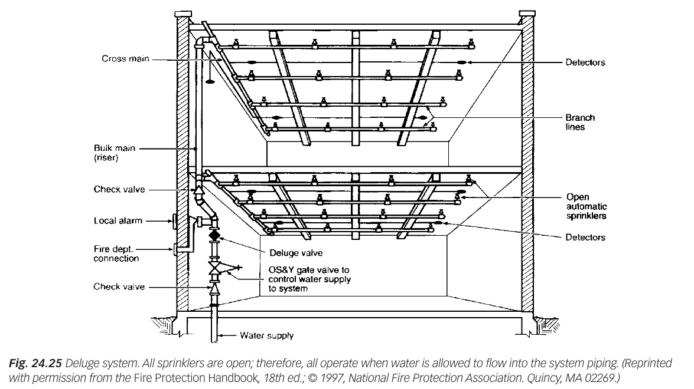
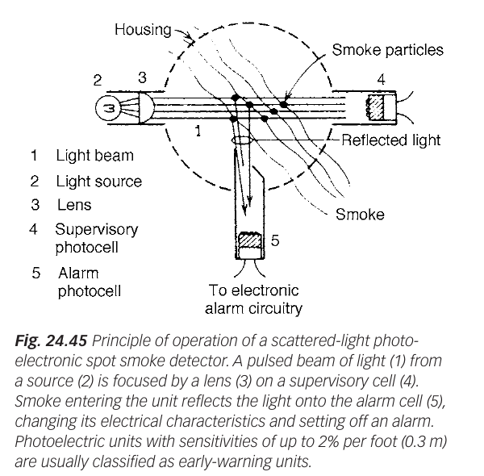

<!-- pagebreak -->
# Module 3: Fire protection

| | |
|---|---|
| **Where it appears** | Ten of eleven papers, 2012-13 to 2023-24 (not 2011-12): Q7 of Section B (2012-13); Q3 or Q4 of Section A (2013-14 to 2018-19); Q2(b) and Q3 of Section A (2020-21, 2021-22); **the compulsory 45-mark Q3 of Section A (2022-23)**; **the compulsory Q5 and Q6 of Section B (2023-24)** |
| **Share of all marks** | 12.6% (385 of 3055 weighted marks, 31 parts); 16.7–18.5% of each recent paper. Mostly theory: only five parts are numericals (fire-water storage). |
| **Time** | core 3 h (§3.1–3.12 and Solutions 3.1, 3.7, 3.10, 3.18, 3.22, 3.23, 3.28, 3.30), full 5 h (all 31 solutions) |
| **Sources** | Kanak pp.198–225 (Aloke sir's fire deck, BNBC 2020 Part 4 Ch. 4 extracts); Grondzik Ch. 24 (§24.1–24.4, 24.6, 24.16–24.19); BNBC 2006 / 2020 Table 4.4.1 (paper attachments) |

**How it has been asked:**

- **Fundamentals:** "What is fire tetrahedron? What are the main causes of ignition?" (2012-13); "What are the **main causes of ignition**?" (2015-16); "Define fire, fire triangle and explain fire fundamentals in detail. Write short note on flammability and combustibility" (2021-22); "Differentiate between the fire tetrahedron and fire triangle. Explain how the different fire extinguishing mediums target different elements" (2023-24).
- **Bangladesh:** "**What are the main sources of fire? Why is fire such a devastating hazard in Bangladesh?**" (**2020-21, 2022-23**), with "What is the fire safety concept tree?" (2020-21); "major industrial and non-industrial fire accidents and sources of fire in Bangladesh" (2021-22).
- **Classes and extinguishers:** "Classify fire according to NFPA and specify which type of extinguisher will be used" (2012-13, 2016-17); "**Make comparison between different types of fire extinguisher** … specify which type of extinguisher will be used for different class of fire" (**2018-19, 2020-21, 2022-23**); "Classify fire according to BNBC with examples" (2020-21, 2022-23); CO₂ vs powder (2015-16); water extinguisher pros and cons (2013-14); purpose, selection and placement of portable extinguishers (2023-24).
- **Systems:** "Briefly describe the **sprinkler** fire protection system with schematic diagram" (2017-18, 2018-19, 2020-21); "Describe **standpipe and hose** fire protection system … with a schematic diagram" (2016-17, 2022-23); "different type of fire protection systems" (2021-22); fusible-element sprinkler head and deflector patterns, detection and alarm functions, **ionization vs photoelectric** smoke detectors (all 2023-24).
- **Storage numerical (template):** "For a facility having building of **light hazard-I** type, **N rentable floors, each A m² net. Floor-to-floor height = 3.7 m.** According to BNBC, determine the storage capacity of water for fire protection" (15 × 500 in 2015-16, 20 × 1500 in 2016-17, 30 × 2500 in 2017-18; light hazard-II, 25 × 3500 in 2018-19). 2012-13 has an older area-based variant.
- **Riser drawings, word for word:** "**Draw the typical diagram for fire protection with automatic fire pump in different water supply zones of a tall building (according to BNBC)**" (**2012-13, 2015-16, 2022-23**) and "**Draw the typical diagram for fire protection system with ground and gravity roof tank with adequate domestic and fire reserve (according to BNBC)**" (**2013-14, 2016-17, 2017-18, 2018-19**).

> **KEY: Toolkit for this module**
>
> - **Fire** = rapid, self-sustaining oxidation (combustion) that releases heat, light and smoke. **Triangle:** fuel + heat + oxygen. **Tetrahedron:** + uninhibited chemical chain reaction.
> - **Four extinguishing modes:** starve (remove fuel), smother (remove oxygen), cool (remove heat), inhibit (break the chain reaction).
> - **Fire classes (NFPA = BNBC 2020):** A ordinary solids; B flammable liquids and gases; C live electrical; D combustible metals; K cooking oils and fats.
> - **Agent per class:** A → water (or foam, ABC powder); B → foam, CO₂, dry powder; C → CO₂, dry powder, clean agent (never water or foam); D → special dry powder (NaCl, graphite); K → wet chemical (potassium acetate/carbonate).
> - **Sprinkler systems:** wet, dry, pre-action, deluge. Ordinary heads open at 57–77 °C. **Standpipe classes:** I (65 mm, firefighters), II (40 mm, occupants), III (both).
> - **BNBC hazard classes:** Light I, Light II, Ordinary I, II, III, Extra.
> - **Fire-water storage** (BNBC Table 4.4.1, values per riser serving 1000 m² of floor):
> $$V=n_r\,(Q_{spr}+Q_{sp})\,t,\qquad n_r=\left\lceil\frac{A_{floor}}{1000\ \text{m}^2}\right\rceil,\qquad H=N\times h$$
>   $Q$ in L/min, $t$ in min, $V$ in L; 1 m³ = 1000 L. Duration $t$: column "up to 51 m" for $H\le51$ m; 51–102 m → 1.25× (BNBC 2006) or the printed column (BNBC 2020: 38/62/95); above 102 m → 1.5× (45/75/112).
> - **Riser diagrams:** Fig. 4.4.3 ground tank + automatic fire pump; Fig. 4.4.4 ground tank + manual pump + gravity roof tank (domestic reserve above fire reserve); Fig. 4.4.8 zones (≈ 67 m each) with an automatic pump per zone; Fig. 4.4.9 zones with intermediate gravity tanks; Fig. 4.4.10 pressure-reducing valves.

## 3.1 Fire and its fundamentals ★

### What fire is {#fire-what}

**Fire** is the rapid oxidation of a material in the exothermic chemical process of combustion, releasing heat, light and various reaction products [Kanak p.198]. Grondzik puts it as: "Fire is a special kind of oxidation known as combustion." Molecules of fuel combine with oxygen and give gases and energy; when this happens fast, the energy appears as heat and light and some of the gases become visible as smoke [Grondzik §24.1].

Combustion is either **controlled** or **uncontrolled** [Kanak p.199]:

- *Controlled* combustion is used on purpose: cooking, lighting, engines of vehicles and aircraft, boilers.
- *Uncontrolled* combustion starts unintentionally and spreads: house fires, wild and forest fires, explosions. Fire protection deals with this kind.

### The fire triangle and the fire tetrahedron {#fire-triangle}

**Fire triangle.** A fire needs three things at once: **fuel**, **heat** (a temperature high enough to release vapour from the fuel and ignite it) and **oxygen** (an oxidising agent, normally air with 21% O₂). "If deprived of any of these needs, building fires will be extinguished" [Grondzik §24.1].

**Fire tetrahedron.** The modern model adds a fourth element, the **uninhibited chemical chain reaction** [Kanak p.198]. Flaming combustion goes on through free radicals (H•, OH•, O•) produced in the flame; they react with fresh fuel vapour and produce more radicals and more heat. The four faces are:

1. **Fuel**: any substance that can undergo combustion (wood, paper, cloth, oil, gas, metals).
2. **Heat**: heat energy sufficient to release vapour from the fuel and cause ignition.
3. **Oxidising agent**: air containing oxygen (or oxidising chemicals).
4. **Uninhibited chemical chain reaction**: enough exothermic reaction energy to keep producing the radicals that sustain the flame.

The fuel–air ratio must also lie inside the **flammable limits** [Kanak p.198].

![Fig. 1: Fire tetrahedron, two versions. Left: a hand-drawn triangular pyramid whose four faces are labelled Oxygen (left face), Heat (front face), Fuel (right face) and Chain reaction (base). Right: a coloured 3-D tetrahedron with flames on its apex; faces OXYGEN (blue, left), HEAT (red, front), FUEL (brown, right) and CHAIN REACTION (green base). Removing any one face collapses the tetrahedron, which is how a fire is put out. [Kanak p.198]](figures/001.jpg "w=0.6")

| | Fire triangle | Fire tetrahedron |
|---|---|---|
| Elements | 3: fuel, heat, oxygen | 4: fuel, heat, oxygen, chemical chain reaction |
| What it explains | Ignition and burning of any fire | Sustained **flaming** combustion as a self-propagating radical reaction |
| Extinguishing modes it explains | Starving, smothering, cooling | The same three **plus chemical inhibition** (dry chemical powders, halons, clean agents) |
| Typical fires | Smouldering (glowing) combustion of solids is described well by the triangle | Flaming fires of liquids, gases and most solids |
| Status | Older, simpler model | Current model (NFPA[The National Fire Protection Association, a US non-profit founded in 1896, writes fire codes and standards used around the world: NFPA 10 (portable extinguishers), NFPA 13 (sprinklers), NFPA 30 (flammable and combustible liquids), NFPA 72 (fire alarms), NFPA 101 (the Life Safety Code). BNBC 2020 Part 4 uses its fire classes.]{.aside}) |

### Terms of fire science (flammability and combustibility) {#fire-terms}

- **Ignition (kindling) temperature:** the lowest temperature at which a material, heated by an outside source (spark, flame), ignites and continues to burn.
- **Auto-ignition temperature:** the lowest temperature at which a substance ignites by itself, with no spark or flame. Cooking oil can auto-ignite; this is why class K fires re-ignite until the oil is cooled [Kanak p.209].
- **Flash point:** the lowest temperature at which a liquid gives off enough vapour to form an ignitable mixture with air just above its surface; the vapour flashes momentarily when a flame is applied, but does not keep burning.
- **Fire point:** a few degrees above the flash point; the vapour is produced fast enough to keep burning after ignition.
- **Flammable (explosive) limits:** a fuel vapour–air mixture burns only between a lower flammable limit (LFL, too lean below it) and an upper limit (UFL, too rich above it). Methane: about 5% to 15% by volume; LPG (propane): about 2% to 10%.
- **Flammability** is the ease with which a material ignites and how fast flame spreads over it. A **flammable** liquid has a flash point **below 37.8 °C (100 °F)** (petrol, kerosene vapour near hot equipment, acetone, alcohol) and ignites at room temperature from a spark.
- **Combustibility** is the ability of a material to burn at all, given enough heat. A **combustible** liquid has a flash point **at or above 37.8 °C** (diesel, lubricating oil, cooking oil): it must be heated before it ignites. Solids are combustible (wood, paper, cloth, plastics) or **non-combustible** (concrete, brick, steel, glass) [NFPA 30].
- So every flammable material is combustible, but not every combustible material is flammable. Flammable materials need stricter storage, ventilation and separation from ignition sources.

**How a solid burns.** Heat **pyrolyses** a solid fuel (breaks it down into combustible vapours); the vapour mixes with air and burns in the flame above the surface; the flame radiates heat back to the fuel and pyrolyses more of it. This feedback is the chain that the tetrahedron describes. Liquids burn as vapour above the surface; gases burn directly.

**How fire spreads.** By **conduction** (through steel beams, pipes, walls), **convection** (hot smoke and gases rising through stairs, shafts and ducts and spreading under the ceiling), **radiation** (from flames and the hot smoke layer to nearby fuel and to neighbouring buildings) and **direct flame contact** and flying brands.

### Products and effects of fire {#fire-effects}

**Products of combustion** [Grondzik §24.1(b)]:

- **Thermal products** (flame and heat): burns, heat shock, dehydration, heat exhaustion, blockage of the respiratory tract. They cause only about one quarter of fire deaths.
- **Smoke**: droplets of tar and fine carbon particles suspended in gases. It irritates the eyes and nose, blinds and chokes, and hides the exits.
- **Toxic gases**: **carbon monoxide** (the most abundant and most deadly; it binds haemoglobin more readily than oxygen and causes confusion, unconsciousness and death), CO₂, HCN, HCl from burning PVC, H₂S, SO₂, NH₃, NO$_x$, phosgene.
- **Oxygen depletion**: below 17% O₂ coordination and judgement fall; at 14–10% people stay conscious but become irrational and tire quickly; at 10–6% they collapse.

**Effects of fire** [Kanak p.199]:

- Fire is a force, a hazard and a potential destroyer that must always be given the highest priority.
- It is heralded by smoke; it must be controlled in its initial stages, before it reaches a large and devastating size.
- Smoke spreads much more easily than fire and harms people far from the fire. **Smoke from a fire has killed more people than the fire itself.**
- Losses are enormous: lives, injuries, buildings, contents, business continuity and the environment.

### How a fire grows {#fire-growth}

A compartment fire passes through five stages (Fig. 2) [Grondzik §24.16, Table 24.1]:

1. **Incipient**: ignition and smouldering; invisible combustion particles and gases, no visible smoke or appreciable heat. Ionization detectors respond here.
2. **Growth**: flames spread over the first item; a hot smoke layer forms under the ceiling and descends; visible smoke (photoelectric detectors), then heat (heat detectors, sprinklers). This is the window for escape and first-aid firefighting.
3. **Flashover**: radiation from the hot layer (about 500–600 °C) ignites every exposed surface in the room almost at once. After flashover nobody in the room survives.
4. **Fully developed**: the whole room burns at 800–1000 °C; the burning rate is limited by the ventilation openings; fire spreads to other rooms and floors.
5. **Decay**: the fuel is consumed and the temperature falls.

Grondzik's Table 24.1 divides growth into five *realms*: preburning (overheat to ignition), initial burning (to a 250 mm flame), vigorous burning (to a 1.5 m flame), interactive burning (flame reaching the ceiling) and remote burning (full room involvement). Growth is speeded by fuel continuity, ignitable interior finish, feedback from walls and ceiling, low ceilings, room insulation, openings and running HVAC fans.

![Fig. 2: Fire development curve: indicative room gas temperature (vertical axis, 0–1200 °C) against time (horizontal axis). The curve rises slowly in the INCIPIENT stage (ignition, smouldering, invisible particles), curves upward in the GROWTH stage (flames spread, hot smoke layer under the ceiling; marked as the escape and first-aid firefighting window), jumps steeply at FLASHOVER (all exposed surfaces ignite, gas layer about 500–600 °C), stays near 850–900 °C in the FULLY DEVELOPED stage (whole room burns, ventilation-controlled) and falls in the DECAY stage (fuel used up). Dashed vertical lines separate the stages.](figures/002.jpg "w=0.75")

> **ASKED: Read this section to answer**
>
> These past-paper parts are answered from this section; the full answers are with the term-final questions at the end of the module.
>
> - “What is fire?” (2017-18); “Define fire, fire triangle and explain fire fundamentals in detail” (2021-22). *Read:* [What fire is](#fire-what), [the triangle and tetrahedron](#fire-triangle). *Answer:* [Solution 3.16](#q-3-16), [Solution 3.3](#q-3-3).
> - “What is fire tetrahedron?” (2012-13); “Differentiate between the fire tetrahedron and fire triangle” (2023-24). *Read:* [the triangle and tetrahedron](#fire-triangle). *Answer:* [Solution 3.1](#q-3-1), [Solution 3.4](#q-3-4).
> - “Write short note on flammability and combustibility” (2021-22). *Read:* [terms of fire science](#fire-terms). *Answer:* [Solution 3.3](#q-3-3).
> - “What are the effects of fire?” (2017-18). *Read:* [products and effects](#fire-effects). *Answer:* [Solution 3.16](#q-3-16).
> - “Write short note on … fire growth” (2020-21). *Read:* [how a fire grows](#fire-growth). *Answer:* [Solution 3.9](#q-3-9).

## 3.2 Causes and sources of fire; the Bangladesh picture ★

### Causes of ignition {#fire-causes}

**Main sources of fire** [Kanak p.202]:

1. **Smoking**: burning cigarettes and matches thrown on waste, bedding, stored cloth.
2. **Electrical equipment**: short circuits, overloaded and substandard wiring, loose connections, arcing, overheated appliances.
3. **Heaters** and cooking appliances, gas burners, stoves.
4. **Process machinery and hot work**: friction, overheated bearings, welding and cutting sparks, boilers.
5. **Arson**: fire set deliberately.
6. **Flammable and combustible materials**: gas cylinders, leaking gas lines, chemicals, fuels, stored cloth and yarn.

Grondzik groups the ignition sources in buildings into **three basic kinds** [Grondzik §24.1(a)]:

- **Chemical**: chiefly *spontaneous combustion*, where materials such as oily rags, hay or chemicals heat themselves at room temperature. It depends on the rate of heat generation, an air supply that brings oxygen without cooling, and insulation by the surroundings that keeps the heat in.
- **Electrical**: mostly resistance heating (appliances, space heaters, overloaded cables); also induction, dielectric heating, arcing, static electricity and lightning.
- **Mechanical**: friction (including sparks), overheated machinery and, occasionally, heat of compression.

### Fire statistics of Bangladesh {#fire-bd-stats}

[Kanak pp.200–201; Bangladesh Fire Service and Civil Defence (BFSCD)]

- Fire incidents rose about **5 times** in two decades: from **5376 in 1996 to 27 624 in 2023** (27 624 / 5376 = 5.1).
- **102 people were killed in 27 624 fire accidents in 2023**; the estimated loss was **Tk 792.4 crore** (Tk 792,36,82,014).
- Most incidents came from **electrical short circuits, burning cigarettes and gas-pipeline leakage**.
- A 2017 BFSCD survey of six occupancy types in Dhaka (shopping malls, hospitals, educational institutions, residential buildings, residential hotels, banks) found:

| Occupancy | Buildings inspected | Safe | Risky | Very risky |
|---|---|---|---|---|
| Shopping malls | 1275 | 47 (4%) | 687 (54%) | 541 (42%) |
| Hospitals | 433 | 11 (2.5%) | 249 (58%) | 173 (40%) |

**Major fire incidents in Bangladesh** [Kanak p.201]:

| Date | Place | Deaths | Cause and description |
|---|---|---|---|
| **Industrial** | | | |
| Feb 2010 | Garib & Garib Sweater factory, Gazipur | 21 | Electrical short circuit; exits locked |
| Nov 2012 | Tazreen Fashions, Ashulia | 112 | Fire from exposed wiring in the ground-floor yarn store; no emergency exits to the outside |
| Sep 2016 | Tampaco Foils, Tongi | 34 | Boiler-room explosion; building collapsed |
| Feb 2019 | Chawkbazar (Churihatta), Old Dhaka | 75 | A car gas cylinder exploded and fire spread to chemical stores in a residential building |
| Jul 2021 | Hashem Foods (Sajeeb group), Rupganj | 52 | Fire in a factory with flammable stocks; locked exit door on upper floor |
| Apr 2023 | Bangabazar clothing market, Dhaka | 0 (18 injured) | Thousands of shops of cloth burnt; inadequate water and access |
| Jan 2024 | Rohingya camp, Cox's Bazar | 0 (about 7000 homeless) | Densely packed shelters of bamboo and plastic |
| **Non-industrial** | | | |
| Feb 2010 | Japan Garden City, Dhaka | 7 | Residential complex fire |
| Mar 2019 | FR Tower, Banani | 25 | Electrical short circuit; high-rise with poor fire exits and no working fire protection |
| Jan 2024 | Benapole Express train, Dhaka | 4 | Arson (fire set intentionally) |
| Feb 2024 | Green Cozy Cottage (Kacchi Bhai), Bailey Road | 46 | Gas cylinders on every floor of a restaurant building blocked the only stair, the fire exit |

### Why fire is such a devastating hazard in Bangladesh {#fire-bd-why}

Kanak vai's note's slide (starred by the student) sorts the reasons by the stage of the fire [Kanak p.202]:

- **Initiation of fire**: plenty of fire sources (substandard wiring, illegal gas connections and cylinders, chemicals stored in homes, smoking); lack of awareness.
- **Fire growth and spread**: very high population density; very high fuel density (cloth, yarn, chemicals, plastics); poorly designed or unplanned buildings with little or no passive protection (no compartments, open stairs, glass façades, no fire doors).
- **Fire control and extinguishment**: no fire protection system inside the occupancy; long fire-service response time in congested roads; the fire is already large before active firefighting can start; lack of water (no hydrants, no reserve) and of fire protection systems.
- **Evacuation from the building**: violation of the building code (too few exits, narrow exit passages, locked or blocked exits, no fire lifts in high-rise buildings and health-care facilities); no or very few fire drills.

### The fire safety concept {#fire-concept}

The **fire safety concept** is that fire safety objectives (life safety first, then property, continuity of operation and heritage [Grondzik §24.1(c)]) are met by a combination of measures, so that no single failure causes a disaster. The **Fire Safety Concepts Tree** (NFPA 550) shows the logic (Fig. 3):

- The top objective is met by **preventing fire ignition** OR by **managing the fire impact** (an "OR" gate: either branch can meet the objective, and designs use both).
- *Prevent ignition*: control heat-energy sources (wiring, smoking, hot work, heaters), control interaction of sources with fuel (separation, distance, insulation) and control the fuel (limit quantity, non-combustible materials, housekeeping).
- *Manage fire impact*: **manage the fire** (control the combustion process by choice of materials and finishes; **suppress** the fire by sprinklers, hose and extinguishers; **control the fire by construction**: compartments, fire walls, fire doors, fire dampers) AND/OR **manage the exposed** (limit the number of people and amount of property exposed; safeguard the exposed by defending them in place, in a refuge, or by moving them: detection, alarm, exits, evacuation).

Two other ways of saying the same thing appear in answers:

- **Passive vs active protection.** *Passive* measures are built in and need no action: fire-rated walls, floors and doors, compartmentation, protected stairs, fire-stops, non-combustible finishes. *Active* measures act when a fire occurs: detectors and alarms, sprinklers, standpipes, extinguishers, smoke control, fire lifts [Grondzik §24.1(c)].
- **Prevent → detect → contain → suppress → escape.**

![Fig. 3: The Fire Safety Concepts Tree (after NFPA 550). Top box: FIRE SAFETY OBJECTIVES (life, property, mission, heritage). Through an OR gate it branches to PREVENT FIRE IGNITION and MANAGE FIRE IMPACT. Prevent fire ignition splits into three boxes: control heat-energy sources (wiring, smoking, hot work, heaters), control source–fuel interactions (separation, insulation, distance) and control fuel (limit, choose non-combustible, housekeeping). Manage fire impact splits into MANAGE FIRE and MANAGE EXPOSED. Manage fire splits into control combustion process (materials, finishes), suppress fire (sprinklers, hose, extinguishers) and control fire by construction (compartments, fire walls). Manage exposed splits into limit amount exposed (occupant load, layout) and safeguard exposed: defend in place or move (detect, alarm, evacuate). A footnote says prevention acts before ignition; detection, suppression, compartmentation and escape act after it.](figures/003.jpg "w=0.85")

### Evacuation {#fire-evacuation}

Evacuation is the orderly movement of occupants from the fire to a safe place outside (or to a protected refuge) before conditions become untenable [Grondzik §24.1(e)]:

- **Behaviour:** occupants (1) notice cues (smell of smoke, noise, alarm), (2) define the situation, (3) choose to fight or flee. Panic is rare; delay in deciding is the usual killer, so early detection and a clear alarm matter most.
- **Means of egress:** *exit access* (corridor to an exit), *exit* (protected stair or door, fire-rated), *exit discharge* (from the exit to a public way). Exits must be enough in number (at least two), wide enough for the occupant load, never locked, lit and signed, and reachable within the code's travel distance.
- **Vertical exits** are protected stairs and smoke-proof towers, **not lifts** (only dedicated fire lifts are used by firefighters). At least 30% of fire deaths happen because fire cuts off the exit route.
- **Needs:** fire drills, trained wardens, emergency lighting, exit signs, refuge floors in tall buildings, pressurised stairs.

> **ASKED: Read this section to answer**
>
> These past-paper parts are answered from this section; the full answers are with the term-final questions at the end of the module.
>
> - “What are the main causes of ignition?” (2012-13, 2015-16). *Read:* [causes of ignition](#fire-causes). *Answer:* [Solution 3.1](#q-3-1), [Solution 3.2](#q-3-2).
> - “What are the main sources of fire? Why is fire such a devastating hazard in Bangladesh?” (2020-21, 2022-23). *Read:* [causes](#fire-causes), [why so devastating](#fire-bd-why). *Answer:* [Solution 3.5](#q-3-5), [Solution 3.12](#q-3-12).
> - “Give brief description of major industrial and non-industrial fire accidents and sources of fire in Bangladesh” (2021-22). *Read:* [fire statistics of Bangladesh](#fire-bd-stats). *Answer:* [Solution 3.6](#q-3-6).
> - “What is the fire safety concept tree?” (2020-21). *Read:* [the fire safety concept](#fire-concept). *Answer:* [Solution 3.5](#q-3-5).
> - “Write short note on evacuation …” (2020-21). *Read:* [evacuation](#fire-evacuation). *Answer:* [Solution 3.9](#q-3-9).

## 3.3 Extinguishing a fire: the four modes ★

A fire is put out by **controlling or removing one or more sides of the fire tetrahedron** [Kanak p.203]:

| Mode | Side removed | How | Agents and examples |
|---|---|---|---|
| **Starvation** (limitation of fuel) | Fuel | Remove unburnt fuel, shut the gas or oil valve, cut fire breaks, isolate electrical supply | Closing a gas valve; removing stock; draining a tank |
| **Smothering** (blanketing, limitation of oxygen) | Oxygen | Cover the fuel or displace the air | Foam blanket, CO₂, fire blanket, sand, steam, a lid on a pan |
| **Cooling** (limitation of temperature) | Heat | Absorb heat until the fuel is below its fire point and stops releasing vapour | Water (2256 kJ/kg on evaporation), wet chemical, CO₂ (partly) |
| **Inhibition** (breaking the chemical chain reaction) | Chain reaction | Agent captures the free radicals in the flame | Dry chemical powders (ABC, BC), halons, clean agents (FM-200) |

Most agents work by more than one mode. Water cools mainly, but the steam it forms (1700 times the volume of the water) also smothers. Foam smothers and cools. CO₂ smothers and also cools (it absorbs about 280 kJ/kg on release). Dry powder inhibits the chain reaction and also coats (smothers) the fuel [Grondzik §24.3, §24.4].

> **ASKED: Read this section to answer**
>
> These past-paper parts are answered from this section; the full answers are with the term-final questions at the end of the module.
>
> - “Describe different way of extinguishment of fire” (2020-21). *Read:* the four modes above. *Answer:* [Solution 3.11](#q-3-11).
> - “Explain how the different fire extinguishing mediums target different elements of fire tetrahedron” (2023-24), with §3.5 for the agents. *Read:* the four modes above. *Answer:* [Solution 3.4](#q-3-4).

## 3.4 Classes of fire ★

Fires are classified by the fuel, because the fuel decides which agent works and which is dangerous. BNBC 2020 Part 4 Ch. 4 (§4.1.4) uses the NFPA letters [Kanak p.203; Grondzik §24.4(e)]:

| Class | Fuel (BNBC 2020 §4.1.4) | Examples | Extinguishing agent | Never use |
|---|---|---|---|---|
| **A** | Common combustibles | Wood, paper, cloth, plastics, rubber | **Water** (cooling); foam; ABC dry powder | (CO₂ only cools briefly; deep-seated fires re-ignite) |
| **B** | Flammable liquids and gases | Petrol, diesel, oil, paint, solvents, propane, LPG | **Foam** (liquids); **CO₂**; **dry chemical powder** (BC/ABC); for gas: shut off the supply first | Water jet: it spreads the burning liquid |
| **C** | Live (energised) electrical equipment | Computers, fax machines, switchboards, motors, transformers | **CO₂**; dry powder; clean agent (non-conducting); cut the power, then treat as A or B | Water and foam: they conduct electricity |
| **D** | Combustible metals | Magnesium, lithium, sodium, potassium, aluminium powder, titanium | **Special class D dry powder** (sodium chloride, graphite, copper based) or dry sand | Water (reacts, releases hydrogen, explodes); CO₂ (Mg burns in CO₂); ordinary ABC powder |
| **K** | Cooking media | Cooking oils and fats in deep fryers | **Wet chemical** (potassium acetate, citrate or carbonate solution) | Water (violent steam explosion; burning oil is thrown out) |

> **TRAP: Kanak vai's note leaves class C blank, and calls the class K agent a "powder"**
>
> The handwritten class-to-extinguisher list in Kanak vai's note reads A water, B foam, **C (blank)**, D dry chemical powder, K "wet chemical powder" [Kanak p.203]. The class C agent is **CO₂** (or dry chemical powder, or a clean agent): a non-conducting agent that leaves no residue on electronics. Class K uses a **wet chemical** in liquid form, not a powder. Class D needs a **special** metal-fire powder, not the ordinary ABC powder.

> **TIP: NFPA letters are not European letters**
>
> In the European/British system (EN 2) class B is flammable liquids, **class C is flammable gases**, class D metals, **class F** cooking oils, and electrical fires have no letter. Questions here ask "according to NFPA" or "according to BNBC"; both use A, B, C (electrical), D, K. State which system you use.

> **ASKED: Read this section to answer**
>
> These past-paper parts are answered from this section; the full answers are with the term-final questions at the end of the module.
>
> - “Classify fire according to NFPA” or “Classify fire” (2012-13, 2016-17, 2018-19, 2020-21), always with “specify which type of extinguisher will be used” from §3.5. *Read:* the class table above. *Answer:* [Solution 3.7](#q-3-7), [Solution 3.8](#q-3-8), [Solution 3.10](#q-3-10), [Solution 3.11](#q-3-11).
> - “Classify fire according to BNBC with examples” (2020-21, 2022-23). *Read:* the class table above. *Answer:* [Solution 3.9](#q-3-9), [Solution 3.12](#q-3-12).

## 3.5 Extinguishing agents and portable extinguishers ★

The extinguishing agents are water, foam, powder, gaseous agents (CO₂, inert gases) and vaporising liquids (halons and their clean-agent replacements) [Kanak p.204].

### Water {#ext-water}

Water is the most commonly available and effective fire-fighting medium. It removes heat: the heat that would pyrolyse the fuel goes into raising the water's temperature and, mainly, into evaporating it (2256 kJ/kg). The steam (1700 times the liquid volume) also displaces air. "Water cools, smothers, emulsifies, and dilutes" [Kanak p.204; Grondzik §24.3].

| Advantages of water | Disadvantages of water |
|---|---|
| Easily available everywhere and cheap: the most used agent | The fire area needs clean-up afterwards |
| Very high cooling capacity (sensible heat plus 2256 kJ/kg latent heat) | **Conducts electricity**: power must be cut before use on electrical equipment |
| Steam formed smothers the fire | **Never use on oil fires**: oil floats and keeps burning, and burning oil is thrown out of a pan |
| Easily stored and pumped over long distances and heights | Damages sensitive electrical and electronic equipment |
| Non-toxic, no health hazard | Many materials dissolve in or are spoilt by water (water damage) |
| Soft water preferred; sea water usable in emergency (but corrodes pumps and pipes) | Reacts dangerously with burning metals (class D); freezes in cold areas |

**Pressurised (stored-pressure) water extinguisher** (Fig. 4): a stainless-steel cylinder about two-thirds full of water with air or nitrogen at about 10 bar in the space above it. Pulling the safety pin and squeezing the operating lever opens the control valve; the gas pressure drives water up the discharge (dip) tube and out through the hose and nozzle as a jet. A 9-litre unit weighs about 14 kg and throws 9–12 m [Grondzik §24.4(e)]. Use on class A only.

![Fig. 4: Pressurised water fire extinguisher. Left: photograph of a stainless-steel cylinder with a black hose and a red label "WATER fire extinguisher". Right: cut-away labelled operating lever, safety pin and carrying handle at the head, control valve, the stored-pressure (gas) space at the top, water in the lower part of the cylinder, a discharge tube (dip tube) from the head to near the bottom, and the nozzle at the end of the external hose. [Kanak p.205]](figures/004.jpg "w=0.55")

### Carbon dioxide {#ext-co2}

CO₂ is stored as a **liquid under pressure** (about 55 bar at room temperature) in a heavy steel cylinder; on release it flashes to gas and partly to "snow" at −78 °C [Kanak p.206]. It **smothers** (displaces oxygen) and **cools** (it absorbs about 280 kJ/kg) [Grondzik §24.4(c)]. It is **clean**: non-conducting, leaves no residue, does not contaminate food, valuable materials or clothing. So CO₂ extinguishers are used in data-processing centres, laboratories, communication rooms, switch rooms and food stores and processing plants, where contamination and clean-up time matter. The extinguisher has no pressure gauge (it is checked by weight) and discharges through a wide **horn** (Fig. 5), which slows the gas and must not be held with bare hands (frost burns).

Limitations: short range (1–2.5 m) and short discharge (10–30 s); it disperses in wind and outdoors; it gives little lasting cooling, so smouldering class A fires **re-ignite**; at the 21–62% concentration needed to extinguish, it suffocates people (9% causes unconsciousness in minutes), so total-flooding CO₂ is used only in unoccupied spaces [Grondzik §24.4(c)].

![Fig. 5: CO₂ fire extinguisher, cut-away. A cylindrical body holds liquid carbon dioxide in the lower part with CO₂ vapour above it. A central dip tube runs from near the bottom to the valve in the head, which carries the safety pin and the operating handle. A short pipe leads to a conical discharge horn; dashed arrows show the gas and snow leaving the horn. [Kanak p.206]](figures/005.jpg "w=0.5")

### Foam

Foam is a mass of gas-filled bubbles lighter than oil, so it floats on a burning liquid, **forms a blanket** that cuts the burning liquid off from the air (smothering), **seals in the vapour** and **cools** the surface [Kanak p.207; Grondzik §24.4(b)]. Portable foam extinguishers are **best for class B fires of flammable liquids** (oil, solvents, petroleum products); they also work on class A.

The **9-litre chemical foam extinguisher** (Fig. 6) has an inner container of aluminium sulphate solution inside an outer container of sodium bicarbonate solution (with a foam stabiliser). Inverting the extinguisher (or opening the inner container by the T-handle) mixes them:

$$\mathrm{Al_2(SO_4)_3 + 6NaHCO_3 \rightarrow 2Al(OH)_3 + 3Na_2SO_4 + 6\,CO_2}$$

The CO₂ produced pressurises the extinguisher and is trapped in bubbles of the aluminium hydroxide gel to form the foam. A 6 m jet is maintained for 30 s, and the discharge must be complete within 90 s [Kanak p.207]. Modern units use mechanical foam (AFFF or FFFP concentrate mixed with water and aerated at the nozzle). Foams are classed by expansion ratio: low (up to 20:1, liquid spills and tanks), medium (20–200:1) and high (200–1000:1, flooding basements and ship holds) [Grondzik §24.4(b)].

Limitations: **foam solutions are electrically conductive**, so not for live electrical equipment; not for metal fires or for gas fires that are flowing; broken down by water jets, heat and wind; leaves a messy residue.

![Fig. 6: 9-litre chemical foam extinguisher, cut-away. An inner compartment (a central tube) holds aluminium sulphate solution; the outer compartment holds sodium bicarbonate solution, with a water-level indicator mark on the outer shell. At the top are a spring-loaded T handle, a valve on the inner container, a nozzle valve and porthole, and the nozzle on the cap. [Kanak p.207]](figures/006.jpg "w=0.45")

### Dry chemical powder {#ext-powder}

The **ABC (multipurpose) dry chemical powder** is mostly **mono-ammonium phosphate** with ammonium sulphate, finely ground and made free-flowing; **BC powder** is sodium or potassium bicarbonate [Kanak p.208; Grondzik §24.4(e)]. The powder is expelled either by stored pressure (nitrogen in the body, with a gauge) or by a **CO₂ gas cartridge** that is pierced by a strike knob when the extinguisher is used (Fig. 7). Nitrogen may also be used as the expellant.

It works mainly by **breaking the chemical chain reaction** (the powder particles capture the flame radicals), which gives very fast knock-down of flames; ammonium phosphate also melts on hot class A surfaces and forms a coating that excludes oxygen (smothering), with some cooling. It is non-conducting, so suitable for class C.

Limitations: the powder spreads over everything, is corrosive (especially in electronics and on hot metal) and leaves a hard residue that must be cleaned promptly; it reduces visibility and irritates the lungs; it does not cool much, so deep-seated fires may re-ignite [Grondzik §24.4(e)].

![Fig. 7: Dry powder extinguisher. Left: cut-away of a cartridge-type powder extinguisher: strike knob, seal and piercer at the top; a small CO₂ gas cartridge inside the head; carrying handle; a central dip tube in the powder that fills the lower body; an external hose ending in a squeeze-grip lever and nozzle. Right: photograph of a red stored-pressure powder extinguisher with a hose and A, B, C pictograms on its label. [Kanak p.208]](figures/007.jpg "w=0.55")

> **TRAP: The powder slide calls ABC powder a class D agent**
>
> The slide says the ABC dry chemical powder (mono-ammonium phosphate) is "used for extinguishment of fires in combustible metals sodium, lithium, magnesium etc. (Class D)" [Kanak p.208]. That is wrong. **ABC powder is for classes A, B and C.** Burning metals need **special class D powders** (sodium chloride, graphite or copper based, chosen for the particular metal named on the extinguisher), which crust over the metal and exclude air. The slide also omits the main mechanism of dry powder, chain-breaking. Write "ABC powder → A, B, C; class D powder → D".

### Wet chemical

Wet chemical extinguishers use the agent **in liquid form** and are ideal for **class K (kitchen)** fires [Kanak p.209]. Class K fires have a special feature: cooking oil vapour is not easily ignited, but oil heated to a high temperature **auto-ignites**, and it can re-ignite after the flame is out until it has cooled below its auto-ignition temperature. The agent is a **potassium carbonate** (or potassium acetate or citrate) solution, discharged as a fine mist so that it does not splash the oil. It works by **saponification** (it reacts with the hot fat to form a soapy foam layer that seals the surface) and by **cooling** the oil below its auto-ignition temperature [Grondzik §24.4(e)].

### Clean agents (halon replacements)

**Halons** (halogenated hydrocarbons such as Halon 1301, CF₃Br) put out fires by interrupting the chain reaction, leave no residue and are safe at use concentrations, but they destroy stratospheric ozone; their production was phased out in 1994 [Grondzik §24.4(a)]. **Clean agents** replace them: **FM-200 (HFC-227ea, heptafluoropropane)**, other HFCs, and inert-gas mixtures (IG-541: nitrogen, argon, CO₂). FM-200 vaporises, mixes with air and interrupts combustion; it is clean, non-toxic, odourless, non-conducting and has zero ozone-depletion potential, but needs about 50% more cylinders than Halon 1301 and is costly. They are used in total-flooding systems for computer rooms, control rooms, telecom rooms, archives and museums [Grondzik §24.4(d)].

### Comparison of extinguisher types {#ext-compare}

| Type (agent) | Fire classes | Mechanism | Advantages | Limitations |
|---|---|---|---|---|
| **Water** (stored pressure) | **A** | Cooling (plus steam smothering) | Cheap, non-toxic, high cooling, penetrates deep-seated fires, long throw | Conducts electricity (not C); spreads oil fires (not B, K); reacts with metals (not D); water damage; freezing |
| **Foam** (AFFF or chemical) | **B**, A | Smothering blanket, vapour sealing, cooling | Best on liquid spills and tanks; prevents re-ignition of liquids | Conductive (not C); not for D or flowing gas; messy; broken by heat and wind |
| **CO₂** | **B, C** | Smothering (O₂ displacement) and some cooling | Clean, no residue, non-conducting, no damage to electronics or food | Short range and duration; disperses outdoors; re-ignition of A; asphyxiation in small rooms; frost burns; heavy cylinder |
| **Dry chemical powder (ABC)** | **A, B, C** (BC powder: B, C) | **Chain-reaction inhibition**, coating (smothering) | Multipurpose, fast knock-down, non-conducting, cheap, works outdoors | Corrosive residue, hard clean-up, damages electronics; poor visibility; little cooling, re-ignition |
| **Class D powder** | **D** | Crusting over the metal, excluding air, absorbing heat | Only agent for burning metals | Metal-specific; useless on other classes |
| **Wet chemical** | **K**, A | Saponification (soap layer on the oil) and cooling | Prevents re-ignition of hot cooking oil; gentle mist does not splash | Conductive (not C); limited to kitchens |
| **Clean agent** (FM-200, inert gas) | **A** (surface), **B, C** | Chain-reaction inhibition (HFC) or O₂ dilution (inert gas) | No residue, non-conducting, safe for people at design concentration, fast | Expensive; needs an enclosed room; HFCs have high global-warming potential |

### Portable fire extinguishers: purpose, selection and placement {#ext-portable}

**Purpose.** Portable extinguishers are **first-aid** fire-fighting appliances: hand-held units used by occupants to put out or control a fire **in its incipient stage**, before it grows, before the fire service arrives and before fixed systems are overwhelmed. "Most fires in buildings can be extinguished at an early stage with these commonly seen devices" [Grondzik §24.4(e)]. They do not replace sprinklers, hose or evacuation; the user must always keep an escape route behind them.

**Selection factors** [NFPA 10; Grondzik §24.4(e), Table 24.11]:

1. **Class of fire likely** in the area: the extinguisher's rating (A, B, C, D, K) must match the fuel (e.g. CO₂ in a server room, wet chemical in a kitchen, class D powder in a magnesium workshop, ABC powder in a general office).
2. **Size and severity of the hazard** (light, ordinary or extra hazard occupancy) → the rating needed (2-A for light and ordinary, 4-A for extra hazard) and the number of extinguishers (e.g. light hazard: one 2-A unit per 557 m², ordinary: per 279 m²).
3. **Effect of the agent on the contents and people**: water damage, powder residue on electronics, CO₂ asphyxiation in small rooms.
4. **Who will use it**: weight and ease of operation for the occupants; training.
5. **Environment**: temperature (water freezes), outdoor wind (CO₂ disperses), corrosive atmospheres.
6. **Electrical hazard**: non-conducting agents where equipment is live.

**Placement factors:**

1. **Travel distance**: no occupant more than **23 m (75 ft)** from a class A extinguisher; **9–15 m (30–50 ft)** for class B; **9 m (30 ft)** for class K; 23 m for class D.
2. **Conspicuous and accessible**: along normal paths of travel and egress, near exits and stair doors, never hidden or blocked, with signs; so a user approaches with the exit behind them (Fig. 8).
3. **Near the hazard but not inside it**: e.g. a CO₂ unit at the door of a switch room, not behind the switchboard.
4. **Mounting height**: units up to 18 kg with their top no more than 1.5 m above the floor; heavier units no more than 1.07 m; bottom at least 0.1 m clear of the floor.
5. **Protection and maintenance**: in cabinets or on brackets, protected from damage and weather; inspected monthly, maintained yearly, hydrostatically tested periodically.

![Fig. 8: Extinguisher and standpipe locations on a typical multi-storey office floor plan. Extinguishers are placed at the stair enclosures and in the lobby and corridors, so that no point on the floor is more than 75 ft (23 m) of travel from an extinguisher; standpipe hose connections are in the stairs. [Grondzik Fig. 24.29]](figures/008.png "w=0.6")

> **ASKED: Read this section to answer**
>
> These past-paper parts are answered from this section; the full answers are with the term-final questions at the end of the module.
>
> - “Make comparison between different types of fire extinguisher … specify which type of extinguisher will be used for different class of fire” (2018-19, 2020-21, 2022-23). *Read:* [comparison of extinguisher types](#ext-compare). *Answer:* [Solution 3.10](#q-3-10), [Solution 3.11](#q-3-11), [Solution 3.12](#q-3-12).
> - “… specify which type of extinguisher will be used for different type of fire” (2012-13, 2016-17). *Read:* [comparison of extinguisher types](#ext-compare). *Answer:* [Solution 3.7](#q-3-7), [Solution 3.8](#q-3-8).
> - “Make a brief comparison between CO₂ and Powder type fire extinguisher” (2015-16). *Read:* [carbon dioxide](#ext-co2), [dry chemical powder](#ext-powder). *Answer:* [Solution 3.13](#q-3-13).
> - “Write down some advantages and disadvantages of water fire extinguisher” (2013-14). *Read:* [water](#ext-water). *Answer:* [Solution 3.14](#q-3-14).
> - “Explain how the different fire extinguishing mediums target different elements of fire tetrahedron” (2023-24). *Read:* each agent’s “how it works” line. *Answer:* [Solution 3.4](#q-3-4).
> - “What is the purpose of portable fire extinguishers? Discuss the key factors governing the selection and placement” (2023-24). *Read:* [portable fire extinguishers](#ext-portable). *Answer:* [Solution 3.15](#q-3-15).

## 3.6 Sprinkler systems ★

### What a sprinkler system is and how it works {#spr-what}

A fire **sprinkler system** is an active fire protection method consisting of a water supply providing adequate pressure and flow to a network of distribution pipes onto which **sprinkler heads** are connected [Kanak p.210]. Sprinkler systems are **automatic**: they **detect** a fire, **announce** it (alarm) and **act** by spraying water to control or suppress it, with no person present. A sprinkler is already above the fire and acts within seconds, while firefighters take minutes; most fires in sprinklered buildings are put out by one to five heads, and over half by two or fewer [Grondzik §24.1(c), §24.3(d)].

**Components of a wet-pipe system** (Fig. 10) [Grondzik §24.3(j); Kanak p.211]:

- **Water supply**: city main, ground or underground tank with fire pumps (main electric pump, diesel standby pump, and a small **jockey pump** that keeps the system pressurised), or a gravity roof tank.
- **Main control valve** (OS&Y gate valve, which shows open or closed) and **alarm valve** (a check valve that, when water flows, sends water to a **water-motor alarm gong** outside the building and trips a **flow switch** to the fire alarm panel).
- **Fire department (Siamese) connection** through which fire engines pump into the system.
- **Riser** (vertical main), **cross mains** on each floor, and **branch lines** carrying the heads.
- **Sprinkler heads**, spaced to cover a set floor area each.
- **Main drain** and **inspector's test connection** for testing.

**Working principle** [Kanak p.211]:

1. In standby the pipes are full of water under pressure; each head is closed by a plug held by a heat-sensitive element.
2. A fire heats the gas under the ceiling. At the head nearest the fire the element reaches its **operating temperature** (typically 68 °C) and fails: a **fusible link** melts or a **glass bulb** bursts.
3. The plug (cap) is pushed out of the orifice by the water pressure and water flows.
4. The water stream hits the **deflector**, which breaks it into a spray of set pattern over the fire and wets the fuel around it (cooling it, and also cooling the hot gases so that neighbouring heads do not open needlessly).
5. The pressure drop and flow open the alarm valve: the gong sounds, the flow switch signals the alarm panel and the fire service, and the fire pump starts on falling pressure.
6. **Only the heads heated by the fire open**; the majority of automatic sprinklers operate individually. Water flows until the main valve is shut by the fire service.

![Fig. 9: Sprinkler installation (isometric). Inset top left: a pendent glass-bulb sprinkler head with a red liquid-filled bulb below a ceiling escutcheon. Main drawing: water storage tanks (red blocks) feed the fire pumps (main and jockey pumps on bases at lower left) with their control panel; the pump discharge pipe runs to a vertical riser; at two floor levels the riser feeds a grid of cross mains and many parallel branch pipes carrying the sprinkler heads. [Kanak p.211]](figures/009.jpg "w=0.6")

### Sprinkler heads {#spr-heads}

Sprinkler heads are the key components; each must suit the property protected in **design, performance, application and temperature rating** [Kanak p.212].

**Activation mechanism** [Grondzik §24.3(c)]. A plug or cap is held tight against the orifice by levers or a strut, which are held in place by the arms (frame) of the head. The restraining element is either:

- a **fusible link**: two metal plates soldered together with a **eutectic alloy** that melts sharply at a set temperature. When the link reaches that temperature the solder melts, the plates separate under the load, the levers fall away and the water pressure blows out the cap; or
- a **frangible glass bulb** containing a coloured liquid (glycerine or alcohol based) and a small air bubble. Heat expands the liquid, which compresses the bubble until it is absorbed; continued expansion builds up pressure and **shatters the bulb** at the rated temperature, releasing the cap.

The head opens because of **heat at the head only**, not because of smoke or an alarm.

**The deflector and spray patterns.** The released water comes out as a solid stream; the **deflector** converts it into a spray whose pattern depends on the deflector's design [Grondzik §24.3(c); Kanak p.211]. Different patterns are produced so that:

- the water covers the design floor area of each head uniformly (standard spray: a roughly hemispherical umbrella, about 5 m wide at 1.3 m below the head), with no dry spots between heads;
- the spray suits the mounting: an **upright** deflector turns water downward from a head above the pipe; a **pendent** deflector spreads it from below the ceiling; a **sidewall** deflector throws a quarter-sphere across a small room from one wall;
- the drop size suits the goal: fine drops cool the hot gas and the ceiling (fire **control**); large, fast drops (ESFR, large-drop heads) penetrate a strong fire plume to the burning fuel (fire **suppression**) in high-piled storage;
- most water is directed down and sideways rather than at the ceiling, wetting the burning material and the fuel next to it, to stop the spread.

**Types of head** [Kanak p.212; Grondzik §24.3(c)] (Fig. 11):

- **Upright (SSU, standard spray upright)**: mounted above exposed pipes, pointing up, just below the deck where the hot gases collect.
- **Pendent (SSP)**: hangs down below the pipe, usually through a suspended ceiling; versions are **recessed**, **flush** and **concealed** (hidden above a cover plate that drops off in a fire).
- **Sidewall**: mounted on a wall, for corridors, hotel rooms and small rooms.
- Special heads: extended coverage, quick response, residential, ESFR (early suppression fast response), large drop, open (deluge) heads.

![Fig. 11: Photographs of sprinkler head types: upright (glass-bulb head with the deflector on top, pointing up); sidewall (horizontal head with a half deflector that throws water sideways off a wall); concealed pendent (a flush cover plate hides the head in the ceiling); pendent (head hanging downward with a toothed deflector below the bulb); and a generic glass-bulb head. [Kanak p.212]](figures/011.jpg "w=0.6")

**Temperature ratings.** The rating should be at least 14 °C above the highest ceiling temperature normally expected; ordinary heads operate at **57–77 °C** [Grondzik §24.3(c), Table 24.7]:

| Max. ceiling temp. | Rating | Classification | Frame colour | Glass bulb colour |
|---|---|---|---|---|
| 38 °C | 57–77 °C | Ordinary | Uncoloured or black | Orange (57 °C) or red (68 °C) |
| 66 °C | 79–107 °C | Intermediate | White | Yellow (79 °C) or green (93 °C) |
| 107 °C | 121–149 °C | High | Blue | Blue |
| 149 °C | 163–191 °C | Extra high | Red | Purple |
| 191 °C | 204–246 °C | Very extra high | Green | Black |
| 246–329 °C | 260–343 °C | Ultra high | Orange | Black |

**Quick-response** heads have a light element with a response time index RTI ≤ 50 (m·s)^½ (standard ≥ 80) and open sooner; they are required in light-hazard occupancies such as offices and hotels [Grondzik §24.3(f)]. Discharge from a head is $Q=K\sqrt{p}$ ($Q$ in L/min, $p$ in bar, $K\approx80$ for a 15 mm head) [Grondzik §24.3(d)].

### Types of sprinkler system {#spr-types}

[Grondzik §24.3(j)–(n)]

- **Wet-pipe**: pipes always full of water under pressure; a head opens and water flows at once. The most common, simplest and most reliable; only where the pipes cannot freeze (above 4 °C).
- **Dry-pipe**: pipes filled with compressed air or nitrogen held by a **dry-pipe valve** in a heated room. When a head opens, the air escapes, the pressure falls, the valve opens and water fills the pipes and flows from the open heads. For unheated spaces: cold stores, loading docks, car parks in cold climates. Water is delayed (system volume is limited to about 2840 L).
- **Pre-action**: dry pipes (air, pressurised or not) with closed heads **plus a separate, more sensitive heat or smoke detection system**. The detectors open the **pre-action valve** and sound an alarm; water fills the pipes; water is discharged only where a head is then opened by heat. Used where accidental water discharge would be costly: computer rooms, museums, libraries, archives. A double-interlock version needs both a detector and a head to operate.
- **Deluge**: **open** heads (no element) on dry pipes; a detection system opens the **deluge valve** and water flows from **all** heads at once. For rapid-spread hazards: aircraft hangars, flammable-liquid stores, transformer yards, chemical plants.

| System | Pipe in standby | Heads | What releases water | Typical use |
|---|---|---|---|---|
| Wet pipe | Water under pressure | Closed | Head opens by heat → immediate discharge | Heated buildings (most common) |
| Dry pipe | Compressed air or N₂ | Closed | Head opens → air escapes → dry-pipe valve opens | Unheated spaces, cold stores |
| Pre-action | Air (low or no pressure) | Closed + detectors | Detector opens valve (pipe fills, alarm); then a head must open | Water-sensitive contents: computer rooms, museums |
| Deluge | Empty (open to air) | **Open** | Detector (or manual) opens deluge valve → all heads discharge | Hangars, flammable liquids, transformers |

### Pipe work and layouts

Water is conveyed from the supply to the heads through a network of pipes: riser → cross mains → branch lines → heads [Kanak p.212]. Black or galvanised mild-steel pipes (or copper) are used (BNBC Table 4.4.8: steel to ASTM A53, A135, A795 etc.; copper to ASTM B88 etc.). There are **three basic layouts** [Kanak pp.212–213] (Figs. 15–17):

- **Tree** (branched): the traditional layout. A single cross main is fed at its centre or end and branch lines tee off it and are dead-ended. Water reaches each head by **one path only**, so friction loss is high and pipe sizes grow toward the riser. Variants by feed point: centre–centre feed, side–centre feed, centre–end feed. Simple, for pipe-schedule design.
- **Loop**: two cross mains joined at both ends into a closed loop; the branch lines are fed from the loop. Water can reach a branch from two directions: lower friction loss, smaller pipes, and the system keeps working if one section is shut for repair.
- **Grid**: parallel branch lines connected at **both ends** to two cross mains, so every head is fed from several paths. Lowest friction and most uniform pressure, but it needs hydraulic calculation. Loop and grid layouts are used where the installation is **hydraulically designed**.

![Fig. 15: Sprinkler piping layouts (textbook excerpt). Grid: several parallel branch lines connected at both ends to two cross mains, forming a grid. Tree: a single feed main with branch lines tee'd off each side and dead-ended. Loop: a closed rectangular cross-main loop with several branch lines spanning across it. [Kanak p.212]](figures/015.jpg "w=0.55")

![Fig. 16: Sprinkler pipe configuration in plan. Top: a rectangular room with a grid of sprinkler heads (dots) on branch lines, spacing 10 ft along each branch and 12 ft between branches, and a central cross main fed from the right-hand wall. Below: "Tree system: centre-centre feed", with the cross main across the middle and the riser at its centre; "Tree system: side-centre feed", with the cross main along the bottom wall fed at its middle. [Kanak p.213]](figures/016.jpg "w=0.55")

![Fig. 17: Pipe configuration, continued. "Tree system: centre-end feed": a cross main along the centre line of the room with branch lines across it, fed at the right-hand end. "Looped system": two cross mains joined at both ends into a closed loop, the branch lines crossing both, fed from a single point on the right side. [Kanak p.213]](figures/017.png "w=0.55")

**BNBC spacing and sizing rules** [Kanak pp.221–222, BNBC Tables 4.4.5–4.4.7]:

- **Ceiling area per sprinkler** (Table 4.4.7): light hazard 20 m² (beams and trusses), 12 m² (open wood joists), 15.6 m² (other construction); ordinary hazard 12 m² (9.3 m² with high piling); extra hazard 8.4 m². Maximum spacing between heads and between pipe lines **4.5 m** (3.5 m for extra hazard and high piling).
- **Pipe schedule** (Table 4.4.5, steel): number of heads a pipe may feed, light / ordinary / extra hazard: 25 mm: 2/2/1; 32 mm: 3/3/2; 40 mm: 5/5/5; 50 mm: 10/10/8; 65 mm: 30/20/15; 75 mm: 60/40/27; 90 mm: 100/65/40; 100 mm: no limit/100/55; 150 mm: –/275/150; 200 mm: –/400/225. Copper (Table 4.4.6) allows slightly more (smoother bore).
- **One sprinkler riser or combined riser** may serve not more than **4850 m²** of floor (light and ordinary hazard) or **2325 m²** (extra hazard) per floor.

> **TRAP: Table 4.4.6 misprint**
>
> In BNBC Table 4.4.6 (copper pipe) the 63 mm row is labelled "(1½)" inch; it is **2½ inch**, as in Table 4.4.5.

> **ASKED: Read this section to answer**
>
> These past-paper parts are answered from this section; the full answers are with the term-final questions at the end of the module.
>
> - “Briefly describe the sprinkler fire protection system with schematic diagram” (2017-18, 2018-19, 2020-21). *Read:* [what a sprinkler system is and how it works](#spr-what), [types](#spr-types). *Answer:* [Solution 3.16](#q-3-16), [Solution 3.10](#q-3-10), [Solution 3.11](#q-3-11).
> - “Explain the mechanism behind the activation of a fusible element sprinkler head. What is the purpose of producing different spray patterns by the deflectors?” (2023-24). *Read:* [sprinkler heads](#spr-heads). *Answer:* [Solution 3.17](#q-3-17).
> - “Describe different type of fire protection systems in details with schematic diagram” (2021-22), with §3.7 and §3.9. *Read:* the whole section. *Answer:* [Solution 3.20](#q-3-20).

## 3.7 Standpipe and hose systems ★

### What it is

A **standpipe and hose system** (hydrant system) is a network of vertical pipes (**standpipes** or risers) with **hose valves (landing valves)** and **hose stations** at every floor, permanently connected to a water supply, so that water at the required pressure is available on every floor for **manual** fire-fighting with hoses [Kanak p.209; Grondzik §24.3(a)]. It saves firefighters from dragging hoses up from the street, which is impossible above about seven floors (27 m). "A useful and efficient hydrant system is the backbone of any fire protection installation." The water pressure in the network is generally maintained **above 8.8 bar** [Kanak p.209].

**Components** (Figs. 18, 19 and 27):

- **Water supply**: water main, ground tank with fire pumps, or gravity roof tank with a **fire reserve** (§3.8).
- **Fire pump** (automatic, with diesel standby) and **jockey pump**; check valves and isolating valves.
- **Standpipe (riser)**: 100–200 mm pipe (BNBC Table 4.4.2) running the full height, usually in the protected stair.
- **Hose station on every floor**: landing valve (65 mm), hose reel or rack with 30 m of 40 mm or 65 mm hose, and a branch pipe (nozzle), in a **hose box** (glass-fronted cabinet). In a fire the glass is broken, the box is opened with the key inside, the hose is connected to the hydrant valve, the branch pipe is fixed to the other end, the valve is opened and the jet is directed at the seat of the fire [Kanak p.210].
- **Siamese connection** (fire department connection): a two-way inlet at street level, with a check valve, through which fire engines pump water into the standpipe. After use, the water between the Siamese and the check valve drains through a ball drip [Grondzik §24.3(a)].
- Pressure-reducing valves on the lower floors of tall buildings; an air-release valve at the top; drain and test outlets.
- Optional branch **to the sprinkler system** on each floor (a **combined system**).

**Operation.** In standby the wet standpipe is full of water, kept at pressure by the jockey pump or by the gravity tank. When a hose valve is opened, the pressure falls, the main **fire pump starts automatically** (and runs until stopped manually), and water flows to the hose. The fire service can boost pressure and flow by pumping into the Siamese connection from a hydrant or from its tanker.

### Classes of standpipe (NFPA 14)

[Grondzik §24.3(a)]

| Class | For whom | Hose connection | Use |
|---|---|---|---|
| **Class I** | Trained fire-service personnel, full-scale fire fighting | **65 mm (2½ in.)** hose valves, usually in stairs, no hose kept | Required in buildings above three storeys and in malls; the system of choice now |
| **Class II** | Building occupants, **first-aid** fire fighting before the fire service arrives | **40 mm (1½ in.)** with hose, nozzle and rack or reel at each station | Large unsprinklered buildings, stages; declining (untrained people struggle with a 30 m hose at 380 L/min) |
| **Class III** | Both | Both 65 mm and 40 mm at each station | Combines I and II |

A **combined system** is a Class I or III standpipe that also supplies the sprinkler system.

**Types by water supply** [Grondzik §24.3(a)]: **automatic-wet** (pipes full of water, connected to a supply that meets the demand automatically; water flows as soon as a hose valve opens; the usual type), **automatic-dry** (pressurised air; a dry-pipe valve admits water when a hose valve opens), **semi-automatic-dry** (a deluge valve opened by a remote switch at the hose station), **manual-dry** (empty pipes; water only from the fire engine via the Siamese) and **manual-wet** (filled from the domestic supply for testing; fire water from the fire engine).

**Sizing** [BNBC Table 4.4.2; Grondzik §24.3(a)]:

| Storeys | Height | Standpipe size |
|---|---|---|
| up to 5 | up to 17 m | 75 mm (only occupancies A1, A2, A4) |
| up to 10 | up to 33 m | 100 mm |
| 10 to 20 | 33–63 m | 150 mm |
| 20 to 54 | 63–165 m | 200 mm |

NFPA 14 flow for Class I and III: 1893 L/min (500 gpm) for the first standpipe plus 946 L/min for each additional one, up to 4731 L/min; minimum residual pressure at the top outlet 690 kPa (100 psi), maximum 1207 kPa (175 psi). The pressure limit is why tall buildings are divided into **zones** (§3.12).

![Fig. 18: BNBC 2020 Fig. 4.4.1: standpipe and hose system connected directly to the water main. Elevation of a multi-storey building (six floors and a basement) with a vertical stand pipe through all floors; a hose station (hose-reel symbol) branches off the stand pipe on every floor, with a branch labelled "To sprinkler system (optional)". At the bottom, the water supply line from the street main enters below ground through a check valve, and a Siamese connection (fire brigade inlet) on the outside wall feeds the riser. No tank and no pump: used only where the main has enough flow and pressure at peak demand. [Kanak p.218]](figures/018.jpg "w=0.5")

> **ASKED: Read this section to answer**
>
> These past-paper parts are answered from this section; the full answers are with the term-final questions at the end of the module.
>
> - “Briefly describe the standpipe and hose fire protection system with a schematic diagram” (2016-17, 2022-23). *Read:* the whole section. *Answer:* [Solution 3.18](#q-3-18), [Solution 3.19](#q-3-19).
> - “Describe different type of fire protection systems in details with schematic diagram” (2021-22), with §3.6 and §3.9. *Read:* the whole section. *Answer:* [Solution 3.20](#q-3-20).

## 3.8 Water supply and fire pumps

### Water sources (BNBC)

Water for fire protection should preferably come from fresh sources (river, tube-well, lake); where fresh water is scarce, sea water or recycled water may be used [Kanak p.214]. The minimum quantity for sprinkler and hose use is given by **Table 4.4.1** or by hydraulic design (§3.11). BNBC allows one or a combination of three sources [Kanak p.218; BNBC 2020 Part 4 §4.2.2]:

1. **Direct connection to the water main** (Fig. 18): where the public (or a dedicated) supply has enough quantity and pressure to feed the equipment during the peak demand period.
2. **Roof gravity tank** (Fig. 30): where the supply cannot feed the equipment directly at peak demand but has enough pressure to fill a roof tank. The tank's **fire reserve** feeds the standpipe by gravity; the vertical distance from the tank bottom to the highest hose station must be enough to give the required pressure.
3. **Storage tank** (ground or underground): where the supply pressure cannot even fill a roof tank. Water is stored in a ground tank and lifted by pumps: Fig. 4.4.3 (automatic fire pump), Fig. 4.4.4 (manual pump to a gravity roof tank) or Fig. 4.4.5.

**Domestic and fire reserve in one tank** (Fig. 20): the tank is divided by level. The **domestic outlet is taken from the side at the top of the fire reserve**, and the **fire outlet from the bottom**. Domestic draw-off can never lower the water below the domestic outlet, so the fire reserve is always kept, and the water is always fresh because the whole tank is turned over by domestic use [BNBC Fig. 4.4.7].

![Fig. 20: BNBC Fig. 4.4.7: storage tank (ground or overhead) with domestic and fire reserve, in section. The inlet "from water main or individual water supply source or ground storage tank (in case of roof tank)" enters over the top; a goose-neck vent pipe and a manhole cover are on the roof of the tank; an overflow pipe is near the top on the right. A horizontal dashed line divides the water into the domestic reserve (upper part) and the fire reserve (lower part). The outlet "to domestic water supply pipe" (with valve) leaves the side at the level of the dashed line, so domestic use can never empty the fire reserve; the outlet "to fire fighting equipment" (with valve) is taken from the bottom of the tank; a drain valve is at the bottom left. [Kanak p.219]](figures/020.jpg "w=0.55")

### Fire pumps

[Kanak p.224; BNBC 2020 Part 4 §4.2.4]

- The fire pump must deliver the required **pressure and flow at the highest and most remote** hose station or sprinkler during peak demand (or fill the pressure tank or roof tank).
- It is housed in a readily accessible pump room of non-combustible construction, protected from mechanical damage, and **used for no other purpose**.
- Equipment fed directly by the pump needs an **automatic** fire pump: it starts on a pressure drop, **is fully operational within 30 s**, and **once started runs until stopped manually**; there is also a manual start.
- Drive: compression-ignition (**diesel**) engine or electric motor **with its own generator**. A **standby pump** (diesel, or electric with its own generator) is required.
- **Automatic priming** equipment is provided where priming is needed (pump above the water level).
- A **manually controlled pump** may be used only to fill a gravity overhead tank holding the fire reserve.
- In practice a set has a **jockey pump** (small pump, e.g. 1.3 L/s, that makes up leakage and keeps the system pressurised so the main pump does not cycle), the **main electric pump**, and the **diesel standby pump** of equal capacity [Grondzik §24.3(b), Fig. 24.15].

## 3.9 Fire detection and alarm ★

### Purpose and functions {#alarm-purpose}

"A fire alarm system serves primarily to protect life and secondarily to prevent property loss" [Grondzik §24.6]. An **automatic fire detection and alarm system** senses a fire in its early stage (smoke, heat, flame, gas) without any person present, and **warns the occupants** in time to evacuate and the staff to fight the fire while it is small.

It has three parts (Fig. 22): **signal initiation** (automatic detectors, manual call points, sprinkler water-flow switches), **signal processing** (the fire alarm control panel, which powers and supervises the circuits, identifies the zone or the individual addressable device, and decides) and **alarm indication** (bells, sounders, voice messages, strobes; at least 15 dBA above the ambient noise).

**Functions beyond alerting the occupants** [Grondzik §24.6, Fig. 24.34]:

1. **Notify the fire service** automatically (auxiliary, remote-station or central-station connection) and show the location of the fire on an annunciator panel, saving response time.
2. **Smoke control**: shut down or reconfigure the HVAC fans (supply 100% outdoor air to non-fire zones, close return air), close **fire and smoke dampers**, start **smoke exhaust fans**, open roof vents, and **pressurise stairs**.
3. **Release held-open fire doors and smoke doors** and drop fire shutters, to compartment the building.
4. **Recall lifts** to the ground (exit) floor and hand them to firefighters (fire lift mode).
5. **Start extinguishing systems**: open pre-action and deluge valves, discharge CO₂ or clean-agent systems after a warning delay, start fire pumps.
6. **Supervise the protection systems**: sprinkler valve positions (tamper switches), water flow, pump running, power and wiring faults (trouble signals).
7. **Switch on emergency lighting**, unlock access-controlled doors on escape routes, shut off gas supplies and process equipment.
8. Give **voice evacuation** instructions, floor by floor (phased evacuation in tall buildings).

### Detector types

Kanak vai's note lists heat detectors, smoke detectors, CO detectors, multi-sensor detectors and manual call points [Kanak p.214]. Each suits a stage of the fire (Fig. 24) [Grondzik §24.16–24.19]:

| Fire stage | Signature | Detector |
|---|---|---|
| Incipient | Invisible particles (0.01–1 $\mu$m) and gases; no smoke, flame or heat | **Ionization** smoke detector; gas (CO) detector |
| Smouldering | Visible smoke (particles up to 10 $\mu$m) | **Photoelectric** smoke detector (spot, beam, air-sampling) |
| Flame | Flame radiation; heat follows almost at once | **Flame** detector: UV (190–260 nm, reacts in milliseconds) or IR (4.3 $\mu$m, hot CO₂) |
| Heat | Uncontrolled heat, rapidly expanding air | **Heat** detector: fixed temperature (57 or 85 °C), rate-of-rise (8 °C/min), linear heat cable |

- **Heat detectors** act much like a sprinkler's fusible link: a **fixed-temperature** detector operates at a set temperature (bimetal or fusible alloy); a **rate-of-rise** detector operates when the temperature rises faster than about 8 °C/min (a sealed air chamber with a bellows and a small bleed hole: a fast rise expands the air faster than it can leak out and closes the contacts). They are robust and give few false alarms, but respond late; used in kitchens, boiler rooms, garages and dusty spaces where smoke detectors would false-alarm.
- **Smoke detectors** give early warning and are the main life-safety detector (ionization and photoelectric, below).
- **CO detectors** sense the carbon monoxide of smouldering fires; **multi-sensor** detectors combine smoke, heat and CO signals to reject false alarms.
- **Flame detectors** (UV, IR, UV/IR) are fast and long-range; for hangars, fuel stores, tank farms.
- **Manual call points** (break-glass pull stations) let a person who sees the fire raise the alarm; placed on the normal paths of egress, at exits and stair doors, well marked [Grondzik §24.22].

![Fig. 23: Detector types (photo panel): a ceiling-mounted heat detector with a finned sensing element, a smoke detector with a slotted chamber housing, a low flat carbon monoxide detector, a multi-sensor detector, and a red wall-mounted manual call point (break-glass unit). [Kanak p.214]](figures/023.jpg "w=0.55")

### Ionization vs photoelectric smoke detectors ★ {#alarm-smoke}

**Ionization detector** (Fig. 25a) [Grondzik §24.16]. A small radioactive source (americium-241, about 1 microcurie) emits alpha particles that **ionize the air** in a chamber between two charged plates, so a tiny current flows. Combustion particles entering the chamber attach to the ions and **reduce their mobility**, so the current falls (and the chamber voltage rises). The electronics sense the drop and raise the alarm. Response is essentially instantaneous once particles arrive. It detects the **small, invisible particles (0.01–1 $\mu$m)** of the incipient stage and of **fast, clean flaming fires**.

**Photoelectric detector** (Fig. 25b) [Grondzik §24.17]. In the common **light-scattering** (Tyndall-effect) type, a pulsed LED sends a beam across a dark chamber; the photocell is shielded and out of the beam, so in clean air it receives no light. Smoke particles entering the chamber **scatter light onto the photocell**; its signal rises and the alarm sounds. In the **obscuration (beam)** type, smoke between a projector and a receiver reduces the light reaching the receiver; this is used in projected-beam detectors for atria and large halls. It detects **larger visible particles (about 0.2–10 $\mu$m and more)** of **smouldering, smoky fires**.

| | Ionization | Photoelectric |
|---|---|---|
| Operating principle | Radioactive source ionizes air between charged plates; particles reduce ion current | Smoke scatters LED light onto a hidden photocell (or obscures a beam) |
| Particles best detected | Small, invisible, 0.01–1 $\mu$m | Larger, visible, about 0.2–10 $\mu$m and more |
| Fire type best detected | **Fast, flaming** fires (paper, wood, alcohol) with little visible smoke | **Slow, smouldering** fires (upholstery, bedding, cables, PVC) with dense smoke |
| Advantages | Very fast to flaming fires; cheap; small; sensitive to invisible products | Fast to smouldering fires (the common cause of night-time deaths); fewer nuisance alarms from cooking; no radioactive material; not affected by agglomerated (aged, travelled) smoke |
| Limitations | Nuisance alarms from cooking, toasters, steam, welding, engine exhaust; slow to smouldering fires; sensitivity falls with dust, high air velocity (above 0.25 m/s), hot ceilings; radioactive source needs disposal | Slower to clean flaming fires; dark (black) smoke absorbs rather than scatters light; false alarms from dust, insects, steam; beam types need a clear line of sight |
| Suitable applications | Offices, computer rooms, stores of clean-burning materials, stagnant-air spaces with fast-fire risk | Bedrooms, hotels, hospitals, corridors and escape routes, rooms with furniture and cables, **air ducts**, rooms near kitchens; beam and air-sampling types in atria, halls, warehouses |
| Not suitable for | Kitchens, bathrooms, garages, workshops, dusty or windy spaces | Very dusty or steamy spaces; spaces where only flaming fires are expected |

Combination (dual-sensor) detectors use both principles. Where both kinds of fire are possible, use photoelectric detectors on escape routes and in sleeping areas, and both or a multi-sensor elsewhere [Grondzik §24.17(f), §24.21].

![Fig. 25: Smoke detector principles. (a) Ionization: a chamber with a positive plate at the top and a negative plate at the bottom; an americium-241 source on the lower plate emits alpha particles that ionize the air, shown as plus and minus ions between the plates, so a small current flows to a current sensor; grey smoke particles entering the chamber capture ions, the ion current falls and the alarm sounds. (b) Photoelectric (light-scattering): an LED sends a light beam across the chamber into a light trap; a photocell sits above the beam behind a baffle, out of the direct beam, so in clean air it sees no light; grey smoke particles in the beam scatter light (dashed arrows) up onto the photocell, its signal rises and the alarm sounds.](figures/025.png "w=0.85")

> **ASKED: Read this section to answer**
>
> These past-paper parts are answered from this section; the full answers are with the term-final questions at the end of the module.
>
> - “Explain the purpose of automatic fire detection and alarm systems within a building. What other critical functions can they perform?” (2023-24). *Read:* [purpose and functions](#alarm-purpose). *Answer:* [Solution 3.21](#q-3-21).
> - “Compare ionization smoke detectors and photoelectric smoke detectors …” (2023-24). *Read:* [ionization vs photoelectric](#alarm-smoke). *Answer:* [Solution 3.22](#q-3-22).

## 3.10 BNBC occupancy and hazard classification ★

### Occupancy groups

BNBC (Part 3 Ch. 1; quoted in Part 4 Ch. 2) groups buildings by use [Kanak p.215]:

| Group | Use | Group | Use |
|---|---|---|---|
| A | Residential | H | Storage |
| B | Educational | I | Assembly |
| C | Institution for care | J | Hazardous |
| D | Health care | K | Garages |
| E | Business | L | Utilities |
| F | Mercantile | M | Miscellaneous |
| G | Industrial | | |

### Hazard classification

For fire protection (sprinklers and water supply) BNBC 2020 classes occupancies by hazard as **Light hazard I, Light hazard II, Ordinary hazard I, Ordinary hazard II, Ordinary hazard III and Extra hazard** [Kanak p.216]. The hazard class depends on how much fuel there is, how combustible it is and how fast it would release heat:

| Hazard class | Definition [Kanak pp.216–217; Grondzik Table 24.8] | Examples |
|---|---|---|
| **Light hazard** (I and II) | Quantity and/or combustibility of contents low; relatively low rates of heat release | Hospitals, museums, offices, residences, hotels, schools, churches, libraries (not stacks), restaurant seating areas |
| **Ordinary hazard, Group 1** | Combustibility low, quantity of combustibles moderate, stockpiles up to 2.4 m; moderate heat release | Laundries, beverage manufacturing, restaurant service areas (kitchens), car parks, electronics plants, canneries |
| **Ordinary hazard, Group 2** | Quantity and combustibility moderate to high, stockpiles up to 3.7 m; moderate to high heat release | **RMG (garment) factories**, wood plants and wood machining, **bakeries**, textile mills, printing, mercantile, dry cleaners, machine shops |
| **Ordinary hazard, Group 3** | Quantity and combustibility high; high heat release (moderate-risk storage) | Warehouses and storage of combustible goods (BNBC group H2), paper and tyre stores |
| **Extra hazard, Group 1** | Quantity and combustibility very high; rapidly developing fire with very high heat release; little or no flammable liquid | Saw mills, aircraft hangars, plywood manufacture, rubber processing, foam upholstery |
| **Extra hazard, Group 2** | Moderate to substantial flammable or combustible liquids; very high heat release | Plastics processing, flammable-liquid spraying, solvent cleaning, paint and varnish dipping |

The BNBC 2006 attachment links the hazard classes to occupancy subgroups [PP 15-16, 16-17 attachment]:

| Hazard class | Occupancy groups (BNBC 2006 Table 4.4.1 notes) |
|---|---|
| Light hazard-I | A1, A2, A3 (single-family, two-family dwellings, flats), E1 (offices) |
| Light hazard-II | A4, A5 (dormitories, hotels), B, C, D, E2, E3, I2, I4 (small assembly) |
| Ordinary hazard-I | I1, I3, I5 (large assembly, sports), F2, F3 (large shops, fuel stations), G1 (low-hazard industry) |
| Ordinary hazard-II | G2 (moderate-hazard industry), H1 (low-risk storage) |
| Ordinary hazard-III | H2 (moderate-risk storage) |
| Extra hazard | J (hazardous): flow and pressure set by the Fire Department, but not less than ordinary hazard-III |

> **TRAP: The bakery is listed under two hazard groups**
>
> Kanak vai's note gives "Laundry, beverage manufacturing, restaurant service area, **bakery**" as Ordinary Hazard Group 1 [Kanak p.216] and "RMG, wood plant, **bakery**" as Group 2 [Kanak p.217]. NFPA 13 (and Grondzik Table 24.8) puts **bakeries in Ordinary Hazard Group 1**. Give a bakery as OH-1, and use RMG and wood plants as the OH-2 examples. Kanak vai's note also has no slide on Ordinary Hazard Group 3 or on the split between Light hazard I and II; use the occupancy table above.

## 3.11 Fire-water storage from BNBC Table 4.4.1 ★ {#fire-storage}

### The table

"The minimum quantity of water for sprinkler and hose use within the building according to their occupancy classification shall be in accordance with Table 4.4.1 or on the basis of the hydraulic design of the system" [Kanak p.218; BNBC 2020 Part 4 §4.2.1]. Both versions appear as paper attachments, and both are printed at the end of this module:

| Building type | Sprinkler (L/min) | Standpipe and hose (L/min) | BNBC 2006: duration (min) | BNBC 2020: ≤ 51 m | 51–102 m | > 102 m |
|---|---|---|---|---|---|---|
| Light hazard-I | 1000 | 1000 | 30 | 30 | 38 | 45 |
| Light hazard-II | 1900 | 1900 | 50 | 50 | 62 | 75 |
| Ordinary hazard-I | 2650 | 1900 | 75 | 75 | 95 | 112 |
| Ordinary hazard-II | 3200 | 1900 | 75 | 75 | 95 | 112 |
| Ordinary hazard-III | 4800 | 1900 | 75 | 75 | 95 | 112 |

Footnotes (in both versions): \* values are for **one riser serving a floor area of 1000 m²**; \*\* the durations are for a building up to **51 m** high; for 51–102 m and above 102 m the duration is **1.25 times** and **1.5 times** the specified value. BNBC 2006 prints only the 51 m column and the footnote; BNBC 2020 prints the multiplied values as columns (rounded).

### The method {#storage-method}

1. **Hazard class** → the row of Table 4.4.1 (given in the papers; otherwise from the occupancy, §3.10).
2. **Flow per riser**: sprinkler flow $Q_{spr}$ and standpipe-and-hose flow $Q_{sp}$ from the row.
3. **Number of risers**: each riser serves 1000 m² of floor, so $n_r=\lceil A_{floor}/1000\rceil$, where $A_{floor}$ is the area of **one floor** (a riser runs the full height and serves that area on every floor; the fire is on one floor).
4. **Building height** $H=N\times h$ (floors × floor-to-floor height) → **duration** $t$: BNBC 2006: base value × 1, 1.25 or 1.5; BNBC 2020: read the column.
5. **Storage** $V=n_r(Q_{spr}+Q_{sp})\,t$ in litres; divide by 1000 for m³.

The four mini-examples below use one made-up building: a hotel (light hazard-II), 16 floors of 2300 m² each, 3.5 m floor to floor, with sprinkler and standpipe systems.

::: {.mini #m-mini-fire-flow}
**Mini-example: hazard row and flow per riser (steps 1–2).** Light hazard-II row of Table 4.4.1: sprinkler [1900]{.lookup t="bnbc" row="Light hazard-II" col="sprinkler_system_litre_per_min"} L/min, standpipe and hose [1900]{.lookup t="bnbc" row="Light hazard-II" col="standpipe_and_hose_system_litre_per_min"} L/min, base duration [50]{.lookup t="bnbc" row="Light hazard-II" col="duration_min_up_to_51m"} min. Both systems run together, so the flow per riser is $1900+1900=$ **3800 L/min**.
:::

::: {.mini #m-mini-fire-risers}
**Mini-example: number of risers (step 3).** One floor is 2300 m², and one riser serves 1000 m²: $n_r=\lceil2300/1000\rceil=\lceil2.3\rceil=$ **3 risers**. Not $\lceil16\times2300/1000\rceil=37$: the fire is on one floor, and a riser serves the same area on every floor.
:::

::: {.mini #m-mini-fire-duration}
**Mini-example: height and duration (step 4).** $H=16\times3.5=56$ m, in the 51–102 m band. BNBC 2006 (base column only): $t=1.25\times50=$ **62.5 min**. BNBC 2020 (read the column): $t=$ [62]{.lookup t="bnbc" row="Light hazard-II" col="duration_min_51m_to_102m"} min.
:::

::: {.mini #m-mini-fire-storage}
**Mini-example: storage (step 5).** $V=n_r\,Q\,t=3\times3800\times62.5=712\,500$ L = **712.5 m³** (BNBC 2006). With the 2020 duration, $3\times3800\times62=706\,800$ L = 706.8 m³.
:::

**Combined systems.** Where the building has both a sprinkler system and a standpipe-and-hose system (the normal case in a high-rise, and what the papers' "fire protection of that building" means), both can run during the same fire: the sprinklers control the fire and the firefighters use the hoses. Kanak vai's note therefore **adds the two flows** for each riser and multiplies by the duration: for light hazard-I up to 51 m, $(1000+1000)\times30=60\,000$ L = 60 m³ per riser [Kanak p.215]. The same reserve feeds both systems through a **combined riser** (one riser serving both, allowed for up to 4850 m² of floor in light and ordinary hazard [BNBC Table 4.4.5 note]), and is kept in the fire-reserve part of the tank (Fig. 20). If the building had only one of the two systems, only that column would be used.

> **TIP: State the combined-system assumption, and know the alternative**
>
> Write one line: "Building has both sprinkler and standpipe systems; both may operate together, so flow = sprinkler + standpipe per riser [Kanak vai's note]." NFPA 14 lets the hose demand of a fully sprinklered building with a *combined* riser include the sprinkler demand, so that only the **larger** of the two flows governs. With equal flows (light hazard) this halves the storage. Give the summed value as the answer and, if time allows, the larger-governs value in one line.

> **TRAP: 95 min, not 93.75 min (BNBC 2020); 37.5 min, not 38 min (BNBC 2006)**
>
> BNBC 2020's footnote says 51–102 m durations are 1.25 times the base: $1.25\times75=93.75$ min, but the 2020 table prints **95** for the ordinary-hazard rows (the other entries are rounded products: $1.25\times30=37.5\to38$, $1.25\times50=62.5\to62$, $1.5\times75=112.5\to112$). **Use the printed table value when the 2020 table is attached**, and the footnote multiplier (37.5, 62.5, 93.75, 45, 75, 112.5 min) when the 2006 table (base durations only) is attached. So 2006 and 2020 answers differ slightly for buildings between 51 m and 102 m, and are identical up to 51 m and above 102 m.

> **TRAP: Use the floor area of one floor, not the total area**
>
> "15 rentable floors, each 500 m²" gives 500 m² per floor → **one** riser. Multiplying by the total floor area (7500 m² → 8 risers) assumes all 15 floors burn at once and gives eight times the storage. The 1000 m² in the footnote is the floor area one riser serves, and a riser serves the same area on every floor.

> **EXAMPLE 3.1** `[BNBC 2020 Table 4.4.1, as attached in PP 22-23]` A garment factory (RMG, ordinary hazard-II) has 12 floors of 2200 m² each, floor-to-floor height 4 m, with sprinkler and standpipe systems. (a) Find the fire-water storage. (b) Repeat for 13 floors, and compare with the BNBC 2006 rule.
>
> **[TUTOR-GENERATED]**
>
> (a) Ordinary hazard-II row: $Q_{spr}$ = [3200]{.lookup t="bnbc" row="Ordinary hazard-II" col="sprinkler_system_litre_per_min"}, $Q_{sp}$ = [1900]{.lookup t="bnbc" row="Ordinary hazard-II" col="standpipe_and_hose_system_litre_per_min"} L/min; per riser $3200+1900=5100$ L/min.
> Risers: $\lceil2200/1000\rceil=3$. Height $H=12\times4=48$ m ≤ 51 m → $t=75$ min.
> $$V=3\times5100\times75=1\,147\,500\ \text{L}=\mathbf{1147.5\ m^3}$$
> (b) $H=13\times4=52$ m, in the 51–102 m band. BNBC 2020 table: $t=95$ min → $V=3\times5100\times95=1\,453\,500$ L = **1453.5 m³**. BNBC 2006 footnote: $t=1.25\times75=93.75$ min → $V=15\,300\times93.75=1\,434\,375$ L = **1434.4 m³**. One more floor (4 m) adds 27% to the storage because it crosses the 51 m line.

> **EXAMPLE 3.2** `[Kanak p.215]` Find the storage for a light hazard-I building up to 51 m whose floors are 1000 m², and the size of the roof tank if the domestic reserve is 40 m³.
>
> **[FROM SOURCE: Kanak p.215]**
>
> One riser; $V=(1000+1000)\times30=60\,000$ L = **60 m³** fire reserve. The roof tank holds the fire reserve in its lower part and the domestic reserve above it (Fig. 20): total **100 m³** (domestic outlet set at the 60 m³ level).

> **ASKED: Read this section to answer**
>
> These past-paper parts are answered from this section; the full answers are with the term-final questions at the end of the module.
>
> - “For a facility having building of light hazard-I type, N rentable floors, each A m² net. Floor-to-floor height = 3.7 m. According to BNBC, determine the storage capacity of water for fire protection” (2015-16, 2016-17, 2017-18; light hazard-II in 2018-19). *Read:* [the method](#storage-method). *Answer:* [Solution 3.23](#q-3-23), [Solution 3.24](#q-3-24), [Solution 3.25](#q-3-25), [Solution 3.26](#q-3-26).
> - “Total building area of 100000 sq. m … Determine the flow requirements and the storage capacity for 90 minutes” (2012-13). *Read:* [the method](#storage-method). *Answer:* [Solution 3.27](#q-3-27).

## 3.12 BNBC riser diagrams ★

These are the drawing questions (2012-13 to 2022-23). Draw them large, label every item, and add the zone height and the tank divisions. Two layouts are asked.

### Ground tank and automatic fire pump (Fig. 4.4.3)

Where the supply pressure is low, the water is stored in a **ground (or underground) tank** filled from the water main, and an **automatic fire pump** takes suction from the bottom of the tank and pressurises the riser directly. The riser rises to the roof (closed top) with a **hose station on every floor**; a **Siamese connection** accessible to the fire engine, with a check valve, joins the pump discharge header so the fire service can pump into the riser. No roof tank is used. (Fig. 30.)

![Fig. 27: BNBC Fig. 4.4.3: typical diagram for fire protection with a ground tank and an automatic fire pump. Elevation of a six-storey building with one vertical riser (standpipe) rising to the roof, closed at the top, with a hose-station symbol on every floor. In the basement/ground: the water main fills a ground tank through an inlet over the top; two suction pipes from the tank bottom go to the automatic fire pump, whose discharge passes a valve into a horizontal header that feeds the riser and a hose station on the lowest level; a Siamese connection accessible to the fire engine, with a check valve, connects to the same header at the outside wall. [Kanak p.220]](figures/027.jpg "w=0.5")

### Automatic fire pumps in different water supply zones of a tall building (Fig. 4.4.8) {#riser-448}

**Why zones.** In a tall building the static pressure at the bottom of a riser rises by about 9.8 kPa per metre of height (10 bar at 100 m). Hose valves, hoses and sprinkler fittings have a maximum allowable working pressure, and a hose at too high a pressure cannot be handled. BNBC therefore requires the pressure on the equipment to be reduced by one of three methods [Kanak p.223; BNBC 2020 Part 4 §4.2.5]:

1. **Water supply zones with automatic fire pumps** (Fig. 4.4.8): the building is divided into zones so that the equipment in each zone works within its pressure limit; **each zone has its own automatic fire pump** (or a pressure tank with an automatic pump).
2. **Water supply zones with intermediate gravity tanks** (Fig. 4.4.9): each zone has its own overhead gravity tank filled by a manually operated pump, and feeds its own zone.
3. **Pressure-reducing devices** (Fig. 4.4.10): one roof gravity tank feeds the whole height and **pressure-reducing valves** on the lower floors cut the pressure.

**Fig. 4.4.8 described** (Fig. 28). The building is split by a break line into **Zone 1** (the lower floors, height about **67 m**) and **Zone 2** (the upper floors). At ground level, the **water main or individual water supply** fills a **ground tank**. **Two automatic fire pumps** draw from the bottom of the tank:

- Pump 1 discharges, through a valve, into the **Zone-1 riser**, which carries a **hose station on every Zone-1 floor** and is **closed at the top of Zone 1**.
- Pump 2 discharges, through a valve, into a second, taller **Zone-2 riser**, which runs up through Zone 1 **without any outlets** (an express riser) and carries hose stations only on the **Zone-2 floors**, ending at the roof.
- Each riser has its own **Siamese connection accessible to the fire engine**, with a check valve (one on the left at the Zone-2 riser line, one on the right connected to the Zone-1 riser).

The zone height of about 67 m corresponds to the largest static head the hose equipment can take (67 m of water ≈ 6.6 bar). Pump 2 must develop the head for the full building height, but no outlet sees more than one zone's static pressure plus the residual pressure.

**How to draw it** (10 marks): a tall rectangle with 10–12 floor lines and a break line; dimension "Zone 1 ≈ 67 m" and "Zone 2"; ground tank at the bottom left with the water main inlet; two pumps with suction from the tank and valves on the delivery; two risers (short one ending at the top of Zone 1, tall one with outlets only in Zone 2); hose-station symbols on each floor of each zone; two Siamese connections with check valves. Label everything; write the title "Fire protection with automatic fire pumps in different water supply zones of a tall building (BNBC Fig. 4.4.8)".

![Fig. 28: BNBC Fig. 4.4.8: typical diagram for fire protection in different water supply zones of a tall building. Elevation of a tall building split by a break line into Zone 1 (lower floors, dimension "Zone 1 hight ≈ 67 m") and Zone 2 (upper floors). At ground level, the water main or individual water supply fills a ground tank; two automatic fire pumps draw from the tank bottom. Pump 1, through a valve, feeds the Zone-1 riser, which has a hose station on every Zone-1 floor and is closed at the top of Zone 1. Pump 2, through a valve, feeds a separate taller riser that passes through Zone 1 without outlets and serves hose stations only on the Zone-2 floors, ending at the roof. Two Siamese connections accessible to the fire engine: one at upper left on the Zone-2 riser line, one at right on the Zone-1 riser. [Kanak p.224]](figures/028.jpg "w=0.6")

### Ground tank and gravity roof tank with domestic and fire reserve (Fig. 4.4.4) {#riser-444}

**Fig. 4.4.4 described** (Fig. 29). The **water main or individual water supply** fills a **ground tank**. A **manually controlled pump** (a transfer pump; a manual pump is allowed because it only fills a tank) takes suction from the ground tank and lifts water through a separate rising pipe, with a valve, to the **roof tank**. The roof tank is divided by level (dashed line) into a **domestic reserve** (upper part) and a **fire reserve** (lower part). The **domestic water supply pipe** leaves the tank **above** the fire reserve and runs down to the floors, so domestic use can never draw down the fire reserve. The **fire header** leaves from the **bottom** of the tank and feeds the **standpipe**, which runs down the building with a **hose station on every floor**. At ground level a **Siamese connection accessible to the fire engine**, with a check valve and a valve, connects to the bottom of the standpipe so the fire service can pump water up into it.

The roof tank must be high enough above the top hose station for the static head to give the required pressure there ("this vertical distance should be sufficient to create required pressure", Fig. 4.4.2). Its fire reserve is the storage calculated from Table 4.4.1 (§3.11). Advantages: water is available by gravity even when power and pumps fail ("an overhead tank is considered a most dependable source" [Grondzik §24.3(a)]); the fire water is kept fresh by domestic turnover; one tank serves both uses. Disadvantages: the weight on the roof structure (seismic load), the limited tank volume, and the low pressure at the top floors.

**How to draw it:** a building with six floor lines; roof tank on top with "Domestic reserve" over "Fire reserve" separated by a dashed line, the domestic outlet from the side at the dashed line and the fire header from the bottom; standpipe down through all floors with hose stations; ground tank at the bottom with the water-main inlet; manually controlled pump with the rising pipe to the roof tank; Siamese connection with check valve at the foot of the standpipe. Title: "Fire protection with ground and gravity roof tank with adequate domestic and fire reserve (BNBC Fig. 4.4.4)".

![Fig. 29: BNBC Fig. 4.4.4: typical diagram of ground and gravity roof tank with adequate domestic and fire reserve. Six-storey building. At ground level, the water main or individual water supply fills a ground tank; suction from its bottom goes to a manually controlled pump, which lifts water through a valve up a separate pipe to a roof tank divided by a dashed line into domestic reserve (top) and fire reserve (bottom). From the bottom of the roof tank the fire header feeds the standpipe running down the building with a hose station on every floor; the domestic water supply pipe leaves the roof tank above the fire reserve and runs down (arrow). A Siamese connection accessible to the fire engine, with a check valve and a valve, connects to the bottom of the fire standpipe. [Kanak p.220]](figures/029.jpg "w=0.55")

![Fig. 30: BNBC Fig. 4.4.2: gravity roof tank with adequate domestic and fire reserve, showing the required static head. Six-storey building with basement. The roof gravity tank is split by a dashed line into an upper domestic reserve and a lower fire reserve; the domestic water supply line leaves above the fire reserve and runs down the building; the stand pipe is fed from the bottom of the tank and has a hose station on every floor and a branch to the sprinkler system (optional). A dimension at the roof reads "this vertical distance should be sufficient to create required pressure" (the static head between the tank bottom and the top hose station). At ground, the water supply line from the main goes to a water lifting pump that fills the roof tank; a Siamese connection on the outside wall feeds the stand pipe. [Kanak p.219]](figures/030.jpg "w=0.5")

### Zones with gravity tanks, and pressure-reducing valves (Figs. 4.4.9, 4.4.10) {#riser-449}

**Fig. 4.4.9** (Fig. 31): for a **tall** building, the gravity-tank layout is repeated per zone. A ground tank is filled from the main; **manually controlled pumps** lift water through separate rising pipes to a **roof tank** (serving Zone 2) and to an **intermediate tank** at the top of Zone 1 (zone height about 67 m). Each tank is divided into **domestic reserve** (top) and **fire reserve** (bottom); from each, the domestic supply leaves above the fire reserve, and a **fire supply** pipe with a check valve leaves the bottom and feeds that zone's standpipe and hose stations. Siamese connections accessible to the fire engine are provided for the zones. This is the answer when a "tall building" is asked "with different water supply zones with ground and gravity roof tank" (2017-18).

**Fig. 4.4.10** (Fig. 32): one roof tank (domestic reserve above fire reserve), filled from a ground tank by a pump, feeds a single standpipe for the whole height. The upper floors (within about 67 m of the tank) are connected directly; on the **lower floors each hose-station branch has a pressure-reducing valve**. A Siamese connection is at ground level.

![Fig. 31: BNBC Fig. 4.4.9: typical diagram for fire protection in different water supply zones with gravity tanks of a tall building. The building is split by a break line into Zone 1 (lower, height about 67 m) and Zone 2 (upper). At ground level, the water main or individual water supply fills a ground tank; manually controlled pumps lift water through separate rising pipes to a roof tank and to an intermediate tank at the top of Zone 1. Each tank is divided by a dashed line into domestic reserve (top) and fire reserve (bottom); from each, a domestic water supply pipe leaves above the fire reserve, and a fire supply pipe with a check valve leaves the bottom to feed that zone's standpipe with a hose station on each floor of the zone. Siamese connections accessible to the fire engine are shown on the ground-floor header and on the Zone-1 fire supply riser. [Kanak p.225]](figures/031.jpg "w=0.55")

![Fig. 32: BNBC Fig. 4.4.10: typical diagram for fire protection with pressure-reducing valves in a tall building. A single roof tank (domestic reserve above a dashed line, fire reserve below) is filled from a ground tank by a pump through a rising pipe with valves. The domestic water supply leaves the tank above the fire reserve; the fire supply from the tank bottom, with a check valve, feeds one standpipe down the full height. The upper floors (within about 67 m of the tank) have hose stations connected directly; on the lower floors, below the break line, each hose-station branch has a pressure-reducing valve. A Siamese connection accessible to the fire engine at ground level connects through a valve to the system. [Kanak p.225]](figures/032.jpg "w=0.55")

| BNBC figure | Supply | Pump | Tank(s) | Pressure control | Use |
|---|---|---|---|---|---|
| 4.4.1 | Water main direct | none | none | main pressure | Main strong enough at peak |
| 4.4.2 | Main fills roof tank | lifting pump | roof tank (domestic + fire) | static head | Main can fill the roof tank |
| 4.4.3 | Ground tank | **automatic fire pump** | ground tank | pump | Low-pressure main, moderate height |
| 4.4.4 | Ground tank | **manual** transfer pump | ground + roof tank (domestic + fire) | static head | Low-pressure main, moderate height |
| 4.4.8 | Ground tank | **automatic pump per zone** | ground tank | zones ≈ 67 m | Tall building |
| 4.4.9 | Ground tank | manual pumps | roof + intermediate tanks per zone | zones ≈ 67 m | Tall building |
| 4.4.10 | Ground tank | pump | one roof tank | pressure-reducing valves | Tall building |

<!-- pagebreak -->

> **ASKED: Read this section to answer**
>
> These past-paper parts are answered from this section; the full answers are with the term-final questions at the end of the module.
>
> - “Draw the typical diagram for fire protection with automatic fire pump in different water supply zones of a tall building” (2012-13, 2015-16, 2022-23). *Read:* [Fig. 4.4.8](#riser-448). *Answer:* [Solution 3.28](#q-3-28), [Solution 3.29](#q-3-29), [Solution 3.19](#q-3-19).
> - “Draw the typical diagram for fire protection system with ground and gravity roof tank with adequate domestic and fire reserve” (2013-14, 2016-17, 2018-19; with water supply zones for a tall building in 2017-18). *Read:* [Fig. 4.4.4](#riser-444), [Figs. 4.4.9, 4.4.10](#riser-449). *Answer:* [Solution 3.30](#q-3-30), [Solution 3.31](#q-3-31), [Solution 3.26](#q-3-26), [Solution 3.25](#q-3-25).

## 3.13 Term-final questions with solutions

The 31 parts fall into five archetypes:

| Archetype | What is asked | Parts | Solved in full |
|---|---|---|---|
| FI1 Fundamentals | Fire, triangle and tetrahedron, causes of ignition, Bangladesh, fire safety concept | 6 | Solutions 3.1, 3.3, 3.4, 3.5, 3.6 |
| FI2 Classes and extinguishers | Classes (NFPA, BNBC), extinguisher per class, comparison, selection | 9 | Solutions 3.7, 3.9, 3.10, 3.13–3.15 |
| FI3 Systems | Sprinkler, standpipe, detection and alarm, smoke detectors | 7 | Solutions 3.16–3.22 |
| FI4 Storage numerical | BNBC Table 4.4.1, n floors × A m² × 3.7 m | 5 | Solution 3.23 (template), 3.27 (area-based) |
| FI5 Riser diagrams | Automatic pump zones; ground + gravity roof tank | 4 | Solutions 3.28, 3.30 |

Theory answers are sized to the marks (about one point per mark). Draw a sketch wherever the question says "schematic" or "diagram".

### FI1. Fire fundamentals

> **TRY 3.1** `[PP 12-13 Q7(a), 5]` What is fire tetrahedron? What are the main causes of ignition?

::: {.answer label="Show answer"}
**Solution 3.1** **[FROM SOURCE: Kanak pp.198, 202; Grondzik §24.1]**

**Fire tetrahedron.** Fire needs four elements at once, shown as the four faces of a tetrahedron (sketch Fig. 1):

1. **Fuel**: any substance that can burn.
2. **Heat**: enough to vaporise the fuel and ignite it.
3. **Oxygen** (oxidising agent): normally air.
4. **Uninhibited chemical chain reaction**: the self-sustaining radical reaction in the flame.

Remove any one face and the fire goes out (starving, cooling, smothering, inhibition).

**Main causes of ignition:** (1) smoking and matches; (2) electrical faults: short circuits, overloaded wiring, arcing, overheated appliances; (3) heaters, stoves and open flames; (4) process machinery and hot work: friction, overheating, welding sparks; (5) arson; (6) flammable and combustible materials: gas leaks, cylinders, chemicals; (7) spontaneous (chemical) combustion of oily rags or stored materials; (8) lightning and static electricity. Grondzik groups these as **chemical, electrical and mechanical** sources.
:::

> **TRY 3.2** `[PP 15-16 Q4(a), 5]` What are the main causes of ignition?

::: {.answer label="Show answer"}
**Solution 3.2** **[FROM SOURCE: Kanak p.202; Grondzik §24.1(a)]** As the second half of Solution 3.1, arranged by Grondzik's three groups for five marks:

- **Electrical** (the commonest in Bangladesh): short circuits, overloaded and substandard wiring, loose connections and arcing, overheated appliances and heaters, static electricity, lightning.
- **Chemical**: spontaneous combustion (oily rags, hay, some chemicals heat themselves when air is supplied but heat cannot escape); reactive chemicals; leaking gas lines and cylinders meeting a flame.
- **Mechanical**: friction and sparks, overheated bearings and machinery, heat of compression.
- **Open flames and human acts**: smoking and matches, cooking and heaters, hot work (welding, cutting), arson.
:::

> **TRY 3.3** `[PP 21-22 Q3(a), 20]` Define fire, fire triangle and explain fire fundamentals in detail. Write short note on flammability and combustibility.

::: {.answer label="Show answer"}
**Solution 3.3** **[FROM SOURCE: Kanak pp.198–199; Grondzik §24.1]**

**Fire.** Fire is the rapid oxidation of a material in the exothermic chemical process of combustion, releasing heat, light and various reaction products (smoke, CO, CO₂, water vapour). It may be controlled (cooking, engines, boilers) or uncontrolled (building and forest fires, explosions).

**Fire triangle.** Three elements are needed together: **fuel**, **heat** (enough to raise the fuel to its ignition temperature) and **oxygen** (air, 21% O₂). Remove any one and the fire goes out. Draw a triangle with sides labelled Fuel, Heat, Oxygen.

**Fire fundamentals.**

1. *Tetrahedron:* flaming combustion also needs an **uninhibited chain reaction** of free radicals (H•, OH•) in the flame; this fourth element is why dry powder and halon-type agents work.
2. *How fuel burns:* heat pyrolyses a solid (or evaporates a liquid) into combustible vapour; the vapour mixes with air and burns within its **flammable limits** (methane 5–15%); the flame radiates heat back and pyrolyses more fuel, so the fire sustains and grows.
3. *Ignition temperature, flash point, fire point, auto-ignition temperature:* the lowest temperatures at which the material ignites from a source, gives a momentary flash, burns continuously, or ignites by itself.
4. *Heat transfer and spread:* conduction (through steel, walls), convection (hot gases rise up stairs and shafts and spread under ceilings), radiation (from flames and the hot layer; causes flashover and spread to neighbouring buildings).
5. *Stages:* incipient → growth → flashover → fully developed → decay (Fig. 2).
6. *Products:* heat and flame (about a quarter of deaths), smoke (blinds and chokes), toxic gases, especially CO, and oxygen depletion. Smoke kills more people than flames.
7. *Extinguishing:* starve the fuel, smother the oxygen, cool the heat, inhibit the chain reaction.

**Flammability.** The ease with which a material ignites and the speed at which flame spreads over it. A **flammable liquid** has a flash point below 37.8 °C (100 °F): petrol, acetone, alcohol. It ignites at room temperature from a spark and needs closed storage, ventilation and separation from ignition sources. Flammable gases (LPG, natural gas) burn within their flammable limits.

**Combustibility.** The ability of a material to burn at all when enough heat is supplied. A **combustible liquid** has a flash point of 37.8 °C or more (diesel, kerosene, lubricating and cooking oil) and must be heated before it ignites. Wood, paper, cloth and plastics are combustible solids; concrete, brick, steel and glass are **non-combustible**. Every flammable material is combustible, but not every combustible material is flammable. Building codes limit combustible finishes (flame-spread classes A, B, C) [Grondzik Table 24.2].
:::

> **TRY 3.4** `[PP 23-24 Q5(a), 10]` Differentiate between the fire tetrahedron and fire triangle. Explain how the different fire extinguishing mediums target different elements of fire tetrahedron.

::: {.answer label="Show answer"}
**Solution 3.4** **[FROM SOURCE: Kanak pp.198, 203–209; Grondzik §24.1, §24.4]**

**Triangle vs tetrahedron:**

| Fire triangle | Fire tetrahedron |
|---|---|
| Three elements: fuel, heat, oxygen | Four: fuel, heat, oxygen and the uninhibited chemical chain reaction |
| Explains ignition and glowing (smouldering) combustion | Explains sustained flaming combustion as a self-propagating free-radical reaction |
| Explains three extinguishing modes: starve, cool, smother | Adds a fourth: chemical inhibition (breaking the chain) |
| Cannot explain why dry powder and halons put out fires with little cooling or smothering | Explains them: the agent captures the flame radicals |

**How the media target the tetrahedron:**

- **Heat (cooling):** **water** absorbs sensible heat and 2256 kJ/kg on evaporation and brings the fuel below its fire point; **wet chemical** cools hot cooking oil below its auto-ignition temperature; CO₂ also cools (280 kJ/kg).
- **Oxygen (smothering):** **foam** forms a blanket over burning liquid and seals in the vapour; **CO₂** and inert gases displace oxygen; steam from water dilutes oxygen; wet chemical forms a soapy layer (saponification); class D powder crusts over the metal; fire blankets and sand.
- **Fuel (starving):** no extinguisher; shut gas and oil valves, isolate the electricity, remove stock, cut fire breaks. Foam also stops vapour (fuel) release from a liquid surface.
- **Chain reaction (inhibition):** **dry chemical powders** (ABC: mono-ammonium phosphate; BC: bicarbonates), **halons** and **clean agents** (FM-200) capture the free radicals and stop the flame chemistry almost instantly.

Most agents act on two faces: water (heat + oxygen), foam (oxygen + heat), CO₂ (oxygen + heat), ABC powder (chain + oxygen).
:::

> **TRY 3.5** `[PP 20-21 Q2(b), 15]` What are the main sources of fire? Why is fire such a devastating hazard in Bangladesh? What is the fire safety concept tree?

::: {.answer label="Show answer"}
**Solution 3.5** **[FROM SOURCE: Kanak pp.200–202; NFPA 550]**

**Main sources of fire** [Kanak p.202]: (1) smoking; (2) electrical equipment (short circuit, overloaded or substandard wiring, the most common cause in Bangladesh); (3) heaters and cooking appliances; (4) process machinery and hot work; (5) arson; (6) flammable and combustible materials (gas leaks and cylinders, chemical stores). In 2023, most of the 27 624 incidents came from short circuits, burning cigarettes and gas-line leakage.

**Why fire is so devastating in Bangladesh:**

- *Initiation:* plenty of fire sources (substandard wiring, illegal gas connections, cylinders and chemicals in residential buildings) and lack of awareness.
- *Growth and spread:* very high population density and fuel density (garments, yarn, chemicals); unplanned buildings with little passive protection (open stairs, no compartments or fire doors).
- *Control:* no fire protection system in most occupancies; long response time on congested roads; the fire is large before firefighting starts; lack of water and hydrants.
- *Evacuation:* building-code violations: too few, narrow, locked or blocked exits; no fire lifts in high-rise buildings; no fire drills.
- *Evidence:* incidents up 5 times from 1996 to 2023 (5376 → 27 624); the 2017 BFSCD survey found only 4% of 1275 Dhaka shopping malls and 2.5% of 433 hospitals safe; disasters such as Tazreen (112 dead), Chawkbazar (75), Hashem Foods (52), Bailey Road (46) and FR Tower (25).

**Fire safety concept tree** (NFPA 550; draw Fig. 3). A logic tree that shows how the fire safety objectives (life, property, operations) can be achieved. The top objective is met by **prevent fire ignition** OR **manage fire impact**:

- *Prevent ignition:* control heat sources; control source–fuel interaction; control the fuel.
- *Manage fire impact:* **manage the fire** (control the combustion process; suppress the fire automatically or manually; control the fire by construction, i.e. compartmentation) or **manage the exposed** (limit the number of people and amount of property exposed; safeguard them by defending in place or moving them: detection, alarm, exits, refuge).

The tree shows that safety does not depend on any single measure; designers combine prevention, active protection (detection, sprinklers) and passive protection (construction, exits).
:::

> **TRY 3.6** `[PP 21-22 Q2(b), 15]` Give brief description of major industrial and non-industrial fire accidents and sources of fire in Bangladesh.

::: {.answer label="Show answer"}
**Solution 3.6** **[FROM SOURCE: Kanak pp.200–202]**

**Industrial fire accidents:**

1. **Garib & Garib Sweater, Gazipur (February 2010), 21 dead:** electrical short circuit; the exits were locked, trapping workers among stocks of yarn.
2. **Tazreen Fashions, Ashulia (November 2012), 112 dead:** fire from exposed wiring in the ground-floor yarn store; stairs led into the fire floor, there was no exit to the outside, and workers were told to keep working.
3. **Tampaco Foils, Tongi (September 2016), 34 dead:** a boiler-room explosion followed by fire in a packaging factory with flammable chemicals; part of the building collapsed.
4. **Chawkbazar (Churihatta), Old Dhaka (February 2019), 75 dead:** a car gas cylinder exploded and the fire spread to chemical stores kept in a residential building in narrow lanes.
5. **Hashem Foods, Rupganj (July 2021), 52 dead:** fire on a lower floor of a food factory with flammable materials; the upper-floor exit was locked.
6. **Bangabazar clothing market (April 2023):** no deaths, 18 injured; thousands of shops destroyed; poor water supply and access.
7. **Rohingya camp, Cox's Bazar (January 2024):** about 7000 people made homeless; dense shelters of bamboo and plastic.

**Non-industrial fire accidents:**

1. **Japan Garden City, Dhaka (February 2010), 7 dead.**
2. **FR Tower, Banani (March 2019), 25 dead:** electrical short circuit in a 22-storey office building with locked or blocked fire exits and an unapproved height; no working fire protection.
3. **Benapole Express train (January 2024), 4 dead:** arson.
4. **Green Cozy Cottage, Bailey Road (February 2024), 46 dead:** a restaurant building with gas cylinders on every floor and the single stair blocked; the fire exit was used as storage.

**Sources of fire in Bangladesh:** electrical short circuit (the largest share), burning cigarettes, gas-pipeline leakage and gas cylinders, cooking stoves and heaters, chemicals stored in residential areas, boilers and hot work, and arson. In 2023 there were 27 624 incidents, 102 deaths and a loss of about Tk 792 crore. The common factors behind the high death tolls: locked or inadequate exits, no fire protection system, high fuel and population density and no fire drills.
:::

### FI2. Fire classes and extinguishers

> **TRY 3.7** `[PP 12-13 Q7(b), 10]` Classify fire according to NFPA and specify which type of extinguisher will be used for different type of fire.

::: {.answer label="Show answer"}
**Solution 3.7** **[FROM SOURCE: Kanak p.203; Grondzik §24.4(e)]**

| Class (NFPA 10) | Fuel | Examples | Extinguisher to use | Do not use |
|---|---|---|---|---|
| **A** | Ordinary combustible solids | Wood, paper, cloth, rubber, plastics | **Water** (cooling); foam; ABC dry powder | |
| **B** | Flammable liquids, gases, greases | Petrol, oil, paint, solvents, LPG | **Foam**, **CO₂**, **dry powder** (BC or ABC) | Water jet (spreads the fire) |
| **C** | Energised electrical equipment | Switchboards, motors, computers | **CO₂**, dry powder, clean agent (non-conducting) | Water, foam (conduct electricity) |
| **D** | Combustible metals | Magnesium, sodium, lithium, aluminium powder | **Special class D dry powder** (NaCl, graphite) or dry sand | Water, CO₂, ABC powder |
| **K** | Cooking oils and fats | Deep-fat fryers in kitchens | **Wet chemical** (potassium acetate/carbonate) | Water (steam explosion) |

Reasons: water cools solids but conducts electricity and floats burning oil; foam blankets liquids; CO₂ is non-conducting and clean; dry powder breaks the chain reaction; class D powder crusts over metals; wet chemical saponifies the oil and cools it below its auto-ignition point. Once the power is cut, a class C fire becomes class A or B.
:::

> **TRY 3.8** `[PP 16-17 Q3(a), 5]` Classify fire and specify the type of extinguisher necessary for each type.

::: {.answer label="Show answer"}
**Solution 3.8** **[FROM SOURCE: Kanak p.203]** As Solution 3.7, in five lines: **A** ordinary solids (wood, paper, cloth) → water; **B** flammable liquids and gases (oil, petrol, LPG) → foam, CO₂ or dry powder; **C** live electrical equipment → CO₂ or dry powder (never water or foam); **D** combustible metals (Mg, Na, Li) → special class D powder; **K** cooking oils and fats → wet chemical.
:::

> **TRY 3.9** `[PP 20-21 Q3(a), 10]` Classify fire according to BNBC with examples. Write short note on evacuation and fire growth.

::: {.answer label="Show answer"}
**Solution 3.9** **[FROM SOURCE: Kanak pp.203, 202; Grondzik §24.1(e), Table 24.1]**

**Classes of fire, BNBC 2020 Part 4 Ch. 4 §4.1.4:**

- **Class A**: common combustibles such as wood, paper, plastics, clothes.
- **Class B**: flammable liquids and gases such as gasoline, propane and solvents.
- **Class C**: live electrical equipment such as computers and fax machines.
- **Class D**: combustible metals such as magnesium, lithium and aluminium.
- **Class K**: cooking media such as cooking oils and fats.

**Evacuation.** Evacuation is the movement of all occupants to a safe place before conditions become untenable. It depends on early detection and alarm, a clear decision by occupants (panic is rare; delay is the danger), and adequate **means of egress**: exit access, protected exits (fire-rated stairs, at least two) and exit discharge to the street. Exits must be wide enough for the occupant load, never locked or blocked, lit and signed. Lifts are not exits (except fire lifts for firefighters). Fire drills, wardens, emergency lighting, pressurised stairs and refuge floors help. In Bangladesh poor evacuation (locked and inadequate exits, no drills) causes most deaths.

**Fire growth.** A fire grows through stages: **incipient** (smouldering, invisible particles), **growth** (flames spread over the first item, a hot smoke layer collects under the ceiling), **flashover** (the hot layer, about 500–600 °C, ignites all surfaces at once), **fully developed** (the room burns at 800–1000 °C; ventilation-controlled; fire spreads to other rooms) and **decay**. Growth is faster with continuous, easily ignited fuel and finishes, low ceilings, insulated rooms, open doors and windows, and HVAC fans. Detection, sprinklers and compartmentation aim to act before flashover (sketch Fig. 2).
:::

> **TRY 3.10** `[PP 18-19 Q3(a), 25]` Make comparison between different types of fire extinguisher. Classify fire and specify which type of extinguisher will be used for different class of fire. Briefly describe the working principle of sprinkler type fire protection system with schematic diagram.

::: {.answer label="Show answer"}
**Solution 3.10** **[FROM SOURCE: Kanak pp.203–212; Grondzik §24.3, §24.4]**

**(i) Comparison of extinguishers** (10 marks):

| Type | Agent and expellant | Classes | Mechanism | Advantages | Limitations |
|---|---|---|---|---|---|
| Water | Water, stored pressure (air/N₂) | A | Cooling (and steam smothering) | Cheap, non-toxic, high cooling, long throw | Conducts electricity; spreads oil fires; water damage; reacts with metals |
| Foam | AFFF or chemical foam (Al₂(SO₄)₃ + NaHCO₃ → CO₂) | B, A | Smothering blanket, vapour seal, cooling | Best on liquids; prevents re-ignition | Conductive; messy; not for D or gas |
| CO₂ | Liquid CO₂ at about 55 bar, discharged by horn | B, C | Smothering, some cooling | Clean, no residue, non-conducting | Short range; re-ignition; asphyxiation; disperses outdoors |
| Dry powder | Mono-ammonium phosphate (ABC) or bicarbonate (BC); CO₂ cartridge or N₂ | A, B, C | Chain-breaking, coating | Multipurpose, fast knock-down, non-conducting | Corrosive residue; damages electronics; poor visibility |
| Wet chemical | Potassium acetate/carbonate solution | K | Saponification and cooling | Stops re-ignition of cooking oil | Kitchen use only |
| Class D powder | NaCl, graphite | D | Crusting, exclusion of air | Only agent for metals | Metal-specific |
| Clean agent | FM-200, inert gas | A, B, C | Chain-breaking / O₂ dilution | No residue; safe in occupied rooms | Expensive; enclosed rooms only |

**(ii) Classes and extinguisher:** the table of Solution 3.7 (A → water; B → foam, CO₂, powder; C → CO₂, powder; D → class D powder; K → wet chemical).

**(iii) Sprinkler system, working principle** (draw Fig. 10, or Fig. 9 simplified: tank → pumps → alarm valve → riser → cross mains → branch lines with heads; Siamese connection):

1. A network of pipes under the ceiling, kept full of water under pressure by the tank, fire pumps and jockey pump (wet-pipe system), carries closed sprinkler heads at set spacing (12–20 m² per head).
2. Each head is closed by a cap held by a **glass bulb** or **fusible link**.
3. Hot gases from a fire heat the nearest head; at its rated temperature (e.g. 68 °C) the bulb bursts or the link melts.
4. Water pressure pushes out the cap; the water strikes the **deflector** and sprays over the fire, cooling the fuel and the hot gases.
5. Only the heads over the fire open. The flow opens the **alarm valve**: the gong sounds and the flow switch signals the alarm panel and fire service; the fire pump starts on low pressure.
6. Variants: dry-pipe (air-filled, for unheated areas), pre-action (detectors fill the pipes first; for computer rooms) and deluge (open heads, all discharge; for hangars).
:::

> **TRY 3.11** `[PP 20-21 Q3(b), 25]` Describe different way of extinguishment of fire. Make comparison among different types of fire extinguisher and specify which type of extinguisher will be used for different class of fire. Describe sprinkler fire protection system.

::: {.answer label="Show answer"}
**Solution 3.11** **[FROM SOURCE: Kanak pp.203–212]** Parts 2 and 3 are as Solution 3.10 (i) and (ii); part 4 as Solution 3.10 (iii), adding the four system types (table in §3.6). The new part:

**Ways of extinguishment** (control or remove one side of the fire tetrahedron):

1. **Starvation** (limiting fuel): remove the fuel or cut its supply, e.g. shut the gas valve, remove stock, drain a tank, isolate electricity.
2. **Smothering** (blanketing, limiting oxygen): foam blanket, CO₂ or inert gas, fire blanket, sand, lid on a pan; steam from water.
3. **Cooling** (limiting temperature): water absorbs heat (2256 kJ/kg on evaporation) until the fuel is below its fire point; wet chemical on cooking oil.
4. **Breaking the chemical chain reaction** (inhibition): dry powders, halons and clean agents capture the flame radicals.
:::

> **TRY 3.12** `[PP 22-23 Q3(a), 25]` What are the main sources of fire? Why is fire such a devastating hazard in Bangladesh? Classify fire according to BNBC with examples. Make comparison between different types of fire extinguisher and specify which type of extinguisher will be used for different class of fire.

::: {.answer label="Show answer"}
**Solution 3.12** **[FROM SOURCE: Kanak pp.202–209]** This is the compulsory 45-mark question's first part; each sub-part is a repeat:

- *Main sources of fire* (5): smoking; electrical short circuit and overloaded wiring; heaters and stoves; machinery and hot work; arson; flammable materials, gas leaks and cylinders (Solution 3.5).
- *Why devastating in Bangladesh* (7): many sources and low awareness; very high population and fuel density; unplanned buildings without passive protection; no fire protection systems, long response, lack of water; code violations in exits, no fire lifts, no drills; incidents up 5 times since 1996, only 4% of malls safe (Solution 3.5).
- *BNBC classes with examples* (5): A common combustibles (wood, paper, plastics, clothes); B flammable liquids and gases (gasoline, propane, solvents); C live electrical equipment (computers, fax machines); D combustible metals (magnesium, lithium, aluminium); K cooking media (cooking oils and fats) (Solution 3.9).
- *Comparison and selection* (8): the table of Solution 3.10 (i), ending with the class-to-agent list: A water, B foam/CO₂/powder, C CO₂/powder, D class D powder, K wet chemical.
:::

> **TRY 3.13** `[PP 15-16 Q4(b), 10]` Make a brief comparison between $\mathrm{CO_2}$ and Powder type fire extinguisher.

::: {.answer label="Show answer"}
**Solution 3.13** **[FROM SOURCE: Kanak pp.206, 208; Grondzik §24.4(c),(e)]**

| Point | CO₂ extinguisher | Dry powder extinguisher |
|---|---|---|
| Agent | Liquid CO₂ stored at about 55 bar; flashes to gas and snow | Mono-ammonium phosphate (ABC) or sodium/potassium bicarbonate (BC) |
| Expellant | Its own vapour pressure | Stored nitrogen, or a CO₂ gas cartridge pierced at use |
| Classes | B and C | A, B, C (ABC) or B, C (BC) |
| Mechanism | Smothering (displaces O₂) and some cooling | Breaking the chain reaction; coating (smothering) the fuel |
| Residue | **None**: clean, no damage to electronics, food or documents | Fine powder everywhere; corrosive; hard to clean |
| Electrical | Non-conducting | Non-conducting |
| Range and duration | Short (1–2.5 m), 10–30 s; disperses in wind | Longer (3–6 m); works outdoors |
| Re-ignition | Likely on class A (little lasting cooling) | Possible on deep-seated A fires |
| Hazards | Asphyxiation in small rooms; frost burns at the horn; heavy cylinder | Breathing irritation; poor visibility |
| Check | By weighing (no gauge) | Pressure gauge (stored pressure) |
| Best use | Server rooms, laboratories, switchrooms, food stores | General-purpose: offices, vehicles, workshops, fuel stations |
:::

> **TRY 3.14** `[PP 13-14 Q3(b), 5]` Write down some advantages and disadvantages of water fire extinguisher

::: {.answer label="Show answer"}
**Solution 3.14** **[FROM SOURCE: Kanak pp.204–205; Grondzik §24.3]**

*Advantages:* easily available and cheap; very high cooling capacity (2256 kJ/kg on evaporation, and the steam expands 1700 times and smothers); easily stored and pumped over long distances; non-toxic, no health hazard; penetrates and soaks deep-seated class A fires and prevents re-ignition.

*Disadvantages:* conducts electricity, so the power must be cut first (not class C); must never be used on oil (class B, K) fires, as burning oil floats and is thrown out; reacts with burning metals (class D); damages electrical and electronic equipment and water-soluble materials; the fire area needs clean-up afterwards.
:::

> **TRY 3.15** `[PP 23-24 Q5(b), 10]` What is the purpose of portable fire extinguishers? Discuss the key factors governing the selection and placement of portable fire extinguishers.

::: {.answer label="Show answer"}
**Solution 3.15** **[FROM SOURCE: Grondzik §24.4(e), Table 24.11; NFPA 10]**

**Purpose.** Portable extinguishers are first-aid fire-fighting appliances, used by occupants to put out or contain a fire **in its incipient stage**, before it spreads and before the fire service or fixed systems act. Most building fires can be put out early this way. They supplement, and never replace, sprinklers, hose systems and evacuation.

**Selection factors:**

1. **Class of the likely fire**: rating must match the fuel (A, B, C, D, K): ABC powder for offices, CO₂ for server and switch rooms, foam for fuel stores, wet chemical for kitchens, class D powder for metal workshops.
2. **Hazard of the occupancy** (light, ordinary, extra): sets the rating (2-A or 4-A) and the number (one 2-A unit per 557 m² light hazard, per 279 m² ordinary hazard).
3. **Effect on contents and people**: water damage, powder residue on electronics, CO₂ asphyxiation in small rooms.
4. **Users**: weight and simplicity for the occupants who will use it.
5. **Environment**: freezing, wind, corrosion, heat.

**Placement factors:**

1. **Travel distance**: class A no more than 23 m (75 ft); class B 9–15 m; class K 9 m.
2. **Conspicuous and accessible**, along normal paths of egress, near exits and stairs, with signs, never hidden or obstructed; the user should approach with the exit behind.
3. **Close to the hazard but not inside it** (at a switch-room door, at a kitchen exit).
4. **Mounting height**: top no more than 1.5 m above the floor (1.07 m for units above 18 kg); bottom at least 0.1 m above the floor.
5. **Protection and maintenance**: on brackets or in cabinets, protected from damage and weather; monthly inspection, yearly maintenance.
:::

### FI3. Fire protection systems

> **TRY 3.16** `[PP 17-18 Q3(a), 20]` What is fire? What are the effects of fire? Briefly describe the sprinkler fire protection system with schematic diagram.

::: {.answer label="Show answer"}
**Solution 3.16** **[FROM SOURCE: Kanak pp.198–199, 210–213; Grondzik §24.1(b), §24.3]**

**Fire** (3): rapid oxidation of a material in the exothermic process of combustion, releasing heat, light and smoke. It needs fuel, heat, oxygen and an uninhibited chain reaction (tetrahedron).

**Effects of fire** (5):

- It destroys lives and property; damage is enormous and catastrophic, and business and services stop.
- **Smoke** spreads faster and farther than flame and harms people far from the fire; smoke has killed more people than fire itself.
- **Toxic gases**, chiefly CO, cause confusion, unconsciousness and death; oxygen depletion below 17% impairs judgement.
- **Heat and flame** cause burns, heat stroke and breathing injury; they weaken steel and concrete and can collapse structures.
- Fire spreads by conduction, convection and radiation to other floors and buildings, so it must be controlled in its initial stage.

**Sprinkler system** (12): definition and components (§3.6), the working-principle steps of Solution 3.10 (iii), and a schematic (Fig. 10): water supply → OS&Y valve → alarm valve with gong → riser → cross mains → branch lines → heads; Siamese connection; drain and test valve. Add the head (glass bulb or fusible link, deflector), the types (wet, dry, pre-action, deluge) in one line each, and the layouts (tree, loop, grid).
:::

> **TRY 3.17** `[PP 23-24 Q6(c), 12]` Explain the mechanism behind the activation of a fusible element sprinkler head. What is the purpose of producing different spray patterns by the deflectors of different sprinkler heads?

::: {.answer label="Show answer"}
**Solution 3.17** **[FROM SOURCE: Grondzik §24.3(c); Kanak p.211]**

**Activation of a fusible-element head** (sketch: frame arms, cap on the orifice, levers held by a soldered link, deflector):

1. The head's orifice is sealed by a **cap (plug)** pressed against it by **levers or a strut**, which are held in place by the **fusible link** and the arms of the frame. The water pressure behind the cap tries to push it out.
2. The link is two metal plates **soldered with a eutectic alloy** that melts sharply at a set temperature (e.g. 68–74 °C for ordinary heads), chosen at least 14 °C above the highest normal ceiling temperature.
3. In a fire, hot gases under the ceiling heat the link. When it reaches its rated temperature the solder melts, the plates separate under the lever load, and the levers fly apart.
4. Nothing now holds the cap: the **water pressure pushes it out** and a solid stream of water flows through the orifice onto the deflector.
5. Only heads heated to their rating open; the rest stay closed. Because of thermal lag the gas around a standard head may be far hotter than its rating when it opens; quick-response links (small mass) open sooner.

(In a glass-bulb head the liquid expands, absorbs the air bubble and bursts the bulb at its rating, with the same result.)

**Purpose of different spray patterns:**

- The deflector turns the solid stream into a spray of designed shape, size and drop size [Grondzik §24.3(c)].
- **Coverage:** each head must wet its design area (up to 12–20 m²) evenly and overlap its neighbours, with no dry spots.
- **Mounting:** upright heads throw water down from above the pipe, pendent heads spread it from below the ceiling, and sidewall heads throw a quarter-sphere across a room from one wall; each needs its own deflector.
- **Control or suppression:** fine drops cool the hot gases and ceiling (fire **control**); large, fast drops (ESFR, large-drop heads) penetrate a strong plume to reach the burning fuel (fire **suppression**) in high-piled storage.
- **Directing water at the fuel:** most water goes down and sideways rather than to the ceiling, wetting the burning material and pre-wetting the fuel around it to stop spread, while cooling nearby heads so they do not open unnecessarily.
- **Special patterns** for obstructions, atria water curtains, extended coverage and residential rooms (spray high on the walls).
:::

> **TRY 3.18** `[PP 16-17 Q3(b), 15]` Briefly describe the standpipe and hose fire protection system with a schematic diagram.

::: {.answer label="Show answer"}
**Solution 3.18** **[FROM SOURCE: Kanak pp.209–210, 218–220; Grondzik §24.3(a)]**

**Definition.** A standpipe and hose system is a network of vertical pipes (standpipes) with hose valves and hose stations on every floor, permanently connected to a water supply, so that water at adequate pressure (above about 8.8 bar in the network) is available on every floor for manual fire-fighting. It is the backbone of a building's fire protection.

**Schematic** (draw BNBC Fig. 4.4.3, Fig. 27): ground tank filled from the main → automatic fire pump (with standby and jockey pump) → check and gate valves → standpipe running the full height → hose station on each floor → Siamese connection with check valve at ground; optional branches to sprinklers.

**Components:**

1. **Water supply**: water main, ground tank with pumps, or gravity roof tank with fire reserve (BNBC Figs. 4.4.1–4.4.4).
2. **Fire pumps**: automatic main pump (diesel or with own generator, running within 30 s), standby pump and jockey pump.
3. **Standpipe**: 100–200 mm (BNBC Table 4.4.2), usually in the protected stair.
4. **Hose station** on every floor: landing valve, 30 m hose on a reel or rack, branch pipe (nozzle), in a glass-fronted hose box with a key.
5. **Siamese connection**: fire-brigade inlet at street level with a check valve.
6. Pressure-reducing valves on lower floors, air release at the top, drain and test valves.

**Operation.** The wet standpipe is kept full and pressurised. When a hose valve is opened the pressure drops and the fire pump starts automatically; the hose is laid out and the jet is directed at the fire. The fire brigade can boost supply through the Siamese connection.

**Classes:** I (65 mm outlets, for firefighters), II (40 mm hose for occupants' first aid), III (both). **Types:** automatic-wet (usual), automatic-dry, semi-automatic-dry, manual-dry, manual-wet.
:::

> **TRY 3.19** `[PP 22-23 Q3(b), 20]` Describe standpipe and hose fire protection systems in details with schematic diagram. Draw the typical diagram for fire protection with automatic fire pump in different water supply zones of a tall building (according to BNBC).

::: {.answer label="Show answer"}
**Solution 3.19** **[FROM SOURCE: Kanak pp.209–210, 218–224; Grondzik §24.3(a)]**

*Standpipe and hose system in detail* (12): Solution 3.18, plus the class table (§3.7: Class I 65 mm for firefighters, required above three storeys; Class II 40 mm with hose for occupants; Class III both; combined systems also feed sprinklers), the five types, the BNBC sizes (75 mm up to 5 storeys, 100 mm up to 10, 150 mm for 10–20, 200 mm for 20–54 storeys), and the water sources (direct main, roof gravity tank, ground tank with pump; Figs. 18, 30, 27).

*Zoned diagram* (8): draw and label **BNBC Fig. 4.4.8** as in Solution 3.28 (ground tank; two automatic fire pumps; Zone 1 riser closed at the top of Zone 1, about 67 m; Zone 2 express riser with outlets only in Zone 2; hose stations; a Siamese connection with check valve for each riser).
:::

> **TRY 3.20** `[PP 21-22 Q3(b), 15]` Describe different type of fire protection systems in details with schematic diagram.

::: {.answer label="Show answer"}
**Solution 3.20** **[FROM SOURCE: Kanak pp.204–214; Grondzik §24.3–24.4, §24.6]**

Fire protection systems are **passive** (built into the structure: fire-rated walls, floors and doors, compartments, protected stairs, fire-stops, fire dampers, non-combustible finishes) or **active** (operate when a fire occurs). The active systems are:

1. **Portable fire extinguishers** (water, foam, CO₂, dry powder, wet chemical) for first-aid fighting of incipient fires by occupants.
2. **Standpipe and hose (hydrant) system**: riser with hose stations on every floor, fed by a tank and automatic fire pump, with a Siamese connection; for manual fire-fighting (sketch Fig. 27).
3. **Automatic sprinkler system**: pipe network with heat-operated heads that open over the fire, sound the alarm and spray water (sketch Fig. 10). Types: wet pipe (water-filled, most common), dry pipe (air-filled, unheated spaces), pre-action (detector-released, for water-sensitive rooms), deluge (open heads, all discharge; hangars).
4. **Gaseous total-flooding systems** (CO₂, FM-200, inert gas): cylinders, detectors, control panel and nozzles flood an enclosed room (computer, electrical, archive rooms) where water would cause damage (sketch Grondzik Fig. 24.28: detector → panel → alarm → discharge valve → nozzles).
5. **Foam systems** for flammable-liquid stores, hangars and tank farms; **water spray and mist** systems for transformers and machinery.
6. **Fire detection and alarm system**: detectors (heat, smoke, flame, CO), manual call points and water-flow switches feed a control panel that sounds alarms, calls the fire service and controls fans, dampers, doors and lifts (sketch Fig. 22).
7. **Smoke control**: smoke exhaust fans, stair pressurisation, smoke vents and curtain boards.
:::

> **TRY 3.21** `[PP 23-24 Q6(a), 8]` Explain the purpose of automatic fire detection and alarm systems within a building. What other critical functions can they perform in addition to just alerting the occupants?

::: {.answer label="Show answer"}
**Solution 3.21** **[FROM SOURCE: Grondzik §24.6, Fig. 24.34]**

**Purpose.** An automatic fire detection and alarm system detects a fire in its earliest stage (smoke, heat, flame or gas), at any time and without anyone present, and warns the occupants and staff so that they can evacuate and fight the fire while it is small. It serves primarily to protect life and secondarily to limit property loss. It consists of initiating devices (detectors, manual call points, flow switches), a control panel and notification appliances (sounders, strobes, voice).

**Other critical functions:**

1. Automatically **call the fire service** and show the location (zone or device) of the fire.
2. **Control smoke**: shut down or switch the HVAC to smoke mode, close fire/smoke dampers, start smoke exhaust fans, pressurise stairs, open roof vents.
3. **Release fire doors and shutters** to compartment the building.
4. **Recall lifts** to the exit floor and put them in firefighter mode.
5. **Start suppression**: open pre-action and deluge valves, release gas systems, start fire pumps.
6. **Supervise** sprinkler valves, water flow, pumps, power and wiring, giving trouble signals.
7. Switch on emergency lighting, unlock escape doors, shut off gas and process plant, and broadcast voice evacuation messages.
:::

> **TRY 3.22** `[PP 23-24 Q6(b), 10]` Compare ionization smoke detectors and photoelectric smoke detectors in terms of the operating principle, advantages/limitations, and suitability in different applications.

::: {.answer label="Show answer"}
**Solution 3.22** **[FROM SOURCE: Grondzik §24.16–24.17]** Sketch both (Fig. 25), then compare:

**Operating principle.**

- *Ionization:* a small americium-241 source ionizes the air between two charged plates and a small current flows. Smoke particles attach to the ions and slow them, so the current falls; the drop triggers the alarm.
- *Photoelectric (light-scattering):* an LED beam crosses a dark chamber; the photocell is out of the beam and sees nothing in clean air. Smoke particles scatter light onto the photocell and its signal triggers the alarm. (Beam types detect the obscuration of a light beam.)

**Advantages and limitations.**

| | Ionization | Photoelectric |
|---|---|---|
| Responds best to | Small invisible particles (0.01–1 $\mu$m): **fast flaming fires** | Larger visible particles (0.2–10 $\mu$m and more): **smouldering fires** |
| Advantages | Very fast on flaming fires; cheap; detects invisible combustion products | Fast on smouldering fires (bedding, furniture, cables); fewer cooking nuisance alarms; no radioactive source; good with smoke that has travelled |
| Limitations | Slow on smouldering fires; nuisance alarms from cooking, steam, exhaust, welding; loses sensitivity with dust, air velocity above 0.25 m/s and hot ceilings; radioactive disposal | Slower on clean flaming fires; black smoke absorbs light; dust, insects and steam cause false alarms |

**Suitability.** Ionization: offices, computer rooms, stores of clean-burning materials (paper, flammable liquids) in still, clean air; not in or near kitchens, bathrooms, garages or workshops. Photoelectric: bedrooms, hotels, hospitals, corridors and escape routes, rooms with upholstered furniture and cables, air ducts and spaces near kitchens; projected-beam and air-sampling versions for atria, halls and warehouses. Where both fire types are possible, use combination or multi-sensor detectors.
:::

### FI4. Fire-water storage (BNBC Table 4.4.1)

Standing assumptions for this family: the building has **both** a sprinkler and a standpipe-and-hose system on combined risers, so the flows add (Kanak vai's note, §3.11); one riser per 1000 m² of floor area per floor, rounded up; height $H$ = floors × 3.7 m; durations from the table that the paper attached (BNBC 2006 for 2015-16 and 2016-17; no table was attached in 2017-18 and 2018-19, so the BNBC 2006 table then in force is used, with the 2020 value alongside).

> **TRY 3.23** `[PP 15-16 Q4(c), 10]` For a facility having building of light hazard-I type, 15 rentable floors, each $500\ \mathrm{m^2}$net. Floor-to-floor height = 3.7 m. According to BNBC, determine the storage capacity of water for the fire protection of that building.

**Solution 3.23** **[TUTOR-GENERATED]** (method of Kanak p.215 with the attached BNBC 2006 Table 4.4.1, end of this module). This is the model answer for the family: hazard row, flow per riser, risers, height and duration, storage. Work it step by step; open a hint if stuck.

::: {.problem #sol-3-23}

::: {.step title="Step 1. Hazard row"}
::: hint
BNBC Table 4.4.1, the row of the given hazard class: sprinkler flow, standpipe-and-hose flow and the base duration. BNBC 2006 prints one duration column (buildings up to 51 m), the same values as the 2020 "up to 51 m" column. See the [flow mini-example](#m-mini-fire-flow).
:::
Light hazard-I (given): sprinkler $Q_{spr}$ = [1000]{.lookup t="bnbc" row="Light hazard-I" col="sprinkler_system_litre_per_min"} L/min, standpipe and hose $Q_{sp}$ = [1000]{.lookup t="bnbc" row="Light hazard-I" col="standpipe_and_hose_system_litre_per_min"} L/min, duration [30]{.lookup t="bnbc" row="Light hazard-I" col="duration_min_up_to_51m"} min for buildings up to 51 m.
:::

::: {.step title="Step 2. Flow per riser"}
::: hint
Both systems on combined risers can run in the same fire: add the two flows of the row (Kanak vai's note, §3.11). See the [flow mini-example](#m-mini-fire-flow).
:::
Combined sprinkler + standpipe system:
$$Q=Q_{spr}+Q_{sp}=1000+1000=2000\ \text{L/min}$$
:::

::: {.step title="Step 3. Number of risers"}
::: hint
Footnote \*: one riser serves 1000 m². Divide the area of **one** floor by 1000 m² and round up; never use the total area. See the [risers mini-example](#m-mini-fire-risers).
:::
Footnote \*: values are for one riser serving 1000 m². Floor area 500 m² per floor:
$$n_r=\lceil 500/1000\rceil=1\ \text{riser}$$
:::

::: {.step title="Step 4. Height and duration"}
::: hint
$H$ = floors × 3.7 m. BNBC 2006 footnote \*\*: base duration up to 51 m, × 1.25 for 51–102 m, × 1.5 above 102 m (with the 2020 table, read the height column instead). See the [duration mini-example](#m-mini-fire-duration).
:::
$H=15\times3.7=55.5$ m, which lies between 51 and 102 m. Footnote \*\*: duration = 1.25 × the tabulated value:
$$t=1.25\times30=37.5\ \text{min}$$
:::

::: {.step title="Step 5. Storage"}
::: hint
$V=n_r\,Q\,t$ in litres; divide by 1000 for m³. See the [storage mini-example](#m-mini-fire-storage).
:::
$$V=n_r\,Q\,t=1\times2000\times37.5=75\,000\ \text{L}$$
:::

:::

::: answer
**Answer: fire-water storage = 75 000 L = 75 m³.**
:::

*With the BNBC 2020 table* (51–102 m column, [38]{.lookup t="bnbc" row="Light hazard-I" col="duration_min_51m_to_102m"} min): $V=2000\times38=76\,000$ L = 76 m³. If the larger-demand convention for combined risers were used (§3.11 TIP), $1000\times37.5=37\,500$ L = 37.5 m³.

> **TRY 3.24** `[PP 16-17 Q3(c), 5]` For a facility having building of light hazard-I type, 20 rentable floors, each $1500\ \mathrm{m^2}$ net. Floor-to-floor height = 3.7 m. According to BNBC, determine the storage capacity of water for fire protection for that building.

**Solution 3.24** **[TUTOR-GENERATED]** As Solution 3.23 (BNBC 2006 attached): the same five steps, with two risers and a height in the 51–102 m band. Work it step by step; open a hint if stuck.

::: {.problem #sol-3-24}

::: {.step title="Step 1. Hazard row"}
::: hint
BNBC Table 4.4.1, the light hazard-I row: the two flows and the base duration (BNBC 2006, up to 51 m). See the [flow mini-example](#m-mini-fire-flow).
:::
Light hazard-I: $Q_{spr}$ = [1000]{.lookup t="bnbc" row="Light hazard-I" col="sprinkler_system_litre_per_min"} L/min, $Q_{sp}$ = [1000]{.lookup t="bnbc" row="Light hazard-I" col="standpipe_and_hose_system_litre_per_min"} L/min, base duration [30]{.lookup t="bnbc" row="Light hazard-I" col="duration_min_up_to_51m"} min.
:::

::: {.step title="Step 2. Flow per riser"}
::: hint
Add the sprinkler and standpipe flows (combined system). See the [flow mini-example](#m-mini-fire-flow).
:::
$$Q=1000+1000=2000\ \text{L/min}$$
:::

::: {.step title="Step 3. Number of risers"}
::: hint
Area of one floor ÷ 1000 m², rounded up. See the [risers mini-example](#m-mini-fire-risers).
:::
Risers $n_r=\lceil1500/1000\rceil=2$.
:::

::: {.step title="Step 4. Height and duration"}
::: hint
$H$ = floors × 3.7 m; pick the band and apply the BNBC 2006 multiplier to the base duration. See the [duration mini-example](#m-mini-fire-duration).
:::
$H=20\times3.7=74$ m (51–102 m) → $t=1.25\times30=37.5$ min.
:::

::: {.step title="Step 5. Storage"}
::: hint
$V=n_r\,Q\,t$; divide by 1000 for m³. See the [storage mini-example](#m-mini-fire-storage).
:::
$$V=2\times(1000+1000)\times37.5=4000\times37.5=150\,000\ \text{L}$$
:::

:::

::: answer
**Answer: 150 000 L = 150 m³.**
:::

BNBC 2020 ([38]{.lookup t="bnbc" row="Light hazard-I" col="duration_min_51m_to_102m"} min): $4000\times38=152\,000$ L = 152 m³ (larger-demand convention: 75 m³).

> **TRY 3.25** `[PP 17-18 Q3(b), 15]` For a facility having building of light hazard-I type, 30 rentable floors, each $2500\ \mathrm{m^2}$ net. Floor-to-floor height = 3.7 m. According to BNBC determine the storage capacity of water for fire protection for that building. Draw the typical diagram for fire protection system with different water supply zones with ground and gravity roof tank with adequate domestic and fire reserve for a tall building (according to BNBC).

**Solution 3.25** **[TUTOR-GENERATED]** (no table attached; BNBC Table 4.4.1, end of this module.) Storage as Solution 3.23, with three risers and a height above 102 m; then the zoned diagram. Work it step by step; open a hint if stuck.

*Storage* (8):

::: {.problem #sol-3-25}

::: {.step title="Step 1. Hazard row"}
::: hint
BNBC Table 4.4.1, the light hazard-I row: the two flows and the base duration (up to 51 m). See the [flow mini-example](#m-mini-fire-flow).
:::
Light hazard-I: $Q_{spr}$ = [1000]{.lookup t="bnbc" row="Light hazard-I" col="sprinkler_system_litre_per_min"} L/min, $Q_{sp}$ = [1000]{.lookup t="bnbc" row="Light hazard-I" col="standpipe_and_hose_system_litre_per_min"} L/min, base duration [30]{.lookup t="bnbc" row="Light hazard-I" col="duration_min_up_to_51m"} min.
:::

::: {.step title="Step 2. Flow per riser"}
::: hint
Add the sprinkler and standpipe flows (combined system). See the [flow mini-example](#m-mini-fire-flow).
:::
$$Q=1000+1000=2000\ \text{L/min}$$
:::

::: {.step title="Step 3. Number of risers"}
::: hint
Area of one floor ÷ 1000 m², rounded up. See the [risers mini-example](#m-mini-fire-risers).
:::
$n_r=\lceil2500/1000\rceil=3$ risers.
:::

::: {.step title="Step 4. Height and duration"}
::: hint
$H$ = floors × 3.7 m; above 102 m the duration is 1.5 × the base (BNBC 2006), or the "above 102 m" column (BNBC 2020). See the [duration mini-example](#m-mini-fire-duration).
:::
$H=30\times3.7=111$ m, above 102 m → $t=1.5\times30=45$ min (BNBC 2020 prints [45]{.lookup t="bnbc" row="Light hazard-I" col="duration_min_above_102m"} too, so both versions agree).
:::

::: {.step title="Step 5. Storage"}
::: hint
$V=n_r\,Q\,t$; divide by 1000 for m³. See the [storage mini-example](#m-mini-fire-storage).
:::
$$V=3\times(1000+1000)\times45=6000\times45=270\,000\ \text{L}$$
:::

:::

::: answer
**Answer: 270 000 L = 270 m³** (larger-demand convention: 135 m³).
:::

*Diagram* (7):

::: {.answer label="Show answer: the diagram"}
The building is 111 m tall, more than one 67 m zone, so draw **BNBC Fig. 4.4.9** (Fig. 31): ground tank filled from the main; manually controlled pumps lifting water to a **roof tank** (serving Zone 2) and an **intermediate tank** at the top of Zone 1 (≈ 67 m); each tank divided into domestic reserve (top) and fire reserve (bottom), with the domestic outlet above the fire reserve and the fire supply (with check valve) from the bottom feeding that zone's standpipe and hose stations; Siamese connections for the zones. Write the fire reserve: 270 m³ in total for the building, held in the zone tanks (and ground tank). Describe the parts as in §3.12.
:::

> **TRY 3.26** `[PP 18-19 Q3(b), 10]` For a facility having building of Light hazard-II type, 25 rentable floors, each $3500\ \mathrm{m^2}$ net. Floor-to-floor height = 3.7 m. According to BNBC determine the storage capacity of water for the protection of that building. Draw the typical diagram for fire protection system with ground and gravity roof tank with adequate domestic and fire reserve for a building. (according to BNBC)

**Solution 3.26** **[TUTOR-GENERATED]** (no table attached; BNBC Table 4.4.1, end of this module.) Storage as Solution 3.23, with the **light hazard-II** row; then the gravity-tank diagram. Work it step by step; open a hint if stuck.

*Storage* (6):

::: {.problem #sol-3-26}

::: {.step title="Step 1. Hazard row"}
::: hint
BNBC Table 4.4.1, the **light hazard-II** row (not I): the two flows and the base duration (up to 51 m). See the [flow mini-example](#m-mini-fire-flow).
:::
Light hazard-II row: $Q_{spr}$ = [1900]{.lookup t="bnbc" row="Light hazard-II" col="sprinkler_system_litre_per_min"}, $Q_{sp}$ = [1900]{.lookup t="bnbc" row="Light hazard-II" col="standpipe_and_hose_system_litre_per_min"} L/min, base duration [50]{.lookup t="bnbc" row="Light hazard-II" col="duration_min_up_to_51m"} min.
:::

::: {.step title="Step 2. Flow per riser"}
::: hint
Add the sprinkler and standpipe flows (combined system). See the [flow mini-example](#m-mini-fire-flow).
:::
Per riser $1900+1900=3800$ L/min.
:::

::: {.step title="Step 3. Number of risers"}
::: hint
Area of one floor ÷ 1000 m², rounded up. See the [risers mini-example](#m-mini-fire-risers).
:::
$n_r=\lceil3500/1000\rceil=4$ risers.
:::

::: {.step title="Step 4. Height and duration"}
::: hint
$H$ = floors × 3.7 m; pick the band and apply the BNBC 2006 multiplier to the base duration. See the [duration mini-example](#m-mini-fire-duration).
:::
$H=25\times3.7=92.5$ m (51–102 m) → $t=1.25\times50=62.5$ min.
:::

::: {.step title="Step 5. Storage"}
::: hint
$V=n_r\,Q\,t$; divide by 1000 for m³. See the [storage mini-example](#m-mini-fire-storage).
:::
$$V=4\times3800\times62.5=15\,200\times62.5=950\,000\ \text{L}$$
:::

:::

::: answer
**Answer: 950 000 L = 950 m³.**
:::

With the BNBC 2020 table ([62]{.lookup t="bnbc" row="Light hazard-II" col="duration_min_51m_to_102m"} min): $15\,200\times62=942\,400$ L = 942.4 m³ (larger-demand convention: 475 m³ with 2006).

*Diagram* (4):

::: {.answer label="Show answer: the diagram"}
Draw **BNBC Fig. 4.4.4** (Fig. 29) as in Solution 3.30, with the roof tank's fire reserve sized at 950 m³. Note under the sketch that at 92.5 m the building exceeds one 67 m pressure zone, so in practice the gravity system is zoned (Fig. 4.4.9) or pressure-reducing valves are fitted on the lower floors (Fig. 4.4.10).
:::

> **TRY 3.27** `[PP 12-13 Q7(c), 10]` For a facility having a total building area of 100000 sq. m, 1000 sq. m of combustible material storage area, 2000 sq. m of elevated floor area, and a special area of 1000 sq.m. Determine the flow requirements and the storage capacity for 90 minutes.

**Solution 3.27** **[TUTOR-GENERATED]** Area-based variant: give each area a hazard class, take its flow per riser of 1000 m² from BNBC Table 4.4.1, add the flows, and multiply by the 90 min given. Work it step by step; open a hint if stuck.

::: {.problem #sol-3-27}

::: {.step title="Step 1. Assumptions and hazard of each area"}
::: hint
No table was attached: state the assumptions. Give each area a BNBC hazard class (§3.10: industry G1 = ordinary hazard-I, storage H2 = ordinary hazard-III, extra hazard not less than ordinary hazard-III) and a number of risers (one per 1000 m² of the area that burns). See the [risers mini-example](#m-mini-fire-risers).
:::
No table was attached, and the area-based guideline this question was set from (Aloke sir's slide: "the storage capacity is to be based on the area of the premises … and the facilities requiring special fire protection … the fire water storage requirement is calculated from the flow requirement" [Kanak p.214]) is not in the surviving notes. State the assumptions and use BNBC Table 4.4.1, per riser of 1000 m²:

- The facility has sprinklers and hose standpipes on combined risers; each area's demand = $n_r(Q_{spr}+Q_{sp})$.
- **General building area** (100 000 m²): an industrial facility, **ordinary hazard-I** (BNBC group G1). A fire is not expected over the whole 100 000 m² at once: the design fire covers **one riser area** (1000 m²), so $n_r=1$.
- **Combustible material storage** (1000 m²): **ordinary hazard-III** (storage H2), $n_r=1$.
- **Elevated floor area** (2000 m², mezzanines and raised floors): **ordinary hazard-I**, whole area, $n_r=2$.
- **Special area** (1000 m²): extra hazard; BNBC says not less than **ordinary hazard-III**, $n_r=1$.
- All four demands are supplied at once (fire in the main building spreading to the special areas), and the duration is the 90 min given.
:::

::: {.step title="Step 2. Flow requirements"}
::: hint
BNBC Table 4.4.1: sprinkler + standpipe flow of each area's row, times its number of risers; then add the four. See the [flow mini-example](#m-mini-fire-flow).
:::
| Area | Hazard (row) | $Q_{spr}+Q_{sp}$ (L/min) | $n_r$ | Flow (L/min) |
|---|---|---|---|---|
| General building, design fire | OH-I | [2650]{.lookup t="bnbc" row="Ordinary hazard-I" col="sprinkler_system_litre_per_min"} + [1900]{.lookup t="bnbc" row="Ordinary hazard-I" col="standpipe_and_hose_system_litre_per_min"} = 4550 | 1 | 4550 |
| Combustible storage, 1000 m² | OH-III | [4800]{.lookup t="bnbc" row="Ordinary hazard-III" col="sprinkler_system_litre_per_min"} + [1900]{.lookup t="bnbc" row="Ordinary hazard-III" col="standpipe_and_hose_system_litre_per_min"} = 6700 | 1 | 6700 |
| Elevated floors, 2000 m² | OH-I | 4550 | 2 | 9100 |
| Special area, 1000 m² | ≥ OH-III | 6700 | 1 | 6700 |
| **Total** | | | | **27 050** |
:::

::: {.step title="Step 3. Storage for 90 min"}
::: hint
$V=Q\,t$ with the total flow and the 90 min given; divide by 1000 for m³. See the [storage mini-example](#m-mini-fire-storage).
:::
$$V=27\,050\times90=2\,434\,500\ \text{L}\approx\mathbf{2434.5\ m^3}$$
:::

:::

::: answer
**Answer: flow requirement 27 050 L/min (about 451 L/s); storage ≈ 2434.5 m³.**
:::

If only the single largest area demand (elevated floors, 9100 L/min) is taken as the design fire, $9100\times90=819\,000$ L = 819 m³. The marks are for stating the hazard of each area, the per-area flow, the total and $V=Qt$.

### FI5. BNBC riser diagrams

> **TRY 3.28** `[PP 12-13 Q7(d), 10]` Draw the typical diagram for fire protection with automatic fire pump in different water supply zones of a tall building (according to BNBC).

::: {.answer label="Show answer"}
**Solution 3.28** **[FROM SOURCE: Kanak pp.223–224, BNBC Fig. 4.4.8]**

Draw Fig. 28 (BNBC Fig. 4.4.8) and label:

1. Building elevation split by a break line into **Zone 1** (lower, height ≈ 67 m) and **Zone 2** (upper).
2. **Ground tank** at the bottom, filled by the **water main or individual water supply**.
3. **Two automatic fire pumps** taking suction from the bottom of the ground tank, each with a valve on the delivery.
4. **Zone-1 riser** from pump 1, with a **hose station on every Zone-1 floor**, closed at the top of Zone 1.
5. **Zone-2 riser** from pump 2, rising through Zone 1 with no outlets and serving **hose stations on the Zone-2 floors** only, closed at the roof.
6. A **Siamese connection accessible to the fire engine**, with a check valve, on each riser.

Two lines of explanation: in a tall building the static pressure at the lower floors would exceed the pressure rating of the hose equipment, so BNBC divides it into zones (each ≈ 67 m) within the allowable pressure; each zone has its own automatic fire pump (or pressure tank and automatic pump), which starts on a pressure drop, is running within 30 s and runs until stopped manually.
:::

> **TRY 3.29** `[PP 15-16 Q4(d), 10]` Draw the typical diagram for fire protection with automatic fire pump in different water supply zones of a tall building (according to BNBC).

::: {.answer label="Show answer"}
**Solution 3.29** **[FROM SOURCE: Kanak p.224]** Word for word the same as TRY 3.28: draw and label Fig. 4.4.8 exactly as in Solution 3.28 (ground tank, two automatic fire pumps, Zone 1 riser ≈ 67 m closed at its top, Zone 2 express riser with outlets only in Zone 2, hose stations, two Siamese connections with check valves).
:::

> **TRY 3.30** `[PP 13-14 Q3(c), 10]` Draw the typical diagram for fire protection system with ground and gravity roof tank with adequate domestic and fire reserve (according to BNBC).

::: {.answer label="Show answer"}
**Solution 3.30** **[FROM SOURCE: Kanak pp.218–220, BNBC Figs. 4.4.4, 4.4.7]**

Draw Fig. 29 (BNBC Fig. 4.4.4) and label:

1. **Ground tank** at ground level, filled by the **water main or individual water supply**.
2. **Manually controlled pump** taking suction from the ground tank, with a valve, and a **rising pipe** to the roof.
3. **Roof (gravity) tank** divided by a dashed line into **domestic reserve** (top) and **fire reserve** (bottom).
4. **Domestic water supply pipe** leaving the side of the roof tank at the top of the fire reserve and running down to the floors (arrow).
5. **Fire header** from the **bottom** of the roof tank feeding the **standpipe** down the building, with a **hose station on every floor**.
6. **Siamese connection accessible to the fire engine**, with check valve and valve, at the foot of the standpipe.

Explain in two lines: the domestic outlet is above the fire reserve, so domestic use can never draw the tank below the fire reserve, and the fire water is kept fresh by domestic turnover (Fig. 4.4.7); the tank bottom must be high enough above the top hose station to give the required pressure by gravity, so firefighting water is available even without power.
:::

> **TRY 3.31** `[PP 16-17 Q3(d), 10]` Draw a typical diagram for fire protection system with ground and gravity roof tank with adequate domestic and fire reserve (according to BNBC).

::: {.answer label="Show answer"}
**Solution 3.31** **[FROM SOURCE: Kanak p.220]** Word for word the same as TRY 3.30: draw and label Fig. 4.4.4 exactly as in Solution 3.30 (ground tank and water main, manually controlled pump and rising pipe, roof tank with domestic reserve above fire reserve, domestic outlet above the fire reserve, fire header from the tank bottom to the standpipe and hose stations, Siamese connection with check valve).
:::

<!-- pagebreak -->

## 3.14 Summary sheet

> **KEY: Module 3 on one page**
>
> - **Fire** = rapid exothermic oxidation (heat, light, smoke). **Triangle** fuel–heat–oxygen; **tetrahedron** adds the chain reaction. Extinguish by **starving, smothering, cooling, inhibiting**.
> - **Flammable** liquid: flash point < 37.8 °C; **combustible**: ≥ 37.8 °C. Stages: incipient → growth → flashover → fully developed → decay. Smoke kills more than flame; CO is the main killer.
> - **Sources:** smoking, electrical short circuit, heaters, hot work and machinery, arson, flammable materials and gas (Grondzik: chemical, electrical, mechanical). **Bangladesh:** 5376 (1996) → 27 624 (2023) incidents, 102 deaths in 2023; Tazreen 112, Chawkbazar 75, Hashem 52, Bailey Road 46, FR Tower 25. Why devastating: sources and awareness; density; unplanned buildings; no systems, slow response, no water; locked and few exits, no drills.
> - **Concept tree:** objectives ← prevent ignition OR manage impact (manage fire: combustion, suppress, construction; manage exposed: limit, safeguard).
> - **Classes:** A solids → water; B liquids/gases → foam, CO₂, powder; C electrical → CO₂, powder; D metals → class D powder (**not** ABC); K cooking oil → wet chemical. Kanak vai's note's errata: class C blank (CO₂), ABC slide says D (wrong).
> - **Agents:** water cools (2256 kJ/kg), conducts; foam blankets B, conducts; CO₂ smothers, clean, re-ignition, asphyxiation; ABC powder (mono-ammonium phosphate) breaks chain, residue; wet chemical saponifies; FM-200 clean, chain-breaking.
> - **Portable:** first aid in incipient stage; select by class, hazard, contents, user, environment; place within 23 m (A), 9–15 m (B), on egress paths, top ≤ 1.5 m.
> - **Sprinklers:** heat opens only the heads over the fire (glass bulb / fusible link, 57–77 °C ordinary, orange/red bulbs); deflector shapes spray for coverage, mounting and control vs suppression. Wet, dry (air, dry-pipe valve), pre-action (detectors first), deluge (open heads). Layouts: tree, loop, grid. Heads: upright, pendent, sidewall, concealed.
> - **Standpipe:** riser + hose station per floor + pump + Siamese; > 8.8 bar; Class I 65 mm, II 40 mm, III both; sizes 75/100/150/200 mm (5/10/20/54 storeys).
> - **Fire pump:** automatic, running in 30 s, runs till stopped manually, diesel or own generator, standby, auto-priming, no other use; jockey pump.
> - **Detection:** initiate → process → indicate; extra functions: call fire service, smoke control, doors, lifts, suppression release, supervision. **Ionization** (Am-241, ion current falls; flaming fires, 0.01–1 $\mu$m; nuisance near kitchens) vs **photoelectric** (scattered LED light; smouldering fires, larger particles; escape routes, bedrooms, ducts).
> - **Hazard classes:** LH-I (A1–A3, E1), LH-II (A4, A5, B, C, D, E2, E3, I2, I4), OH-I (I1, I3, I5, F2, F3, G1), OH-II (G2, H1), OH-III (H2), extra (J). Bakery = OH-1, RMG = OH-2.
> - **Storage:** $V=\lceil A_{floor}/1000\rceil\,(Q_{spr}+Q_{sp})\,t$; $H=N\times3.7$; $t$: ≤ 51 m base, 51–102 m ×1.25 (2006) or 38/62/95 (2020), > 102 m ×1.5 (45/75/112). **Answers:** 15 × 500 → 75 m³ (76); 20 × 1500 → 150 m³ (152); 30 × 2500 → 270 m³; 25 × 3500 LH-II → 950 m³ (942.4).
> - **Diagrams:** 4.4.8 = ground tank + automatic pump per zone (≈ 67 m), express riser; 4.4.4 = ground tank + manual pump + roof tank (domestic above fire reserve) + standpipe + Siamese; 4.4.9 = gravity tank per zone; 4.4.10 = PRVs.

## 3.15 Self-test

1. What does the tetrahedron add to the triangle, and which agents act on it?
2. Define flash point and give the flash-point line between flammable and combustible liquids.
3. Why must water never be used on a class K fire?
4. Which extinguisher would you place at the door of a server room, and why?
5. What is wrong with "ABC powder: class D"?
6. A wet-pipe sprinkler system has 300 heads. How many open when a waste bin catches fire under one of them?
7. What colour is the bulb of a 68 °C sprinkler head, and what is its classification?
8. How does a pre-action system differ from a deluge system?
9. Which smoke detector would you choose for a hotel corridor next to a kitchen, and why?
10. Give two functions of a fire alarm system other than sounding the alarm.
11. A light hazard-I building has 18 floors of 1200 m² at 3.7 m. Find the storage with BNBC 2006.
12. In Fig. 4.4.4, why is the domestic outlet taken above the fire reserve?

**Answers.**

1. The uninhibited chemical chain reaction; dry chemical powders, halons and clean agents break it.
2. The lowest liquid temperature that gives enough vapour for a momentary flash with a flame; below 37.8 °C flammable, at or above 37.8 °C combustible.
3. Water sinks into the hot oil, flashes to steam and throws burning oil out (and cooking oil re-ignites until cooled).
4. CO₂ (or clean agent): non-conducting and leaves no residue on electronics.
5. ABC (mono-ammonium phosphate) powder is for classes A, B and C; metal fires need a special class D powder.
6. Usually one (or a few): only heads heated to their rating open.
7. Red; ordinary (57–77 °C).
8. Pre-action has closed heads and detectors fill the pipes, water flows only where a head opens; deluge has open heads and all discharge when the detectors open the valve.
9. Photoelectric: fewer nuisance alarms from cooking and good on smouldering fires on escape routes.
10. Any two: call the fire service; smoke control (fans, dampers, stair pressurisation); release fire doors; recall lifts; release suppression; supervise valves and pumps.
11. $n_r=2$, $H=66.6$ m → $t=37.5$ min; $V=2\times2000\times37.5=150\,000$ L = 150 m³.
12. So domestic use can never draw down the fire reserve, while still turning over the water.

<!-- BEGIN DATA TABLES (generated by build/make_tables.py; do not edit) -->
<!-- pagebreak -->
## 3.T Tables for Module 3

**BNBC 2006 Table 4.4.1. Water requirement for fire protection (as attached to the 2015-16 and 2016-17 papers)**

| Occupancy hazard | Sprinkler* (L/min) | Standpipe and hose* (L/min) | Duration** (min) |
|---|---|---|---|
| Light hazard-I | 1000 | 1000 | 30 |
| Light hazard-II | 1900 | 1900 | 50 |
| Ordinary hazard-I | 2650 | 1900 | 75 |
| Ordinary hazard-II | 3200 | 1900 | 75 |
| Ordinary hazard-III | 4800 | 1900 | 75 |

Storage = flow rate $\times$ duration. For a building with both systems, add the sprinkler and the standpipe flows (as taught in class; Module 3 shows the larger-demand alternative).

**BNBC 2020 Table 4.4.1. Water requirement for fire protection (as attached to the 2022-23 paper)**

| Occupancy hazard | Sprinkler (L/min) | Standpipe and hose (L/min) | Duration (min) $\le$ 51 m | 51–102 m | $>$ 102 m |
|---|---|---|---|---|---|
| Light hazard-I | 1000 | 1000 | 30 | 38 | 45 |
| Light hazard-II | 1900 | 1900 | 50 | 62 | 75 |
| Ordinary hazard-I | 2650 | 1900 | 75 | 95 | 112 |
| Ordinary hazard-II | 3200 | 1900 | 75 | 95 | 112 |
| Ordinary hazard-III | 4800 | 1900 | 75 | 95 | 112 |

Durations depend on building height in BNBC 2020.

<!-- END DATA TABLES -->
