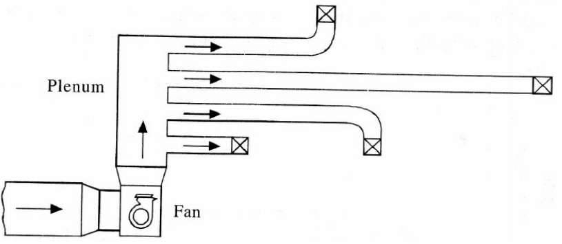
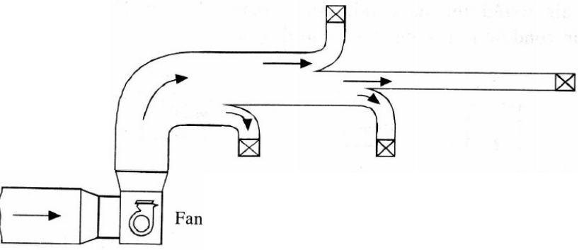
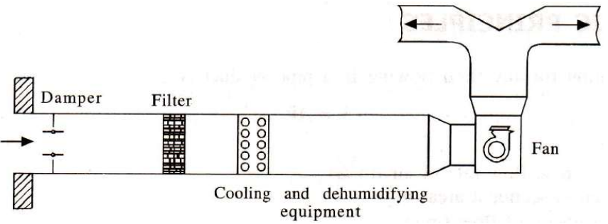
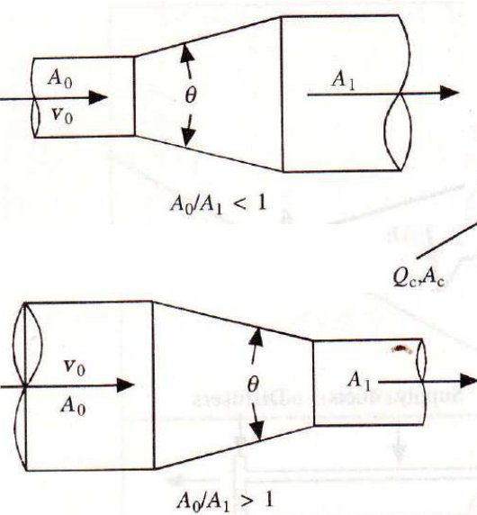
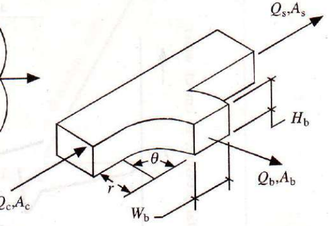
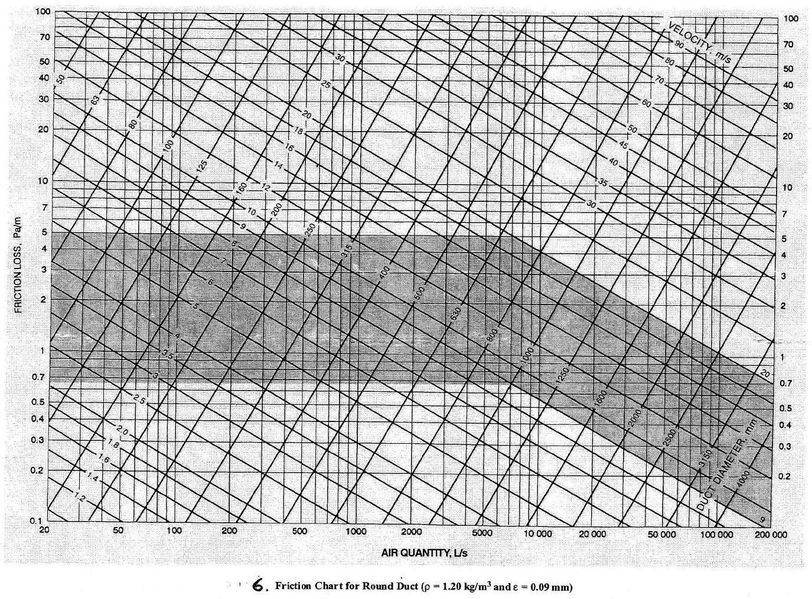
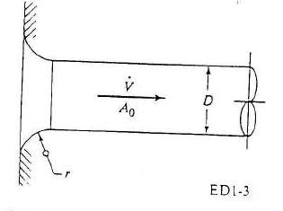
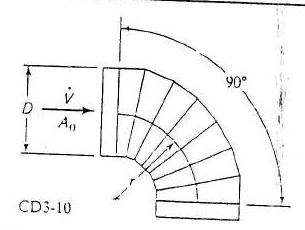
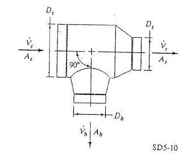
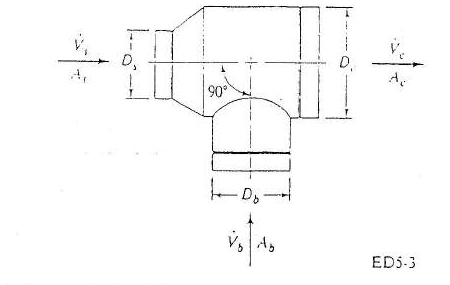

<!-- pagebreak -->
# Module 6: Duct design

| | |
|---|---|
| **Where it appears** | Six papers: Section A Q2(c) 2011-12, Q3(c) 2012-13, Q3(a) 2013-14, Q2(a) 2020-21, Q2(a) 2021-22, Q2(b) 2022-23. Not set in 2015-16 to 2018-19 or in 2023-24. |
| **Share of all marks** | 3.6% (110 of 3055 weighted marks, 6 parts), 15–20 marks when it is set (5.4–7.3% of that paper). One archetype only: equal-friction sizing of a small network plus the static (fan) pressure of the index run, with a layout figure given in the paper. |
| **Time** | core 2 h (§6.2–6.4, §6.7 and Solutions 6.1 and 6.4), full 3.5 h (all six solutions and the theory) |
| **Sources** | Arif pp.77a–93b; Note pp.129–143; Ameen §15.2–15.4 (Ex. 15.1–15.3); Data Book Chart 6 and Table 7 |

**How it has been asked:**

- **Always a numerical**, "Size the duct system using the equal-friction method … Estimate the static pressure in the index run of the duct network", on a layout figure with section lengths and room flows.
- **The three-room layout E/F/G**, 0.5 m³/s to each room (A–C 6 m, C–G 3 m, C–D 4 m, D–F 2 m, D–E 6 m + 2 m): **"The duct shall be of standard round sections with diameters in increments of 25 mm. The air velocity in the first section is not to exceed 8 m/s … a pressure drop of 25 Pa at each of the outlet grilles at E, F and G"** (**2013-14, 2021-22**). 2013-14 adds "Assume the resistance due to the fittings as one-fifth that of the duct length"; 2021-22 adds that sentence **and** "consider the resistance due to the elbow and Tee as 10 Pa and 15 Pa respectively". The same figure in 2011-12 asks for "maximum allowable air speed = 10 m/s", "20 Pa at each of the outlet grils" and "joints … 1/4 of the duct pressure drop".
- **The four-room layout E/F/G/H** (Arif sir's Example 2, Ameen Ex. 15.1): "A packaged air conditioner serves four rooms in an apartment … **elbow and Tee as 10 Pa and 15 Pa respectively**" (**2020-21 ≡ 2022-23, verbatim**).
- **ASHRAE fitting coefficients** once: "Size the supply duct system … using equal friction method. Specify the fan pressure required at location (1) … outlet grills have pressure loss of 12 Pa", with the fittings marked SD5-10 and CD3-10, i.e. Data Book Table 7 (2012-13).
- No pure theory part has been set on ducts. The theory below (system types, losses, methods, equivalent diameter) is what the numericals rest on and what a short question would ask; the "sources of pressure loss in a duct system" (2023-24 Q8(c)) is answered in §6.2.

> **KEY: Toolkit for this module**
>
> - $\dot V$ = volume flow rate, m³/s (the chart uses L/s: 1 m³/s = 1000 L/s). $D$ = round duct diameter, mm. $V$ = mean velocity, m/s. $L$ = section length, m. $\rho=1.2$ kg/m³ (standard air).
> - **Velocity:** $V=\dfrac{\dot V}{\pi D^2/4}$; **minimum diameter for a velocity limit:** $D=\sqrt{4\dot V/(\pi V_{max})}$, then round **up** to the next 25 mm.
> - **Pressures:** $p_t=p_s+p_v$, velocity pressure $p_v=\rho V^2/2=0.6V^2$ Pa.
> - **Friction (major) loss:** $\Delta p_f=(\Delta p/L)\times L$, with $\Delta p/L$ (Pa/m) from **Chart 6** (end of this module), or from $\Delta p/L=\dfrac{f}{D}\dfrac{\rho V^2}{2}$ (§6.3).
> - **Fitting (dynamic, minor) loss:** $\Delta p_d=C_o\,\rho V^2/2$, $C_o$ from **Table 7** (end of this module) or Table 15.6 (§6.4), or the paper's own allowance (elbow 10 Pa, tee 15 Pa; or a fraction of the duct loss).
> - **Run loss** = Σ duct losses + Σ fitting losses + outlet grille. **Index run** = the run with the **largest** loss (not necessarily the longest). Fan (static) pressure required = index-run loss.
> - **Dampering** of another run = index-run loss − that run's loss.
> - **Equivalent diameter of a rectangular duct** $a\times b$: $d_e=1.3\dfrac{(ab)^{0.625}}{(a+b)^{0.25}}$.

## 6.1 The air-distribution system and duct system types ★

The **air-distribution system** carries conditioned air from the air-handling unit (AHU) to the rooms and brings it back [Arif p.77b; Note p.129; Ameen §15.1]. It has:

- a **supply duct** from the AHU fan to the supply outlets (diffusers, grilles, registers) in each room;
- a **return duct** from the return grilles back to the AHU;
- an **outdoor (ventilation) air** intake and an **exhaust**, each with a damper, so that part of the return air is exhausted and replaced by fresh air;
- the AHU itself: filter, supply fan and cooling coil.

![Fig. 1: Schematic layout of an air-duct system. Ventilation (outdoor) air enters at the left through a damper and mixes with recirculated return air; a further damper lets part of the return air go to exhaust. The mixture passes through the air handling unit: filter, supply fan, cooling coil. The supply air duct leaves the AHU and drops into the room through three branch outlets (arrows down into the room). Three return branches leave the room and join the return air duct, which runs back to the mixing point and to the exhaust damper. One duct is needed for the supply air and another for the return air.](figures/001.png "w=0.7")

**Classification by velocity and pressure** [Arif p.78a; Note p.129]. The supply and return ducts are classed by the velocity and pressure of the air in them:

| | Conventional (low-velocity) system | High-velocity system |
|---|---|---|
| Main-duct velocity | up to about **10 m/s** (2000 ft/min) | up to about **30 m/s** (6000 ft/min) |
| Friction rate | less than **1.23 Pa/m** (0.15 in. w.g. per 100 ft) | up to about **5.7 Pa/m** (0.7 in. w.g. per 100 ft) |
| Duct size for a given flow | large | small (saves building space) |
| Pressure loss, fan power | low | high |
| Noise | low | high; needs attenuators |
| Usual design method | equal friction | static regain |
| Typical use | residences, offices, most buildings; every past paper | large, tall buildings where ceiling space is scarce |

High velocity gives smaller ducts but "not only greater pressure losses but also greater noise levels" [Arif p.78a]. That is why every past paper fixes a first-section velocity of 8 or 10 m/s: a low-velocity system.

**Classification by arrangement** (Figs. 2–6) [Arif pp.78b–80b; Note p.130]:

1. **Individual duct system.** The fan discharges into a **plenum**; a separate duct runs from the plenum to every outlet. Each run is short and can be balanced on its own, but it uses much duct. Used in small systems (residences).
2. **Trunk-and-branch system.** One main **trunk** leaves the fan; **branches** are taken off it to the outlets, and the trunk is reduced in size after each take-off. It uses the least duct for a large building and is the most common arrangement. **Every past-paper layout is a trunk-and-branch system.**
3. **System with no recirculation.** Outdoor air only: damper, filter, cooling and dehumidifying coil, fan, supply duct. No return duct. Used where room air must not be recirculated (operating theatres, laboratories, animal houses), at a high energy cost.
4. **Recirculation with zone dampers.** Outdoor air and recirculated air are mixed (each through a damper) before the filter and coil. After the fan the supply splits into zone ducts, each with its own damper to set the zone's share of air.
5. **Zone reheaters, recirculation and bypass.** As (4), plus a **bypass** duct with a damper that lets part of the return air go round the filter and coil, and a **reheater** in each zone duct. The bypass and reheat give each zone its own temperature control at part load.

**Duct design considerations** [Ameen §15.3]:

- Lay the ducts to carry the air as directly as possible, with few fittings; avoid sudden changes of direction.
- Round ducts have the least friction and leakage for a given area; rectangular ducts fit ceiling spaces and are traditional for low-velocity systems; round or flat-oval spiral duct is preferred for high-velocity systems.
- Keep rectangular ducts nearly square: aspect ratio (width : depth) not above 6 : 1. Slope transitions about 1 in 7.
- Consider noise and fire isolation; support, brace and seal the ducts.

**The duct design procedure** [Ameen §15.3]: (1) sketch a tentative layout on the building plan, from the AHU to every outlet and return intake; (2) fix the air quantity of every outlet and section; (3) size the mains and branches by one of the methods of §6.6; (4) add up the total-pressure losses of the duct runs (supply and return) and select the fan for the flow and the largest loss; (5) iterate for large systems (imbalance, excessive losses, noise); (6) fix the dampering needed in the other runs to balance the flow; (7) draw the final layout and estimate the cost; (8) check the noise level and add attenuation if needed.

## 6.2 Pressure in a duct system: losses and fan pressure ★

**Three pressures** (gauge, relative to the room) at any section of a duct:

- **static pressure** $p_s$: the pressure the air exerts on the duct walls, in every direction;
- **velocity pressure** $p_v=\rho V^2/2$: the kinetic energy of the flow per unit volume, felt only facing the flow. With $\rho=1.2$ kg/m³, $p_v=0.6V^2$ Pa: 8 m/s gives 38.4 Pa, 6 m/s gives 21.6 Pa;
- **total pressure** $p_t=p_s+p_v$.

Along the flow the **total pressure always falls** (every metre of duct and every fitting loses some), except across the fan, which raises it. The static pressure can **rise** where the velocity falls (an enlargement, or the main after a branch take-off), because velocity pressure is converted back to static pressure. That rise is the **static regain** used in §6.6.

**Losses in duct systems** [Arif pp.81b–82a; Note pp.131–132]. "Conditioned air supplied by the AHU … encounters pressure losses at every component of the air-conditioning system: duct length and duct fittings. Computing the losses is necessary for proper selection and sizing of the fan." The losses are of two kinds:

| | Friction (major) loss | Dynamic (minor, fitting) loss |
|---|---|---|
| Cause | viscous shear at the duct wall along straight duct | change of flow direction or velocity: separation, eddies, mixing |
| Where | every metre of straight duct | elbows, bends, tees and branch take-offs, transitions (enlargement, contraction), dampers, entries and exits |
| Formula | $\Delta p_f=\dfrac{f L}{D}\dfrac{\rho V^2}{2}=(\Delta p/L)\,L$ | $\Delta p_d=C_o\dfrac{\rho V^2}{2}$ |
| Data | friction chart (Chart 6) | loss coefficients (Table 7, Table 15.6) |

**The main sources of pressure loss** in an air-conditioning system (the answer to "identify the main sources of pressure loss in a duct system"): the return grille, the return duct, the filter, the cooling (and heating) coil, the supply duct (friction), the duct fittings (elbows, tees, transitions), the dampers, and the supply diffusers or grilles.

![Fig. 7: Total pressure (cm of water) against distance along a simple air-conditioning system, points 0 to 7, with the system drawn underneath: return grille, return duct, filter, fan, cooling coil, supply ducts, diffusers. The total pressure starts at zero (room) at point 0, drops through the return grille (0–1), slopes down along the return duct (1–2), drops through the filter (2–3, the lowest, most negative point), rises steeply across the fan (3–4, the peak), drops across the cooling coil (4–5), slopes down along the supply ducts (5–6) and drops through the diffusers (6–7) back to zero in the room. Table below: 0–1 return grille, 1–2 return duct, 2–3 filter, 3–4 pressure build-up by fan, 4–5 cooling coil, 5–6 supply duct, 6–7 diffuser.](figures/007.jpg "w=0.7")

How to draw and read Fig. 7: everything upstream of the fan (return side) is below room pressure (suction), everything downstream (supply side) above it. The fan rise 3–4 equals the sum of all the drops, 0–3 plus 4–7.

**Fan pressure** [Ameen §15.3; McQuiston ch.12]:

- **Fan total pressure** = rise of total pressure across the fan = $p_{t,out}-p_{t,in}$ = sum of all the total-pressure losses round the circuit with the **largest** resistance (supply index run + return run + AHU components):
$$FTP=\sum\Delta p_{\text{index run}}=\sum(\Delta p_f+\Delta p_d)+\Delta p_{\text{grille}}$$
- **Fan static pressure** = fan total pressure − velocity pressure at the fan outlet: $FSP=FTP-p_{v,out}$.
- **Fan air power** = $\dot V\times FTP$ (W, with $\dot V$ in m³/s and $FTP$ in Pa); shaft power = air power / fan efficiency.

In the past papers only the supply side is given. "The static pressure in the index run" and "the fan pressure required" are both answered by the **total loss of the index run**, including the outlet grille, which is what the course solutions do [Arif p.86a; Note p.136].

> **TIP: "static pressure in the index run"**
>
> Strictly, the duct and fitting losses are losses of total pressure, and the index-run loss is the total pressure the fan must supply to that run. The course calls it "the static pressure in the index run" (Ameen's wording); the grille loss given in the paper is taken to include the discharge into the room. Write "Static pressure required at the fan outlet = index-run loss = … Pa" and you have answered both wordings.

## 6.3 Friction loss and the friction chart ★

**The friction equation.** For a round duct, the Darcy–Weisbach equation gives
$$\frac{\Delta p_f}{L}=\frac{f}{D}\,\frac{\rho V^2}{2}\qquad(\text{Pa/m},\ D \text{ in m})$$
with the friction factor $f$ from the Colebrook equation, or explicitly from the **Altshul–Tsal** equation used by ASHRAE [ASHRAE Fundamentals, Duct Design; McQuiston ch.12]:
$$f'=0.11\left(\frac{\varepsilon}{D}+\frac{68}{Re}\right)^{0.25};\qquad f=f'\ \text{if}\ f'\ge0.018,\quad f=0.85f'+0.0028\ \text{if}\ f'<0.018$$
For standard air ($\rho=1.20$ kg/m³) $Re=66.4\,D\,V$ with $D$ in **mm** and $V$ in m/s. With galvanised steel, $\varepsilon=0.09$ mm. These two equations reproduce Chart 6 to within the precision of reading it, so they are the check on every chart reading in this module. The friction rate rises roughly as $V^{1.9}/D^{1.2}$: halving the velocity cuts the friction rate to about a quarter.

Example of the equation, at 1.5 m³/s and 8 m/s: $D=\sqrt{4(1.5)/(\pi\times8)}=0.489$ m; $Re=66.4\times489\times8=2.60\times10^5$; $f'=0.11(0.09/489+68/259\,500)^{0.25}=0.0160<0.018$, so $f=0.85(0.0160)+0.0028=0.0164$; $\Delta p/L=(0.0164/0.489)\times0.6\times8^2=1.29$ Pa/m.

**The friction chart** (Data Book Chart 6, "Friction Chart for Round Duct (ρ = 1.20 kg/m³ and ε = 0.09 mm)", printed at the end of this module as Fig. 21) [Arif p.86b; Note p.136; Ameen §15.2]:

- log–log axes: **air quantity** 20–200 000 L/s horizontally, **friction loss** 0.1–100 Pa/m vertically;
- two families of straight diagonal lines: **duct diameter** (50–4000 mm, rising to the right) and **velocity** (1.2–90 m/s, falling to the right);
- a **shaded band** (about 0.7–5 Pa/m at the left, falling to the right): the usual low-velocity design range.

Any two of the four quantities ($\dot V$, $D$, $V$, $\Delta p/L$) fix a point, and the other two are read at that point. In the equal-friction method:

1. enter with the first-section flow (vertical line) and the velocity limit (velocity line): point **O**; read the friction rate on the vertical scale;
2. draw the horizontal line through O: the **design friction rate**, the same for every section;
3. where each section's flow (vertical line) meets the horizontal line, read its diameter (and velocity).

![Fig. 8: Friction chart drawn from the ASHRAE friction equation for ρ = 1.20 kg/m³ and ε = 0.09 mm, log–log: air quantity 100–10 000 L/s horizontally, friction loss 0.3–5 Pa/m vertically. Solid grey lines are duct diameters 160, 200, 250, 315, 400, 500, 630, 800, 1000, 1250 mm (rising to the right); dashed blue lines are velocities 3, 4, 5, 6, 8, 10, 12, 15 m/s (falling to the right). The red construction is that of Solution 6.1: point O at 1500 L/s on the 8 m/s line gives 1.3 Pa/m and D ≈ 489 mm; the horizontal red line at 1.3 Pa/m meets the 1000 L/s vertical at D ≈ 418 mm and the 500 L/s vertical at D ≈ 322 mm.](figures/008.jpg "w=0.8")

**The chart readings used in this module**, each checked against the equation:

| Flow (L/s) | Velocity (m/s) | $D=\sqrt{4\dot V/\pi V}$ (mm) | Chart reading (Pa/m) | Equation (Pa/m) | Used in |
|---|---|---|---|---|---|
| 2000 | 8 | 564 | 1.15 (slides) | 1.08 | Example 6.2 |
| 3000 | 8 | 691 | 0.85 (slides: 0.9) | 0.85 | Solutions 6.4, 6.5 |
| 1500 | 8 | 489 | 1.3 | 1.29 | Solutions 6.1, 6.2 |
| 1500 | 10 | 437 | 2.2 | 2.24 | Solution 6.3 |
| 3500 | 8 | 746 | 0.8 | 0.77 | Solution 6.6 |
| 8000 | 8 | 1128 | 0.48 (Ameen) | 0.47 | Example 6.3 |

Readings within about 5% of the equation are as good as the chart can be read, especially inside the grey band, where the photocopy hides the velocity lines. In the solutions the diameter for each section is the equation value at the quoted friction rate; on the chart you would read the same value to within about 5 mm.

> **TIP: rounding up and the friction rate**
>
> Every diameter is rounded **up** to the next standard size (25 mm steps). A rounded-up duct has a lower velocity and a lower friction rate than the design rate, so (a) the velocity limit is always met, and (b) taking every section's loss as (design rate × length), as the course does, slightly **overestimates** the loss: a safe fan pressure. For example, the 500 mm first duct of Solution 6.1 actually runs at 1.15 Pa/m, not 1.3. Do not round down: the velocity limit would be broken (see the TRAP in Solution 6.1).

## 6.4 Dynamic losses in fittings ★

"In the flow through ducts, whenever the direction or velocity changes the pressure loss is greater than that in the case of uninterrupted flow. The additional loss, in excess of the straight duct friction loss, is the **dynamic loss**" [Arif p.92a; Ameen §15.2]. It is caused

- (a) by **changes of direction**: elbows, bends, offsets, branch take-offs;
- (b) by **changes of area or velocity**: enlargements, contractions, inlets (suction openings), outlets (discharge openings), dampers, obstructions.

Because the loss varies as the square of the velocity, it is written in terms of the velocity pressure:
$$\Delta p_d=C_o\,p_v=C_o\,\frac{\rho V^2}{2}$$
where $C_o$ is the **dynamic loss coefficient**, found by experiment and compiled by ASHRAE (Duct Fitting Database) [Arif pp.92a–92b]. For entries, exits, elbows, transitions and obstructions the velocity pressure may be referred to the upstream or the downstream section, so always use the velocity that the table names. For a **tee** there are two coefficients, one for the straight-through (main) path and one for the branch path [Arif p.92b].

**The coefficient tables you have.**

*Data Book Table 7* ("Total pressure coefficients of ducts", four ASHRAE fittings; printed at the end of this module):

| Fitting (ASHRAE code) | $C_o$ depends on | Range in the table |
|---|---|---|
| Bell-mouth inlet to a round duct (ED1-3) | $r/D$ of the bell mouth | 0.50 (sharp, $r/D=0$) to 0.03 ($r/D\ge0.2$) |
| 90° pleated elbow, round, 7 sections, $r/D=2.5$ (CD3-10) | duct diameter $D$ | 0.16 (75 mm) to 0.03 (1500 mm); 0.06 at 450 mm, 0.05 at 690 mm |
| Diverging tee, round, conical branch tapered into the body (SD5-10) | branch: $A_b/A_c$ and the branch ratio; main: $A_s/A_c$ and the straight ratio | $C_b$ about 0.2–0.7 in the useful range; $C_s$ about 0.13–0.16 |
| Converging tee, round, $D_c\ge$ 25 cm (ED5-3), for **return** ducts | $A_s/A_c$, $A_b/A_c$ and the flow ratio | can be **negative** at low branch flow (the fast stream drags the slow one) |

*Table 15.6* (round segmented elbows, 3, 4 and 5 pieces, from Ameen and the slides; **not** in the data book) [Arif p.93b; Note p.141]. $C_o=K_\theta\,C_o'$:

| No. of pieces | $r/D=0.75$ | 1.0 | 1.5 | 2.0 |
|---|---|---|---|---|
| 5 | 0.46 | 0.33 | 0.24 | 0.19 |
| 4 | 0.50 | 0.37 | 0.27 | 0.24 |
| 3 | 0.54 | 0.42 | 0.34 | 0.33 |

| $\theta$ | 0 | 20 | 30 | 45 | 60 | 75 | 90 | 110 | 130 | 150 | 180 |
|---|---|---|---|---|---|---|---|---|---|---|---|
| $K_\theta$ | 0 | 0.31 | 0.45 | 0.60 | 0.78 | 0.90 | 1.00 | 1.13 | 1.20 | 1.28 | 1.40 |

So a 5-piece 90° elbow with $r/D=1$ has $C_o=0.33\times1.00=0.33$; a 45° one, $0.33\times0.60=0.20$.

**How the course uses the SD5-10 tee table** (Ameen Ex. 15.3, the slides and the Full note) [Note pp.138–139]:

- **Straight-through (main) path**, downstream section $s$, upstream (common) section $c$: enter Table $C_s$ with $A_s/A_c=(D_s/D_c)^2$ (row) and $V_s/V_c$ (column); loss $=C_s\,\rho V_s^2/2$.
- **Branch path**, branch section $b$: enter Table $C_b$ with $A_b/A_c=(D_b/D_c)^2$ and $V_b/V_c$; loss $=C_b\,\rho V_b^2/2$.
- The tee loss is charged to the section **downstream** of the junction (the straight or the branch section), and the common section $c$ is the section just **upstream** of the junction, not the first duct of the system.
- Interpolate linearly, first along the row (the velocity ratio), then between the two rows (the area ratio). For a ratio above 0.9 use the 0.9 column.

> **TRAP: what the column ratio of Table 7 really is**
>
> The data book heads the SD5-10 columns $\dot V_b/\dot V_c$ and $\dot V_s/\dot V_c$ (the dot means **flow-rate** ratio), as in the ASHRAE original, where the blank cells are the impossible region where the branch would run much faster than the main. Ameen's Table 15.5 prints the same numbers headed $v_b/v_c$ (velocity ratio), and the course (Ameen Ex. 15.3, the slides, the Full note) reads them that way. The examiners' solutions follow the course, so this module does too; write one line, "SD5-10 read with the velocity ratio $V_b/V_c$ (course convention, Ameen Table 15.5)". The two readings can differ a lot for a branch: in Solution 6.6 the flow-ratio reading gives $C_b\approx0.85$ instead of 0.56.

**Fixed allowances.** When the paper gives them, use them instead of coefficients:

- a fixed loss per fitting: "elbow and Tee as 10 Pa and 15 Pa" (2020-21, 2021-22, 2022-23; Arif sir's Example 1);
- a fraction of the duct friction loss: "fittings as one-fifth (one-fourth) that of the duct length" (2013-14; 2011-12 "joints … 1/4"; Arif sir's Example 2). Then fitting loss of a run = fraction × duct loss of that run, i.e. run loss = $(1+\text{fraction})\times$ duct loss + grille.

Use **one** allowance, never both (TRAP in Solution 6.1). Counting, as in the course tables: one **tee** for every junction the run passes through (charged to the section leaving the junction, whether the run goes straight on or turns into the branch), one **elbow** for every bend that is not a take-off, and one **grille** at the outlet.

## 6.5 Rectangular and oval ducts: the equivalent diameter

The chart and the tables are for **round** ducts. A rectangular duct has more friction than a round duct of the same area and flow, because of its corners and larger perimeter. It is handled through the **circular equivalent** $d_e$: the diameter of the round duct that has the **same friction loss per metre at the same flow rate** [Arif p.90b; Ameen §15.2]:
$$d_e=1.3\,\frac{(ab)^{5/8}}{(a+b)^{1/4}}=1.3\,\frac{(ab)^{0.625}}{(a+b)^{0.25}}$$
where $a$ and $b$ are the sides, in any consistent unit. Size the round duct on the chart, then choose $a\times b$ with $d_e\ge D$. Table 15.12 of Ameen (ASHRAE) tabulates the formula: e.g. 100 × 100 mm → 109 mm, 300 × 300 → 328, 500 × 500 → 547 [Arif p.91a]. It holds for aspect ratios up to about 8 : 1.

**Flat-oval ducts** (aspect ratio 2 to 4), major axis $a$, minor axis $b$ [Arif p.90b]:
$$d_e=\frac{1.55A^{0.625}}{P^{0.25}},\qquad A=\frac{\pi b^2}{4}+b(a-b),\qquad P=\pi b+2(a-b)$$

> **TRAP: the oval-duct formulas and the hydraulic diameter**
>
> - The slides print $A=b^2/4+b(a-b)$ and $P=b+2(a-b)$, without the π. A flat-oval duct is a rectangle $b\times(a-b)$ with two half-circles of diameter $b$, so the area is $\pi b^2/4+b(a-b)$ and the perimeter $\pi b+2(a-b)$, as in ASHRAE.
> - Do not use the hydraulic diameter $D_h=4A/P=2ab/(a+b)$ to read the chart with the duct flow. $D_h$ gives equal friction at equal **velocity**; the chart is entered with the **flow rate**, which needs $d_e$. For 600 × 300 mm, $D_h=400$ mm but $d_e=457$ mm.

> **EXAMPLE 6.1** `[Arif pp.90b–91b; tutor example]` (a) Find the circular equivalent of a 600 mm × 300 mm duct. (b) A 500 mm round duct must be replaced by a rectangular duct 300 mm deep. Find the width, in 50 mm steps.

**Solution.** **[TUTOR-GENERATED]**

(a) $d_e=1.3\dfrac{(600\times300)^{0.625}}{(600+300)^{0.25}}=1.3\times\dfrac{1.926\times10^{3}}{5.477}=$ **457 mm**. (Check on the table's first entry: 100 × 100 gives $1.3\times(10^4)^{0.625}/200^{0.25}=109$ mm, as printed.)

(b) Solve $1.3(300a)^{0.625}/(300+a)^{0.25}=500$: $a=732$ mm. Round **up** (a smaller duct would have more friction): **750 mm × 300 mm**, $d_e=506$ mm ≥ 500 mm. The aspect ratio 2.5 : 1 is within the 6 : 1 limit.

## 6.6 Duct design methods ★

"There are a number of duct design methods for air-conditioning systems": the **equal-friction** method, the **static-regain** method, the **T-method**, the **velocity-reduction** method and the **balanced-pressure** method. The first three are the ASHRAE-recommended methods [Arif p.83b; Note p.133; Ameen §15.4]. The aim of all of them is the same: duct sizes that deliver the design flow to every outlet, at a sensible balance between first cost (duct size, sheet metal, space) and running cost (fan power, which depends on the pressure loss), without noise.

| Method | Principle | Advantages | Disadvantages | Used for |
|---|---|---|---|---|
| **Equal friction** | Every section is sized for the **same friction loss per metre**, set by the velocity in the first (main) section | simple, quick, by hand with the chart; velocity falls gradually from fan to outlets, which keeps noise low; a good balance for symmetrical layouts | short runs get excess pressure and must be **dampered** (noise at the dampers); no static-pressure balance at the branch take-offs; not economical for long, high-velocity mains | low-velocity supply, return and exhaust systems; residences, offices, small commercial buildings; VAV systems (terminals balance them); **all past papers** |
| **Static regain** | Velocity is reduced along the main so that the **static regain** at each take-off just balances the friction and fitting loss of the next section: the **static pressure at every branch entry is about the same** | nearly equal static pressure at all outlets and branches, so outlets and terminal units are easily selected and balanced; little dampering | iterative, trial and error, time-consuming; very low velocities and large ducts at the end of long runs; the total pressure requirement is not readily apparent | high-velocity, constant-air-volume systems with long mains and many take-offs; large buildings |
| **T-method** | An optimisation (Tsal): the network is "condensed" into one equivalent duct to select the optimum fan pressure, then "expanded" back to size every section for the **minimum life-cycle cost** (first cost + energy cost) | lowest owning-plus-operating cost; uses real cost and fitting data | needs cost data and a computer program; not a hand method | large systems designed with software |
| **Velocity reduction** | The designer **selects** the velocities: highest at the fan, reduced step by step in the main and branches according to recommended values; each size = flow / velocity | very simple; good control of noise by the chosen velocities | relies on experience; no pressure balance, so heavy dampering; the friction rate varies from section to section | simple, small systems; residences; rough first sizing |
| **Balanced pressure** (balanced capacity) | Size the index run first; then size each other branch so that its loss **equals the pressure available** at its take-off, using up the excess pressure in the duct itself (smaller branch, higher velocity) | balanced by design: little or no dampering; smaller, cheaper branch ducts | iterative; branch velocities may become noisy; needs good fitting data | constant-flow systems where the flow to every space is critical |

**Equal friction in more detail** [Ameen §15.4]. "When energy cost is high and the installed duct work cost is low, a low friction rate design is more economical. For low energy cost and high duct cost, design based on a higher friction rate is more economical." The design friction rate is set by selecting the velocity in the main duct; "the same pressure loss per unit length is then used throughout the system. After sizing the system, the total pressure loss of the **index circuit**, the circuit having the largest pressure loss, which need not be the longest one, should be calculated including that of fittings and transitions." The differences between runs "must be compensated by damping those runs with lower losses" [Arif p.84a]. The full procedure is §6.7.

**Static regain in more detail** [Ameen §15.4]. Between two sections of the main, with velocities $V_1>V_2$, the static pressure rises by
$$\Delta p_s=R\,(p_{v1}-p_{v2})=R\,\frac{\rho}{2}\left(V_1^2-V_2^2\right)$$
where $R$ is the **static regain factor**, 0.5–0.95 (typically 0.75–0.9): part of the drop in velocity pressure is lost in the fitting. Procedure: size the first section as in equal friction; then, for each next section of the run with the largest resistance, **assume** a velocity, read its friction rate, and check that the regain balances the section's loss; adjust the velocity (usually two or three trials) until regain ≈ loss. Fig. 12 shows it. Example: $R=0.8$, 8 m/s reduced to 6 m/s: $\Delta p_s=0.8(38.40-21.60)=13.44$ Pa, available to push the air through the next section.

![Fig. 12: Static regain at an enlargement: total, static and velocity pressure (Pa, gauge) along a main duct. In section 1 (V = 8 m/s, velocity pressure 38.4 Pa) the total pressure (black) and static pressure (blue) both fall with friction, the shaded gap between them being the velocity pressure. At the enlargement (dotted line) the velocity drops to 6 m/s (velocity pressure 21.6 Pa): the total pressure drops slightly (the fitting loss) but the static pressure jumps up by the static regain R(pv1 − pv2), then both fall again along section 2.](figures/012.png "w=0.7")

**Dampering and balancing.** In a branched system the air divides so that every run from the fan to an outlet has the **same** total pressure loss. If the runs are sized with different losses, the short (low-loss) runs take more than their design air and the index run less. The cure is a **balancing damper** (volume damper, or a splitter damper at the take-off) in each run with a smaller loss, set to add a resistance equal to (index-run loss − that run's loss). The index run itself needs no damper. Dampers waste fan energy and can make noise, so the static-regain and balanced-pressure methods try to make the excess small by design.

## 6.7 The equal-friction procedure ★

Every past-paper duct question is answered with the same five steps and the same table [Arif pp.84a–90a; Note pp.133–143; Ameen Ex. 15.1–15.3].

> **KEY: Equal-friction sizing in five steps**
>
> 1. **Section flows.** Letter the junctions. The flow in each section = sum of the outlet flows downstream of it. Tabulate section, $\dot V$, length $L$ (add the legs of an L-shaped section).
> 2. **First section and friction rate.** $D_{min}=\sqrt{4\dot V_1/(\pi V_{max})}$, round **up** to the next 25 mm, and find $V_1=\dot V_1/A_1\le V_{max}$. On Chart 6 enter at $\dot V_1$ (L/s) and $V_{max}$: read the **design friction rate** $\Delta p/L$ (Pa/m). (If the paper gives a friction rate instead, use it.)
> 3. **Size every section at that friction rate.** For each section read $D$ where its flow meets the horizontal line $\Delta p/L$ = constant; round **up** to 25 mm; compute $V=\dot V/A$ and check it is below the limit and falls towards the outlets. Duct loss $\Delta p_f=(\Delta p/L)\times L$.
> 4. **Fitting losses.** With the paper's allowance (elbow 10 Pa, tee 15 Pa; or a fraction of the duct loss), or with coefficients: $\Delta p_d=C_o\,\rho V^2/2$, $\rho=1.2$, $C_o$ from Table 7 (tees SD5-10, elbows CD3-10) or Table 15.6, interpolation shown. Add the grille loss at each outlet.
> 5. **Index run, fan pressure, dampering.** For every run from the fan to an outlet: run loss = Σ duct + Σ fittings + grille. The largest is the **index run**; its loss is the static (fan) pressure required. Dampering in each other run = index-run loss − run loss.

The answer table (the course layout, Ameen Table 15.2):

| Section | $\dot V$ (m³/s) | $V$ (m/s) | $D$ (mm) | $\Delta p/L$ (Pa/m) | $L$ (m) | Duct loss (Pa) | Fittings: type, $C_o$, $\rho V^2/2$, loss (Pa) | Total fitting loss (Pa) | Total loss (Pa) |
|---|---|---|---|---|---|---|---|---|---|

one block of rows per run, each block ending with the run total.

> **TIP: velocities and chart readings in the source tables**
>
> The slides and notes print the velocities read off the chart at the design friction rate (e.g. 5.75 m/s for 1 m³/s at 1.15 Pa/m). This module prints $V=\dot V/A$ of the **chosen** standard duct, which is exact and is what the tee coefficients need. Both are acceptable; the losses in the fixed-allowance questions do not depend on them.

> **EXAMPLE 6.2** `[Arif pp.84b–86a; Note pp.134–136; Ameen Ex. 15.2]` An air conditioner supplies air to three rooms in a small office premises. The schematic layout of the duct system and the volume flow rate to each room are shown in the figure. Section lengths: A–B 2 m, B–C 5 m, C–D 7 m, D–E 9 m, D–H 2 m, C–F 8 m, F–G 6 m. (a) Size the duct system using the equal-friction method recommended for low-pressure duct network. The ducts shall be of standard round sections with diameters in increments of 25 mm. The air velocity in the first section is not to exceed 8 m/s. (b) Estimate the static pressure in the index run of the duct network and indicate the amount of dampering in the other branches to balance the flow. Consider a pressure drop of 25 Pa at each of the outlet grilles at D, E and F. In the calculation, consider the resistance due to the elbow and Tee as 10 Pa and 15 Pa respectively.

**Solution.** **[FROM SOURCE: Arif pp.85b–86a; Note pp.135–136]**, velocities recomputed as $\dot V/A$.

> **TRAP: the grilles are at G, E and H, not D, E and F**
>
> The statement (slides, note and Ameen) puts the outlet grilles "at D, E and F", but in the figure D is a junction and F an elbow: the outlets are **G, E and H**. The slides' table puts the grilles at H, G and E [Arif p.85b]; the note labels them "Grille (D)" and "1G (F)", following the text [Note p.135]. Read the figure.

*Step 1. Flows.* A–B and B–C carry $1+0.7+0.3=2.0$ m³/s; C–D $0.7+0.3=1.0$; D–E 0.7; D–H 0.3; C–F and F–G 1.0.

*Step 2.* $D_{min}=\sqrt{4(2.0)/(\pi\times8)}=0.564$ m → **575 mm**, $V=2.0/(\pi\times0.575^2/4)=7.70$ m/s ≤ 8 ✓. Chart at 2000 L/s, 8 m/s: the slides read **1.15 Pa/m** (equation 1.08; inside the grey band 1.1–1.15 is a fair reading). This rate is kept for all sections.

*Step 3.* At 1.15 Pa/m:

| Section | $\dot V$ (m³/s) | $D$ at 1.15 Pa/m (mm) | $D$ (mm) | $V$ (m/s) | $L$ (m) | $\Delta p_f$ (Pa) |
|---|---|---|---|---|---|---|
| A–B | 2.0 | 564 | 575 | 7.70 | 2 | 2.30 |
| B–C | 2.0 | 564 | 575 | 7.70 | 5 | 5.75 |
| C–D | 1.0 | 429 | 450 | 6.29 | 7 | 8.05 |
| D–H | 0.3 | 273 | 275 | 5.05 | 2 | 2.30 |
| C–F | 1.0 | 429 | 450 | 6.29 | 8 | 9.20 |
| F–G | 1.0 | 429 | 450 | 6.29 | 6 | 6.90 |
| D–E | 0.7 | 375 | 375 | 6.34 | 9 | 10.35 |

(The slides print the chart velocities 8, 5.75, 5, 5.75 and 6 m/s. D–E sits right on a size step: 375 mm at 1.15 Pa/m, but 379 mm, hence 400 mm, at the equation's 1.08 Pa/m.)

*Steps 4–5.* Elbow at B (in B–C) and at F (F–G); a tee at each junction C and D; grille 25 Pa:

| Run | Duct loss (Pa) | Fittings | Fitting loss (Pa) | Total (Pa) |
|---|---|---|---|---|
| A-B-C-D-H | 2.30 + 5.75 + 8.05 + 2.30 = 18.40 | 1E + 2T + 1G | 10 + 30 + 25 = 65 | 83.40 |
| A-B-C-F-G | 2.30 + 5.75 + 9.20 + 6.90 = 24.15 | 2E + 1T + 1G | 20 + 15 + 25 = 60 | 84.15 |
| A-B-C-D-E | 2.30 + 5.75 + 8.05 + 10.35 = 26.45 | 1E + 2T + 1G | 10 + 30 + 25 = 65 | **91.45** |

**Index run A-B-C-D-E: static pressure 91.45 Pa.** **Dampering: run C–F–G 91.45 − 84.15 = 7.30 Pa; branch D–H 91.45 − 83.40 = 8.05 Pa.** Total every run: the index run is the run with the largest **total** loss, which need not be the longest one (here A-B-C-D-H, 16 m, loses less than A-B-C-F-G, 21 m, by only 0.75 Pa, because two tees cost more than two elbows).

> **EXAMPLE 6.3** `[Note pp.137–141; Ameen Ex. 15.3]` A package air conditioner serves three rooms in a residential home. Layout (Figure 15.18): fan at A; A–B 25 m; B–E 10 m (branch up to outlet E, 3 m³/s); B–C 10 m; C–F 10 m (branch down to outlet F, 2 m³/s); C–D 20 m + 8 m (to outlet D, 3 m³/s, with a 90° elbow, $r/D=1.0$). Use 8 m/s for the main duct velocity. (a) Size the system by the equal-friction method with standard round sections (take 25 mm steps). (b) Determine the total static pressure for the index run and the dampering in the other branches. Calculate the fitting losses with the ASHRAE fittings data (tees SD5-10 of Table 7, a 5-piece elbow of Table 15.6). 25 Pa at each outlet register.

**Solution.** **[TUTOR-GENERATED]** (method of Ameen Ex. 15.3 and Note pp.137–139, sized consistently with 25 mm steps and $V=\dot V/A$; the note's slips are in the TRAP below).

*Steps 1–2.* A–B carries $3+3+2=8$ m³/s; $D_{min}=\sqrt{4(8)/(\pi\times8)}=1.128$ m = 1128 mm → **1150 mm**, $V=7.70$ m/s. Chart at 8000 L/s, 8 m/s: **0.48 Pa/m** (equation 0.47).

*Step 3.* At 0.48 Pa/m (chart diameters 940, 775, 665 mm):

| Section | $\dot V$ (m³/s) | $D$ (mm) | $V$ (m/s) | $\rho V^2/2$ (Pa) | $L$ (m) | $\Delta p_f$ (Pa) |
|---|---|---|---|---|---|---|
| A–B | 8 | 1150 | 7.70 | 35.59 | 25 | 12.00 |
| B–C | 5 | 950 | 7.05 | 29.85 | 10 | 4.80 |
| B–E | 3 | 800 | 5.97 | 21.37 | 10 | 4.80 |
| C–D | 3 | 800 | 5.97 | 21.37 | 28 | 13.44 |
| C–F | 2 | 675 | 5.59 | 18.74 | 10 | 4.80 |

*Step 4. Fittings* (Table 7, SD5-10, course convention; common section = the section upstream of the junction):

- **Tee at B, branch to E** (common A–B): $V_b/V_c=5.97/7.70=0.77$, $A_b/A_c=(800/1150)^2=0.48$. $C_b$ row 0.4: $0.27+(0.24-0.27)\times0.75=0.248$; row 0.5: $0.36+(0.30-0.36)\times0.75=0.315$; at 0.48: $C_b=0.248+0.84(0.315-0.248)=$ **0.30**. Loss $0.30\times21.37=6.41$ Pa.
- **Tee at B, straight to C** (common A–B): $V_s/V_c=7.05/7.70=0.92$ (use the 0.9 column), $A_s/A_c=(950/1150)^2=0.68$. $C_s$ in the 0.9 column: 0.150 (row 0.6), 0.140 (row 0.7); at 0.68: **0.14**. Loss $0.14\times29.85=4.18$ Pa.
- **Tee at C, branch to F** (common B–C): $V_b/V_c=5.59/7.05=0.79$, $A_b/A_c=(675/950)^2=0.50$. $C_b$ row 0.5: $0.36+(0.30-0.36)\times0.92=0.305$; row 0.6: $0.49+(0.39-0.49)\times0.92=0.398$; at 0.505: **0.31**. Loss $0.31\times18.74=5.81$ Pa.
- **Tee at C, straight to D** (common B–C): $V_s/V_c=5.97/7.05=0.85$, $A_s/A_c=(800/950)^2=0.71$. $C_s$ row 0.7: $0.15+(0.14-0.15)\times0.46=0.145$; row 0.8: $0.13+(0.14-0.13)\times0.46=0.135$; at 0.71: **0.14**. Loss $0.14\times21.37=2.99$ Pa.
- **Elbow in C–D**: 5-piece, 90°, $r/D=1$ (Table 15.6): $C_o=0.33\times1.00=0.33$. Loss $0.33\times21.37=7.05$ Pa.

*Step 5. Runs* (register 25 Pa):

| Run | Duct loss (Pa) | Fittings (Pa) | Total (Pa) |
|---|---|---|---|
| A-B-E | 12.00 + 4.80 = 16.80 | 6.41 + 25 | 48.21 |
| A-B-C-F | 12.00 + 4.80 + 4.80 = 21.60 | 4.18 + 5.81 + 25 | 56.59 |
| A-B-C-D | 12.00 + 4.80 + 13.44 = 30.24 | 4.18 + 2.99 + 7.05 + 25 | **69.46** |

**Index run A-B-C-D: total static pressure 69.46 Pa. Dampering: A-B-E 21.25 Pa, A-B-C-F 12.87 Pa.** (Ameen: 70.96 Pa, 23.21 Pa and 13 Pa, with 780/700 mm ducts and chart velocities.)

> **TRAP: the Full note's Ex. 15.3 table [Note pp.138–139]**
>
> - **C–F coefficient.** The note first took $V_b/V_c=5.75/8=0.72$ and $A_b/A_c=(650/1150)^2=0.32$ against the first duct, then corrected the common section to B–C. With the corrected ratios $V_b/V_c=5.75/7.2=0.80$ and $A_b/A_c=(650/950)^2=0.47$, Table 7 gives $C_b\approx0.28$, not the 0.36 written (0.36 belongs to a ratio of about 0.7). The same slip-free reading for B–E ($V_b/V_c=0.79$, $A_b/A_c=0.46$) gives 0.28, not 0.25.
> - **Arithmetic.** The fitting total of A-B-C-F, 33.32 Pa, still adds the crossed-out 3.97 Pa ($0.2\times19.84$). With the note's corrected 7.14 Pa it is $4.35+7.14+25=36.49$ Pa, so the run is $21.6+36.49=58.09$ Pa and the dampering $70.9-58.09=12.81$ Pa, not 15.98 Pa.
> - **The common section of a tee** is the section just upstream of that junction (B–C for the tees at C), never the fan duct.

## 6.8 Term-final questions with solutions

All six parts are one archetype (DU1). They come in three families:

| Family | Papers | Layout | Fittings given | Solved in full |
|---|---|---|---|---|
| A. Three rooms E, F, G | 21-22, 13-14, 11-12 | A–C 6 m (1.5 m³/s), C–G 3 m, C–D 4 m, D–F 2 m, D–E 6 + 2 m (0.5 m³/s each) | 10/15 Pa (21-22); 1/5 of duct loss (13-14); 1/4 (11-12) | Solution 6.1 |
| B. Four rooms E, F, G, H | 20-21 ≡ 22-23 | Ameen Ex. 15.1: A–B 2 m (3 m³/s), B–H 5 + 2 m (1.5), B–C 4 m, C–G 3 m, C–D 4 m, D–F 2 m, D–E 6 + 2 m | elbow 10 Pa, tee 15 Pa | Solution 6.4 |
| C. ASHRAE fittings | 12-13 | 1–2 4 m (3.5 m³/s), branch 2–10 3 + 3 m (2.5), main 2–6 2 + 4 m (1.0) | SD5-10 tee, CD3-10 elbows (Table 7) | Solution 6.6 |

Standing conventions, used in every solution unless it says otherwise:

- Standard air, $\rho=1.2$ kg/m³; round galvanised ducts; Chart 6 (end of this module), checked against the friction equation of §6.3.
- The first section is sized from the velocity limit and rounded **up** to 25 mm; the design friction rate is read at (first-section flow, limiting velocity) and kept for every section; every diameter is rounded up to 25 mm; $V=\dot V/A$.
- Duct loss of a section = design rate × length (the course method; slightly conservative, TIP in §6.3).
- Fittings counted as in §6.4: a tee for each junction passed, an elbow for each bend that is not a take-off, a grille at each outlet. The curved take-offs at C and D (and B) are the tees; the corners at the end of D–E and at the foot of B–H are elbows.
- Index run = largest run loss = static (fan) pressure required; dampering of the others = difference (not asked in the papers, but one line earns it).

### Family A: the three-room layout

> **TRY 6.1** `[PP 21-22 Q2(a), 20]` A packaged air conditioner serves three rooms in an apartment. The schematic layout of the duct system, together with the volume flow rate to each room, is shown in Fig. for Q. No. 2(a). (i) Size the duct system using the equal-friction method. The duct shall be of standard round sections with diameters in increments of 25 mm. The air velocity in the first section is not to exceed 8 m/s. (ii) Estimate the static pressure in the index run of the duct network. There is a pressure drop of 25 Pa at each of the outlet grilles at E, F and G. Assume the resistance due to the fittings as one-fifth that of the duct length. In the calculation, consider the resistance due to the elbow and Tee as 10 Pa and 15 Pa respectively.

**Solution 6.1** **[TUTOR-GENERATED]** (method of Arif pp.84a–86a; the class solution [Note p.143] is corrected in the TRAP below).

*Assumption.* The paper gives two fitting allowances; use **one**. The specific values, elbow 10 Pa and tee 15 Pa, are used here (as in 2020-21 and 2022-23); the one-fifth allowance is Solution 6.2.

*Step 1. Section flows and lengths.*

| Section | Feeds | $\dot V$ (m³/s) | $L$ (m) |
|---|---|---|---|
| A–C | E, F, G | 1.5 | 6 |
| C–D | E, F | 1.0 | 4 |
| D–E | E | 0.5 | 6 + 2 = 8 |
| D–F | F | 0.5 | 2 |
| C–G | G | 0.5 | 3 |

*Step 2. First section and friction rate.* $D_{min}=\sqrt{\dfrac{4(1.5)}{\pi\times8}}=0.489$ m = 489 mm → **500 mm** (25 mm steps, rounded up). $V_{AC}=\dfrac{1.5}{\pi(0.5)^2/4}=7.64$ m/s ≤ 8 m/s ✓. Chart 6 at 1500 L/s and 8 m/s: **Δp/L ≈ 1.3 Pa/m** (equation 1.29 Pa/m). This is the design friction rate.

*Step 3. Sizes at 1.3 Pa/m* (Fig. 8 shows the construction):

| Section | $\dot V$ (m³/s) | $D$ at 1.3 Pa/m (mm) | $D$ chosen (mm) | $V=\dot V/A$ (m/s) | $\Delta p/L$ (Pa/m) | $L$ (m) | $\Delta p_f$ (Pa) |
|---|---|---|---|---|---|---|---|
| A–C | 1.5 | 489 | **500** | 7.64 | 1.3 | 6 | 7.80 |
| C–D | 1.0 | 418 | **425** | 7.05 | 1.3 | 4 | 5.20 |
| D–E | 0.5 | 322 | **325** | 6.03 | 1.3 | 8 | 10.40 |
| D–F | 0.5 | 322 | **325** | 6.03 | 1.3 | 2 | 2.60 |
| C–G | 0.5 | 322 | **325** | 6.03 | 1.3 | 3 | 3.90 |

Velocities fall from 7.64 m/s at the fan to 6.03 m/s at the outlets, all below 8 m/s ✓.

*Steps 4–5. Runs* (tee 15 Pa at C and at D, elbow 10 Pa at the corner of D–E, grille 25 Pa):

| Run | Duct loss (Pa) | Fittings | Fitting + grille loss (Pa) | Total (Pa) |
|---|---|---|---|---|
| A-C-D-E | 7.80 + 5.20 + 10.40 = 23.40 | 2T + 1E + 1G | 30 + 10 + 25 = 65 | **88.40** |
| A-C-D-F | 7.80 + 5.20 + 2.60 = 15.60 | 2T + 1G | 30 + 25 = 55 | 70.60 |
| A-C-G | 7.80 + 3.90 = 11.70 | 1T + 1G | 15 + 25 = 40 | 51.70 |

**(i) Duct sizes: A–C 500 mm, C–D 425 mm, D–E, D–F and C–G 325 mm. (ii) Index run A-C-D-E; static pressure required = 88.40 Pa.** Dampering: **A-C-D-F 17.80 Pa, A-C-G 36.70 Pa.** (With the one-fifth allowance instead of 10/15 Pa: 53.08 Pa, Solution 6.2.)

> **TRAP: the class solution of this paper [Note p.143]**
>
> - **First duct 475 mm is too small.** $\sqrt{4(1.5)/(\pi\times8)}=489$ mm, so 475 mm gives $1.5/(\pi\times0.475^2/4)=8.46$ m/s, above the 8 m/s limit. Round up: **500 mm** (7.64 m/s).
> - **Both fitting allowances were applied**: lengths × (1 + 1/5) **and** 10/15 Pa per fitting, although the note itself says "use either". That counts the fittings twice and gives $1.5\times18\times1.2+65=97.4$ Pa. Use one.
> - The note's 1.5 Pa/m is high for this point: the chart (and the equation) give about 1.3 Pa/m at 1500 L/s and 8 m/s.
> - The printed figure labels the last outlet "B"; the text calls it E.

> **TRY 6.2** `[PP 13-14 Q3(a), 20]` A packaged air conditioner serves three rooms in an apartment. The schematic layout of the duct system, together with the volume flow rate to each room, is shown in Fig. for Q. No. 3(a). (i) Size the duct system using the equal-friction method. The duct shall be of standard round sections with diameters in increments of 25 mm. The air velocity in the first section is not to exceed 8 m/s. (ii) Estimate the static pressure in the index run of the duct network. There is a pressure drop of 25 Pa at each of the outlet grilles at E, F and G. Assume the resistance due to the fittings as one-fifth that of the duct length.

**Solution 6.2** **[TUTOR-GENERATED]** As Solution 6.1 (same layout, same 8 m/s and 25 mm steps), so the same friction rate **1.3 Pa/m** and the same sizes: **A–C 500 mm, C–D 425 mm, D–E, D–F, C–G 325 mm**, and the same duct losses. Only the fittings change: fitting loss = duct loss / 5.

| Run | Duct loss (Pa) | Fittings = duct/5 (Pa) | Grille (Pa) | Total (Pa) |
|---|---|---|---|---|
| A-C-D-E | 23.40 | 4.68 | 25 | **53.08** |
| A-C-D-F | 15.60 | 3.12 | 25 | 43.72 |
| A-C-G | 11.70 | 2.34 | 25 | 39.04 |

**Index run A-C-D-E; static pressure = 23.40 × 1.2 + 25 = 53.08 Pa.** Dampering: A-C-D-F 9.36 Pa, A-C-G 14.04 Pa.

> **TRY 6.3** `[PP 11-12 Q2(c), 15]` An air handling unit serves 3 rooms in an apartment, as shown in Fig. for Q. 2(c). (i) Size the duct system using equal friction method. Assume maximum allowable air speed = 10 m/s. (ii) Estimate the four pressure required if there is a pressure drop of 20 Pa at each of the outlet grils at E, F and G, and pressure losses due to joints are assumed to be 1/4 of the duct pressure drop.

**Solution 6.3** **[TUTOR-GENERATED]** "Four pressure" is a misprint for **fan pressure**. The flow to G is cut off in the scan; it is 0.5 m³/s, as in the same figure in 2013-14 and 2021-22. No size step is stated: 25 mm steps are assumed. As Solution 6.1, with $V_{max}=10$ m/s:

- $D_{min}=\sqrt{4(1.5)/(\pi\times10)}=0.437$ m = 437 mm → **450 mm**, $V=9.43$ m/s ≤ 10 ✓.
- Chart 6 at 1500 L/s and 10 m/s: **Δp/L ≈ 2.2 Pa/m** (equation 2.24).
- At 2.2 Pa/m: 1.0 m³/s → 376 mm → **400 mm** (7.96 m/s); 0.5 m³/s → 289 mm → **300 mm** (7.07 m/s). (C–D is right at a step: 375 mm would be just too small at 2.2 Pa/m; take 400 mm.)

| Section | $D$ (mm) | $V$ (m/s) | $L$ (m) | $\Delta p_f$ at 2.2 Pa/m (Pa) |
|---|---|---|---|---|
| A–C | 450 | 9.43 | 6 | 13.20 |
| C–D | 400 | 7.96 | 4 | 8.80 |
| D–E | 300 | 7.07 | 8 | 17.60 |
| D–F | 300 | 7.07 | 2 | 4.40 |
| C–G | 300 | 7.07 | 3 | 6.60 |

| Run | Duct loss (Pa) | Joints = duct/4 (Pa) | Grille (Pa) | Total (Pa) |
|---|---|---|---|---|
| A-C-D-E | 39.60 | 9.90 | 20 | **69.50** |
| A-C-D-F | 26.40 | 6.60 | 20 | 53.00 |
| A-C-G | 19.80 | 4.95 | 20 | 44.75 |

**Sizes: A–C 450 mm, C–D 400 mm, branches 300 mm. Fan pressure required = index run A-C-D-E = 39.60 × 1.25 + 20 = 69.50 Pa** (plus the AHU's own filter and coil losses, which are not given). Dampering: A-C-D-F 16.50 Pa, A-C-G 24.75 Pa.

### Family B: the four-room layout

> **TRY 6.4** `[PP 20-21 Q2(a), 20]` A packaged air conditioner serves four rooms in an apartment. The schematic layout of the duct system, together with the volume flow rate to each room, is shown in Fig. for Q. No. 2(a). (i) Size the duct system using the equal-friction method. The duct shall be of standard round sections with diameters in increments of 25 mm. The air velocity in the first section is not to exceed 8 m/s. (ii) Estimate the static pressure in the index run of the duct network. There is a pressure drop of 25 Pa at each of the outlet grills at E, F, G and H. In the calculation, consider the resistance due to the elbow and Tee as 10 Pa and 15 Pa, respectively.

**Solution 6.4** **[TUTOR-GENERATED]** (the layout and data of Arif sir's Example 2 / Ameen Ex. 15.1 [Arif pp.87a–90a], with the paper's 10/15 Pa fittings).

*Step 1. Flows and lengths.* A–B $1.5+0.5+0.5+0.5=3.0$ m³/s, 2 m; B–H 1.5, 5 + 2 = 7 m; B–C 1.5, 4 m; C–G 0.5, 3 m; C–D 1.0, 4 m; D–F 0.5, 2 m; D–E 0.5, 6 + 2 = 8 m.

*Step 2.* $D_{min}=\sqrt{4(3.0)/(\pi\times8)}=0.691$ m = 691 mm → **700 mm**, $V=7.80$ m/s ≤ 8 ✓. Chart 6 at 3000 L/s, 8 m/s: **Δp/L ≈ 0.85 Pa/m** (equation 0.85; the slides read 0.9).

*Step 3. Sizes at 0.85 Pa/m.*

| Section | $\dot V$ (m³/s) | $D$ at 0.85 Pa/m (mm) | $D$ chosen (mm) | $V$ (m/s) | $L$ (m) | $\Delta p_f$ (Pa) |
|---|---|---|---|---|---|---|
| A–B | 3.0 | 691 | **700** | 7.80 | 2 | 1.70 |
| B–H | 1.5 | 531 | **550** | 6.31 | 7 | 5.95 |
| B–C | 1.5 | 531 | **550** | 6.31 | 4 | 3.40 |
| C–G | 0.5 | 351 | **375** | 4.53 | 3 | 2.55 |
| C–D | 1.0 | 456 | **475** | 5.64 | 4 | 3.40 |
| D–F | 0.5 | 351 | **375** | 4.53 | 2 | 1.70 |
| D–E | 0.5 | 351 | **375** | 4.53 | 8 | 6.80 |

*Steps 4–5. Runs* (tee 15 Pa at B, C, D; elbow 10 Pa at the foot of B–H and the corner of D–E; grille 25 Pa):

| Run | Duct loss (Pa) | Fittings | Fitting + grille loss (Pa) | Total (Pa) |
|---|---|---|---|---|
| A-B-H | 1.70 + 5.95 = 7.65 | 1T + 1E + 1G | 15 + 10 + 25 = 50 | 57.65 |
| A-B-C-G | 1.70 + 3.40 + 2.55 = 7.65 | 2T + 1G | 30 + 25 = 55 | 62.65 |
| A-B-C-D-F | 1.70 + 3.40 + 3.40 + 1.70 = 10.20 | 3T + 1G | 45 + 25 = 70 | 80.20 |
| A-B-C-D-E | 1.70 + 3.40 + 3.40 + 6.80 = 15.30 | 3T + 1E + 1G | 45 + 10 + 25 = 80 | **95.30** |

**(i) Sizes: A–B 700 mm; B–H and B–C 550 mm; C–D 475 mm; C–G, D–F, D–E 375 mm. (ii) Index run A-B-C-D-E; static pressure = 95.30 Pa.** Dampering: A-B-C-D-F 15.10 Pa, A-B-C-G 32.65 Pa, A-B-H 37.65 Pa.

With the slides' allowance "fittings one-fourth of the duct length" instead of 10/15 Pa [Arif p.87a]: $15.30\times1.25+25=44.13$ Pa (the slides get 45.25 Pa with 0.9 Pa/m and 675/525/450/375 mm ducts; their 675 mm first duct gives 8.38 m/s, above the 8 m/s limit).

> **TRY 6.5** `[PP 22-23 Q2(b), 15]` A packaged air conditioner serves four rooms in an apartment. The schematic layout of the duct system, together with the volume flow rate of each room, is shown in Fig. for Q. No. 2(b). (i) Size the duct system using the equal-friction method. The duct shall be of standard round sections with diameters in increments of 25 mm. The air velocity in the first section is not to exceed 8 m/s. (ii) Estimate the static pressure in the index run of the duct network. There is a pressure drop of 25 Pa at each of the outlet grilles at E, F, G and H. In the calculation, consider the resistance due to the elbow and Tee as 10 Pa and 15 Pa respectively.

**Solution 6.5** **[TUTOR-GENERATED]** Verbatim repeat of TRY 6.4 (same figure and data, 15 marks instead of 20). The answer is that of Solution 6.4: **sizes A–B 700 mm, B–H and B–C 550 mm, C–D 475 mm, C–G, D–F, D–E 375 mm; index run A-B-C-D-E, static pressure 95.30 Pa**; dampering 15.10 Pa (to F), 32.65 Pa (to G), 37.65 Pa (to H).

### Family C: ASHRAE fitting coefficients (Table 7)

> **TRY 6.6** `[PP 12-13 Q3(c), 20]` Size the supply duct system as shown in Fig. below, using equal friction method. Specify the fan pressure required at location (1) for the system if the outlet grills have pressure loss of 12 Pa.

**Solution 6.6** **[TUTOR-GENERATED]**

*Assumptions* (the paper gives no velocity): first-section velocity 8 m/s (low-velocity system, as in every other paper); standard round ducts in 25 mm steps; tee SD5-10 and elbows CD3-10 from Table 7, read with the velocity ratio (course convention, TRAP in §6.4); grille 12 Pa at outlets 6 and 10.

*Step 1. Sections.* 1–2: 3.5 m³/s, 4 m. Branch 2–10 (2–7–8, elbow 8–9, 9–10): 2.5 m³/s, 3 + 3 = 6 m. Main 2–6 (2–3–4, elbow 4–5, 5–6): 1.0 m³/s, 2 + 4 = 6 m.

*Step 2.* $D_{min}=\sqrt{4(3.5)/(\pi\times8)}=0.746$ m = 746 mm → **750 mm**, $V=7.92$ m/s. Chart 6 at 3500 L/s, 8 m/s: **Δp/L ≈ 0.8 Pa/m** (equation 0.77).

*Step 3. Sizes at 0.8 Pa/m.*

| Section | $\dot V$ (m³/s) | $D$ at 0.8 Pa/m (mm) | $D$ (mm) | $V$ (m/s) | $\rho V^2/2$ (Pa) | $L$ (m) | $\Delta p_f$ (Pa) |
|---|---|---|---|---|---|---|---|
| 1–2 | 3.5 | 746 | **750** | 7.92 | 37.66 | 4 | 3.20 |
| 2–10 | 2.5 | 653 | **675** | 6.99 | 29.28 | 6 | 4.80 |
| 2–6 | 1.0 | 462 | **475** | 5.64 | 19.11 | 6 | 4.80 |

*Step 4. Fittings.*

- **Tee SD5-10 at 2, branch path to 10** (common section 1–2): $V_b/V_c=6.99/7.92=0.88$, $A_b/A_c=(675/750)^2=0.81$. Table 7 $C_b$, row 0.8: $0.65+(0.52-0.65)\times0.82=0.544$; row 0.9: $0.83+(0.65-0.83)\times0.82=0.683$; at 0.81: $C_b=0.544+0.1\times(0.683-0.544)=$ **0.56**. Loss $0.56\times29.28=16.40$ Pa.
- **Tee SD5-10 at 2, straight path to 6**: $V_s/V_c=5.64/7.92=0.71$, $A_s/A_c=(475/750)^2=0.40$. Table 7 $C_s$, row 0.4: $0.15+(0.16-0.15)\times0.12=0.151$ (row 0.5: 0.141); at 0.40: $C_s=$ **0.15**. Loss $0.15\times19.11=2.87$ Pa.
- **Elbow CD3-10 at 8–9** (675 mm): Table 7 between 450 mm (0.06) and 690 mm (0.05): $C_o=0.06-0.01\times\dfrac{675-450}{690-450}=$ **0.051**. Loss $0.051\times29.28=1.49$ Pa.
- **Elbow CD3-10 at 4–5** (475 mm): $C_o=0.06-0.01\times\dfrac{25}{240}=$ **0.059**. Loss $0.059\times19.11=1.13$ Pa.

*Step 5. Runs.*

| Run | Duct (Pa) | Tee (Pa) | Elbow (Pa) | Grille (Pa) | Total (Pa) |
|---|---|---|---|---|---|
| 1-2-7-8-9-10 | 3.20 + 4.80 | 16.40 | 1.49 | 12 | **37.89** |
| 1-2-3-4-5-6 | 3.20 + 4.80 | 2.87 | 1.13 | 12 | 23.99 |

**Sizes: 1–2 750 mm, branch 2–10 675 mm, main 2–6 475 mm. Fan pressure required at 1 = index run 1–10 = 37.89 Pa** (supply side only; the AHU's own losses are not given). The run to outlet 6 needs **13.90 Pa** of dampering.

> **TIP: the flow-ratio reading of Table 7**
>
> Read with the flow ratio printed in the data book ($\dot V_b/\dot V_c=2.5/3.5=0.71$, ASHRAE's convention), the branch coefficient becomes $C_b\approx0.85$ (the straight one stays 0.15) and the index run 46.39 Pa. If you use this reading, say so; the course reading above is what the class solutions use.

## 6.9 Summary sheet

> **KEY: Module 6 on one page**
>
> - **System types:** low velocity (≤ 10 m/s, < 1.23 Pa/m, quiet, large ducts, equal friction) vs high velocity (up to 30 m/s, up to 5.7 Pa/m, small ducts, noisy, static regain). Arrangements: individual (plenum + one duct per outlet), trunk-and-branch (all past papers), no recirculation, recirculation with zone dampers, zone reheat with recirculation and bypass.
> - **Pressures:** $p_t=p_s+p_v$, $p_v=0.6V^2$ Pa. Total pressure always falls along the flow; static pressure can rise (regain) where the velocity falls. Losses = friction $(\Delta p/L)L$ + dynamic $C_o\rho V^2/2$ + grilles. Fan total pressure = loss of the index circuit; fan static = total − outlet $p_v$.
> - **Chart 6** (ρ = 1.2, ε = 0.09 mm): any two of $\dot V$ (L/s), $D$, $V$, Δp/L fix the rest. Check: $f'=0.11(\varepsilon/D+68/Re)^{0.25}$, $Re=66.4DV$ (D mm), $\Delta p/L=(f/D)\,0.6V^2$.
> - **Readings:** 1500 L/s @ 8 m/s → 1.3 Pa/m; @ 10 m/s → 2.2; 2000 @ 8 → 1.1–1.15; 3000 @ 8 → 0.85; 3500 @ 8 → 0.8; 8000 @ 8 → 0.48.
> - **Equal friction in 5 steps:** flows → first duct $\sqrt{4\dot V/\pi V_{max}}$ rounded **up** to 25 mm, friction rate at (flow, $V_{max}$) → all sections at that rate, rounded up → fittings (paper's allowance or Table 7) + grille → index run (largest loss, not necessarily longest), dampering = differences.
> - **Fitting counts:** one tee per junction passed (on the section leaving it), one elbow per bend, one grille. Use **one** allowance: either 10/15 Pa per fitting or a fraction of the duct loss, never both.
> - **Table 7, SD5-10 tee** (course reading): rows $A/A_c=(D/D_c)^2$, columns $V/V_c$; common section = the one just upstream of the junction; loss $=C\times\rho V^2/2$ of the downstream section. CD3-10 elbow: $C_o$ by diameter (0.06 at 450 mm, 0.05 at 690 mm). 5-piece elbow, $r/D=1$: 0.33 (Table 15.6).
> - **Rectangular duct:** $d_e=1.3(ab)^{0.625}/(a+b)^{0.25}$ (600 × 300 → 457 mm); aspect ratio ≤ 6 : 1; not $D_h$.
> - **Methods:** equal friction (simple, dampering needed); static regain ($\Delta p_s=R(p_{v1}-p_{v2})$, $R$ 0.5–0.95; equal static pressure at take-offs, iterative); T-method (life-cycle-cost optimisation, software); velocity reduction (chosen velocities, experience); balanced pressure (branches sized to use the available pressure, little dampering).
> - **Answers:** 21-22: 500/425/325 mm, **88.40 Pa** · 13-14: same sizes, **53.08 Pa** · 11-12: 450/400/300 mm, **69.50 Pa** · 20-21 ≡ 22-23: 700/550/475/375 mm, **95.30 Pa** · 12-13: 750/675/475 mm, **37.89 Pa**.
> - **Errata:** 2021-22 class solution 475 mm (8.46 m/s > 8) and double-counted fittings; Ex. 15.3 note: 3.97 Pa carried (58.09 Pa, damper 12.81 Pa), C–F $C_b\approx0.28$; Arif Example 1: grilles at G, E, H, not D, E, F.

## 6.10 Self-test

1. Give two differences between low-velocity and high-velocity duct systems.
2. What is the difference between an individual duct system and a trunk-and-branch system?
3. Name the two kinds of pressure loss in a duct and give the formula for each.
4. What is the velocity pressure of air at 7 m/s?
5. 1.5 m³/s, velocity not to exceed 8 m/s, 25 mm steps: what is the first duct diameter and its velocity?
6. What is the index run, and why is it not always the longest run?
7. A run loses 70.60 Pa and the index run 88.40 Pa. What must be done to the run?
8. A paper says "fittings one-fifth of the duct length" and also "elbow 10 Pa, tee 15 Pa". What do you do?
9. Which section is the "common" section for a tee loss coefficient?
10. Find the circular equivalent of a 400 mm × 400 mm duct.
11. State the principle of the static-regain method and one disadvantage.
12. Why are duct diameters rounded up, not to the nearest size?

**Answers.**

1. Low velocity: main ducts up to about 10 m/s, friction below 1.23 Pa/m, larger ducts, quiet. High velocity: up to 30 m/s, up to 5.7 Pa/m, smaller ducts, more noise and fan power.
2. Individual: a separate duct from a plenum to each outlet. Trunk-and-branch: one main trunk with branches taken off it, reduced in size after each take-off.
3. Friction loss $\Delta p_f=(f L/D)\rho V^2/2$ (from the chart as Δp/L × L) and dynamic (fitting) loss $\Delta p_d=C_o\rho V^2/2$.
4. $0.6\times7^2=29.4$ Pa.
5. $\sqrt{4(1.5)/(\pi\times8)}=489$ mm → 500 mm; $V=7.64$ m/s.
6. The run from the fan to an outlet with the largest total loss (ducts + fittings + grille). A shorter run with more fittings can lose more than a longer one.
7. Add a balancing damper set to absorb $88.40-70.60=17.80$ Pa.
8. Use one of them (state which); applying both counts the fittings twice.
9. The section just upstream of that junction, carrying the combined flow.
10. $1.3(160\,000)^{0.625}/800^{0.25}=437$ mm.
11. Velocity is reduced along the main so that the static regain at each take-off balances the loss of the next section, giving nearly the same static pressure at every branch. Disadvantages: iterative; large ducts at the ends of long runs.
12. So that the velocity limit is never exceeded and every section's friction rate is at or below the design rate.

<!-- BEGIN DATA TABLES (generated by build/make_tables.py; do not edit) -->
<!-- pagebreak -->
## 6.T Tables for Module 6

**Data Book Table 7. Bell-mouth inlet to a round duct (ED1-3): $C_o$**

| $r/D$ | $C_o$ |
|---|---|
| 0.00 | 0.50 |
| 0.01 | 0.44 |
| 0.02 | 0.37 |
| 0.03 | 0.31 |
| 0.04 | 0.26 |
| 0.05 | 0.22 |
| 0.06 | 0.20 |
| 0.08 | 0.15 |
| 0.10 | 0.12 |
| 0.12 | 0.09 |
| 0.16 | 0.06 |
| 0.20 | 0.03 |
| 10.00 | 0.03 |

**Data Book Table 7. 90° pleated elbow, round, 7 sections, $r/D$ = 2.5 (CD3-10)**

| $D$ (in) | $D$ (mm) | $C_o$ |
|---|---|---|
| 3 | 75 | 0.16 |
| 6 | 150 | 0.12 |
| 9 | 230 | 0.10 |
| 12 | 300 | 0.08 |
| 15 | 380 | 0.07 |
| 18 | 450 | 0.06 |
| 27 | 690 | 0.05 |
| 60 | 1500 | 0.03 |

**Data Book Table 7. Diverging tee, round, conical branch (SD5-10): branch $C_b$**

| $A_b/A_c$ | $\dot V_b/\dot V_c$ = 0.1 | $\dot V_b/\dot V_c$ = 0.2 | $\dot V_b/\dot V_c$ = 0.3 | $\dot V_b/\dot V_c$ = 0.4 | $\dot V_b/\dot V_c$ = 0.5 | $\dot V_b/\dot V_c$ = 0.6 | $\dot V_b/\dot V_c$ = 0.7 | $\dot V_b/\dot V_c$ = 0.8 | $\dot V_b/\dot V_c$ = 0.9 |
|---|---|---|---|---|---|---|---|---|---|
| 0.1 | 0.65 | 0.24 |  |  |  |  |  |  |  |
| 0.2 | 2.98 | 0.65 | 0.33 | 0.24 | 0.18 |  |  |  |  |
| 0.3 | 7.36 | 1.56 | 0.65 | 0.39 | 0.29 | 0.24 | 0.20 |  |  |
| 0.4 | 13.78 | 2.98 | 1.20 | 0.65 | 0.43 | 0.33 | 0.27 | 0.24 | 0.21 |
| 0.5 | 22.24 | 4.92 | 1.98 | 1.04 | 0.65 | 0.47 | 0.36 | 0.30 | 0.26 |
| 0.6 | 32.73 | 7.36 | 2.98 | 1.56 | 0.96 | 0.65 | 0.49 | 0.39 | 0.33 |
| 0.7 | 45.26 | 10.32 | 4.21 | 2.21 | 1.34 | 0.90 | 0.65 | 0.51 | 0.42 |
| 0.8 | 59.82 | 13.78 | 5.67 | 2.98 | 1.80 | 1.20 | 0.86 | 0.65 | 0.52 |
| 0.9 | 76.41 | 17.75 | 7.36 | 3.88 | 2.35 | 1.56 | 1.11 | 0.83 | 0.65 |

**Data Book Table 7. Diverging tee (SD5-10): main (straight) $C_s$**

| $A_s/A_c$ | $\dot V_s/\dot V_c$ = 0.1 | $\dot V_s/\dot V_c$ = 0.2 | $\dot V_s/\dot V_c$ = 0.3 | $\dot V_s/\dot V_c$ = 0.4 | $\dot V_s/\dot V_c$ = 0.5 | $\dot V_s/\dot V_c$ = 0.6 | $\dot V_s/\dot V_c$ = 0.7 | $\dot V_s/\dot V_c$ = 0.8 | $\dot V_s/\dot V_c$ = 0.9 |
|---|---|---|---|---|---|---|---|---|---|
| 0.1 | 0.13 | 0.16 |  |  |  |  |  |  |  |
| 0.2 | 0.20 | 0.13 | 0.15 | 0.16 | 0.28 |  |  |  |  |
| 0.3 | 0.90 | 0.13 | 0.13 | 0.14 | 0.15 | 0.16 | 0.20 |  |  |
| 0.4 | 2.88 | 0.20 | 0.14 | 0.13 | 0.14 | 0.15 | 0.15 | 0.16 | 0.34 |
| 0.5 | 6.25 | 0.37 | 0.17 | 0.14 | 0.13 | 0.14 | 0.14 | 0.15 | 0.15 |
| 0.6 | 11.88 | 0.90 | 0.20 | 0.13 | 0.14 | 0.13 | 0.14 | 0.14 | 0.15 |
| 0.7 | 18.62 | 1.71 | 0.33 | 0.18 | 0.16 | 0.14 | 0.13 | 0.15 | 0.14 |
| 0.8 | 26.88 | 2.88 | 0.50 | 0.20 | 0.15 | 0.14 | 0.13 | 0.13 | 0.14 |
| 0.9 | 36.45 | 4.46 | 0.90 | 0.30 | 0.19 | 0.16 | 0.15 | 0.14 | 0.13 |

**Data Book Table 7. Converging tee, round, $D_c \ge$ 25 cm (ED5-3): branch $C_b$**

| $A_s/A_c$ | $A_b/A_c$ | $\dot V_b/\dot V_c$ = 0.1 | $\dot V_b/\dot V_c$ = 0.2 | $\dot V_b/\dot V_c$ = 0.3 | $\dot V_b/\dot V_c$ = 0.4 | $\dot V_b/\dot V_c$ = 0.5 | $\dot V_b/\dot V_c$ = 0.6 | $\dot V_b/\dot V_c$ = 0.7 | $\dot V_b/\dot V_c$ = 0.8 | $\dot V_b/\dot V_c$ = 0.9 |
|---|---|---|---|---|---|---|---|---|---|---|
| 0.5 | 0.2 | -7.26 | -0.62 | 0.43 | 0.75 | 0.86 | 0.91 | 0.93 | 0.93 | 0.90 |
| 0.5 | 0.3 | -16.99 | -2.35 | -0.07 | 0.57 | 0.80 | 0.89 | 0.91 | 0.90 | 0.87 |
| 0.5 | 0.4 | -30.49 | -4.67 | -0.72 | 0.38 | 0.76 | 0.89 | 0.92 | 0.90 | 0.85 |
| 0.5 | 0.5 | -47.82 | -7.61 | -1.50 | 0.19 | 0.75 | 0.93 | 0.97 | 0.93 | 0.85 |
| 0.5 | 0.6 | -69.03 | -11.17 | -2.42 | -0.03 | 0.76 | 1.01 | 1.05 | 0.98 | 0.88 |
| 0.5 | 0.7 | -94.17 | -15.37 | -3.49 | -0.26 | 0.80 | 1.13 | 1.17 | 1.07 | 0.93 |
| 0.5 | 0.8 | -123.30 | -20.22 | -4.71 | -0.50 | 0.87 | 1.29 | 1.33 | 1.20 | 1.02 |
| 0.5 | 0.9 | -156.48 | -25.73 | -6.09 | -0.77 | 0.96 | 1.48 | 1.53 | 1.36 | 1.13 |
| 0.5 | 1.0 | -193.74 | -31.92 | -7.63 | -1.07 | 1.06 | 1.71 | 1.77 | 1.56 | 1.28 |
| 1.0 | 0.2 | -1.54 | 0.39 | 0.74 | 0.87 | 0.92 | 0.95 | 0.97 | 0.99 | 1.03 |
| 1.0 | 0.3 | -3.75 | 0.03 | 0.64 | 0.83 | 0.90 | 0.94 | 0.97 | 1.00 | 1.08 |
| 1.0 | 0.4 | -6.57 | -0.32 | 0.61 | 0.85 | 0.93 | 0.97 | 0.99 | 1.03 | 1.16 |
| 1.0 | 0.5 | -10.05 | -0.65 | 0.64 | 0.94 | 1.02 | 1.03 | 1.04 | 1.08 | 1.26 |
| 1.0 | 0.6 | -14.24 | -0.98 | 0.74 | 1.10 | 1.16 | 1.15 | 1.13 | 1.16 | 1.40 |
| 1.0 | 0.7 | -19.20 | -1.32 | 0.91 | 1.33 | 1.37 | 1.31 | 1.26 | 1.27 | 1.57 |
| 1.0 | 0.8 | -24.98 | -1.69 | 1.14 | 1.63 | 1.63 | 1.53 | 1.43 | 1.41 | 1.78 |
| 1.0 | 0.9 | -31.62 | -2.10 | 1.42 | 2.00 | 1.96 | 1.80 | 1.64 | 1.59 | 2.02 |
| 1.0 | 1.0 | -39.19 | -2.55 | 1.76 | 2.43 | 2.35 | 2.12 | 1.90 | 1.81 | 2.30 |

**Data Book Table 7. Converging tee (ED5-3): main $C_s$**

| $A_s/A_c$ | $A_b/A_c$ | $\dot V_s/\dot V_c$ = 0.1 | $\dot V_s/\dot V_c$ = 0.2 | $\dot V_s/\dot V_c$ = 0.3 | $\dot V_s/\dot V_c$ = 0.4 | $\dot V_s/\dot V_c$ = 0.5 | $\dot V_s/\dot V_c$ = 0.6 | $\dot V_s/\dot V_c$ = 0.7 | $\dot V_s/\dot V_c$ = 0.8 | $\dot V_s/\dot V_c$ = 0.9 |
|---|---|---|---|---|---|---|---|---|---|---|
| 0.5 | 0.2 | 126.36 | 16.99 | 5.39 | 2.42 | 1.32 | 0.81 | 0.54 | 0.38 | 0.28 |
| 0.5 | 0.3 | 65.94 | 10.28 | 3.65 | 1.79 | 1.05 | 0.68 | 0.48 | 0.35 | 0.27 |
| 0.5 | 0.4 | 38.84 | 7.27 | 2.87 | 1.51 | 0.93 | 0.63 | 0.45 | 0.34 | 0.27 |
| 0.5 | 0.5 | 25.07 | 5.74 | 2.47 | 1.37 | 0.87 | 0.60 | 0.44 | 0.33 | 0.26 |
| 0.5 | 0.6 | 17.98 | 4.95 | 2.27 | 1.29 | 0.84 | 0.58 | 0.43 | 0.33 | 0.26 |
| 0.5 | 0.7 | 14.69 | 4.58 | 2.17 | 1.26 | 0.82 | 0.58 | 0.43 | 0.33 | 0.26 |
| 0.5 | 0.8 | 13.78 | 4.48 | 2.15 | 1.25 | 0.82 | 0.57 | 0.43 | 0.33 | 0.26 |
| 0.5 | 0.9 | 14.45 | 4.56 | 2.17 | 1.26 | 0.82 | 0.58 | 0.43 | 0.33 | 0.26 |
| 0.5 | 1.0 | 16.24 | 4.76 | 2.22 | 1.28 | 0.83 | 0.58 | 0.43 | 0.33 | 0.26 |
| 1.0 | 0.2 | -99.78 | -0.17 | 3.15 | 2.40 | 1.58 | 0.98 | 0.56 | 0.25 | 0.02 |
| 1.0 | 0.3 | -75.42 | 2.54 | 3.85 | 2.65 | 1.69 | 1.03 | 0.58 | 0.26 | 0.03 |
| 1.0 | 0.4 | -38.31 | 6.66 | 4.92 | 3.04 | 1.86 | 1.11 | 0.62 | 0.28 | 0.03 |
| 1.0 | 0.5 | 3.90 | 11.35 | 6.14 | 3.48 | 2.04 | 1.20 | 0.66 | 0.29 | 0.04 |
| 1.0 | 0.6 | 48.66 | 16.32 | 7.43 | 3.94 | 2.24 | 1.29 | 0.70 | 0.31 | 0.04 |
| 1.0 | 0.7 | 94.88 | 21.46 | 8.76 | 4.43 | 2.45 | 1.38 | 0.75 | 0.33 | 0.05 |
| 1.0 | 0.8 | 142.01 | 26.70 | 10.12 | 4.92 | 2.66 | 1.48 | 0.79 | 0.35 | 0.06 |
| 1.0 | 0.9 | 189.74 | 32.00 | 11.49 | 5.41 | 2.87 | 1.58 | 0.84 | 0.37 | 0.07 |
| 1.0 | 1.0 | 237.90 | 37.35 | 12.88 | 5.92 | 3.08 | 1.68 | 0.88 | 0.39 | 0.07 |

<!-- END DATA TABLES -->
