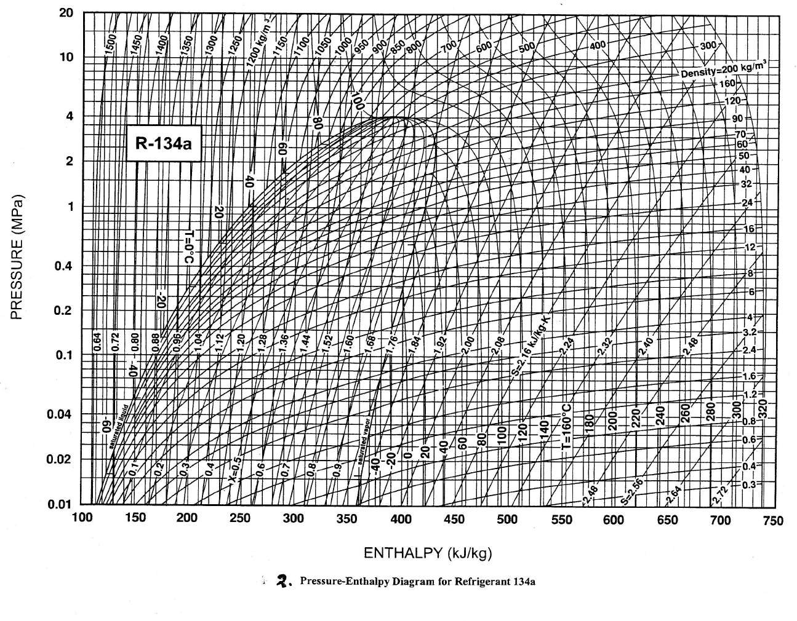
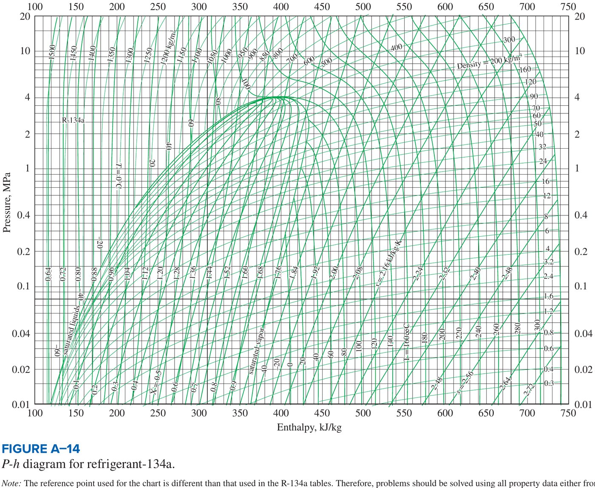
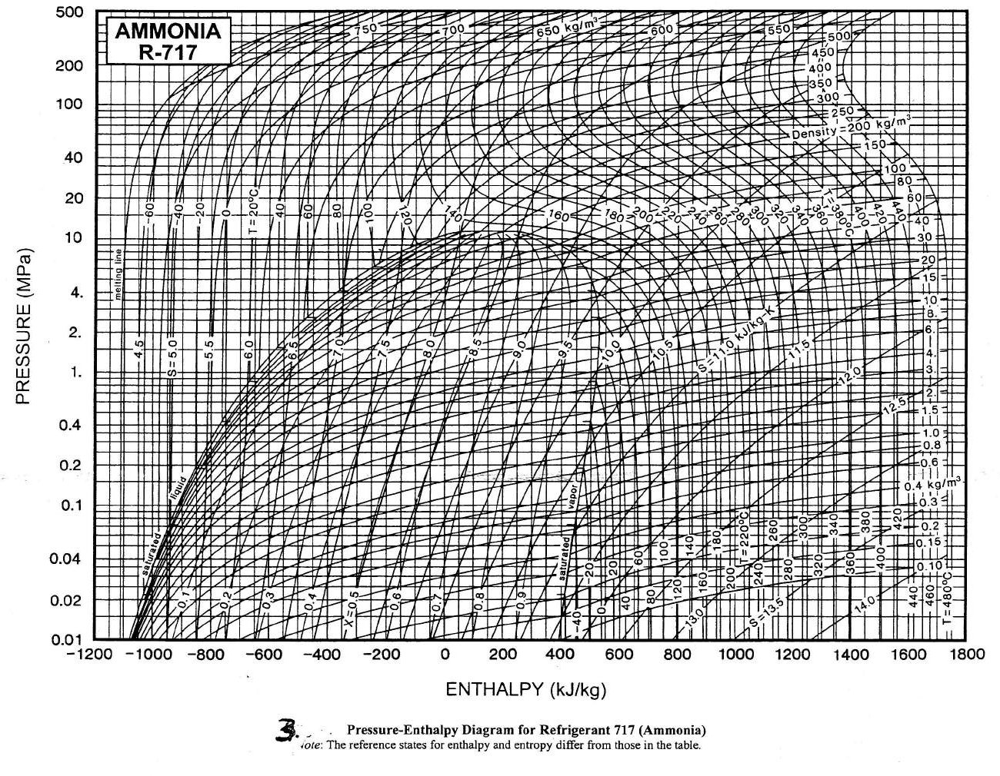

<!-- pagebreak -->
# Module 7: Vapour compression and multistage systems

| | |
|---|---|
| **Where it appears** | Every paper, 2011-12 to 2023-24. The multistage numerical is Q1(b) of Section A from 2013-14 to 2022-23 (Q5(c)/Q6(b) of Section B in 2011-12 and 2012-13), asked in 10 of 11 papers; cycle theory is Q1(a), Q2(a) or Q5(a)/(b); 2023-24 asks only the 5-mark multi-evaporator question (Q8(a)) |
| **Share of all marks** | 10.9% (332 of 3055 weighted marks): 22 parts. The multistage R134a numerical alone is 200 marks (6.5%), 20 marks a year, with verbatim repeats |
| **Time** | core 3 h (§7.1–7.3, §7.6–7.8 and Solutions 4.1 and 4.7), full 6 h (all 22 solutions) |
| **Sources** | Arif pp.18–31; Note pp.77–96; Rifat pp.4–14; Aloke pp.1–3; Ameen §3.2–3.5; Data Book Tables 1 and 3, superheated tables pp.9–10 and 13–16, Charts 2 and 3 |

**How it has been asked:**

- **The multistage R134a numerical (VC2), 20 marks, 10 of 11 papers.** "Calculate the power required by the two compressors in a R134a system which serves a 50 TR evaporator at −40 °C and 60 TR evaporator at −10 °C. The system uses two stage compression with inter-cooling and is arranged as in Fig. … The condensing temperature is 30 °C. Also calculate the COP of the system" (**2012-13 ≡ 2015-16 verbatim**; 2013-14 with 60 TR at −20 °C, 70 TR at 0 °C, 34 °C; 2021-22 with 80 TR / 100 TR). From 2016-17 the wording adds "with inter-cooling and **removal of flash gas** … the intercooler temperature is … **Draw the schematic diagram and P-h diagram** of the system" (2016-17 in kW at −30/−6 °C; 2017-18 "a fish freezing plant", 60 kW at −40 °C and 70 kW at −20 °C).
- **The three-stage fish-freezing plant:** "A fish freezing plant uses three stage compression … serves a 60 TR evaporator at −30 °C, 50 TR evaporator at −20 °C and 40 TR evaporator at −10 °C … condensing temperature is 30 °C and the intercooler temperature is −20 °C and −10 °C" (**2020-21 ≡ 2022-23 verbatim**; 2018-19 with −40 °C). 2011-12 asked an older form: "three stage compression with three stage expansion valve and flash intercooling: condenser pressure = 12 bar, evaporator pressure = 2 bar, flash intercooler pressure = 4 bar and 8 bar, load = 10 TR … compare the C.O.P. … with that of simple saturation cycle".
- **Cycle theory (VC1), 5–15 marks, up to 2018-19:** "What are the modifications that are introduced in reversed Carnot cycle to convert it into an ideal vapor compression refrigeration cycle and why?" (2016-17); "What are the deviations in a real vapor compression cycle from ideal …?" (2012-13, **2015-16**, 2018-19); "Draw the block diagram … with sub-cooling in condenser and superheating of vapor leaving the evaporator and depict this on a p-h diagram" (**2013-14 ≡ 2015-16**); "Explain the effects of superheating and subcooling" (2011-12); "Why is superheating considered to be good in certain cases?" (2018-19); "how does the work of compression and power vary with the evaporating temperature" (2013-14); "Define EER, SEER, kW/ton. Show the variation of COP with the evaporator and condenser temperature" (2016-17); "advantages of vapor compression refrigeration system over air refrigeration system" (2011-12).
- **Single-stage ammonia (VC3), once:** "In a 15 TR ammonia refrigeration plant … sub-cooled by 5 °C … vapor leaving the evaporator is 0.97 dry" (2011-12).
- **Multistage theory (VC4):** "two stage compression system with water intercooler, liquid intercooler and a liquid flash chamber" (2011-12); "primary reasons for employing multi-evaporator systems" (2023-24).

> **KEY: Toolkit for this module**
>
> - **States** (single stage, Arif p.18 numbering): 1 = compressor inlet (sat. vapour at $T_e$), 2 = compressor outlet (superheated, $s_2=s_1$), 3 = condenser outlet (sat. liquid at $T_c$), 4 = evaporator inlet ($h_4=h_3$). Some slides and notes call the compressor inlet "2"; always define your numbering on the sketch.
> - **Energy per kg:** refrigerating effect $q_L=h_1-h_4$; compressor work $w=h_2-h_1$; heat rejected $q_H=h_2-h_3=q_L+w$ (kJ/kg).
> - **Rates:** $\dot Q_L=\dot m\,q_L$, $\dot W=\dot m\,w$ (kW with $\dot m$ in kg/s). $COP=\dot Q_L/\dot W$; Carnot $COP=T_L/(T_H-T_L)$ in K.
> - **Units:** 1 TR = 12 000 Btu/h = 211 kJ/min = **3.517 kW** (slides: 3.516). $EER=$ Btu/h of cooling per W of input $=3.412\,COP$. kW/TR $=3.517/COP$; $EER\times$ kW/TR $=12$.
> - **Properties:** R134a, Data Book Table 1 (saturated, by temperature) and the superheated blocks at 0.101325, 0.2, 0.4, 0.6, 0.8, 1.0, 1.2 … MPa; IIR datum ($h=200$, $s=1.00$ for sat. liquid at 0 °C), the same as the R134a p-h chart. Ammonia: Table 3 (bar) and superheated blocks, datum $h=s=0$ at −40 °C sat. liquid; the NH₃ p-h chart has a **different** datum, so never mix its values with the table.
> - **Isentropic outlet:** $s_{out}=s_{in}$; find $h$ at the outlet pressure in the superheated table: interpolate in $s$ inside each bracketing pressure block, then linearly in $p$ between the blocks.
> - **Throttling:** $h_{out}=h_{in}$; quality $x=(h-h_f)/(h_g-h_f)$ at the lower pressure.
> - **Flash tank / evaporator control volume** (steady, adiabatic, no work): $\sum \dot m_{in}h_{in}+\dot Q_{evap}=\sum \dot m_{out}h_{out}$, with the mass balance $\sum\dot m_{in}=\sum\dot m_{out}$.
> - **Multistage COP** $=\sum \dot Q_{evap}/\sum \dot W_{comp}$.

## 7.1 Refrigeration, COP and the ton ★

A **refrigerator** moves heat $Q_L$ from a cold space at $T_L$ to warm surroundings at $T_H$, using work $W$. It rejects $Q_H=Q_L+W$. A **heat pump** is the same machine, valued for $Q_H$ [Ameen §3.1].

- **Coefficient of performance:** $COP_R=\dfrac{Q_L}{W}$ (refrigerator), $COP_{HP}=\dfrac{Q_H}{W}=COP_R+1$ [Arif p.31].
- **Refrigerating effect (RE):** heat absorbed per kg of refrigerant in the evaporator, kJ/kg. **Refrigerating capacity:** $\dot m\times RE$, kW or TR.
- **Ton of refrigeration:** the heat absorbed by 1 short ton (2000 lb) of ice melting at 0 °C in 24 h: $2000\times144/24=12\,000$ Btu/h $=200$ Btu/min $=3.517$ kW [Arif p.31; Ameen §3.4]. The slides and notes print 3.516 kW; this guide uses 3.517 kW (as in Module 1). The difference is 0.03% and never changes an answer.
- **EER** (energy efficiency ratio): cooling output in Btu/h divided by the electrical input in W. Since 1 W = 3.412 Btu/h, $EER=3.412\,COP$.
- **SEER** (seasonal EER): the total cooling over a whole cooling season (Btu) divided by the total electrical energy used in that season (W·h). It weights the part-load hours at which an air conditioner actually runs, so it rates a unit by its seasonal performance, not by one test point. A unit with a SEER of 14–20 is typical today.
- **kW/ton** (kW per TR): electrical power input per ton of cooling, $\text{kW/TR}=3.517/COP$. Chillers are rated this way; lower is better. $EER\times\text{kW/TR}=12$.

| EER (Btu/h per W) | COP | kW/TR |
|---|---|---|
| 6.0 | 1.758 | 2.0 |
| 12.0 | 3.516 | 1.0 |
| 24.0 | 7.032 | 0.5 |

(Arif p.31; Note p.92.)

## 7.2 From the reversed Carnot cycle to the ideal vapour compression cycle ★

**The reversed Carnot cycle** is the best possible refrigerator between $T_L$ and $T_H$. It has two isothermal and two isentropic processes, and with a vapour all four are inside the dome (Fig. 1(a)) [Aloke p.3; Ameen §3.2]:

1. 1-2 isentropic compression of wet vapour from $T_L$ to $T_H$ (ends as saturated vapour);
2. 2-3 isothermal heat rejection (condensation) at $T_H$;
3. 3-4 isentropic expansion of the liquid in an expander (a turbine) from $T_H$ to $T_L$;
4. 4-1 isothermal heat absorption (evaporation) at $T_L$.

$$COP_{Carnot}=\frac{T_L}{T_H-T_L}\qquad(T\text{ in K})$$

It depends only on the two temperatures. Every real cycle between the same temperatures has a lower COP.

**The modifications and why** [Aloke p.2; Arif p.18; Ameen §3.3]:

| Carnot process | Ideal VCR process | Why the change |
|---|---|---|
| 1-2 wet compression (vapour + liquid droplets) | **dry compression**: saturated vapour at 1 compressed isentropically into the superheated region (2 is above $T_c$) | Liquid droplets wash the oil off the cylinder walls and can strike the valves (**liquid slugging**, wet compression is impractical in a reciprocating compressor). The state at 1 of the Carnot cycle (a precise quality) cannot be controlled. Dry compression is safe and can be controlled. |
| 2-3 isothermal heat rejection | **constant-pressure** heat rejection: desuperheating 2 → sat. vapour, then condensation at $T_c$ | The vapour is superheated after dry compression; at constant pressure it first cools, then condenses at constant $T$. |
| 3-4 isentropic expansion in an expander | **throttling** in an expansion valve or capillary tube, $h_4=h_3$ | The expander would produce very little work (liquid has a tiny $v\,dp$), and a small expander handling a wet mixture is costly and unreliable. A valve is cheap, simple and also controls the flow to the evaporator. |
| 4-1 isothermal evaporation | the same: constant $p$ and $T$ | unchanged |

**The price** [Aloke pp.2–3]: two irreversibilities are introduced, (1) non-isothermal heat rejection in 2-3 (the superheat horn above $T_c$ in Fig. 1(b)) and (2) throttling 3-4. Throttling lowers the refrigerating effect: on T-s the RE is the area under 4-1, and the throttled state 4 lies to the right of the isentropic state 4′, so RE falls by the area under 4′-4. The expander work is lost as well, and dry compression needs more work. Both effects lower the COP below the Carnot COP between the same temperatures.

![Fig. 1: Reversed Carnot cycle and ideal VCR cycle on T-s for R134a between −10 °C and 40 °C. (a) Carnot: rectangle 1-2-3-4 inside the dome; 1-2 isentropic compression of wet vapour, 2-3 condensation at 40 °C, 3-4 isentropic expansion in an expander, 4-1 evaporation at −10 °C; the shaded rectangle is the net work. (b) Ideal VCR: 1 on the saturated-vapour line at −10 °C, 1-2 vertical isentropic compression to state 2 above 40 °C (a small superheat horn for R134a), 2-3 desuperheating and condensation along the 40 °C pressure line, 3-4 throttling drawn dashed to 4 in the dome at −10 °C, to the right of the isentropic point 4′; 4-1 evaporation, the refrigerating effect being the area under 4-1.](figures/001.png "w=0.9")

![Fig. 2: Aloke sir's comparison of the Carnot cycle 1-2''-3-4′ and the standard VCRS 1-2-3-4 on T-s: isotherms T_c and T_e, points 2, 2′, 2'' above the condensing line, 4′ (isentropic) and 4 (throttled) on the evaporating line; the hatched area A2 between 4′ and 4 is the refrigerating effect lost by throttling [Aloke p.3]](figures/002.jpg "w=0.5")

## 7.3 The ideal cycle on the p-h diagram ★

**The four processes** [Arif p.18b; Aloke p.1]:

- 1 → 2: isentropic compression, $p_e\to p_c$; $\dot W=\dot m(h_2-h_1)$.
- 2 → 3: isobaric heat rejection in the condenser; $\dot Q_H=\dot m(h_2-h_3)$.
- 3 → 4: isenthalpic expansion (throttling), $p_c\to p_e$; $h_4=h_3$.
- 4 → 1: isobaric heat extraction in the evaporator; $\dot Q_L=\dot m(h_1-h_4)$.

$$COP=\frac{h_1-h_4}{h_2-h_1}$$

**Why p-h?** Three of the four processes are straight lines on it (two horizontal, one vertical), and every energy quantity is a horizontal length. Refrigeration engineers draw every cycle on p-h with a log pressure scale (Fig. 3).

**Drawing it:** draw the dome (saturated-liquid line on the left, saturated-vapour line on the right, critical point on top); draw two horizontal lines, $p_c$ above and $p_e$ below; put 3 where $p_c$ meets the liquid line, drop vertically to 4 on $p_e$; go right along $p_e$ to 1 on the vapour line; from 1 rise along a constant-$s$ line (steeper than the vapour line, leaning right) to 2 on $p_c$; close with 2 → 3.

![Fig. 3: The ideal VCR cycle. (a) Schematic: compressor (W_in) → 2 → condenser (Q_H out) → 3 → expansion valve → 4 → evaporator (Q_L in) → 1 → compressor. (b) p-h diagram for R134a at −10 °C / 40 °C: 1 on the saturated-vapour line at the low pressure, isentropic line 1-2 to 2 in the superheated region at the high pressure, horizontal 2-3 to 3 on the saturated-liquid line, vertical 3-4 into the dome, horizontal 4-1; RE = h1 − h4, q_H = h2 − h3, w = h2 − h1. (c) The same cycle on T-s, with throttling 3-4 dashed.](figures/003.png "w=1.0")

**Reading properties** [Ameen §3.4]:

- **Saturated states:** Table 1 (R134a) is laid out by temperature, every 2 °C from −30 °C to 50 °C. At a given pressure, interpolate linearly between the two rows whose pressures bracket it.
- **Superheated states:** the superheated tables come in pressure blocks. Inside a block, interpolate in $s$ (or $T$); between blocks, interpolate linearly in $p$. The p-h chart gives the same state in one reading, to about ±2 kJ/kg.
- **Datum.** The R134a tables and both R134a p-h charts at the end of this module use the IIR datum ($h=200$ kJ/kg, $s=1.00$ kJ/kg·K for saturated liquid at 0 °C), so they can be mixed. The ammonia chart does not share the ammonia table's datum: use only one of them for a whole problem.

> **TIP: The coarse blocks between 0.1 and 0.4 MPa**
>
> R134a has superheated blocks only at 0.101325, 0.2 and 0.4 MPa in the low range. The intermediate pressures of the exam problems (132.7, 234.3, 292.8, 349.8 kPa) fall between them, and the isentropes curve, so linear interpolation in $p$ comes out about 1 kJ/kg below the true value (e.g. 401.41 instead of 402.5 kJ/kg at 292.8 kPa, $s=1.7413$). This guide uses the table route throughout, as the examiner can follow it from the tables, and states the chart/EOS value next to it where the difference is more than 0.5 kJ/kg. Either is accepted; use one consistently within an answer.

> **EXAMPLE 7.1** `[Arif pp.19–21; Note pp.79–81; Rifat pp.4–5; Ameen Ex. 3.4]` A simple vapour compression refrigeration cycle using R134a operates on the ideal cycle between 0.12 and 0.7 MPa. The mass flow rate is 0.06 kg/s. Determine (1) the rate of heat removal from the refrigerated space and the compressor power, (2) the rate of heat rejection, (3) the COP.
>
> **[FROM SOURCE: Arif pp.19–21, corrected]** Numbering of Fig. 3 (1 = compressor inlet). The sources number the compressor inlet "2"; the physics is the same.
>
> *State 1* (sat. vapour at 120 kPa). Table 1 rows −24 °C (0.11130 MPa, $h_g=384.07$, $s_g=1.7451$) and −22 °C (0.12165 MPa, $h_g=385.32$, $s_g=1.7432$); interpolating in $p$: $T_1=-22.32$ °C, $h_1=385.12$ kJ/kg, $s_1=1.7435$ kJ/kg·K.
>
> *State 3* (sat. liquid at 700 kPa). Table 1 rows 26 °C (0.68543 MPa, $h_f=235.97$) and 28 °C (0.72688 MPa, $h_f=238.84$): $T_3=26.70$ °C, $h_3=236.98$ kJ/kg $=h_4$.
>
> *State 2* (700 kPa, $s_2=1.7435$). Superheated table, 0.6 MPa block: between sat. vapour (21.58 °C, $h=410.67$, $s=1.7178$) and 30 °C ($h=418.97$, $s=1.7455$) → $h=418.37$. 0.8 MPa block: between sat. vapour (31.33 °C, 415.58, 1.7144) and 40 °C (424.61, 1.7437) → $h=424.55$. Linear in $p$ to 700 kPa: $h_2=418.37+0.5(424.55-418.37)=421.46$ kJ/kg ($T_2\approx34.7$ °C). EOS check: 421.67.
>
> $$\dot Q_L=\dot m(h_1-h_4)=0.06(385.12-236.98)=\mathbf{8.89\ kW}$$
> $$\dot W=\dot m(h_2-h_1)=0.06(421.46-385.12)=\mathbf{2.18\ kW}$$
> $$\dot Q_H=\dot Q_L+\dot W=\mathbf{11.07\ kW},\qquad COP=\frac{8.89}{2.18}=\mathbf{4.08}$$

> **TRAP: h = 428 kJ/kg in the slides, Rifat vai and the Note**
>
> All three read the compressor outlet as $h=428$ kJ/kg off the chart and get $\dot Q_L=0.06(385.43-236)=8.96$ kW, $\dot W=2.55$ kW, $\dot Q_H=11.51$ kW and **COP = 3.51** (Arif p.21b, Rifat p.5, also Ameen Ex. 3.4), or COP = **3.43** (Note p.81). 428 kJ/kg lies on the $s\approx1.764$ isentrope, not on $s=1.7435$; the table and the EOS both give ≈ 421.5 kJ/kg, so the true COP is about **4.08**. The Note also takes $h_f=238.84$ kJ/kg for 0.7 MPa: that is the 28 °C row (0.727 MPa); at 0.7 MPa the table gives 236.98. When you read a chart, follow the isentrope from state 1 carefully, and check the answer: for −22 °C / 27 °C the ideal R134a COP must be close to 4.

## 7.4 The actual cycle: deviations, subcooling and superheating ★

**Deviations of the actual cycle from the ideal cycle** [Ameen §3.4; Arif p.18; McQuiston ch. 15]:

1. **Pressure drop in the evaporator and suction line** (friction): the refrigerant leaves the evaporator and enters the compressor below the evaporating pressure, so the compressor needs a larger pressure ratio and the specific volume at suction is larger.
2. **Pressure drop in the condenser and discharge/liquid lines:** the compressor must discharge above the condensing pressure.
3. **Superheating of the vapour** at the evaporator exit and in the suction line (state 1′ to the right of the saturated-vapour line), instead of saturated vapour at the compressor inlet.
4. **Subcooling of the liquid** in the condenser and liquid line (state 3′ to the left of the saturated-liquid line), instead of saturated liquid at the valve.
5. **Non-isentropic compression:** friction, heat transfer to or from the cylinder walls, valve and clearance losses. Entropy usually rises (isentropic efficiency 0.7–0.85), so the discharge is hotter and the work larger. (With strong cooling of the cylinder, $s$ may even fall.)
6. **Heat exchange with the surroundings** in the suction line (heat gain) and in the discharge line (heat loss).
7. **Throttling is not exactly adiabatic**, and the expansion device may receive flash gas if the liquid is not subcooled.

The net result: the actual cycle has a lower refrigerating effect per unit of work and a lower COP than the ideal cycle, and the compressor capacity is smaller because of the larger suction volume.

![Fig. 4: VCR system with subcooling and superheating. (a) Block diagram: compressor → 2′ → condenser with a subcooling section at its outlet → 3′ subcooled liquid → expansion valve → 4′ → evaporator with a superheating section at its outlet → 1′ superheated vapour → compressor. (b) p-h diagram: the ideal cycle 1-2-3-4 in grey and the actual cycle 1′-2′-3′-4′ in red: 3′ left of the saturated-liquid line (subcooling 3→3′), 1′ right of the saturated-vapour line (superheat 1→1′), sloping lines for the pressure drops in the condenser and evaporator, and a compression line 1′-2′ that leans to the right of the isentrope (non-isentropic compression).](figures/004.jpg "w=1.0")

### Subcooling

**Subcooling** is cooling the condensed liquid below its saturation temperature at the condenser pressure (3 → 3′ in Fig. 4) [Ameen §3.4]. It is done in the last passes of the condenser, in a separate subcooler (cooling water), or in a liquid-suction heat exchanger.

- **Effect:** state 4′ moves left, so the refrigerating effect rises by $h_3-h_{3'}\approx c_{p,l}\,\Delta T_{sub}$, with **no change in the compressor work** (state 1 and 2 are unchanged). So COP and capacity both rise.
- It also ensures that only liquid, without flash gas, reaches the expansion valve, so the valve meters correctly and is not eroded.
- Its only cost is the cooling medium (or the larger condenser) needed.

### Superheating

**Superheating** is heating the vapour above its saturation temperature at the evaporator pressure (1 → 1′).

- **Useful superheat** occurs inside the evaporator (or in a heat exchanger that cools the liquid) and cools the refrigerated space: RE rises by $h_{1'}-h_1$.
- **Useless superheat** occurs in the suction line outside the cold space: it does no cooling.
- **On the work:** isentropes diverge as they move right, so $h_{2'}-h_{1'}>h_2-h_1$: the work per kg rises. The specific volume at suction also rises, so the mass flow (and the capacity) of a given compressor falls, and the discharge temperature rises.
- **On COP:** useless superheat always lowers COP. Useful superheat raises or lowers it slightly depending on the refrigerant: it raises COP a little for R134a, R12 and R22 (as in Solution 7.17), and lowers it for ammonia, which has a large discharge-temperature rise.

**Why superheating is considered good in certain cases** [Ameen §3.4; 2018-19 Q1(a)]:

1. It guarantees that **no liquid droplets** enter the compressor. Liquid cannot be compressed: it causes **liquid slugging**, broken valves, washed-off lubricating oil and dilution of the oil in the crankcase. A reciprocating compressor must have dry vapour.
2. A thermostatic expansion valve **needs** a few kelvin of superheat (typically 5 K) as its control signal: it opens or closes to hold the superheat constant, matching the flow to the load.
3. Useful superheat adds refrigerating effect, and for refrigerants such as R134a and R12 it slightly raises the COP.
4. In a liquid-suction heat exchanger the superheat comes from subcooling the liquid, so the flash gas at the valve is reduced.

### Wet and dry compression

- **Dry compression:** the vapour enters the compressor saturated or superheated; the discharge is superheated. This is the standard (ideal) cycle and the practical choice.
- **Wet compression:** the vapour enters as a wet mixture (e.g. $x=0.97$), chosen so that compression ends at or near saturated vapour. Its theoretical advantage is a lower discharge temperature and a COP closer to Carnot. In practice the liquid droplets do not evaporate in the short compression time; they wash the oil off the cylinder walls and can hammer the valves. So wet compression is avoided in reciprocating compressors. The 2011-12 ammonia problem (Solution 7.11) has wet suction ($x_1=0.97$) but still ends superheated, because ammonia has a large superheat horn.

## 7.5 Effect of evaporating and condensing temperature ★

For the ideal cycle with a fixed condensing temperature (Fig. 5) [Ameen §3.3; Stoecker & Jones ch. 10]:

- **Lowering the evaporating temperature $T_e$:** the pressure ratio rises; the isentropic work $h_2-h_1$ rises; the refrigerating effect $h_1-h_4$ falls (state 4 moves to a higher quality); so **COP falls steeply**. The suction specific volume $v_1$ rises fast, so the mass flow handled by a given compressor falls and the **capacity falls**.
- **Raising the condensing temperature $T_c$:** $h_3=h_4$ rises (RE falls) and $h_2$ rises (work rises), so COP falls.
- **Power of a given (fixed-displacement) compressor:** $\dot W=\dot V\,(h_2-h_1)/v_1$. At $T_e=T_c$ the work per kg is zero, so the power is zero. As $T_e$ falls, $h_2-h_1$ rises but $1/v_1$ falls. The product rises to a **maximum** and then falls (Fig. 5(c)). For R134a with $T_c=35$ °C the peak is near $T_e\approx0$ °C. A motor must be sized for this peak, which is met during **pull-down** (starting a warm plant), when the evaporator temperature passes through the peak region.
- Carnot shows the same trend: $COP=T_L/(T_H-T_L)$ rises with $T_L$ and falls with $T_H$. So keep $T_e$ as high and $T_c$ as low as the product and the cooling medium allow (5–7 K temperature difference is usual at each heat exchanger [Ameen §3.3]).

![Fig. 5: Effect of temperatures on the ideal R134a cycle. (a) COP against evaporating temperature from −45 to 15 °C for condensing temperatures of 30, 40 and 50 °C: COP rises steeply with T_e and is lower for a higher T_c. (b) At T_c = 35 °C, refrigerating effect h1 − h4 (falling as T_e falls) and work of compression h2 − h1 (rising as T_e falls), kJ/kg. (c) For a fixed compressor displacement, the power (h2 − h1)/v1 rises from zero at T_e = T_c to a peak near 0 °C and then falls; the capacity (h1 − h4)/v1 falls continuously as T_e falls.](figures/005.jpg "w=1.0")

## 7.6 Vapour compression vs air refrigeration

The **air refrigeration** (reversed Brayton or Bell-Coleman) cycle uses air as the refrigerant: compression, cooling at constant pressure, expansion in an expander, heating at constant pressure. No phase change occurs. The **vapour compression** cycle uses the latent heat of a boiling refrigerant [Ameen §3.3; Arora ch. 3].

| Item | Vapour compression | Air refrigeration |
|---|---|---|
| Heat absorbed | as latent heat at constant temperature | as sensible heat with a temperature rise |
| COP | high (3–6 in air conditioning) | low (often below 1–2) |
| Refrigerant mass and equipment size per TR | small (large latent heat) | very large air flow, bulky |
| Running cost | low | high |
| Evaporator temperature | controlled by the pressure | varies along the heat exchanger |
| Expansion device | simple throttle valve | expander (turbine) needed |
| Leakage, toxicity | refrigerant must be contained | air is free, safe, leak does no harm |
| Weight / use | stationary plants, buildings | aircraft (light, uses bleed air) |

## 7.7 Multipressure systems: flash-gas removal and intercooling ★

A **multipressure system** has two or more low-side pressures [Arif p.22a; Ameen §3.5]. It arises in two ways:

- **Several evaporators at different temperatures** served by one plant: a dairy with one evaporator at −35 °C to harden ice cream and another at 2 °C to cool milk; a cold store with rooms at different temperatures; a fish-freezing plant with freezer, chill room and air conditioning.
- **Multistage (compound) compression** for one low-temperature evaporator: in process industries a two- or three-stage compressor serves an evaporator at −20 °C or lower [Arif p.22a]. One stage is used down to about −30 °C, two stages to about −55 °C, three stages to about −80 °C [Ameen §3.5]. Staging is used when the pressure ratio exceeds about 4–5 (or 8–9 for one reciprocating stage).

Two functions are part of nearly every multipressure system [Arif p.23a]: **removal of flash gas** and **intercooling**.

### Flash-gas removal

When saturated liquid is throttled from the condenser pressure to a low evaporator pressure, part of it flashes to vapour; the vapour fraction grows as the pressure falls. This **flash gas** does no cooling in the evaporator, but it must still be compressed from the lowest pressure [Arif p.24b]. If the liquid is throttled first to an intermediate pressure into a **flash tank** (Fig. 6), the flash vapour (state 6) is drawn off and compressed only from the intermediate pressure, and only saturated liquid (state 4) goes on to the evaporator. Gains:

- less vapour is compressed over the full pressure ratio, so **power is saved**;
- the liquid entering the evaporator is colder (4 → 5 instead of 1 → 2), so the **RE per kg rises** and the evaporator is smaller and better wetted (no vapour blanket at its inlet).

The flash fraction at the tank is the quality after throttling: $x=\dfrac{h_{cond,f}-h_{f,i}}{h_{g,i}-h_{f,i}}$.

![Fig. 6: Flash-gas removal. (a) Schematic: liquid from the condenser (1) through an expansion valve to the flash tank at an intermediate pressure (3); the flash vapour (6) leaves the top of the tank to the compressor; saturated liquid (4) leaves the bottom through a second expansion valve (5) to the evaporator, whose vapour (7) goes to the compressor. (b) p-h diagram (R134a, 30 °C condenser, 0 °C tank, −20 °C evaporator): direct throttling 1→2 into the evaporator compared with throttling 1→3 to the tank, separation into liquid 4 and vapour 6, and throttling 4→5; the length 5–2 is the gain in RE per kg of liquid.](figures/006.png "w=1.0")

### Intercooling

**Intercooling** between two stages of compression reduces the compression work [Arif p.23b]. Isentropes on p-h become flatter (lean further right) as the vapour gets more superheated, so compressing a cooled vapour from the intermediate pressure takes less work than continuing the hot compression (Fig. 7(b)): on the p-V diagram the area between the uncooled and the cooled high-stage compression is the work saved. It also lowers the discharge temperature, protecting the oil and the valves.

Methods [Arif p.23b–24a; Note p.84]:

1. **Water intercooler:** a water-cooled heat exchanger between the stages. It can only cool the gas to a few degrees above the cooling-water temperature (e.g. 35 °C), which is usually above the intermediate saturation temperature. So it removes only part of the superheat. It is often used before a flash intercooler.
2. **Flash (liquid, refrigerant) intercooler:** the low-stage discharge is bubbled through liquid refrigerant held at the intermediate pressure by a float valve. The gas is cooled to saturated vapour at the intermediate pressure by evaporating some of the liquid. It cools completely, but the evaporated refrigerant must be compressed by the high stage.
3. **Liquid subcooler (shell-and-coil intercooler):** the high-pressure liquid from the condenser passes through a coil submerged in the intermediate-pressure liquid and is subcooled to near the intermediate temperature before it is throttled to the evaporator.

In practice the flash tank and the flash intercooler are one vessel ("intercooler and flash tank"), which is the arrangement in every exam problem.

![Fig. 7: Two-stage compression with water intercooler, liquid intercooler and flash chamber. (a) Schematic: evaporator → 1 → LP compressor → 2 → water intercooler → 2′ → bubbled through the liquid in the liquid (flash) intercooler; vapour 3 from the intercooler and the flash vapour from the flash chamber → HP compressor → 4 → condenser → 5 → expansion valve → 6 into the flash chamber; liquid 7 from the flash chamber feeds the intercooler through a float valve and, through an expansion valve, the evaporator (8). (b) p-h diagram on R134a coordinates (−30 / 0 / 35 °C): 1-2 LP isentropic compression, 2-2′ water cooling, 2′-3 cooling to saturated vapour in the liquid intercooler, 3-4 HP compression, 4-5 condensation, 5-6 throttling to the intermediate pressure, 7 saturated liquid, 7-8 throttling, 8-1 evaporation.](figures/007.png "w=1.0")

**Optimum intermediate pressure.** For two stages with complete intercooling, the total work is about minimum at $p_i=\sqrt{p_e\,p_c}$ [Ameen §3.5]. In the exam problems the intermediate pressure is fixed by the high-temperature evaporator or given as the intercooler temperature.

> **TIP: Intercooling effectiveness depends on the refrigerant**
>
> For ammonia, whose isentropes are flat and whose discharge temperature is high, intercooling saves a lot of work. For R12, R22 and R134a the slopes before and after cooling are nearly the same, so the saving from desuperheating alone is small; the main gain of the two-stage R134a system comes from **flash-gas removal** and from the smaller pressure ratio per stage [Ameen §3.5].

## 7.8 Solving any multistage system: the five-step method ★

Every past-paper multistage problem is solved with the same five steps. Learn them as a drill.

> **KEY: The five-step method**
>
> 1. **Name the states** on a schematic and on a p-h sketch. Number them around the flow: low-stage suction 1, low-stage discharge 2, high-stage suction 3, high-stage discharge 4, condenser liquid 5, after its valve 6, tank liquid 7, after its valve 8 (three stages: 1–12). Mark every pressure level with its saturation temperature.
> 2. **Saturation properties** at each pressure level from Table 1: $p$, $h_f$, $h_g$, $s_g$. Every compressor suction is saturated vapour; every liquid leaving a condenser or tank is saturated liquid; every valve keeps $h$.
> 3. **Mass and energy balances**, starting from the coldest evaporator and working up:
>    - lowest evaporator: $\dot m_1=\dfrac{\dot Q_{low}}{h_1-h_8}$;
>    - each flash tank together with the evaporator at its temperature (one control volume): $\dot m_{liq,in}h_{liq,in}+\dot Q_{evap}+\dot m_{disch}h_{disch}=\dot m_{vap,out}h_g+\dot m_{liq,out}h_f$, and the mass balance gives $\dot m_{liq,in}=\dot m_{vap,out}$. Solve for the flow to the next compressor.
> 4. **Isentropic discharge states** from $s$: $s_2=s_1$ at the intermediate pressure, $s_4=s_3$ at the condenser pressure, from the superheated table (or chart).
> 5. **Powers and COP:** $\dot W_k=\dot m_k(h_{out}-h_{in})$ for each compressor, $COP=\sum\dot Q_{evap}/\sum\dot W$.

Steps 2 and 4 can be done in one states table. Draw the schematic and the p-h diagram even when they are not asked: they earn marks and prevent mistakes with the state numbers.

### Type A: two compressors, one evaporator, flash intercooler (flash-gas removal)

The liquid from the condenser (5) is throttled to the intermediate pressure into the intercooler and flash tank (6). Saturated liquid (7) from the tank is throttled (8) to the evaporator. The low-stage discharge (2) is bubbled through the liquid in the tank and leaves, with the flash gas, as saturated vapour (3) to the high-stage compressor (Fig. 8) [Arif pp.23–26; Note pp.83–89; Rifat pp.6–8].

![Fig. 8: Two compressors and one evaporator with a flash intercooler (Example 7.2). (a) Schematic: evaporator −20 °C, 50 kW → 1 → low-stage compressor → 2, bubbled into the intercooler and flash tank at 0 °C; saturated vapour 3 from the top of the tank → high-stage compressor → 4 → condenser 30 °C → 5 → expansion valve → 6 into the tank; saturated liquid 7 from the bottom of the tank → expansion valve → 8 → evaporator. (b) p-h diagram on R134a coordinates with the three pressure levels −20 °C (132.7 kPa), 0 °C (292.8 kPa) and 30 °C (770.2 kPa): 1-2 and 3-4 isentropic compressions, 2→3 desuperheating in the tank, 4-5 condensation, 5-6 and 7-8 throttling, 8-1 evaporation.](figures/008.png "w=1.0")

> **EXAMPLE 7.2** `[Arif pp.25b–29a; Note pp.86–89; Rifat pp.6–9]` Determine the COP of a two-stage refrigeration system with flash-gas removal. The system uses R134a to produce 50 kW of refrigeration. $T_{cond}=30$ °C, $T_{evap}=-20$ °C, and the intercooler temperature is 0 °C. Repeat for a one-stage system.
>
> **[FROM SOURCE: Arif pp.26–29, corrected]** States as in Fig. 8.
>
> *Step 2* (Table 1): −20 °C: $p=132.7$ kPa, $h_1=386.55$, $s_1=1.7413$. 0 °C: $p=292.8$ kPa, $h_3=398.60$, $s_3=1.7271$, $h_7=h_8=200.00$. 30 °C: $p=770.2$ kPa, $h_5=h_6=241.72$ kJ/kg.
>
> *Step 4* (superheated table). $h_2$ at 292.8 kPa, $s=1.7413$: 0.2 MPa block, rows −10 °C (392.77, 1.7339) and 0 °C (401.21, 1.7654) → 394.75; 0.4 MPa block, rows 10 °C (404.78, 1.7263) and 20 °C (414.00, 1.7583) → 409.10; linear in $p$: $h_2=401.41$ kJ/kg (chart/EOS: 402.5, see the TIP in §7.3). $h_4$ at 770.2 kPa, $s=1.7271$: 0.6 MPa block → 413.46, 0.8 MPa block → 419.49; $h_4=418.59$ kJ/kg.
>
> *Step 3.* Evaporator: $\dot m_1=\dfrac{50}{386.55-200.00}=0.2680$ kg/s. Tank (in: 6 and 2; out: 3 and 7; $\dot m_6=\dot m_3$, $\dot m_7=\dot m_2=\dot m_1$):
> $$\dot m_3h_5+\dot m_1h_2=\dot m_3h_3+\dot m_1h_7\ \Rightarrow\ \dot m_3=\dot m_1\frac{h_2-h_7}{h_3-h_5}=0.2680\,\frac{401.41-200.00}{398.60-241.72}=0.3441\ \text{kg/s}$$
>
> *Step 5.* $\dot W_{12}=0.2680(401.41-386.55)=3.98$ kW; $\dot W_{34}=0.3441(418.59-398.60)=6.88$ kW; total $\mathbf{10.86}$ kW;
> $$COP=\frac{50}{10.86}=\mathbf{4.60}$$
> With the chart value $h_2=402.5$: $\dot W_{12}=4.27$ kW, total 11.16 kW, COP 4.48 (EOS throughout: 11.22 kW, COP 4.46).
>
> *One stage*, −20 °C / 30 °C: $h_1=386.55$, $s_1=1.7413$; $h_2$ at 770.2 kPa, $s=1.7413$ → 422.95 kJ/kg ($T_2\approx37.7$ °C); $h_3=h_4=241.72$. $\dot m=50/(386.55-241.72)=0.3452$ kg/s, $\dot W=0.3452(422.95-386.55)=12.57$ kW, $COP=\mathbf{3.98}$. The two-stage system needs 13.6% less power.

> **TRAP: Two slips in the Example 7.2 sources**
>
> - **The flash-fraction shortcut.** The slides and notes find $x=(241.72-200)/(398.60-200)=0.210$ and then $\dot m=50/[(1-x)(h_1-h_8)]=0.3393$ kg/s for the high stage. That treats the tank as a flash separator only and forgets that the hot low-stage gas 2 is **desuperheated in the tank**, which boils off extra liquid. The energy balance of Step 3 gives 0.3441 kg/s. In every exam problem the low-stage discharge is piped into the tank, so always use the energy balance. With the shortcut and chart values the slide gets COP 4.50, the Note and Rifat vai 4.65 (they also use 402 and 418 instead of the chart's 402.5 and 418.6).
> - **The one-stage comparison** (Rifat p.9) reads $h_2=440$ kJ/kg and gets COP **2.67**. The isentrope from −20 °C reaches 770.2 kPa at 422.95 kJ/kg, so the one-stage COP is **3.98**. Two-stage still wins, by about 14% in power, not by 40%.

### Type B: two evaporators at different temperatures

**One compressor with a back-pressure valve** (Fig. 9(a), (b)) [Arif p.22b; Note p.82]: the condenser liquid (3) splits between two expansion valves feeding the high-temperature evaporator (4 → 5) and the low-temperature evaporator (7 → 8). A **pressure-reducing (back-pressure) valve** after the warm evaporator throttles its vapour (5 → 6) down to the suction pressure, because both streams must enter the single compressor at the same pressure. The mixed suction state 1 lies between 8 and 6: $\dot m_1h_1=\dot m_5h_6+\dot m_7h_8$. The vapour of the warm evaporator is compressed from the lowest pressure, which wastes work: the throttling 5 → 6 is pure loss.

**Individual compressors** (Fig. 9(c)): each evaporator has its own compressor discharging to the common condenser. Each compressor works only over its own pressure ratio, so the warm load is handled cheaply, but every kilogram of liquid for the cold evaporator still flashes all the way from the condenser pressure.

![Fig. 9: Two evaporators at different temperatures. (a) One compressor: condenser liquid 3 splits; one branch through an expansion valve (4) to the high-temperature evaporator (exit 5) and a back-pressure (pressure-reducing) valve (6); the other through an expansion valve (7) to the low-temperature evaporator (exit 8); 6 and 8 mix to 1 at the compressor suction; discharge 2 to the condenser. (b) p-h of (a): 3-4 and 3-7 throttling, 4-5 evaporation at the higher pressure, 5-6 vertical drop at constant h through the back-pressure valve, 7-8 evaporation at the lower pressure, 1 between 8 and 6, 1-2 compression. (c) Individual compressors: compressor A serves the high-temperature evaporator, compressor B the low-temperature evaporator; both discharge to the condenser.](figures/009.png "w=1.0")

### Type C: two compressors, two evaporators, flash intercooler (the exam template)

This is the arrangement of the exam figure (Fig. 10) [Arif pp.25a, 29b–30b; Note pp.85, 89–91; Rifat pp.10–12]. The high-temperature evaporator works at the intermediate pressure, fed directly from the condenser through its own valve; its vapour joins the tank vapour at the high-stage suction (3). The **control volume** for Step 3 encloses the high-temperature evaporator **and** the flash tank (the hand-drawn loop on Arif p.30a):

$$\underbrace{\dot m_3h_5}_{\text{liquid in (both valves)}}+\dot Q_{high}+\underbrace{\dot m_1h_2}_{\text{low-stage gas in}}=\underbrace{\dot m_3h_3}_{\text{vapour out}}+\underbrace{\dot m_1h_7}_{\text{liquid out}}$$

Mass balance: $\dot m_1=\dot m_2=\dot m_7=\dot m_8$ and $\dot m_3=\dot m_4=\dot m_5$. So

$$\dot m_1=\frac{\dot Q_{low}}{h_1-h_8},\qquad \dot m_3=\frac{\dot Q_{high}+\dot m_1(h_2-h_7)}{h_3-h_5}$$

![Fig. 10: The exam template: two compressors, two evaporators, intercooler and flash tank. (a) Schematic as in the 2012-13, 2013-14 and 2015-16 papers: condenser 30 °C → 5; one branch through an expansion valve (6) to the evaporator at −10 °C, 60 TR, whose vapour joins line 3; the other through a float-controlled valve (6) into the intercooler and flash tank at −10 °C; vapour from the tank joins line 3 → high-stage compressor → 4 → condenser; liquid 7 from the tank → expansion valve → 8 → evaporator at −40 °C, 50 TR → 1 → low-stage compressor → 2, piped below the liquid level in the tank. (b) p-h diagram on R134a coordinates for Solution 7.1: levels −40 °C (51 kPa), −10 °C (201 kPa) and 30 °C (770 kPa); 1-2 and 3-4 isentropic compressions; 2→3 desuperheating; 4-5 condensation; 5-6 and 7-8 throttling; 6→3 is the −10 °C evaporator plus the flash vapour; 8-1 the −40 °C evaporator.](figures/010.png "w=1.0")

> **EXAMPLE 7.3** `[Arif pp.25a, 29b–30b; Note pp.89–91; Rifat pp.10–12]` An R134a system has one evaporator of 180 kW at −30 °C and another of 200 kW at 5 °C, two compressors, and an intercooler and flash tank at 5 °C, arranged as in Fig. 10; the condensing temperature is 40 °C. Find the compressor power and the COP. Repeat with a single-stage compressor for each evaporator.
>
> **[FROM SOURCE: Note pp.89–91, corrected]** Steps 1–4 (Table 1; the 5 °C row is interpolated between 4 °C and 6 °C):
>
>
> | State | Where | $p$ (kPa) | $h$ (kJ/kg) | $s$ (kJ/kg·K) | From |
> |---|---|---|---|---|---|
> | 1 | low-temp. evaporator exit, sat. vapour at -30 °C | 84.4 | 380.32 | 1.7515 | Table 1, $T=-30$ °C |
> | 2 | low-stage discharge, $s_2=s_1$ | 349.8 | 408.39 | 1.7515 | superheated table |
> | 3 | high-stage suction, sat. vapour at 5 °C | 349.8 | 401.49 | 1.7245 | Table 1, $T=5$ °C |
> | 4 | high-stage discharge, $s_4=s_3$ | 1016.6 | 423.68 | 1.7245 | superheated table |
> | 5 = 6 | condenser exit, sat. liquid at 40 °C; throttled | 1016.6 / 349.8 | 256.41 | | Table 1, $T=40$ °C |
> | 7 = 8 | tank liquid, sat. liquid at 5 °C; throttled | 349.8 / 84.4 | 206.76 | | Table 1, $T=5$ °C |
>
> $m_1=\dfrac{180.00}{380.32-206.76}=1.0371$ kg/s;
> $m_3=\dfrac{200.00+1.0371(408.39-206.76)}{401.49-256.41}=2.8199$ kg/s;
> $W_{12}=1.0371(408.39-380.32)=29.11$ kW; $W_{34}=2.8199(423.68-401.49)=62.57$ kW;
> total 91.68 kW; COP $=380.00/91.68=4.15$. EOS: 409.1, 423.7, W 92.5, COP 4.11.
>
> Step 4 in detail: $h_2$ ($s=1.7515$): 0.2 MPa block → 397.49, 0.4 MPa block → 412.04, linear in $p$ to 349.8 kPa → 408.39 kJ/kg (chart/EOS 409.1). $h_4$ ($s=1.7245$): 1.0 MPa block → 423.36, 1.2 MPa block → 427.13, to 1016.6 kPa → 423.68 kJ/kg ($T_4\approx43.7$ °C).
>
> **Answer: $\dot W_{12}=29.11$ kW, $\dot W_{34}=62.57$ kW, total 91.68 kW, COP = 4.15** (EOS: 92.5 kW, 4.11).
>
> *Individual compressors*, each from its evaporator to 40 °C, both fed with liquid at 256.41 kJ/kg:
>
> - A, −30 °C, 180 kW: $h_2=432.32$ (1016.6 kPa, $s=1.7515$), $\dot m=180/(380.32-256.41)=1.4527$ kg/s, $\dot W=1.4527(432.32-380.32)=75.54$ kW;
> - B, 5 °C, 200 kW: $h_2=423.68$, $\dot m=200/(401.49-256.41)=1.3786$ kg/s, $\dot W=1.3786(423.68-401.49)=30.59$ kW.
>
> Total 106.13 kW, COP $=380/106.13=3.58$. The two-stage system with the flash intercooler saves about 14% of the power.

> **TRAP: h₄ = 418 kJ/kg in the Note and Rifat vai's notes**
>
> Both read $h_4=418$ kJ/kg off the chart for 1016.6 kPa, $s=1.7245$, and get $\dot W_{34}=48.28$ kW (Note) or 46.72 kW (Rifat), COP **4.81** or **4.903**. 418 kJ/kg is below the saturated vapour enthalpy at 40 °C (419.43), which is impossible for a superheated discharge. The table and the EOS both give 423.7 kJ/kg, so $\dot W_{34}=62.6$ kW and COP ≈ 4.14–4.15. Quick check: the discharge enthalpy at 40 °C condensing must exceed $h_g(40\ °\text{C})=419.43$.

### Type D: three stages, three evaporators, two flash tanks

The fish-freezing plant of 2018-19, 2020-21 and 2022-23 (Fig. 11) [Note pp.93–96]. Condenser liquid 7 feeds the −10 °C evaporator and the −10 °C tank (both at $h_8=h_7$). Liquid 9 from the −10 °C tank feeds the −20 °C evaporator and the −20 °C tank ($h_{10}=h_9$). Liquid 11 from the −20 °C tank feeds the −30 °C evaporator ($h_{12}=h_{11}$). Compressor 1-2 discharges into the −20 °C tank, compressor 3-4 into the −10 °C tank, compressor 5-6 into the condenser. Two control volumes, each "evaporator + its tank":

$$\text{CV}_{-20}:\ \dot m_3h_9+\dot Q_{-20}+\dot m_1h_2=\dot m_3h_3+\dot m_1h_{11}$$
$$\text{CV}_{-10}:\ \dot m_5h_7+\dot Q_{-10}+\dot m_3h_4=\dot m_5h_5+\dot m_3h_9$$

(the liquid entering each CV equals the vapour leaving it, $\dot m_9=\dot m_3$). The same structure with no intermediate evaporators is the 2011-12 three-stage, one-evaporator system (Fig. 12).

![Fig. 11: Three-stage system with three evaporators and two flash tanks (2018-19, 2020-21, 2022-23). (a) Schematic: condenser 30 °C → 7, split between an expansion valve to the evaporator −10 °C, 40 TR (8) and a valve into the −10 °C flash tank (8); vapour from both → 5 → compressor 5-6 → 6 → condenser. Liquid 9 from the −10 °C tank splits between the evaporator −20 °C, 50 TR (10) and the −20 °C flash tank (10); vapour from both → 3 → compressor 3-4 → 4, piped into the −10 °C tank. Liquid 11 from the −20 °C tank → valve → 12 → evaporator −30 °C, 60 TR → 1 → compressor 1-2 → 2, piped into the −20 °C tank. (b) p-h diagram on R134a coordinates: four pressure levels −30 °C (84 kPa), −20 °C (133 kPa), −10 °C (201 kPa) and 30 °C (770 kPa); compressions 1-2, 3-4, 5-6; throttling 7-8, 9-10, 11-12; evaporation at each level; 2→3 and 4→5 desuperheating in the tanks.](figures/011.jpg "w=1.0")

![Fig. 12: Three-stage compression with three expansion valves, two flash intercoolers and one evaporator (2011-12 Q6(b), pressures 2, 4, 8 and 12 bar). (a) Schematic: as the three-evaporator system but without the evaporators at the two intermediate levels: condenser liquid 7 → valve → 8 into the 8-bar flash tank; liquid 9 → valve → 10 into the 4-bar flash tank; liquid 11 → valve → 12 → evaporator at 2 bar → 1 → compressor 1-2 → 2 into the 4-bar tank; vapour 3 → compressor 3-4 → 4 into the 8-bar tank; vapour 5 → compressor 5-6 → 6 → condenser at 12 bar. (b) p-h diagram on R134a coordinates with the four pressure levels.](figures/012.png "w=1.0")

## 7.9 Single-stage cycle with subcooling and wet suction (ammonia)

When the refrigerant leaves the evaporator wet ($x_1<1$) or the liquid is subcooled, the state points change but the cycle equations do not [Ameen §3.4]:

- **Wet suction**, $x_1$ given: $h_1=h_f+x_1h_{fg}$, $s_1=s_f+x_1s_{fg}$ at $T_e$.
- **Discharge:** compare $s_1$ with $s_g$ at $T_c$. If $s_1<s_g$, state 2 is wet: $x_2=(s_1-s_f)/s_{fg}$ at $T_c$. If $s_1>s_g$, state 2 is superheated: from the superheated table, or with a given vapour $c_p$: $s_1=s_g+c_{p,v}\ln(T_2/T_{sat})$ and $h_2=h_g+c_{p,v}(T_2-T_{sat})$.
- **Subcooled liquid** by $\Delta T$: $h_3=h_f(T_c)-c_{p,l}\Delta T$ (or $h_f$ at the subcooled temperature, which is almost the same).
- Then $RE=h_1-h_4$ with $h_4=h_3$, $w=h_2-h_1$, $COP=RE/w$, $\dot m=\dot Q_L/RE$, $\dot W=\dot m\,w$.
- Use the ammonia **table** (Table 3, datum $h=s=0$ at −40 °C) for all states; the ammonia chart has a different datum.

<!-- pagebreak -->

## 7.10 Term-final questions with solutions

The 22 parts fall into four archetypes. The multistage numerical carries 200 marks and comes first.

| Group | Papers | System | Solved in full |
|---|---|---|---|
| VC2-A. Two evaporators, two compressors, flash tank | 12-13, 15-16, 21-22, 13-14, 16-17, 17-18 | Type C (Fig. 10) | Solution 7.1 |
| VC2-B. Three stages | 20-21, 22-23, 18-19, 11-12 | Type D (Figs. 11, 12) | Solution 7.7 |
| VC3. Single-stage ammonia | 11-12 | §7.9 | Solution 7.11 |
| VC1. Cycle theory | 16-17, 18-19, 15-16, 13-14, 12-13, 11-12 | §7.2–7.6 | Solutions 4.12–4.20 |
| VC4. Multistage theory | 23-24, 11-12 | §7.7–7.8 | Solutions 4.21–4.22 |

Standing assumptions for every numerical, unless the solution says otherwise:

- Ideal cycles: saturated vapour at every compressor suction, saturated liquid leaving the condenser and every tank, isentropic compression, isenthalpic throttling, no pressure drops or heat leaks; each flash tank and its evaporator at the same saturation temperature; complete desuperheating of the low-stage gas in the tank.
- R134a properties from Table 1 and the superheated tables (the "table route", §7.3); the chart/EOS value is quoted where they differ by more than 0.5 kJ/kg.
- 1 TR = 3.517 kW.

### VC2-A: two evaporators, two compressors, intercooler and flash tank

> **TRY 7.1** `[PP 12-13 Q5(c), 20]` Calculate the power required by the two compressors in a R134a system which serves a 50 TR evaporator at −40 °C and 60 TR evaporator at −10 °C. The system uses two stage compression with inter-cooling and is arranged as in Fig. for Q. No. 5(d) (Fig. 10(a)). The condensing temperature is 30 °C. Also calculate the COP of the system.

**Solution 7.1** **[TUTOR-GENERATED]** (method of Arif pp.29b–30b and Note pp.89–91, with the five steps of §7.8). This is the model answer for the whole family.

*Step 1. States and sketch.* As in Fig. 10: 1 low-temperature evaporator exit (−40 °C), 2 low-stage discharge, 3 high-stage suction (−10 °C), 4 high-stage discharge, 5 condenser exit (30 °C), 6 after the valves (into the −10 °C evaporator and the tank), 7 tank liquid, 8 low-temperature evaporator inlet. Loads: $\dot Q_{-40}=50\times3.517=175.85$ kW, $\dot Q_{-10}=60\times3.517=211.02$ kW.

*Steps 2 and 4. States table.* Table 1 rows −40 °C, −10 °C and 30 °C are printed directly.

| State | Where | $p$ (kPa) | $h$ (kJ/kg) | $s$ (kJ/kg·K) | From |
|---|---|---|---|---|---|
| 1 | low-temp. evaporator exit, sat. vapour at -40 °C | 51.2 | 374.00 | 1.7643 | Table 1, $T=-40$ °C |
| 2 | low-stage discharge, $s_2=s_1$ | 200.6 | 400.96 | 1.7643 | superheated table |
| 3 | high-stage suction, sat. vapour at -10 °C | 200.6 | 392.66 | 1.7334 | Table 1, $T=-10$ °C |
| 4 | high-stage discharge, $s_4=s_3$ | 770.2 | 420.53 | 1.7334 | superheated table |
| 5 = 6 | condenser exit, sat. liquid at 30 °C; throttled | 770.2 / 200.6 | 241.72 | | Table 1, $T=30$ °C |
| 7 = 8 | tank liquid, sat. liquid at -10 °C; throttled | 200.6 / 51.2 | 186.70 | | Table 1, $T=-10$ °C |

Isentropic outlets in detail: $h_2$ at 200.6 kPa, $s=1.7643$: 0.2 MPa block, rows −10 °C ($h=392.77$, $s=1.7339$) and 0 °C (401.21, 1.7654) → 400.92; 0.4 MPa block, rows 20 °C (414.00, 1.7583) and 30 °C (423.21, 1.7892) → 415.79; linear in $p$: $h_2=400.92+\frac{0.6}{200}(415.79-400.92)=400.96$ kJ/kg ($T_2\approx-0.3$ °C). $h_4$ at 770.2 kPa, $s=1.7334$: 0.6 MPa block, sat. vapour (410.67, 1.7178) and 30 °C (418.97, 1.7455) → 415.34; 0.8 MPa block, sat. vapour (415.58, 1.7144) and 40 °C (424.61, 1.7437) → 421.44; $h_4=415.34+0.851(421.44-415.34)=420.53$ kJ/kg ($T_4\approx35.4$ °C). The EOS gives 401.0 and 420.6.

*Step 3. Mass and energy balances.*

- −40 °C evaporator: $\dot m_1=\dot Q_{-40}/(h_1-h_8)$.
- Control volume = −10 °C evaporator + tank: in, liquid $\dot m_3$ at $h_5$, the load 211.02 kW and the low-stage gas $\dot m_1$ at $h_2$; out, vapour $\dot m_3$ at $h_3$ and liquid $\dot m_1$ at $h_7$:
$$\dot m_3h_5+\dot Q_{-10}+\dot m_1h_2=\dot m_3h_3+\dot m_1h_7$$

*Step 5. Powers and COP.*

$m_1=\dfrac{175.85}{374.00-186.70}=0.9389$ kg/s;
$m_3=\dfrac{211.02+0.9389(400.96-186.70)}{392.66-241.72}=2.7308$ kg/s;
$W_{12}=0.9389(400.96-374.00)=25.31$ kW; $W_{34}=2.7308(420.53-392.66)=76.10$ kW;
total 101.41 kW; COP $=386.87/101.41=3.81$. EOS: 401.0, 420.6, W 101.6, COP 3.81.

**Answer: low-stage compressor 25.31 kW, high-stage compressor 76.10 kW, total power 101.41 kW; COP = 3.81.** (One stage between −40 °C and 30 °C would have a COP of only about 2.35 for the −40 °C load.)

> **TRY 7.2** `[PP 15-16 Q1(c), 15]` Calculate the power required by the two compressors in a R 134a system which serves a 50 TR evaporator at −40 °C and 60 TR evaporator at −10 °C. The system uses two stage compression with inter-cooling and is arranged as in Fig. for Q. No. 1 (c). The condensing temperature is 30 °C. Also calculate the COP of the system.

**Solution 7.2** **[TUTOR-GENERATED]** A verbatim repeat of TRY 7.1 (here for 15 marks). Same states and balances:

| State | Where | $p$ (kPa) | $h$ (kJ/kg) | $s$ (kJ/kg·K) | From |
|---|---|---|---|---|---|
| 1 | low-temp. evaporator exit, sat. vapour at -40 °C | 51.2 | 374.00 | 1.7643 | Table 1, $T=-40$ °C |
| 2 | low-stage discharge, $s_2=s_1$ | 200.6 | 400.96 | 1.7643 | superheated table |
| 3 | high-stage suction, sat. vapour at -10 °C | 200.6 | 392.66 | 1.7334 | Table 1, $T=-10$ °C |
| 4 | high-stage discharge, $s_4=s_3$ | 770.2 | 420.53 | 1.7334 | superheated table |
| 5 = 6 | condenser exit, sat. liquid at 30 °C; throttled | 770.2 / 200.6 | 241.72 | | Table 1, $T=30$ °C |
| 7 = 8 | tank liquid, sat. liquid at -10 °C; throttled | 200.6 / 51.2 | 186.70 | | Table 1, $T=-10$ °C |
$m_1=\dfrac{175.85}{374.00-186.70}=0.9389$ kg/s;
$m_3=\dfrac{211.02+0.9389(400.96-186.70)}{392.66-241.72}=2.7308$ kg/s;
$W_{12}=0.9389(400.96-374.00)=25.31$ kW; $W_{34}=2.7308(420.53-392.66)=76.10$ kW;
total 101.41 kW; COP $=386.87/101.41=3.81$. EOS: 401.0, 420.6, W 101.6, COP 3.81.

**Answer: 25.31 kW + 76.10 kW = 101.41 kW; COP = 3.81.**

> **TRY 7.3** `[PP 21-22 Q1(b), 20]` Calculate the power required by the two compressors in a R134a system which serves a 80 TR evaporator at −40 °C and 100 TR evaporator at −10 °C. The system uses two stage compressions with inter-cooling and removal of flash gas. The condensing temperature is 30 °C and the intercooler temperature is −10 °C. Draw the schematic diagram and P-h diagram of the system. Also calculate the COP of the system.

**Solution 7.3** **[TUTOR-GENERATED]** As Solution 7.1 (same temperatures, so the same states table and the same sketches, Fig. 10 with 80 TR and 100 TR), with the loads $80\times3.517=281.36$ kW at −40 °C and $100\times3.517=351.70$ kW at −10 °C:

| State | Where | $p$ (kPa) | $h$ (kJ/kg) | $s$ (kJ/kg·K) | From |
|---|---|---|---|---|---|
| 1 | low-temp. evaporator exit, sat. vapour at -40 °C | 51.2 | 374.00 | 1.7643 | Table 1, $T=-40$ °C |
| 2 | low-stage discharge, $s_2=s_1$ | 200.6 | 400.96 | 1.7643 | superheated table |
| 3 | high-stage suction, sat. vapour at -10 °C | 200.6 | 392.66 | 1.7334 | Table 1, $T=-10$ °C |
| 4 | high-stage discharge, $s_4=s_3$ | 770.2 | 420.53 | 1.7334 | superheated table |
| 5 = 6 | condenser exit, sat. liquid at 30 °C; throttled | 770.2 / 200.6 | 241.72 | | Table 1, $T=30$ °C |
| 7 = 8 | tank liquid, sat. liquid at -10 °C; throttled | 200.6 / 51.2 | 186.70 | | Table 1, $T=-10$ °C |
$m_1=\dfrac{281.36}{374.00-186.70}=1.5022$ kg/s;
$m_3=\dfrac{351.70+1.5022(400.96-186.70)}{392.66-241.72}=4.4624$ kg/s;
$W_{12}=1.5022(400.96-374.00)=40.50$ kW; $W_{34}=4.4624(420.53-392.66)=124.36$ kW;
total 164.86 kW; COP $=633.06/164.86=3.84$. EOS: 401.0, 420.6, W 165.1, COP 3.83.

**Answer: 40.50 kW + 124.36 kW = 164.86 kW; COP = 3.84.** (The COP differs from Solution 7.1 only because the ratio of the two loads is different: the −10 °C load is cheaper to serve.)

> **TRY 7.4** `[PP 13-14 Q1(c), 20]` Calculate the power required by the two compressors in a R134a system which serves a 60 TR evaporator at −20 °C and 70 TR evaporator at 0 °C. The system uses two stage compression with inter-cooling and is arranged as in Fig. for Q. No. 1(c) (Fig. 10(a) with these temperatures). The condensing temperature is 34 °C. Also calculate the COP of the system.

**Solution 7.4** **[TUTOR-GENERATED]** As Solution 7.1 with −20 °C / 0 °C / 34 °C. Loads $60\times3.517=211.02$ kW and $70\times3.517=246.19$ kW. $h_2$ comes from the coarse 0.2–0.4 MPa blocks (394.75 and 409.10 at $s=1.7413$; Example 7.2), so the chart/EOS value 402.5 is noted.

| State | Where | $p$ (kPa) | $h$ (kJ/kg) | $s$ (kJ/kg·K) | From |
|---|---|---|---|---|---|
| 1 | low-temp. evaporator exit, sat. vapour at -20 °C | 132.7 | 386.55 | 1.7413 | Table 1, $T=-20$ °C |
| 2 | low-stage discharge, $s_2=s_1$ | 292.8 | 401.41 | 1.7413 | superheated table |
| 3 | high-stage suction, sat. vapour at 0 °C | 292.8 | 398.60 | 1.7271 | Table 1, $T=0$ °C |
| 4 | high-stage discharge, $s_4=s_3$ | 862.6 | 420.97 | 1.7271 | superheated table |
| 5 = 6 | condenser exit, sat. liquid at 34 °C; throttled | 862.6 / 292.8 | 247.54 | | Table 1, $T=34$ °C |
| 7 = 8 | tank liquid, sat. liquid at 0 °C; throttled | 292.8 / 132.7 | 200.00 | | Table 1, $T=0$ °C |
$m_1=\dfrac{211.02}{386.55-200.00}=1.1312$ kg/s;
$m_3=\dfrac{246.19+1.1312(401.41-200.00)}{398.60-247.54}=3.1380$ kg/s;
$W_{12}=1.1312(401.41-386.55)=16.81$ kW; $W_{34}=3.1380(420.97-398.60)=70.18$ kW;
total 86.99 kW; COP $=457.21/86.99=5.26$. EOS: 402.5, 421.0, W 88.7, COP 5.16.

**Answer: 16.81 kW + 70.18 kW = 86.99 kW; COP = 5.26** (with the chart value $h_2=402.5$: total 88.7 kW, COP 5.16).

> **TRY 7.5** `[PP 16-17 Q1(b), 20]` Calculate the power required by the two compressors in an R134a system which serves a 50 kW evaporator at −30 °C and 60 kW evaporator at −6 °C. The system uses two stage compression with inter-cooling and removal of flash gas. The condensing temperature is 32 °C and the intercooler temperature is −6 °C. Draw the schematic diagram and P-h diagram of the system. Also calculate the COP of the system.

**Solution 7.5** **[TUTOR-GENERATED]** As Solution 7.1. Draw Fig. 10 with −30 °C (50 kW), −6 °C (60 kW, and the tank) and 32 °C. Loads are already in kW.

| State | Where | $p$ (kPa) | $h$ (kJ/kg) | $s$ (kJ/kg·K) | From |
|---|---|---|---|---|---|
| 1 | low-temp. evaporator exit, sat. vapour at -30 °C | 84.4 | 380.32 | 1.7515 | Table 1, $T=-30$ °C |
| 2 | low-stage discharge, $s_2=s_1$ | 234.3 | 399.98 | 1.7515 | superheated table |
| 3 | high-stage suction, sat. vapour at -6 °C | 234.3 | 395.06 | 1.7307 | Table 1, $T=-6$ °C |
| 4 | high-stage discharge, $s_4=s_3$ | 815.4 | 420.97 | 1.7307 | superheated table |
| 5 = 6 | condenser exit, sat. liquid at 32 °C; throttled | 815.4 / 234.3 | 244.62 | | Table 1, $T=32$ °C |
| 7 = 8 | tank liquid, sat. liquid at -6 °C; throttled | 234.3 / 84.4 | 191.99 | | Table 1, $T=-6$ °C |
$m_1=\dfrac{50.00}{380.32-191.99}=0.2655$ kg/s;
$m_3=\dfrac{60.00+0.2655(399.98-191.99)}{395.06-244.62}=0.7659$ kg/s;
$W_{12}=0.2655(399.98-380.32)=5.22$ kW; $W_{34}=0.7659(420.97-395.06)=19.84$ kW;
total 25.06 kW; COP $=110.00/25.06=4.39$. EOS: 400.7, 421.0, W 25.3, COP 4.35.

**Answer: 5.22 kW + 19.84 kW = 25.06 kW; COP = 4.39** (chart/EOS: $h_2=400.7$, total 25.3 kW, COP 4.35).

> **TRY 7.6** `[PP 17-18 Q1(b), 20]` A fish freezing plant uses two stage compression refrigeration systems with inter-cooling and removal of flash gas. Calculate the power required by the two compressors if the refrigerant is R-134a which serves a 60 kW evaporator at −40 °C and 70 kW evaporator at −20 °C. The condensing temperature is 34 °C and the intercooler temperature is −20 °C. Draw the schematic diagram and P-h diagram of the system. Also calculate the COP of the system.

**Solution 7.6** **[TUTOR-GENERATED]** As Solution 7.1 with −40 °C / −20 °C / 34 °C (Fig. 10 with these values). $h_2$ at 132.7 kPa lies between the 0.101325 and 0.2 MPa blocks (387.08 and 400.92 at $s=1.7643$).

| State | Where | $p$ (kPa) | $h$ (kJ/kg) | $s$ (kJ/kg·K) | From |
|---|---|---|---|---|---|
| 1 | low-temp. evaporator exit, sat. vapour at -40 °C | 51.2 | 374.00 | 1.7643 | Table 1, $T=-40$ °C |
| 2 | low-stage discharge, $s_2=s_1$ | 132.7 | 391.48 | 1.7643 | superheated table |
| 3 | high-stage suction, sat. vapour at -20 °C | 132.7 | 386.55 | 1.7413 | Table 1, $T=-20$ °C |
| 4 | high-stage discharge, $s_4=s_3$ | 862.6 | 425.39 | 1.7413 | superheated table |
| 5 = 6 | condenser exit, sat. liquid at 34 °C; throttled | 862.6 / 132.7 | 247.54 | | Table 1, $T=34$ °C |
| 7 = 8 | tank liquid, sat. liquid at -20 °C; throttled | 132.7 / 51.2 | 173.64 | | Table 1, $T=-20$ °C |
$m_1=\dfrac{60.00}{374.00-173.64}=0.2995$ kg/s;
$m_3=\dfrac{70.00+0.2995(391.48-173.64)}{386.55-247.54}=0.9728$ kg/s;
$W_{12}=0.2995(391.48-374.00)=5.24$ kW; $W_{34}=0.9728(425.39-386.55)=37.78$ kW;
total 43.02 kW; COP $=130.00/43.02=3.02$. EOS: 392.5, 425.5, W 43.5, COP 2.99.

**Answer: 5.24 kW + 37.78 kW = 43.02 kW; COP = 3.02** (chart/EOS: $h_2=392.5$, total 43.5 kW, COP 2.99). The COP is low because the high stage lifts from −20 °C to 34 °C.

### VC2-B: three-stage systems

> **TRY 7.7** `[PP 20-21 Q1(b), 20]` A fish freezing plant uses three stage compression refrigeration system with inter-cooling and removal of flash gas. Calculate the power required by the three compressors in a R134a system which serves a 60 TR evaporator at −30 °C, 50 TR evaporator at −20 °C and 40 TR evaporator at −10 °C. The condensing temperature is 30 °C and the intercooler temperature is −20 °C and −10 °C. Draw the schematic diagram and P-h diagram of the system. Also calculate the COP of the system.

**Solution 7.7** **[FROM SOURCE: Note pp.93–96, completed]** The Note sets up this problem (loads 211, 175.8 and 140.64 kW with 3.516 kW/TR, $\dot m_{11}=1.02$ kg/s, the two loop balances) and stops. Completed here with the five steps.

*Step 1.* Schematic and p-h diagram: Fig. 11. Loads: $\dot Q_{-30}=60\times3.517=211.02$ kW, $\dot Q_{-20}=50\times3.517=175.85$ kW, $\dot Q_{-10}=40\times3.517=140.68$ kW; total 527.55 kW.

*Steps 2 and 4. States table* (Table 1 rows −30, −20, −10 and 30 °C; superheated table for 2, 4, 6):

| State | Where | $p$ (kPa) | $h$ (kJ/kg) | $s$ (kJ/kg·K) |
|---|---|---|---|---|
| 1 | −30 °C evaporator exit, sat. vapour | 84.4 | 380.32 | 1.7515 |
| 2 | compressor 1-2 discharge, $s_2=s_1$ | 132.7 | 388.21 | 1.7515 |
| 3 | compressor 3-4 suction, sat. vapour at −20 °C | 132.7 | 386.55 | 1.7413 |
| 4 | compressor 3-4 discharge, $s_4=s_3$ | 200.6 | 394.80 | 1.7413 |
| 5 | compressor 5-6 suction, sat. vapour at −10 °C | 200.6 | 392.66 | 1.7334 |
| 6 | compressor 5-6 discharge, $s_6=s_5$ | 770.2 | 420.53 | 1.7334 |
| 7 = 8 | condenser liquid at 30 °C; throttled to −10 °C | 770.2 / 200.6 | 241.72 | |
| 9 = 10 | −10 °C tank liquid; throttled to −20 °C | 200.6 / 132.7 | 186.70 | |
| 11 = 12 | −20 °C tank liquid; throttled to −30 °C | 132.7 / 84.4 | 173.64 | |

Isentropic outlets: $h_2$ ($s=1.7515$): 0.101325 MPa block → 383.88, 0.2 MPa block → 397.49, linear in $p$ to 132.7 kPa → 388.21 kJ/kg (chart/EOS 389.1). $h_4$ ($s=1.7413$): 0.2 MPa block → 394.75, 0.4 MPa block → 409.10, to 200.6 kPa → 394.80. $h_6$ ($s=1.7334$) at 770.2 kPa → 420.53 (as in Solution 7.1).

*Step 3. Balances*, from the coldest level up (mass: $\dot m_1=\dot m_2=\dot m_{11}=\dot m_{12}$; $\dot m_3=\dot m_4=\dot m_9$; $\dot m_5=\dot m_6=\dot m_7$):

$$\dot m_1=\frac{211.02}{380.32-173.64}=1.0210\ \text{kg/s}$$

CV = −20 °C evaporator + −20 °C tank: $\dot m_3h_9+175.85+\dot m_1h_2=\dot m_3h_3+\dot m_1h_{11}$:
$$\dot m_3=\frac{175.85+1.0210(388.21-173.64)}{386.55-186.70}=1.9761\ \text{kg/s}$$

CV = −10 °C evaporator + −10 °C tank: $\dot m_5h_7+140.68+\dot m_3h_4=\dot m_5h_5+\dot m_3h_9$:
$$\dot m_5=\frac{140.68+1.9761(394.80-186.70)}{392.66-241.72}=3.6564\ \text{kg/s}$$

*Step 5. Powers and COP.*

- $\dot W_{12}=1.0210(388.21-380.32)=8.05$ kW
- $\dot W_{34}=1.9761(394.80-386.55)=16.29$ kW
- $\dot W_{56}=3.6564(420.53-392.66)=101.90$ kW

$$\sum\dot W=126.24\ \text{kW},\qquad COP=\frac{527.55}{126.24}=4.18$$

**Answer: 8.05 kW, 16.29 kW and 101.90 kW, total 126.24 kW; COP = 4.18** (EOS throughout: 127.5 kW, COP 4.14). The top compressor does 81% of the work: it carries all the vapour of the three evaporators and the flash gas across the largest pressure ratio.

> **TRY 7.8** `[PP 22-23 Q1(b), 20]` A fish freezing plant uses multi stage compression refrigeration system with inter-cooling and removal of flash gas. Calculate the power required by the three compressors in a R134a system which serves a 60 TR evaporator at −30 °C, 50 TR evaporator at −20 °C and 40 TR evaporator at −10 °C. The system uses three stage compressions with inter-cooling and removal of flash gas. The condensing temperature is 30 °C and the intercooler temperature is −20 °C and −10 °C. Draw the schematic diagram and P-h diagram of the system. Also, calculate the COP of the system.

**Solution 7.8** **[TUTOR-GENERATED]** A verbatim repeat of TRY 7.7: draw Fig. 11 and reproduce Solution 7.7. Levels −30 °C (84.4 kPa, $h_g=380.32$, $s_g=1.7515$), −20 °C (132.7 kPa, 386.55, 1.7413, $h_f=173.64$), −10 °C (200.6 kPa, 392.66, 1.7334, $h_f=186.70$), condenser 30 °C (770.2 kPa, $h_f=241.72$); discharges 388.21 (chart/EOS 389.1), 394.80, 420.53 kJ/kg. Loads 211.02, 175.85 and 140.68 kW (527.55 kW). Flows 1.0210, 1.9761 and 3.6564 kg/s. **Answer: 8.05 + 16.29 + 101.90 = 126.24 kW; COP = 4.18** (EOS: 127.5 kW, 4.14).

> **TRY 7.9** `[PP 18-19 Q1(b), 20]` A fish freezing plant uses multi stage compression refrigeration system with inter-cooling and removal of flash gas. Calculate the power required by the three compressors in a R134a system which serves a 60 TR evaporator at −40 °C, 50 TR evaporator at −20 °C and 40 TR evaporator at −10 °C. The system uses three stage compressions with inter-cooling and removal of flash gas. The condensing temperature is 30 °C and the intercooler temperature is −20 °C and −10 °C. Draw the schematic diagram and P-h diagram of the system. Also calculate the COP of the system.

**Solution 7.9** **[TUTOR-GENERATED]** As Solution 7.7 with the lowest evaporator at −40 °C instead of −30 °C (Fig. 11 with −40 °C). Only states 1, 2 and 12 change:

- State 1: Table 1, −40 °C: $p=51.2$ kPa, $h_1=374.00$, $s_1=1.7643$.
- State 2 at 132.7 kPa, $s=1.7643$: 0.101325 MPa block → 387.08, 0.2 MPa block → 400.92, so $h_2=391.48$ kJ/kg (chart/EOS 392.5).
- Levels −20 °C (132.7 kPa, $h_g=386.55$, $s_g=1.7413$, $h_f=173.64$) and −10 °C (200.6 kPa, 392.66, 1.7334, $h_f=186.70$); condenser 770.2 kPa, $h_f=241.72$; $h_4=394.80$, $h_6=420.53$ as before. Loads 211.02, 175.85, 140.68 kW (527.55 kW).

Balances:
$\dot m_1=\dfrac{211.02}{374.00-173.64}=1.0532$ kg/s;
$\dot m_3=\dfrac{175.85+1.0532(391.48-173.64)}{386.55-186.70}=2.0279$ kg/s;
$\dot m_5=\dfrac{140.68+2.0279(394.80-186.70)}{392.66-241.72}=3.7279$ kg/s.

Powers: $\dot W_{12}=1.0532(391.48-374.00)=18.41$ kW; $\dot W_{34}=2.0279(394.80-386.55)=16.72$ kW; $\dot W_{56}=3.7279(420.53-392.66)=103.89$ kW.

**Answer: total 139.02 kW; COP = 527.55/139.02 = 3.79** (EOS: 140.4 kW, COP 3.76).

> **TRY 7.10** `[PP 11-12 Q6(b), 25]` The following data refer to a three stage compression with three stage expansion valve and flash intercooling: Condenser pressure = 12 bar; Evaporator pressure = 2 bar; Flash intercooler pressure = 4 bar and 8 bar; Load on the evaporator = 10 TR. Find the power required to drive the system and compare the C.O.P. of this system with that of simple saturation cycle working between the same overall pressure limits.

**Solution 7.10** **[TUTOR-GENERATED]** The paper does not name the refrigerant. **Assume R134a**, the refrigerant of every other multistage question (2, 4, 8 and 12 bar are exactly the 0.2, 0.4, 0.8 and 1.2 MPa superheated blocks, so each discharge needs only one interpolation in $s$). The system is Fig. 12: Solution 7.7 with no evaporators at the two intermediate levels. Load $10\times3.517=35.17$ kW.

*Saturation properties* (Table 1, interpolated in $p$):

| $p$ | $T_{sat}$ (°C) | $h_f$ | $h_g$ | $s_g$ |
|---|---|---|---|---|
| 2 bar (evaporator) | −10.08 | 186.60 | 392.61 | 1.7335 |
| 4 bar (flash intercooler 1) | 8.92 | 212.10 | 403.71 | 1.7226 |
| 8 bar (flash intercooler 2) | 31.32 | 243.63 | 415.45 | 1.7140 |
| 12 bar (condenser) | 46.31 | 265.94 | 422.04 | 1.7088 |

*Discharges* (superheated table, interpolated in $s$ inside one block): $h_2$ at 0.4 MPa, $s=1.7335$, between 10 °C and 20 °C → 406.84 kJ/kg; $h_4$ at 0.8 MPa, $s=1.7226$, between sat. vapour and 40 °C → 418.10; $h_6$ at 1.2 MPa, $s=1.7140$ → 423.77.

*Balances* (no load at the tanks):
$\dot m_1=\dfrac{35.17}{392.61-212.10}=0.1948$ kg/s;
4-bar tank: $\dot m_3=\dot m_1\dfrac{h_2-h_{f,4}}{h_{g,4}-h_{f,8}}=0.1948\,\dfrac{406.84-212.10}{403.71-243.63}=0.2370$ kg/s;
8-bar tank: $\dot m_5=\dot m_3\dfrac{h_4-h_{f,8}}{h_{g,8}-h_{f,12}}=0.2370\,\dfrac{418.10-243.63}{415.45-265.94}=0.2766$ kg/s.

*Powers:* $\dot W_{12}=0.1948(406.84-392.61)=2.77$ kW; $\dot W_{34}=0.2370(418.10-403.71)=3.41$ kW; $\dot W_{56}=0.2766(423.77-415.45)=2.30$ kW; **total 8.48 kW**, **COP = 35.17/8.48 = 4.15**.

*Simple saturation cycle* between 2 and 12 bar: $h_1=392.61$, $s_1=1.7335$; $h_2$ at 1.2 MPa, $s=1.7335$ (rows 50–60 °C) → 430.07; $h_4=265.94$. $\dot m=35.17/(392.61-265.94)=0.2777$ kg/s; $\dot W=0.2777(430.07-392.61)=10.40$ kW; **COP = 3.38**.

**Answer (R134a): three-stage power 8.48 kW, COP 4.15, against 10.40 kW and COP 3.38 for the simple cycle: 18.4% less power.**

If the examiner intended **ammonia** (Table 3 and the ammonia superheated tables, same method): discharges 1509.0, 1532.9 and 1513.0 kJ/kg; powers 2.53, 2.98 and 1.97 kW, total 7.48 kW, COP 4.70; simple cycle $h_2=1682.9$, $\dot m=0.03219$ kg/s, 8.49 kW, COP 4.14; saving 11.9%. State your refrigerant at the start; the method earns the marks.

### VC3: single-stage ammonia

> **TRY 7.11** `[PP 11-12 Q5(c), 20]` In a 15 TR ammonia refrigeration plant, the condensing temperature is 25 °C and evaporating temperature −10 °C. The refrigerant ammonia is sub-cooled by 5 °C before passing through the throttle valve. The vapor leaving the evaporator is 0.97 dry. The specific heat of saturated ammonia liquid at 25 °C is 4.6 kJ/kgK and saturated ammonia vapor at 25 °C is 2.8 kJ/kgK. Find (i) the coefficient of performance, and (ii) Power required to run the plant.

**Solution 7.11** **[TUTOR-GENERATED]** Method of §7.9; ammonia Table 3 (Moran & Shapiro, datum $h=s=0$ at −40 °C). States: 1 compressor inlet (−10 °C, $x=0.97$), 2 discharge (25 °C pressure), 3 subcooled liquid (20 °C), 4 after the valve.

*Table 3:* −10 °C row: $h_f=133.94$, $h_{fg}=1296.61$, $s_f=0.5389$, $s_{fg}=4.9273$. 25 °C (between the 24 °C and 28 °C rows): $p=10.04$ bar, $h_f=298.28$, $h_g=1463.21$, $s_g=5.0283$.

*State 1:* $h_1=133.94+0.97(1296.61)=1391.65$ kJ/kg; $s_1=0.5389+0.97(4.9273)=5.3184$ kJ/kg·K.

*State 2:* $s_1=5.3184>s_g(25\ °\text{C})=5.0283$, so the discharge is superheated (wet suction, but dry discharge). With the given $c_{p,v}=2.8$:
$$5.3184=5.0283+2.8\ln\frac{T_2}{298.15}\ \Rightarrow\ T_2=330.7\ \text{K}=57.6\ °\text{C}$$
$$h_2=1463.21+2.8(330.7-298.15)=1554.35\ \text{kJ/kg}$$
(The superheated table at 10.04 bar, $s=5.3184$ gives 1554.4: the same.)

*State 3:* subcooled 5 K: $h_3=298.28-4.6\times5=275.28$ kJ/kg (the 20 °C saturated liquid row gives 274.26, almost the same); $h_4=h_3$.

*Performance:*
$$RE=h_1-h_4=1391.65-275.28=1116.38\ \text{kJ/kg},\qquad w=h_2-h_1=1554.35-1391.65=162.70\ \text{kJ/kg}$$
$$COP=\frac{1116.38}{162.70}=\mathbf{6.86}$$
$$\dot m=\frac{15\times3.517}{1116.38}=\frac{52.76}{1116.38}=0.0473\ \text{kg/s},\qquad \dot W=0.0473\times162.70=\mathbf{7.69\ kW}$$

**Answer: (i) COP = 6.86 (EOS check: 6.88); (ii) power = 7.69 kW.** Do not take $h$ values from the ammonia p-h chart and mix them with Table 3: the chart has a different datum.

### VC1: vapour compression cycle theory

> **TRY 7.12** `[PP 16-17 Q1(a), 15]` What are the modifications that are introduced in reversed Carnot cycle to convert it into an ideal vapor compression refrigeration cycle and why? Show these processes on P-h and T-s diagrams.

**Solution 7.12** **[FROM SOURCE: Aloke pp.1–3; Arif p.18]**

*Reversed Carnot cycle* (Fig. 1(a)): 1-2 isentropic compression of wet vapour from $T_L$ to $T_H$; 2-3 isothermal condensation at $T_H$; 3-4 isentropic expansion in an expander; 4-1 isothermal evaporation at $T_L$. $COP=T_L/(T_H-T_L)$, the highest possible.

*Modifications* (Fig. 1(b), Fig. 3):

1. **Wet compression → dry compression.** The vapour is evaporated completely to saturated vapour (state 1 on the saturated-vapour line) and compressed isentropically into the superheated region. *Why:* liquid droplets in the cylinder wash away the lubricating oil, are not evaporated in the short compression time and can damage the valves (liquid slugging); the exact wet state at the compressor inlet cannot be controlled; with dry compression the compressor is safe.
2. **Isothermal heat rejection → constant-pressure heat rejection.** Since the discharge is superheated, the condenser first desuperheats the gas (temperature falling) and then condenses it at constant temperature, all at constant pressure. *Why:* a consequence of dry compression; heat rejection in a real condenser happens at constant pressure.
3. **Isentropic expansion in an expander → throttling** through an expansion valve or capillary tube ($h_4=h_3$). *Why:* the work from expanding a liquid is very small (its specific volume is small), so an expander would cost more than it recovers; an expander for a two-phase mixture is unreliable; a valve is simple, cheap, and also **controls the refrigerant flow** to the evaporator.
4. Evaporation stays isothermal and isobaric.

*Consequences:* two irreversibilities, the non-isothermal heat rejection (superheat horn) and throttling. Throttling reduces the refrigerating effect (state 4 lies right of the isentropic 4′: loss = area under 4′-4 on T-s) and the expander work is lost; dry compression increases the work. So $COP_{VCR}<COP_{Carnot}$ between the same temperatures.

*Diagrams:* draw the ideal cycle on T-s (Fig. 1(b)) and on p-h (Fig. 3(b)): on p-h, 1 on the saturated-vapour line at $p_e$; 1-2 along constant $s$ to $p_c$; 2-3 horizontal to the saturated-liquid line; 3-4 vertical (constant $h$) down to $p_e$; 4-1 horizontal.

> **TRY 7.13** `[PP 18-19 Q1(a), 15]` Establish how an actual cycle differs from a theoretical vapor compression cycle. What is sub-cooling and superheating in vapor compression cycle? Explain with the help of diagram. Why is superheating considered to be good in certain cases?

**Solution 7.13** **[TUTOR-GENERATED]** (§7.4; Ameen §3.4). Draw Fig. 4(b).

*Actual vs theoretical cycle:*

1. Pressure drop in the evaporator and suction line: the compressor suction is below the evaporating pressure.
2. Pressure drop in the condenser and discharge line: the compressor discharges above the condensing pressure.
3. The vapour leaving the evaporator is superheated, not saturated.
4. The liquid leaving the condenser is subcooled, not saturated.
5. Compression is not isentropic (friction, heat transfer, valve losses): $s$ rises, the discharge is hotter and the work is larger.
6. Heat is gained in the suction line and lost from the discharge line; throttling is not perfectly adiabatic.

So the actual COP and capacity are lower than the theoretical ones.

*Subcooling:* cooling the condensed liquid below its saturation temperature at the condenser pressure (3 → 3′). It raises the refrigerating effect by $c_{p,l}\Delta T_{sub}$ at no extra compressor work, so COP rises, and it keeps flash gas out of the expansion valve.

*Superheating:* heating the vapour above its saturation temperature at the evaporator pressure (1 → 1′). Useful superheat (inside the cold space) adds RE; useless superheat (in the suction line) does not. Superheating increases the work per kg, the suction specific volume and the discharge temperature.

*Why superheating is good in certain cases:*

1. It ensures that no liquid enters the compressor: protection against liquid slugging, valve damage and oil dilution.
2. A thermostatic expansion valve needs a few kelvin of superheat to control the flow.
3. Useful superheat increases the refrigerating effect; for R12, R134a and R22 it even raises the COP slightly.
4. In a liquid-suction heat exchanger the superheat comes from subcooling the liquid, which cuts the flash gas at the valve.

> **TRY 7.14** `[PP 15-16 Q1(b), 15]` What are the deviations that occur in a real vapor compression cycle from ideal vapor compression cycle? Draw the block diagram of a vapor compression refrigeration system with sub-cooling in condenser and superheating of vapor leaving the evaporator and depict this on a p-h diagram.

**Solution 7.14** **[TUTOR-GENERATED]** (§7.4).

*Deviations of the real cycle* (one point per mark):

1. Frictional pressure drop in the evaporator, so the refrigerant boils at a falling pressure and temperature.
2. Pressure drop in the suction line and the suction valve: the suction pressure is lower and the specific volume larger.
3. Pressure drop in the discharge valve, discharge line and condenser.
4. Superheating of the vapour in the evaporator and suction line.
5. Subcooling of the liquid in the condenser and liquid line.
6. Polytropic (non-isentropic) compression with friction and heat exchange with the cylinder walls.
7. Heat transfer to or from the pipes; throttling not exactly adiabatic.

*Block diagram:* Fig. 4(a): compressor → (2′) condenser, whose last section is a subcooler → (3′) subcooled liquid → expansion valve → (4′) evaporator, whose last section superheats the vapour → (1′) superheated vapour → compressor.

*p-h diagram:* Fig. 4(b): 3′ lies on the condenser pressure line to the **left** of the saturated-liquid line (subcooled region); 4′ is vertically below 3′ (constant $h$) on the evaporator line, to the left of the saturated state 4; 1′ lies on the evaporator line to the **right** of the saturated-vapour line (superheated region); 1′-2′ follows (or leans slightly right of) a constant-$s$ line to the condenser pressure; 2′-3′ is horizontal. Label $\Delta T_{sub}$ and $\Delta T_{sh}$.

> **TRY 7.15** `[PP 13-14 Q1(b), 10]` Draw the block diagram of a vapor compression refrigeration system with sub-cooling in condenser and superheating of vapor leaving the evaporator and depict this on a p-h diagram.

**Solution 7.15** **[TUTOR-GENERATED]** The second half of TRY 7.14 (repeated in 2015-16).

- *Block diagram* (Fig. 4(a)): compressor (1′ → 2′, superheated vapour at high pressure) → condenser: desuperheating, condensing and a subcooling section → 3′ subcooled liquid → expansion valve → 4′ low-quality mixture → evaporator: boiling and a superheating section → 1′ superheated vapour → compressor.
- *p-h diagram* (Fig. 4(b)): horizontal line at $p_c$ from 2′ (right, superheated) to 3′, which lies left of the saturated-liquid line by $\Delta T_{sub}$; vertical line 3′ → 4′ to $p_e$; horizontal line 4′ → 1′ crossing the saturated-vapour line, 1′ in the superheated region by $\Delta T_{sh}$; constant-entropy line 1′ → 2′.
- Mark the gains: subcooling moves 4′ left (more RE, same work); superheating moves 1′ right (more RE if useful, more work and a hotter discharge).

> **TRY 7.16** `[PP 12-13 Q5(b), 5]` What are the deviations in a real vapor compression cycle from Ideal vapor compression cycle?

**Solution 7.16** **[TUTOR-GENERATED]** (§7.4). Five deviations:

1. Pressure drops in the evaporator, suction line and suction valve (compressor suction below evaporator pressure).
2. Pressure drops in the discharge valve, discharge line and condenser (compressor discharge above condenser pressure).
3. Superheating of the suction vapour, not saturated vapour.
4. Subcooling of the liquid before the expansion valve, not saturated liquid.
5. Non-isentropic compression (friction and heat transfer), with heat exchange with the surroundings in the lines.

> **TRY 7.17** `[PP 11-12 Q5(b), 10]` Explain the effects of superheating and subcooling in a refrigeration system.

**Solution 7.17** **[TUTOR-GENERATED]** (§7.4). Sketch both on p-h (Fig. 4(b)).

*Subcooling* (3 → 3′, liquid below $T_{sat}$ at $p_c$):

1. $h_4$ falls, so the refrigerating effect rises by $h_3-h_{3'}\approx c_{p,l}\Delta T$.
2. The compressor work per kg is unchanged (states 1 and 2 do not move).
3. So COP and capacity both rise; the mass flow for a given load falls.
4. Only liquid reaches the expansion valve: no flash gas, steady metering.

*Superheating* (1 → 1′, vapour above $T_{sat}$ at $p_e$):

1. Useful superheat (in the cold space) raises RE by $h_{1'}-h_1$; useless superheat (suction line) gives nothing.
2. The work per kg rises, because isentropes diverge to the right.
3. The suction specific volume rises, so a given compressor pumps less mass and its capacity falls.
4. The discharge temperature rises (oil and valve life).
5. COP: falls with useless superheat; with useful superheat it rises slightly for R134a, R12 and R22, falls for ammonia.
6. It protects the compressor from liquid.

*Numbers* (ideal R134a cycle, evaporator 2 bar (−10.08 °C), condenser 40 °C; Table 1 and the 0.2 MPa block):

| Case | $h_1$ | $h_2$ | $h_3=h_4$ | RE | $w$ | COP |
|---|---|---|---|---|---|---|
| Saturated | 392.61 | 426.54 | 256.41 | 136.20 | 33.92 | 4.02 |
| 10 K useful superheat | 401.14 | 436.80 | 256.41 | 144.73 | 35.66 | 4.06 |
| 5 K subcooling | 392.61 | 426.54 | 249.01 | 143.60 | 33.92 | 4.23 |

(kJ/kg.) Subcooling 5 K raises COP by about 5%; 10 K of useful superheat raises it by only about 1%, and costs more work per kg.

> **TRY 7.18** `[PP 13-14 Q5(a), 15]` Explain how does the work of compression and power vary with the evaporating temperature in an ideal compressor with constant condensing temperature.

**Solution 7.18** **[TUTOR-GENERATED]** (§7.5; Stoecker & Jones ch. 10). Draw Fig. 5(b) and (c).

1. **Work of compression per kg**, $w=h_2-h_1$: as the evaporating temperature falls at constant condensing temperature, the suction pressure falls, the pressure ratio rises, and the isentrope from the lower state 1 is longer and flatter, so $w$ **rises continuously** (zero when $T_e=T_c$).
2. **Refrigerating effect**, $h_1-h_4$: falls slowly, because $h_1$ falls and $h_4$ is fixed. So COP falls steeply.
3. **Power of a given compressor** (fixed displacement rate $\dot V$, ideal volumetric efficiency): $\dot W=\dot m\,w=\dfrac{\dot V}{v_1}(h_2-h_1)$. As $T_e$ falls, $w$ rises but $v_1$ rises faster (the vapour is less dense), so $\dot m$ falls. The product starts at zero ($T_e=T_c$, $w=0$), rises to a **maximum**, then falls towards zero at very low $T_e$ ($\dot m\to0$).
4. **Consequence:** the motor must be sized for the peak power. The peak is met during **pull-down**, when a warm plant is started and its evaporating temperature passes through the peak region; a motor sized only for the design (low) evaporating temperature would be overloaded. Refrigerating capacity $\dot V(h_1-h_4)/v_1$ falls all the way.

Ideal R134a cycle, $T_c=35$ °C (per kg, and per m³/s of compressor displacement):

| $T_e$ (°C) | RE (kJ/kg) | $w$ (kJ/kg) | COP | capacity (kW per m³/s) | power (kW per m³/s) |
|---|---|---|---|---|---|
| 10 | 155.3 | 15.7 | 9.92 | 3141 | 317 |
| 0 | 149.6 | 22.9 | 6.52 | 2158 | 331 |
| −10 | 143.7 | 30.9 | 4.66 | 1442 | 310 |
| −20 | 137.5 | 39.4 | 3.49 | 933 | 268 |
| −30 | 131.3 | 48.9 | 2.68 | 581 | 216 |
| −40 | 125.0 | 59.4 | 2.11 | 346 | 164 |

The work per kg rises from 15.7 to 59.4 kJ/kg as $T_e$ falls from 10 to −40 °C, while the power of the same compressor peaks near 0 °C (331 kW per m³/s) and then falls.

> **TRY 7.19** `[PP 16-17 Q2(a), 7]` Define EER, SEER, kW/ton. Show the variation of COP with the evaporator and condenser temperature.

**Solution 7.19** **[FROM SOURCE: Arif p.31; Note p.92]**

- **EER** (energy efficiency ratio) = refrigerating effect in Btu/h ÷ power input in W. Because 1 W = 3.412 Btu/h, $EER=3.412\times COP$.
- **SEER** (seasonal energy efficiency ratio) = total cooling delivered over a typical cooling season (Btu) ÷ total electrical energy used over that season (W·h). It accounts for part-load operation and changing outdoor temperature.
- **kW/ton** = electrical power input (kW) per TR of cooling $=3.516/COP$; $EER\times\text{kW/ton}=12$ (e.g. EER 12 ⇔ COP 3.516 ⇔ 1.0 kW/ton).
- **COP vs temperatures** (sketch Fig. 5(a)): COP rises steeply as the evaporator temperature rises and falls as the condenser temperature rises. The Carnot value $T_e/(T_c-T_e)$ shows why: COP depends on the temperature lift $T_c-T_e$. Physically, a higher $T_e$ means a smaller pressure ratio, less work per kg and a larger RE; a higher $T_c$ means more flash gas (smaller RE) and more work.

> **TRY 7.20** `[PP 11-12 Q5(a), 5]` Mention the advantages of vapor compression refrigeration system over air refrigeration system.

**Solution 7.20** **[TUTOR-GENERATED]** (§7.6).

1. Much higher COP (heat is absorbed and rejected as latent heat, close to the isothermal processes of the Carnot cycle), so the running cost is low.
2. Much smaller refrigerant flow and equipment size per TR (large latent heat per kg).
3. The evaporator temperature is fixed by the pressure and can be controlled easily; it stays constant through the evaporator.
4. A simple throttle valve replaces the expander.
5. Any required low temperature (by choosing the refrigerant and pressure), with smaller heat-exchanger surface.

### VC4: multistage and multi-evaporator theory

> **TRY 7.21** `[PP 23-24 Q8(a), 5]` What are the primary reasons for employing multi-evaporator systems in refrigeration?

**Solution 7.21** **[FROM SOURCE: Arif p.22a; Ameen §3.5]**

1. One plant must hold **different spaces at different temperatures**: a dairy with an ice-cream hardening room at −35 °C and a milk cooler at 2 °C; a cold store with frozen and chilled rooms; a fish-freezing plant with a freezer, a chill room and air conditioning.
2. Running each evaporator at its **own (highest possible) evaporating temperature** saves power: the warm loads are not served at the cold evaporator's low pressure, and the vapour from the warm evaporator is compressed over a smaller pressure ratio.
3. Separate independent systems would cost more; one compressor set, condenser and control system are cheaper to buy and maintain.
4. Product quality: each product is kept at its proper temperature and humidity (an evaporator that is too cold dries out unpacked food).
5. With a flash tank at the intermediate pressure, the multi-evaporator plant also gains flash-gas removal and intercooling.

> **TRY 7.22** `[PP 11-12 Q6(a), 10]` Describe, with the help of schematic and p-h diagrams, the working of a two stage compression system with water intercooler, liquid intercooler and a liquid flash chamber.

**Solution 7.22** **[TUTOR-GENERATED]** (§7.7; Ameen §3.5 Figs. 3.18–3.19; Arif pp.23b–24b). Draw Fig. 7.

*Working* (state numbers of Fig. 7):

1. **LP compressor (1 → 2):** saturated vapour from the evaporator at $p_e$ is compressed isentropically to the intermediate pressure $p_i$; it leaves hot and superheated.
2. **Water intercooler (2 → 2′):** the gas passes through a water-cooled heat exchanger and is cooled at constant pressure, but only to a few degrees above the cooling-water temperature, still superheated.
3. **Liquid intercooler (2′ → 3):** the gas is bubbled through liquid refrigerant held at $p_i$ by a float valve. It is cooled to saturated vapour at $p_i$; the heat removed evaporates part of the liquid. The vapour leaving (3) is the cooled gas plus this vapour.
4. **HP compressor (3 → 4):** compresses saturated vapour at $p_i$ to $p_c$, with less work and a lower discharge temperature than without intercooling.
5. **Condenser (4 → 5):** saturated liquid at $p_c$.
6. **Expansion to the flash chamber (5 → 6):** the liquid is throttled to $p_i$; the flash vapour separates and goes to the HP suction (with 3); the saturated liquid (7) collects at the bottom. Part of this liquid feeds the liquid intercooler.
7. **Expansion to the evaporator (7 → 8 → 1):** the cold saturated liquid at $p_i$ is throttled to $p_e$ and evaporates, producing the refrigeration.

*p-h diagram* (Fig. 7(b)): three pressure lines $p_e$, $p_i$, $p_c$; 1-2 isentrope from the saturated-vapour line at $p_e$ to $p_i$; 2-2′ horizontal (water); 2′-3 horizontal to the saturated-vapour line at $p_i$ (liquid intercooler); 3-4 isentrope to $p_c$; 4-5 horizontal to the saturated-liquid line; 5-6 vertical to $p_i$; 7 on the saturated-liquid line at $p_i$; 7-8 vertical to $p_e$; 8-1 horizontal.

*Advantages:* less total work (intercooling, smaller pressure ratio per stage), lower discharge temperatures, flash gas compressed only from $p_i$, colder liquid to the evaporator (larger RE), better volumetric efficiency of the LP compressor. Heat balance of the liquid intercooler + flash chamber: $\dot m_{HP}h_5+\dot m_{LP}h_{2'}=\dot m_{HP}h_3+\dot m_{LP}h_7$.

<!-- pagebreak -->

## 7.11 Summary sheet

> **KEY: Module 7 on one page**
>
> - **Ideal cycle** (1 suction, 2 discharge, 3 condenser liquid, 4 evaporator inlet): $RE=h_1-h_4$, $w=h_2-h_1$, $q_H=h_2-h_3$, $h_4=h_3$, $s_2=s_1$. $COP=RE/w$; Carnot $T_L/(T_H-T_L)$.
> - **Carnot → VCR:** wet → dry compression (no slugging), isothermal → isobaric rejection (superheat horn), expander → throttle valve (cheap, controls flow). Two irreversibilities: superheat horn, throttling.
> - **Actual cycle:** pressure drops (evaporator, suction, discharge, condenser), superheat, subcooling, non-isentropic compression, heat leaks. **Subcooling:** RE ↑, work same, COP ↑. **Superheat:** protects the compressor, TXV needs it, work and $v_1$ ↑.
> - **Temperatures:** COP ↑ with $T_e$, ↓ with $T_c$. Work per kg ↑ as $T_e$ ↓; power of a fixed compressor peaks (pull-down). EER $=3.412\,COP$, kW/TR $=3.516/COP$, $EER\times$kW/TR $=12$; SEER = seasonal Btu / seasonal W·h. 1 TR = 3.517 kW.
> - **Five steps:** (1) states on schematic + p-h; (2) Table 1 at every level; (3) $\dot m_1=Q_{low}/(h_1-h_8)$, then CV "evaporator + tank": $\dot m_{up}h_{f,above}+Q+\dot m_{low}h_{disch}=\dot m_{up}h_g+\dot m_{low}h_f$; (4) $h_{disch}$ at $s$ from the superheated table (blocks: interpolate in $s$, then $p$); (5) $\dot W=\dot m\Delta h$, $COP=\sum Q/\sum W$.
> - **Flash tank:** flash gas removed at $p_i$ (power saved, colder liquid). Never use the $x$-shortcut when the low-stage gas is bubbled through the tank.
> - **Answers (R134a, table route):** 50/60 TR, −40/−10/30 °C: **101.41 kW, COP 3.81** (12-13 ≡ 15-16) · 80/100 TR: 164.86 kW, 3.84 · 60/70 TR, −20/0/34: 86.99 kW, 5.26 · 50/60 kW, −30/−6/32: 25.06 kW, 4.39 · 60/70 kW, −40/−20/34: 43.02 kW, 3.02 · three-stage 60/50/40 TR, −30/−20/−10/30: **126.24 kW, COP 4.18** (20-21 ≡ 22-23) · with −40 °C: 139.02 kW, 3.79 · 2/4/8/12 bar, 10 TR: 8.48 kW, 4.15 vs 3.38 · NH₃ 15 TR: COP 6.86, 7.69 kW.
> - **Errata:** $h=428$ (0.12/0.7 MPa) → 421.5, COP 4.08; $h_2=440$ (−20/30) → 423, COP 3.98; $h_4=418$ (5/40 °C) → 423.7, COP 4.15; the Arif example's COP is 4.60 (table) / 4.46 (EOS).

## 7.12 Self-test

1. Write the COP of the ideal VCR cycle in enthalpies, with the state numbering of this module.
2. Name the three changes from the reversed Carnot cycle to the ideal VCR cycle.
3. Why does throttling reduce the refrigerating effect?
4. What does subcooling do to the compressor work per kg?
5. Give two reasons why superheating is useful.
6. Why does the power of a given compressor pass through a maximum as the evaporating temperature falls?
7. Convert a COP of 3.0 to EER and to kW/TR.
8. What is the control volume used for the flash tank in the exam template?
9. In the template, why is $\dot m_3$ larger than $\dot m_1$?
10. At 292.8 kPa and $s=1.7413$, the table route gives 401.41 kJ/kg and the chart 402.5. Why?
11. A discharge enthalpy of 418 kJ/kg is read at 40 °C condensing. Why must it be wrong?
12. Why may you not mix the ammonia p-h chart with the ammonia table?

**Answers.**

1. $COP=(h_1-h_4)/(h_2-h_1)$, $h_4=h_3$.
2. Dry instead of wet compression; constant-pressure instead of isothermal heat rejection; throttling instead of an expander.
3. The throttled state lies at a higher enthalpy (higher quality) than the isentropic expansion state, so less liquid is left to evaporate.
4. Nothing: states 1 and 2 are unchanged.
5. It keeps liquid out of the compressor; a thermostatic expansion valve needs it to control the flow (and useful superheat adds RE).
6. Work per kg rises but the mass flow falls faster (suction specific volume rises): their product has a peak.
7. EER $=3.412\times3.0=10.2$; kW/TR $=3.516/3.0=1.17$.
8. The high-temperature evaporator plus the flash tank, so the high-temperature load enters the balance.
9. It carries the high-temperature evaporator's vapour, the flash gas and the vapour boiled off by desuperheating the low-stage gas, as well as the low-stage flow.
10. The table has blocks only at 0.2 and 0.4 MPa; the isentrope is curved, so linear interpolation in pressure is about 1 kJ/kg low.
11. It is below $h_g(40\ °\text{C})=419.43$ kJ/kg, so it would be inside the dome; an isentropic discharge from saturated vapour is superheated.
12. They have different reference states (datums); only differences taken from one source are valid.

<!-- BEGIN DATA TABLES (generated by build/make_tables.py; do not edit) -->
<!-- pagebreak -->
## 7.T Tables for Module 7

**Data Book Table 1 (p.8). Refrigerant 134a: properties of saturated liquid and saturated vapour**

Datum (IIR): $h=200$ kJ/kg, $s=1.00$ kJ/kgK for saturated liquid at 0 °C. $v_f = 1/\rho_f$. Flags: a = triple point, b = normal boiling point, c = critical point.

| $T$ °C | $p$ MPa | $\rho_f$ kg/m$^3$ | $v_g$ m$^3$/kg | $h_f$ kJ/kg | $h_g$ kJ/kg | $s_f$ kJ/kgK | $s_g$ kJ/kgK | $c_{p,f}$ | $c_{p,g}$ | $c_p/c_v$ vap | Sound liq m/s | Sound vap m/s | $\mu_f$ $\mu$Pa s | $\mu_g$ | $k_f$ mW/mK | $k_g$ | $\sigma$ mN/m | flag |
|---|---|---|---|---|---|---|---|---|---|---|---|---|---|---|---|---|---|---|
| -103.30 | 0.00039 | 1591.1 | 35.496 | 71.46 | 334.94 | 0.4126 | 1.9639 | 1.184 | 0.585 | 1.164 | 1120. | 126.8 | 2175. | 6.46 | 145.2 | 3.08 | 28.07 | a |
| -100.00 | 0.00056 | 1582.4 | 25.193 | 75.36 | 336.85 | 0.4354 | 1.9456 | 1.184 | 0.593 | 1.162 | 1103. | 127.9 | 1893. | 6.60 | 143.2 | 3.34 | 27.50 |  |
| -90.00 | 0.00152 | 1555.8 | 9.7698 | 87.23 | 342.76 | 0.5020 | 1.8972 | 1.189 | 0.617 | 1.156 | 1052. | 131.0 | 1339. | 7.03 | 137.3 | 4.15 | 25.79 |  |
| -80.00 | 0.00367 | 1529.0 | 4.2682 | 99.16 | 348.83 | 0.5654 | 1.8580 | 1.198 | 0.642 | 1.151 | 1002. | 134.0 | 1018. | 7.46 | 131.5 | 4.95 | 24.10 |  |
| -70.00 | 0.00798 | 1501.9 | 2.0590 | 111.20 | 355.02 | 0.6262 | 1.8264 | 1.210 | 0.667 | 1.148 | 952. | 136.8 | 809.2 | 7.89 | 126.0 | 5.75 | 22.44 |  |
| -60.00 | 0.01591 | 1474.3 | 1.0790 | 123.36 | 361.31 | 0.6846 | 1.8010 | 1.223 | 0.692 | 1.146 | 903. | 139.4 | 663.1 | 8.30 | 120.7 | 6.56 | 20.80 |  |
| -50.00 | 0.02945 | 1446.3 | 0.60620 | 135.67 | 367.65 | 0.7410 | 1.7806 | 1.238 | 0.720 | 1.146 | 855. | 141.7 | 555.1 | 8.72 | 115.6 | 7.36 | 19.18 |  |
| -40.00 | 0.05121 | 1417.7 | 0.36108 | 148.14 | 374.00 | 0.7956 | 1.7643 | 1.255 | 0.749 | 1.148 | 807. | 143.6 | 472.2 | 9.12 | 110.6 | 8.17 | 17.60 |  |
| -30.00 | 0.08438 | 1388.4 | 0.22594 | 160.79 | 380.32 | 0.8486 | 1.7515 | 1.273 | 0.781 | 1.152 | 760. | 145.2 | 406.4 | 9.52 | 105.8 | 8.99 | 16.04 |  |
| -28.00 | 0.09270 | 1382.4 | 0.20680 | 163.34 | 381.57 | 0.8591 | 1.7492 | 1.277 | 0.788 | 1.153 | 751. | 145.4 | 394.9 | 9.60 | 104.8 | 9.15 | 15.73 |  |
| -26.07 | 0.10133 | 1376.7 | 0.19018 | 165.81 | 382.78 | 0.8690 | 1.7472 | 1.281 | 0.794 | 1.154 | 742. | 145.7 | 384.2 | 9.68 | 103.9 | 9.31 | 15.44 | b |
| -26.00 | 0.10167 | 1376.5 | 0.18958 | 165.90 | 382.82 | 0.8694 | 1.7471 | 1.281 | 0.794 | 1.154 | 742. | 145.7 | 383.8 | 9.68 | 103.9 | 9.32 | 15.43 |  |
| -24.00 | 0.11130 | 1370.4 | 0.17407 | 168.47 | 384.07 | 0.8798 | 1.7451 | 1.285 | 0.801 | 1.155 | 732. | 145.9 | 373.1 | 9.77 | 102.9 | 9.48 | 15.12 |  |
| -22.00 | 0.12165 | 1364.4 | 0.16006 | 171.05 | 385.32 | 0.8900 | 1.7432 | 1.289 | 0.809 | 1.156 | 723. | 146.1 | 362.9 | 9.85 | 102.0 | 9.65 | 14.82 |  |
| -20.00 | 0.13273 | 1358.3 | 0.14739 | 173.64 | 386.55 | 0.9002 | 1.7413 | 1.293 | 0.816 | 1.158 | 714. | 146.3 | 353.0 | 9.92 | 101.1 | 9.82 | 14.51 |  |
| -18.00 | 0.14460 | 1352.1 | 0.13592 | 176.23 | 387.79 | 0.9104 | 1.7396 | 1.297 | 0.823 | 1.159 | 705. | 146.4 | 343.5 | 10.01 | 100.1 | 9.98 | 14.21 |  |
| -16.00 | 0.15728 | 1345.9 | 0.12551 | 178.83 | 389.02 | 0.9205 | 1.7379 | 1.302 | 0.831 | 1.161 | 695. | 146.6 | 334.3 | 10.09 | 99.2 | 10.15 | 13.91 |  |
| -14.00 | 0.17082 | 1339.7 | 0.11605 | 181.44 | 390.24 | 0.9306 | 1.7363 | 1.306 | 0.838 | 1.163 | 686. | 146.7 | 325.4 | 10.17 | 98.3 | 10.32 | 13.61 |  |
| -12.00 | 0.18524 | 1333.4 | 0.10744 | 184.07 | 391.46 | 0.9407 | 1.7348 | 1.311 | 0.846 | 1.165 | 677. | 146.8 | 316.9 | 10.25 | 97.4 | 10.49 | 13.32 |  |
| -10.00 | 0.20060 | 1327.1 | 0.09959 | 186.70 | 392.66 | 0.9506 | 1.7334 | 1.316 | 0.854 | 1.167 | 668. | 146.9 | 308.6 | 10.33 | 96.5 | 10.66 | 13.02 |  |
| -8.00 | 0.21693 | 1320.8 | 0.09242 | 189.34 | 393.87 | 0.9606 | 1.7320 | 1.320 | 0.863 | 1.169 | 658. | 146.9 | 300.6 | 10.41 | 95.6 | 10.83 | 12.72 |  |
| -6.00 | 0.23428 | 1314.3 | 0.08587 | 191.99 | 395.06 | 0.9705 | 1.7307 | 1.325 | 0.871 | 1.171 | 649. | 147.0 | 292.9 | 10.49 | 94.7 | 11.00 | 12.43 |  |
| -4.00 | 0.25268 | 1307.9 | 0.07987 | 194.65 | 396.25 | 0.9804 | 1.7294 | 1.330 | 0.880 | 1.174 | 640. | 147.0 | 285.4 | 10.57 | 93.8 | 11.17 | 12.14 |  |
| -2.00 | 0.27217 | 1301.4 | 0.07436 | 197.32 | 397.43 | 0.9902 | 1.7282 | 1.336 | 0.888 | 1.176 | 631. | 147.0 | 278.1 | 10.65 | 92.9 | 11.34 | 11.85 |  |
| 0.00 | 0.29280 | 1294.8 | 0.06931 | 200.00 | 398.60 | 1.0000 | 1.7271 | 1.341 | 0.897 | 1.179 | 622. | 146.9 | 271.1 | 10.73 | 92.0 | 11.51 | 11.56 |  |
| 2.00 | 0.31462 | 1288.1 | 0.06466 | 202.69 | 399.77 | 1.0098 | 1.7260 | 1.347 | 0.906 | 1.182 | 612. | 146.9 | 264.3 | 10.81 | 91.1 | 11.69 | 11.27 |  |
| 4.00 | 0.33766 | 1281.4 | 0.06039 | 205.40 | 400.92 | 1.0195 | 1.7250 | 1.352 | 0.916 | 1.185 | 603. | 146.8 | 257.6 | 10.90 | 90.2 | 11.86 | 10.99 |  |
| 6.00 | 0.36198 | 1274.7 | 0.05644 | 208.11 | 402.06 | 1.0292 | 1.7240 | 1.358 | 0.925 | 1.189 | 594. | 146.7 | 251.2 | 10.98 | 89.4 | 12.04 | 10.70 |  |
| 8.00 | 0.38761 | 1267.9 | 0.05280 | 210.84 | 403.20 | 1.0388 | 1.7230 | 1.364 | 0.935 | 1.192 | 585. | 146.5 | 244.9 | 11.06 | 88.5 | 12.22 | 10.42 |  |
| 10.00 | 0.41461 | 1261.0 | 0.04944 | 213.58 | 404.32 | 1.0485 | 1.7221 | 1.370 | 0.945 | 1.196 | 576. | 146.4 | 238.8 | 11.15 | 87.6 | 12.40 | 10.14 |  |
| 12.00 | 0.44301 | 1254.0 | 0.04633 | 216.33 | 405.43 | 1.0581 | 1.7212 | 1.377 | 0.956 | 1.200 | 566. | 146.2 | 232.9 | 11.23 | 86.7 | 12.58 | 9.86 |  |
| 14.00 | 0.47288 | 1246.9 | 0.04345 | 219.09 | 406.53 | 1.0677 | 1.7204 | 1.383 | 0.967 | 1.204 | 557. | 146.0 | 227.1 | 11.32 | 85.9 | 12.77 | 9.58 |  |
| 16.00 | 0.50425 | 1239.8 | 0.04078 | 221.87 | 407.61 | 1.0772 | 1.7196 | 1.390 | 0.978 | 1.209 | 548. | 145.7 | 221.5 | 11.40 | 85.0 | 12.95 | 9.30 |  |
| 18.00 | 0.53718 | 1232.6 | 0.03830 | 224.66 | 408.69 | 1.0867 | 1.7188 | 1.397 | 0.989 | 1.214 | 539. | 145.5 | 216.0 | 11.49 | 84.1 | 13.14 | 9.03 |  |
| 20.00 | 0.57171 | 1225.3 | 0.03600 | 227.47 | 409.75 | 1.0962 | 1.7180 | 1.405 | 1.001 | 1.219 | 530. | 145.1 | 210.7 | 11.58 | 83.3 | 13.33 | 8.76 |  |
| 22.00 | 0.60789 | 1218.0 | 0.03385 | 230.29 | 410.79 | 1.1057 | 1.7173 | 1.413 | 1.013 | 1.224 | 520. | 144.8 | 205.5 | 11.67 | 82.4 | 13.53 | 8.48 |  |
| 24.00 | 0.64578 | 1210.5 | 0.03186 | 233.12 | 411.82 | 1.1152 | 1.7166 | 1.421 | 1.025 | 1.230 | 511. | 144.5 | 200.4 | 11.76 | 81.6 | 13.72 | 8.21 |  |
| 26.00 | 0.68543 | 1202.9 | 0.03000 | 235.97 | 412.84 | 1.1246 | 1.7159 | 1.429 | 1.038 | 1.236 | 502. | 144.1 | 195.4 | 11.85 | 80.7 | 13.92 | 7.95 |  |
| 28.00 | 0.72688 | 1195.2 | 0.02826 | 238.84 | 413.84 | 1.1341 | 1.7152 | 1.437 | 1.052 | 1.243 | 493. | 143.6 | 190.5 | 11.95 | 79.8 | 14.13 | 7.68 |  |
| 30.00 | 0.77020 | 1187.5 | 0.02664 | 241.72 | 414.82 | 1.1435 | 1.7145 | 1.446 | 1.065 | 1.249 | 483. | 143.2 | 185.8 | 12.04 | 79.0 | 14.33 | 7.42 |  |
| 32.00 | 0.81543 | 1179.6 | 0.02513 | 244.62 | 415.78 | 1.1529 | 1.7138 | 1.456 | 1.080 | 1.257 | 474. | 142.7 | 181.1 | 12.14 | 78.1 | 14.54 | 7.15 |  |
| 34.00 | 0.86263 | 1171.6 | 0.02371 | 247.54 | 416.72 | 1.1623 | 1.7131 | 1.466 | 1.095 | 1.265 | 465. | 142.1 | 176.6 | 12.24 | 77.3 | 14.76 | 6.89 |  |
| 36.00 | 0.91185 | 1163.4 | 0.02238 | 250.48 | 417.65 | 1.1717 | 1.7124 | 1.476 | 1.111 | 1.273 | 455. | 141.6 | 172.1 | 12.34 | 76.4 | 14.98 | 6.64 |  |
| 38.00 | 0.96315 | 1155.1 | 0.02113 | 253.43 | 418.55 | 1.1811 | 1.7118 | 1.487 | 1.127 | 1.282 | 446. | 141.0 | 167.7 | 12.44 | 75.6 | 15.21 | 6.38 |  |
| 40.00 | 1.0166 | 1146.7 | 0.01997 | 256.41 | 419.43 | 1.1905 | 1.7111 | 1.498 | 1.145 | 1.292 | 436. | 140.3 | 163.4 | 12.55 | 74.7 | 15.44 | 6.13 |  |
| 42.00 | 1.0722 | 1138.2 | 0.01887 | 259.41 | 420.28 | 1.1999 | 1.7103 | 1.510 | 1.163 | 1.303 | 427. | 139.7 | 159.2 | 12.65 | 73.9 | 15.68 | 5.88 |  |
| 44.00 | 1.1301 | 1129.5 | 0.01784 | 262.43 | 421.11 | 1.2092 | 1.7096 | 1.523 | 1.182 | 1.314 | 418. | 138.9 | 155.1 | 12.76 | 73.0 | 15.93 | 5.63 |  |
| 46.00 | 1.1903 | 1120.6 | 0.01687 | 265.47 | 421.92 | 1.2186 | 1.7089 | 1.537 | 1.202 | 1.326 | 408. | 138.2 | 151.0 | 12.88 | 72.1 | 16.18 | 5.38 |  |
| 48.00 | 1.2529 | 1111.5 | 0.01595 | 268.53 | 422.69 | 1.2280 | 1.7081 | 1.551 | 1.223 | 1.339 | 399. | 137.4 | 147.0 | 13.00 | 71.3 | 16.45 | 5.13 |  |
| 50.00 | 1.3179 | 1102.3 | 0.01509 | 271.62 | 423.44 | 1.2375 | 1.7072 | 1.566 | 1.246 | 1.354 | 389. | 136.6 | 143.1 | 13.12 | 70.4 | 16.72 | 4.89 |  |
| 52.00 | 1.3854 | 1092.9 | 0.01428 | 274.74 | 424.15 | 1.2469 | 1.7064 | 1.582 | 1.270 | 1.369 | 379. | 135.7 | 139.2 | 13.24 | 69.6 | 17.01 | 4.65 |  |
| 54.00 | 1.4555 | 1083.2 | 0.01351 | 277.89 | 424.83 | 1.2563 | 1.7055 | 1.600 | 1.296 | 1.386 | 370. | 134.7 | 135.4 | 13.37 | 68.7 | 17.31 | 4.41 |  |
| 56.00 | 1.5282 | 1073.4 | 0.01278 | 281.06 | 425.47 | 1.2658 | 1.7045 | 1.618 | 1.324 | 1.405 | 360. | 133.8 | 131.6 | 13.51 | 67.8 | 17.63 | 4.18 |  |
| 58.00 | 1.6036 | 1063.2 | 0.01209 | 284.27 | 426.07 | 1.2753 | 1.7035 | 1.638 | 1.354 | 1.425 | 350. | 132.7 | 127.9 | 13.65 | 67.0 | 17.96 | 3.95 |  |
| 60.00 | 1.6818 | 1052.9 | 0.01144 | 287.50 | 426.63 | 1.2848 | 1.7024 | 1.660 | 1.387 | 1.448 | 340. | 131.7 | 124.2 | 13.79 | 66.1 | 18.31 | 3.72 |  |
| 62.00 | 1.7628 | 1042.2 | 0.01083 | 290.78 | 427.14 | 1.2944 | 1.7013 | 1.684 | 1.422 | 1.473 | 331. | 130.5 | 120.6 | 13.95 | 65.2 | 18.68 | 3.49 |  |
| 64.00 | 1.8467 | 1031.2 | 0.01024 | 294.09 | 427.61 | 1.3040 | 1.7000 | 1.710 | 1.461 | 1.501 | 321. | 129.4 | 117.0 | 14.11 | 64.3 | 19.07 | 3.27 |  |
| 66.00 | 1.9337 | 1020.0 | 0.00969 | 297.44 | 428.02 | 1.3137 | 1.6987 | 1.738 | 1.504 | 1.532 | 311. | 128.1 | 113.5 | 14.28 | 63.4 | 19.50 | 3.05 |  |
| 68.00 | 2.0237 | 1008.3 | 0.00916 | 300.84 | 428.36 | 1.3234 | 1.6972 | 1.769 | 1.552 | 1.567 | 301. | 126.8 | 109.9 | 14.46 | 62.6 | 19.95 | 2.83 |  |
| 70.00 | 2.1168 | 996.2 | 0.00865 | 304.28 | 428.65 | 1.3332 | 1.6956 | 1.804 | 1.605 | 1.607 | 290. | 125.5 | 106.4 | 14.65 | 61.7 | 20.45 | 2.61 |  |
| 72.00 | 2.2132 | 983.8 | 0.00817 | 307.78 | 428.86 | 1.3430 | 1.6939 | 1.843 | 1.665 | 1.653 | 280. | 124.0 | 102.9 | 14.85 | 60.8 | 20.98 | 2.40 |  |
| 74.00 | 2.3130 | 970.8 | 0.00771 | 311.33 | 429.00 | 1.3530 | 1.6920 | 1.887 | 1.734 | 1.705 | 269. | 122.6 | 99.5 | 15.07 | 59.9 | 21.56 | 2.20 |  |
| 76.00 | 2.4161 | 957.3 | 0.00727 | 314.94 | 429.04 | 1.3631 | 1.6899 | 1.938 | 1.812 | 1.766 | 259. | 121.0 | 96.0 | 15.30 | 59.0 | 22.21 | 1.99 |  |
| 78.00 | 2.5228 | 943.1 | 0.00685 | 318.63 | 428.98 | 1.3733 | 1.6876 | 1.996 | 1.904 | 1.838 | 248. | 119.4 | 92.5 | 15.56 | 58.1 | 22.92 | 1.80 |  |
| 80.00 | 2.6332 | 928.2 | 0.00645 | 322.39 | 428.81 | 1.3836 | 1.6850 | 2.065 | 2.012 | 1.924 | 237. | 117.7 | 89.0 | 15.84 | 57.2 | 23.72 | 1.60 |  |
| 85.00 | 2.9258 | 887.2 | 0.00550 | 332.22 | 427.76 | 1.4104 | 1.6771 | 2.306 | 2.397 | 2.232 | 207. | 113.1 | 80.2 | 16.67 | 54.9 | 26.22 | 1.14 |  |
| 90.00 | 3.2442 | 837.8 | 0.00461 | 342.93 | 425.42 | 1.4390 | 1.6662 | 2.756 | 3.121 | 2.820 | 176. | 107.9 | 70.9 | 17.81 | 52.8 | 29.91 | 0.71 |  |
| 95.00 | 3.5912 | 772.7 | 0.00374 | 355.25 | 420.67 | 1.4715 | 1.6492 | 3.938 | 5.020 | 4.369 | 141. | 101.9 | 60.4 | 19.61 | 51.7 | 36.40 | 0.33 |  |
| 100.00 | 3.9724 | 651.2 | 0.00268 | 373.30 | 407.68 | 1.5188 | 1.6109 | 17.59 | 25.35 | 20.81 | 101. | 94.0 | 45.1 | 24.21 | 59.9 | 60.58 | 0.04 |  |
| 101.06 | 4.0593 | 511.9 | 0.00195 | 389.64 | 389.64 | 1.5621 | 1.5621 | inf | inf | inf | 0. | 0.0 |  |  | inf | inf | 0.00 | c |

**Data Book (pp.9–10). Refrigerant 134a: properties of superheated vapour**

Same datum as the saturated table. $v = 1/\rho$. To find $u$ use $u = h - pv$.

**0.101325 MPa, T_{sat} -26.07 °C**

| $T$ °C | $\rho$ kg/m$^3$ | $h$ kJ/kg | $s$ kJ/kgK | $c$ m/s |
|---|---|---|---|---|
| Sat. liquid | 1374.34 | 166.07 | 0.8701 | 747.1 |
| Sat. vapor | 5.26 | 382.90 | 1.7476 | 145.7 |
| -20.00 | 5.11 | 387.68 | 1.7667 | 147.8 |
| -10.00 | 4.89 | 395.65 | 1.7976 | 151.0 |
| 0.00 | 4.69 | 403.74 | 1.8278 | 154.2 |
| 10.00 | 4.50 | 411.97 | 1.8574 | 157.2 |
| 20.00 | 4.34 | 420.34 | 1.8864 | 160.1 |
| 30.00 | 4.18 | 428.85 | 1.9150 | 162.9 |
| 40.00 | 4.04 | 437.52 | 1.9431 | 165.7 |
| 50.00 | 3.91 | 446.33 | 1.9708 | 168.4 |
| 60.00 | 3.78 | 455.30 | 1.9981 | 171.0 |
| 70.00 | 3.67 | 464.43 | 2.0251 | 173.6 |
| 80.00 | 3.56 | 473.70 | 2.0518 | 176.1 |
| 90.00 | 3.46 | 483.13 | 2.0781 | 178.6 |
| 100.00 | 3.36 | 492.71 | 2.1041 | 181.0 |
| 110.00 | 3.27 | 502.44 | 2.1298 | 183.4 |
| 120.00 | 3.19 | 512.32 | 2.1553 | 185.7 |
| 130.00 | 3.11 | 522.35 | 2.1805 | 188.1 |
| 140.00 | 3.03 | 532.52 | 2.2054 | 190.3 |
| 150.00 | 2.96 | 542.83 | 2.2301 | 192.6 |

**0.200 MPa, T_{sat} -10.07 °C**

| $T$ °C | $\rho$ kg/m$^3$ | $h$ kJ/kg | $s$ kJ/kgK | $c$ m/s |
|---|---|---|---|---|
| Sat. liquid | 1325.78 | 186.69 | 0.9506 | 672.8 |
| Sat. vapor | 10.01 | 392.71 | 1.7337 | 146.9 |
| -10.00 | 10.01 | 392.77 | 1.7339 | 147.0 |
| 0.00 | 9.54 | 401.21 | 1.7654 | 150.6 |
| 10.00 | 9.13 | 409.73 | 1.7961 | 154.0 |
| 20.00 | 8.76 | 418.35 | 1.8260 | 157.3 |
| 30.00 | 8.42 | 427.07 | 1.8552 | 160.4 |
| 40.00 | 8.12 | 435.90 | 1.8839 | 163.4 |
| 50.00 | 7.83 | 444.87 | 1.9121 | 166.3 |
| 60.00 | 7.57 | 453.97 | 1.9398 | 169.2 |
| 70.00 | 7.33 | 463.20 | 1.9671 | 171.9 |
| 80.00 | 7.11 | 472.57 | 1.9940 | 174.6 |
| 90.00 | 6.89 | 482.08 | 2.0206 | 177.2 |
| 100.00 | 6.70 | 491.74 | 2.0468 | 179.7 |
| 110.00 | 6.51 | 501.53 | 2.0727 | 182.2 |
| 120.00 | 6.34 | 511.47 | 2.0983 | 184.7 |
| 130.00 | 6.17 | 521.55 | 2.1236 | 187.1 |
| 140.00 | 6.01 | 531.76 | 2.1486 | 189.4 |
| 150.00 | 5.87 | 542.12 | 2.1734 | 191.7 |

**0.400 MPa, T_{sat} 8.94 °C**

| $T$ °C | $\rho$ kg/m$^3$ | $h$ kJ/kg | $s$ kJ/kgK | $c$ m/s |
|---|---|---|---|---|
| Sat. liquid | 1263.84 | 212.08 | 1.0432 | 583.8 |
| Sat. vapor | 19.52 | 403.80 | 1.7229 | 146.6 |
| 10.00 | 19.41 | 404.78 | 1.7263 | 147.0 |
| 20.00 | 18.45 | 414.00 | 1.7583 | 151.2 |
| 30.00 | 17.61 | 423.21 | 1.7892 | 155.0 |
| 40.00 | 16.87 | 432.46 | 1.8192 | 158.6 |
| 50.00 | 16.20 | 441.76 | 1.8485 | 162.0 |
| 60.00 | 15.60 | 451.15 | 1.8771 | 165.3 |
| 70.00 | 15.05 | 460.63 | 1.9051 | 168.4 |
| 80.00 | 14.54 | 470.21 | 1.9326 | 171.4 |
| 90.00 | 14.08 | 479.91 | 1.9597 | 174.3 |
| 100.00 | 13.65 | 489.72 | 1.9864 | 177.1 |
| 110.00 | 13.24 | 499.65 | 2.0126 | 179.8 |
| 120.00 | 12.87 | 509.71 | 2.0386 | 182.4 |
| 130.00 | 12.51 | 519.90 | 2.0641 | 185.0 |
| 140.00 | 12.18 | 530.21 | 2.0894 | 187.5 |
| 150.00 | 11.87 | 540.66 | 2.1144 | 190.0 |

**0.600 MPa, T_{sat} 21.58 °C**

| $T$ °C | $\rho$ kg/m$^3$ | $h$ kJ/kg | $s$ kJ/kgK | $c$ m/s |
|---|---|---|---|---|
| Sat. liquid | 1219.08 | 229.62 | 1.1035 | 524.0 |
| Sat. vapor | 29.13 | 410.67 | 1.7178 | 145.0 |
| 30.00 | 27.79 | 418.97 | 1.7455 | 149.0 |
| 40.00 | 26.41 | 428.72 | 1.7772 | 153.4 |
| 50.00 | 25.21 | 438.44 | 1.8077 | 157.4 |
| 60.00 | 24.16 | 448.16 | 1.8374 | 161.2 |
| 70.00 | 23.22 | 457.93 | 1.8662 | 164.7 |
| 80.00 | 22.37 | 467.75 | 1.8944 | 168.0 |
| 90.00 | 21.59 | 477.65 | 1.9221 | 171.2 |
| 100.00 | 20.88 | 487.64 | 1.9492 | 174.3 |
| 110.00 | 20.22 | 497.72 | 1.9759 | 177.3 |
| 120.00 | 19.61 | 507.92 | 2.0022 | 180.1 |
| 130.00 | 19.04 | 518.22 | 2.0280 | 182.9 |
| 140.00 | 18.51 | 528.63 | 2.0536 | 185.6 |
| 150.00 | 18.01 | 539.17 | 2.0787 | 188.2 |
| 160.00 | 17.54 | 549.82 | 2.1036 | 190.8 |
| 170.00 | 17.10 | 560.59 | 2.1282 | 193.3 |
| 180.00 | 16.68 | 571.48 | 2.1525 | 195.8 |
| 190.00 | 16.29 | 582.50 | 2.1766 | 198.2 |
| 200.00 | 15.91 | 593.63 | 2.2003 | 200.6 |

**0.800 MPa, T_{sat} 31.33 °C**

| $T$ °C | $\rho$ kg/m$^3$ | $h$ kJ/kg | $s$ kJ/kgK | $c$ m/s |
|---|---|---|---|---|
| Sat. liquid | 1181.92 | 243.58 | 1.1495 | 477.4 |
| Sat. vapor | 38.99 | 415.58 | 1.7144 | 142.9 |
| 40.00 | 36.98 | 424.61 | 1.7437 | 147.6 |
| 50.00 | 35.03 | 434.85 | 1.7758 | 152.4 |
| 60.00 | 33.36 | 444.98 | 1.8067 | 156.8 |
| 70.00 | 31.90 | 455.08 | 1.8366 | 160.8 |
| 80.00 | 30.62 | 465.17 | 1.8656 | 164.6 |
| 90.00 | 29.46 | 475.30 | 1.8939 | 168.1 |
| 100.00 | 28.41 | 485.49 | 1.9215 | 171.5 |
| 110.00 | 27.46 | 495.74 | 1.9486 | 174.7 |
| 120.00 | 26.58 | 506.07 | 1.9753 | 177.8 |
| 130.00 | 25.77 | 516.50 | 2.0015 | 180.8 |
| 140.00 | 25.01 | 527.03 | 2.0272 | 183.7 |
| 150.00 | 24.31 | 537.66 | 2.0527 | 186.4 |
| 160.00 | 23.65 | 548.40 | 2.0777 | 189.2 |
| 170.00 | 23.03 | 559.24 | 2.1025 | 191.8 |
| 180.00 | 22.45 | 570.20 | 2.1270 | 194.4 |
| 190.00 | 21.89 | 581.28 | 2.1511 | 196.9 |
| 200.00 | 21.37 | 592.46 | 2.1750 | 199.4 |

**1.000 MPa, T_{sat} 39.39 °C**

| $T$ °C | $\rho$ kg/m$^3$ | $h$ kJ/kg | $s$ kJ/kgK | $c$ m/s |
|---|---|---|---|---|
| Sat. liquid | 1149.06 | 255.44 | 1.1874 | 438.6 |
| Sat. vapor | 49.16 | 419.31 | 1.7117 | 140.6 |
| 40.00 | 48.95 | 419.99 | 1.7139 | 141.0 |
| 50.00 | 45.86 | 430.91 | 1.7482 | 146.9 |
| 60.00 | 43.34 | 441.56 | 1.7807 | 152.0 |
| 70.00 | 41.21 | 452.05 | 1.8117 | 156.7 |
| 80.00 | 39.36 | 462.47 | 1.8416 | 160.9 |
| 90.00 | 37.74 | 472.86 | 1.8706 | 164.9 |
| 100.00 | 36.29 | 483.26 | 1.8989 | 168.6 |
| 110.00 | 34.99 | 493.69 | 1.9265 | 172.1 |
| 120.00 | 33.80 | 504.19 | 1.9535 | 175.4 |
| 130.00 | 32.71 | 514.75 | 1.9800 | 178.6 |
| 140.00 | 31.70 | 525.39 | 2.0061 | 181.7 |
| 150.00 | 30.76 | 536.12 | 2.0318 | 184.6 |
| 160.00 | 29.90 | 546.95 | 2.0571 | 187.5 |
| 170.00 | 29.08 | 557.88 | 2.0820 | 190.3 |
| 180.00 | 28.32 | 568.91 | 2.1066 | 193.0 |
| 190.00 | 27.60 | 580.05 | 2.1309 | 195.6 |
| 200.00 | 26.92 | 591.29 | 2.1550 | 198.2 |

**1.200 MPa, T_{sat} 46.32 °C**

| $T$ °C | $\rho$ kg/m$^3$ | $h$ kJ/kg | $s$ kJ/kgK | $c$ m/s |
|---|---|---|---|---|
| Sat. liquid | 1118.89 | 265.91 | 1.2200 | 405.0 |
| Sat. vapor | 59.73 | 422.22 | 1.7092 | 138.2 |
| 50.00 | 58.09 | 426.51 | 1.7226 | 140.7 |
| 60.00 | 54.32 | 437.83 | 1.7571 | 146.9 |
| 70.00 | 51.26 | 448.81 | 1.7896 | 152.3 |
| 80.00 | 48.69 | 459.61 | 1.8206 | 157.1 |
| 90.00 | 46.49 | 470.30 | 1.8504 | 161.5 |
| 100.00 | 44.55 | 480.94 | 1.8794 | 165.6 |
| 110.00 | 42.83 | 491.58 | 1.9075 | 169.4 |
| 120.00 | 41.28 | 502.25 | 1.9350 | 173.0 |
| 130.00 | 39.87 | 512.95 | 1.9619 | 176.4 |
| 140.00 | 38.58 | 523.72 | 1.9882 | 179.7 |
| 150.00 | 37.39 | 534.56 | 2.0142 | 182.8 |
| 160.00 | 36.29 | 545.48 | 2.0397 | 185.8 |
| 170.00 | 35.26 | 556.50 | 2.0648 | 188.8 |
| 180.00 | 34.31 | 567.60 | 2.0896 | 191.6 |
| 190.00 | 33.40 | 578.80 | 2.1141 | 194.4 |
| 200.00 | 32.56 | 590.11 | 2.1382 | 197.1 |
| 210.00 | 31.76 | 601.51 | 2.1621 | 199.7 |
| 220.00 | 31.01 | 613.02 | 2.1856 | 202.3 |
| 230.00 | 30.29 | 624.64 | 2.2090 | 204.8 |
| 240.00 | 29.61 | 636.36 | 2.2320 | 207.2 |
| 250.00 | 28.96 | 648.18 | 2.2548 | 209.7 |

**1.400 MPa, T_{sat} 52.43 °C**

| $T$ °C | $\rho$ kg/m$^3$ | $h$ kJ/kg | $s$ kJ/kgK | $c$ m/s |
|---|---|---|---|---|
| Sat. liquid | 1090.50 | 275.38 | 1.2488 | 375.1 |
| Sat. vapor | 70.76 | 424.50 | 1.7068 | 135.6 |
| 60.00 | 66.61 | 433.69 | 1.7347 | 141.2 |
| 70.00 | 62.25 | 445.31 | 1.7691 | 147.5 |
| 80.00 | 58.74 | 456.56 | 1.8014 | 153.0 |
| 90.00 | 55.79 | 467.60 | 1.8322 | 158.0 |
| 100.00 | 53.24 | 478.53 | 1.8619 | 162.5 |
| 110.00 | 51.03 | 489.39 | 1.8906 | 166.6 |
| 120.00 | 49.05 | 500.25 | 1.9186 | 170.5 |
| 130.00 | 47.28 | 511.11 | 1.9459 | 174.2 |
| 140.00 | 45.67 | 522.02 | 1.9726 | 177.7 |
| 150.00 | 44.19 | 532.97 | 1.9988 | 181.0 |
| 160.00 | 42.83 | 544.00 | 2.0246 | 184.2 |
| 170.00 | 41.57 | 555.10 | 2.0499 | 187.2 |
| 180.00 | 40.41 | 566.28 | 2.0748 | 190.2 |
| 190.00 | 39.31 | 577.55 | 2.0994 | 193.1 |
| 200.00 | 38.28 | 588.92 | 2.1237 | 195.9 |
| 210.00 | 37.32 | 600.38 | 2.1477 | 198.6 |
| 220.00 | 36.41 | 611.94 | 2.1714 | 201.3 |
| 230.00 | 35.55 | 623.60 | 2.1948 | 203.9 |
| 240.00 | 34.73 | 635.35 | 2.2179 | 206.4 |
| 250.00 | 33.96 | 647.22 | 2.2408 | 208.9 |

**1.600 MPa, T_{sat} 57.91 °C**

| $T$ °C | $\rho$ kg/m$^3$ | $h$ kJ/kg | $s$ kJ/kgK | $c$ m/s |
|---|---|---|---|---|
| Sat. liquid | 1063.28 | 284.11 | 1.2748 | 348.1 |
| Sat. vapor | 82.34 | 426.27 | 1.7042 | 132.9 |
| 60.00 | 80.74 | 428.99 | 1.7124 | 134.7 |
| 70.00 | 74.43 | 441.47 | 1.7493 | 142.3 |
| 80.00 | 69.61 | 453.30 | 1.7833 | 148.7 |
| 90.00 | 65.71 | 464.76 | 1.8153 | 154.2 |
| 100.00 | 62.43 | 476.01 | 1.8458 | 159.2 |
| 110.00 | 59.62 | 487.13 | 1.8753 | 163.8 |
| 120.00 | 57.14 | 498.19 | 1.9038 | 168.0 |
| 130.00 | 54.95 | 509.23 | 1.9315 | 171.9 |
| 140.00 | 52.98 | 520.28 | 1.9586 | 175.6 |
| 150.00 | 51.18 | 531.36 | 1.9851 | 179.1 |
| 160.00 | 49.54 | 542.49 | 2.0111 | 182.5 |
| 170.00 | 48.03 | 553.68 | 2.0366 | 185.7 |
| 180.00 | 46.63 | 564.94 | 2.0617 | 188.8 |
| 190.00 | 45.32 | 576.29 | 2.0865 | 191.8 |
| 200.00 | 44.10 | 587.71 | 2.1109 | 194.7 |
| 210.00 | 42.96 | 599.23 | 2.1350 | 197.6 |
| 220.00 | 41.88 | 610.84 | 2.1588 | 200.3 |
| 230.00 | 40.87 | 622.55 | 2.1823 | 203.0 |
| 240.00 | 39.91 | 634.35 | 2.2055 | 205.6 |
| 250.00 | 39.00 | 646.25 | 2.2285 | 208.2 |

**1.800 MPa, T_{sat} 62.90 °C**

| $T$ °C | $\rho$ kg/m$^3$ | $h$ kJ/kg | $s$ kJ/kgK | $c$ m/s |
|---|---|---|---|---|
| Sat. liquid | 1036.81 | 292.26 | 1.2987 | 323.2 |
| Sat. vapor | 94.53 | 427.59 | 1.7014 | 130.1 |
| 70.00 | 88.23 | 437.17 | 1.7296 | 136.5 |
| 80.00 | 81.54 | 449.76 | 1.7657 | 144.0 |
| 90.00 | 76.38 | 461.74 | 1.7992 | 150.3 |
| 100.00 | 72.17 | 473.36 | 1.8308 | 155.9 |
| 110.00 | 68.64 | 484.78 | 1.8610 | 160.8 |
| 120.00 | 65.60 | 496.06 | 1.8900 | 165.4 |
| 130.00 | 62.91 | 507.29 | 1.9183 | 169.6 |
| 140.00 | 60.53 | 518.50 | 1.9457 | 173.5 |
| 150.00 | 58.37 | 529.71 | 1.9725 | 177.3 |
| 160.00 | 56.42 | 540.95 | 1.9988 | 180.8 |
| 170.00 | 54.62 | 552.24 | 2.0246 | 184.2 |
| 180.00 | 52.97 | 563.59 | 2.0499 | 187.4 |
| 190.00 | 51.44 | 575.01 | 2.0748 | 190.6 |
| 200.00 | 50.01 | 586.50 | 2.0993 | 193.6 |
| 210.00 | 48.68 | 598.08 | 2.1236 | 196.5 |
| 220.00 | 47.43 | 609.74 | 2.1475 | 199.4 |
| 230.00 | 46.25 | 621.50 | 2.1710 | 202.1 |
| 240.00 | 45.14 | 633.34 | 2.1944 | 204.9 |
| 250.00 | 44.09 | 645.28 | 2.2174 | 207.5 |

**2.000 MPa, T_{sat} 67.49 °C**

| $T$ °C | $\rho$ kg/m$^3$ | $h$ kJ/kg | $s$ kJ/kgK | $c$ m/s |
|---|---|---|---|---|
| Sat. liquid | 1010.74 | 299.96 | 1.3209 | 300.1 |
| Sat. vapor | 107.46 | 428.52 | 1.6983 | 127.2 |
| 70.00 | 104.37 | 432.22 | 1.7091 | 129.9 |
| 80.00 | 94.85 | 445.86 | 1.7483 | 138.9 |
| 90.00 | 87.97 | 458.49 | 1.7835 | 146.2 |
| 100.00 | 82.58 | 470.57 | 1.8164 | 152.4 |
| 110.00 | 78.17 | 482.32 | 1.8474 | 157.8 |
| 120.00 | 74.44 | 493.86 | 1.8772 | 162.7 |
| 130.00 | 71.18 | 505.30 | 1.9059 | 167.2 |
| 140.00 | 68.33 | 516.68 | 1.9338 | 171.4 |
| 150.00 | 65.78 | 528.03 | 1.9609 | 175.4 |
| 160.00 | 63.47 | 539.39 | 1.9875 | 179.1 |
| 170.00 | 61.37 | 550.79 | 2.0135 | 182.6 |
| 180.00 | 59.45 | 562.23 | 2.0390 | 186.0 |
| 190.00 | 57.67 | 573.72 | 2.0641 | 189.3 |
| 200.00 | 56.02 | 585.28 | 2.0888 | 192.4 |
| 210.00 | 54.49 | 596.92 | 2.1131 | 195.5 |
| 220.00 | 53.05 | 608.64 | 2.1371 | 198.4 |
| 230.00 | 51.70 | 620.44 | 2.1608 | 201.3 |
| 240.00 | 50.43 | 632.33 | 2.1842 | 204.1 |
| 250.00 | 49.23 | 644.30 | 2.2073 | 206.8 |

**2.200 MPa, T_{sat} 71.74 °C**

| $T$ °C | $\rho$ kg/m$^3$ | $h$ kJ/kg | $s$ kJ/kgK | $c$ m/s |
|---|---|---|---|---|
| Sat. liquid | 984.76 | 307.32 | 1.3417 | 278.4 |
| Sat. vapor | 121.25 | 429.08 | 1.6948 | 124.3 |
| 80.00 | 110.03 | 441.49 | 1.7303 | 133.3 |
| 90.00 | 100.70 | 454.98 | 1.7680 | 141.8 |
| 100.00 | 93.78 | 467.61 | 1.8023 | 148.7 |
| 110.00 | 88.25 | 479.75 | 1.8344 | 154.7 |
| 120.00 | 83.70 | 491.59 | 1.8649 | 160.0 |
| 130.00 | 79.79 | 503.25 | 1.8942 | 164.9 |
| 140.00 | 76.41 | 514.81 | 1.9226 | 169.3 |
| 150.00 | 73.40 | 526.32 | 1.9501 | 173.5 |
| 160.00 | 70.71 | 537.81 | 1.9769 | 177.4 |
| 170.00 | 68.28 | 549.31 | 2.0032 | 181.1 |
| 180.00 | 66.06 | 560.84 | 2.0289 | 184.6 |
| 190.00 | 64.02 | 572.42 | 2.0542 | 188.0 |
| 200.00 | 62.13 | 584.06 | 2.0790 | 191.3 |
| 210.00 | 60.38 | 595.76 | 2.1035 | 194.4 |
| 220.00 | 58.74 | 607.53 | 2.1276 | 197.5 |
| 230.00 | 57.21 | 619.38 | 2.1514 | 200.4 |
| 240.00 | 55.77 | 631.31 | 2.1749 | 203.3 |
| 250.00 | 54.42 | 643.33 | 2.1981 | 206.1 |

**2.400 MPa, T_{sat} 75.70 °C**

| $T$ °C | $\rho$ kg/m$^3$ | $h$ kJ/kg | $s$ kJ/kgK | $c$ m/s |
|---|---|---|---|---|
| Sat. liquid | 958.58 | 314.40 | 1.3616 | 257.9 |
| Sat. vapor | 136.07 | 429.27 | 1.6908 | 121.4 |
| 80.00 | 127.96 | 436.42 | 1.7112 | 126.9 |
| 90.00 | 114.90 | 451.12 | 1.7523 | 137.0 |
| 100.00 | 105.89 | 464.44 | 1.7885 | 144.8 |
| 110.00 | 99.00 | 477.04 | 1.8218 | 151.5 |
| 120.00 | 93.44 | 489.22 | 1.8532 | 157.2 |
| 130.00 | 88.79 | 501.14 | 1.8831 | 162.4 |
| 140.00 | 84.77 | 512.90 | 1.9119 | 167.2 |
| 150.00 | 81.27 | 524.57 | 1.9398 | 171.6 |
| 160.00 | 78.15 | 536.20 | 1.9670 | 175.7 |
| 170.00 | 75.35 | 547.82 | 1.9935 | 179.6 |
| 180.00 | 72.81 | 559.45 | 2.0195 | 183.3 |
| 190.00 | 70.48 | 571.11 | 2.0449 | 186.8 |
| 200.00 | 68.34 | 582.82 | 2.0699 | 190.2 |
| 210.00 | 66.36 | 594.58 | 2.0945 | 193.4 |
| 220.00 | 64.51 | 606.41 | 2.1188 | 196.6 |
| 230.00 | 62.79 | 618.31 | 2.1427 | 199.6 |
| 240.00 | 61.18 | 630.29 | 2.1662 | 202.5 |
| 250.00 | 59.66 | 642.35 | 2.1895 | 205.4 |

**2.600 MPa, T_{sat} 79.41 °C**

| $T$ °C | $\rho$ kg/m$^3$ | $h$ kJ/kg | $s$ kJ/kgK | $c$ m/s |
|---|---|---|---|---|
| Sat. liquid | 931.88 | 321.29 | 1.3806 | 238.2 |
| Sat. vapor | 152.12 | 429.08 | 1.6863 | 118.3 |
| 80.00 | 150.48 | 430.22 | 1.6895 | 119.3 |
| 90.00 | 131.08 | 446.81 | 1.7359 | 131.7 |
| 100.00 | 119.15 | 461.03 | 1.7745 | 140.8 |
| 110.00 | 110.50 | 474.19 | 1.8093 | 148.1 |
| 120.00 | 103.72 | 486.75 | 1.8417 | 154.4 |
| 130.00 | 98.17 | 498.96 | 1.8724 | 160.0 |
| 140.00 | 93.46 | 510.94 | 1.9017 | 165.0 |
| 150.00 | 89.39 | 522.79 | 1.9301 | 169.7 |
| 160.00 | 85.80 | 534.57 | 1.9576 | 174.0 |
| 170.00 | 82.59 | 546.30 | 1.9844 | 178.1 |
| 180.00 | 79.70 | 558.04 | 2.0106 | 181.9 |
| 190.00 | 77.07 | 569.79 | 2.0362 | 185.5 |
| 200.00 | 74.65 | 581.57 | 2.0614 | 189.0 |
| 210.00 | 72.43 | 593.40 | 2.0861 | 192.4 |
| 220.00 | 70.36 | 605.29 | 2.1105 | 195.6 |
| 230.00 | 68.44 | 617.24 | 2.1345 | 198.8 |
| 240.00 | 66.64 | 629.27 | 2.1581 | 201.8 |
| 250.00 | 64.95 | 641.37 | 2.1815 | 204.8 |

**2.800 MPa, T_{sat} 82.90 °C**

| $T$ °C | $\rho$ kg/m$^3$ | $h$ kJ/kg | $s$ kJ/kgK | $c$ m/s |
|---|---|---|---|---|
| Sat. liquid | 904.29 | 328.05 | 1.3990 | 219.1 |
| Sat. vapor | 169.71 | 428.50 | 1.6812 | 115.3 |
| 90.00 | 150.13 | 441.84 | 1.7183 | 125.9 |
| 100.00 | 133.85 | 457.32 | 1.7603 | 136.4 |
| 110.00 | 122.89 | 471.16 | 1.7970 | 144.6 |
| 120.00 | 114.63 | 484.17 | 1.8305 | 151.5 |
| 130.00 | 108.00 | 496.70 | 1.8620 | 157.5 |
| 140.00 | 102.49 | 508.93 | 1.8919 | 162.9 |
| 150.00 | 97.78 | 520.97 | 1.9207 | 167.8 |
| 160.00 | 93.66 | 532.90 | 1.9486 | 172.3 |
| 170.00 | 90.01 | 544.77 | 1.9757 | 176.5 |
| 180.00 | 86.74 | 556.61 | 2.0021 | 180.5 |
| 190.00 | 83.78 | 568.45 | 2.0279 | 184.3 |
| 200.00 | 81.08 | 580.31 | 2.0533 | 187.9 |
| 210.00 | 78.59 | 592.21 | 2.0782 | 191.4 |
| 220.00 | 76.29 | 604.16 | 2.1027 | 194.7 |
| 230.00 | 74.15 | 616.17 | 2.1268 | 198.0 |
| 240.00 | 72.16 | 628.25 | 2.1505 | 201.1 |
| 250.00 | 70.30 | 640.39 | 2.1740 | 204.1 |

**3.000 MPa, T_{sat} 86.20 °C**

| $T$ °C | $\rho$ kg/m$^3$ | $h$ kJ/kg | $s$ kJ/kgK | $c$ m/s |
|---|---|---|---|---|
| Sat. liquid | 875.30 | 334.75 | 1.4171 | 200.4 |
| Sat. vapor | 189.25 | 427.47 | 1.6752 | 112.2 |
| 90.00 | 173.82 | 435.84 | 1.6983 | 119.1 |
| 100.00 | 150.47 | 453.20 | 1.7455 | 131.8 |
| 110.00 | 136.36 | 467.93 | 1.7845 | 141.0 |
| 120.00 | 126.23 | 481.47 | 1.8194 | 148.5 |
| 130.00 | 118.34 | 494.36 | 1.8518 | 155.0 |
| 140.00 | 111.89 | 506.86 | 1.8824 | 160.7 |
| 150.00 | 106.45 | 519.11 | 1.9117 | 165.9 |
| 160.00 | 101.75 | 531.21 | 1.9399 | 170.6 |
| 170.00 | 97.62 | 543.21 | 1.9673 | 175.0 |
| 180.00 | 93.94 | 555.16 | 1.9940 | 179.2 |
| 190.00 | 90.62 | 567.10 | 2.0201 | 183.1 |
| 200.00 | 87.61 | 579.05 | 2.0456 | 186.8 |
| 210.00 | 84.84 | 591.02 | 2.0706 | 190.4 |
| 220.00 | 82.30 | 603.03 | 2.0952 | 193.8 |
| 230.00 | 79.94 | 615.10 | 2.1195 | 197.2 |
| 240.00 | 77.74 | 627.22 | 2.1433 | 200.4 |
| 250.00 | 75.69 | 639.41 | 2.1668 | 203.4 |
| 260.00 | 73.77 | 651.66 | 2.1900 | 206.5 |
| 270.00 | 71.96 | 664.00 | 2.2130 | 209.4 |
| 280.00 | 70.25 | 676.41 | 2.2356 | 212.2 |
| 290.00 | 68.63 | 688.89 | 2.2580 | 215.0 |
| 300.00 | 67.10 | 701.46 | 2.2801 | 217.8 |

**4.000 MPa, T_{sat} 100.35 °C**

| $T$ °C | $\rho$ kg/m$^3$ | $h$ kJ/kg | $s$ kJ/kgK | $c$ m/s |
|---|---|---|---|---|
| Sat. liquid | 626.95 | 376.48 | 1.5272 | 101.3 |
| Sat. vapor | 396.29 | 404.57 | 1.6024 | 93.4 |
| 110.00 | 233.68 | 446.28 | 1.7131 | 119.8 |
| 120.00 | 199.79 | 465.29 | 1.7621 | 132.5 |
| 130.00 | 179.83 | 481.11 | 1.8018 | 142.0 |
| 140.00 | 165.73 | 495.51 | 1.8371 | 149.7 |
| 150.00 | 154.89 | 509.13 | 1.8697 | 156.4 |
| 160.00 | 146.10 | 522.25 | 1.9004 | 162.4 |
| 170.00 | 138.74 | 535.07 | 1.9296 | 167.8 |
| 180.00 | 132.41 | 547.69 | 1.9578 | 172.7 |
| 190.00 | 126.88 | 560.17 | 1.9850 | 177.4 |
| 200.00 | 121.97 | 572.58 | 2.0115 | 181.7 |
| 210.00 | 117.55 | 584.95 | 2.0374 | 185.8 |
| 220.00 | 113.56 | 597.30 | 2.0627 | 189.7 |
| 230.00 | 109.90 | 609.66 | 2.0875 | 193.4 |
| 240.00 | 106.55 | 622.05 | 2.1119 | 197.0 |
| 250.00 | 103.44 | 634.47 | 2.1359 | 200.5 |
| 260.00 | 100.56 | 646.93 | 2.1595 | 203.8 |
| 270.00 | 97.87 | 659.45 | 2.1827 | 207.1 |
| 280.00 | 95.35 | 672.03 | 2.2057 | 210.2 |
| 290.00 | 92.98 | 684.67 | 2.2283 | 213.3 |
| 300.00 | 90.75 | 697.38 | 2.2507 | 216.2 |

**6.00 MPa, T_{sat}  °C**

| $T$ °C | $\rho$ kg/m$^3$ | $h$ kJ/kg | $s$ kJ/kgK | $c$ m/s | flag |
|---|---|---|---|---|---|
| Sat. liquid |  |  |  |  | supercritical |
| Sat. vapor |  |  |  |  | supercritical |
| 110.00 | 762.66 | 375.61 | 1.5174 | 173.6 | supercritical |
| 120.00 | 591.77 | 405.75 | 1.5950 | 127.4 | supercritical |
| 130.00 | 418.90 | 439.87 | 1.6807 | 120.4 | supercritical |
| 140.00 | 333.91 | 465.19 | 1.7428 | 130.1 | supercritical |
| 150.00 | 289.37 | 484.69 | 1.7894 | 139.9 | supercritical |
| 160.00 | 260.70 | 501.52 | 1.8288 | 148.3 | supercritical |
| 170.00 | 239.96 | 516.92 | 1.8639 | 155.7 | supercritical |
| 180.00 | 223.87 | 531.45 | 1.8963 | 162.2 | supercritical |
| 190.00 | 210.82 | 545.43 | 1.9269 | 168.1 | supercritical |
| 200.00 | 199.88 | 559.04 | 1.9559 | 173.6 | supercritical |
| 210.00 | 190.50 | 572.39 | 1.9839 | 178.6 | supercritical |
| 220.00 | 182.31 | 585.57 | 2.0109 | 183.4 | supercritical |
| 230.00 | 175.06 | 598.64 | 2.0371 | 187.8 | supercritical |
| 240.00 | 168.56 | 611.63 | 2.0626 | 192.1 | supercritical |
| 250.00 | 162.68 | 624.57 | 2.0876 | 196.2 | supercritical |
| 260.00 | 157.33 | 637.50 | 2.1121 | 200.0 | supercritical |
| 270.00 | 152.41 | 650.43 | 2.1361 | 203.8 | supercritical |
| 280.00 | 147.88 | 663.38 | 2.1598 | 207.4 | supercritical |
| 290.00 | 143.67 | 676.35 | 2.1830 | 210.9 | supercritical |
| 300.00 | 139.75 | 689.36 | 2.2059 | 214.3 | supercritical |

**Data Book Table 3 (p.12). Saturated ammonia (liquid–vapour): temperature table**

Moran & Shapiro Table A-13. Datum: $h=s=0$ for saturated liquid at $-40$ °C. Do not mix with the NH$_3$ p-h chart (different datum).

| $T$ °C | $p$ bar | $v_f\times10^3$ m$^3$/kg | $v_g$ m$^3$/kg | $u_f$ kJ/kg | $u_g$ kJ/kg | $h_f$ kJ/kg | $h_{fg}$ kJ/kg | $h_g$ kJ/kg | $s_f$ kJ/kgK | $s_g$ kJ/kgK |
|---|---|---|---|---|---|---|---|---|---|---|
| -50 | 0.4086 | 1.4245 | 2.6265 | -43.94 | 1264.99 | -43.88 | 1416.20 | 1372.32 | -0.1922 | 6.1543 |
| -45 | 0.5453 | 1.4367 | 2.0060 | -22.03 | 1271.19 | -21.95 | 1402.52 | 1380.57 | -0.0951 | 6.0523 |
| -40 | 0.7174 | 1.4493 | 1.5524 | -0.10 | 1277.20 | 0.00 | 1388.56 | 1388.56 | 0.0000 | 5.9557 |
| -36 | 0.8850 | 1.4597 | 1.2757 | 17.47 | 1281.87 | 17.60 | 1377.17 | 1394.77 | 0.0747 | 5.8819 |
| -32 | 1.0832 | 1.4703 | 1.0561 | 35.09 | 1286.41 | 35.25 | 1365.55 | 1400.81 | 0.1484 | 5.8111 |
| -30 | 1.1950 | 1.4757 | 0.9634 | 43.93 | 1288.63 | 44.10 | 1359.65 | 1403.75 | 0.1849 | 5.7767 |
| -28 | 1.3159 | 1.4812 | 0.8803 | 52.78 | 1290.82 | 52.97 | 1353.68 | 1406.66 | 0.2212 | 5.7430 |
| -26 | 1.4465 | 1.4867 | 0.8056 | 61.65 | 1292.97 | 61.86 | 1347.65 | 1409.51 | 0.2572 | 5.7100 |
| -22 | 1.7390 | 1.4980 | 0.6780 | 79.46 | 1297.18 | 79.72 | 1335.36 | 1415.08 | 0.3287 | 5.6457 |
| -20 | 1.9019 | 1.5038 | 0.6233 | 88.40 | 1299.23 | 88.68 | 1329.10 | 1417.79 | 0.3642 | 5.6144 |
| -18 | 2.0769 | 1.5096 | 0.5739 | 97.36 | 1301.25 | 97.68 | 1322.77 | 1420.45 | 0.3994 | 5.5837 |
| -16 | 2.2644 | 1.5155 | 0.5291 | 106.36 | 1303.23 | 106.70 | 1316.35 | 1423.05 | 0.4346 | 5.5536 |
| -14 | 2.4652 | 1.5215 | 0.4885 | 115.37 | 1305.17 | 115.75 | 1309.86 | 1425.61 | 0.4695 | 5.5239 |
| -12 | 2.6798 | 1.5276 | 0.4516 | 124.42 | 1307.08 | 124.83 | 1303.28 | 1428.11 | 0.5043 | 5.4948 |
| -10 | 2.9089 | 1.5338 | 0.4180 | 133.50 | 1308.95 | 133.94 | 1296.61 | 1430.55 | 0.5389 | 5.4662 |
| -8 | 3.1532 | 1.5400 | 0.3874 | 142.60 | 1310.78 | 143.09 | 1289.86 | 1432.95 | 0.5734 | 5.4380 |
| -6 | 3.4134 | 1.5464 | 0.3595 | 151.74 | 1312.57 | 152.26 | 1283.02 | 1435.28 | 0.6077 | 5.4103 |
| -4 | 3.6901 | 1.5528 | 0.3340 | 160.88 | 1314.32 | 161.46 | 1276.10 | 1437.56 | 0.6418 | 5.3831 |
| -2 | 3.9842 | 1.5594 | 0.3106 | 170.07 | 1316.04 | 170.69 | 1269.08 | 1439.78 | 0.6759 | 5.3562 |
| 0 | 4.2962 | 1.5660 | 0.2892 | 179.29 | 1317.71 | 179.96 | 1261.97 | 1441.94 | 0.7097 | 5.3298 |
| 2 | 4.6270 | 1.5727 | 0.2695 | 188.53 | 1319.34 | 189.26 | 1254.77 | 1444.03 | 0.7435 | 5.3038 |
| 4 | 4.9773 | 1.5796 | 0.2514 | 197.80 | 1320.92 | 198.59 | 1247.48 | 1446.07 | 0.7770 | 5.2781 |
| 6 | 5.3479 | 1.5866 | 0.2348 | 207.10 | 1322.47 | 207.95 | 1240.09 | 1448.04 | 0.8105 | 5.2529 |
| 8 | 5.7395 | 1.5936 | 0.2195 | 216.42 | 1323.96 | 217.34 | 1232.61 | 1449.94 | 0.8438 | 5.2279 |
| 10 | 6.1529 | 1.6008 | 0.2054 | 225.77 | 1325.42 | 226.75 | 1225.03 | 1451.78 | 0.8769 | 5.2033 |
| 12 | 6.5890 | 1.6081 | 0.1923 | 235.14 | 1326.82 | 236.20 | 1217.35 | 1453.55 | 0.9099 | 5.1791 |
| 16 | 7.5324 | 1.6231 | 0.1691 | 253.95 | 1329.48 | 255.18 | 1201.70 | 1456.87 | 0.9755 | 5.1314 |
| 20 | 8.5762 | 1.6386 | 0.1492 | 272.86 | 1331.94 | 274.26 | 1185.64 | 1459.90 | 1.0404 | 5.0849 |
| 24 | 9.7274 | 1.6547 | 0.1320 | 291.84 | 1334.19 | 293.45 | 1169.16 | 1462.61 | 1.1048 | 5.0394 |
| 28 | 10.993 | 1.6714 | 0.1172 | 310.92 | 1336.20 | 312.75 | 1152.24 | 1465.00 | 1.1686 | 4.9948 |
| 32 | 12.380 | 1.6887 | 0.1043 | 330.07 | 1337.97 | 332.17 | 1134.87 | 1467.03 | 1.2319 | 4.9509 |
| 36 | 13.896 | 1.7068 | 0.0930 | 349.32 | 1339.47 | 351.69 | 1117.00 | 1468.70 | 1.2946 | 4.9078 |
| 40 | 15.549 | 1.7256 | 0.0831 | 368.67 | 1340.70 | 371.35 | 1098.62 | 1469.97 | 1.3569 | 4.8652 |
| 45 | 17.819 | 1.7503 | 0.0725 | 393.01 | 1341.81 | 396.13 | 1074.84 | 1470.96 | 1.4341 | 4.8125 |
| 50 | 20.331 | 1.7765 | 0.0634 | 417.56 | 1342.42 | 421.17 | 1050.09 | 1471.26 | 1.5109 | 4.7604 |

**Data Book (pp.13–16). Superheated ammonia vapour**

Moran & Shapiro Table A-15, same datum as Table 3.

**0.4 bar, T_{sat} -50.36 °C**

| $T$ °C | $v$ m$^3$/kg | $u$ kJ/kg | $h$ kJ/kg | $s$ kJ/kgK |
|---|---|---|---|---|
| Sat | 2.6795 | 1264.54 | 1371.72 | 6.1618 |
| -50 | 2.6841 | 1265.11 | 1372.48 | 6.1652 |
| -45 | 2.7481 | 1273.05 | 1382.98 | 6.2118 |
| -40 | 2.8118 | 1281.01 | 1393.48 | 6.2573 |
| -35 | 2.8753 | 1288.96 | 1403.98 | 6.3018 |
| -30 | 2.9385 | 1296.93 | 1414.47 | 6.3455 |
| -25 | 3.0015 | 1304.90 | 1424.96 | 6.3882 |
| -20 | 3.0644 | 1312.88 | 1435.46 | 6.4300 |
| -15 | 3.1271 | 1320.87 | 1445.95 | 6.4711 |
| -10 | 3.1896 | 1328.87 | 1456.45 | 6.5114 |
| -5 | 3.2520 | 1336.88 | 1466.95 | 6.5509 |
| 0 | 3.3142 | 1344.90 | 1477.47 | 6.5898 |
| 5 | 3.3764 | 1352.95 | 1488.00 | 6.6280 |

**0.6 bar, T_{sat} -43.28 °C**

| $T$ °C | $v$ m$^3$/kg | $u$ kJ/kg | $h$ kJ/kg | $s$ kJ/kgK |
|---|---|---|---|---|
| Sat | 1.8345 | 1273.27 | 1383.34 | 6.0186 |
| -40 | 1.8630 | 1278.62 | 1390.40 | 6.0490 |
| -35 | 1.9061 | 1286.75 | 1401.12 | 6.0946 |
| -30 | 1.9491 | 1294.88 | 1411.83 | 6.1390 |
| -25 | 1.9918 | 1303.01 | 1422.52 | 6.1826 |
| -20 | 2.0343 | 1311.13 | 1433.19 | 6.2251 |
| -15 | 2.0766 | 1319.25 | 1443.85 | 6.2668 |
| -10 | 2.1188 | 1327.37 | 1454.50 | 6.3077 |
| -5 | 2.1609 | 1335.49 | 1465.14 | 6.3478 |
| 0 | 2.2028 | 1343.61 | 1475.78 | 6.3871 |
| 5 | 2.2446 | 1351.75 | 1486.43 | 6.4257 |

**0.8 bar, T_{sat} -37.94 °C**

| $T$ °C | $v$ m$^3$/kg | $u$ kJ/kg | $h$ kJ/kg | $s$ kJ/kgK |
|---|---|---|---|---|
| Sat | 1.4021 | 1279.61 | 1391.78 | 5.9174 |
| -35 | 1.4215 | 1284.51 | 1398.23 | 5.9446 |
| -30 | 1.4543 | 1292.81 | 1409.15 | 5.9900 |
| -25 | 1.4868 | 1301.09 | 1420.04 | 6.0343 |
| -20 | 1.5192 | 1309.36 | 1430.90 | 6.0777 |
| -15 | 1.5514 | 1317.61 | 1441.72 | 6.1200 |
| -10 | 1.5834 | 1325.85 | 1452.53 | 6.1615 |
| -5 | 1.6153 | 1334.09 | 1463.31 | 6.2021 |
| 0 | 1.6471 | 1342.31 | 1474.08 | 6.2419 |
| 5 | 1.6788 | 1350.54 | 1484.84 | 6.2809 |
| 10 | 1.7103 | 1358.77 | 1495.60 | 6.3192 |
| 15 | 1.7418 | 1367.01 | 1506.35 | 6.3568 |
| 20 | 1.7732 | 1375.25 | 1517.10 | 6.3939 |

**1.0 bar, T_{sat} -33.60 °C**

| $T$ °C | $v$ m$^3$/kg | $u$ kJ/kg | $h$ kJ/kg | $s$ kJ/kgK |
|---|---|---|---|---|
| Sat | 1.1381 | 1284.61 | 1398.41 | 5.8391 |
| -30 | 1.1573 | 1290.71 | 1406.44 | 5.8723 |
| -25 | 1.1838 | 1299.15 | 1417.53 | 5.9175 |
| -20 | 1.2101 | 1307.57 | 1428.58 | 5.9616 |
| -15 | 1.2362 | 1315.96 | 1439.58 | 6.0046 |
| -10 | 1.2621 | 1324.33 | 1450.54 | 6.0467 |
| -5 | 1.2880 | 1332.67 | 1461.47 | 6.0878 |
| 0 | 1.3136 | 1341.00 | 1472.37 | 6.1281 |
| 5 | 1.3392 | 1349.33 | 1483.25 | 6.1676 |
| 10 | 1.3647 | 1357.64 | 1494.11 | 6.2063 |
| 15 | 1.3900 | 1365.95 | 1504.96 | 6.2442 |
| 20 | 1.4153 | 1374.27 | 1515.80 | 6.2816 |

**1.5 bar, T_{sat} -25.22 °C**

| $T$ °C | $v$ m$^3$/kg | $u$ kJ/kg | $h$ kJ/kg | $s$ kJ/kgK |
|---|---|---|---|---|
| Sat | 0.7787 | 1293.80 | 1410.61 | 5.6973 |
| -25 | 0.7795 | 1294.20 | 1411.13 | 5.6994 |
| -20 | 0.7978 | 1303.00 | 1422.67 | 5.7454 |
| -15 | 0.8158 | 1311.75 | 1434.12 | 5.7902 |
| -10 | 0.8336 | 1320.44 | 1445.49 | 5.8338 |
| -5 | 0.8514 | 1329.08 | 1456.79 | 5.8764 |
| 0 | 0.8689 | 1337.68 | 1468.02 | 5.9179 |
| 5 | 0.8864 | 1346.25 | 1479.20 | 5.9585 |
| 10 | 0.9037 | 1354.78 | 1490.34 | 5.9981 |
| 15 | 0.9210 | 1363.29 | 1501.44 | 6.0370 |
| 20 | 0.9382 | 1371.79 | 1512.51 | 6.0751 |
| 25 | 0.9553 | 1380.28 | 1523.56 | 6.1125 |
| 30 | 0.9723 | 1388.76 | 1534.60 | 6.1492 |

**2.0 bar, T_{sat} -18.86 °C**

| $T$ °C | $v$ m$^3$/kg | $u$ kJ/kg | $h$ kJ/kg | $s$ kJ/kgK |
|---|---|---|---|---|
| Sat | 0.59460 | 1300.39 | 1419.31 | 5.5969 |
| -15 | 0.60542 | 1307.43 | 1428.51 | 5.6328 |
| -10 | 0.61926 | 1316.46 | 1440.31 | 5.6781 |
| -5 | 0.63294 | 1325.41 | 1452.00 | 5.7221 |
| 0 | 0.64648 | 1334.29 | 1463.59 | 5.7649 |
| 5 | 0.65989 | 1343.11 | 1475.09 | 5.8066 |
| 10 | 0.67320 | 1351.87 | 1486.51 | 5.8473 |
| 15 | 0.68640 | 1360.59 | 1497.87 | 5.8871 |
| 20 | 0.69952 | 1369.28 | 1509.18 | 5.9260 |
| 25 | 0.71256 | 1377.93 | 1520.44 | 5.9641 |
| 30 | 0.72553 | 1386.56 | 1531.67 | 6.0014 |

**2.5 bar, T_{sat} -13.67 °C**

| $T$ °C | $v$ m$^3$/kg | $u$ kJ/kg | $h$ kJ/kg | $s$ kJ/kgK |
|---|---|---|---|---|
| Sat | 0.48213 | 1305.49 | 1426.03 | 5.5190 |
| -10 | 0.49051 | 1312.37 | 1435.00 | 5.5534 |
| -5 | 0.50180 | 1321.65 | 1447.10 | 5.5989 |
| 0 | 0.51293 | 1330.83 | 1459.06 | 5.6431 |
| 5 | 0.52393 | 1339.91 | 1470.89 | 5.6860 |
| 10 | 0.53482 | 1348.91 | 1482.61 | 5.7278 |
| 15 | 0.54560 | 1357.84 | 1494.25 | 5.7685 |
| 20 | 0.55630 | 1366.72 | 1505.80 | 5.8083 |
| 25 | 0.56691 | 1375.55 | 1517.28 | 5.8471 |
| 30 | 0.57745 | 1384.34 | 1528.70 | 5.8851 |
| 35 | 0.58793 | 1393.10 | 1540.08 | 5.9223 |
| 40 | 0.59835 | 1401.84 | 1551.42 | 5.9589 |
| 45 | 0.60872 | 1410.56 | 1562.74 | 5.9947 |

**3.0 bar, T_{sat} -9.24 °C**

| $T$ °C | $v$ m$^3$/kg | $u$ kJ/kg | $h$ kJ/kg | $s$ kJ/kgK | flag |
|---|---|---|---|---|---|
| Sat | 0.40607 | 1309.65 | 1431.47 | 5.4554 | s_last_digit_cut_off_in_scan;value_from_Moran_A-15 |
| -5 | 0.41428 | 1317.80 | 1442.08 | 5.4953 | s_last_digit_cut_off_in_scan;value_from_Moran_A-15 |
| 0 | 0.42382 | 1327.28 | 1454.43 | 5.5409 | s_last_digit_cut_off_in_scan;value_from_Moran_A-15 |
| 5 | 0.43323 | 1336.64 | 1466.61 | 5.5851 | s_last_digit_cut_off_in_scan;value_from_Moran_A-15 |
| 10 | 0.44251 | 1345.89 | 1478.65 | 5.6280 | s_last_digit_cut_off_in_scan;value_from_Moran_A-15 |
| 15 | 0.45169 | 1355.05 | 1490.56 | 5.6697 | s_last_digit_cut_off_in_scan;value_from_Moran_A-15 |
| 20 | 0.46078 | 1364.13 | 1502.36 | 5.7103 | s_last_digit_cut_off_in_scan;value_from_Moran_A-15 |
| 25 | 0.46978 | 1373.14 | 1514.07 | 5.7499 | s_last_digit_cut_off_in_scan;value_from_Moran_A-15 |
| 30 | 0.47870 | 1382.09 | 1525.70 | 5.7886 | s_last_digit_cut_off_in_scan;value_from_Moran_A-15 |
| 35 | 0.48756 | 1391.00 | 1537.26 | 5.8264 | s_last_digit_cut_off_in_scan;value_from_Moran_A-15 |
| 40 | 0.49637 | 1399.86 | 1548.77 | 5.8635 | s_last_digit_cut_off_in_scan;value_from_Moran_A-15 |
| 45 | 0.50512 | 1408.70 | 1560.24 | 5.8998 | s_last_digit_cut_off_in_scan;value_from_Moran_A-15 |

**3.5 bar, T_{sat} -5.36 °C**

| $T$ °C | $v$ m$^3$/kg | $u$ kJ/kg | $h$ kJ/kg | $s$ kJ/kgK |
|---|---|---|---|---|
| Sat | 0.35108 | 1313.14 | 1436.01 | 5.4016 |
| 0 | 0.36011 | 1323.66 | 1449.70 | 5.4522 |
| 10 | 0.37654 | 1342.82 | 1474.61 | 5.5417 |
| 20 | 0.39251 | 1361.49 | 1498.87 | 5.6259 |
| 30 | 0.40814 | 1379.81 | 1522.66 | 5.7057 |
| 40 | 0.42350 | 1397.87 | 1546.09 | 5.7818 |
| 60 | 0.45363 | 1433.55 | 1592.32 | 5.9249 |
| 80 | 0.48320 | 1469.06 | 1638.18 | 6.0586 |
| 100 | 0.51240 | 1504.73 | 1684.07 | 6.1850 |
| 120 | 0.54136 | 1540.79 | 1730.26 | 6.3056 |
| 140 | 0.57013 | 1577.38 | 1776.92 | 6.4213 |
| 160 | 0.59876 | 1614.60 | 1824.16 | 6.5330 |
| 180 | 0.62728 | 1652.51 | 1872.06 | 6.6411 |
| 200 | 0.65572 | 1691.15 | 1920.65 | 6.7460 |

**4.0 bar, T_{sat} -1.90 °C**

| $T$ °C | $v$ m$^3$/kg | $u$ kJ/kg | $h$ kJ/kg | $s$ kJ/kgK |
|---|---|---|---|---|
| Sat | 0.30942 | 1316.12 | 1439.89 | 5.3548 |
| 0 | 0.31227 | 1319.95 | 1444.86 | 5.3731 |
| 10 | 0.32701 | 1339.68 | 1470.49 | 5.4652 |
| 20 | 0.34129 | 1358.81 | 1495.33 | 5.5515 |
| 30 | 0.35520 | 1377.49 | 1519.57 | 5.6328 |
| 40 | 0.36884 | 1395.85 | 1543.38 | 5.7101 |
| 60 | 0.39550 | 1431.97 | 1590.17 | 5.8549 |
| 80 | 0.42160 | 1467.77 | 1636.41 | 5.9897 |
| 100 | 0.44733 | 1503.64 | 1682.58 | 6.1169 |
| 120 | 0.47280 | 1539.85 | 1728.97 | 6.2380 |
| 140 | 0.49808 | 1576.55 | 1775.79 | 6.3541 |
| 160 | 0.52323 | 1613.86 | 1823.16 | 6.4661 |
| 180 | 0.54827 | 1651.85 | 1871.16 | 6.5744 |
| 200 | 0.57322 | 1690.56 | 1919.85 | 6.6796 |

**4.5 bar, T_{sat} 1.25 °C**

| $T$ °C | $v$ m$^3$/kg | $u$ kJ/kg | $h$ kJ/kg | $s$ kJ/kgK |
|---|---|---|---|---|
| Sat | 0.27671 | 1318.73 | 1443.25 | 5.3135 |
| 10 | 0.28846 | 1336.48 | 1466.29 | 5.3962 |
| 20 | 0.30142 | 1356.09 | 1491.72 | 5.4845 |
| 30 | 0.31401 | 1375.15 | 1516.45 | 5.5674 |
| 40 | 0.32631 | 1393.80 | 1540.64 | 5.6460 |
| 60 | 0.35029 | 1430.37 | 1588.00 | 5.7926 |
| 80 | 0.37369 | 1466.47 | 1634.63 | 5.9285 |
| 100 | 0.39671 | 1502.55 | 1681.07 | 6.0564 |
| 120 | 0.41947 | 1538.91 | 1727.67 | 6.1781 |
| 140 | 0.44205 | 1575.73 | 1774.65 | 6.2946 |
| 160 | 0.46448 | 1613.13 | 1822.15 | 6.4069 |
| 180 | 0.48681 | 1651.20 | 1870.26 | 6.5155 |
| 200 | 0.50905 | 1689.97 | 1919.04 | 6.6208 |

**5.0 bar, T_{sat} 4.13 °C**

| $T$ °C | $v$ m$^3$/kg | $u$ kJ/kg | $h$ kJ/kg | $s$ kJ/kgK |
|---|---|---|---|---|
| Sat | 0.25034 | 1321.02 | 1446.19 | 5.2765 |
| 10 | 0.25757 | 1333.22 | 1462.00 | 5.3330 |
| 20 | 0.26949 | 1353.32 | 1488.06 | 5.4234 |
| 30 | 0.28103 | 1372.76 | 1513.28 | 5.5080 |
| 40 | 0.29227 | 1391.74 | 1537.87 | 5.5878 |
| 60 | 0.31410 | 1428.76 | 1585.81 | 5.7362 |
| 80 | 0.33535 | 1465.16 | 1632.84 | 5.8733 |
| 100 | 0.35621 | 1501.46 | 1679.56 | 6.0020 |
| 120 | 0.37681 | 1537.97 | 1726.37 | 6.1242 |
| 140 | 0.39722 | 1574.90 | 1773.51 | 6.2412 |
| 160 | 0.41749 | 1612.40 | 1821.14 | 6.3537 |
| 180 | 0.43765 | 1650.54 | 1869.36 | 6.4626 |
| 200 | 0.45771 | 1689.38 | 1918.24 | 6.5681 |

**5.5 bar, T_{sat} 6.79 °C**

| $T$ °C | $v$ m$^3$/kg | $u$ kJ/kg | $h$ kJ/kg | $s$ kJ/kgK |
|---|---|---|---|---|
| Sat | 0.22861 | 1323.06 | 1448.80 | 5.2430 |
| 10 | 0.23227 | 1329.88 | 1457.63 | 5.2743 |
| 20 | 0.24335 | 1350.50 | 1484.34 | 5.3671 |
| 30 | 0.25403 | 1370.35 | 1510.07 | 5.4534 |
| 40 | 0.26441 | 1389.64 | 1535.07 | 5.5345 |
| 50 | 0.27454 | 1408.53 | 1559.53 | 5.6114 |
| 60 | 0.28449 | 1427.13 | 1583.60 | 5.6848 |
| 80 | 0.30398 | 1463.85 | 1631.04 | 5.8230 |
| 100 | 0.32307 | 1500.36 | 1678.05 | 5.9525 |
| 120 | 0.34190 | 1537.02 | 1725.07 | 6.0753 |
| 140 | 0.36054 | 1574.07 | 1772.37 | 6.1926 |
| 160 | 0.37903 | 1611.66 | 1820.13 | 6.3055 |
| 180 | 0.39742 | 1649.88 | 1868.46 | 6.4146 |
| 200 | 0.41571 | 1688.79 | 1917.43 | 6.5203 |

**6.0 bar, T_{sat} 9.27 °C**

| $T$ °C | $v$ m$^3$/kg | $u$ kJ/kg | $h$ kJ/kg | $s$ kJ/kgK |
|---|---|---|---|---|
| Sat | 0.21038 | 1324.89 | 1451.12 | 5.2122 |
| 10 | 0.21115 | 1326.47 | 1453.16 | 5.2195 |
| 20 | 0.22155 | 1347.62 | 1480.55 | 5.3145 |
| 30 | 0.23152 | 1367.90 | 1506.81 | 5.4026 |
| 40 | 0.24118 | 1387.52 | 1532.23 | 5.4851 |
| 50 | 0.25059 | 1406.67 | 1557.03 | 5.5631 |
| 60 | 0.25981 | 1425.49 | 1581.38 | 5.6373 |
| 80 | 0.27783 | 1462.52 | 1629.22 | 5.7768 |
| 100 | 0.29546 | 1499.25 | 1676.52 | 5.9071 |
| 120 | 0.31281 | 1536.07 | 1723.76 | 6.0304 |
| 140 | 0.32997 | 1573.24 | 1771.22 | 6.1481 |
| 160 | 0.34699 | 1610.92 | 1819.12 | 6.2613 |
| 180 | 0.36390 | 1649.22 | 1867.56 | 6.3707 |
| 200 | 0.38071 | 1688.20 | 1916.63 | 6.4766 |

**7.0 bar, T_{sat} 13.79 °C**

| $T$ °C | $v$ m$^3$/kg | $u$ kJ/kg | $h$ kJ/kg | $s$ kJ/kgK |
|---|---|---|---|---|
| Sat | 0.18148 | 1328.04 | 1455.07 | 5.1576 |
| 20 | 0.18721 | 1341.72 | 1472.77 | 5.2186 |
| 30 | 0.19610 | 1362.88 | 1500.15 | 5.3104 |
| 40 | 0.20464 | 1383.20 | 1526.45 | 5.3958 |
| 50 | 0.21293 | 1402.90 | 1551.95 | 5.4760 |
| 60 | 0.22101 | 1422.16 | 1576.87 | 5.5519 |
| 80 | 0.23674 | 1459.85 | 1625.56 | 5.6939 |
| 100 | 0.25205 | 1497.02 | 1673.46 | 5.8258 |
| 120 | 0.26709 | 1534.16 | 1721.12 | 5.9502 |
| 140 | 0.28193 | 1571.57 | 1768.92 | 6.0688 |
| 160 | 0.29663 | 1609.44 | 1817.08 | 6.1826 |
| 180 | 0.31121 | 1647.90 | 1865.75 | 6.2925 |
| 200 | 0.32571 | 1687.02 | 1915.01 | 6.3988 |

**8.0 bar, T_{sat} 17.84 °C**

| $T$ °C | $v$ m$^3$/kg | $u$ kJ/kg | $h$ kJ/kg | $s$ kJ/kgK |
|---|---|---|---|---|
| Sat | 0.15958 | 1330.64 | 1458.30 | 5.1099 |
| 20 | 0.16138 | 1335.59 | 1464.70 | 5.1318 |
| 30 | 0.16948 | 1357.71 | 1493.29 | 5.2277 |
| 40 | 0.17720 | 1378.77 | 1520.53 | 5.3161 |
| 50 | 0.18465 | 1399.05 | 1546.77 | 5.3986 |
| 60 | 0.19189 | 1418.77 | 1572.28 | 5.4763 |
| 80 | 0.20590 | 1457.14 | 1621.86 | 5.6209 |
| 100 | 0.21949 | 1494.77 | 1670.37 | 5.7545 |
| 120 | 0.23280 | 1532.24 | 1718.48 | 5.8801 |
| 140 | 0.24590 | 1569.89 | 1766.61 | 5.9995 |
| 160 | 0.25886 | 1607.96 | 1815.04 | 6.1140 |
| 180 | 0.27170 | 1646.57 | 1863.94 | 6.2243 |
| 200 | 0.28445 | 1685.83 | 1913.39 | 6.3311 |

**9.0 bar, T_{sat} 21.52 °C**

| $T$ °C | $v$ m$^3$/kg | $u$ kJ/kg | $h$ kJ/kg | $s$ kJ/kgK |
|---|---|---|---|---|
| Sat | 0.14239 | 1332.82 | 1460.97 | 5.0675 |
| 30 | 0.14872 | 1352.36 | 1486.20 | 5.1520 |
| 40 | 0.15582 | 1374.21 | 1514.45 | 5.2436 |
| 50 | 0.16263 | 1395.11 | 1541.47 | 5.3286 |
| 60 | 0.16922 | 1415.32 | 1567.61 | 5.4083 |
| 80 | 0.18191 | 1454.39 | 1618.11 | 5.5555 |
| 100 | 0.19416 | 1492.50 | 1667.24 | 5.6908 |
| 120 | 0.20612 | 1530.30 | 1715.81 | 5.8176 |
| 140 | 0.21788 | 1568.20 | 1764.29 | 5.9379 |
| 160 | 0.22948 | 1606.46 | 1813.00 | 6.0530 |
| 180 | 0.24097 | 1645.24 | 1862.12 | 6.1639 |
| 200 | 0.25237 | 1684.64 | 1911.77 | 6.2711 |

**10.0 bar, T_{sat} 24.89 °C**

| $T$ °C | $v$ m$^3$/kg | $u$ kJ/kg | $h$ kJ/kg | $s$ kJ/kgK |
|---|---|---|---|---|
| Sat | 0.12852 | 1334.66 | 1463.18 | 5.0294 |
| 30 | 0.13206 | 1346.82 | 1478.88 | 5.0816 |
| 40 | 0.13868 | 1369.52 | 1508.20 | 5.1768 |
| 50 | 0.14499 | 1391.07 | 1536.06 | 5.2644 |
| 60 | 0.15106 | 1411.79 | 1562.86 | 5.3460 |
| 80 | 0.16270 | 1451.60 | 1614.31 | 5.4960 |
| 100 | 0.17389 | 1490.20 | 1664.10 | 5.6332 |
| 120 | 0.18478 | 1528.35 | 1713.13 | 5.7612 |
| 140 | 0.19545 | 1566.51 | 1761.96 | 5.8823 |
| 160 | 0.20598 | 1604.97 | 1810.94 | 5.9981 |
| 180 | 0.21638 | 1643.91 | 1860.29 | 6.1095 |
| 200 | 0.22670 | 1683.44 | 1910.14 | 6.2171 |

**12.0 bar, T_{sat} 30.94 °C**

| $T$ °C | $v$ m$^3$/kg | $u$ kJ/kg | $h$ kJ/kg | $s$ kJ/kgK |
|---|---|---|---|---|
| Sat | 0.10751 | 1337.52 | 1466.53 | 4.9625 |
| 40 | 0.11287 | 1359.73 | 1495.18 | 5.0553 |
| 60 | 0.12378 | 1404.54 | 1553.07 | 5.2347 |
| 80 | 0.13387 | 1445.91 | 1606.56 | 5.3906 |
| 100 | 0.14347 | 1485.55 | 1657.71 | 5.5315 |
| 120 | 0.15275 | 1524.41 | 1707.71 | 5.6620 |
| 140 | 0.16181 | 1563.09 | 1757.26 | 5.7850 |
| 160 | 0.17072 | 1601.95 | 1806.81 | 5.9021 |
| 180 | 0.17950 | 1641.23 | 1856.63 | 6.0145 |
| 200 | 0.18819 | 1681.05 | 1906.87 | 6.1230 |
| 220 | 0.19680 | 1721.50 | 1957.66 | 6.2282 |
| 240 | 0.20534 | 1762.63 | 2009.04 | 6.3303 |
| 260 | 0.21382 | 1804.48 | 2061.06 | 6.4297 |
| 280 | 0.22225 | 1847.04 | 2113.74 | 6.5267 |

**14.0 bar, T_{sat} 36.26 °C**

| $T$ °C | $v$ m$^3$/kg | $u$ kJ/kg | $h$ kJ/kg | $s$ kJ/kgK |
|---|---|---|---|---|
| Sat | 0.09231 | 1339.56 | 1468.79 | 4.9050 |
| 40 | 0.09432 | 1349.29 | 1481.33 | 4.9453 |
| 60 | 0.10423 | 1396.97 | 1542.89 | 5.1360 |
| 80 | 0.11324 | 1440.06 | 1598.59 | 5.2984 |
| 100 | 0.12172 | 1480.79 | 1651.20 | 5.4433 |
| 120 | 0.12986 | 1520.41 | 1702.21 | 5.5765 |
| 140 | 0.13777 | 1559.63 | 1752.52 | 5.7013 |
| 160 | 0.14552 | 1598.92 | 1802.65 | 5.8198 |
| 180 | 0.15315 | 1638.53 | 1852.94 | 5.9333 |
| 200 | 0.16068 | 1678.64 | 1903.59 | 6.0427 |
| 220 | 0.16813 | 1719.35 | 1954.73 | 6.1485 |
| 240 | 0.17551 | 1760.72 | 2006.43 | 6.2513 |
| 260 | 0.18283 | 1802.78 | 2058.75 | 6.3513 |
| 280 | 0.19010 | 1845.55 | 2111.69 | 6.4488 |

**16.0 bar, T_{sat} 41.03 °C**

| $T$ °C | $v$ m$^3$/kg | $u$ kJ/kg | $h$ kJ/kg | $s$ kJ/kgK |
|---|---|---|---|---|
| Sat | 0.08079 | 1340.97 | 1470.23 | 4.8542 |
| 60 | 0.08951 | 1389.06 | 1532.28 | 5.0461 |
| 80 | 0.09774 | 1434.02 | 1590.40 | 5.2156 |
| 100 | 0.10539 | 1475.93 | 1644.56 | 5.3648 |
| 120 | 0.11268 | 1516.34 | 1696.64 | 5.5008 |
| 140 | 0.11974 | 1556.14 | 1747.72 | 5.6276 |
| 160 | 0.12663 | 1595.85 | 1798.45 | 5.7475 |
| 180 | 0.13339 | 1635.81 | 1849.23 | 5.8621 |
| 200 | 0.14005 | 1676.21 | 1900.29 | 5.9723 |
| 220 | 0.14663 | 1717.18 | 1951.79 | 6.0789 |
| 240 | 0.15314 | 1758.79 | 2003.81 | 6.1823 |
| 260 | 0.15959 | 1801.07 | 2056.42 | 6.2829 |
| 280 | 0.16599 | 1844.05 | 2109.64 | 6.3809 |

**18.0 bar, T_{sat} 45.38 °C**

| $T$ °C | $v$ m$^3$/kg | $u$ kJ/kg | $h$ kJ/kg | $s$ kJ/kgK |
|---|---|---|---|---|
| Sat | 0.07174 | 1341.88 | 1471.01 | 4.8086 |
| 60 | 0.07801 | 1380.77 | 1521.19 | 4.9627 |
| 80 | 0.08565 | 1427.79 | 1581.97 | 5.1399 |
| 100 | 0.09267 | 1470.97 | 1637.78 | 5.2937 |
| 120 | 0.09931 | 1512.22 | 1690.98 | 5.4326 |
| 140 | 0.10570 | 1552.61 | 1742.88 | 5.5614 |
| 160 | 0.11192 | 1592.76 | 1794.23 | 5.6828 |
| 180 | 0.11801 | 1633.08 | 1845.50 | 5.7985 |
| 200 | 0.12400 | 1673.78 | 1896.98 | 5.9096 |
| 220 | 0.12991 | 1715.00 | 1948.83 | 6.0170 |
| 240 | 0.13574 | 1756.85 | 2001.18 | 6.1210 |
| 260 | 0.14152 | 1799.35 | 2054.08 | 6.2222 |
| 280 | 0.14724 | 1842.55 | 2107.58 | 6.3207 |

**20.0 bar, T_{sat} 49.37 °C**

| $T$ °C | $v$ m$^3$/kg | $u$ kJ/kg | $h$ kJ/kg | $s$ kJ/kgK |
|---|---|---|---|---|
| Sat | 0.06445 | 1342.37 | 1471.26 | 4.7670 |
| 60 | 0.06875 | 1372.05 | 1509.54 | 4.8838 |
| 80 | 0.07596 | 1421.36 | 1573.27 | 5.0696 |
| 100 | 0.08248 | 1465.89 | 1630.86 | 5.2283 |
| 120 | 0.08861 | 1508.03 | 1685.24 | 5.3703 |
| 140 | 0.09447 | 1549.03 | 1737.98 | 5.5012 |
| 160 | 0.10016 | 1589.65 | 1789.97 | 5.6241 |
| 180 | 0.10571 | 1630.32 | 1841.74 | 5.7409 |
| 200 | 0.11116 | 1671.33 | 1893.64 | 5.8530 |
| 220 | 0.11652 | 1712.82 | 1945.87 | 5.9611 |
| 240 | 0.12182 | 1754.90 | 1998.54 | 6.0658 |
| 260 | 0.12706 | 1797.63 | 2051.74 | 6.1675 |
| 280 | 0.13224 | 1841.03 | 2105.50 | 6.2665 |

<!-- END DATA TABLES -->
