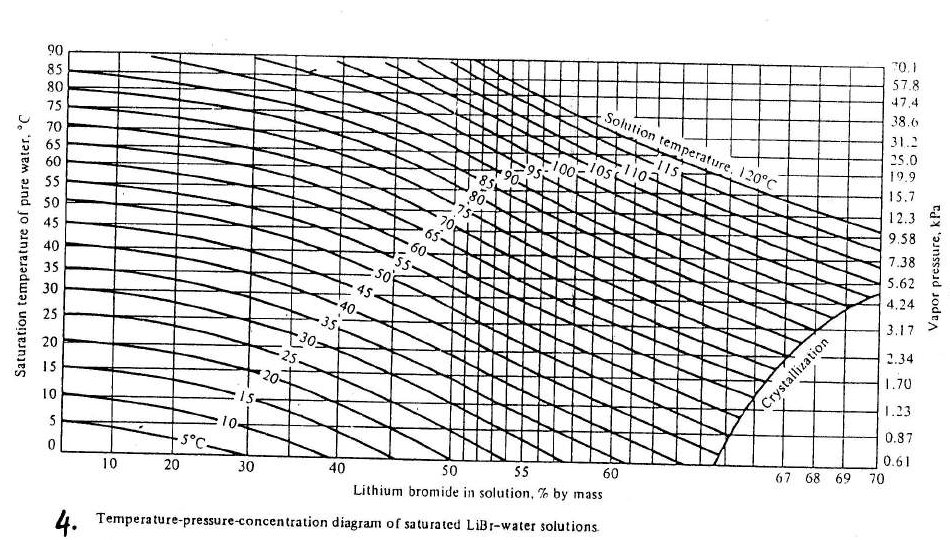
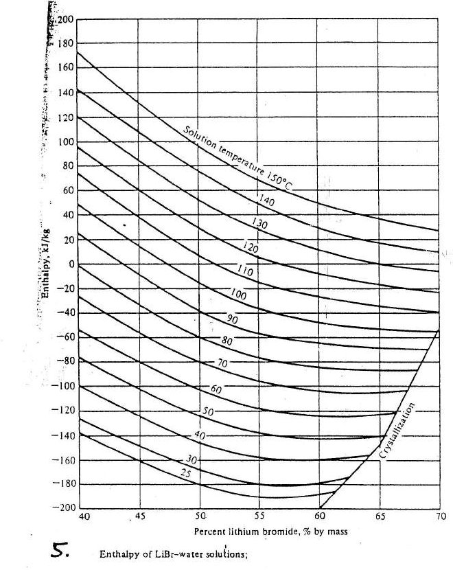

<!-- pagebreak -->
# Module 8: Absorption refrigeration

| | |
|---|---|
| **Where it appears** | 10 of 11 papers, 2011-12 to 2023-24 (not 2017-18). The LiBr–water numerical is Q4(b)–Q7(b) of Section A or B in 2012-13, 2013-14, 2015-16, 2016-17, 2018-19, 2020-21 and 2022-23; the aqua-ammonia description is asked in 2018-19, 2021-22 and 2023-24; comparisons in 2011-12 and 2012-13 |
| **Share of all marks** | 7.2% (219 of 3055 weighted marks): 13 parts. Numericals (AB1) 144 marks in 8 parts; theory (AB2) 75 marks in 5 parts |
| **Time** | core 2 h (§8.1–8.5 and Solutions 8.2, 8.6, 8.9), full 4 h (all 13 solutions) |
| **Sources** | Aloke pp.4–7, 73–91; Kanak pp.3–5, 41–56; Ameen §5.1–5.6; Data Book Table 1 (R718) and the superheated steam table, Charts 4 and 5 (all at the end of this module) |

**How it has been asked:**

- **The LiBr–water COP problem (AB1), 15–23 marks, 4 papers.** "In an absorption refrigerating system using LiBr, T$_G$ = 100 °C, T$_E$ = 9 °C, T$_a$ = 30 °C, T$_C$ = 40 °C. Estimate the values of COP for the following conditions: i) Ideal/carnot cycle ii) A real cycle if pump delivers 0.75 kg/s solution iii) If a heat exchanger is inserted after the pump and water enters the generator at 50 °C. iv) If condensing temperature is reduced to 35 °C, is there any chance of crystallization?" (2013-14; **2015-16 and 2020-21 the same words** with 8/31/38 °C, 0.5 kg/s, 48 °C, 33 °C and 9/28/43 °C, 0.5 kg/s, 50 °C). 2012-13 gives the slide problem (100/40/30/10 °C, $w$ = 0.6 kg/s) as a figure: "Estimate refrigerant flow rate and COP of the system shown in Fig."
- **The LiBr–water heat-rate problem (AB1), 15–20 marks, 3 papers.** "The operating temperatures of a lithium bromide-water absorption system are as: Generator 100 °C, condenser 34 °C, evaporator 7 °C, absorber 28 °C. Draw the schematic/block diagram of the system and calculate … (i) The heat supplied to the generator. (ii) The heat rejected at the condenser and absorber. (iii) The cooling effect. (iv) The coefficient of performance … The mass flow rate delivered by the aqua pump is 0.58 kg/s" (2016-17; **2018-19 ≡ 2022-23** with 36 °C / 6 °C and 0.45 / 0.42 kg/s).
- **Carnot COP with steam (AB1), once:** "the heat is supplied to NH$_3$ generator by condensing steam at 2 bar and 90% dry … evaporator … −5 °C. Find the maximum C.O.P. … refrigeration load is 20 tonnes and actual C.O.P. is 70% of the maximum … find the mass of steam required per hour … atmosphere … 30 °C" (2011-12, 15 marks).
- **The aqua-ammonia system (AB2), 15–18 marks:** "**Describe an aqua-ammonia vapor absorption refrigeration system with necessary schematic diagram. Hence, analyze the benefit of using two heat exchangers; one after the pump and the another before the expansion valve**" (**2021-22 ≡ 2023-24 verbatim**); "Describe a vapor absorption refrigeration system with proper schematic diagram. Hence, discuss the function of generator, absorber, heat exchangers, analyzer and rectifier" (2018-19).
- **Comparisons (AB2):** "Make brief comparisons between (i) vapour compression vs. vapour absorption chillers (ii) LiBr vs. NH$_3$ absorption systems" (2012-13, 20 marks); "What are the disadvantages of Lithium-bromide-water absorption system of refrigeration?" (2011-12, 5 marks).

> **KEY: Toolkit for this module**
>
> - **Pairs:** LiBr–water: water is the **refrigerant**, LiBr the absorbent (air conditioning, $T_E>3$ °C, vacuum). NH$_3$–water (aqua-ammonia): NH$_3$ is the refrigerant, water the absorbent (down to −60 °C, pressures above atmospheric).
> - **Temperatures:** $T_G$ generator, $T_C$ condenser, $T_E$ evaporator, $T_a$ absorber; $T_0$ the surroundings (heat sink). Absolute temperatures (K) in every COP formula.
> - **Two pressures only:** $p_H=p_{sat,water}(T_C)$ (generator + condenser) and $p_L=p_{sat,water}(T_E)$ (evaporator + absorber).
> - **Concentration** $x$ = mass fraction of **LiBr** in the solution (kg LiBr/kg solution); Chart 4 gives it from (solution temperature, water saturation temperature); Chart 5 gives $h$ from (solution temperature, $x$).
> - **States (LiBr, Fig. 6):** 1 dilute solution leaving the absorber and the pump, 2 dilute solution entering the generator, 3 concentrated solution leaving the generator, 4 concentrated solution entering the throttle/absorber, 5 water vapour to the condenser, 6 liquid water leaving the condenser, 7 water vapour leaving the evaporator. Without a heat exchanger, $h_2=h_1$ and $h_4=h_3$.
> - **Balances:** LiBr $\dot m_1x_1=\dot m_3x_3$; total $\dot m_1=\dot m_3+\dot m_5$; $\dot m_5=\dot m_6=\dot m_7$ (refrigerant).
> - **Heat rates** (pump work neglected): $q_g=\dot m_3h_3+\dot m_5h_5-\dot m_1h_2$; $q_c=\dot m_5(h_5-h_6)$; $q_e=\dot m_5(h_7-h_6)$; $q_a=\dot m_5h_7+\dot m_3h_4-\dot m_1h_1$. Check: $q_g+q_e=q_c+q_a$.
> - **COP** $=q_e/q_g$ (with pump work: $q_e/(q_g+W_p)$). Real single-effect values 0.6–0.8.
> - **Maximum (Carnot) COP:** $COP_{max}=\dfrac{T_G-T_0}{T_G}\cdot\dfrac{T_E}{T_0-T_E}$; for LiBr problems the slides take $T_0=(T_a+T_C)/2$.
> - **Water properties** (Table 1, R718): $h_6=h_f(T_C)$, $h_7=h_g(T_E)$; $h_5$ = superheated vapour at $T_G$ and $p_H$: **2688 kJ/kg** at 100 °C (superheated table, 0.06-bar block). 1 TR = 3.517 kW.
> - **Naming:** in this guide *strong solution* = strong in **refrigerant**, *weak* = weak in refrigerant (the course slides' convention). For LiBr, always say **dilute** (state 1, ≈ 50 % LiBr) and **concentrated** (state 3, ≈ 66 % LiBr) as well (§8.2).

## 8.1 The absorption principle ★

**What it is.** The vapour absorption refrigeration system (VARS) was developed by Ferdinand Carré in France (patented in the US in 1860). It is a **heat-operated** cycle: it uses heat (steam, hot water, exhaust gas, a flame, solar or geothermal heat) instead of shaft work. It is economical where inexpensive heat is available in abundance: waste or process steam, geothermal energy, solar heat and cheap natural gas [Aloke p.73; Kanak p.41; Ameen §5.1].

**How it differs from vapour compression.** The condenser, expansion valve and evaporator are the same. Only the method of compressing the refrigerant differs: the **compressor is replaced by an absorber, a pump and a generator** (Fig. 1, Fig. 2) [Aloke pp.75–76; Kanak p.43]. A second fluid, the **absorbent**, is used besides the refrigerant.

The three steps that replace the compressor (Stoecker & Jones, Kanak p.43):

1. **Absorb** the low-pressure refrigerant vapour in a liquid (the absorbent) while removing heat (absorber, cooled by water).
2. **Raise the pressure of the liquid** solution with a pump.
3. **Release the vapour** at the high pressure by applying heat (generator).

**Why it works.** Some liquids have a great affinity for certain vapours: water absorbs large quantities of NH$_3$ vapour, LiBr solution absorbs water vapour, and the vapour "disappears" into a small volume of liquid [Aloke p.4]. Pumping a liquid needs very little work ($\int v\,dp$ with a tiny $v$), far less than compressing a vapour through the same pressure rise. The price is the heat $Q_g$ needed in the generator to boil the refrigerant out again. So the energy input is mostly low-grade heat, and the electric input is only the small pump [Ameen §5.1].

**The two pressure levels.** Generator and condenser share the high pressure; evaporator and absorber share the low pressure. The pump and two valves (the expansion valve on the refrigerant side, a throttle valve on the solution side) separate them.

**The simple cycle** (Fig. 1, bottom) [Aloke pp.73–75; Ameen §5.1]:

- low-pressure refrigerant vapour from the evaporator enters the **absorber** and is absorbed by the weak solution coming from the generator; the heat of absorption and condensation is removed by cooling water;
- the resulting **strong solution** (rich in refrigerant) is **pumped** to the generator pressure;
- in the **generator** heat boils refrigerant vapour out of the solution; the high-pressure vapour goes to the **condenser**, then through the **expansion valve** to the **evaporator**, where it produces the refrigerating effect;
- the **weak solution** left in the generator returns to the absorber through a **throttle valve**.

![Fig. 1: Comparison of the simple vapour compression and vapour absorption cycles [Aloke p.75]. Top: compressor → condenser → expansion valve (with sensing bulb) → evaporator → compressor. Bottom (vapour absorption cycle): generator → "High-pressure vapour" → condenser → T-X valve → evaporator → "Low-pressure vapour" → absorber; the pump draws solution from the absorber and delivers "Strong solution" to the generator; "Solution" returns from the generator through a throttle valve to the absorber. The generator, absorber and pump take the compressor's place.](figures/001.jpg "w=0.75")

![Fig. 2: What replaces the compressor [Aloke p.76; Kanak p.43; Stoecker & Jones Fig. 17-1]. A dashed box sits between the low-pressure vapour from the evaporator and the high-pressure vapour to the condenser (with the expansion valve between condenser and evaporator). Inside the box: "Vapor compression: 1. Compressor. Absorption: 1. Absorb vapor in liquid while removing heat; 2. Elevate pressure of liquid with pump; 3. Release vapor by applying heat."](figures/002.jpg "w=0.6")

**Refrigerant–absorbent pairs** [Aloke pp.73–74; Kanak pp.41–42; Ameen §5.1]:

| Pair | Refrigerant | Absorbent | Use |
|---|---|---|---|
| LiBr–water | water | lithium bromide (a highly hygroscopic salt) | air conditioning (water chillers); not for low temperatures, since water freezes at 0 °C |
| aqua-ammonia (NH$_3$–water) | ammonia | water ("aqua") | industrial refrigeration, ice making, cold storage, down to about −60 °C; not for air conditioning because NH$_3$ is toxic |

**Properties of a good refrigerant–absorbent pair** [Aloke p.74; Ameen §5.3]:

1. The absorbent has a **great affinity** for the refrigerant (more than the ordinary law of solubility gives), so it absorbs a lot of vapour at the absorber temperature.
2. The two are **mutually soluble** over the whole range of operating conditions: highly soluble at absorber conditions, poorly soluble at generator conditions.
3. The absorbent has **low volatility** (negligible vapour pressure at the generator temperature): the normal boiling points should differ by about 200 °C, so that only refrigerant leaves the generator. (LiBr is non-volatile; NH$_3$ and water differ by only 133–138 °C, so some water boils off with the ammonia and an analyzer and a rectifier are needed.)
4. The refrigerant has a **reasonably high latent heat**, so the flow rate is small.
5. The absorbent is **chemically stable** at the generator temperature, with no irreversible reaction, and remains liquid throughout the cycle.
6. **Low viscosity** (small pump work), low specific heat and low surface tension; non-toxic, non-corrosive and cheap.

## 8.2 Strong and weak solution: one naming for the whole module ★

> **TRAP: "Strong" means different things in different books**
>
> The aqua-ammonia texts and the course slides name a solution by its **refrigerant** content: the solution pumped from the absorber to the generator is the **strong solution** (rich in NH$_3$), and the one returning from the generator is the **weak solution** [Aloke pp.6, 77–78; Ameen §5.1: "the strong, i.e. the refrigerant-rich solution formed in the absorber"]. Many LiBr–water texts and chiller catalogues do the opposite: they name the solution by its **LiBr** content, so the concentrated solution leaving the generator (≈ 64–66 % LiBr) is called "strong" and the absorber outlet (≈ 50–60 %) "weak".
>
> **This guide uses the slides' convention throughout** (strong = strong in refrigerant). For LiBr–water it always adds the unambiguous words: **dilute solution** (state 1, from the absorber, more water) and **concentrated solution** (state 3, from the generator, more LiBr). In an exam, define your words on the sketch (e.g. "strong solution (rich in NH$_3$)"), and you cannot be marked wrong.

## 8.3 The practical aqua-ammonia system and its components ★

In a practical system some auxiliaries are added to improve the efficiency. How many to add is a balance between first cost and running cost [Aloke p.77; Kanak p.44; Ameen §5.2]. Fig. 3 shows the complete aqua-ammonia system with all the auxiliaries and two heat exchangers; Fig. 4 is the same figure as printed in the course slides.

![Fig. 3: Aqua-ammonia absorption system with analyzer, rectifier and two heat exchangers (drawn for this guide after Aloke p.81 and Ameen Fig. 5.5). High-pressure side (above the dotted line): the strong solution (rich in NH$_3$) from the pump passes up through HX-1 (the solution heat exchanger), where it is preheated, and enters the top of the ANALYZER, a tray column sitting on the GENERATOR. Heat $Q_g$ (steam, hot water, exhaust gas or flame) boils NH$_3$ out of the solution in the generator. The vapour rising through the analyzer (NH$_3$ + some H$_2$O vapour) goes to the RECTIFIER (water-cooled, $Q_r$ out), whose condensate returns as reflux (dashed) to the analyzer; dry NH$_3$ vapour goes to the CONDENSER ($Q_c$ out), then to the RECEIVER, then as warm liquid NH$_3$ through HX-2 (the liquid–vapour heat exchanger), where it is subcooled, and on to the expansion valve. Low-pressure side: the EVAPORATOR takes $Q_e$ from the cold space; the cold NH$_3$ vapour passes back through HX-2 (where it is warmed) and on to the ABSORBER (cooling water, $Q_a$ out). The hot weak solution (poor in NH$_3$) leaves the bottom of the generator, gives its heat to the strong solution in HX-1, passes through the throttle valve and is sprayed into the absorber. The absorber's strong solution goes to the pump.](figures/003.jpg "w=1.0")

![Fig. 4: The same system as printed in the slides, "Absorption cycle with auxiliaries and two heat exchangers" [Aloke p.81; Kanak p.47; Ameen Fig. 5.5]. Pump → strong solution up through the left "Heat exchanger" → top of the "Analyzer" on the "Generator" (heat $Q_g$); vapour → "Rectifier" (its return line goes back to the analyzer) → "High-pressure vapour" → "Condenser" (heat $Q_c$) → "Receiver" → right "Heat exchanger" (annotated "Subcools") → "Expansion valve" → "Evaporator" (heat $Q_e$); "Low-pressure vapour" from the evaporator through the right heat exchanger to the "Absorber" (heat $Q_a$); "Weak solution" from the generator through the left heat exchanger and the "Throttling valve" to the absorber.](figures/004.jpg "w=0.75")

**Working, step by step** (states of Fig. 3) [Aloke pp.4–6; Kanak pp.3–4]:

1. NH$_3$ vapour is produced in the **generator** at high pressure from the strong solution by an external heat source. NH$_3$ boils off first, because its boiling point is far lower than that of water; but some water vapour goes with it.
2. The water vapour carried with the ammonia is removed in the **analyzer** and the **rectifier**, so only dehydrated (dry) NH$_3$ gas enters the condenser.
3. High-pressure NH$_3$ vapour is condensed in the **condenser** (heat rejected to cooling water) and collected in the **receiver**.
4. The liquid is subcooled in the **liquid–vapour heat exchanger**, then throttled in the **expansion valve**, which reduces its pressure and temperature below the temperature to be maintained in the evaporator.
5. The low-temperature refrigerant absorbs heat in the **evaporator** and leaves it as (nearly) saturated vapour, which is warmed slightly in the liquid–vapour heat exchanger.
6. The slightly superheated, low-pressure NH$_3$ vapour is absorbed in the **absorber** by the weak solution sprayed into it. The weak NH$_3$ solution becomes strong after absorbing the vapour. Cooling water removes the heat of condensation and the heat of absorption.
7. The **pump** raises the strong solution to the generator pressure and sends it through the **solution heat exchanger**, where it takes heat from the hot weak solution returning from the generator, and into the top of the analyzer.
8. The solution in the generator becomes weak as NH$_3$ vapour leaves it. The hot weak solution passes through the solution heat exchanger and the **throttle valve**, which reduces its pressure to the absorber pressure, and returns to the absorber.

**Functions of the components** [Aloke pp.77–80; Kanak pp.44–46; Ameen §5.2]:

| Component | Function |
|---|---|
| **Generator** | A shell partly filled with strong solution, kept at a constant level over submerged steam or hot-gas/hot-water tubes. Heat from an external source (process or waste steam, even solar-heated water) boils the refrigerant (NH$_3$) out of the solution at the high pressure. It does the "release vapour by heating" part of the compressor's job. |
| **Absorber** | One or more shells, like shell-and-tube condensers, with cooling-water tubes. The weak solution from the generator and the **refrigerant vapour** from the evaporator enter; the strong solution is drawn off. The cooling water removes the heat of condensation and the heat of absorption; the lower the solution temperature, the more vapour is absorbed and the richer the solution becomes. |
| **Pump** | Raises the strong solution from the absorber pressure to the generator pressure. It is the only moving part, and needs little power since it pumps a liquid. |
| **Solution heat exchanger** (after the pump) | Between absorber and generator: heats the cool strong solution on its way to the generator and cools the hot weak solution returning to the absorber. Saves generator heat and absorber cooling. |
| **Liquid–vapour heat exchanger** (before the expansion valve) | Subcools the warm liquid refrigerant from the condenser/receiver with the cold vapour leaving the evaporator. |
| **Analyzer** | A tray column built on top of the generator or as a separate vessel. The strong aqua from the absorber and the reflux from the rectifier enter at the top and flow down into the generator. The rising vapour is cooled by the incoming solution and most of its water vapour condenses; the solution is preheated by the vapour, so less heat is needed in the generator. |
| **Rectifier** | A water-cooled heat exchanger, like a small water-cooled condenser, after the analyzer. It cools the vapour leaving the analyzer further, so the residual water vapour condenses and returns (reflux) to the analyzer; dehydrated NH$_3$ vapour goes on to the condenser. 40–50 °C usually dehydrates ammonia enough. |
| **Condenser, receiver, expansion valve, evaporator** | As in vapour compression: condense the NH$_3$, store the liquid, throttle it to the low pressure, and evaporate it to take heat from the cold space. |
| **Throttle valve** (solution) | Reduces the weak solution from the generator pressure to the absorber pressure. |

**Why the analyzer and rectifier are needed** [Aloke p.83; Ameen §5.2]: water is volatile at the generator temperature (the boiling points of NH$_3$, −33 °C, and water, 100 °C, differ by only 133 °C), so the vapour leaving the generator carries water vapour. Water that reaches the expansion valve can freeze in it (the evaporator is below 0 °C), and water that reaches the evaporator stays there as liquid: it raises the boiling temperature of the evaporator mixture and reduces the refrigerating effect. The analyzer and rectifier send nearly pure NH$_3$ to the condenser and evaporator. A LiBr–water system needs neither, because LiBr does not evaporate.

**The benefit of the two heat exchangers** [Aloke pp.78–79; Kanak p.46; Ameen §5.2]:

- **HX-1, after the pump (solution heat exchanger).** The strong solution leaves the absorber cold (≈ 30 °C) and must be heated to the generator temperature; the weak solution leaves the generator hot and must be cooled to the absorber temperature before it can absorb. HX-1 lets one stream do the other's job: it recovers heat that would otherwise be thrown away in the absorber. **Less heat is needed in the generator** ($Q_g$ falls), **less cooling is needed in the absorber** ($Q_a$ falls by the same amount), so the **COP rises** and the cooling-water and boiler sizes fall. Typical gain: COP 0.73 → 0.78 in the LiBr example of Solution 8.2.
- **HX-2, before the expansion valve (liquid–vapour heat exchanger, subcooler).** The cold evaporator vapour subcools the warm condensed liquid. Subcooled liquid flashes less in the expansion valve, so **each kg of refrigerant gives a larger refrigerating effect**, and less refrigerant must be boiled off in the generator per kW of cooling (smaller $Q_g$ and pump flow, higher COP). It also superheats the suction vapour slightly so that no liquid droplets enter the absorber, and warmer vapour carries less un-evaporated liquid (water) out of the evaporator.
- Together they economise on the heat needed in the generator and the cooling needed in the absorber; shell-and-tube units are used in large plants. The price is the first cost of the exchangers, so the number of auxiliaries is a trade-off between initial and operating cost.

> **TRAP: Two slips in the course material on this system**
>
> 1. **"The strong solution from the evaporator"** [Kanak p.44; Aloke p.78; also Ameen §5.2]: nothing but **refrigerant vapour** comes from the evaporator. Write: "the weak solution from the generator and the refrigerant vapour from the evaporator enter the absorber; the strong solution is drawn off". The same slip appears in the label "NH$_3$ vapor + solution" on the evaporator-to-absorber line of the aqua-ammonia figure [Aloke p.83; Kanak p.48].
> 2. **Analyzer and rectifier labels swapped** [Kanak p.48; Aloke p.83]: in that printed figure the box stacked on the generator is labelled "Rectifier" and the one downstream "Analyzer". The analyzer sits **on the generator** (the incoming strong solution flows down through it), and the rectifier comes **after** it, just before the condenser, and is water-cooled (Fig. 3, and the slides' own Fig. 2 [Aloke p.81]). Draw them in that order.

## 8.4 The maximum (Carnot) COP ★ {#absorption-carnot}

**Definition.** Neglecting the pump work [Ameen §5.5]:
$$COP=\frac{\text{refrigeration rate}}{\text{heat supplied to the generator}}=\frac{Q_E}{Q_G},\qquad\text{with pump work: } COP=\frac{Q_E}{Q_G+W_p}$$

Real absorption COPs are below 1 (0.6–0.8 single effect), against 3 and above for vapour compression. But the input is low-grade heat that costs roughly a third as much per kJ as electric power, and absorption becomes economic when waste heat is available [Ameen §5.5].

**The ideal system.** An absorption system exchanges heat with three reservoirs (Fig. 5) [Aloke p.82; Kanak p.47]: it takes $Q_G$ from the heating medium at $T_G$, takes $Q_E$ from the refrigerated space at $T_E$, and rejects $Q_0=Q_G+Q_E+W_p$ to the environment at $T_0$ (absorber and condenser). The best possible device is a **reversible heat engine** between $T_G$ and $T_0$ driving a **reversible refrigerator** between $T_E$ and $T_0$:
$$W=Q_G\,\frac{T_G-T_0}{T_G},\qquad Q_E=W\,\frac{T_E}{T_0-T_E}$$
$$\boxed{COP_{max}=\frac{Q_E}{Q_G}=\frac{T_G-T_0}{T_G}\cdot\frac{T_E}{T_0-T_E}=\eta_{Carnot}\times COP_{Carnot,R}}$$

The same result follows from the second law: entropy generation $\ge0$ gives $Q_G/T_G+Q_E/T_E\le Q_0/T_0$. **Trends:** $T_G\uparrow\Rightarrow COP\uparrow$; $T_E\uparrow\Rightarrow COP\uparrow$; $T_0\uparrow\Rightarrow COP\downarrow$ [Aloke p.82].

For a LiBr problem the absorber and condenser are both heat sinks at different temperatures; the slides take $T_0=(T_a+T_C)/2$ [Aloke p.88].

> **TRAP: The COP$_{max}$ denominator in Kanak vai's note**
>
> Kanak vai's note's boxed formula [Kanak p.47] reads $COP_{max}=\frac{T_E}{T_G}\left(\frac{T_G-T_0}{T_1-T_E}\right)$. The "$T_1$" is a slip: it is $T_0-T_E$, the lift of the Carnot refrigerator from $T_E$ to the environment. The trends written under it, and every worked number in the sources, use $T_0$.

> **EXAMPLE 8.1** `[Aloke p.88; Kanak p.50]` A LiBr system has $T_G=100$ °C, $T_E=10$ °C, $T_a=30$ °C and $T_C=40$ °C. Find the ideal (Carnot) COP.
>
> **[FROM SOURCE: Aloke p.88; Kanak p.50]** Take $T_0=(T_a+T_C)/2=(30+40)/2=35$ °C. Temperature **differences** are the same in °C and K, but the ratio $T_E/T_G$ needs kelvin:
> $$COP_{max}=\frac{T_E}{T_G}\cdot\frac{T_G-T_0}{T_0-T_E}=\frac{283.15}{373.15}\cdot\frac{100-35}{35-10}=0.7588\times2.6=\mathbf{1.97}$$
> The real cycle of the same plant reaches only about 0.73 (Solution 8.2): the irreversibilities of heat transfer through finite temperature differences, mixing in the absorber and throttling cost more than half the ideal COP.

::: {.mini #m-mini-absorption-steam}
**Mini-example: heating steam between table rows.** A generator is heated by steam at 1.5 bar, 95 % dry, condensing to saturated liquid; it needs 50 kW. Find the steam temperature and the steam flow.

0.15 MPa lies between the Table 1 rows 110 °C ($p=$ [0.14338]{.lookup t="water-sat" row="110" col="p_MPa"} MPa, $h_f=$ [461.42]{.lookup t="water-sat" row="110" col="h_liq_kJ_kg"}, $h_g=$ [2691.06]{.lookup t="water-sat" row="110" col="h_vap_kJ_kg"}) and 115 °C ([0.16918]{.lookup t="water-sat" row="115" col="p_MPa"} MPa, [482.59]{.lookup t="water-sat" row="115" col="h_liq_kJ_kg"}, [2698.58]{.lookup t="water-sat" row="115" col="h_vap_kJ_kg"}). Fraction $=(0.15-0.14338)/(0.16918-0.14338)=0.2566$, so $T=110+0.2566	imes5=111.28$ °C, $h_f=466.85$, $h_g=2692.99$, $h_{fg}=2226.14$ kJ/kg.

Each kg gives up $q=x\,h_{fg}=0.95\times2226.14=2114.8$ kJ/kg, so $\dot m=50/2114.8=0.02364$ kg/s $=85.1$ kg/h.
:::

## 8.5 The LiBr–water system and how to solve it ★

**The system** (Fig. 6) [Aloke pp.86–87; Kanak pp.50, 54; Ameen §5.5]. Water is the refrigerant, a solution of LiBr in water the absorbent. Since LiBr is a salt with practically no vapour pressure, **only water vapour leaves the generator**: no analyzer or rectifier is needed. Because water boils at 5–10 °C only at about 1 kPa, the whole machine runs under a **deep vacuum**: about 1 kPa in the evaporator and absorber, 5–9 kPa in the generator and condenser. In commercial chillers the generator and condenser share one shell (same pressure) and the evaporator and absorber share another; cooling water from the cooling tower passes in series through the absorber and then the condenser [Ameen §5.5].

![Fig. 6: LiBr–water absorption system with a solution heat exchanger and the state numbers used in this guide (after the Q-paper figures and Aloke p.87). The pump takes dilute LiBr solution from the ABSORBER ($T_a$, heat $q_a$ out) and delivers it ($\dot m_1$, state 1) up through the solution heat exchanger (left coil) to the GENERATOR at state 2. Heat $q_g$ enters the generator ($T_G$). Water vapour (refrigerant) leaves the generator at state 5 for the CONDENSER ($T_C$, $q_c$ out); liquid water (state 6) passes through the expansion valve to the EVAPORATOR ($T_E$, $q_e$ in); water vapour leaves the evaporator at state 7 for the absorber. The concentrated solution leaves the generator at state 3, gives heat to the dilute solution in the heat exchanger (right coil), leaves it at state 4 and passes through the throttle valve into the absorber. A dotted line separates the high pressure $p_H=p_{sat}(T_C)$ (generator, condenser) from the low pressure $p_L=p_{sat}(T_E)$ (absorber, evaporator).](figures/006.jpg "w=0.85")

**State numbers.** This guide uses the slides' numbering (Fig. 6, Aloke p.87): 1 dilute solution out of the absorber/pump, 2 into the generator, 3 concentrated solution out of the generator, 4 out of the heat exchanger, 5 water vapour to the condenser, 6 liquid water out of the condenser, 7 water vapour out of the evaporator. **Without a heat exchanger** 1 ≡ 2 and 3 ≡ 4. (The 2012-13 paper figure has no heat exchanger and numbers the states 1 solution to the generator, 2 solution from the generator, 3 vapour, 4 liquid water, 5 evaporator vapour: map them before you write.)

### Reading the two LiBr charts {#absorption-charts}

**Chart 4 (T–p–x, equilibrium chart)** [Data Book Chart 4, end of this module, Fig. 10]. Left axis: saturation temperature of **pure water**, °C (0–90); right axis: the same lines as vapour pressure, kPa (0.61 kPa at 0 °C, 1.23 at 10 °C, 4.24 at 30 °C, 7.38 at 40 °C …); bottom axis: LiBr in solution, % by mass (the scale is squeezed above 60 %: 67, 68, 69, 70 are close together); sloping lines: solution temperature 5–120 °C; bottom right: the crystallization line. A solution in equilibrium with water vapour at pressure $p$ has the same vapour pressure as pure water at its saturation temperature, so:

- **absorber outlet (state 1):** go along the horizontal line of the **evaporator** temperature $T_E$ (the absorber is at $p_L=p_{sat}(T_E)$) to the line of solution temperature $T_a$, and drop to the $x$ axis;
- **generator outlet (state 3):** go along the horizontal line of the **condenser** temperature $T_C$ ($p_H$) to the solution-temperature line $T_G$, and drop to $x$.

**Chart 5 (h–x)** [Data Book Chart 5, Fig. 11]. Enthalpy of the solution, kJ/kg (−200 to +200), against % LiBr (40–70), with curves of solution temperature 25–150 °C and the crystallization line. Read $h_1$ at ($x_1$, $T_a$), $h_3$ at ($x_3$, $T_G$), and with a heat exchanger $h_2$ at ($x_1$, the given solution temperature at 2). Between two curves, interpolate linearly (e.g. 52 °C lies one-fifth of the way from the 50 °C to the 60 °C curve).

**Water and steam** [Data Book Table 1 (R718) and the superheated steam table, end of this module]: $h_6=h_f(T_C)$, $h_7=h_g(T_E)$. State 5 is water vapour leaving the generator at the **generator temperature** but the **condenser pressure** (5–9 kPa), so it is superheated: $h_5$ from the superheated table, 0.06-bar (6 kPa) block, midway between the 80 °C ($h=$ [2650.1]{.lookup t="water-sh" row="0.06;80" col="h_kJ_kg"}) and 120 °C ($h=$ [2726.0]{.lookup t="water-sh" row="0.06;120" col="h_kJ_kg"}) rows: $h_5=(2650.1+2726.0)/2=2688$ kJ/kg at 100 °C. At these low pressures steam is an ideal gas and $h$ depends on $T$ alone (the EOS gives 2687.8–2688.0 kJ/kg from 5 to 9 kPa), so 2688 kJ/kg is used for every condenser temperature.

::: {.mini #m-mini-absorption-water}
**Mini-example: water properties between table rows.** Table 1 has a row every 5 °C. Find $p_{sat}$ and $h_g$ at 12 °C (an evaporator) and $h_f$ at 32 °C (a condenser).

12 °C is 2/5 of the way from 10 to 15 °C: $p=$ [1.23]{.lookup t="water-sat" row="10" col="p_MPa" x="1000"} $+0.4\,($[1.71]{.lookup t="water-sat" row="15" col="p_MPa" x="1000"} $-1.23)=1.422$ kPa; $h_g=$ [2519.21]{.lookup t="water-sat" row="10" col="h_vap_kJ_kg"} $+0.4\,($[2528.33]{.lookup t="water-sat" row="15" col="h_vap_kJ_kg"} $-2519.21)=2522.86$ kJ/kg. 32 °C: $h_f=$ [125.73]{.lookup t="water-sat" row="30" col="h_liq_kJ_kg"} $+0.4\,($[146.63]{.lookup t="water-sat" row="35" col="h_liq_kJ_kg"} $-125.73)=134.09$ kJ/kg.
:::

> **TRAP: $h_5$ is not $h_g$ at 100 °C**
>
> The slides, Kanak vai's note and Ameen take $h_5=h_g(100\ °\text{C})=2676$ kJ/kg [Aloke p.89; Kanak p.52; Ameen Ex. 5.1]. That is saturated vapour at 101.4 kPa. The vapour leaving a generator at 100 °C is at the condenser pressure (7.38 kPa for 40 °C), where water saturates at only 40 °C: it is superheated by 60 K, and $h\approx2688$ kJ/kg. The difference raises $q_g$ by about 12 kJ per kg of refrigerant (1.8 kW in Solution 8.2) and **lowers the COP by about 0.003**. Either value earns the marks if stated; this guide uses 2688.

> **EXAMPLE 8.2** `[Aloke p.88; Kanak pp.51–52; Stoecker & Jones Ex. 17.1]` For $T_G=100$ °C, $T_C=40$ °C, $T_a=30$ °C, $T_E=10$ °C, read the concentrations and enthalpies of the solution at the absorber outlet (1) and generator outlet (3), and the enthalpy of the dilute solution heated to 52 °C (2).
>
> **[FROM SOURCE: Aloke pp.88–89; Kanak pp.51–52]**
>
> - Pressures (Table 1): $p_H=p_{sat}(40\ °\text{C})=$ [7.38]{.lookup t="water-sat" row="40" col="p_MPa" x="1000"} kPa; $p_L=p_{sat}(10\ °\text{C})=$ [1.23]{.lookup t="water-sat" row="10" col="p_MPa" x="1000"} kPa.
> - Chart 4, absorber: 10 °C line × 30 °C solution line → $x_1=$ **[50 %]{.lookup t="chart4"}**. Generator: 40 °C line × 100 °C solution line → $x_3=$ **[66.4 %]{.lookup t="chart4"}** (Fig. 7). The ASHRAE Dühring correlation gives 49.0 % and 66.1 %.
> - Chart 5: $h_1$ (50 %, 30 °C) $=$ **[−168]{.lookup t="chart5"} kJ/kg**; $h_3$ (66.4 %, 100 °C) $=$ **[−52]{.lookup t="chart5"} kJ/kg**; $h_2$ (50 %, 52 °C) $=$ **[−120]{.lookup t="chart5"} kJ/kg** (Fig. 8).
>
> On the T–p–x chart the cycle is the rectangle of Fig. 7: the solution is pumped at constant $x$ from the low- to the high-pressure line, boils in the generator along the high-pressure line (water leaves, $x$ rises from 50 to 66.4 %), is throttled at constant $x$ back to the low-pressure line, and absorbs vapour in the absorber along the low-pressure line ($x$ falls back to 50 %).

![Fig. 7: The 2012-13 Q4(b) cycle drawn on Data Book Chart 4 (temperature–pressure–concentration diagram of saturated LiBr–water solutions; left axis saturation temperature of pure water 0–90 °C, right axis vapour pressure 0.61–70.1 kPa, bottom axis % LiBr by mass, sloping solution-temperature lines 5–120 °C, crystallization line at the lower right). Red horizontal: the high pressure, 40 °C water = 7.38 kPa; blue horizontal: the low pressure, 10 °C water = 1.23 kPa. Orange rectangle: 1 (50 %, low pressure, on the 30 °C solution line: absorber outlet) → up at constant x = 50 % (pump) → g (50 %, high pressure: boiling starts in the generator) → along the high-pressure line "generator: water boils off, x rises" → 3 (66.4 %, on the 100 °C solution line: generator outlet) → down at x = 66.4 % (throttle) → a (66.4 %, low pressure: absorption starts) → along the low-pressure line "absorber: vapour absorbed, x falls" → 1. Green dashed line: a 34 °C condenser; its intersection with the 100 °C line, 3′, lies at ≈ 69 %, close to the crystallization line.](figures/007.jpg "w=1.0")

![Fig. 8: The same states on Data Book Chart 5 (enthalpy of LiBr–water solutions, −200 to +200 kJ/kg, against % LiBr 40–70, solution-temperature curves 25–150 °C, crystallization line from about 60 % at −200 kJ/kg to 70 % at −55 kJ/kg). Orange: 1 (50 %, 30 °C, −168 kJ/kg) → 2 (50 %, 52 °C, −120 kJ/kg) "heated in the HX 30 → 52 °C"; 3 (66.4 %, 100 °C, −52 kJ/kg) → 4 (66.4 %, −116 kJ/kg, ≈ 62 °C) "cooled in the HX"; point 4 lies just left of the crystallization line. Green: with a 34 °C condenser, 3′ (69 %, 100 °C, −53 kJ/kg) → 4′ (69 %, −119 kJ/kg), which lies to the right of (beyond) the crystallization line: solid LiBr forms.](figures/008.jpg "w=0.75")

> **TIP: How accurate is a chart reading?**
>
> Chart 4 is the Stoecker & Jones chart. Two published correlations bracket it: at 100 °C/40 °C the ASHRAE (Dühring) correlation gives 66.1 % and the Patek–Klomfar formulation (CoolProp `INCOMP::LiBr`) 66.5 %, against the chart's 66.4 %; at the absorber (30 °C/10 °C) they give 49.0 % and 48.4 % against the chart's 50 %. Read the chart to about ±0.5 %, and the enthalpy chart to ±2 kJ/kg; the COP changes only in the third decimal. The solutions below quote each chart reading and the correlation values beside it, and use the chart reading throughout.

### The method (six steps) {#absorption-method}

1. **Draw** the schematic with state numbers (Fig. 6); write $T_G$, $T_C$, $T_E$, $T_a$ on it.
2. **Pressures:** $p_H=p_{sat}(T_C)$, $p_L=p_{sat}(T_E)$ (Table 1).
3. **Concentrations** from Chart 4: $x_1$ at ($T_E$ line, $T_a$ solution), $x_3$ at ($T_C$ line, $T_G$ solution).
4. **Mass balances:** LiBr is conserved in the generator, and the vapour carries none:
$$\dot m_1x_1=\dot m_3x_3\Rightarrow\dot m_3=\dot m_1\frac{x_1}{x_3},\qquad\dot m_5=\dot m_1-\dot m_3=\dot m_6=\dot m_7\ \text{(refrigerant flow)}$$
5. **Enthalpies:** $h_1$, $h_3$ (and $h_2$) from Chart 5; $h_5=2688$, $h_6=h_f(T_C)$, $h_7=h_g(T_E)$ from the water tables.
6. **Energy balances** on each component (steady flow, pump work neglected), then the COP:
$$q_g=\dot m_3h_3+\dot m_5h_5-\dot m_1h_2,\quad q_c=\dot m_5(h_5-h_6),\quad q_e=\dot m_5(h_7-h_6),\quad q_a=\dot m_5h_7+\dot m_3h_4-\dot m_1h_1$$
$$COP=\frac{q_e}{q_g},\qquad\text{check: }q_g+q_e=q_c+q_a$$

::: {.mini #m-mini-absorption-mass}
**Mini-example: the mass balances.** The pump delivers $\dot m_1=1.0$ kg/s at $x_1=0.52$; the generator outlet is $x_3=0.65$.

LiBr in = LiBr out: $\dot m_3=1.0\times0.52/0.65=0.80$ kg/s of concentrated solution; refrigerant $\dot m_5=1.0-0.80=0.20$ kg/s of water vapour.
:::

::: {.mini #m-mini-absorption-cop}
**Mini-example: heat rates and COP.** With the flows above, $h_1=-170$, $h_3=-55$, $h_5=2688$, $h_6=h_f(35\ °\text{C})=146.63$, $h_7=h_g(5\ °\text{C})=2510.06$ kJ/kg, no heat exchanger ($h_2=h_1$, $h_4=h_3$).

$q_g=0.80(-55)+0.20(2688)-1.0(-170)=-44.0+537.6+170.0=663.6$ kW; $q_e=0.20\,(2510.06-146.63)=472.7$ kW; $COP=472.7/663.6=0.712$. Check: $q_c=0.20\,(2688-146.63)=508.3$ kW, $q_a=0.20(2510.06)+0.80(-55)-1.0(-170)=628.0$ kW, and $663.6+472.7=508.3+628.0$.
:::

**The solution heat exchanger** [Aloke pp.90–91; Kanak pp.54–56]. If the dilute solution enters the generator at a given temperature $T_2$, read $h_2$ at ($x_1$, $T_2$). Only $q_g$ changes (and $q_a$, by the same amount); $q_e$ does not. The heat exchanger balance gives the concentrated-solution enthalpy at its outlet:
$$\dot m_1(h_2-h_1)=\dot m_3(h_3-h_4)\Rightarrow h_4=h_3-\frac{\dot m_1}{\dot m_3}(h_2-h_1)$$

::: {.mini #m-mini-absorption-hx}
**Mini-example: a heat exchanger and the crystallization check.** In the cycle above ($\dot m_1=1.0$, $\dot m_3=0.80$ kg/s, $x_3=65$ %, $h_1=-170$, $h_3=-55$ kJ/kg) a heat exchanger heats the dilute solution so that $h_2=-125$ kJ/kg.

Duty $\dot m_1(h_2-h_1)=1.0\times45=45.0$ kW, so $q_g=663.6-45.0=618.6$ kW and $COP=472.7/618.6=0.764$ ($q_e$ unchanged). Outlet of the concentrated solution: $h_4=-55-\dfrac{1.0}{0.80}\times45=-111.3$ kJ/kg. The crystallization line on Chart 5 at 65 % is at about [−148]{.lookup t="chart5"} kJ/kg; $-111.3$ lies above it (to its left): no crystallization.
:::

### Crystallization ★ {#absorption-crystallization}

If the LiBr concentration is too high, or the solution too cold, for its concentration, the salt comes out of solution as crystals. They form a **slush** that blocks the pipes (usually the concentrated-solution line from the heat exchanger to the absorber) and stops the unit [Ameen §5.6; Aloke p.91].

- **Where:** most likely where the solution **leaving the generator leaves the heat exchanger** (state 4): it has the highest concentration and has just been cooled [Aloke p.91; Kanak p.56].
- **How to check:** plot ($x_3$, $h_4$) on Chart 5. If it lies beyond (to the right of / below) the crystallization line, the solution crystallizes.
- **Why a low condensing temperature is dangerous:** a lower $T_C$ lowers $p_H$; at the same generator temperature more water boils off, so $x_3$ rises (66.4 → 69 % for 40 → 34 °C in Fig. 7), and the cooled solution at 4 falls past the line. **Modern systems keep the condensing pressure up** even when cold cooling water is available, to avoid crystallization [Aloke p.91; Kanak p.56]. Other causes: a generator that is too hot, air leakage (raises the absorber pressure), a power failure that lets the hot concentrated solution cool in the pipes. Remedies: controls that limit $T_G$ or the concentration, keeping $T_C$ up, a by-pass (anti-crystallization) line, and dilution cycles at shutdown.
- **Freezing at part load:** at reduced load the refrigerant water can freeze; capacity is controlled by reducing the refrigerant water pump flow, reducing the generator temperature or raising the condensing temperature [Ameen §5.6].

## 8.6 Comparisons ★

### Vapour compression vs vapour absorption

[Aloke pp.7, 85; Kanak p.5; Ameen §5.4]

| Aspect | Vapour absorption | Vapour compression |
|---|---|---|
| Energy input | low-grade energy, **heat** (steam, hot water, exhaust of IC engines, solar, gas flame) | high-grade energy, **mechanical work** (electric motor) |
| Compression | absorber + pump + generator | compressor |
| Moving parts | only the small solution pump: quiet, little wear, smooth | the compressor: more wear, tear and noise |
| Electric power | small (pump, ≈ 1–2 % of a compressor's) | large |
| COP | low, 0.6–0.8 single effect (1.0–1.2 double effect); judged per kJ of heat | high, 3–6 |
| Effect of low evaporator pressure | the system works at low evaporator pressure without much loss of COP | COP falls considerably as the evaporator pressure falls |
| Part load | almost no effect on performance; capacity controlled by the solution and steam flow | performance falls at part load |
| Liquid at the evaporator exit | no danger | liquid in the suction line can damage the compressor |
| Capacity control | easy, automatic | more difficult |
| Size, weight, cost | more space, higher first cost; can stand outdoors as a vertical unit | compact, lower first cost |
| Life | ≈ 15 years | ≈ 25 years |
| Condenser water | more: ≈ 4.4 gpm/TR (heat of absorption as well), bigger cooling tower and water treatment | ≈ 3.0 gpm/TR |
| Other | needs a chimney (fired units), maintenance, longer overhaul downtime | none of these |
| Best where | waste heat or cheap fuel is available, electricity is costly or scarce, low noise and vibration are needed | electricity is available; small and medium plants |

### LiBr–water vs aqua-ammonia

[Aloke p.84; Kanak p.48; Ameen §5.3]

| Aspect | LiBr–water | NH$_3$–water (aqua-ammonia) |
|---|---|---|
| Refrigerant / absorbent | water / LiBr | NH$_3$ / water |
| Lowest evaporator temperature | above about 3 °C (water freezes at 0 °C): air conditioning (chilled water) only | below 0 °C, down to about −60 °C: refrigeration and ice making |
| COP | comparable (0.6–0.8 single effect; LiBr slightly higher) | comparable |
| Pressures | very low (deep vacuum, ≈ 1 and 7 kPa): air leaks in, a purge unit is needed; large vapour volumes | above atmospheric (≈ 2–15 bar): leaks are outward |
| Volatility of the absorbent | LiBr is non-volatile: no analyzer or rectifier | water evaporates with NH$_3$: analyzer and rectifier needed |
| Corrosion | LiBr is very corrosive (with air): inhibitors, generator kept below about 120 °C | NH$_3$ attacks copper and its alloys: steel construction |
| Crystallization | possible at high concentration / low temperature | none |
| Toxicity, flammability | non-toxic, non-flammable: safe for buildings | NH$_3$ is toxic and mildly flammable: not used for comfort air conditioning |
| Heat source | low temperature (80–120 °C) | higher generator temperature (≈ 120–150 °C) |
| Typical use | large building water chillers | industrial cold stores, ice plants, Electrolux refrigerators |

### Disadvantages of the LiBr–water system

[Aloke pp.84–85; Ameen §5.3]

1. It cannot give temperatures below about 3 °C, because the refrigerant is water: air conditioning only.
2. It works under a deep vacuum: air leaks in, so a purge unit is needed; the low-pressure water vapour has a huge specific volume, so the vessels and vapour passages are large.
3. LiBr is very corrosive in the presence of air: corrosion inhibitors are needed and the generator temperature is limited.
4. **Crystallization** of LiBr at high concentration or low solution temperature (e.g. low condensing water temperature or a power failure) blocks the flow.
5. Like every absorption system: high first cost, low COP (below 1), more space, more condenser water (heat of absorption) and a larger cooling tower, a chimney for fired units, and careful maintenance. LiBr is also expensive.

## 8.7 The Electrolux (three-fluid) refrigerator

The Electrolux or **Platen–Munters** system (1925) is an aqua-ammonia system with **no pump and no valves**. It uses three fluids: **ammonia** (refrigerant), **water** (absorbent) and **hydrogen** (an inert gas that equalizes the pressure) (Fig. 9). It is not in the course notes; this is the standard textbook description (TUTOR-GENERATED).

**Principle (Dalton's law).** The total pressure is the same everywhere in the unit (about 14 bar). In the condenser the gas is nearly pure NH$_3$, so NH$_3$ condenses at a high partial pressure (room temperature). In the evaporator hydrogen fills most of the space, so the **partial pressure of NH$_3$ is low** and the liquid NH$_3$ evaporates at a low temperature, taking heat from the food space. The pressure difference that a pump and an expansion valve would give is replaced by a difference in partial pressure.

**Working** (Fig. 9):

1. Heat (a gas or kerosene flame or an electric heater) boils NH$_3$ out of the strong solution in the **generator**; the vapour bubbles lift the solution up a narrow tube (**bubble pump**, a thermosiphon) to the **separator**.
2. In the separator the NH$_3$ vapour leaves the weak solution; it passes a **rectifier (water separator)** that condenses the water vapour and drains it back, and goes to the air-cooled **condenser**.
3. Liquid NH$_3$ flows by gravity (through a U-seal that keeps the hydrogen out of the condenser) into the **evaporator**, where it evaporates into the hydrogen and produces cooling.
4. The heavy NH$_3$ + H$_2$ mixture sinks through a **gas heat exchanger** to the **absorber**, where weak solution flowing down from the separator absorbs the NH$_3$. The light hydrogen, now nearly free of NH$_3$, rises back through the gas heat exchanger to the evaporator.
5. The strong solution from the absorber flows back to the generator (through a liquid heat exchanger in most units).

**Features:** silent, no moving parts, no electric motor (runs on gas, kerosene or electricity), long life; low COP (≈ 0.2–0.3) and small capacities only. Used in domestic and caravan refrigerators, hotel minibars and where there is no electricity.

![Fig. 9: Electrolux (three-fluid, NH$_3$–H$_2$O–H$_2$) refrigerator. Heat input (gas flame, kerosene or electric) at the GENERATOR; the bubble pump tube lifts solution and vapour to the SEPARATOR; NH$_3$ vapour (red) goes through the RECTIFIER (water separator, water drains back to the separator) to the air-cooled CONDENSER (heat to room air); liquid NH$_3$ (through a U-seal) flows to the EVAPORATOR, where NH$_3$ evaporates into H$_2$ and takes heat from the food space. The NH$_3$ + H$_2$ mixture (heavy gas) sinks through the gas heat exchanger to the ABSORBER, where water absorbs the NH$_3$ and the H$_2$ passes; the H$_2$ rises back through the gas heat exchanger to the evaporator. The weak solution flows by gravity from the separator to the absorber, and the strong solution from the absorber back to the generator. Note under the figure: the total pressure is the same everywhere (no pump, no valve); in the evaporator the H$_2$ lowers the NH$_3$ partial pressure, so NH$_3$ boils at a low temperature (Dalton's law).](figures/009.jpg "w=0.85")

<!-- pagebreak -->

## 8.8 Term-final questions with solutions

The 13 parts fall into two archetypes. The LiBr numerical carries most of the marks and comes first.

| Group | Papers | Solved in full |
|---|---|---|
| AB1-A. Carnot COP and steam consumption | 11-12 | Solution 8.1 |
| AB1-B. LiBr COP: Carnot, real, heat exchanger, crystallization | 12-13, 13-14, 15-16, 20-21 | Solution 8.2 |
| AB1-C. LiBr heat rates at the generator, condenser, absorber, COP | 16-17, 18-19, 22-23 | Solution 8.6 |
| AB2. Theory: aqua-ammonia system, components, comparisons | 21-22, 23-24, 18-19, 12-13, 11-12 | Solutions 8.9, 8.11–8.13 |

Standing assumptions for every LiBr numerical, unless the solution says otherwise:

- Steady flow; pump work and heat losses neglected; solution leaving the absorber and the generator in equilibrium at $T_a$ and $T_G$ and at the evaporator and condenser pressures; water leaving the condenser saturated liquid at $T_C$ and leaving the evaporator saturated vapour at $T_E$; vapour leaving the generator at $T_G$ (superheated, $h_5=2688$ kJ/kg, §8.5).
- $x$ from Chart 4 and $h$ of the solution from Chart 5 (the readings are quoted with the correlation values beside them, §8.5 TIP); water from Table 1; the states of Fig. 6.
- For the Carnot COP, $T_0=(T_a+T_C)/2$ as in the slides.

### AB1-A: maximum COP and steam consumption

> **TRY 8.1** `[PP 11-12 Q8(d), 15]` In an absorption type refrigerator, the heat is supplied to NH$_3$ generator by condensing steam at 2 bar and 90% dry. The temperature in the evaporator is to be maintained at −5 °C. Find the maximum C.O.P. possible. If the refrigeration load is 20 tonnes and actual C.O.P. is 70% of the maximum C.O.P., find the mass of steam required per hour. Take temperature of the atmosphere as 30 °C.

**Solution 8.1** **[TUTOR-GENERATED]** (§8.4; the classic Khurmi/Rajput problem). Carnot COP between the steam temperature, the evaporator and the atmosphere, then the generator heat and the steam that supplies it. Work it step by step; open a hint if stuck.

::: {.problem #sol-8-1}

::: {.step title="Step 1. Generator temperature and latent heat of the steam"}
::: hint
The steam condenses at its saturation temperature at 2 bar. Table 1 (R718) has no 0.2 MPa row: take the two rows either side and interpolate $T$, $h_f$ and $h_g$ linearly in $p$. See the [steam mini-example](#m-mini-absorption-steam).
:::
*Generator temperature.* The steam condenses at its saturation temperature. Table 1 (R718), rows 120 °C ([0.19867]{.lookup t="water-sat" row="120" col="p_MPa"} MPa, $h_f=$ [503.81]{.lookup t="water-sat" row="120" col="h_liq_kJ_kg"}, $h_g=$ [2705.93]{.lookup t="water-sat" row="120" col="h_vap_kJ_kg"}) and 125 °C ([0.23224]{.lookup t="water-sat" row="125" col="p_MPa"} MPa, [525.07]{.lookup t="water-sat" row="125" col="h_liq_kJ_kg"}, [2713.10]{.lookup t="water-sat" row="125" col="h_vap_kJ_kg"}), interpolated in $p$ to 0.2 MPa: $T_G=$ **120.20 °C** $=393.35$ K, $h_{fg}=$ **2201.6 kJ/kg**. $T_E=-5$ °C $=268.15$ K, $T_0=30$ °C $=303.15$ K.
:::

::: {.step title="Step 2. Maximum COP"}
::: hint
A Carnot engine between $T_G$ and $T_0$ driving a Carnot refrigerator between $T_E$ and $T_0$: $COP_{max}=\frac{T_E}{T_0-T_E}\cdot\frac{T_G-T_0}{T_G}$, in kelvin. Here $T_0$ is the atmosphere, 30 °C. See [§8.4](#absorption-carnot) and Example 8.1.
:::
*Maximum COP* (Carnot engine $T_G\to T_0$ driving a Carnot refrigerator $T_E\to T_0$):
$$COP_{max}=\frac{T_E}{T_0-T_E}\cdot\frac{T_G-T_0}{T_G}=\frac{268.15}{35}\cdot\frac{90.20}{393.35}=7.6614\times0.2293=\mathbf{1.757}$$
:::

::: {.step title="Step 3. Actual COP and generator heat"}
::: hint
Actual COP $=0.7\,COP_{max}$. Load in kW (1 TR = 3.517 kW); $Q_G=Q_E/COP$.
:::
*Actual COP* $=0.7\times1.757=$ **1.230**.

*Generator heat.* Load $Q_E=20\times3.517=70.34$ kW (1 TR = 3.517 kW):
$$Q_G=\frac{Q_E}{COP}=\frac{70.34}{1.230}=57.20\ \text{kW}$$
:::

::: {.step title="Step 4. Steam consumption"}
::: hint
Wet steam condensing to saturated liquid gives up only its latent part, $q=x\,h_{fg}$ per kg; $\dot m_{steam}=Q_G/q$. See the [steam mini-example](#m-mini-absorption-steam).
:::
*Steam.* Steam at 2 bar, 90 % dry, condensing to saturated liquid at 2 bar gives up only its latent part: $q=x\,h_{fg}=0.9\times2201.6=1981.4$ kJ/kg.
$$\dot m_{steam}=\frac{57.20}{1981.4}=0.02887\ \text{kg/s}=\mathbf{103.9\ kg/h}$$
:::

:::

::: answer
**Answer: COP$_{max}$ = 1.757; actual COP = 1.230; steam ≈ 103.9 kg/h** (with 1 TR = 211 kJ/min, 104 kg/h).
:::

### AB1-B: the LiBr COP problem

> **TRY 8.2** `[PP 12-13 Q4(b), 15]` Estimate refrigerant flow rate and COP of the system shown in Fig. for Q. No. 4(b). [Fig. for Q. No. 4(b): LiBr–water system; generator 100 °C, condenser 40 °C, absorber 30 °C, evaporator 10 °C; solution pump $w$ = 0.6 kg/s; states 1–5.]

**Solution 8.2** **[FROM SOURCE: Aloke pp.86–91; Kanak pp.49–56, corrected]** The model answer for the whole family: the six steps of [§8.5](#absorption-method), then the heat exchanger and the crystallization check. Work it step by step; open a hint if stuck.

::: {.problem #sol-8-2}

::: {.step title="Step 1. Sketch and Carnot COP"}
::: hint
Draw Fig. 6 and write $T_G$, $T_C$, $T_E$, $T_a$ and the pump flow $\dot m_1$ on it. Carnot: $COP_{max}=\frac{T_E}{T_G}\cdot\frac{T_G-T_0}{T_0-T_E}$ in kelvin, with $T_0=(T_a+T_C)/2$. See [§8.4](#absorption-carnot) and Example 8.1.
:::
This is the slides' problem (Stoecker & Jones Ex. 17.1). The paper asks only the real cycle without heat exchanger (part ii below); parts (i), (iii) and (iv) are the slide version, which 2013-14, 2015-16 and 2020-21 ask. The paper's states 1–5 are this guide's 1 (= 2), 3 (= 4), 5, 6 and 7.

*Sketch:* Fig. 6 without the heat exchanger, with $T_G=100$ °C, $T_C=40$ °C, $T_E=10$ °C, $T_a=30$ °C, $\dot m_1=0.6$ kg/s.

**(i) Carnot cycle.** $T_0=(30+40)/2=35$ °C:
$$COP_{max}=\frac{283.15}{373.15}\cdot\frac{100-35}{35-10}=\mathbf{1.97}$$
:::

::: {.step title="Step 2. Pressures"}
::: hint
Water table (Table 1, R718): $p_H=p_{sat}(T_C)$ (generator, condenser), $p_L=p_{sat}(T_E)$ (evaporator, absorber). Between two 5 °C rows, interpolate linearly: [water-table mini-example](#m-mini-absorption-water).
:::
**(ii) Real cycle, no heat exchanger.**

*Pressures* (Table 1): $p_H=p_{sat}(40\ °\text{C})=$ [7.38]{.lookup t="water-sat" row="40" col="p_MPa" x="1000"} kPa (generator, condenser); $p_L=p_{sat}(10\ °\text{C})=$ [1.23]{.lookup t="water-sat" row="10" col="p_MPa" x="1000"} kPa (evaporator, absorber).
:::

::: {.step title="Step 3. Concentrations"}
::: hint
Chart 4: $x_1$ where the horizontal line of the water temperature $T_E$ meets the solution line $T_a$; $x_3$ where the $T_C$ line meets the $T_G$ line. See [reading the LiBr charts](#absorption-charts) and Example 8.2.
:::
*Concentrations* (Chart 4, Fig. 7): absorber outlet, 10 °C line × 30 °C solution → $x_1=$ [0.50]{.lookup t="chart4"}; generator outlet, 40 °C line × 100 °C solution → $x_3=$ [0.664]{.lookup t="chart4"}. (ASHRAE Dühring correlation 49.0 % and 66.1 %; CoolProp 48.4 % and 66.5 %.)
:::

::: {.step title="Step 4. Mass balances"}
::: hint
LiBr is conserved in the generator and the vapour carries none: $\dot m_3=\dot m_1x_1/x_3$; refrigerant $\dot m_5=\dot m_1-\dot m_3$. See the [mass-balance mini-example](#m-mini-absorption-mass).
:::
*Mass balances:*
$$\dot m_3=\dot m_1\frac{x_1}{x_3}=0.6\times\frac{0.50}{0.664}=0.4518\ \text{kg/s},\qquad\dot m_5=0.6-0.4518=\mathbf{0.1482\ kg/s}\ \text{(refrigerant)}$$
:::

::: {.step title="Step 5. Enthalpies"}
::: hint
Chart 5: $h_1$ at ($x_1$, $T_a$), $h_3$ at ($x_3$, $T_G$) (see [reading the LiBr charts](#absorption-charts)). Water: $h_5=2688$ kJ/kg (superheated, §8.5), $h_6=h_f(T_C)$, $h_7=h_g(T_E)$ from Table 1, interpolated between rows: [water-table mini-example](#m-mini-absorption-water).
:::
*Enthalpies:* Chart 5 (Fig. 8): $h_1=h_2=$ [−168]{.lookup t="chart5"} kJ/kg (50 %, 30 °C), $h_3=h_4=$ [−52]{.lookup t="chart5"} kJ/kg (66.4 %, 100 °C) (correlation −168 and −52). Water: $h_5=2688$ kJ/kg (superheated vapour, 100 °C, 7.38 kPa; 0.06-bar block of the superheated table, midway between [2650.1]{.lookup t="water-sh" row="0.06;80" col="h_kJ_kg"} at 80 °C and [2726.0]{.lookup t="water-sh" row="0.06;120" col="h_kJ_kg"} at 120 °C); $h_6=h_f(40\ °\text{C})=$ [167.53]{.lookup t="water-sat" row="40" col="h_liq_kJ_kg"} kJ/kg; $h_7=h_g(10\ °\text{C})=$ [2519.21]{.lookup t="water-sat" row="10" col="h_vap_kJ_kg"} kJ/kg.
:::

::: {.step title="Step 6. Heat rates and COP"}
::: hint
$q_g=\dot m_3h_3+\dot m_5h_5-\dot m_1h_2$ (no heat exchanger: $h_2=h_1$), $q_e=\dot m_5(h_7-h_6)$, $q_c=\dot m_5(h_5-h_6)$, $q_a=\dot m_5h_7+\dot m_3h_4-\dot m_1h_1$; $COP=q_e/q_g$. See the [heat-rate mini-example](#m-mini-absorption-cop).
:::
*Energy balances* (unrounded flows carried):
$$q_g=\dot m_3h_3+\dot m_5h_5-\dot m_1h_1=-23.49+398.34+100.80=475.6\ \text{kW}$$
$$q_e=\dot m_5(h_7-h_6)=0.1482\,(2519.21-167.53)=348.5\ \text{kW}$$
$$COP=\frac{348.5}{475.6}=\mathbf{0.733}$$
If heat rejection is wanted: $q_c=\dot m_5(h_5-h_6)=373.5$ kW, $q_a=\dot m_5h_7+\dot m_3h_3-\dot m_1h_1=373.33-23.49+100.80=450.6$ kW; check $475.6+348.5=373.5+450.6=824.1$ kW.
:::

::: {.step title="Step 7. With a heat exchanger"}
::: hint
Chart 5: $h_2$ at ($x_1$, $T_2$). Flows and $q_e$ do not change; $q_g$ (and $q_a$) fall by the exchanger duty $\dot m_1(h_2-h_1)$. Outlet of the concentrated solution: $h_4=h_3-(\dot m_1/\dot m_3)(h_2-h_1)$. See the [heat-exchanger mini-example](#m-mini-absorption-hx).
:::
**(iii) With a heat exchanger** after the pump, the dilute solution entering the generator at 52 °C. Chart 5 at (50 %, 52 °C): $h_2=$ [−120]{.lookup t="chart5"} kJ/kg, one-fifth of the way from the 50 °C to the 60 °C curve (correlation −120; CoolProp gives $h(52)-h(30)=47.1$ kJ/kg at 50 %, chart 48). Flows and $q_e$ are unchanged:
$$q_g=\dot m_3h_3+\dot m_5h_5-\dot m_1h_2=-23.49+398.34+72.00=446.8\ \text{kW},\qquad COP=\frac{348.5}{446.8}=\mathbf{0.780}$$
The heat exchanger transfers $\dot m_1(h_2-h_1)=0.6\times48=28.8$ kW: the generator needs 28.8 kW less and the absorber rejects 28.8 kW less. The concentrated solution leaves it at $h_4=h_3-\dfrac{\dot m_1}{\dot m_3}(h_2-h_1)=-52-1.3280\times48=-115.7$ kJ/kg (≈ 62 °C), just left of the crystallization line at 66.4 % (Fig. 8).
:::

::: {.step title="Step 8. Crystallization check at the lower condensing temperature"}
::: hint
New $p_H=p_{sat}(T_C)$, new $x_3$ (Chart 4) and $h_3$ (Chart 5), new $\dot m_3$; then $h_4$ from the heat-exchanger balance. Plot ($x_3$, $h_4$) on Chart 5: beyond the crystallization line, the solution crystallizes. See [Crystallization](#absorption-crystallization) and the [heat-exchanger mini-example](#m-mini-absorption-hx).
:::
**(iv) Condensing temperature reduced to 34 °C** (heat exchanger still in place, generator 100 °C). $p_H=p_{sat}(34\ °\text{C})$: Table 1 rows 30 °C ([4.25]{.lookup t="water-sat" row="30" col="p_MPa" x="1000"} kPa) and 35 °C ([5.63]{.lookup t="water-sat" row="35" col="p_MPa" x="1000"} kPa), $4.25+0.8\,(5.63-4.25)=5.35$ kPa (5.32 kPa EOS). Chart 4: 34 °C line × 100 °C solution → $x_3=$ [0.69]{.lookup t="chart4"} (Dühring 69.0 %, CoolProp 69.5 %), point 3′ of Fig. 7. Chart 5: $h_3=$ [−53]{.lookup t="chart5"} kJ/kg (69 %, 100 °C; correlation −52).
$$\dot m_3=0.6\times\frac{0.50}{0.69}=0.4348\ \text{kg/s},\qquad\dot m_5=0.1652\ \text{kg/s}$$
$h_1=-168$ and $h_2=-120$ kJ/kg as before. Heat exchanger balance:
$$h_4=h_3-\frac{\dot m_1}{\dot m_3}(h_2-h_1)=-53-1.3800\times48=-119.2\ \text{kJ/kg}$$
On Chart 5 the crystallization line at 69 % is at about [−73]{.lookup t="chart5"} kJ/kg; the point (69 %, −119 kJ/kg) lies far beyond it (point 4′ of Fig. 8). **Yes: the solution crystallizes**, where the concentrated solution leaves the heat exchanger. A low condensing temperature is the classic cause; plants keep the condensing pressure up.
:::

:::

::: answer
**Answer: refrigerant flow 0.1482 kg/s; COP = 0.733 without a heat exchanger (Carnot 1.97), 0.780 with it; at 34 °C condensing the solution crystallizes.**
:::

> **TRAP: Kanak vai's note's and the slides' numbers for this problem**
>
> - **$x_3=0.667$ [Kanak pp.52–53; Aloke p.89]** should be **0.664**, the value the slides' own chart construction reads (Aloke p.88). With 0.667 Kanak vai's note gets $\dot m_3=0.45$, $\dot m_5=0.15$ kg/s; the COP moves by only about 0.001.
> - **$h_5=2676$ kJ/kg** is $h_g$ at 100 °C; the vapour is superheated at 7.38 kPa, $h\approx2688$ kJ/kg (§8.5 TRAP). This lowers the COP by about 0.003.
> - Printed results: Kanak vai's note COP **0.737** without and **0.784** with the heat exchanger; slides 0.735 (a misprint: their own $348.2/473.3=0.736$) and 0.783. With $x_3=0.664$ and 2676 the book-value route gives 0.735 and 0.783; the corrected values are **0.733 and 0.780**. Any of these, with the method shown, is a full-mark answer.
> - **Part (iv):** the slides read $h_3=-57$ kJ/kg at 69 %, 100 °C and get $h_4=-123.2$ kJ/kg (rounded to −120 on the slide). The data-book chart's 100 °C curve is almost flat above 64 % and reads about −53 kJ/kg there, so $h_4\approx-119$ kJ/kg. The conclusion is the same: crystallization.
> - The slides divide by 476.6 instead of 473.3 for the COP, and write $0.5/0.667\times0.6=0.452$ (it is 0.450; 0.452 belongs to 0.664) [Aloke p.90].

> **TRY 8.3** `[PP 13-14 Q5(b), 20]` In an absorption refrigerating system using LiBr, T$_G$ = 100°C, T$_E$ = 9°C, T$_a$ = 30°C, T$_C$ = 40°C. Estimate the values of COP for the following conditions: i) Ideal/carnot cycle ii) A real cycle if pump delivers 0.75 kg/s solution iii) If a heat exchanger is inserted after the pump and water enters the generator at 50°C. iv) If condensing temperature is reduced to 35°C, is there any chance of crystallization? The schematic diagram of the system is given in Fig. 5(b).

**Solution 8.3** **[TUTOR-GENERATED]** As Solution 8.2 with $T_E=9$ °C, $\dot m_1=0.75$ kg/s, $T_2=50$ °C and 35 °C. Work it step by step; open a hint if stuck.

::: {.problem #sol-8-3}

::: {.step title="Step 1. Sketch and Carnot COP"}
::: hint
Draw Fig. 6 and write $T_G$, $T_C$, $T_E$, $T_a$ and the pump flow $\dot m_1$ on it. Carnot: $COP_{max}=\frac{T_E}{T_G}\cdot\frac{T_G-T_0}{T_0-T_E}$ in kelvin, with $T_0=(T_a+T_C)/2$. See [§8.4](#absorption-carnot) and Example 8.1.
:::
Fig. 5(b) of the paper is Fig. 6 with these temperatures (its states are the same 1–7): $T_G=100$ °C, $T_C=40$ °C, $T_E=9$ °C, $T_a=30$ °C, $\dot m_1=0.75$ kg/s.

**(i)** $T_0=(30+40)/2=35$ °C; $COP_{max}=\dfrac{282.15}{373.15}\cdot\dfrac{65}{26}=$ **1.89**.
:::

::: {.step title="Step 2. Pressures"}
::: hint
Water table (Table 1, R718): $p_H=p_{sat}(T_C)$ (generator, condenser), $p_L=p_{sat}(T_E)$ (evaporator, absorber). Between two 5 °C rows, interpolate linearly: [water-table mini-example](#m-mini-absorption-water).
:::
**(ii)** $p_H=p_{sat}(40\ °\text{C})=$ [7.38]{.lookup t="water-sat" row="40" col="p_MPa" x="1000"} kPa. $p_L=p_{sat}(9\ °\text{C})$: Table 1 rows 5 °C ([0.87]{.lookup t="water-sat" row="5" col="p_MPa" x="1000"} kPa) and 10 °C ([1.23]{.lookup t="water-sat" row="10" col="p_MPa" x="1000"} kPa), $0.87+0.8\,(1.23-0.87)=1.158$ kPa.
:::

::: {.step title="Step 3. Concentrations"}
::: hint
Chart 4: $x_1$ where the horizontal line of the water temperature $T_E$ meets the solution line $T_a$; $x_3$ where the $T_C$ line meets the $T_G$ line. See [reading the LiBr charts](#absorption-charts) and Example 8.2.
:::
Chart 4: $x_1=$ [0.505]{.lookup t="chart4"} (9 °C line × 30 °C solution; Dühring 49.7 %, CoolProp 49.1 %), $x_3=$ [0.664]{.lookup t="chart4"} (as before; Dühring 66.1 %, CoolProp 66.5 %).
:::

::: {.step title="Step 4. Mass balances"}
::: hint
LiBr is conserved in the generator and the vapour carries none: $\dot m_3=\dot m_1x_1/x_3$; refrigerant $\dot m_5=\dot m_1-\dot m_3$. See the [mass-balance mini-example](#m-mini-absorption-mass).
:::
$\dot m_3=0.75\times0.505/0.664=0.5704$ kg/s; $\dot m_5=0.75-0.5704=0.1796$ kg/s.
:::

::: {.step title="Step 5. Enthalpies"}
::: hint
Chart 5: $h_1$ at ($x_1$, $T_a$), $h_3$ at ($x_3$, $T_G$) (see [reading the LiBr charts](#absorption-charts)). Water: $h_5=2688$ kJ/kg (superheated, §8.5), $h_6=h_f(T_C)$, $h_7=h_g(T_E)$ from Table 1, interpolated between rows: [water-table mini-example](#m-mini-absorption-water).
:::
Chart 5: $h_1=$ [−169]{.lookup t="chart5"} kJ/kg (50.5 %, 30 °C; correlation −170), $h_3=$ [−52]{.lookup t="chart5"} kJ/kg (correlation −52). Water: $h_5=2688$ (0.06-bar block of the superheated table, midway between [2650.1]{.lookup t="water-sh" row="0.06;80" col="h_kJ_kg"} at 80 °C and [2726.0]{.lookup t="water-sh" row="0.06;120" col="h_kJ_kg"} at 120 °C), $h_6=h_f(40\ °\text{C})=$ [167.53]{.lookup t="water-sat" row="40" col="h_liq_kJ_kg"}, $h_7=h_g(9\ °\text{C})$: rows 5 °C ([2510.06]{.lookup t="water-sat" row="5" col="h_vap_kJ_kg"}) and 10 °C ([2519.21]{.lookup t="water-sat" row="10" col="h_vap_kJ_kg"}), $2510.06+0.8\,(2519.21-2510.06)=2517.38$ kJ/kg.
:::

::: {.step title="Step 6. Heat rates and COP"}
::: hint
$q_g=\dot m_3h_3+\dot m_5h_5-\dot m_1h_2$ (no heat exchanger: $h_2=h_1$), $q_e=\dot m_5(h_7-h_6)$, $q_c=\dot m_5(h_5-h_6)$, $q_a=\dot m_5h_7+\dot m_3h_4-\dot m_1h_1$; $COP=q_e/q_g$. See the [heat-rate mini-example](#m-mini-absorption-cop).
:::
$q_g=\dot m_3h_3+\dot m_5h_5-\dot m_1h_1=-29.66+482.75+126.75=579.8$ kW; $q_e=0.1796\,(2517.38-167.53)=422.0$ kW; **COP = 422.0/579.8 = 0.728**.
:::

::: {.step title="Step 7. With a heat exchanger"}
::: hint
Chart 5: $h_2$ at ($x_1$, $T_2$). Flows and $q_e$ do not change; $q_g$ (and $q_a$) fall by the exchanger duty $\dot m_1(h_2-h_1)$. Outlet of the concentrated solution: $h_4=h_3-(\dot m_1/\dot m_3)(h_2-h_1)$. See the [heat-exchanger mini-example](#m-mini-absorption-hx).
:::
**(iii)** Chart 5 at (50.5 %, 50 °C): $h_2=$ [−125]{.lookup t="chart5"} kJ/kg (correlation −126; CoolProp $h(50)-h(30)=42.5$ kJ/kg, chart 44). Heat exchanger duty $0.75\times44=33.0$ kW.
$q_g=-29.66+482.75+93.75=546.8$ kW; **COP = 422.0/546.8 = 0.772**. ($h_4=-52-1.3149\times44=-109.9$ kJ/kg, clear of the crystallization line.)
:::

::: {.step title="Step 8. Crystallization check at the lower condensing temperature"}
::: hint
New $p_H=p_{sat}(T_C)$, new $x_3$ (Chart 4) and $h_3$ (Chart 5), new $\dot m_3$; then $h_4$ from the heat-exchanger balance. Plot ($x_3$, $h_4$) on Chart 5: beyond the crystallization line, the solution crystallizes. See [Crystallization](#absorption-crystallization) and the [heat-exchanger mini-example](#m-mini-absorption-hx).
:::
**(iv)** $T_C=35$ °C: $p_H=p_{sat}(35\ °\text{C})=$ [5.63]{.lookup t="water-sat" row="35" col="p_MPa" x="1000"} kPa. Chart 4: $x_3=$ [0.687]{.lookup t="chart4"} (Dühring 68.5 %, CoolProp 69.0 %); Chart 5: $h_3=$ [−53]{.lookup t="chart5"} kJ/kg. $\dot m_3=0.75\times0.505/0.687=0.5513$ kg/s, $\dot m_5=0.1987$ kg/s.
$h_4=-53-1.3604\times44=-112.9$ kJ/kg. The crystallization line at 68.7 % is at about [−81]{.lookup t="chart5"} kJ/kg: the point lies beyond it. **Yes, crystallization is likely** at the heat-exchanger outlet of the concentrated solution.
:::

:::

::: answer
**Answer: COP 1.89 (Carnot), 0.728 (real), 0.772 (with heat exchanger); at 35 °C condensing the solution crystallizes.**
:::

> **TRY 8.4** `[PP 15-16 Q6(b), 23]` In an absorption refrigeration system using LiBr, $T_G = 100^\circ\mathrm{C}$, $T_E = 8^\circ\mathrm{C}$, $T_a = 31^\circ\mathrm{C}$, $T_C = 38^\circ\mathrm{C}$. Estimate the values of COP for the following conditions: (i) Ideal/ Carnot cycle (ii) A real cycle if pump delivers 0.5 kg/s solution (iii) If a heat exchanger is inserted after the pump and water enters the generator at $48^\circ\mathrm{C}$. (iv) If condensing temperature is reduced to $33^\circ\mathrm{C}$, is there any chance of crystallization? The schematic diagram of the system is given in Fig. 6 (b).

**Solution 8.4** **[TUTOR-GENERATED]** As Solution 8.2 with 8/31/38 °C, 0.5 kg/s, 48 °C and 33 °C (Fig. 6). Work it step by step; open a hint if stuck.

::: {.problem #sol-8-4}

::: {.step title="Step 1. Sketch and Carnot COP"}
::: hint
Draw Fig. 6 and write $T_G$, $T_C$, $T_E$, $T_a$ and the pump flow $\dot m_1$ on it. Carnot: $COP_{max}=\frac{T_E}{T_G}\cdot\frac{T_G-T_0}{T_0-T_E}$ in kelvin, with $T_0=(T_a+T_C)/2$. See [§8.4](#absorption-carnot) and Example 8.1.
:::
Fig. 6 with $T_G=100$ °C, $T_C=38$ °C, $T_E=8$ °C, $T_a=31$ °C, $\dot m_1=0.5$ kg/s.

**(i)** $T_0=(31+38)/2=34.5$ °C; $COP_{max}=\dfrac{281.15}{373.15}\cdot\dfrac{65.5}{26.5}=$ **1.86**.
:::

::: {.step title="Step 2. Pressures"}
::: hint
Water table (Table 1, R718): $p_H=p_{sat}(T_C)$ (generator, condenser), $p_L=p_{sat}(T_E)$ (evaporator, absorber). Between two 5 °C rows, interpolate linearly: [water-table mini-example](#m-mini-absorption-water).
:::
**(ii)** $p_H=p_{sat}(38\ °\text{C})$: Table 1 rows 35 °C ([5.63]{.lookup t="water-sat" row="35" col="p_MPa" x="1000"} kPa) and 40 °C ([7.38]{.lookup t="water-sat" row="40" col="p_MPa" x="1000"} kPa), $5.63+0.6\,(7.38-5.63)=6.68$ kPa. $p_L=p_{sat}(8\ °\text{C})$: rows 5 °C ([0.87]{.lookup t="water-sat" row="5" col="p_MPa" x="1000"} kPa) and 10 °C ([1.23]{.lookup t="water-sat" row="10" col="p_MPa" x="1000"} kPa), $0.87+0.6\,(1.23-0.87)=1.086$ kPa.
:::

::: {.step title="Step 3. Concentrations"}
::: hint
Chart 4: $x_1$ where the horizontal line of the water temperature $T_E$ meets the solution line $T_a$; $x_3$ where the $T_C$ line meets the $T_G$ line. See [reading the LiBr charts](#absorption-charts) and Example 8.2.
:::
Chart 4: $x_1=$ [0.52]{.lookup t="chart4"} (8 °C line × 31 °C solution; Dühring 51.0 %, CoolProp 50.6 %); $x_3=$ [0.674]{.lookup t="chart4"} (38 °C line × 100 °C; Dühring 67.1 %, CoolProp 67.5 %).
:::

::: {.step title="Step 4. Mass balances"}
::: hint
LiBr is conserved in the generator and the vapour carries none: $\dot m_3=\dot m_1x_1/x_3$; refrigerant $\dot m_5=\dot m_1-\dot m_3$. See the [mass-balance mini-example](#m-mini-absorption-mass).
:::
$\dot m_3=0.5\times0.52/0.674=0.3858$ kg/s; $\dot m_5=0.5-0.3858=0.1142$ kg/s.
:::

::: {.step title="Step 5. Enthalpies"}
::: hint
Chart 5: $h_1$ at ($x_1$, $T_a$), $h_3$ at ($x_3$, $T_G$) (see [reading the LiBr charts](#absorption-charts)). Water: $h_5=2688$ kJ/kg (superheated, §8.5), $h_6=h_f(T_C)$, $h_7=h_g(T_E)$ from Table 1, interpolated between rows: [water-table mini-example](#m-mini-absorption-water).
:::
Chart 5: $h_1=$ [−172]{.lookup t="chart5"} kJ/kg (52 %, 31 °C; correlation −172), $h_3=$ [−53]{.lookup t="chart5"} kJ/kg (67.4 %, 100 °C; correlation −52). Water: $h_5=2688$ (0.06-bar block of the superheated table, midway between [2650.1]{.lookup t="water-sh" row="0.06;80" col="h_kJ_kg"} at 80 °C and [2726.0]{.lookup t="water-sh" row="0.06;120" col="h_kJ_kg"} at 120 °C); $h_6=h_f(38\ °\text{C})$: rows 35 °C ([146.63]{.lookup t="water-sat" row="35" col="h_liq_kJ_kg"}) and 40 °C ([167.53]{.lookup t="water-sat" row="40" col="h_liq_kJ_kg"}), $146.63+0.6\,(167.53-146.63)=159.17$; $h_7=h_g(8\ °\text{C})$: rows 5 °C ([2510.06]{.lookup t="water-sat" row="5" col="h_vap_kJ_kg"}) and 10 °C ([2519.21]{.lookup t="water-sat" row="10" col="h_vap_kJ_kg"}), $2510.06+0.6\,(2519.21-2510.06)=2515.55$ kJ/kg.
:::

::: {.step title="Step 6. Heat rates and COP"}
::: hint
$q_g=\dot m_3h_3+\dot m_5h_5-\dot m_1h_2$ (no heat exchanger: $h_2=h_1$), $q_e=\dot m_5(h_7-h_6)$, $q_c=\dot m_5(h_5-h_6)$, $q_a=\dot m_5h_7+\dot m_3h_4-\dot m_1h_1$; $COP=q_e/q_g$. See the [heat-rate mini-example](#m-mini-absorption-cop).
:::
$q_g=\dot m_3h_3+\dot m_5h_5-\dot m_1h_1=-20.45+307.09+86.00=372.6$ kW; $q_e=0.1142\,(2515.55-159.17)=269.2$ kW; **COP = 0.722**.
:::

::: {.step title="Step 7. With a heat exchanger"}
::: hint
Chart 5: $h_2$ at ($x_1$, $T_2$). Flows and $q_e$ do not change; $q_g$ (and $q_a$) fall by the exchanger duty $\dot m_1(h_2-h_1)$. Outlet of the concentrated solution: $h_4=h_3-(\dot m_1/\dot m_3)(h_2-h_1)$. See the [heat-exchanger mini-example](#m-mini-absorption-hx).
:::
**(iii)** $h_2=$ [−135]{.lookup t="chart5"} kJ/kg (52 %, 48 °C; correlation −136; CoolProp $\Delta h=35.3$, chart 37). Duty $0.5\times37=18.5$ kW. $q_g=-20.45+307.09+67.50=354.1$ kW; **COP = 269.2/354.1 = 0.760**. ($h_4=-53-1.2962\times37=-101.0$ kJ/kg; the line at 67.4 % is at about [−118]{.lookup t="chart5"}: clear.)
:::

::: {.step title="Step 8. Crystallization check at the lower condensing temperature"}
::: hint
New $p_H=p_{sat}(T_C)$, new $x_3$ (Chart 4) and $h_3$ (Chart 5), new $\dot m_3$; then $h_4$ from the heat-exchanger balance. Plot ($x_3$, $h_4$) on Chart 5: beyond the crystallization line, the solution crystallizes. See [Crystallization](#absorption-crystallization) and the [heat-exchanger mini-example](#m-mini-absorption-hx).
:::
**(iv)** $T_C=33$ °C: $p_H=p_{sat}(33\ °\text{C})$: rows 30 °C ([4.25]{.lookup t="water-sat" row="30" col="p_MPa" x="1000"} kPa) and 35 °C ([5.63]{.lookup t="water-sat" row="35" col="p_MPa" x="1000"} kPa), $4.25+0.6\,(5.63-4.25)=5.08$ kPa. Chart 4: $x_3=$ [0.697]{.lookup t="chart4"} (Dühring 69.5 %, CoolProp 70.1 %: right at the edge of the chart); $h_3=$ [−54]{.lookup t="chart5"} kJ/kg (correlation −51). $\dot m_3=0.5\times0.52/0.697=0.3730$ kg/s, $\dot m_5=0.1270$ kg/s. $h_4=-54-1.3404\times37=-103.6$ kJ/kg, against the crystallization line at about [−60]{.lookup t="chart5"} kJ/kg at 69.7 %. **Yes, the solution crystallizes** at the heat-exchanger outlet; even the generator outlet itself (69.7 %, 100 °C) is close to the line.
:::

:::

::: answer
**Answer: COP 1.86 (Carnot), 0.722 (real), 0.760 (with heat exchanger); crystallization at 33 °C condensing.**
:::

> **TRY 8.5** `[PP 20-21 Q7(b), 18]` In a vapor absorption refrigeration system using LiBr, $T_G = 100^\circ\mathrm{C}$, $T_E = 9^\circ\mathrm{C}$, $T_a = 28^\circ\mathrm{C}$, and $T_c = 43^\circ\mathrm{C}$. Estimate the value of COP for: (i) Carnot cycle (ii) Real cycle if pump delivers 0.5 kg/s solutions (iii) If a heat exchanger is inserted after the pump and the water enters the generator at $50^\circ\mathrm{C}$.

**Solution 8.5** **[TUTOR-GENERATED]** As Solution 8.2 with 9/28/43 °C, 0.5 kg/s and 50 °C; no crystallization part. Work it step by step; open a hint if stuck.

::: {.problem #sol-8-5}

::: {.step title="Step 1. Sketch and Carnot COP"}
::: hint
Draw Fig. 6 and write $T_G$, $T_C$, $T_E$, $T_a$ and the pump flow $\dot m_1$ on it. Carnot: $COP_{max}=\frac{T_E}{T_G}\cdot\frac{T_G-T_0}{T_0-T_E}$ in kelvin, with $T_0=(T_a+T_C)/2$. See [§8.4](#absorption-carnot) and Example 8.1.
:::
Fig. 6 with $T_G=100$ °C, $T_C=43$ °C, $T_E=9$ °C, $T_a=28$ °C, $\dot m_1=0.5$ kg/s.

**(i)** $T_0=(28+43)/2=35.5$ °C; $COP_{max}=\dfrac{282.15}{373.15}\cdot\dfrac{64.5}{26.5}=$ **1.84**.
:::

::: {.step title="Step 2. Pressures"}
::: hint
Water table (Table 1, R718): $p_H=p_{sat}(T_C)$ (generator, condenser), $p_L=p_{sat}(T_E)$ (evaporator, absorber). Between two 5 °C rows, interpolate linearly: [water-table mini-example](#m-mini-absorption-water).
:::
**(ii)** $p_H=p_{sat}(43\ °\text{C})$: Table 1 rows 40 °C ([7.38]{.lookup t="water-sat" row="40" col="p_MPa" x="1000"} kPa) and 45 °C ([9.59]{.lookup t="water-sat" row="45" col="p_MPa" x="1000"} kPa), $7.38+0.6\,(9.59-7.38)=8.71$ kPa. $p_L=p_{sat}(9\ °\text{C})$: rows 5 °C ([0.87]{.lookup t="water-sat" row="5" col="p_MPa" x="1000"} kPa) and 10 °C ([1.23]{.lookup t="water-sat" row="10" col="p_MPa" x="1000"} kPa), $0.87+0.8\,(1.23-0.87)=1.158$ kPa.
:::

::: {.step title="Step 3. Concentrations"}
::: hint
Chart 4: $x_1$ where the horizontal line of the water temperature $T_E$ meets the solution line $T_a$; $x_3$ where the $T_C$ line meets the $T_G$ line. See [reading the LiBr charts](#absorption-charts) and Example 8.2.
:::
Chart 4: $x_1=$ [0.495]{.lookup t="chart4"} (9 °C line × 28 °C; Dühring 48.4 %, CoolProp 47.7 %); $x_3=$ [0.651]{.lookup t="chart4"} (43 °C line × 100 °C; Dühring 64.7 %, CoolProp 65.0 %).
:::

::: {.step title="Step 4. Mass balances"}
::: hint
LiBr is conserved in the generator and the vapour carries none: $\dot m_3=\dot m_1x_1/x_3$; refrigerant $\dot m_5=\dot m_1-\dot m_3$. See the [mass-balance mini-example](#m-mini-absorption-mass).
:::
$\dot m_3=0.5\times0.495/0.651=0.3802$ kg/s; $\dot m_5=0.5-0.3802=0.1198$ kg/s.
:::

::: {.step title="Step 5. Enthalpies"}
::: hint
Chart 5: $h_1$ at ($x_1$, $T_a$), $h_3$ at ($x_3$, $T_G$) (see [reading the LiBr charts](#absorption-charts)). Water: $h_5=2688$ kJ/kg (superheated, §8.5), $h_6=h_f(T_C)$, $h_7=h_g(T_E)$ from Table 1, interpolated between rows: [water-table mini-example](#m-mini-absorption-water).
:::
Chart 5: $h_1=$ [−171]{.lookup t="chart5"} kJ/kg (49.5 %, 28 °C; correlation −171), $h_3=$ [−51]{.lookup t="chart5"} kJ/kg (65.1 %, 100 °C; correlation −52). Water: $h_5=2688$ (0.06-bar block of the superheated table, midway between [2650.1]{.lookup t="water-sh" row="0.06;80" col="h_kJ_kg"} at 80 °C and [2726.0]{.lookup t="water-sh" row="0.06;120" col="h_kJ_kg"} at 120 °C); $h_6=h_f(43\ °\text{C})$: rows 40 °C ([167.53]{.lookup t="water-sat" row="40" col="h_liq_kJ_kg"}) and 45 °C ([188.43]{.lookup t="water-sat" row="45" col="h_liq_kJ_kg"}), $167.53+0.6\,(188.43-167.53)=180.07$; $h_7=h_g(9\ °\text{C})$: rows 5 °C ([2510.06]{.lookup t="water-sat" row="5" col="h_vap_kJ_kg"}) and 10 °C ([2519.21]{.lookup t="water-sat" row="10" col="h_vap_kJ_kg"}), $2510.06+0.8\,(2519.21-2510.06)=2517.38$ kJ/kg.
:::

::: {.step title="Step 6. Heat rates and COP"}
::: hint
$q_g=\dot m_3h_3+\dot m_5h_5-\dot m_1h_2$ (no heat exchanger: $h_2=h_1$), $q_e=\dot m_5(h_7-h_6)$, $q_c=\dot m_5(h_5-h_6)$, $q_a=\dot m_5h_7+\dot m_3h_4-\dot m_1h_1$; $COP=q_e/q_g$. See the [heat-rate mini-example](#m-mini-absorption-cop).
:::
$q_g=\dot m_3h_3+\dot m_5h_5-\dot m_1h_1=-19.39+322.06+85.50=388.2$ kW; $q_e=0.1198\,(2517.38-180.07)=280.0$ kW; **COP = 0.721**.
:::

::: {.step title="Step 7. With a heat exchanger"}
::: hint
Chart 5: $h_2$ at ($x_1$, $T_2$). Flows and $q_e$ do not change; $q_g$ (and $q_a$) fall by the exchanger duty $\dot m_1(h_2-h_1)$. Outlet of the concentrated solution: $h_4=h_3-(\dot m_1/\dot m_3)(h_2-h_1)$. See the [heat-exchanger mini-example](#m-mini-absorption-hx).
:::
**(iii)** $h_2=$ [−122]{.lookup t="chart5"} kJ/kg (49.5 %, 50 °C; correlation −122; CoolProp $\Delta h=47.3$, chart 49). Duty $0.5\times49=24.5$ kW. $q_g=-19.39+322.06+61.00=363.7$ kW; **COP = 280.0/363.7 = 0.770**. ($h_4=-51-1.3152\times49=-115.4$ kJ/kg, clear of the line, which is at about [−147]{.lookup t="chart5"} kJ/kg at 65.1 %: the high condensing temperature keeps the concentration low.)
:::

:::

::: answer
**Answer: COP 1.84 (Carnot), 0.721 (real), 0.770 (with heat exchanger).**
:::

### AB1-C: LiBr heat rates (the "aqua pump" problem)

> **TRY 8.6** `[PP 16-17 Q7(b), 20]` The operating temperatures of a lithium bromide-water absorption system are as: Generator $100^\circ\mathrm{C}$, condenser $34^\circ\mathrm{C}$, evaporator $7^\circ\mathrm{C}$, absorber $28^\circ\mathrm{C}$. Draw the schematic/block diagram of the system and calculate the following: (i) The heat supplied to the generator. (ii) The heat rejected at the condenser and absorber. (iii) The cooling effect. (iv) The coefficient of performance of the cycle. The mass flow rate delivered by the aqua pump is 0.58 kg/s.

**Solution 8.6** **[TUTOR-GENERATED]** The six steps of [§8.5](#absorption-method), without a heat exchanger; this is the model answer for the heat-rate family. Work it step by step; open a hint if stuck.

::: {.problem #sol-8-6}

::: {.step title="Step 1. Sketch"}
::: hint
Draw Fig. 6 without the heat exchanger (1 ≡ 2, 3 ≡ 4) and write $T_G$, $T_C$, $T_E$, $T_a$ and the pump flow $\dot m_1$ on it. See [the six-step method](#absorption-method).
:::
(Ameen Ex. 5.1 is the same problem with 35/5/30 °C and 0.4 kg/s, solved there on a different chart.) The "aqua pump" is the solution pump. No heat exchanger: draw Fig. 6 without it (1 ≡ 2, 3 ≡ 4), with $T_G=100$ °C, $T_C=34$ °C, $T_E=7$ °C, $T_a=28$ °C and $\dot m_1=0.58$ kg/s.
:::

::: {.step title="Step 2. Pressures"}
::: hint
Water table (Table 1, R718): $p_H=p_{sat}(T_C)$ (generator, condenser), $p_L=p_{sat}(T_E)$ (evaporator, absorber). Between two 5 °C rows, interpolate linearly: [water-table mini-example](#m-mini-absorption-water).
:::
*Pressures* (Table 1): $p_H=p_{sat}(34\ °\text{C})$: rows 30 °C ([4.25]{.lookup t="water-sat" row="30" col="p_MPa" x="1000"} kPa) and 35 °C ([5.63]{.lookup t="water-sat" row="35" col="p_MPa" x="1000"} kPa), $4.25+0.8\,(5.63-4.25)=5.35$ kPa; $p_L=p_{sat}(7\ °\text{C})$: rows 5 °C ([0.87]{.lookup t="water-sat" row="5" col="p_MPa" x="1000"} kPa) and 10 °C ([1.23]{.lookup t="water-sat" row="10" col="p_MPa" x="1000"} kPa), $0.87+0.4\,(1.23-0.87)=1.014$ kPa.
:::

::: {.step title="Step 3. Concentrations"}
::: hint
Chart 4: $x_1$ where the horizontal line of the water temperature $T_E$ meets the solution line $T_a$; $x_3$ where the $T_C$ line meets the $T_G$ line. See [reading the LiBr charts](#absorption-charts) and Example 8.2.
:::
*Concentrations* (Chart 4): $x_1=$ [0.51]{.lookup t="chart4"} (7 °C line × 28 °C solution; Dühring 49.8 %, CoolProp 49.3 %); $x_3=$ [0.69]{.lookup t="chart4"} (34 °C line × 100 °C solution; Dühring 69.0 %, CoolProp 69.5 %).
:::

::: {.step title="Step 4. Mass balances"}
::: hint
LiBr is conserved in the generator and the vapour carries none: $\dot m_3=\dot m_1x_1/x_3$; refrigerant $\dot m_5=\dot m_1-\dot m_3$. See the [mass-balance mini-example](#m-mini-absorption-mass).
:::
*Mass balances:* $\dot m_3=0.58\times0.51/0.69=0.4287$ kg/s; $\dot m_5=0.58-0.4287=0.1513$ kg/s.
:::

::: {.step title="Step 5. Enthalpies"}
::: hint
Chart 5: $h_1$ at ($x_1$, $T_a$), $h_3$ at ($x_3$, $T_G$) (see [reading the LiBr charts](#absorption-charts)). Water: $h_5=2688$ kJ/kg (superheated, §8.5), $h_6=h_f(T_C)$, $h_7=h_g(T_E)$ from Table 1, interpolated between rows: [water-table mini-example](#m-mini-absorption-water).
:::
*Enthalpies:* Chart 5: $h_1=$ [−176]{.lookup t="chart5"} kJ/kg (51 %, 28 °C; correlation −176), $h_3=$ [−53]{.lookup t="chart5"} kJ/kg (69 %, 100 °C; correlation −52). Water: $h_5=2688$ (0.06-bar block of the superheated table, midway between [2650.1]{.lookup t="water-sh" row="0.06;80" col="h_kJ_kg"} at 80 °C and [2726.0]{.lookup t="water-sh" row="0.06;120" col="h_kJ_kg"} at 120 °C); $h_6=h_f(34\ °\text{C})$: rows 30 °C ([125.73]{.lookup t="water-sat" row="30" col="h_liq_kJ_kg"}) and 35 °C ([146.63]{.lookup t="water-sat" row="35" col="h_liq_kJ_kg"}), $125.73+0.8\,(146.63-125.73)=142.45$; $h_7=h_g(7\ °\text{C})$: rows 5 °C ([2510.06]{.lookup t="water-sat" row="5" col="h_vap_kJ_kg"}) and 10 °C ([2519.21]{.lookup t="water-sat" row="10" col="h_vap_kJ_kg"}), $2510.06+0.4\,(2519.21-2510.06)=2513.72$ kJ/kg.
:::

::: {.step title="Step 6. Heat rates and COP"}
::: hint
$q_g=\dot m_3h_3+\dot m_5h_5-\dot m_1h_2$ (no heat exchanger: $h_2=h_1$), $q_e=\dot m_5(h_7-h_6)$, $q_c=\dot m_5(h_5-h_6)$, $q_a=\dot m_5h_7+\dot m_3h_4-\dot m_1h_1$; $COP=q_e/q_g$. See the [heat-rate mini-example](#m-mini-absorption-cop).
:::
**(i)** $q_g=\dot m_3h_3+\dot m_5h_5-\dot m_1h_1=-22.72+406.71+102.08=$ **486.1 kW**

**(ii)** $q_c=\dot m_5(h_5-h_6)=0.1513\times2545.55=$ **385.2 kW**; $q_a=\dot m_5h_7+\dot m_3h_3-\dot m_1h_1=380.34-22.72+102.08=$ **459.7 kW**

**(iii)** $q_e=\dot m_5(h_7-h_6)=0.1513\times2371.27=$ **358.8 kW** (102 TR)

**(iv)** $COP=358.8/486.1=$ **0.738**. Check: $486.1+358.8=385.2+459.7=844.9$ kW.
:::

:::

::: answer
**Answer: $q_g$ = 486.1 kW; $q_c$ = 385.2 kW, $q_a$ = 459.7 kW; cooling effect 358.8 kW (102 TR); COP = 0.738.**
:::

(At 69 % the concentrated solution is close to the crystallization limit, as in part (iv) of Solution 8.2: without a heat exchanger it stays hot until it is throttled into the absorber and is safe, but a solution heat exchanger would cool it past the crystallization line unless the condensing temperature were raised.)

> **TRY 8.7** `[PP 18-19 Q6(b), 18]` The operating temperatures of a lithium bromide-water absorption system are as: Generator $100^\circ\mathrm{C}$, condenser $36^\circ\mathrm{C}$, evaporator $6^\circ\mathrm{C}$, absorber $28^\circ\mathrm{C}$. Draw the schematic/block diagram of the system and calculate the followings: (i) The heat supplied to the generator (ii) The heat reflected at the condenser (iii) The coefficient of performance of the cycle. The mass flow rate delivered by the aqua pump is 0.45 kg/s.

**Solution 8.7** **[TUTOR-GENERATED]** As Solution 8.6 with 36 °C / 6 °C and 0.45 kg/s ("reflected" means rejected). Work it step by step; open a hint if stuck.

::: {.problem #sol-8-7}

::: {.step title="Step 1. Sketch"}
::: hint
Draw Fig. 6 without the heat exchanger (1 ≡ 2, 3 ≡ 4) and write $T_G$, $T_C$, $T_E$, $T_a$ and the pump flow $\dot m_1$ on it. See [the six-step method](#absorption-method).
:::
Fig. 6 without the heat exchanger (1 ≡ 2, 3 ≡ 4), with $T_G=100$ °C, $T_C=36$ °C, $T_E=6$ °C, $T_a=28$ °C and $\dot m_1=0.45$ kg/s.
:::

::: {.step title="Step 2. Pressures"}
::: hint
Water table (Table 1, R718): $p_H=p_{sat}(T_C)$ (generator, condenser), $p_L=p_{sat}(T_E)$ (evaporator, absorber). Between two 5 °C rows, interpolate linearly: [water-table mini-example](#m-mini-absorption-water).
:::
$p_H=p_{sat}(36\ °\text{C})$: Table 1 rows 35 °C ([5.63]{.lookup t="water-sat" row="35" col="p_MPa" x="1000"} kPa) and 40 °C ([7.38]{.lookup t="water-sat" row="40" col="p_MPa" x="1000"} kPa), $5.63+0.2\,(7.38-5.63)=5.98$ kPa; $p_L=p_{sat}(6\ °\text{C})$: rows 5 °C ([0.87]{.lookup t="water-sat" row="5" col="p_MPa" x="1000"} kPa) and 10 °C ([1.23]{.lookup t="water-sat" row="10" col="p_MPa" x="1000"} kPa), $0.87+0.2\,(1.23-0.87)=0.942$ kPa.
:::

::: {.step title="Step 3. Concentrations"}
::: hint
Chart 4: $x_1$ where the horizontal line of the water temperature $T_E$ meets the solution line $T_a$; $x_3$ where the $T_C$ line meets the $T_G$ line. See [reading the LiBr charts](#absorption-charts) and Example 8.2.
:::
Chart 4: $x_1=$ [0.515]{.lookup t="chart4"} (6 °C line × 28 °C; Dühring 50.5 %, CoolProp 50.1 %), $x_3=$ [0.683]{.lookup t="chart4"} (36 °C line × 100 °C; Dühring 68.1 %, CoolProp 68.5 %).
:::

::: {.step title="Step 4. Mass balances"}
::: hint
LiBr is conserved in the generator and the vapour carries none: $\dot m_3=\dot m_1x_1/x_3$; refrigerant $\dot m_5=\dot m_1-\dot m_3$. See the [mass-balance mini-example](#m-mini-absorption-mass).
:::
$\dot m_3=0.45\times0.515/0.683=0.3393$ kg/s; $\dot m_5=0.45-0.3393=0.1107$ kg/s.
:::

::: {.step title="Step 5. Enthalpies"}
::: hint
Chart 5: $h_1$ at ($x_1$, $T_a$), $h_3$ at ($x_3$, $T_G$) (see [reading the LiBr charts](#absorption-charts)). Water: $h_5=2688$ kJ/kg (superheated, §8.5), $h_6=h_f(T_C)$, $h_7=h_g(T_E)$ from Table 1, interpolated between rows: [water-table mini-example](#m-mini-absorption-water).
:::
Chart 5: $h_1=$ [−177]{.lookup t="chart5"} kJ/kg (51.5 %, 28 °C; correlation −177), $h_3=$ [−53]{.lookup t="chart5"} kJ/kg (68.3 %, 100 °C; correlation −52). Water: $h_5=2688$ (0.06-bar block of the superheated table, midway between [2650.1]{.lookup t="water-sh" row="0.06;80" col="h_kJ_kg"} at 80 °C and [2726.0]{.lookup t="water-sh" row="0.06;120" col="h_kJ_kg"} at 120 °C); $h_6=h_f(36\ °\text{C})$: rows 35 °C ([146.63]{.lookup t="water-sat" row="35" col="h_liq_kJ_kg"}) and 40 °C ([167.53]{.lookup t="water-sat" row="40" col="h_liq_kJ_kg"}), $146.63+0.2\,(167.53-146.63)=150.81$; $h_7=h_g(6\ °\text{C})$: rows 5 °C ([2510.06]{.lookup t="water-sat" row="5" col="h_vap_kJ_kg"}) and 10 °C ([2519.21]{.lookup t="water-sat" row="10" col="h_vap_kJ_kg"}), $2510.06+0.2\,(2519.21-2510.06)=2511.89$ kJ/kg.
:::

::: {.step title="Step 6. Heat rates and COP"}
::: hint
$q_g=\dot m_3h_3+\dot m_5h_5-\dot m_1h_2$ (no heat exchanger: $h_2=h_1$), $q_e=\dot m_5(h_7-h_6)$, $q_c=\dot m_5(h_5-h_6)$, $q_a=\dot m_5h_7+\dot m_3h_4-\dot m_1h_1$; $COP=q_e/q_g$. See the [heat-rate mini-example](#m-mini-absorption-cop).
:::
**(i)** $q_g=\dot m_3h_3+\dot m_5h_5-\dot m_1h_1=-17.98+297.53+79.65=$ **359.2 kW**; **(ii)** $q_c=\dot m_5(h_5-h_6)=0.1107\times2537.19=$ **280.8 kW**; cooling $q_e=\dot m_5(h_7-h_6)=0.1107\times2361.08=261.3$ kW; **(iii)** **COP = 261.3/359.2 = 0.728**.
:::

:::

::: answer
**Answer: $q_g$ = 359.2 kW; $q_c$ = 280.8 kW; COP = 0.728.**
:::

> **TRY 8.8** `[PP 22-23 Q7(a), 15]` The operating temperatures of a lithium bromide-water absorption system are as: Generator $100^\circ\mathrm{C}$, condenser $36^\circ\mathrm{C}$, evaporator $6^\circ\mathrm{C}$, absorber $28^\circ\mathrm{C}$. Draw the schematic/block diagram of the system and calculate the followings: (i) The heat supplied to the generator (ii) The heat rejected at the condenser (iii) The coefficient of performance of the cycle. The mass flow rate delivered by the aqua pump is 0.42 kg/s.

**Solution 8.8** **[TUTOR-GENERATED]** As Solution 8.7 with $\dot m_1=0.42$ kg/s. Work it step by step; open a hint if stuck.

::: {.problem #sol-8-8}

::: {.step title="Step 1. Sketch"}
::: hint
Draw Fig. 6 without the heat exchanger (1 ≡ 2, 3 ≡ 4) and write $T_G$, $T_C$, $T_E$, $T_a$ and the pump flow $\dot m_1$ on it. See [the six-step method](#absorption-method).
:::
TRY 8.7 with 0.42 kg/s: every flow and heat rate scales by 0.42/0.45, and the COP does not change (states, $x$ and $h$ are the same). Fig. 6 without the heat exchanger, with $T_G=100$ °C, $T_C=36$ °C, $T_E=6$ °C, $T_a=28$ °C and $\dot m_1=0.42$ kg/s.
:::

::: {.step title="Step 2. Pressures"}
::: hint
Water table (Table 1, R718): $p_H=p_{sat}(T_C)$ (generator, condenser), $p_L=p_{sat}(T_E)$ (evaporator, absorber). Between two 5 °C rows, interpolate linearly: [water-table mini-example](#m-mini-absorption-water).
:::
As Solution 8.7: $p_H=p_{sat}(36\ °\text{C})$: Table 1 rows 35 °C ([5.63]{.lookup t="water-sat" row="35" col="p_MPa" x="1000"} kPa) and 40 °C ([7.38]{.lookup t="water-sat" row="40" col="p_MPa" x="1000"} kPa), $5.63+0.2\,(7.38-5.63)=5.98$ kPa; $p_L=p_{sat}(6\ °\text{C})$: rows 5 °C ([0.87]{.lookup t="water-sat" row="5" col="p_MPa" x="1000"} kPa) and 10 °C ([1.23]{.lookup t="water-sat" row="10" col="p_MPa" x="1000"} kPa), $0.87+0.2\,(1.23-0.87)=0.942$ kPa.
:::

::: {.step title="Step 3. Concentrations"}
::: hint
Chart 4: $x_1$ where the horizontal line of the water temperature $T_E$ meets the solution line $T_a$; $x_3$ where the $T_C$ line meets the $T_G$ line. See [reading the LiBr charts](#absorption-charts) and Example 8.2.
:::
Chart 4: $x_1=$ [0.515]{.lookup t="chart4"}, $x_3=$ [0.683]{.lookup t="chart4"} (chart checks as in Solution 8.7: Dühring 50.5 % and 68.1 %, CoolProp 50.1 % and 68.5 %).
:::

::: {.step title="Step 4. Mass balances"}
::: hint
LiBr is conserved in the generator and the vapour carries none: $\dot m_3=\dot m_1x_1/x_3$; refrigerant $\dot m_5=\dot m_1-\dot m_3$. See the [mass-balance mini-example](#m-mini-absorption-mass).
:::
$\dot m_3=0.42\times0.515/0.683=0.3167$ kg/s; $\dot m_5=0.42-0.3167=0.1033$ kg/s.
:::

::: {.step title="Step 5. Enthalpies"}
::: hint
Chart 5: $h_1$ at ($x_1$, $T_a$), $h_3$ at ($x_3$, $T_G$) (see [reading the LiBr charts](#absorption-charts)). Water: $h_5=2688$ kJ/kg (superheated, §8.5), $h_6=h_f(T_C)$, $h_7=h_g(T_E)$ from Table 1, interpolated between rows: [water-table mini-example](#m-mini-absorption-water).
:::
Chart 5: $h_1=$ [−177]{.lookup t="chart5"}, $h_3=$ [−53]{.lookup t="chart5"} kJ/kg (correlation −177 and −52 kJ/kg). Water: $h_5=2688$ (0.06-bar block of the superheated table, midway between [2650.1]{.lookup t="water-sh" row="0.06;80" col="h_kJ_kg"} at 80 °C and [2726.0]{.lookup t="water-sh" row="0.06;120" col="h_kJ_kg"} at 120 °C); $h_6=h_f(36\ °\text{C})=150.81$ and $h_7=h_g(6\ °\text{C})=2511.89$ kJ/kg, interpolated as in Solution 8.7 between rows 35 °C ([146.63]{.lookup t="water-sat" row="35" col="h_liq_kJ_kg"}) and 40 °C ([167.53]{.lookup t="water-sat" row="40" col="h_liq_kJ_kg"}), and 5 °C ([2510.06]{.lookup t="water-sat" row="5" col="h_vap_kJ_kg"}) and 10 °C ([2519.21]{.lookup t="water-sat" row="10" col="h_vap_kJ_kg"}).
:::

::: {.step title="Step 6. Heat rates and COP"}
::: hint
$q_g=\dot m_3h_3+\dot m_5h_5-\dot m_1h_2$ (no heat exchanger: $h_2=h_1$), $q_e=\dot m_5(h_7-h_6)$, $q_c=\dot m_5(h_5-h_6)$, $q_a=\dot m_5h_7+\dot m_3h_4-\dot m_1h_1$; $COP=q_e/q_g$. See the [heat-rate mini-example](#m-mini-absorption-cop).
:::
**(i)** $q_g=\dot m_3h_3+\dot m_5h_5-\dot m_1h_1=-16.78+277.69+74.34=$ **335.2 kW**; **(ii)** $q_c=\dot m_5(h_5-h_6)=0.1033\times2537.19=$ **262.1 kW**; cooling $\dot m_5(h_7-h_6)=0.1033\times2361.08=243.9$ kW; **(iii)** **COP = 0.728**.
:::

:::

::: answer
**Answer: $q_g$ = 335.2 kW; $q_c$ = 262.1 kW; COP = 0.728.**
:::

### AB2: theory

> **TRY 8.9** `[PP 21-22 Q6(b), 18]` Describe an aqua-ammonia vapor absorption refrigeration system with necessary schematic diagram. Hence, analyze the benefit of using two heat exchangers; one after the pump and the another before the expansion valve.

::: {.answer label="Show answer"}
**Solution 8.9** **[FROM SOURCE: Aloke pp.4–6, 77–81; Kanak pp.3–4, 44–47; Ameen §5.2]** Draw Fig. 3 (about a third of the marks): generator with the analyzer on top, rectifier, condenser, receiver, liquid–vapour heat exchanger, expansion valve, evaporator, absorber, pump, solution heat exchanger, throttle valve; mark $Q_g$ in, $Q_c$, $Q_r$, $Q_a$ out, $Q_e$ in, the strong and weak solutions and the high/low pressure sides.

*Description.*

1. NH$_3$ is the refrigerant and water the absorbent. The compressor of a vapour compression plant is replaced by the absorber, pump and generator.
2. **Absorber:** low-pressure NH$_3$ vapour from the evaporator is absorbed by the weak solution sprayed in from the generator. Absorption releases heat, removed by cooling water; the colder the absorber, the more NH$_3$ is absorbed. The product is the **strong solution** (rich in NH$_3$).
3. **Pump:** raises the strong solution to the condenser pressure, with very little work (it pumps a liquid).
4. **Generator:** heat from steam, hot water or a flame boils NH$_3$ vapour out of the strong solution at the high pressure. Some water vapour also boils off.
5. **Analyzer** (on the generator) and **rectifier** (water-cooled, after it) condense this water vapour and return it as reflux, so that dry NH$_3$ goes to the condenser; water in the expansion valve and evaporator would freeze or collect there and spoil the refrigerating effect.
6. **Condenser, receiver, expansion valve, evaporator:** as in vapour compression. The liquid NH$_3$ is throttled to the low pressure and evaporates at low temperature, taking $Q_e$ from the cold space.
7. The **weak solution** left in the generator returns hot to the absorber through the solution heat exchanger and a throttle valve, which drops it to the absorber pressure.

*Benefit of the two heat exchangers.*

- **After the pump (solution heat exchanger):** the cold strong solution (absorber temperature) is preheated by the hot weak solution (generator temperature) on its way to the generator, and the weak solution is cooled before it enters the absorber. Heat that would be rejected in the absorber is recycled to the generator: **$Q_g$ falls, $Q_a$ falls by the same amount, the COP rises** (0.73 → 0.78 in the LiBr example, Solution 8.2), and the boiler, absorber and cooling tower can be smaller. A cooler weak solution also absorbs vapour better.
- **Before the expansion valve (liquid–vapour heat exchanger):** the warm liquid NH$_3$ from the receiver is subcooled by the cold vapour leaving the evaporator. Less liquid flashes in the expansion valve, so **the refrigerating effect per kg rises**; for the same load less NH$_3$ must be generated, so $Q_g$ and the pump flow fall and the COP rises. The vapour is slightly superheated, so no liquid is carried into the absorber.
- Both save running cost at the price of extra first cost; the number of exchangers is chosen by balancing the two.
:::

> **TRY 8.10** `[PP 23-24 Q3(a), 15]` Describe an aqua-ammonia vapor absorption refrigeration system with necessary schematic diagram. Hence, analyze the benefit of using two heat exchangers; one after the pump and the another before the expansion valve.

::: {.answer label="Show answer"}
**Solution 8.10** **[FROM SOURCE: Aloke pp.4–6, 77–81]** A verbatim repeat of TRY 8.9 (here for 15 marks): give Solution 8.9 with Fig. 3, trimming the description to about seven points and the benefits to the two bullet groups.
:::

> **TRY 8.11** `[PP 18-19 Q6(a), 17]` Describe a vapor absorption refrigeration system with proper schematic diagram. Hence, discuss the function of generator, absorber, heat exchangers, analyzer and rectifier.

::: {.answer label="Show answer"}
**Solution 8.11** **[FROM SOURCE: Aloke pp.77–81; Kanak pp.44–47; Ameen §5.2]** Draw Fig. 3 and describe it as in Solution 8.9 (points 1–7). Then the functions:

- **Generator:** a shell partly filled with strong solution, kept at a constant level over submerged steam, hot-gas or hot-water tubes; external heat (process or waste steam, solar-heated water) drives NH$_3$ vapour out of the solution at the high pressure.
- **Absorber:** one or more shell-and-tube vessels with cooling-water tubes. The weak solution from the generator and the NH$_3$ vapour from the evaporator enter; the strong solution is drawn off. The cooling water removes the heat of condensation and heat of absorption; the lower the temperature, the richer the solution.
- **Heat exchangers:** (a) the solution heat exchanger between absorber and generator heats the cool strong solution going to the generator and cools the hot weak solution returning to the absorber, saving generator heat and absorber cooling; (b) a second heat exchanger subcools the liquid refrigerant entering the expansion valve with the cold evaporator vapour, increasing the refrigerating effect per kg.
- **Analyzer:** built on the generator or separately; the strong aqua from the absorber and the reflux from the rectifier enter at the top and flow down to the generator, cooling the rising vapour so most of its water vapour condenses; the solution is preheated, so less generator heat is needed.
- **Rectifier:** a water-cooled condenser-like exchanger after the analyzer; it cools the vapour further so the residual water vapour condenses (40–50 °C is enough) and returns to the analyzer, leaving dehydrated NH$_3$ to flow to the condenser.
:::

> **TRY 8.12** `[PP 12-13 Q4(a), 20]` Make brief comparisons between (i) vapour compression vs. vapour absorption chillers (ii) LiBr vs. NH$_3$ absorption systems.

::: {.answer label="Show answer"}
**Solution 8.12** **[FROM SOURCE: Aloke pp.7, 84–85; Kanak pp.5, 48–49; Ameen §5.3–5.4]** About ten points each, as tables (the two tables of §8.6).

*(i) Vapour compression vs vapour absorption chillers.*

| Vapour absorption | Vapour compression |
|---|---|
| Driven by low-grade heat (steam, hot water, exhaust, gas); electric power only for a small pump | Driven by high-grade mechanical work (electric motor) |
| Compression by absorber + pump + generator | Compression by a compressor |
| Only moving part is the pump: quiet, smooth, little wear | Compressor: wear, noise and vibration |
| COP 0.6–0.8 (per unit heat) | COP 3–6 (per unit work) |
| Lower evaporator pressure has little effect on COP | COP falls considerably with evaporator pressure |
| Part load hardly affects performance; capacity control easy and automatic | Performance falls at part load; control harder |
| Liquid at the evaporator exit is harmless | Liquid in the suction line can damage the compressor |
| Larger, heavier, higher first cost; life ≈ 15 years | Compact, cheaper; life ≈ 25 years |
| More condenser water (≈ 4.4 gpm/TR), larger cooling tower, water treatment; fired units need a chimney | ≈ 3.0 gpm/TR |
| Needs careful maintenance and longer overhaul downtime | Simpler maintenance |

*(ii) LiBr–water vs NH$_3$–water.*

| LiBr–water | NH$_3$–water |
|---|---|
| Refrigerant water, absorbent LiBr | Refrigerant NH$_3$, absorbent water |
| Evaporator above ≈ 3 °C: air-conditioning chillers only | Below 0 °C (to ≈ −60 °C): refrigeration, ice plants |
| COP comparable (slightly higher) | COP comparable |
| Deep vacuum (≈ 1 and 7 kPa): purge unit, large vessels | Above atmospheric pressure |
| LiBr non-volatile: no analyzer or rectifier | Water volatile: analyzer and rectifier needed |
| LiBr very corrosive: inhibitors needed | NH$_3$ attacks copper: steel construction |
| Crystallization risk | No crystallization |
| Non-toxic, non-flammable | NH$_3$ toxic: not used in comfort air conditioning |
| Low-temperature heat (80–120 °C) is enough | Needs a hotter generator |
:::

> **TRY 8.13** `[PP 11-12 Q8(b), 5]` What are the disadvantages of Lithium-bromide-water absorption system of refrigeration?

::: {.answer label="Show answer"}
**Solution 8.13** **[FROM SOURCE: Aloke pp.84–85; Ameen §5.3]** (one point per mark)

1. Water is the refrigerant, so temperatures below about 3 °C cannot be reached: air conditioning only.
2. It works under a deep vacuum: air leaks in and a purge unit is needed; the vapour volumes, hence the vessels, are large.
3. LiBr is very corrosive (especially with air present): corrosion inhibitors, and a generator temperature limit of about 120 °C.
4. Crystallization of LiBr at high concentration or low temperature (low condensing temperature, power failure) can block the solution lines.
5. As an absorption plant: low COP, high first cost, large size, more cooling water and a bigger cooling tower than a compression chiller.
:::

<!-- pagebreak -->

## 8.9 Summary sheet

> **KEY: Module 8 on one page**
>
> - **Principle:** compressor → absorber (absorb vapour, reject heat) + pump (raise liquid pressure) + generator (boil vapour out with heat). Two pressures: $p_H=p_{sat}(T_C)$, $p_L=p_{sat}(T_E)$. Pairs: LiBr–water (water refrigerant; AC, > 3 °C, vacuum) and NH$_3$–water (NH$_3$ refrigerant; below 0 °C, analyzer + rectifier).
> - **Naming:** strong = rich in refrigerant (absorber → generator), weak = poor in refrigerant (generator → absorber). LiBr: dilute (state 1) and concentrated (state 3).
> - **Aqua-ammonia components:** generator, analyzer (on the generator, strong solution + reflux flow down, water vapour condensed), rectifier (water-cooled, after the analyzer, residual water condensed), condenser, receiver, liquid–vapour HX (subcools liquid), expansion valve, evaporator, absorber (cooling water), pump, solution HX (after the pump), throttle valve. Two HX: $Q_g\downarrow$, $Q_a\downarrow$, RE per kg ↑, COP ↑.
> - **Carnot:** $COP_{max}=\frac{T_G-T_0}{T_G}\cdot\frac{T_E}{T_0-T_E}$ (K); $T_0=(T_a+T_C)/2$. $T_G\uparrow$, $T_E\uparrow$ → COP ↑; $T_0\uparrow$ → COP ↓.
> - **LiBr method:** Chart 4: $x_1$ at ($T_E$ line, $T_a$), $x_3$ at ($T_C$ line, $T_G$). $\dot m_3=\dot m_1x_1/x_3$, $\dot m_5=\dot m_1-\dot m_3$. Chart 5: $h_1$, $h_3$, $h_2$. $h_5=2688$ (not 2676), $h_6=h_f(T_C)$, $h_7=h_g(T_E)$. $q_g=\dot m_3h_3+\dot m_5h_5-\dot m_1h_2$, $q_e=\dot m_5(h_7-h_6)$, $q_c=\dot m_5(h_5-h_6)$, $q_a=\dot m_5h_7+\dot m_3h_4-\dot m_1h_1$; COP $=q_e/q_g$.
> - **HX:** $h_4=h_3-(\dot m_1/\dot m_3)(h_2-h_1)$; plot ($x_3$, $h_4$) on Chart 5: beyond the crystallization line → crystallizes (at the HX outlet). Low $T_C$ → higher $x_3$ → crystallization.
> - **Answers:** 100/40/30/10, 0.6 kg/s: $x$ 0.50/0.664, $\dot m_5=0.1482$ kg/s, **COP 0.733**, with HX (52 °C) **0.780**, Carnot 1.97, 34 °C → crystallizes (12-13) · 100/40/30/9, 0.75: 1.89, 0.728, 0.772, 35 °C crystallizes (13-14) · 100/38/31/8, 0.5: 1.86, 0.722, 0.760, 33 °C crystallizes (15-16) · 100/43/28/9, 0.5: 1.84, 0.721, 0.770 (20-21) · 100/34/7/28, 0.58: $q_g$ 486.1, $q_c$ 385.2, $q_a$ 459.7, $q_e$ 358.8 kW, COP 0.738 (16-17) · 100/36/6/28: 0.45 kg/s 359.2 / 280.8 kW, 0.42 kg/s 335.2 / 262.1 kW, COP 0.728 (18-19, 22-23) · NH$_3$, steam 2 bar, −5/30 °C, 20 TR: COP$_{max}$ 1.757, 103.9 kg/h (11-12).
> - **Errata:** COP$_{max}$ denominator is $T_0-T_E$ (Kanak p.47 writes $T_1$); "strong solution from the evaporator" is refrigerant vapour (Kanak p.44); rectifier/analyzer labels swapped (Kanak p.48, Aloke p.83); $x_3=0.667$ → 0.664 and $h_5=2676$ → 2688 (Kanak pp.52–54).

## 8.10 Self-test

1. Which three components replace the compressor, and what does each do?
2. In LiBr–water, which is the refrigerant? Why can it not cool below about 3 °C?
3. Why does an aqua-ammonia plant need an analyzer and a rectifier, and a LiBr plant not?
4. Where does the analyzer sit, and where the rectifier?
5. Write $COP_{max}$ of an absorption system and say how it changes with $T_G$, $T_E$ and $T_0$.
6. On Chart 4, which two lines fix the absorber-outlet concentration?
7. Why is $h_5$ at 100 °C and 7.38 kPa larger than $h_g(100\ °\text{C})$?
8. A solution heat exchanger is added. Which of $q_g$, $q_e$, $q_a$, $q_c$ change?
9. Why does lowering the condensing temperature risk crystallization, and where does it occur?
10. Give four advantages of an absorption chiller over a compression chiller.
11. What is the third fluid in the Electrolux refrigerator, and what does it do?
12. 18-19 and 22-23 have the same temperatures but different pump flows. Why is the COP the same?

**Answers.**

1. Absorber (absorbs the low-pressure vapour in the absorbent while cooling water removes heat), pump (raises the liquid solution to the high pressure), generator (heat boils the refrigerant out at the high pressure).
2. Water; it would freeze at 0 °C, so commercial units stay above about 3 °C.
3. Water is volatile at the generator temperature, so it leaves with the NH$_3$ and must be condensed out; LiBr has no vapour pressure.
4. The analyzer on top of the generator; the rectifier after it, before the condenser (water-cooled).
5. $\frac{T_G-T_0}{T_G}\cdot\frac{T_E}{T_0-T_E}$; it rises with $T_G$ and $T_E$ and falls with $T_0$.
6. The horizontal line of the evaporator (water) temperature and the solution-temperature line of the absorber temperature.
7. At 7.38 kPa water saturates at 40 °C, so vapour at 100 °C is superheated by 60 K: 2688 against 2676 kJ/kg.
8. $q_g$ and $q_a$ fall by the exchanger duty; $q_e$ and $q_c$ do not change.
9. A lower $p_H$ lets more water boil off at the same $T_G$, so $x_3$ rises; the concentrated solution crystallizes where it leaves the heat exchanger (coldest, most concentrated).
10. Uses low-grade/waste heat; little electricity; quiet with almost no moving parts; good part-load performance; easy capacity control; liquid at the evaporator exit harmless (any four).
11. Hydrogen; it keeps the total pressure uniform and lowers the NH$_3$ partial pressure in the evaporator, so no pump or valve is needed.
12. All states, concentrations and enthalpies are the same; every flow and heat rate scales with the pump flow, so their ratio does not.

<!-- BEGIN DATA TABLES (generated by build/make_tables.py; do not edit) -->
<!-- pagebreak -->
## 8.T Tables for Module 8

**Data Book (pp.3–6). Superheated water vapour**

Moran & Shapiro Table A-4.

**0.06 bar, T_{sat} 36.16 °C**

| $T$ °C | $v$ m$^3$/kg | $u$ kJ/kg | $h$ kJ/kg | $s$ kJ/kgK |
|---|---|---|---|---|
| Sat | 23.739 | 2425.0 | 2567.4 | 8.3304 |
| 80 | 27.132 | 2487.3 | 2650.1 | 8.5804 |
| 120 | 30.219 | 2544.7 | 2726.0 | 8.7840 |
| 160 | 33.302 | 2602.7 | 2802.5 | 8.9693 |
| 200 | 36.383 | 2661.4 | 2879.7 | 9.1398 |
| 240 | 39.462 | 2721.0 | 2957.8 | 9.2982 |
| 280 | 42.540 | 2781.5 | 3036.8 | 9.4464 |
| 320 | 45.618 | 2843.0 | 3116.7 | 9.5859 |
| 360 | 48.696 | 2905.5 | 3197.7 | 9.7180 |
| 400 | 51.774 | 2969.0 | 3279.6 | 9.8435 |
| 440 | 54.851 | 3033.5 | 3362.6 | 9.9633 |
| 500 | 59.467 | 3132.3 | 3489.1 | 10.1336 |

**0.35 bar, T_{sat} 72.69 °C**

| $T$ °C | $v$ m$^3$/kg | $u$ kJ/kg | $h$ kJ/kg | $s$ kJ/kgK |
|---|---|---|---|---|
| Sat | 4.526 | 2473.0 | 2631.4 | 7.7158 |
| 80 | 4.625 | 2483.7 | 2645.6 | 7.7564 |
| 120 | 5.163 | 2542.4 | 2723.1 | 7.9644 |
| 160 | 5.696 | 2601.2 | 2800.6 | 8.1519 |
| 200 | 6.228 | 2660.4 | 2878.4 | 8.3237 |
| 240 | 6.758 | 2720.3 | 2956.8 | 8.4828 |
| 280 | 7.287 | 2780.9 | 3036.0 | 8.6314 |
| 320 | 7.815 | 2842.5 | 3116.1 | 8.7712 |
| 360 | 8.344 | 2905.1 | 3197.1 | 8.9034 |
| 400 | 8.872 | 2968.6 | 3279.2 | 9.0291 |
| 440 | 9.400 | 3033.2 | 3362.2 | 9.1490 |
| 500 | 10.192 | 3132.1 | 3488.8 | 9.3194 |

**0.70 bar, T_{sat} 89.95 °C**

| $T$ °C | $v$ m$^3$/kg | $u$ kJ/kg | $h$ kJ/kg | $s$ kJ/kgK |
|---|---|---|---|---|
| Sat | 2.365 | 2494.5 | 2660.0 | 7.4797 |
| 100 | 2.434 | 2509.7 | 2680.0 | 7.5341 |
| 120 | 2.571 | 2539.7 | 2719.6 | 7.6375 |
| 160 | 2.841 | 2599.4 | 2798.2 | 7.8279 |
| 200 | 3.108 | 2659.1 | 2876.7 | 8.0012 |
| 240 | 3.374 | 2719.3 | 2955.5 | 8.1611 |
| 280 | 3.640 | 2780.2 | 3035.0 | 8.3162 |
| 320 | 3.905 | 2842.0 | 3115.3 | 8.4504 |
| 360 | 4.170 | 2904.6 | 3196.5 | 8.5828 |
| 400 | 4.434 | 2968.2 | 3278.6 | 8.7086 |
| 440 | 4.698 | 3032.9 | 3361.8 | 8.8286 |
| 500 | 5.095 | 3131.8 | 3488.5 | 8.9991 |

**1.0 bar, T_{sat} 99.63 °C**

| $T$ °C | $v$ m$^3$/kg | $u$ kJ/kg | $h$ kJ/kg | $s$ kJ/kgK |
|---|---|---|---|---|
| Sat | 1.694 | 2506.1 | 2675.5 | 7.3594 |
| 100 | 1.696 | 2506.7 | 2676.2 | 7.3614 |
| 120 | 1.793 | 2537.3 | 2716.6 | 7.4668 |
| 160 | 1.984 | 2597.8 | 2796.2 | 7.6597 |
| 200 | 2.172 | 2658.1 | 2875.3 | 7.8343 |
| 240 | 2.359 | 2718.5 | 2954.5 | 7.9949 |
| 280 | 2.546 | 2779.6 | 3034.2 | 8.1445 |
| 320 | 2.732 | 2841.5 | 3114.6 | 8.2849 |
| 360 | 2.917 | 2904.2 | 3195.9 | 8.4175 |
| 400 | 3.103 | 2967.9 | 3278.2 | 8.5435 |
| 440 | 3.288 | 3032.6 | 3361.4 | 8.6636 |
| 500 | 3.565 | 3131.6 | 3488.1 | 8.8342 |

**1.5 bar, T_{sat} 111.37 °C**

| $T$ °C | $v$ m$^3$/kg | $u$ kJ/kg | $h$ kJ/kg | $s$ kJ/kgK |
|---|---|---|---|---|
| Sat | 1.159 | 2519.7 | 2693.6 | 7.2233 |
| 120 | 1.188 | 2533.3 | 2711.4 | 7.2693 |
| 160 | 1.317 | 2595.2 | 2792.8 | 7.4665 |
| 200 | 1.444 | 2656.2 | 2872.9 | 7.6433 |
| 240 | 1.570 | 2717.2 | 2952.7 | 7.8052 |
| 280 | 1.695 | 2778.6 | 3032.8 | 7.9555 |
| 320 | 1.819 | 2840.6 | 3113.5 | 8.0964 |
| 360 | 1.943 | 2903.5 | 3195.0 | 8.2293 |
| 400 | 2.067 | 2967.3 | 3277.4 | 8.3555 |
| 440 | 2.191 | 3032.1 | 3360.7 | 8.4757 |
| 500 | 2.376 | 3131.2 | 3487.6 | 8.6466 |
| 600 | 2.685 | 3301.7 | 3704.3 | 8.9101 |

**3.0 bar, T_{sat} 133.55 °C**

| $T$ °C | $v$ m$^3$/kg | $u$ kJ/kg | $h$ kJ/kg | $s$ kJ/kgK |
|---|---|---|---|---|
| Sat | 0.606 | 2543.6 | 2725.3 | 6.9919 |
| 160 | 0.651 | 2587.1 | 2782.3 | 7.1276 |
| 200 | 0.716 | 2650.7 | 2865.5 | 7.3115 |
| 240 | 0.781 | 2713.1 | 2947.3 | 7.4774 |
| 280 | 0.844 | 2775.4 | 3028.6 | 7.6299 |
| 320 | 0.907 | 2838.1 | 3110.1 | 7.7722 |
| 360 | 0.969 | 2901.4 | 3192.2 | 7.9061 |
| 400 | 1.032 | 2965.6 | 3275.0 | 8.0330 |
| 440 | 1.094 | 3030.6 | 3358.7 | 8.1538 |
| 500 | 1.187 | 3130.0 | 3486.0 | 8.3251 |
| 600 | 1.341 | 3300.8 | 3703.2 | 8.5892 |

**5.0 bar, T_{sat} 151.86 °C**

| $T$ °C | $v$ m$^3$/kg | $u$ kJ/kg | $h$ kJ/kg | $s$ kJ/kgK |
|---|---|---|---|---|
| Sat | 0.3749 | 2561.2 | 2748.7 | 6.8213 |
| 180 | 0.4045 | 2609.7 | 2812.0 | 6.9656 |
| 200 | 0.4249 | 2642.9 | 2855.4 | 7.0592 |
| 240 | 0.4646 | 2707.6 | 2939.9 | 7.2307 |
| 280 | 0.5034 | 2771.2 | 3022.9 | 7.3865 |
| 320 | 0.5416 | 2834.7 | 3105.6 | 7.5308 |
| 360 | 0.5796 | 2898.7 | 3188.4 | 7.6660 |
| 400 | 0.6173 | 2963.2 | 3271.9 | 7.7938 |
| 440 | 0.6548 | 3028.6 | 3356.0 | 7.9152 |
| 500 | 0.7109 | 3128.4 | 3483.9 | 8.0873 |
| 600 | 0.8041 | 3299.6 | 3701.7 | 8.3522 |
| 700 | 0.8969 | 3477.5 | 3925.9 | 8.5952 |

**7.0 bar, T_{sat} 164.97 °C**

| $T$ °C | $v$ m$^3$/kg | $u$ kJ/kg | $h$ kJ/kg | $s$ kJ/kgK |
|---|---|---|---|---|
| Sat | 0.2729 | 2572.5 | 2763.5 | 6.7080 |
| 180 | 0.2847 | 2599.8 | 2799.1 | 6.7880 |
| 200 | 0.2999 | 2634.8 | 2844.8 | 6.8865 |
| 240 | 0.3292 | 2701.8 | 2932.2 | 7.0641 |
| 280 | 0.3574 | 2766.9 | 3017.1 | 7.2233 |
| 320 | 0.3852 | 2831.3 | 3100.9 | 7.3697 |
| 360 | 0.4126 | 2895.8 | 3184.7 | 7.5063 |
| 400 | 0.4397 | 2960.9 | 3268.7 | 7.6350 |
| 440 | 0.4667 | 3026.6 | 3353.3 | 7.7571 |
| 500 | 0.5070 | 3126.8 | 3481.7 | 7.9299 |
| 600 | 0.5738 | 3298.5 | 3700.2 | 8.1956 |
| 700 | 0.6403 | 3476.6 | 3924.8 | 8.4391 |

**10.0 bar, T_{sat} 179.91 °C**

| $T$ °C | $v$ m$^3$/kg | $u$ kJ/kg | $h$ kJ/kg | $s$ kJ/kgK |
|---|---|---|---|---|
| Sat | 0.1944 | 2583.6 | 2778.1 | 6.5865 |
| 200 | 0.2060 | 2621.9 | 2827.9 | 6.6940 |
| 240 | 0.2275 | 2692.9 | 2920.4 | 6.8817 |
| 280 | 0.2480 | 2760.2 | 3008.2 | 7.0465 |
| 320 | 0.2678 | 2826.1 | 3093.9 | 7.1962 |
| 360 | 0.2873 | 2891.6 | 3178.9 | 7.3349 |
| 400 | 0.3066 | 2957.3 | 3263.9 | 7.4651 |
| 440 | 0.3257 | 3023.6 | 3349.3 | 7.5883 |
| 500 | 0.3541 | 3124.4 | 3478.5 | 7.7622 |
| 540 | 0.3729 | 3192.6 | 3565.6 | 7.8720 |
| 600 | 0.4011 | 3296.8 | 3697.9 | 8.0290 |
| 640 | 0.4198 | 3367.4 | 3787.2 | 8.1290 |

**15.0 bar, T_{sat} 198.32 °C**

| $T$ °C | $v$ m$^3$/kg | $u$ kJ/kg | $h$ kJ/kg | $s$ kJ/kgK |
|---|---|---|---|---|
| Sat | 0.1318 | 2594.5 | 2792.2 | 6.4448 |
| 200 | 0.1325 | 2598.1 | 2796.8 | 6.4546 |
| 240 | 0.1483 | 2676.9 | 2899.3 | 6.6628 |
| 280 | 0.1627 | 2748.6 | 2992.7 | 6.8381 |
| 320 | 0.1765 | 2817.1 | 3081.9 | 6.9938 |
| 360 | 0.1899 | 2884.4 | 3169.2 | 7.1363 |
| 400 | 0.2030 | 2951.3 | 3255.8 | 7.2690 |
| 440 | 0.2160 | 3018.5 | 3342.5 | 7.3940 |
| 500 | 0.2352 | 3120.3 | 3473.1 | 7.5698 |
| 540 | 0.2478 | 3189.1 | 3560.9 | 7.6805 |
| 600 | 0.2668 | 3293.9 | 3694.0 | 7.8385 |
| 640 | 0.2793 | 3364.8 | 3783.8 | 7.9391 |

**20.0 bar, T_{sat} 212.42 °C**

| $T$ °C | $v$ m$^3$/kg | $u$ kJ/kg | $h$ kJ/kg | $s$ kJ/kgK |
|---|---|---|---|---|
| Sat | 0.0996 | 2600.3 | 2799.5 | 6.3409 |
| 240 | 0.1085 | 2659.6 | 2876.5 | 6.4952 |
| 280 | 0.1200 | 2736.4 | 2976.4 | 6.6828 |
| 320 | 0.1308 | 2807.9 | 3069.5 | 6.8452 |
| 360 | 0.1411 | 2877.0 | 3159.3 | 6.9917 |
| 400 | 0.1512 | 2945.2 | 3247.6 | 7.1271 |
| 440 | 0.1611 | 3013.4 | 3335.5 | 7.2540 |
| 500 | 0.1757 | 3116.2 | 3467.6 | 7.4317 |
| 540 | 0.1853 | 3185.6 | 3556.1 | 7.5434 |
| 600 | 0.1996 | 3290.9 | 3690.1 | 7.7024 |
| 640 | 0.2091 | 3362.2 | 3780.4 | 7.8035 |
| 700 | 0.2232 | 3470.9 | 3917.4 | 7.9487 |

**30.0 bar, T_{sat} 233.90 °C**

| $T$ °C | $v$ m$^3$/kg | $u$ kJ/kg | $h$ kJ/kg | $s$ kJ/kgK |
|---|---|---|---|---|
| Sat | 0.0667 | 2604.1 | 2804.2 | 6.1869 |
| 240 | 0.0682 | 2619.7 | 2824.3 | 6.2265 |
| 280 | 0.0771 | 2709.9 | 2941.3 | 6.4462 |
| 320 | 0.0850 | 2788.4 | 3043.4 | 6.6245 |
| 360 | 0.0923 | 2861.7 | 3138.7 | 6.7801 |
| 400 | 0.0994 | 2932.8 | 3230.9 | 6.9212 |
| 440 | 0.1062 | 3002.9 | 3321.5 | 7.0520 |
| 500 | 0.1162 | 3108.0 | 3456.5 | 7.2338 |
| 540 | 0.1227 | 3178.4 | 3546.6 | 7.3474 |
| 600 | 0.1324 | 3285.0 | 3682.3 | 7.5085 |
| 640 | 0.1388 | 3357.0 | 3773.5 | 7.6106 |
| 700 | 0.1484 | 3466.5 | 3911.7 | 7.7571 |

**40 bar, T_{sat} 250.4 °C**

| $T$ °C | $v$ m$^3$/kg | $u$ kJ/kg | $h$ kJ/kg | $s$ kJ/kgK |
|---|---|---|---|---|
| Sat | 0.04978 | 2602.3 | 2801.4 | 6.0701 |
| 280 | 0.05546 | 2680.0 | 2901.8 | 6.2568 |
| 320 | 0.06199 | 2767.4 | 3015.4 | 6.4553 |
| 360 | 0.06788 | 2845.7 | 3117.2 | 6.6215 |
| 400 | 0.07341 | 2919.9 | 3213.6 | 6.7690 |
| 440 | 0.07872 | 2992.2 | 3307.1 | 6.9041 |
| 500 | 0.08643 | 3099.5 | 3445.3 | 7.0901 |
| 540 | 0.09145 | 3171.1 | 3536.9 | 7.2056 |
| 600 | 0.09885 | 3279.1 | 3674.4 | 7.3688 |
| 640 | 0.1037 | 3351.8 | 3766.6 | 7.4720 |
| 700 | 0.1110 | 3462.1 | 3905.9 | 7.6198 |
| 740 | 0.1157 | 3536.6 | 3999.6 | 7.7141 |

**60 bar, T_{sat} 275.64 °C**

| $T$ °C | $v$ m$^3$/kg | $u$ kJ/kg | $h$ kJ/kg | $s$ kJ/kgK |
|---|---|---|---|---|
| Sat | 0.03244 | 2589.7 | 2784.3 | 5.8892 |
| 280 | 0.03317 | 2605.2 | 2804.2 | 5.9252 |
| 320 | 0.03876 | 2720.0 | 2952.6 | 6.1846 |
| 360 | 0.04331 | 2811.2 | 3071.1 | 6.3782 |
| 400 | 0.04739 | 2892.9 | 3177.2 | 6.5408 |
| 440 | 0.05122 | 2970.0 | 3277.3 | 6.6853 |
| 500 | 0.05665 | 3082.2 | 3422.2 | 6.8803 |
| 540 | 0.06015 | 3156.1 | 3517.0 | 6.9999 |
| 600 | 0.06525 | 3266.9 | 3658.4 | 7.1677 |
| 640 | 0.06859 | 3341.0 | 3752.6 | 7.2731 |
| 700 | 0.07352 | 3453.1 | 3894.1 | 7.4234 |
| 740 | 0.07677 | 3528.3 | 3989.2 | 7.5190 |

**80 bar, T_{sat} 295.06 °C**

| $T$ °C | $v$ m$^3$/kg | $u$ kJ/kg | $h$ kJ/kg | $s$ kJ/kgK |
|---|---|---|---|---|
| Sat | 0.02352 | 2569.8 | 2758.0 | 5.7432 |
| 320 | 0.02682 | 2662.7 | 2877.2 | 5.9489 |
| 360 | 0.03089 | 2772.7 | 3019.8 | 6.1819 |
| 400 | 0.03432 | 2863.8 | 3138.3 | 6.3634 |
| 440 | 0.03742 | 2946.7 | 3246.1 | 6.5190 |
| 480 | 0.04034 | 3025.7 | 3348.4 | 6.6586 |
| 520 | 0.04313 | 3102.7 | 3447.7 | 6.7871 |
| 560 | 0.04582 | 3178.7 | 3545.3 | 6.9072 |
| 600 | 0.04845 | 3254.4 | 3642.0 | 7.0206 |
| 640 | 0.05102 | 3330.1 | 3738.3 | 7.1283 |
| 700 | 0.05481 | 3443.9 | 3882.4 | 7.2812 |
| 740 | 0.05729 | 3520.4 | 3978.7 | 7.3782 |

**100 bar, T_{sat} 311.06 °C**

| $T$ °C | $v$ m$^3$/kg | $u$ kJ/kg | $h$ kJ/kg | $s$ kJ/kgK |
|---|---|---|---|---|
| Sat | 0.01803 | 2544.4 | 2724.7 | 5.6141 |
| 320 | 0.01925 | 2588.8 | 2781.3 | 5.7103 |
| 360 | 0.02331 | 2729.1 | 2962.1 | 6.0060 |
| 400 | 0.02641 | 2832.4 | 3096.5 | 6.2120 |
| 440 | 0.02911 | 2922.1 | 3213.2 | 6.3805 |
| 480 | 0.03160 | 3005.4 | 3321.4 | 6.5282 |
| 520 | 0.03394 | 3085.6 | 3425.1 | 6.6622 |
| 560 | 0.03619 | 3164.1 | 3526.0 | 6.7864 |
| 600 | 0.03837 | 3241.7 | 3625.3 | 6.9029 |
| 640 | 0.04048 | 3318.9 | 3723.7 | 7.0131 |
| 700 | 0.04358 | 3434.7 | 3870.5 | 7.1687 |
| 740 | 0.04560 | 3512.1 | 3968.1 | 7.2670 |

**120 bar, T_{sat} 324.75 °C**

| $T$ °C | $v$ m$^3$/kg | $u$ kJ/kg | $h$ kJ/kg | $s$ kJ/kgK |
|---|---|---|---|---|
| Sat | 0.01426 | 2513.7 | 2684.9 | 5.4924 |
| 360 | 0.01811 | 2678.4 | 2895.7 | 5.8361 |
| 400 | 0.02108 | 2798.3 | 3051.3 | 6.0747 |
| 440 | 0.02355 | 2896.1 | 3178.7 | 6.2586 |
| 480 | 0.02576 | 2984.4 | 3293.5 | 6.4154 |
| 520 | 0.02781 | 3068.0 | 3401.8 | 6.5555 |
| 560 | 0.02977 | 3149.0 | 3506.2 | 6.6840 |
| 600 | 0.03164 | 3228.7 | 3608.3 | 6.8037 |
| 640 | 0.03345 | 3307.5 | 3709.0 | 6.9164 |
| 700 | 0.03610 | 3425.2 | 3858.4 | 7.0749 |
| 740 | 0.03781 | 3503.7 | 3957.4 | 7.1746 |

**140 bar, T_{sat} 336.75 °C**

| $T$ °C | $v$ m$^3$/kg | $u$ kJ/kg | $h$ kJ/kg | $s$ kJ/kgK |
|---|---|---|---|---|
| Sat | 0.01149 | 2476.8 | 2637.6 | 5.3717 |
| 360 | 0.01422 | 2617.4 | 2816.5 | 5.6602 |
| 400 | 0.01722 | 2760.9 | 3001.9 | 5.9448 |
| 440 | 0.01954 | 2868.6 | 3142.2 | 6.1474 |
| 480 | 0.02157 | 2962.5 | 3264.5 | 6.3143 |
| 520 | 0.02343 | 3049.8 | 3377.8 | 6.4610 |
| 560 | 0.02517 | 3133.6 | 3486.0 | 6.5941 |
| 600 | 0.02683 | 3215.4 | 3591.1 | 6.7172 |
| 640 | 0.02843 | 3296.0 | 3694.1 | 6.8326 |
| 700 | 0.03075 | 3415.7 | 3846.2 | 6.9939 |
| 740 | 0.03225 | 3495.2 | 3946.7 | 7.0952 |

**160 bar, T_{sat} 347.44 °C**

| $T$ °C | $v$ m$^3$/kg | $u$ kJ/kg | $h$ kJ/kg | $s$ kJ/kgK |
|---|---|---|---|---|
| Sat | 0.00931 | 2431.7 | 2580.6 | 5.2455 |
| 360 | 0.01105 | 2539.0 | 2715.8 | 5.4614 |
| 400 | 0.01426 | 2719.4 | 2947.6 | 5.8175 |
| 440 | 0.01652 | 2839.4 | 3103.7 | 6.0429 |
| 480 | 0.01842 | 2939.7 | 3234.4 | 6.2215 |
| 520 | 0.02013 | 3031.1 | 3353.3 | 6.3752 |
| 560 | 0.02172 | 3117.8 | 3465.4 | 6.5132 |
| 600 | 0.02323 | 3201.8 | 3573.5 | 6.6399 |
| 640 | 0.02467 | 3284.2 | 3678.9 | 6.7580 |
| 700 | 0.02674 | 3406.0 | 3833.9 | 6.9224 |
| 740 | 0.02808 | 3486.7 | 3935.9 | 7.0251 |

**180 bar, T_{sat} 357.06 °C**

| $T$ °C | $v$ m$^3$/kg | $u$ kJ/kg | $h$ kJ/kg | $s$ kJ/kgK |
|---|---|---|---|---|
| Sat | 0.00749 | 2374.3 | 2509.1 | 5.1044 |
| 360 | 0.00809 | 2418.9 | 2564.5 | 5.1922 |
| 400 | 0.01190 | 2672.8 | 2887.0 | 5.6887 |
| 440 | 0.01414 | 2808.2 | 3062.8 | 5.9428 |
| 480 | 0.01596 | 2915.9 | 3203.2 | 6.1345 |
| 520 | 0.01757 | 3011.8 | 3378.0 | 6.2960 |
| 560 | 0.01904 | 3101.7 | 3444.4 | 6.4392 |
| 600 | 0.02042 | 3188.0 | 3555.6 | 6.5696 |
| 640 | 0.02174 | 3272.3 | 3663.6 | 6.6905 |
| 700 | 0.02362 | 3396.3 | 3821.5 | 6.8580 |
| 740 | 0.02483 | 3478.0 | 3925.0 | 6.9623 |

**200 bar, T_{sat} 365.81 °C**

| $T$ °C | $v$ m$^3$/kg | $u$ kJ/kg | $h$ kJ/kg | $s$ kJ/kgK |
|---|---|---|---|---|
| Sat | 0.00583 | 2293.0 | 2409.7 | 4.9269 |
| 400 | 0.00994 | 2619.3 | 2818.1 | 5.5540 |
| 440 | 0.01222 | 2774.9 | 3019.4 | 5.8450 |
| 480 | 0.01399 | 2891.2 | 3170.8 | 6.0518 |
| 520 | 0.01551 | 2992.0 | 3302.2 | 6.2218 |
| 560 | 0.01689 | 3085.2 | 3423.0 | 6.3705 |
| 600 | 0.01818 | 3174.0 | 3537.6 | 6.5048 |
| 640 | 0.01940 | 3260.2 | 3648.1 | 6.6286 |
| 700 | 0.02113 | 3386.4 | 3809.0 | 6.7993 |
| 740 | 0.02224 | 3469.3 | 3914.1 | 6.9052 |
| 800 | 0.02385 | 3592.7 | 4069.7 | 7.0544 |

**240 bar, T_{sat}  °C**

| $T$ °C | $v$ m$^3$/kg | $u$ kJ/kg | $h$ kJ/kg | $s$ kJ/kgK |
|---|---|---|---|---|
| 400 | 0.00673 | 2477.8 | 2639.4 | 5.2393 |
| 440 | 0.00929 | 2700.6 | 2923.4 | 5.6506 |
| 480 | 0.01100 | 2838.3 | 3102.3 | 5.8950 |
| 520 | 0.01241 | 2950.5 | 3248.5 | 6.0842 |
| 560 | 0.01366 | 3051.1 | 3379.0 | 6.2448 |
| 600 | 0.01481 | 3145.2 | 3500.7 | 6.3875 |
| 640 | 0.01588 | 3235.5 | 3616.7 | 6.5174 |
| 700 | 0.01739 | 3366.4 | 3783.8 | 6.6947 |
| 740 | 0.01835 | 3451.7 | 3892.1 | 6.8038 |
| 800 | 0.01974 | 3578.0 | 4051.6 | 6.9567 |

**280 bar, T_{sat}  °C**

| $T$ °C | $v$ m$^3$/kg | $u$ kJ/kg | $h$ kJ/kg | $s$ kJ/kgK |
|---|---|---|---|---|
| 400 | 0.00383 | 2223.5 | 2330.7 | 4.7494 |
| 440 | 0.00712 | 2613.2 | 2812.6 | 5.4494 |
| 480 | 0.00885 | 2780.8 | 3028.5 | 5.7446 |
| 520 | 0.01020 | 2906.8 | 3192.3 | 5.9566 |
| 560 | 0.01136 | 3015.7 | 3333.7 | 6.1307 |
| 600 | 0.01241 | 3115.6 | 3463.0 | 6.2823 |
| 640 | 0.01338 | 3210.3 | 3584.8 | 6.4187 |
| 700 | 0.01473 | 3346.1 | 3758.4 | 6.6029 |
| 740 | 0.01558 | 3433.9 | 3870.0 | 6.7153 |
| 800 | 0.01680 | 3563.1 | 4033.4 | 6.8720 |
| 900 | 0.01873 | 3774.3 | 4298.8 | 7.1084 |

**320 bar, T_{sat}  °C**

| $T$ °C | $v$ m$^3$/kg | $u$ kJ/kg | $h$ kJ/kg | $s$ kJ/kgK |
|---|---|---|---|---|
| 400 | 0.00236 | 1980.4 | 2055.9 | 4.3239 |
| 440 | 0.00544 | 2509.0 | 2683.0 | 5.2327 |
| 480 | 0.00722 | 2718.1 | 2949.2 | 5.5968 |
| 520 | 0.00853 | 2860.7 | 3133.7 | 5.8357 |
| 560 | 0.00963 | 2979.0 | 3287.2 | 6.0246 |
| 600 | 0.01061 | 3085.3 | 3424.6 | 6.1858 |
| 640 | 0.01150 | 3184.5 | 3552.5 | 6.3290 |
| 700 | 0.01273 | 3325.4 | 3732.8 | 6.5203 |
| 740 | 0.01350 | 3415.9 | 3847.8 | 6.6361 |
| 800 | 0.01460 | 3548.0 | 4015.1 | 6.7966 |
| 900 | 0.01633 | 3762.7 | 4285.1 | 7.0372 |

**Data Book Table 1 (p.2). Refrigerant 718 (water/steam): saturated liquid and saturated vapour**

Datum: $u=s=0$ for saturated liquid at the triple point. $v_f = 1/\rho_f$. For moist air $P_g = p_{sat}(T)$. Flags: a = triple point, b = normal boiling point, c = critical point.

| $T$ °C | $p$ MPa | $\rho_f$ kg/m$^3$ | $v_g$ m$^3$/kg | $h_f$ kJ/kg | $h_g$ kJ/kg | $s_f$ kJ/kgK | $s_g$ kJ/kgK | $c_{p,f}$ | $c_{p,g}$ | $c_p/c_v$ vap | Sound liq m/s | Sound vap m/s | $\mu_f$ $\mu$Pa s | $\mu_g$ | $k_f$ mW/mK | $k_g$ | $\sigma$ mN/m | flag |
|---|---|---|---|---|---|---|---|---|---|---|---|---|---|---|---|---|---|---|
| 0.01 | 0.00061 | 999.8 | 205.99 | 0.00 | 2500.92 | 0.0000 | 9.1555 | 4.220 | 1.884 | 1.329 | 1402. | 409.0 | 1791.2 | 9.22 | 561.0 | 17.07 | 75.65 | a |
| 5.00 | 0.00087 | 999.9 | 147.01 | 21.02 | 2510.06 | 0.0763 | 9.0248 | 4.205 | 1.889 | 1.328 | 1426. | 412.6 | 1518.3 | 9.34 | 570.5 | 17.34 | 74.94 |  |
| 10.00 | 0.00123 | 999.7 | 106.30 | 42.02 | 2519.21 | 0.1511 | 8.8998 | 4.196 | 1.895 | 1.328 | 1447. | 416.2 | 1306.0 | 9.46 | 580.0 | 17.62 | 74.22 |  |
| 15.00 | 0.00171 | 999.1 | 77.875 | 62.98 | 2528.33 | 0.2245 | 8.7803 | 4.189 | 1.900 | 1.328 | 1466. | 419.7 | 1137.6 | 9.59 | 589.3 | 17.92 | 73.49 |  |
| 20.00 | 0.00234 | 998.2 | 57.757 | 83.91 | 2537.43 | 0.2965 | 8.6660 | 4.184 | 1.906 | 1.327 | 1482. | 423.2 | 1001.6 | 9.73 | 598.4 | 18.23 | 72.74 |  |
| 25.00 | 0.00317 | 997.0 | 43.337 | 104.83 | 2546.51 | 0.3672 | 8.5566 | 4.182 | 1.912 | 1.327 | 1497. | 426.6 | 890.1 | 9.87 | 607.2 | 18.55 | 71.97 |  |
| 30.00 | 0.00425 | 995.6 | 32.878 | 125.73 | 2555.55 | 0.4368 | 8.4520 | 4.180 | 1.918 | 1.327 | 1509. | 430.0 | 797.4 | 10.01 | 615.5 | 18.89 | 71.19 |  |
| 35.00 | 0.00563 | 994.0 | 25.205 | 146.63 | 2564.55 | 0.5051 | 8.3517 | 4.180 | 1.925 | 1.327 | 1520. | 433.4 | 719.3 | 10.16 | 623.3 | 19.24 | 70.40 |  |
| 40.00 | 0.00738 | 992.2 | 19.515 | 167.53 | 2573.51 | 0.5724 | 8.2555 | 4.180 | 1.931 | 1.327 | 1529. | 436.7 | 653.0 | 10.31 | 630.6 | 19.60 | 69.60 |  |
| 45.00 | 0.00959 | 990.2 | 15.252 | 188.43 | 2582.43 | 0.6386 | 8.1633 | 4.180 | 1.939 | 1.327 | 1536. | 440.0 | 596.1 | 10.46 | 637.3 | 19.97 | 68.78 |  |
| 50.00 | 0.01235 | 988.0 | 12.027 | 209.34 | 2591.29 | 0.7038 | 8.0748 | 4.182 | 1.947 | 1.328 | 1542. | 443.2 | 546.8 | 10.62 | 643.6 | 20.36 | 67.94 |  |
| 55.00 | 0.01576 | 985.7 | 9.5643 | 230.26 | 2600.09 | 0.7680 | 7.9898 | 4.183 | 1.955 | 1.328 | 1547. | 446.4 | 504.0 | 10.77 | 649.2 | 20.77 | 67.10 |  |
| 60.00 | 0.01995 | 983.2 | 7.6672 | 251.18 | 2608.83 | 0.8313 | 7.9081 | 4.185 | 1.965 | 1.328 | 1551. | 449.5 | 466.4 | 10.93 | 654.3 | 21.19 | 66.24 |  |
| 65.00 | 0.02504 | 980.5 | 6.1935 | 272.12 | 2617.50 | 0.8937 | 7.8296 | 4.187 | 1.975 | 1.329 | 1553. | 452.6 | 433.2 | 11.10 | 659.0 | 21.62 | 65.37 |  |
| 70.00 | 0.03120 | 977.7 | 5.0395 | 293.07 | 2626.10 | 0.9551 | 7.7540 | 4.190 | 1.986 | 1.330 | 1555. | 455.6 | 403.9 | 11.26 | 663.1 | 22.07 | 64.48 |  |
| 75.00 | 0.03860 | 974.8 | 4.1289 | 314.03 | 2634.60 | 1.0158 | 7.6812 | 4.193 | 1.999 | 1.331 | 1555. | 458.5 | 377.7 | 11.43 | 666.8 | 22.53 | 63.58 |  |
| 80.00 | 0.04741 | 971.8 | 3.4052 | 335.01 | 2643.02 | 1.0756 | 7.6111 | 4.197 | 2.012 | 1.332 | 1554. | 461.4 | 354.3 | 11.59 | 670.0 | 23.01 | 62.67 |  |
| 85.00 | 0.05787 | 968.6 | 2.8258 | 356.01 | 2651.33 | 1.1346 | 7.5434 | 4.201 | 2.027 | 1.333 | 1553. | 464.2 | 333.3 | 11.76 | 672.8 | 23.51 | 61.75 |  |
| 90.00 | 0.07018 | 965.3 | 2.3591 | 377.04 | 2659.53 | 1.1929 | 7.4781 | 4.205 | 2.043 | 1.334 | 1550. | 466.9 | 314.4 | 11.93 | 675.3 | 24.02 | 60.82 |  |
| 95.00 | 0.08461 | 961.9 | 1.9806 | 398.09 | 2667.61 | 1.2504 | 7.4151 | 4.210 | 2.061 | 1.335 | 1547. | 469.6 | 297.3 | 12.10 | 677.3 | 24.55 | 59.87 |  |
| 99.97 | 0.10133 | 958.4 | 1.6732 | 419.06 | 2675.53 | 1.3069 | 7.3544 | 4.216 | 2.080 | 1.337 | 1543. | 472.2 | 281.8 | 12.27 | 679.1 | 25.09 | 58.92 | b |
| 100.00 | 0.10142 | 958.3 | 1.6718 | 419.17 | 2675.57 | 1.3072 | 7.3541 | 4.216 | 2.080 | 1.337 | 1543. | 472.2 | 281.7 | 12.27 | 679.1 | 25.10 | 58.91 |  |
| 105.00 | 0.12090 | 954.7 | 1.4184 | 440.27 | 2683.39 | 1.3633 | 7.2952 | 4.222 | 2.101 | 1.339 | 1538. | 474.7 | 267.6 | 12.44 | 680.5 | 25.66 | 57.94 |  |
| 110.00 | 0.14338 | 950.9 | 1.2093 | 461.42 | 2691.06 | 1.4188 | 7.2381 | 4.228 | 2.124 | 1.341 | 1533. | 477.1 | 254.7 | 12.61 | 681.7 | 26.24 | 56.96 |  |
| 115.00 | 0.16918 | 947.1 | 1.0358 | 482.59 | 2698.58 | 1.4737 | 7.1828 | 4.236 | 2.150 | 1.343 | 1527. | 479.5 | 242.9 | 12.78 | 682.6 | 26.85 | 55.97 |  |
| 120.00 | 0.19867 | 943.1 | 0.89121 | 503.81 | 2705.93 | 1.5279 | 7.1291 | 4.244 | 2.177 | 1.346 | 1520. | 481.7 | 232.1 | 12.96 | 683.2 | 27.47 | 54.97 |  |
| 125.00 | 0.23224 | 939.0 | 0.77003 | 525.07 | 2713.10 | 1.5816 | 7.0770 | 4.252 | 2.207 | 1.349 | 1512. | 483.9 | 222.1 | 13.13 | 683.6 | 28.11 | 53.96 |  |
| 130.00 | 0.27028 | 934.8 | 0.66800 | 546.38 | 2720.08 | 1.6346 | 7.0264 | 4.261 | 2.239 | 1.352 | 1504. | 486.0 | 212.9 | 13.30 | 683.7 | 28.76 | 52.93 |  |
| 135.00 | 0.31323 | 930.5 | 0.58173 | 567.74 | 2726.87 | 1.6872 | 6.9772 | 4.272 | 2.274 | 1.355 | 1496. | 487.9 | 204.4 | 13.47 | 683.6 | 29.44 | 51.90 |  |
| 140.00 | 0.36154 | 926.1 | 0.50845 | 589.16 | 2733.44 | 1.7392 | 6.9293 | 4.283 | 2.311 | 1.359 | 1486. | 489.8 | 196.5 | 13.65 | 683.3 | 30.14 | 50.86 |  |
| 145.00 | 0.41568 | 921.6 | 0.44596 | 610.64 | 2739.80 | 1.7907 | 6.8826 | 4.294 | 2.351 | 1.363 | 1476. | 491.6 | 189.2 | 13.82 | 682.8 | 30.86 | 49.80 |  |
| 150.00 | 0.47616 | 917.0 | 0.39245 | 632.18 | 2745.93 | 1.8418 | 6.8371 | 4.307 | 2.394 | 1.368 | 1466. | 493.3 | 182.5 | 13.99 | 682.0 | 31.60 | 48.74 |  |
| 155.00 | 0.54350 | 912.3 | 0.34646 | 653.79 | 2751.81 | 1.8924 | 6.7926 | 4.321 | 2.440 | 1.373 | 1455. | 494.8 | 176.1 | 14.16 | 681.1 | 32.35 | 47.67 |  |
| 160.00 | 0.61823 | 907.4 | 0.30678 | 675.47 | 2757.44 | 1.9426 | 6.7491 | 4.335 | 2.488 | 1.379 | 1443. | 496.3 | 170.2 | 14.34 | 680.0 | 33.13 | 46.59 |  |
| 165.00 | 0.70093 | 902.5 | 0.27243 | 697.24 | 2762.81 | 1.9923 | 6.7066 | 4.351 | 2.540 | 1.385 | 1431. | 497.6 | 164.7 | 14.51 | 678.6 | 33.93 | 45.50 |  |
| 170.00 | 0.79219 | 897.5 | 0.24259 | 719.08 | 2767.90 | 2.0417 | 6.6650 | 4.368 | 2.594 | 1.392 | 1419. | 498.9 | 159.6 | 14.68 | 677.0 | 34.75 | 44.41 |  |
| 175.00 | 0.89260 | 892.3 | 0.21658 | 741.02 | 2772.71 | 2.0906 | 6.6241 | 4.386 | 2.652 | 1.399 | 1405. | 500.0 | 154.7 | 14.85 | 675.3 | 35.59 | 43.30 |  |
| 180.00 | 1.0028 | 887.0 | 0.19384 | 763.05 | 2777.21 | 2.1392 | 6.5840 | 4.405 | 2.713 | 1.407 | 1392. | 501.0 | 150.1 | 15.03 | 673.3 | 36.45 | 42.19 |  |
| 185.00 | 1.1235 | 881.6 | 0.17390 | 785.19 | 2781.41 | 2.1875 | 6.5447 | 4.425 | 2.777 | 1.416 | 1378. | 501.9 | 145.8 | 15.20 | 671.1 | 37.33 | 41.07 |  |
| 190.00 | 1.2552 | 876.1 | 0.15636 | 807.43 | 2785.28 | 2.2355 | 6.5059 | 4.447 | 2.844 | 1.425 | 1363. | 502.7 | 141.8 | 15.37 | 668.8 | 38.24 | 39.95 |  |
| 195.00 | 1.3988 | 870.4 | 0.14089 | 829.79 | 2788.82 | 2.2832 | 6.4678 | 4.471 | 2.915 | 1.436 | 1348. | 503.4 | 137.9 | 15.54 | 666.1 | 39.16 | 38.81 |  |
| 200.00 | 1.5549 | 864.7 | 0.12721 | 852.27 | 2792.01 | 2.3305 | 6.4302 | 4.496 | 2.990 | 1.447 | 1332. | 503.9 | 134.3 | 15.71 | 663.3 | 40.11 | 37.67 |  |
| 205.00 | 1.7243 | 858.8 | 0.11508 | 874.88 | 2794.83 | 2.3777 | 6.3930 | 4.523 | 3.068 | 1.459 | 1316. | 504.3 | 130.9 | 15.89 | 660.3 | 41.09 | 36.53 |  |
| 210.00 | 1.9077 | 852.7 | 0.10429 | 897.63 | 2797.27 | 2.4245 | 6.3563 | 4.551 | 3.150 | 1.472 | 1299. | 504.6 | 127.6 | 16.06 | 657.0 | 42.09 | 35.38 |  |
| 215.00 | 2.1058 | 846.5 | 0.09468 | 920.53 | 2799.32 | 2.4712 | 6.3200 | 4.582 | 3.237 | 1.486 | 1282. | 504.8 | 124.5 | 16.24 | 653.4 | 43.11 | 34.23 |  |
| 220.00 | 2.3196 | 840.2 | 0.08609 | 943.58 | 2800.95 | 2.5177 | 6.2840 | 4.615 | 3.329 | 1.501 | 1264. | 504.8 | 121.5 | 16.41 | 649.7 | 44.17 | 33.07 |  |
| 225.00 | 2.5497 | 833.7 | 0.07840 | 966.80 | 2802.15 | 2.5640 | 6.2483 | 4.650 | 3.426 | 1.518 | 1246. | 504.6 | 118.7 | 16.59 | 645.6 | 45.26 | 31.90 |  |
| 230.00 | 2.7971 | 827.1 | 0.07150 | 990.19 | 2802.90 | 2.6101 | 6.2128 | 4.688 | 3.528 | 1.536 | 1228. | 504.4 | 116.0 | 16.76 | 641.3 | 46.38 | 30.74 |  |
| 235.00 | 3.0625 | 820.3 | 0.06530 | 1013.77 | 2803.17 | 2.6561 | 6.1775 | 4.728 | 3.638 | 1.556 | 1209. | 503.9 | 113.4 | 16.94 | 636.7 | 47.53 | 29.57 |  |
| 240.00 | 3.3469 | 813.4 | 0.05970 | 1037.55 | 2802.96 | 2.7020 | 6.1423 | 4.772 | 3.754 | 1.578 | 1189. | 503.3 | 110.9 | 17.12 | 631.8 | 48.73 | 28.39 |  |
| 245.00 | 3.6512 | 806.2 | 0.05465 | 1061.55 | 2802.22 | 2.7478 | 6.1072 | 4.819 | 3.878 | 1.601 | 1169. | 502.6 | 108.4 | 17.31 | 626.7 | 49.97 | 27.22 |  |
| 250.00 | 3.9762 | 798.9 | 0.05008 | 1085.77 | 2800.93 | 2.7935 | 6.0721 | 4.870 | 4.011 | 1.627 | 1148. | 501.6 | 106.1 | 17.49 | 621.2 | 51.26 | 26.04 |  |
| 255.00 | 4.3229 | 791.4 | 0.04594 | 1110.23 | 2799.07 | 2.8392 | 6.0369 | 4.925 | 4.153 | 1.655 | 1127. | 500.5 | 103.9 | 17.68 | 615.4 | 52.61 | 24.87 |  |
| 260.00 | 4.6923 | 783.6 | 0.04217 | 1134.96 | 2796.60 | 2.8849 | 6.0016 | 4.986 | 4.308 | 1.686 | 1105. | 499.2 | 101.7 | 17.88 | 609.2 | 54.03 | 23.69 |  |
| 265.00 | 5.0853 | 775.7 | 0.03875 | 1159.96 | 2793.49 | 2.9307 | 5.9661 | 5.051 | 4.475 | 1.720 | 1083. | 497.7 | 99.6 | 18.07 | 602.8 | 55.53 | 22.51 |  |
| 270.00 | 5.5030 | 767.5 | 0.03562 | 1185.27 | 2789.69 | 2.9765 | 5.9304 | 5.123 | 4.656 | 1.757 | 1060. | 496.0 | 97.5 | 18.28 | 595.9 | 57.11 | 21.34 |  |
| 275.00 | 5.9464 | 759.0 | 0.03277 | 1210.90 | 2785.17 | 3.0224 | 5.8944 | 5.202 | 4.855 | 1.798 | 1037. | 494.1 | 95.5 | 18.48 | 588.7 | 58.80 | 20.16 |  |
| 280.00 | 6.4166 | 750.3 | 0.03015 | 1236.88 | 2779.87 | 3.0685 | 5.8579 | 5.289 | 5.073 | 1.845 | 1013. | 491.9 | 93.5 | 18.70 | 581.1 | 60.61 | 18.99 |  |
| 285.00 | 6.9147 | 741.3 | 0.02776 | 1263.25 | 2773.73 | 3.1147 | 5.8209 | 5.385 | 5.314 | 1.896 | 988. | 489.5 | 91.6 | 18.92 | 573.2 | 62.57 | 17.83 |  |
| 290.00 | 7.4418 | 731.9 | 0.02555 | 1290.03 | 2766.70 | 3.1612 | 5.7834 | 5.493 | 5.582 | 1.954 | 962. | 486.9 | 89.7 | 19.15 | 565.0 | 64.71 | 16.66 |  |
| 295.00 | 7.9991 | 722.2 | 0.02353 | 1317.27 | 2758.70 | 3.2080 | 5.7451 | 5.614 | 5.882 | 2.019 | 936. | 483.9 | 87.8 | 19.40 | 556.3 | 67.05 | 15.51 |  |
| 300.00 | 8.5879 | 712.1 | 0.02166 | 1345.01 | 2749.64 | 3.2552 | 5.7059 | 5.750 | 6.220 | 2.094 | 909. | 480.7 | 85.9 | 19.65 | 547.4 | 69.65 | 14.36 |  |
| 310.00 | 9.8651 | 690.7 | 0.01833 | 1402.22 | 2727.95 | 3.3510 | 5.6244 | 6.085 | 7.045 | 2.277 | 853. | 473.3 | 82.2 | 20.21 | 528.7 | 75.84 | 12.09 |  |
| 320.00 | 11.2843 | 667.1 | 0.01547 | 1462.22 | 2700.59 | 3.4494 | 5.5372 | 6.537 | 8.159 | 2.528 | 793. | 464.4 | 78.4 | 20.85 | 509.2 | 83.91 | 9.86 |  |
| 330.00 | 12.8581 | 640.8 | 0.01298 | 1525.87 | 2666.03 | 3.5518 | 5.4422 | 7.186 | 9.753 | 2.889 | 729. | 453.7 | 74.5 | 21.61 | 489.1 | 94.94 | 7.70 |  |
| 340.00 | 14.6007 | 610.7 | 0.01078 | 1594.53 | 2621.85 | 3.6601 | 5.3356 | 8.21 | 12.24 | 3.45 | 658. | 440.7 | 70.4 | 22.55 | 468.5 | 110.91 | 5.63 |  |
| 350.00 | 16.5294 | 574.7 | 0.00880 | 1670.89 | 2563.64 | 3.7784 | 5.2110 | 10.12 | 16.69 | 4.46 | 578. | 424.4 | 65.9 | 23.82 | 447.4 | 135.95 | 3.67 |  |
| 360.00 | 18.6660 | 527.6 | 0.00695 | 1761.66 | 2481.49 | 3.9167 | 5.0536 | 15.00 | 27.36 | 6.83 | 480. | 402.4 | 60.3 | 25.72 | 425.7 | 181.51 | 1.88 |  |
| 370.00 | 21.0436 | 451.4 | 0.00495 | 1890.69 | 2334.52 | 4.1112 | 4.8012 | 45.16 | 96.60 | 21.15 | 360. | 362.8 | 52.1 | 29.68 | 425.0 | 323.84 | 0.39 |  |
| 373.95 | 22.0640 | 322.0 | 0.00311 | 2084.26 | 2084.26 | 4.4070 | 4.4070 | ∞ | ∞ | ∞ | 0. | 0.0 | — | — | ∞ | ∞ | 0.00 | c |

<!-- END DATA TABLES -->
